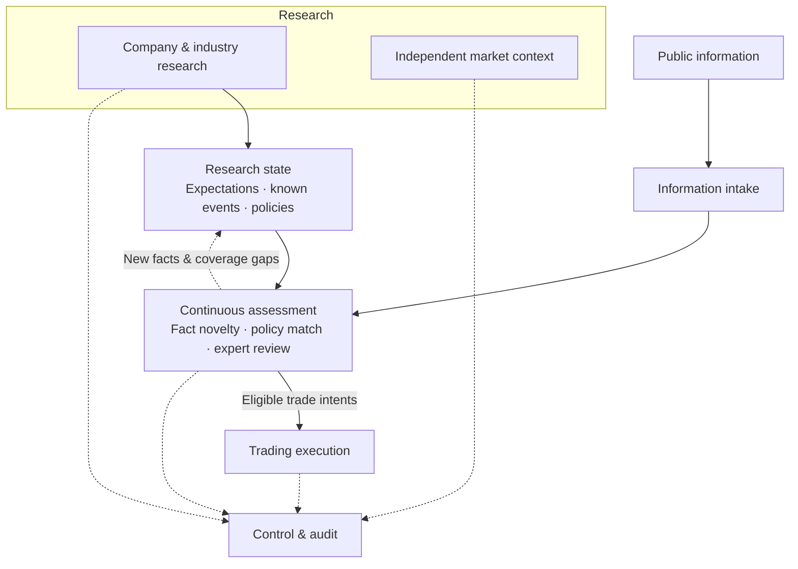

# DoxAgent

**AI equity research and trading, built around changes in market expectations.**

Research companies. Understand expectations. Follow new facts. Act on meaningful change.

**English** | [简体中文](README.zh-CN.md)

[Overview](#overview) · [Capabilities](#capabilities) · [How it works](#how-it-works) · [Architecture](#architecture) · [Explore](#explore)

## Overview

DoxAgent is an AI agent system for equity research, continuous information monitoring, and event-driven trading. It connects company and industry research with a structured view of market expectations, then evaluates incoming information against that research to support trading decisions and execution.

Its central question is:

> **Does this new fact materially change what the market expected of this company?**

To answer it, DoxAgent studies the company's economics, identifies the assumptions behind current expectations, and researches the future developments that could change them. As news arrives, it checks what is new, whether a researched trading condition has been met, and whether further analysis is needed.

The result is a continuing loop between **research, observation, decision, execution, and review**. It is intended for people building and operating an ongoing research process around individual stocks.

## Capabilities

| Capability | What it provides |
| --- | --- |
| **Company and industry research** | A research foundation covering business economics, industry dynamics, value chains, key drivers, and market expectations. Broader market conditions are studied in a separate research track. |
| **Expectation modeling** | An explicit view of current expectations, what their realization depends on, and the developments that could revise them. |
| **Monitoring policies** | Researched conditions that connect observable future facts to a meaningful expectation change and a predefined trading direction. |
| **Continuous information intake** | Collection, article-content enrichment, relevance filtering, and deduplication of public information for the stocks being followed. |
| **Event assessment** | Comparison with known facts, evaluation against monitoring policies, and expert research for uncertain or uncovered developments. |
| **Trading execution** | A separate execution process for eligible trade intents, including account constraints, orders, fills, positions, and exits. |
| **Control and review** | A console for inspecting research, events, policies, message flows, decisions, execution outcomes, and operating costs. |

## How it works

### 1. Establish the research foundation

Study the company, its industry, and the economic relationships that shape its prospects. Independent market research provides a view of the broader trading environment.

### 2. Make expectations explicit

Organize the research into an expectation model: what is currently expected, which real-world mechanisms support it, and how future developments could change its scale, timing, probability, or economics.

### 3. Define what to watch

Research possible developments and turn those with a sufficiently clear economic effect into monitoring policies. Each policy states the observable conditions and the trading direction they support.

### 4. Assess incoming information

Compare each relevant message with the event memory and active policies. Fact novelty and policy satisfaction are assessed separately. Cases that need deeper judgment enter expert research. The outcome may be a trade decision, no trade, or further investigation.

### 5. Execute eligible decisions

Pass eligible trade intents to the execution process, which applies the configured account and trading constraints and tracks orders through fills and exits. Decisions, submitted orders, and actual fills remain separately visible.

### 6. Maintain the knowledge

Feed new facts into the event library and return policy coverage gaps to research and maintenance. Subsequent assessments use the updated knowledge and published policies, while earlier decisions remain traceable to their original context.

**Example:** A manufacturer announces a capacity expansion. DoxAgent compares the announcement with known plans and prior expectations, evaluates its effect on supply, timing, and business economics, and checks the relevant policy conditions. That assessment determines whether it supports a trading direction or needs more research.

## Architecture

DoxAgent separates deep research, continuously maintained knowledge, incoming information, live assessment, and trading execution. The control console brings their outputs together for inspection and review.

Four design choices shape the system:

- **Research before the event.** Build the expectation model and actionable conditions ahead of incoming news.
- **Distinct responsibilities.** Company research, market context, fact memory, policy assessment, and order execution have separate roles.
- **Continuity over time.** Retain research, event history, and processing progress so the system can continue across messages and interruptions.
- **Traceable decisions.** Preserve the evidence and research context behind a decision, alongside its actual execution outcome.

## Explore

- [Product overview](dev_plan/workflow_v2/DOXAGENT_V2_FRONTEND_PRD_PART1.md) — the research, expectations, strategy, and event-library experience.
- [Monitoring and operations](dev_plan/workflow_v2/DOXAGENT_V2_FRONTEND_PRD_PART2.md) — message flows, runtime visibility, and outcome review.
- [Operating guide](dev_plan/workflow_v2/backend_delivery/PRODUCTION_RUNBOOK.md) — configuration and operation.
- [Changelog](changelog) — project history.
- [Issues](https://github.com/XWeixuan/DoxAgent/issues) — questions, bug reports, and proposals.

The project is under active development. Data coverage and available execution capabilities depend on the configured sources, services, and account settings.
