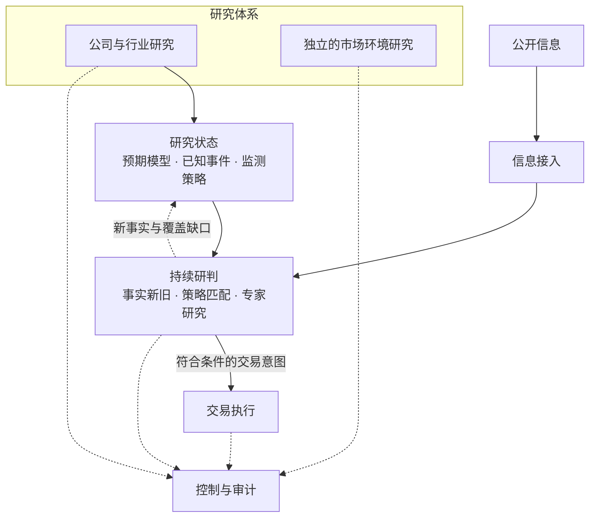

# DoxAgent

**围绕市场预期变化，连接 AI 投研、持续监测与交易执行。**

研究公司，理解预期，跟踪新事实，识别有意义的变化。

[English](README.md) | **简体中文**

[项目简介](#项目简介) · [主要能力](#主要能力) · [业务流程](#业务流程) · [整体架构](#整体架构) · [进一步了解](#进一步了解)

## 项目简介

DoxAgent 是一个面向股票研究、持续信息监测与事件驱动交易的 AI 智能体系统。它将公司与行业研究转化为结构化的市场预期认知，持续对照新信息，形成交易判断并衔接执行。

它围绕一个核心问题运行：

> **这条新事实，是否实质改变了市场对这家公司的原有预期？**

为此，DoxAgent 研究公司的经济逻辑，识别当前预期背后的假设，并提前研究哪些未来变化可能推动预期修订。消息到来时，系统判断其中有哪些新增事实、是否满足已研究的交易条件，以及是否需要进一步分析。

整个过程形成 **研究 → 观察 → 决策 → 执行 → 复盘** 的持续闭环，适合围绕个股建立并运营长期研究流程的人。

## 主要能力

| 能力 | 能够提供什么 |
| --- | --- |
| **公司与行业研究** | 梳理商业模式、行业变化、产业链关系、关键驱动因素与市场预期；通过独立研究流程观察宏观与市场环境。 |
| **预期建模** | 明确当前预期、预期兑现依赖的现实机制，以及可能推动预期修订的未来变化。 |
| **监测策略生成** | 将研究过的未来变化转化为可观察、可判断的条件，并明确其对应的预期变化与交易方向。 |
| **持续信息接入** | 面向关注的股票采集公开信息、补全文章正文、筛选相关内容并去重。 |
| **事件研判** | 对照已知事实判断信息增量，匹配监测策略，并对不确定或尚未覆盖的变化开展专家研究。 |
| **交易执行** | 将符合条件的交易意图交给独立执行流程，处理账户约束、订单、成交、持仓与退出。 |
| **运行控制与复盘** | 通过控制台查看研究成果、事件、策略、消息流、决策过程、执行结果与运行成本。 |

## 业务流程

### 1. 建立研究基础

研究公司、行业及影响公司前景的经济关系。独立的市场研究提供宏观环境与交易环境的观察视角。

### 2. 明确当前预期

将研究组织为预期模型：当前市场预期是什么，依赖哪些现实机制，以及未来变化可能如何改变其规模、时点、概率或经济性。

### 3. 确定监测边界

研究未来可能发生的变化，将经济影响足够明确的情形转化为监测策略。每条策略明确可观察的成立条件及其支持的交易方向。

### 4. 研判新信息

将每条相关消息与事件记忆、现行策略进行比较。分别判断事实是否新增、策略条件是否成立，需要深入判断的情况进入专家研究。结果可以是交易、不交易或继续调查。

### 5. 执行符合条件的决策

将符合条件的交易意图交给执行流程，按配置的账户与交易约束处理，跟踪订单、成交及退出。交易决策、已提交订单和实际成交分别呈现。

### 6. 持续维护认知

将新事实纳入事件库，把策略覆盖缺口反馈给研究与维护流程。后续研判使用更新后的知识与已发布策略，历史决策仍可追溯到当时的研究情境。

**举个例子：** 某制造商宣布扩产。DoxAgent 会对照已知计划和原有预期，研究这次变化对供给、时间进度与公司经济性的影响，再检查相关策略条件，判断是否足以支持交易方向，或是否需要补充研究。

## 整体架构

DoxAgent 将深度研究、持续维护的知识、新信息接入、实时研判和交易执行分别组织，由控制台汇总各部分成果，支持查看与复盘。

系统围绕四个原则设计：

- **提前完成研究。** 在消息到来前建立预期模型和可执行的判断条件。
- **职责明确。** 公司研究、市场环境、事实记忆、策略判断与订单执行各自承担清晰的业务职责。
- **保持长期连续性。** 保留研究、事件历史与处理进度，支持跨消息、跨时间以及中断后的接续运行。
- **决策可以追溯。** 保留判断背后的证据与研究情境，并关联实际执行结果。

## 进一步了解

- [产品说明](dev_plan/workflow_v2/DOXAGENT_V2_FRONTEND_PRD_PART1.md)：了解基础投研、预期研究、交易策略与事件库。
- [监测与运行说明](dev_plan/workflow_v2/DOXAGENT_V2_FRONTEND_PRD_PART2.md)：了解消息流、运行状态与结果复盘。
- [运行指南](dev_plan/workflow_v2/backend_delivery/PRODUCTION_RUNBOOK.md)：了解配置与运行方式。
- [更新记录](changelog)：查看项目演进。
- [问题与建议](https://github.com/XWeixuan/DoxAgent/issues)：反馈问题、讨论需求与改进方向。

项目仍在持续开发中。信息覆盖范围与可用的交易执行能力取决于实际配置的消息源、服务和账户设置。
