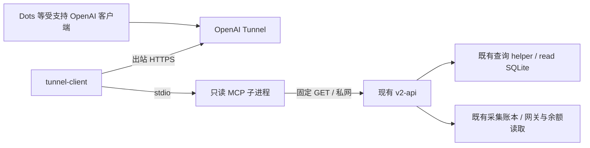

# DoxAgent 外部 Agent 只读 MCP：排查结论与开发方案

日期：2026-11-04（Asia/Shanghai）  
状态：仅完成排查和方案，尚未实施、部署或建立 Tunnel。  
代码基线：本地 `main`，HEAD `4b6e7398345618cab5be3581b549a672fc6fccff`；排查开始时 HEAD 与本地 `origin/main` 引用一致，未执行 fetch。已有 `changelog` 修改及未跟踪文件保留；工作期间另有 RSS 迁移相关并发修改出现，本轮未编辑、暂存或还原这些文件。该基线不是“整个工作树干净”或“生产已部署同版本”的证明。

## 1. 建议与已发现的约束

采用 **OpenAI Secure MCP Tunnel → 独立 stdio MCP 进程 → 现有 V2 HTTP API → 原有业务查询逻辑**。对外仅注册四个工具：运营概览、Case List、Case Search、Case Detail。不挂载业务数据库到 MCP 容器，不导入完整 API 应用，不复用内部研究/操作 MCP 的工具注册表。

现有能力足以复用 Case 列表、搜索、详情及大部分运营查询。真正需要补充的是：跨页面的轻量聚合、页面展示字段投影、现有 API 的专用只读入口，以及 Tunnel 部署。无需新增数据库、索引、CDC、历史回填、采集任务或后台业务轮询。

必须先处理以下实际约束，不能按接口名称推断能力：

1. **API 返回范围大于页面展示范围。** `OverviewStatus.normal_tickers/blocked_tickers` 虽已存在，但当前 Overview JSX 没有显示这两个计数；`CaseSummary`、`CaseDetail` 也包含许多未显示的内部字段。不得原样转发 DTO。
2. **Case 搜索是标题包含匹配。** 不是全文、reasoning、向量或相关性排名搜索。消息流另有标题/正文搜索，不能拿它冒充 Case Search。
3. **Case 详情是多个接口组成的页面。** 主详情包含第一页 attempts/messages 及正文引用；候选、执行、更多尝试、更多消息和正文分别读取。单次主详情不能声称已经取得全部正文和全部记录。
4. **收益审计打开页面会 POST 创建行情快照，假设收益会继续 POST 计算。** 这些操作不能包装为只读 MCP。第一版保留 Overview 已有的 Paper/Live 收益变化；独立收益审计 KPI 暂不接入，原因及后续路径见第 4 节。
5. **读取并不等于零 SQLite 写入。** 原 API 创建视图、续页游标时写入 read-store 的 `views/cursors`。方案的只读边界是禁止业务数据、配置及交易状态变更；MCP 自身不直接写数据库，复用 API 已有的短技术状态写入。若要求“包括技术游标在内绝对零数据库写入”，与直接复用当前 API 冲突，需另行改变视图/游标存储；本方案不偷偷改造该机制。
6. **Tunnel 不是任意第三方 MCP 客户端的通用公网入口。** 官方文档列明支持的 OpenAI 接入方式；Dots 的实际宿主、组织、工作区和权限尚未联调。先验证该接入条件，再进入部署，不能预先宣称“所有 Agent 都能连接”。

## 2. 排查范围与证据边界

本轮进行了本地源代码、前端渲染代码、共享 DTO、后端路由、SQL/索引选择、查询进程、部署配置和现有测试源码排查，并查阅了当前 OpenAI 官方文档。

没有登录生产前端，没有请求生产业务 API，没有连接生产 SQLite/Supabase，没有运行生产命令或创建 Tunnel。本文件描述**当前本地代码的实现**，不是生产版本或生产性能验收。现有测试仅作契约证据阅读，本轮未运行应用测试。

主要证据入口：

| 证据 | 所在文件与定位 |
| --- | --- |
| 全局及 ticker 页面路由 | `frontend/v2/src/app.tsx` 的 `Workspace`；`pages/ticker-workspace.tsx` |
| Overview 查询及显示 | `frontend/v2/src/pages/overview/{context,data,index,metrics,monitor-row,initialization}.tsx/ts` |
| 运行 KPI、筛选和最近记录表 | `frontend/v2/src/pages/runtime.tsx:157`、`:379`、`:488`、`:917`、`:1047` |
| Case 详情的实际显示 | `frontend/v2/src/pages/runtime-case.tsx` 的 `CaseDetails/Reason/Attempts/EventEvidence/PolicyEvidence/Candidates/Executions/ExitStrategyStatus` |
| 消息 KPI 与源卡片 | `frontend/v2/src/pages/message-bus.tsx` 的 `MessageStream/SourceCard` |
| 成本、收益、策略顶部 KPI | `frontend/v2/src/pages/{audit,revenue-audit,strategy}.tsx` |
| 共享契约、外层 Resource | `dev_plan/workflow_v2/api_contract/doxagent-v2-api.types.ts`；`frontend/v2/src/core/schema-source.ts` |
| Overview API 与失败数 | `src/doxagent/api_v2/overview.py:21`、`:102`、`:123`；`overview_status` |
| Case API | `src/doxagent/api_v2/runtime.py:88`；`case_detail.py:159`；`executions.py`；`content.py` |
| 视图、分页、标题搜索 | `src/doxagent/api_v2/views.py:20`、`:189`；`v2_read/repository.py:833`、`:887`、`:1041` |
| 消息指标实际口径 | `src/doxagent/api_v2/bus.py`、`bus_metrics.py`、`bus_dashboard.py`；`message_bus_v2/collection_plane/{observability,source_rounds}.py` |
| 查询资源保护、鉴权 | `src/doxagent/api_v2/{app,auth,query_runner}.py`；`v2_read/settings.py` |
| 部署拓扑 | `docker-compose.v2-production.yml`；`deploy/docker-compose.server.yml`；`frontend/v2/deploy/nginx.conf` |

## 3. 前端页面范围

V2 是 React/Vite 前端，API 基路径为 `/api/doxagent/v2`。下文接口省略该前缀，`{ticker}` 表示单个标的。

| 前端路径 | 页面 | 本次边界 |
| --- | --- | --- |
| `/overview` | 全局 Overview | 纳入现有实时状态、顶部 KPI、ticker 运营行及初始化进度状态 |
| `/ticker/:ticker/runtime` | 运行状态 | 纳入顶部 KPI；最近处理记录用于 Case List/Search；详情抽屉用于 Detail |
| `/ticker/:ticker/message-bus` | 消息总线 | 纳入顶部 KPI 与消息源状态；不提供消息流全文遍历工具 |
| 同页 `mode=CONFIG` | 消息源配置 | 只参考已显示的运行事实，不暴露编辑表单、参数、监测词或配置写入 |
| `/audit/cost`、`/ticker/:ticker/audit` | 收益 / 成本审计 | 纳入成本顶部 KPI 及 usage 完整性提示；不导出逐轮明细或报表 |
| 同页 `audit=REVENUE` | 收益审计 | 完成排查；当前依赖主动快照/计算，第一版不包装该链路 |
| `/ticker/:ticker/strategy` | 交易策略 | 仅可按需读顶部统计；不读策略正文、变更时间线或研究文档 |
| `/ticker/:ticker/research` | 基础投研 | 排除 |
| `/ticker/:ticker/expectations` | 预期研究 | 排除 |
| `/ticker/:ticker/events` | 事件库 | 排除独立检索和详情；Case 详情已经内嵌显示的固定快照引用例外 |

Case Detail 的“原有预期/预期变化”和引用 Event/Fact 属于该 Case 已有显示，可以读取；这不授权沿链接展开整个预期研究、事件库或策略库。

## 4. 运营指标与 API / 数据来源映射

### 4.1 Overview

| 页面名称 | 原字段 | API / 来源 | MCP 输出 |
| --- | --- | --- | --- |
| 当前时段 | `clock.session` | `GET /read-context?page=OVERVIEW`、`/overview/status`；`PageCalendar` | 原 session 值、读取周期和必要时钟语义 |
| IB Gateway–Live / Paper | `ib_gateway_live_status`、`ib_gateway_paper_status` | `GET /overview/gateway-status?view_id=...`；`GatewayMonitor` | 原连接枚举；检测失败单独保留，不伪造断开 |
| OpenRouter 余额 | `status/balance_usd/checked_at` | `GET /overview/openrouter-balance`；API 进程内 300 秒缓存、现有 credits 查询 | 原值与旧值状态，不把管理密钥传给 MCP |
| Policy 命中 | `policy_hits` | `GET /overview/metrics`；`Metrics`、贡献去重 | 当前值、环比、页面可见完整性与暂估状态 |
| 交易：执行 / 触发 | `trade_executed/trade_triggered` | 同上，原执行/触发口径 | 分别返回，不能合并为订单数或成交数 |
| 消息 / token 成本 | `messages/api_token_cost` | 同上，投影指标桶 | 原指标 |
| 下游Case判定失败数 | `failed_cases` | `failed_cases_metric()`；Runtime FAILURE 节点的 `graph_cases` 桶 | 原值，不能改为失败 attempt 数或所有失败日志数 |
| 收益变化 Paper / Live | `paper_realized_net_pnl/live_realized_net_pnl` | 同上，已有已实现净收益桶 | 分环境、保留完整性/暂估；不当作账户总收益 |
| ticker 运营行 | 见下表 | `GET /overview/tickers?view_id=...&limit=...` | 分页、只投影显示字段 |

ticker 行白名单：`state.ticker`、`requested_mode/effective_mode`（包含待生效显示）、`run_state/health/health_reasons`、`last_standard_message_at`、`source_counts.normal/abnormal`、`metrics` 内五个原指标。初始化未完成时，保留初始化 `status`、页面显示的步骤 `step_key/status/first_started_at/duration_seconds/quality_annotations` 及失败提示；不返回研究成果、操作权限、控制 revision、etag 或操作回执。

**不转发** `normal_tickers/blocked_tickers`、`TickerState.actions`、`work_epoch`、`cutoff_at` 等仅存在于 DTO 的字段。`health=UNKNOWN` 必须保持未知，不能因为页面未绘制健康徽标就转成 NORMAL。

### 4.2 Runtime 顶部 KPI

接口：`GET /tickers/{ticker}/runtime/metrics?view_id=...`，要求 RUNTIME view；来源为 `v2_read.metrics.Metrics` 和既有桶/贡献。

| 页面名称 | 原字段 |
| --- | --- |
| 周期处理 | `processed_cases` |
| 一轮判定延时 · s | `hot_path_mean_seconds` |
| 二轮研判延时 · s | `w3_mean_seconds` |
| NEW / OLD | `new_cases/old_cases` |
| Policy 命中 / 比例 | `hit_cases/hit_case_ratio` |
| 二轮研判 | `w3_cases` |
| 事件发现 | `new_fact_candidates` |
| 交易执行 | `executed_cases` |

不把这些 ticker 指标重新相加命名成“全局新 KPI”，也不把命中比例的分母换成全部 Case。链路图节点和边计数已存在于 `/runtime/graph`，但该响应还携带 Case 页与 stream cursor；默认 Overview 不调用它，不附带图中的 Case。节点统计是后续按需扩展项，不是第一版额外必需工具。

### 4.3 消息总线顶部 KPI 与消息源

接口：`GET /tickers/{ticker}/message-bus/dashboard?view_id=...&source_id?&source_kind?`。当前前端实际依赖它，不应以旧 `/message-bus/metrics` DTO 替代当前看板口径。

| 页面名称 | 原字段 | 口径 |
| --- | --- | --- |
| 周期新增 | `metrics.published_revisions` | 当前周期正式发布修订；与 Overview 消息指标保持各自原名称 |
| 消息源状态 | `counts.total/running/sleeping/abnormal/disabled/unknown` | 原看板分类；休眠/窗口外/暂停不能自定为失败 |
| 正文补全成功率 | `metrics.new_article_body.ratio/full/total/pending` | 首次发现文章 cohort，FULL/SHORT_FULL；含未发布失败文章的分母，不按网络尝试数统计 |
| 平均端到端耗时 | `mean_e2e_seconds/e2e_samples` | 新消息首次发现至首次正式发布；原周期桶 |
| 周期轮询覆盖率 | `coverage.expected/succeeded/ratio` | 每源近20个已结算逻辑轮次；替代路径 OR，互补单元 AND；当前 partial/failed/SOURCE_DEFERRED 源的整个窗口排除 |

来源：read SQLite 的当前投影、指标桶与正文 cohort，以及 collection plane `acquisition.sqlite3` 的单元 head / 有界逻辑周期。`recent_rounds()` 使用 `cycles_unit_time` 和每源近20轮，不新增轮询。

单源状态按 `SourceCard` 的实际显示投影，单独分页读取：

- `source.name/kind`、`publication_mode`、`poll_status`、`current_error.code/message`。
- `target_interval_seconds/countdown_state/next_target_at`、`last_success_at`、`published_today`。
- `recent.mean_e2e_seconds/p95_e2e_seconds/e2e_samples/refresh_seconds/body_ratio/body_full/body_total`。
- `source_id/binding_id` 仅作来源标识及翻页定位，不外加抓取 checkpoint、HTTP headers、配置参数、内部 endpoint、阶段耗时或 capture 指标。

`/message-bus/sources` 另支持 `limit/cursor/diagnostics/today_counts`，配置页显示最近延迟和新增。但它不提供当前 SourceCard 所需的全部 `recent` 指标，不能直接替代 dashboard。第一版单源分页应复用 dashboard 的状态构建及 recent 计算，不能悄悄缺列或用旧 latency 顶替 E2E。

当前 `BusStatus` 中的连续运行时长、平均轮询延迟和 diagnostics 虽有 API/契约，当前消息流顶部已改用上述五组指标；不把未渲染的旧指标自动加入 MCP。

### 4.4 成本与策略：概览中的按需 KPI 区块

成本 API：`GET /audit/cost/report?view_id=...&scope=API|CODEX&dimension=NODE&ticker_selector=ALL|...&limit=1`，要求 COST view。复用 `cost_report.report()` 的桶聚合、`total()` 和 `source_reasons()`，仅取顶部内容：

| 页面名称 | 原字段 |
| --- | --- |
| Token 总量 / 可计价总成本 | `totals.total_tokens/total_cost_usd` |
| Input Token 及成本 | `totals.input_tokens/input_cost_usd` |
| Output Token 及成本 | `totals.output_tokens/output_cost_usd` |
| 缓存命中 Token / 比例 | `totals.cached_input_tokens/cache_hit_ratio` |
| 有效/已观测、缺 usage、未计价等提示 | `usage_known_attempts/observed_attempts/usage_unknown_attempts/unpriced_attempts/unknown_model_price_attempts/reported_cost_attempts/estimated_cost_attempts/normalized_attempts`，按 JSX 的条件显示 |

保留 `source_coverage` 的页面可见状态/原因。API 和 CODEX 分开；CODEX USD 保持不适用。全局成本页包含共享研究和非活动 owner，不能等同于 Overview 活动 ticker 的成本和。`limit=1` 只限制原报表明细响应，不声称它减少聚合扫描；第一版按需读取，不为默认 Overview 重复执行两份完整报表。

策略 API：`GET /tickers/{ticker}/policies/metrics?view_id=...&shell_id=...`，要求 POLICIES view，沿用 `policy_queries.metrics()` 和现有 wire 构造。只投影顶部 `active/long_ratio/short_ratio/added/hit/modified/retired/executed`，显示名称为“生效数量、LONG / SHORT 可用覆盖、周期新增、周期命中、周期修改、周期失效、周期交易执行”。保留未知生效性注记。必须明确 `shell_id`；前端支持 ALL，也默认选择 `default_shell_id`，不能把某个 Shell 的值标成 ticker 总值。MCP 默认该按需区块使用显式 `shell_id=ALL`，不为确定默认 Shell 预取全部策略正文。

这些 KPI 可通过同一个 Overview 工具的 `section=cost|policy` 请求，属于第一层聚合能力；不因此新增研究工具，也不在首次全局查询中展开成本报表或策略明细。

### 4.5 独立收益审计的冲突处理

前端 `RevenueAudit` 首先 `POST /audit/revenue/refresh`；`RevenueService.capture()` 可读取账户/行情、请求报价、写报价缓存并保存 frame。报表 GET 依赖该 owner 的 `frame_id`；`UNEXECUTED/ALL` 还可能 POST `/audit/revenue/hypotheticals`。

顶部字段已经盘点：策略总资产、净收益/收益率、实际已实现净收益、当前浮盈、实际交易/意图与已平仓数、胜率、实际费用，对应 `RevenueReport.kpis` 的 `strategy_value/net/roi/realized/upl/actual_count/intent_count/completed_count/win_rate/fees`。

**第一版不接入这组独立 KPI，不触发 refresh、报价或假设计算。** 该取舍来自“严格只读、资源保护”高于“增加指标”的要求，不能用静默 POST 满足表面字段覆盖。Overview 已有 Paper/Live 收益变化照常提供。若后续明确需要独立收益 KPI，另做最小只读入口：读取既有且可证明归属/时间的快照，缺失则 unavailable，不创建快照；先确认是否有稳定可复用快照，不能盗用其他 owner 的短期 frame。本轮不把它列为默认实现依赖。

## 5. 展示字段投影规则

业务值使用现有字段名称，不建立另一个指标口径表。新增 JSON 分组仅用于组织已有字段；`view_id/cursor/case_id/source_id` 等是定位/分页所需协议元数据，不是新增运营指标。

1. 不直接序列化原 DTO，也不使用 `dict` 展开或“除几个敏感字段外全部返回”。按页面字段逐项构造。
2. KPI 仅保留 `metric_id/unit/current/change_pct/current_coverage/provisional` 中**当前页面确实使用的子字段**；coverage 只取可见状态和原因。ticker 表没有环比时不额外带 `change_pct`。不转发未展示的 `previous` 原始数值、`previous_coverage`、known/excluded counts 等。
3. `Value` 的状态/空值语义沿用；不把 unavailable、无样本、未配置当作 0。错误和完整性原因保留必要信息。
4. 数值保持原十进制字符串/原比例，单位仍为原单位；中文名称与 UI 一致。百分比和金额的显示精度参考 `core/format.ts`，不进行新的业务计算。
5. 保留必要的 `meta.as_of/freshness/refresh_error`、原 coverage 状态/原因及分页字段。新增 section 标识只说明查询组织，不产生健康分、异常评级、未展示的 CPU/内存/磁盘指标或自动诊断结论。

## 6. Case 现有能力核实

### 6.1 List / Search

共同接口：`GET /tickers/{ticker}/runtime/cases`。

| 项目 | 当前行为 | MCP 约束 |
| --- | --- | --- |
| ticker | 路径必填；RUNTIME view 的 ticker 必须相同 | 必填，不新增跨 ticker 全局搜索 |
| 周期 | view 中选择 CURRENT/PREVIOUS/7/30/ALL | 同枚举，默认 CURRENT；ALL 只在明确请求时使用 |
| 分页 | 默认20，API允许1–100；不透明 cursor | MCP默认20、最大20；一请求一页 |
| 排序 | `sort_key DESC,id DESC` 的 keyset | 原排序，无 offset 或相关性排名 |
| 结果 | 枚举、在 SQL 中过滤 | 使用下方前端可选项 |
| 来源 | `source_id` 精确过滤 | 复用；可由列表行定位标识获得，不加载消息详情获取 |
| 搜索 | `q.strip()`，最大200字符，Unicode `casefold` 后标题字面子串 | Search必须非空；不新增全文、正则、模糊、向量或 AND/OR 语言 |
| 组合 | 周期、result、source_id、q 在分页前过滤 | 保留组合；换筛选必须重新开始分页 |
| 视图 | cursor 绑定 owner、kind、ticker、view、filters、limit | 后续页沿用同一个 view 和参数；不得静默切换快照 |

前端结果下拉白名单：`POLICY_HIT`、`POLICY_RECALLED`、`ARCHIVE`、`EVENT_DISCOVERY`、`FIRST_ROUND_TRADE`、`POLICY_RELATED_EVENT`、`SUSPECTED_DUPLICATE_HIT`、`TRADE_INTENT`、`TRADE_EXECUTION`、`TRADE_NOT_EXECUTED`、`FAILURE`，省略代表全部。后端还接受 `BADCASE`，但当前下拉不提供，第一版 MCP 不增加它。

查询链路：`runtime.cases()` → `Views.page()` → `ReadStore.page()` → `object_current` / 历史分支。Case 标题条件是 `instr(casefold(json_extract(payload,'$.title.value')),?)>0`。现有 `current_day/current_page/history_recent` 等索引用于范围和排序；**没有可直接复用的 Case 标题 FTS 索引**。小页大小不保证小扫描量，稀疏命中/ALL/`POLICY_RECALLED` 需保留现有 deadline。不得扫描所有 Case 后在 MCP 内过滤，也不新增索引或回填历史 search_text。

已有证据测试：`tests/v2_backend/test_trade_outcomes.py:548` 覆盖分页前筛选、Unicode、字面 `%_`、正文不参与、冻结视图和筛选变化时 cursor 拒绝。另有同文件的 POLICY_HIT / POLICY_RECALLED 测试。

**列表/搜索行只允许：**

| 页面列 | 原字段投影 |
| --- | --- |
| 消息 / 来源 | `title`、`source_name` 与回退 `source.name`；定位用 `case_id/source_id` |
| 研判结果 | `results` 中页面渲染的研判项、`first_round_tags`、`w3_decision`、`w3_operations_status`、`result_settled` |
| 交易执行 | `trade.state/reason_codes`（含页面 tooltip 与投递失败标签） |
| 状态 | `status` |
| 接收 / 完成 / 耗时 | `received_at/completed_at/duration_seconds` |

不返回 `revision/semantic_day/runtime_mode/first_round_shape/technical_status/initial_route/resolved_route/final_novelty/final_policy_hit/trade.intent_count/trade_disposition/stream_item_id/member_count` 或完整 source 对象。`final_policy_hit` 可被现有筛选使用，但页面表格未独立显示，不能因此加为返回列。也不调用详情、正文、attempts、candidates 或 executions 来“补充摘要”。

### 6.2 Detail

主接口：`GET /tickers/{ticker}/runtime/cases/{case_id}?view_id=...`。定位需要 ticker + Case ID；MCP 可在缺省 view 时内部创建 RUNTIME view，Agent 不必手动创建上下文。由 List/Search 打开时沿用其 view。

| 页面区块 | 允许的详情内容 | 读取方式 |
| --- | --- | --- |
| 标题与来源 | `summary.title/first_round_tags/source_name/source.name/source.kind` | 主详情投影 |
| 生命周期 | `lifecycle_timing.elapsed_seconds/settled/invocation_union_seconds/uncovered_seconds/partial` | 主详情；不附带未显示的时间原始字段 |
| 失败提示 | `failures.stage/status/error.message` | 主详情；主接口失败集合已按既有规则有界，不伪造全量失败历史 |
| W1 | novelty、confidence、extraction.candidate_count、rounds、引用 ID/Fact 归因、未解析引用、reasoning | 原 `w1`；reasoning 正文按需读取 |
| W2 | skipped、policy_hit、policy_related、confidence、命中/相关/候选 Policy、未解析引用、rounds、reasoning；novel_fact_alignment 的 status/policy_fact_novelty/condition_results/related_policy_results/error | 原 `w2`，只取 JSX 实际显示的叶字段 |
| W3 | status、novelty、policy_hit、references/policies；decision 的 decision、policy_trade 的 policy_id/condition_id、expert_trade.direction、reason；operations_status/error、trade/operations timing.wall_seconds；旧版 expert_trade/direction、prior_expectation/expectation_delta；三类已显示 reasoning | 原 `w3`；不转发未渲染的 operations_result 原始 JSON |
| 旧版 Policy 执行 | `policy_execution.selected_condition.policy_id/condition_id`、`reason` | 页面已有分支，按条件输出 |
| Policy WATCH | followup 的 policy_id/reason/expires_at；actions 的 policy_id/action/reason；receipt | 页面 receipt 的 JSON 展开属于确实显示的例外，保持原内容且分页/分块有界 |
| WATCH / PIN | watch 的 policy_id/reason/expires_at；pin 的 pin_id/reason/expires_at 和 message.title/source_name/body；receipt 中 watch/pins 动作的 ID/action/status | 只投影 `W3State` 显示子项；PIN body按需分块 |
| 各轮尝试 | node_id/round/phase、attempt_number/status、timing.wall_seconds、W3 sdk_seconds；rounds.attempt_count/not_executed_reason | 内嵌第一页 + `/attempts?node=W1|W2|W3&limit=20&cursor=...` |
| 消息正文 | 每条消息的 title/body | 内嵌 messages 第一页 + `/messages?limit=20&cursor=...`；正文单独 chunk |
| 事件发现 | originating_node/proposition/assertion_state/subject_time，缺省回退 occurrence_date | `/candidates?originating_node?&limit=20&cursor=...`，仅该 Case |
| 交易执行 | direction、页面显示的执行/投递状态、entry_result/intake_status、execution_group 展示子字段、成交数量/金额/首次成交、entry_reason/reason_codes、退出策略展示值 | `/executions?limit=20&cursor=...`，只读取该 Case 已有结果 |

退出策略投影：`phase/data_health/pnl/mfe/atr/stop_net/confirmation/remaining_quantity/exit_reason`；交易组投影：`account_type/state/main_side/main_asset/main_quantity/hedge_asset/hedge_quantity/hedge_result/hedge_reason`。不提供订单操作，不为查看状态直连 IBKR。

EventEvidence 只保留页面已有 `kind/event_id/title/fact_ids/facts.proposition/provisional_proposition` 及未解析归因。PolicyEvidence 只保留 `policy_id/title/condition_ids`。不跟随链接加载独立事件/策略正文，不调用导出专用 `/cases/{case_id}/policies/{policy_id}`、订单/fills 详情或任何整包下载接口。

主详情中的 `document1/document2/library/policy_set/runtime_activation_id/provisional_snapshot_version/hot_path` 等定位/溯源字段，只有构建固定快照关联所必需的值在服务器内部使用，不因为 DTO 有它们就输出研究文档信息。不可用固定快照返回原 `PINNED_ARTIFACT_MISSING`，不能回退当前 head 补齐。

正文复用 `GET /tickers/{ticker}/contents/{content_id}?cursor=...`，当前 chunk 为16000字节，续读沿用 `next_cursor/complete`。只允许读取从**该 Case 白名单字段**解析出的 content，不接受任意 content ID、URL、路径或 JSONPath。页面明确显示的 receipt/inline 长文本也采用同一详情续读方式，不能无界附带在 overview/list/search 中。

## 7. 四个 MCP 工具的拟定契约

下列名称和限制是开发提案，尚无这些 MCP 工具实现。输入均为闭合 schema；四个工具共用固定 GET 客户端，无任意 API/SQL/命令执行入口。

### 7.1 `doxagent_get_overview`

输入分支：

- `section=summary`（默认）：`period?`、`limit=20`（1–20）、`cursor?`。一次返回全局现有 KPI + ticker 页；ticker 行内附 Runtime 顶部 KPI 和 Bus 顶部 KPI，便于一次判断常见处理、延迟、正文和源异常。
- `section=sources`：`ticker`、`period?`、`limit=20`（1–20）、`cursor?`；返回单源运行状态页，不返回源配置。没有先调用 summary 也能查询，但只能查前端已经存在的 ticker。
- `section=cost`：`period?`、`scope=API|CODEX`、`ticker_selector=ALL|ticker`；仅顶部 KPI，首次概览不主动执行。
- `section=policy`：`ticker`、`period?`、`shell_id=ALL|现有ShellID`；仅顶部 KPI。

默认 summary 的全局 KPI 始终覆盖 Overview view 的全体 ticker，与当前 ticker 页分页分开。返回 ticker `has_more/next_cursor`；超出一页不能把已返回部分称为“全体正常”。不另造全局失败 ticker 数、源异常率或业务健康评级。

summary 周期只接受 Overview 的四种周期，不接受 ALL；首次未给 period 时沿用前端默认逻辑：交易日当前日，休市日前一交易日。显式请求不可选 CURRENT 时返回原校验失败，不能无提示换日。Runtime/Bus 的当前语义日与 Overview 交易日视角不同，必须为各区块保留其实际 period，不能直接用字符串替换 page 类型伪造 context。summary 传入已选周期给子区块；单独 sources/policy 可按原页支持 ALL，且仅在显式指定时使用。

summary 不展开单源卡片、Case、消息正文或图节点 Case。Agent 可根据 ticker 源异常计数进一步请求 `section=sources`。这是第一层内部的有界下钻，不需要新增工具。

### 7.2 `doxagent_list_cases`

输入：`ticker`、`period?`、`result?`、`source_id?`、`limit=20`、`cursor?`、`view_id?`。一次仅一页。输出为第 6.1 节投影后的行、原 `limit/has_more/next_cursor/snapshot_id` 和必要元数据。List 不接受 q；搜索使用独立工具，底层共享一个实现。

### 7.3 `doxagent_search_cases`

与 List 相同，另必填 `q`（trim 后1–200字符），调用同一个 `/runtime/cases` API。返回与 List 完全相同的摘要类型，不附 reasoning、不产生新搜索摘要，不转换为消息正文搜索。未命中即空页，不自动扩大到 ALL 或循环所有 ticker。

### 7.4 `doxagent_get_case_detail`

输入：`ticker/case_id`、`view_id?`、`part?`、`node?`、`originating_node?`、`cursor?`、`content_handle?`。`part` 使用有限枚举 `main|w1|w2|w3|watch_pin|attempts|messages|candidates|executions|content`，字段组合按分支限制。

- 默认 `main`：主详情的可见概况及 W1/W2/W3 结构信息；原有内嵌第一页只保留页面字段。reasoning、消息 body、PIN body 和长 receipt 返回可继续读取的引用，不一次装入完整文本。
- 指定其他 part：只读该 Case 的对应区块/一页，不自动遍历所有子页；`content` 一次只返回一个正文 chunk。
- 单个内联字段或区块仍过大时，按完整字段/记录边界与 UTF-8 边界续读；原长文本可通过受限 handle 分块恢复，不生成替代摘要，不静默裁掉尾部。
- handle 只映射 Case 白名单内的既有 ContentRef 或 inline 叶字段；使用小型有界内存表即可，绑定 Case/view/part，失效后明确要求重新打开。不得建立另一套持久化内容库、任意对象读取器或通用 JSONPath 工具。
- 获取一次 Detail 即是明确调查该 Case，无需再让用户逐次确认；列表、搜索和 Overview 永不预取 Detail。

“完整详情”指上述页面全部显示内容均可通过分页/按需读取取得，不承诺一次响应返回所有历史尝试、全部消息和所有长正文。

所有工具标注 `readOnlyHint=true`、`destructiveHint=false`、`idempotentHint=true`、`openWorldHint=false`，并在描述中明确只读和渐进读取。注解只是客户端提示，真正只读由固定路由、只读凭证和代码路径保障。结果优先返回结构化 JSON；兼容性文本回退只提供一份 JSON 表达，不再附加自然语言长报告或重复正文。

## 8. 最小后端改动与复用方式

### 8.1 轻量 MCP 层

新增 `src/doxagent/agent_mcp/`，入口 `python -m doxagent.agent_mcp`。仅导入 MCP SDK、httpx、轻量 schema/投影模块。现有 `pyproject.toml` 已锁定 `mcp==2.0.0` 且已有 httpx；不新增 Node MCP 服务或升级 SDK。不导入 `create_app()`、RuntimeJournal、研究工具 factory 或交易执行器。

优先复用本项目 `mcp/server.lowlevel + stdio_server` 的协议写法；工具集合另建固定表。stdout 只输出协议，日志去 stderr。MCP 运行环境只提供 API base URL、内部只读凭证文件及运行限制，不继承 `.env.v2` 全套业务密钥。

### 8.2 一处运营聚合入口

新增 `GET /overview/operations`，供 MCP 读取 ticker 页中的 Runtime/Bus KPI 和按需源状态；它是已有页面数据的组合接口，不是新的业务查询体系。

实施拆分：

1. 把 `runtime.py` 目前位于路由闭包中的指标构造提取为 `runtime_metrics_data(store, view, service=None)`；旧前端路由与新聚合入口调用同一个函数。保留原指标名称、quotient 分母和 coverage。
2. 新入口调用现有 Overview ticker 选择/分页逻辑，再给**当前有界 ticker 页**补上 Runtime / Bus 顶部 KPI。已有 Overview 全局 status、metrics、gateway、balance 仍直接复用原 HTTP API。
3. Runtime 指标用现有 `Metrics.prime()` 对选中 ticker 批量预热后构造，避免每个指标重读数据库；ticker 选择与分页函数从 `overview.py` 提取共享，不复制 SQL。
4. Bus 复用 `bus_dashboard.dashboard_data()` 及其 helper。每个被选 ticker 至多计算一次；summary 投影丢弃 sources，sources 分支取有界源页。首版不另建周期、文章或源分类查询。
5. `dashboard_data()` 现状会计算 ticker 的全部源 recent 数据后返回。先提取共享的状态构造与分页选择，在 sources 分支只给当前页源计算 recent；counts/全局覆盖仍依原完整绑定集合计算，不能因为分页改变 KPI 分母。summary 路径仅跳过单卡 E2E/body 明细的构造，**仍调用同一口径 helper**计算顶部 KPI/覆盖。旧前端路径保留全卡输出。此优化不新增索引或物化表。
6. 用 `Views.create()` 的原周期/时钟构建逻辑提供各 page 所需上下文，不绕过 `SCOPE_MISMATCH`。提取可复用的 context 构建 helper，允许一次请求内共享冻结 seq 和 calendar 读取；外部可续页 view/cursor 仍使用原 token 机制。不为每个 ticker、每个指标创建一个持久 view。
7. 查询仍走现有 QueryRunner/deadline。按剩余预算在完成一个 ticker 后停止，保存续页位置；没处理的 ticker 通过 has_more 明示，不作为零值。不能失败后转后台重算或增设批量轮询。

MCP summary 的调用上界为固定数量的全局 API + 一页 `/overview/operations`，不会形成 Agent 侧逐 ticker 调用。Gateway 与 balance 使用现有端点和现有单飞/缓存，避免在查询子进程重新实例化监控。若合并部分原 Overview 查询，可继续提取共享函数，但不是实施前提。

成本第一版按需直接调用原 report 并投影；策略同样直接调用现有 metrics。Case List/Search/Detail 及其子页不新建业务查询；内容限制只增加关联范围校验。新增聚合及投影应回到同一原 helper，而非另写一套 SELECT 后期维持双份语义。

### 8.3 简单、服务端强制的只读凭证

现有 `SupabaseAuth` 验证用户后只接受 DEVELOPER，`Principal.wire()` 返回 `can_operate=true`；没有现成可直接用于常驻 MCP 的只读服务凭证。不能把“工具描述写只读”当作权限，也不使用浏览器 access token 长期硬编码或 Supabase service-role key。

最小方案：API 增加一个可选的内部随机 bearer token（secret 文件），识别为固定 `agent-read` principal；仅启用一组固定 GET 路由和参数。普通 Supabase 登录保持原逻辑。鉴权后、提交 QueryRunner 前检查只读身份，query worker 内也保留同一限制，`can_operate=false`。

- 允许：本方案需要的 read-context、Overview 读接口、聚合入口、受限成本/策略 KPI、Case List/Detail 与该 Case 的 attempts/messages/candidates/executions/content。
- read-context 只允许 OVERVIEW/RUNTIME/MESSAGE_BUS/COST/POLICIES；不允许 RESEARCH/EXPECTATIONS/EVENTS。`refresh` 只使用现有 OPEN，不提供任意刷新动作。
- Case content 必须校验由指定 Case/view 的白名单 ContentRef 或 inline 字段可达；复用 CaseEvidence / 主详情解析 helper，不提供任意 ticker 下所有 contents 的读取权。可在现有 content handler 为该 principal 增加 `case_id/view_id` 条件校验，旧浏览器参数不变。
- 拒绝所有业务 POST/PATCH/DELETE、所有 Shell/SQL/文件读取参数、操作/配置/交易接口、研究/事件库/下载/导出路径。MCP 客户端本身也只构造白名单 GET。
- 使用现有 secret 文件挂载与恒定时间 token 比较；一个凭证、一种只读身份和固定路径即可。不增加用户管理、角色矩阵、OAuth 服务或权限数据库。

只读指令不等于需要给 API 加第二套公网认证系统。该 token 是内网服务调用凭证；Tunnel 的 OpenAI 凭证与它分开，二者都不传给 Agent。

## 9. 分页、体积、时效及 I/O 预算

以下是**拟定限制/验收目标**，不是已测性能：

| 项目 | 首版限制 |
| --- | --- |
| Case List/Search | 默认/最大20条，一次一页，一个ticker |
| Overview ticker / sources 页 | 默认/最大20行；达到体积或执行预算时按完整行提前分页 |
| Detail 子集合 | 默认/最大20；沿用原 cursor，不读完全部页 |
| 正文 | 复用16000字节 chunk；内联长文本按同量级UTF-8分块 |
| MCP 单次序列化结果 | 128 KiB硬上限（包含元数据）；不得先返回再靠客户端截断 |
| MCP 并发 | 全服务最多1个业务查询在途，最多2个等待；满时返回 busy，不无界排队 |
| 既有 API 默认查询 | query_workers=2、普通查询3秒；实际以部署 env 为准，不因 MCP 放宽 |
| Detail 时间限制现状 | 虽有 detail_seconds=5，当前 app 仅对 `/body` 或 `/download` 路径选它；普通 Case 主详情仍走 query_seconds，不能误称已有5秒专用预算 |
| MCP overview总时限 | 建议15秒，内部查询均受原API预算；Gateway探测可占最多约8秒，不能据此放宽SQLite查询 |
| 原 view/cursor | 默认view15分钟，cursor30分钟且受parent view到期约束；使用原 VIEW_EXPIRED/CURSOR_EXPIRED/INVALID_CURSOR |

API 普通响应本身允许256 KiB、Detail可达1 MiB；这**不**意味着可以原样暴露给 MCP。投影后对编码字节数验收。分页必须保证未返回行不被越过，字段必须可续读恢复；不能过滤完原页后丢弃多余行却仍使用已经越过它们的原 next_cursor。

处理体积的最小实现：正常20行不超限时直接沿用 API cursor；若投影页超限，在 MCP 有界续页状态中保留未交付的投影行/原 next_cursor，再续读剩余行，完成后才请求下一原页。游标绑定原 view、筛选和limit；不通过改变limit重用原cursor。状态只在内存、有TTL与总量上限，不持久复制业务库。

Overview 可对**相同身份/参数的按需查询**合并在途请求、短暂复用结果（建议20秒，最多4 MiB）；不后台刷新。每块保留原 as_of/freshness；缓存不能延长view寿命，也不能冒充实时。长详情句柄/超限余页共用有界内存管理，不能无限保存正文。错误不触发高速自动重试；busy/timeout向调用方返回可重试状态。

时效特别处理：`bus_dashboard.dashboard_data()` 会切换到当前highwater，collection plane状态又独立于业务MVCC；它是live dashboard。不得把Bus、Gateway、余额与Case的冻结view描述为原子一致快照。冻结Case继续使用固定view；Bus保留已有观测时刻（如有）及真实响应时刻，作为技术时效元数据，不增造业务指标。

SQLite保护：

- MCP不挂载SQLite、事件根目录或workspace，不创建第二个ReadStore/API worker池。
- API业务读取沿用 `ReadStore.connect(write=False)` 的URI只读连接和progress handler；技术token写保持短事务。MCP不触发migrate/ingest/put_content。
- 不调用 graph/messages SSE，不创建 deferred metrics jobs，不做全量 COUNT / 全库导出 / 全历史补偿。Case search即使返回空页，也不能重复扩大范围扫描。
- 限制单请求ticker页、源页和时间窗口；默认不使用ALL。不用指标“预览需求”触发正文文件读取。
- 压力下返回部分完成页/原错误并停止，不以新增线程池、后台任务或更长SQLite锁等待掩盖资源不足。

## 10. Secure MCP Tunnel 与最轻部署

[OpenAI Secure MCP Tunnel 官方指南](https://developers.openai.com/api/docs/guides/secure-mcp-tunnels)确认可从私网主机出站HTTPS连接OpenAI，再转发到本地stdio或HTTP MCP；需要tunnel_id与运行密钥。创建需Tunnels Read+Manage，使用需Read+Use，并关联目标组织/工作区。这里采用私有连接，不进行公开插件发布。官方指南没有给出适用于本机的CPU/RSS保证，必须实测。

建议同一腾讯云主机新增一个小型Compose服务 `v2-agent-mcp-tunnel`：tunnel-client为父进程，启动stdio MCP子进程，共两个主要进程。复用现有Docker私网访问 `http://v2-api:8000`；不继承 `x-backend` 的 `/data`、env_file和migrate依赖，不在容器启动时执行全量生产check。容器内API访问仍是HTTP；跨边界连接由Tunnel保护。



部署提案：

- 新建 `deploy/Dockerfile.agent-mcp` 和 `deploy/docker-compose.agent-mcp.yml`。镜像只安装锁定的必要MCP/httpx依赖与适配层，不复制浏览器、Codex、IBKR SDK等完整backend运行环境；可以使用独立小依赖锁文件，版本与仓库现有锁保持一致。
- `ports` 为空，不加公网Nginx路径、安全组入站或MCP HTTP listener。Tunnel本地管理界面保持默认loopback，不作为公网健康接口。
- 只挂载内部API只读token和Tunnel必要配置/secret；OpenAI runtime key按当前CLI支持的安全环境/secret输入传入，不写入镜像、命令行或可分享配置。profile持久化只保存非秘密配置。
- 初始容器限制建议：内存384 MiB、无额外swap额度、CPU上限0.5核、pids_limit=32、轮转日志。属于试运行预算；未测前不能宣称该上限足够。空闲RSS工作目标≤200 MiB、空闲CPU<1%单核；如果达不到，先量出SDK/传输开销，再调实现或修订预算，不挤占核心服务额度。
- 运行时开销主要为一个Python适配进程和Tunnel客户端；本轮不安装二进制、不做资源测量。预计是几十至数百MiB量级的待测预算，不是生产容量承诺。镜像大小不等于常驻内存。
- Tunnel长轮询属于必要传输，不是新增DoxAgent数据轮询；没有Agent调用时不查业务库。

以下仅是官方CLI形态对应的**未来运行模板**，本轮未执行；实施时先核对所下载版本的help，再配置路径和secret：

```bash
tunnel-client help quickstart
tunnel-client init --sample sample_mcp_stdio_local \
  --profile doxagent-readonly --tunnel-id <tunnel_id> \
  --mcp-command "python -m doxagent.agent_mcp"
tunnel-client doctor --profile doxagent-readonly --explain
tunnel-client run --profile doxagent-readonly
```

先选最新受支持发行版，验证后固定二进制版本/校验和并留收据，后续部署不自动升级。[官方MCP接入说明](https://developers.openai.com/api/docs/guides/tools-connectors-mcp)要求Responses API使用`tunnel_id`，不能把Tunnel托管地址当作`server_url`。Dots实际宿主若没有相应Tunnel接入能力，应报告该阻塞；不自动改为公网MCP、公共代理或其他厂商隧道。

## 11. 文件级实施任务与顺序

实施应在独立 `codex/agent-readonly-mcp` 分支或隔离工作树进行，保留当前未提交内容。下表仅为待办，不代表已修改这些文件。

| 顺序 | 文件/模块 | 具体工作 | 完成条件 |
| --- | --- | --- | --- |
| 0 | 接入前置核实 | 确认Dots宿主、Platform组织、工作区、Tunnel权限、主机出站HTTPS；只查看现有资源 | 明确可以使用Tunnel；不要求预先开放端口 |
| 1 | `agent_mcp/schemas.py`、`projection.py`（新增） | 将第4–7节逐项固化为闭合输入与展示投影；定义四工具和详情part | 无DTO透传，无新增业务指标 |
| 2 | `api_v2/auth.py`、`app.py`；必要时新增 `agent_read_auth.py` | 可选token、只读principal、固定路由与参数限制；父/子查询入口一致执行 | 持该token直接访问写接口/研究接口也被拒绝；普通登录不变 |
| 3 | `api_v2/runtime.py`、`overview.py`、`views.py` | 提取共享指标/分页/context helper | 旧API返回契约等价，不复制业务SQL，不额外创建每ticker view |
| 4 | `api_v2/agent_overview.py`（新增）、`bus_dashboard.py` | 新增 `/overview/operations`，复用Runtime与Bus；有界页/源卡计算与超时续页 | 单Agent查询能取得全局+首批ticker状态；无逐Case查询 |
| 5 | `api_v2/content.py`、`case_detail.py`/`case_evidence.py` | 仅为agent内容读取增加Case/view可达范围校验；提取必要可复用解析helper | 不能猜content ID读取研究正文；固定快照不回退head |
| 6 | `agent_mcp/client.py`、`service.py`、`__main__.py`（新增） | 固定GET、Resource解包、view/cursor复用、四工具stdio注册、限流/长度/句柄管理 | 一次一页；列表搜索不触发详情；完整文本可续读恢复 |
| 7 | `api_contract/doxagent-v2-api.types.ts`、`core/schema-source.ts`、API `route_contract.json`/wire schema | 为新增聚合响应增加闭合类型和根引用；用现有generator同步前后端验证schema | 新路由纳入OpenAPI覆盖，无手改一份遗漏另一份 |
| 8 | `tests/v2_backend/`、`tests/test_agent_mcp_readonly.py`（新增） | 加入第12节有意义的契约/边界测试，复用既有fixture | 核心回归及新测试通过 |
| 9 | `deploy/Dockerfile.agent-mcp`、Compose覆盖文件、runbook | 打包两个轻进程；不继承业务卷/密钥；启动/健康/回滚步骤 | 配置无公网ports，无业务卷，无启动迁移 |
| 10 | `changelog`、发布/验收收据 | 重要代码修改后追加简要记录，区分本地、已部署、未验收项目 | 不覆盖已有changelog；保留镜像/版本/调用和资源证据 |

预计3–5个工程工作日：契约与只读入口约1天、聚合/投影/详情续读1–2天、测试1天、部署与客户端联调0.5–1天；账号权限等待及发现现有接口性能问题另计。此估算不是承诺，也不授权本轮开始实施。

## 12. 验证计划与发布验收

### 12.1 本地必测

1. **页面对齐：** 用同一fixture/同一view比较原API经前端展示投影与MCP值；逐项覆盖Overview、Runtime、Bus、cost/policy可选KPI。无样本、PARTIAL、UNKNOWN、STALE、NOT_CONFIGURED、CODEX成本不适用都保留；DTO中插入额外字段不能自动出现在MCP。
2. **聚合口径：** 全局KPI不受ticker页截断影响；源分页不影响counts/coverage分母；失败/partial/deferred全窗排除；正文cohort与E2E分母不变；休市和2点语义边界使用原calendar。
3. **渐进披露：** Overview/List/Search期间断言没有任何detail/content/candidate/execution调用。Detail仅访问选中的Case；超长正文、PIN body、receipt及多页尝试可完整恢复，未请求的内容不读取。
4. **搜索/分页：** 标题Unicode/字面符号、组合过滤、空结果、ALL显式选择、200字符边界；cursor跨筛选/limit/ticker/view拒绝；超限页不会漏行或重复，不能静默换快照。
5. **只读：** 验证tools/list仅四工具；传入任意method/path/SQL/命令失败；直接用内部token请求POST/PATCH/DELETE、交易、配置、研究、事件库、下载及任意content全部拒绝。业务写事务/命令入口被调用应使测试失败；现有views/cursors技术写允许且单独核实。
6. **查询资源：** 本地代表性fixture检查查询计划和请求计数；保留current_day/current_page/cycles_unit_time等选择。稀疏搜索超时、query pool busy、锁错误、上游401/403/413/410均有明确结果，不转后台无限重试。模拟并发，确保一个在途查询和有界队列。
7. **协议/内容：** 初始化、tools/list、tools/call、错误、取消、断线；结构化输出schema；stdout无日志。内容只能从指定Case的可见字段取得，不因手工content_id绕过边界。

相关现有回归文件：`test_api.py`、`test_trade_outcomes.py`、`test_case_evidence.py`、`test_overview_loading.py`、`test_gateway_status.py`、`test_openrouter_balance.py`、`test_cost_report.py`、`test_policy_queries.py`、`test_wire.py`、`test_openapi.py`，以及前端 `runtime-case.test.ts`。先运行与修改相关的选择集，再执行生成schema、typecheck与构建；不在本轮方案工作中运行生产测试或真实下单。

### 12.2 试部署及自然负载观察

1. 部署前只读核验实际运行镜像/Compose覆盖、schema/index存在性、API基址和资源余量；本地代码与生产不一致时先记录差异，不强行宣称与生产前端完全对齐。
2. 仅部署必要API改动和新增Tunnel/MCP服务，不重启Executor、Message Bus或采集服务；若API重建必需，单独保存旧镜像和配置收据。
3. Tunnel doctor、readiness、active polling通过后，再从**实际Dots宿主**发现四工具并调用overview。只看到进程RUNNING或/readyz不能算端到端通过。
4. 依次完成一次summary、sources页、cost/policy KPI、Case List、标题Search、单Case主详情、正文第二块、至少一个子集合续页；记录响应字节数、原API request_id、view与时间，不记录密钥或正文到普通日志。
5. 用与部署前可比的自然负载观察至少15分钟；持续业务运行时仅做有限次查询，不启动压测。对比read/API查询耗时和错误、物理读写、WAL/锁等待、collector/runtime消费积压，记录MCP/Tunnel的RSS、CPU和出站流量。
6. 验收目标：无新业务写入、无新锁错误/持续积压；查询耗时相对可比基线无持续显著回退（建议以p95增加≤10%作初步目标，样本不足明确写未验收）；内存/CPU在预算内。不能从短期少量调用推出全市场高并发容量。

回滚：停止新增Tunnel/MCP服务、撤销/轮换内部只读token、如有API变更恢复旧API镜像；不删除业务库、不清WAL、不恢复业务数据、不重放消息、不操作持仓。验收收据分别写清功能、只读、性能和客户端接入的已测/未测状态。

## 13. 本轮交付与待核实项

本轮只新增本方案Markdown；没有业务代码修改，因此没有追加代码变更changelog。下一轮若实施，必须按AGENTS.md要求记录重要代码变更。

实施前需要核实的外部事实：Dots的实际Tunnel支持与账号关联、Tencent主机当前部署版本/资源余量、实际API预算覆盖值、所选tunnel-client版本的安全密钥输入方式。已将这些安排在执行步骤0和试部署前；它们不妨碍本轮代码排查和方案产出，也不应由猜测替代验证。
