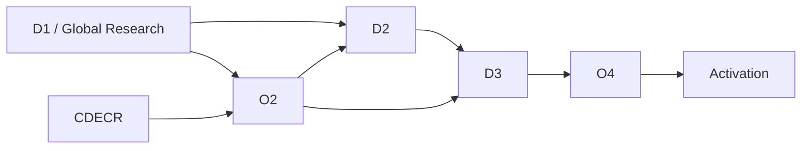
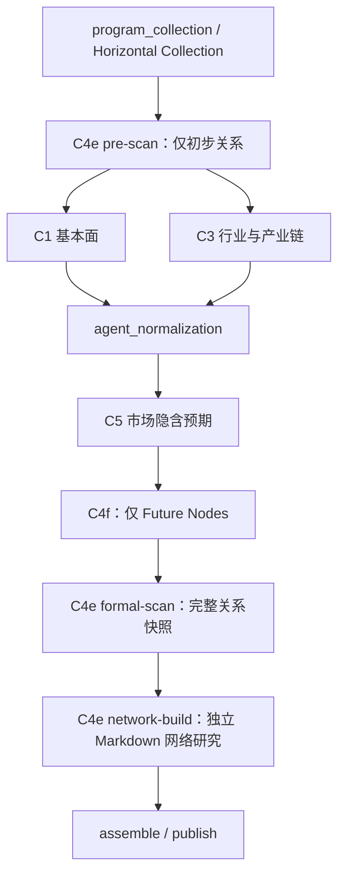

# Workflow V2 · D1 Entity Map 实现现状勘察

更新日期：2026-10-09，时间均按 Asia/Shanghai 表述。本文按 C4 拆分后的**最新本地工作区实现**更新；INTC/BE 样本仍为 2026-10-09 02:29:24 采集的改造前远端快照。本轮没有重新连接远端、刷新 ticker 或部署，不将本地实现当作已上线现状。

用途：梳理编排、业务逻辑、schema、字段、持久化与下游消费，作为后续研究质量优化的实现基线。实施过程和此前测试记录见 [C4 独立任务编排实施与验收](../c4_split_orchestration_implementation_20261009.md)。

## 1. 结论与交付

当前初始化 D1 入口仍选择 `codex_global_research_v1 / global_research`，C4 已拆为四阶段：

`C4e pre-scan → C1/C3 → C5 → C4f Future Node → C4e formal-scan → C4e network-build → publish`

同一 run 的四个 C4 阶段复用同一 `CodexAgentRole.C4` 和持久化 Codex thread，分别注入本轮 Prompt/Skill/Schema。最终独立保留 `future_nodes`、formal-scan 完整 `entity_relations`、`entity_network_report`，由 `c4_product_status` 分别记录可用、为空或失败。当前 Global Research 已移除混合 enrichment、两数组任一成功即满足的条件及 pre-scan 整体回退。

Entity Map 现在有两种交付：五字段快照提供关系研究入口，独立 Markdown 网络正文解释现实活动、外部行动者选择、共同依赖、局部变化的回传机制与信息入口。仍没有规范化实体库、节点/边存储或脱离 D1 run 的独立版本生命周期；network-build 的新发现不自动改写 formal-scan 关系表。

任务/产物耦合已拆除；实体身份、关系类型自由文本、语义完整性检查、O2/D2 网络报告接入和跨产品引用作用域仍有边界。独立 C4 manifest 不等于已经修复所有下游引用命名空间，详见第 7、8 节。

INTC、BE 已拉取的关系分别为 **23 条、30 条**，对应 2026-09-21 UTC 发布的旧 D1。采集时 activation 指针与所取 D1 一致；不证明当前指针仍未变，也不代表旧产出已经经过新 formal-scan/network-build。

| 交付物（改造前远端快照） | INTC | BE |
| --- | --- | --- |
| 可读 Entity Map，保留原文 | [entity_map.md](INTC/entity_map.md) | [entity_map.md](BE/entity_map.md) |
| 五字段无损 JSON | [entity_map.json](INTC/entity_map.json) | [entity_map.json](BE/entity_map.json) |
| 已发布 bundle 原始 JSON | [bundle.raw.json](INTC/bundle.raw.json) | [bundle.raw.json](BE/bundle.raw.json) |
| 旧预扫描 completion | [c4_pre_scan](INTC/c4_pre_scan.completion.raw.json) | [c4_pre_scan](BE/c4_pre_scan.completion.raw.json) |
| 旧 enrichment completion | [c4_enrichment](INTC/c4_enrichment.completion.raw.json) | [c4_enrichment](BE/c4_enrichment.completion.raw.json) |
| 采集时 activation 依据 | [activation](INTC/activation_revision.raw.json) | [activation](BE/activation_revision.raw.json) |

各 ticker 目录另含 citation manifest、ArtifactRef、冻结输入、audit 与初始化节点记录。来源、大小和 SHA-256 见 [采集清单](evidence/remote_capture_manifest.json)；旧版分析与探针见 [analysis.json](evidence/analysis.json)。旧 C4 的 `report.raw.md` 为空，符合当时结构输出；新版 network-build 要求非空正文，不能沿用旧样本的空报告预期。

## 2. 勘察依据与版本边界

### 2.1 最新本地工作区

- cwd：`C:\Users\WEIXUANXIE\Desktop\DoxAgent`；分支 `codex/v1-retirement-cleanup`；HEAD `f9d1a3f8928d9af1a61a34eb99682b9395a65f5f`。
- 工作区含 C4 拆分及 D2/D3 等未提交修改，以本轮实际读取的源码为准，HEAD 不代表所有文件当前内容。原勘察开始时的 142 条状态记录不是本次更新后的状态计数。
- 运行版本仍为 `codex_global_research_v1`；Agent bundle 已为 `codex-global-research-agent-bundle-v2`；task 合同仍为 `codex-d1-attempt-task-v4`。
- 本轮对照 orchestrator、manifest、C4e/C4f prompt/skill、schema、runner/recovery、capsule、repository、迁移与下游输入代码，只更新本文。

### 2.2 改造前远端采集证据

以下均为原采集时观测，**本轮未重新验证远端实时状态**：

- SSH `doxagent-sg`，实测 `ubuntu@VM-0-15-ubuntu`；仓库 `/home/ubuntu/doxagent`，HEAD `b0f1caf50060b34483f13020a9d173ef57933afa`，有未提交修改。
- 初始化容器 `doxagent-v2-v2-initialization-1`，镜像 `doxagent-v2:codex-gpt6-research-0.159.3`；Worker `doxagent-v2-codex-worker-1`，镜像 `doxagent-v2:maintenance-worker-20261003`。
- 样本读取自 `/data/research/research.sqlite3` 与 `/data/workspaces/<run_id>`，激活指针来自 `/data/initialization/control.sqlite3`。使用 SQLite 只读模式、`query_only=ON` 和显式读事务，不宣称两库跨库原子快照。
- 原比较的 12 个容器代码/资源，11 个与**当时拆分前本地基线**归一化换行后一致；schema 差异限于当时 D2/D3 枚举。不能把旧比较套用到当前新增 C4 节点和 bundle 字段的代码。
- 四次历史 C4 attempt 的冻结 prompt、混合 skill 和 NodeOutput schema 与当时旧根目录资源一致。现在它们是历史合同，旧资源已固定到 `compatibility/legacy_document1/`，当前 C4e/C4f 使用新资源。

原采集时初始化配置为 `gpt-6-luna / max / 1800s`；历史样本四次 C4 请求实际为 **`gpt-5.6-luna / max / 1800s`**，均 `allow_subagents=false`。见 [remote_worker_settings.json](evidence/remote_worker_settings.json)。不据此推断现在的模型配置或新版研究表现。

`evidence/runtime_source/`、`INTC/BE/frozen_inputs`、原始样本和 `analysis.json` 本轮保持原样。目录外原 ZIP 保留原始勘察版本，最新说明以本 README 为准。

## 3. 编排现状

### 3.1 初始化大编排

`ticker_initialization/catalog.py` 中 D1/CDECR 可并行；O2 等待 D1+CDECR，D2 等待 D1+O2，D3 等待 D2+O2，随后 O4 与 activation。



初始化 `research_adapter._d1()` 直接创建 `CodexGlobalResearchOrchestrator`，child run ID 为 `<initialization_id>-d1`。入口直接选择 Global Research，不能用保留的 legacy Document1 流程解释它；远端配置观测见第 2 节。

### 3.2 Global Research 内部



| 环节 | 实际输入/行为 | 产物职责 |
| --- | --- | --- |
| 数据准备 | 收集或恢复 Global 横向数据 | pre-scan 不直接注入 horizontal.json；后置 C4 context 明确包含完整 horizontal_collection |
| `c4_pre_scan` | ticker、company_name、research_brief、base_context；Worker 携统一 cutoff | 轻量初始关系，只交付 entity_relations |
| C1/C3 | pre-scan 完整交接副本、各自横向输入 | 保留关系；程序仍清空内部默认 future_nodes，不意味着 pre-scan 继续生成未来事项 |
| C5 | C1/C3 完整交接、规范化 Observation、横向市场输入 | C1/C3/C5 核心报告未接纳时，不启动后置 C4 链 |
| `c4f_future_nodes` | 共享完整研究材料 | 仅研究 Future Nodes，不修改关系/网络正文 |
| `c4e_formal_scan` | 共享材料，加 C4f 交接 | 开放、检索密集的关系发现，返回新的完整快照，不只返回新增行 |
| `c4e_network_build` | 共享材料，加 Future Nodes 和 formal 完整交接 | 继续深度研究、web search、新对象和理解修正；独立 Markdown 正文 |
| 发布 | 三项分别取各自节点结果 | bundle 独立保存列表/正文/状态，汇总主报告仍只拼 C1/C3/C5 |

共享材料包括：pre-scan、C1/C3/C5 完整 NodeOutput（报告全文、观察候选及诊断）、完整 horizontal collection、规范化 observations、请求基础上下文，以及成功上游 attempt 的 artifact 路径/ID/SHA 索引。不是只交摘要；artifact 索引提供追溯位置，不表示每份原始文件已内联复制。引用证据按 handoff/rebinder 重新导入。

### 3.3 Prompt、Skill 与同 thread

以下路径相对于 `prompts/codex_v2/document1/`：

| 节点 | Prompt | Skill | Wire schema |
| --- | --- | --- | --- |
| `c4_pre_scan` | `agents/c4e.md` | `skills/c4/c4e_pre_scan.md` | `schemas/c4e_relations.schema.json` |
| `c4f_future_nodes` | `agents/c4f.md` | `skills/c4/c4f_future_node.md` | `schemas/c4f_future_nodes.schema.json` |
| `c4e_formal_scan` | `agents/c4e.md` | `skills/c4/c4e_formal-scan.md` | `schemas/c4e_relations.schema.json` |
| `c4e_network_build` | `agents/c4e.md` | `skills/c4/c4e_network-build.md` | `schemas/c4e_network-build.schema.json` |

四节点映射同一 C4 role 的 ThreadRecord。Global C4 重试也保留 thread，其他角色与 legacy lane 保留原重试隔离策略。共享 thread 仅继承研究上下文，不共享任务职责或完成状态。

持久化 thread 与底层进程分离：Global C4 每轮释放 capsule，下一轮以同一 thread ID 恢复 SDK 会话，重新加载当前 attempt 的 MCP capability/证据目录；`max_subagents=0` 也执行。此为代码规则和离线验证，不是远端实模验收结论。

### 3.4 完成、恢复与降级

1. 同 run 已有 published bundle 时直接返回；旧快照不自动成为新版产物。
2. 恢复成功阶段核对 input hash、ArtifactRef 和正文/receipt SHA；hash 覆盖 manifest、上下文、prompt/skill/schema。发布前中断可恢复已接纳产品。
3. 初始化入口配置 max_attempts=1；durable turn 另受上层 substep 调度，Global C4 重试仍保持同 thread。
4. 一般节点异常记录失败占位；lease、capability、不可变 workspace 等完整性异常仍抛出。
5. C4f/formal 未接纳时，依赖阶段记录 node.skipped、checkpoint 失败及对应产品 failed，不以缺失必需输入继续冒充完成。
6. 合法空关系列表或 Future Nodes 表示该阶段已接纳，记 empty，可继续下一阶段；空网络正文不符合 schema，会失败。
7. 核心 C1/C3/C5 完整时仍可按既有 optional C4 策略发布，但保存三项状态和 workflow.partial；**published 不等于 C4 三产品全部可用**。
8. formal 直接成为最终关系快照，不 union 或回退 pre-scan；network 新发现不自动反向改写关系表。

当前 lane 无 c4_enrichment/c4_finalization；require_complete_c4_enrichment 仅属于仍保留的 legacy 逻辑，不能描述新版完成条件。

## 4. 业务定位与生成逻辑

C4e 由“目标公司有哪些直接关系”扩展为“哪些现实活动塑造其机会与约束，活动由哪些参与者、技术、设施、资本安排或规则共同支撑”。相关性按经济活动和回传线索判断，不要求每行端点都是 ticker，也不要求每个对象与目标公司直接交易。

| 阶段 | 研究定位与完成边界 |
| --- | --- |
| pre-scan | 明确主要经营活动、业务位置和已知联系，帮助 C1/C3 起步；未完成深层网络不阻止交付，不按类别凑条数 |
| formal-scan | 从外部对象自身的信息世界、选择、依赖、替代和共同约束继续发现；可以不带 ticker 搜索、记录外部—外部联系；旧关系和上游报告不是白名单 |
| network-build | 围绕实际经济活动组织研究，解释行动者选择、资源/支付/风险安排、共同依赖、局部变化如何回传以及事实从哪里公开；可以继续发现对象和修正理解，不是关系表逐行扩写 |
| C4f | 独立搜索具体、可观察、有支持时间信息的未来事项，保留来源时间精度；关系/上游帮助发现方向，不写回 Entity Map |

C4e 可以分析经济作用、条件性传导和关键未知，须区分事实/推断/待核实联系。旧版“C4 不分析影响”不再概括 network-build 职责；预期差、最低交易充分性、Policy 与交易决策仍交给后续节点。信息入口不是监控词表或交易条件。

模型负责搜索/阅读/研究，程序负责阶段供材、接纳、证据作用域、恢复与发布。无固定条数、类型枚举、搜索次数、网络层数或章节配额。formal 的完整快照合同不证明现实关系已穷尽；非空 Markdown schema 不证明网络解释有质量。

C4 共用受 role 能力控制的 Data MCP、Source Capture 与 SDK live web search。白名单涉及 SEC、IR、监管、政府合同/支出、公司新闻等，还受工具暴露/排除规则控制；权限存在不表示已成功调用或覆盖业务事实。

## 5. Schema 与字段字典

### 5.1 EntityRelation：每行恰好五个公开字段

| 中文 JSON 字段 | Python / durable 内部名 | 当前业务含义 | 当前限制与歧义 |
| --- | --- | --- | --- |
| 关系主体 | `relation_subject` | 关系起点、发起方或业务所属主体 | 不是 ticker 外键；可写 Intel，也可写 Intel Foundry，没有必须等于目标公司的校验 |
| 关系对象 | `relation_object` | 关系另一端的公司、分部、产品、平台、设施、主体类别或暴露对象 | 非规范化 entity ID；可是一家公司、多家公司合写、产品组合或宽泛主体集合 |
| 关系类型 | `relation_type` | 对该关系的业务标签，例如客户、制造合作、竞争/替代 | 自由字符串；无枚举，可混合多个角色，方向语义也无机器约束 |
| 关系说明 | `relation_description` | 解释关系是什么、为什么成立及必要事实边界 | 自由文本；可嵌入 O 别名、Markdown URL、数量和条件，没有专门证据字段 |
| 关联业务或产品 | `related_business_or_product` | 关系对应的业务范围、产品、技术或应用 | 自由字符串；非产品 ID，不校验与主体/对象是否属于同一体系，可混写多个业务 |

五字段均为必需 `str`；`extra='forbid'`，`populate_by_name=True`，因此既接受中文 alias，也接受内部英文名。Agent wire schema 使用中文 alias；NodeOutput、SQLite bundle 等 canonical 持久化一般 `by_alias=True`，部分 durable/内部交接以英文名序列化，两者语义相同。

EntityRelation 没有独立 `schema_version`、entity/relation ID、ticker/市场/地区身份键、source/source_date、effective_from/effective_to、status、confidence、importance、金额/收入占比、上下游层级或边属性。外围 run/artifact/attempt 存在 ID 与状态，这不与提示词“公开关系行不加 ID/状态机”冲突。

当前字符串没有 `minLength`、空白检查、格式约束或字段间一致性校验；数组没有关系去重或数量约束。第 9 节的探针实测了这些接纳行为。

formal-scan 明确允许两个端点都在目标公司之外。当前 skill 要求按实际角色/状态差异展开对象，确实共同组成安排时可以合写；这是研究指令，没有新增机器实体身份或自动拆分规则。

### 5.2 FutureNode 与网络正文

FutureNode 五字段仍为 `时间/time`、`未来事项/future_event`、`与目标公司的关系/relationship_to_target`、`来源/source`、`来源发布日期/source_published_at`，都是字符串，保留来源精度，不强制 ISO date。

EntityRelation 没有独立来源/发布日期字段，证据仍来自文本引用与该产品的 attempt manifest。network-build 主产物独立采用用户提供的 schema，与附件逐字节一致：

```json
{
  "type": "string",
  "pattern": "\\S",
  "description": "C4e network-build 的完整 Markdown 网络研究正文。"
}
```

schema 只保证非空白字符串；skill 要求标题、cutoff、网络整体背景及按实际活动组织的章节，关键对象/运作/回传/信息入口/未知自然融入正文，不是每章必填 JSON 字段。不另交节点/边数组或五字段增量。

### 5.3 阶段 wire 与内部 canonical receipt

| 层次 | 形态 | 实际约束 |
| --- | --- | --- |
| pre-scan / formal wire | status、summary、report_markdown、warnings、entity_relations | 全 required，禁止额外属性，report_markdown 固定空，不存在 future_nodes 字段 |
| C4f wire | status、summary、report_markdown、warnings、future_nodes | 全 required，禁止额外属性，report_markdown 固定空，不存在 entity_relations 字段 |
| network wire | JSON 字符串 | 非空 Markdown；适配器兼容 SDK 直接返回正文文本，拒绝旧 NodeOutput 对象 |
| 内部 NodeOutput | 原 status/summary/report/warnings/observations/relations/future/metadata | 接纳后统一保存 receipt，未使用数组默认空；network 正文放入 report_markdown，不代表 Agent 应返回旧 envelope |
| GlobalResearchBundle | 原字段加 entity_network_report、c4_product_status | 三产品分别固定取 Future/formal/network 的结果 |

status 仍是字符串，stage validator 明确拒绝 failed/error/cancelled/aborted（忽略大小写），未新增完整业务状态枚举。权威 attempt 状态由运行时接纳决定。c4_product_status 分别记录：available=本阶段已接纳且非空；empty=本阶段已接纳但关系/Future 数组空；failed=未接纳或因前置 C4 失败而跳过。

历史 bundle 新字段默认 `entity_network_report=""`、`c4_product_status={}`，表示历史未记录，不能补标成三项执行成功。

### 5.4 最新接纳行为与旧探针的区别

当前 C4 先按阶段 schema 校验 wire 值，再恢复内部 NodeOutput。缺字段、类型错误、额外业务字段、错误产品数组、结构阶段非空 report 均导致响应不接纳，之后只能尝试本阶段自己的文件。通用 recover_output/ingest_model 的逐行隔离与扩展剥除仍保留，不能绕过先行 schema 校验。

| 原 analysis.json 探针 | 当前 C4 实现 |
| --- | --- |
| 空字符串关系字段、重复行被接纳 | 字段无 minLength、数组无去重，仍是结构合同边界 |
| 任意 status 可通过旧 validator | 新阶段拒绝四类失败状态，其他字符串仍非严格枚举 |
| 非空 C4 report 被接纳 | 新关系/Future schema 固定 report 为空，validator 再隔离职责 |
| Future-only 满足 complete flag | 仅属于旧 enrichment；新 formal schema 不接受 Future Nodes 字段 |
| 额外 confidence 剥除后接纳 | 通用恢复器仍能修整；当前 C4 wire 先拒绝扩展 |

主体身份、方向、重复事实、时效、因果连接和正文质量仍不是自动语义验证项。独立状态解决合同边界，不能替代业务研究验收。

## 6. 文件、持久化与发布边界

每轮冻结 input 的 AGENTS.md、当前 prompt 对应 task.md、task.json、context.json、manifest、阶段 skill/schema。task 仍为 codex-d1-attempt-task-v4；结构阶段声明 structured_output_path，network 声明 markdown_output_path 和 response_format=json_string。C4 不使用 C1/C3/C5 的 progressive draft/progress 合同。

runner 先接纳 response；本阶段没有对应非空内容时，仅尝试同 attempt、同产品文件。结构阶段看所属数组，network 看正文，不跨产品补值。合法空数组可以由有效 response 接纳，但失败 turn 留下空数组文件本身不构成非空恢复证据。

```text
<workspace>/<run_id>/
  attempts/<attempt_id>/input/{AGENTS.md,task.md,task.json,context.json,...}
  attempts/<relation_or_future_attempt>/output/completion.json
  attempts/<network_attempt>/output/entity_network_report.md
  attempts/<attempt_id>/audit/{bundle,ingestion,turn_summary,...}.json
  artifacts/c4_pre_scan/<attempt_id>/{report.md,completion.json}
  artifacts/c4f_future_nodes/<attempt_id>/{report.md,completion.json}
  artifacts/c4e_formal_scan/<attempt_id>/{report.md,completion.json}
  artifacts/c4e_network_build/<attempt_id>/{report.md,completion.json}
  artifacts/global_research/{global_research_v1.md,citation_manifest.json}
```

结构阶段 report.md 仍空，真实数组在 completion/bundle；network report.md 非空。canonical receipt 统一用内部 NodeOutput，支持恢复、引用提升和追溯。汇总研究正文仍只含 C1/C3/C5。

| 最终字段 | 权威来源/定位 |
| --- | --- |
| future_nodes | 仅 c4f_future_nodes，bundle 数组及该 attempt completion |
| entity_relations | 仅 c4e_formal_scan，bundle 数组及该 attempt completion |
| entity_network_report | 仅 c4e_network_build，bundle 字符串及 reports['c4e_network_build'] 对应 report |
| c4_product_status | 三阶段独立接纳/内容状态，不由 published 或另一数组推断 |

SQLite 沿用 codex_runtime_records 通用 JSON 记录，bundle 的 record_type 为 bundles；新增字段随 payload 保存，manifest 独立存储。没有新建实体/边表或独立网络数据库。

Postgres 的 doxagent.codex_global_research_bundles save/get/upsert 已加入 entity_network_report text 与 c4_product_status jsonb。迁移在 `supabase/migrations/202610090001_c4_independent_products.sql`，默认空正文/空字典保持历史可读。上线新版后端前须应用；本轮未查询远端实际 schema 或应用状态。

原数据库 size check 只计算 report_index/entity_relations/future_nodes 合计 ≤524288 bytes；应用层 `_guard_payload('bundle', ...)` 也计入新正文/状态，硬上限 512 KiB。两层覆盖范围不同，五字段仍未展开为数据库列。

V2 基础投研索引/下载仍显式组织 C1/C3/C5 与 Future Nodes，未新增 Entity Map/network 页面或下载项。独立保存/发布成功不等于下游页面已经呈现。

## 7. 下游使用与证据交接

| 消费方 | 最新本地交接 | 边界 |
| --- | --- | --- |
| C1/C3 | pre-scan 关系 envelope | 初步关系，不含 pre-scan Future 研究 |
| C4f/formal/network | 完整上游 handoff；network 额外承接 formal | 按上游 artifact manifest 重导入证据，分配本 attempt 别名 |
| O2 | O2UpstreamContextManifest.entity_relations/future_nodes，研究 refs 显式 C1/C3/C5 | 尚无网络正文/三产品状态的专门输入字段 |
| D2 | GlobalResearchInput 两数组，引用加 D1- 前缀，报告显式 C1/C3/C5 | 尚未专门注入 network/状态；前缀未区分 C4 和聚合作用域 |
| 本地 D3 v2.1 | 遍历 Global reports/artifact 冻结正文；structure.json 仍仅两数组 | network 可经通用原始 artifact 入口进入材料，不等于新增专门消费/引用合同 |
| activation | 保存 document1.run_id | 不自动刷新研究；INTC/BE 指针对齐仅为采集时证据 |
| V2 页面/ZIP | 未索引 Entity Map/network 项 | 不等于 bundle 缺少产物 |

正式引用仍为 `【cite:O#】`。C4 每个 node manifest 绑定自己的 report ArtifactRef；promotion 扫描完整 canonical NodeOutput，因此空 report 的结构字段引用也会进入 manifest，网络正文使用自己的 manifest。

UpstreamObservationRebinder 根据上游 artifact ID、manifest 和 Observation 重导入证据。缺失时改为 `[upstream evidence unavailable]` 并保留 warning，不伪造 resolved 来源。已离线验证 formal 证据进入 network 后重新绑定，以及网络自身引用提升。

**跨发布产品的作用域问题未全面解决：** Global 聚合 manifest 仍只聚合并重编号 C1/C3/C5；最终关系/Future/网络各保留 formal/C4f/network 自己的 O 编号，不能交给 Global 聚合 manifest 解码。应通过 `bundle.reports[node.value]` artifact 找对应 manifest；bundle 数组行仍不带 manifest/artifact 身份字段。

因此，独立产物不自动修复 D2 只加 D1- 前缀并按 Global 聚合 manifest 读取的风险。本轮未重放 D2/O2/D3 全链消费，也不宣称历史 D2 已发生业务误引用。

## 8. INTC、BE 改造前真实样本及剩余关注项

本节数值/原文来自第 2.2 节历史采集。两个 run 都是旧 pre_scan + enrichment，**没有新版 C4f/formal/network 产物**，不能将旧 enrichment 改名充作新节点验收。

### 8.1 样本身份与规模

| 项目 | INTC | BE |
| --- | --- | --- |
| D1 run_id | `init-intc-738849dbdbb04ae1a39efa0aec69c071-d1` | `init-be-788adefdd31844d98a907468b883176d-d1` |
| 研究 cutoff，北京时间 | 2026-09-22 04:23:27 | 2026-09-21 20:30:11 |
| 发布时间，北京时间 | 2026-09-22 05:40:24 | 2026-09-21 22:14:01 |
| 预扫描 → 最终关系 | 17 → 23 | 25 → 30 |
| 预扫描 → 最终 Future Nodes | 11 → 20 | 19 → 33 |
| C4 预扫描 / enrichment 耗时 | 16.98 / 15.50 分钟 | 12.76 / 19.03 分钟 |
| 最终关系类型标签数 | 22 | 27 |
| 含正式 O 别名的最终关系行 | 23/23 | 2/30 |
| 含直接 URL 的最终关系行 | 0/23 | 30/30 |
| 完全重复行 / 空字段 | 0 / 0 | 0 / 0 |
| 预扫描主体—对象组合在最终缺失 | 0 | 0 |
| C4 pre / enrichment manifest entries | 17 / 25 | 5 / 5 |
| 两个 C4 manifest unresolved | 0 / 0 | 0 / 0 |
| 两个 C4 ingestion quarantine | 0 / 0 | 0 / 0 |
| 采集时激活 revision | `runtime-maintain-e738add6dd328ee2e3d98e09-activation` | `runtime-maintain-e5b914877fe8a40a46b494c6-activation` |

entry 数统计完整 NodeOutput，包括 warnings / Future Nodes，不可当作“每条关系证据数量”。`resolved=0` 的缺失数仅指正式 O 引用；BE 直接 URL 不受此项检验覆盖。上述耗时是一次历史 attempt 的墙钟时间，包含 Worker 等待/执行与产物处理，不能直接当作模型纯推理时长、当前模型性能或改造后的预计耗时。

INTC enrichment 新增六个主体—对象组合：Intel 18A/18A-P/14A、Panther Lake、OEM 上市伙伴集合、Foveros/EMIB 技术组合、Lens Technology、Altera。BE 新增五个组合：800V DC 架构、NVIDIA Rubin Ultra/Kyber 生态、MOL/Samsung Heavy Industries、Transwestern/Green Chile/FERC、NERC/FERC 可靠性框架。这里是对产出差异的描述，不是重新认证这些业务关系。

### 8.2 观察、已解决项与剩余边界

| 关注项 | 原样本证据 | 最新本地实现/剩余影响 |
| --- | --- | --- |
| 对象粒度混合 | INTC 合写 AMD/Qualcomm/NVIDIA/ARM-RISC-V/云厂商自研芯片；BE 含终端市场、监管框架、未披露供应者 | formal skill 要求按真实角色/状态差异展开，允许有依据的共同安排/类别；仍无规范实体 ID、自动拆分/跨 ticker 归并 |
| 多种关系合写 | 公用事业渠道/融资合作、业务分部与制造平台等 | 五字段仍为自由文本，程序不自动判定商业状态 |
| Entity Map/Future 完成耦合 | 旧两数组任一非空可避免回退 | 当前 lane 已拆分任务/schema/状态、删除混合回退；空产品仍显式 empty |
| 完整快照 | 旧样本 pre→enrichment 未丢失主体—对象组合 | formal 直接交付完整快照，不做程序 union/语义穷尽证明；有意修订删除需按研究依据验收 |
| 证据表示不统一 | INTC 正式引用；BE 每行有 URL，仅两行有 O 引用 | row 仍无 source/date；URL 不等于捕获或语义支持，独立 manifest 不等于统一逐行证据 |
| 聚合别名冲突 | INTC 19 个别名中 16 个同号异 URL、3 个缺失；BE O69/O72 缺失 | formal/Future/network 各有作用域，聚合仍仅 C1/C3/C5；下游统一身份尚未整体改造 |
| 来源与时效 | row 无 source_date/effective window | 仍按 D1 run 快照，未独立刷新或逐边修订撤销 |
| 关键路径 | 旧两次 C4 合计约 32 分钟 | pre 已去掉 Future；后置变三串行阶段。未实测新版质量/耗时/token，不能推断更快 |
| 深度网络价值 | 旧样本只有五字段行 | 新增独立网络正文和供材，但尚未新实模验收；非空 schema 与旧 23/30 条都不是业务效果证明 |

**别名冲突的具体例子：** INTC 第一条 CCPG 关系说明引用 `【cite:O2】`。其 C4 enrichment manifest 的 O2 URL 是 `https://www.intc.com/news-events/press-releases/detail/1776/intel-reports-second-quarter-2026-financial-results`，对应 C4 attempt `init-779e6ae62c4a4337ae79c2940b874cc9`；同 bundle 的汇总 manifest O2 则是 `https://www.sec.gov/Archives/edgar/data/50863/000005086326000077/q126earningsrelease.htm`，对应 C1 attempt `init-609e79a4023544e29f5e06f67b1938ff`。URL 差异和作用域差异可在交付的原始 manifest 与 bundle 中直接复核；完整冲突列表在 `analysis.json`。

### 8.3 后续优化仍需明确的问题

1. 五字段快照/网络正文继续服务阅读，还是需支持实体检索、跨 ticker 归并、监控对象生成？若需机器实体身份，明确粒度和拆分目的。
2. 外部—外部联系、设施/技术/契约如何表达精度与状态？不能混同潜在合作、技术适配和已部署客户。
3. 各产品来源作用域与时间边界怎样交给 O2/D2/D3？正文已保存，但 O2/D2 专门接入和统一引用身份仍待衔接。
4. formal 快照与 network 新发现怎样修订/版本化？目前不自动回写、不独立刷新；任务是否拆分已是实施结果，不再是待选问题。
5. 怎样用新 run 验收外部独立发现、机制解释、信息入口、引用准确性与总关键路径成本？旧条数和离线通过均不替代研究验收。

## 9. 验证记录与尚未验证范围

### 9.1 原远端采集验证（历史记录）

- 70 个远端抓取文件校验大小/SHA；有 canonical ArtifactRef hash 的 completion/report 同时核对。
- 两 ticker 五字段 schema、entity_map/bundle/enrichment 列表一致性、采集时 activation 指针对齐。
- pre/final 组合、空字段/重复行、正式引用与 C4 manifest、同编号聚合 URL 冲突。
- 12 个容器文件与旧本地基线比较、四次冻结 prompt/skill/schema 比较、旧接纳探针。
- 原离线组合 **35 passed，29.46s**，保留为旧基线记录，不是本轮新流程测试结果。

`evidence/analyze_capture.py` 当时兼做投影、旧根目录资源比较和旧接纳探针，仍引用如今已移动/删除的 agents/c4.md 与混合 skill。本轮保留该脚本原样，不能在最新工作区直接重跑后覆盖 analysis.json，再把结果当成当前合同。

### 9.2 拆分实现已有验收记录

前轮最终定向组合 **87 passed / 1 deselected / 1 既有依赖 warning，68.21s**；命令和范围见 [实施验收说明](../c4_split_orchestration_implementation_20261009.md)。覆盖精确 DAG、同 thread 重试、阶段资源/schema、供材、产物空/失败/跨合同、失败链、文件/checkpoint 恢复、引用重绑定/独立 manifest、SQLite/PG、Pilot、MCP 权限与 capsule 生命周期。

被排除的 `test_failed_worker_turn_persists_bounded_turn_summary` 已单独复现失败：C1 synthetic start failure 后缺 turn_summary.json。属于通用 Worker 起动失败审计，未扩展修复；不能把组合描述成完整 Worker suite 全绿。

本轮只更新文档，重新对照源码/资源并校验文档内容、链接及冻结样本 SHA，不重复模型研究，也不把之前 pytest 结果写成本轮新跑结果。

### 9.3 未验证与复核方式

未进行新完整 C4 实模 run、逐条外部事实实时核验、全仓回归、D2/O2/D3 完整消费重放、network 前端验收或生产部署。迁移已在仓库，本轮未查询远端实际 schema/应用状态；新版质量、token、性能没有实测结论。

远端证据可在仓库根用 Python 只读复核，不导入现行业务代码、不重写历史分析：

```python
import hashlib, json
from pathlib import Path
root = Path('dev_plan/workflow_v2.1/d1_entity_map_recon_20261009')
manifest = json.loads((root / 'evidence/remote_capture_manifest.json').read_text(encoding='utf-8'))
for item in manifest['files']:
    data = (root / item['name']).read_bytes()
    assert len(data) == item['size_bytes'], item['name']
    assert hashlib.sha256(data).hexdigest() == item['sha256'], item['name']
print('verified', len(manifest['files']), 'captured files')
```

## 10. 最新代码导航

按文件/符号定位本地最新实现，不沿用已变更的旧行号。evidence/runtime_source 仅佐证采集时容器代码。

| 内容 | 入口 |
| --- | --- |
| 初始化依赖和 D1 入口 | `src/doxagent/ticker_initialization/catalog.py`、`research_adapter.py::_d1` |
| DAG/供材/失败链/三产品发布 | `src/doxagent/workflows/codex_global_research/orchestrator.py::run / _execute_after_c4_stage` |
| 阶段路由 | `prompts/codex_v2/document1/global_research/bundle_manifest.json` |
| C4e/C4f 角色定义 | `prompts/codex_v2/document1/agents/c4e.md`、`agents/c4f.md` |
| 阶段研究方法 | `prompts/codex_v2/document1/skills/c4/` 下四份 skill |
| Wire 合同 | `prompts/codex_v2/document1/schemas/` 下 c4e_relations、c4f_future_nodes、c4e_network-build schema |
| 五字段/枚举/bundle | `src/doxagent/codex_runtime/schema.py::EntityRelation / FutureNode / CodexD1Node / GlobalResearchBundle` |
| 内部 NodeOutput | `src/doxagent/workflows/codex_document1/schema.py` |
| schema 物化/输出路径 | `src/doxagent/workflows/codex_document1/attempt_bundle.py::AttemptBundleSeeder` |
| 接纳/恢复/引用提升 | `src/doxagent/workflows/codex_document1/node_runner.py::run_attempt / validate_node_output / has_stage_content`；`recovery.py::recover_node_output` |
| 同 thread/恢复/发布 | `src/doxagent/workflows/codex_document1/orchestrator.py::_execute_node / _restore_successful_node / _publish_references` |
| 证据重新导入 | `src/doxagent/workflows/codex_document1/upstream_rebinder.py` |
| capsule 释放 | `src/doxagent/codex_worker/capsules.py::release` |
| SQLite/PG 存取 | `src/doxagent/codex_runtime/repository.py::_save_lane_bundle / _get_lane_bundle` |
| PG 新列 | `supabase/migrations/202610090001_c4_independent_products.sql`；原表 202608200001_codex_research_lanes.sql |
| O2/D2 边界 | `src/doxagent/cdecr_integration/contracts.py`；`src/doxagent/ticker_initialization/research_adapter.py::_events`；`src/doxagent/workflows/codex_document2/inputs.py` |
| D3 v2.1 材料冻结 | `src/doxagent/workflows/codex_document3/inputs_v21.py` |
| V2 呈现范围 | `src/doxagent/v2_read/artifacts.py` |
| Pilot 和历史兼容 | `src/doxagent/pilot/case_builder.py`、templates.py；`prompts/codex_v2/document1/compatibility/legacy_document1/` |
| 行为回归 | `tests/test_c4_split_workflow.py`；其他组合见实施验收说明 |

历史冻结输入回答“INTC/BE 当时按什么合同生成”，最新工作区回答“新 run 按什么规则运行”；远端是否升级及新研究质量仍需部署/实模分别验收。

## 11. 2026-10-09 后续本地实模补充

后续又完成了[四轮失败与非阻塞性审查](../c4_workflow_failure_review_20261009/README.md)：第四轮成功仅覆盖正常路径，尚有已复现的异常隔离、产物恢复、发布后补跑和 Windows 动态 Pack 可读性问题。完整原因、证据和待实施方案以该审查报告为准。

上文 9.3 的“未进行新完整 C4 实模 run”是本报告当时的验证边界；后续已另用 D2/D3 v2.1 共用的 MU Document1 冻结资产，对四个 C4 节点完成一次**仅 C4、非 Pilot 架构**的本地真实工作流运行。四节点均为 `gpt-6-sol/high`、单次成功、同一 thread：pre-scan 16 条初步关系、C4f 14 个 Future Nodes、formal-scan 41 条完整关系、network-build 6,367 字符独立 Markdown。全部节点实际使用 web search，四阶段当前 attempt 引用分别 16/16、23/23、41/41、50/50 可解析。详细的装配核对、早期失败代次、修复、收据、产物与限制见 [MU C4 本地真实工作流测试](../../../eval/c4_live_mu_20261009/README.md)。这一补充仍不等于整条 D1 publish、远端 migration 或生产部署验收。
