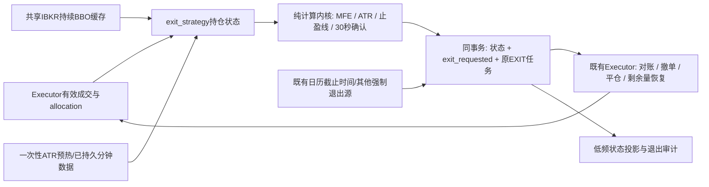

# DoxAgent 退出策略模块开发方案

日期：2026-10-27。状态：开发实现与验证已交付，尚未部署；见[实施记录](../../docs/exit-strategy-module-implementation-20261027.md)。策略确定为 **50% MFE + 2.5 ATR**。目标是在当前生产架构上交付可长期运行的退出能力，保持低资源占用；本轮不重新选参数、不改 W3 研判、不扩展趋势识别系统。

## 1. 总体决定与适用边界

新增与 `trade_execution` 同级的 **`exit_strategy` 业务模块**，独立负责持仓跟踪、止盈计算和退出决定；运行时由既有 `v2-executor` 进程托管，复用其 IBKR 会话和 Runtime SQLite。**退出模块不直接下单，所有订单仍由现有 Executor 统一管理。**并列指业务职责与代码边界，并不要求另建一个常驻容器或第二个订单写入者。

固定业务规则：5% MFE 激活、`D=max(0.50×MFE, 2.5×ATR20)`、单向收紧止盈线、每5秒观察、30秒内六次有效观察至少五次越线且最新仍越线、未触发则按原定截止时间退出。强制风险退出、消息失效退出不等待30秒。

有三点必须讲清：

1. 前轮[历史回测](../../docs/adaptive-trailing-backtest-20261024.md)中旧版仍有完整报价有效性验证限制。选定参数是本次产品决定，不代表历史收益已被充分证明；工程验收也不能代替收益验收。
2. **生产状态从真实 ENTRY 成交开始**。消息首发时点只用于之前的假设回测，不能作为生产 MFE 的起点，也不能把下单时间或 `EXECUTION_ACCEPTED` 当成成交时间。
3. 第一交付完成当前单股票持仓的生产闭环；同一计算内核和退出请求支持显式多腿组。当前执行源码没有现成的 Beta 两腿交易组，组合止盈要等执行侧提供真实 `group_id + legs + fills` 才能启用。此模块不自行开 ETF、不估计 Beta，也不从账户里随意找 ETF 仓位配对。这样可以先把已存在的交易模式交付生产，同时把对冲接入接口做完整。

不新增 LLM 调用、Redis、Kafka、独立行情数据库、逐 ticker 进程、趋势阶段划分或多指标决策系统。

## 2. 当前事实及必须修改的接点

源码基线：本地 `main`，HEAD `22291144`；设计同时考虑工作目录现有文件。以下是源码核查结果，未声称所有本地文件都与运行镜像逐字一致。

| 已有能力 / 缺口 | 当前证据 | 设计处理 |
| --- | --- | --- |
| 唯一订单写入者、按账户/ticker独立推进 | `trade_execution/worker.py:142`、`Executor.step`、`WriterLock` | 继续作为唯一执行宿主；不增加订单 socket writer |
| 成交落账、owned lot、FIFO抵消 | `repository.py:707`、`:853` | 持仓和数量以有效 fills/allocations 为准，不另造持仓真相 |
| 每个 lot 已有 `lot_id:exit` 定时任务 | `repository.py:_rebuild_lots` | 提前退出复用同一任务，不创建“止盈专用平仓订单链” |
| 交易日历、SMART/OVERNIGHT、收盘前30分钟退出 | `sessions.py:55` | 复用截止时间与场所判定，兼容半日市和夏令时 |
| 现有行情是持续 `reqMktData`，同步 `quote()` 等待使用 | `ibkr_session.py:202` | 新增非阻塞完整BBO读取；下单使用路径保留，底层共享订阅 |
| 回调只维护 bid/ask价格与更新时间，未实现 bid/ask size | `ibkr_session.py:_make_app` | 增加 size、双边接收时间、连接代次与质量字段；这是策略上线的实际缺口 |
| 瞬态失败 EXIT 自动恢复只认 `lot.scheduled_exit <= now` | `repository.py:1129` | 改成认“已经请求退出或定时到期”，提前止盈失败不能等到15:30才恢复 |
| 已有投影只处理若干 `te_*` 表，`te_events`主要读取费用 | `v2_read/executions.py:94` | 显式增加低频退出状态投影与 DTO；不能假定新表/新事件会自动显示 |
| 现有 `replan_exit` 是停 worker 后的人工修复工具 | `trade_execution/operations.py:48` | 不拿它当实时触发 API；新增小型运行中退出请求接口 |

2026-10-27 只读生产快照：服务器8核，内存约15.24GiB，可用约1.82GiB；`v2-executor` running、重启计数0，单次空闲采样约23.23MiB、CPU 0.00%，容器内存上限2GiB。**空闲快照不是负载验收**，但说明应优先增加轻量逻辑，而非再起一个完整服务。现有硬风险止损、消息失效退出在本次核查的执行目录中未发现完整独立实现，因此本文只规定其接入优先级，不宣称已有该项保障。

## 3. 模块结构和数据流



建议目录，不额外拆通用框架：

```text
src/doxagent/exit_strategy/
  schema.py       # 不可变策略配置、组合输入、状态/结果类型
  engine.py       # 纯函数；不访问DB、网络、墙钟或下单接口
  market.py       # BBO质量判定、有效1分钟bar、ATR种子与缓存
  repository.py   # 私有状态、策略版本、退出请求的事务操作
  runner.py       # 接受成交变化、5秒调度、恢复与指标
  cli.py          # 导入/绑定策略、status、inspect；不提供直接下单命令
```

`trade_execution` 只提供持仓视图、共享报价接口、`request_exit` 和实际执行；`exit_strategy` 不反向修改 ENTRY 的定价/资金模型。Runner 由 `run_worker` 创建为一个有边界的协程，退出时一并停止。不新增 CLI 常驻 daemon，不复制账户恢复器或订单状态机。

不能只加一个 `create_task` 就宣称调度隔离：当前 worker 还有同步 `drain_events` 和周期数据库维护。接入包需把这些可能等待SQLite的维护调用按原顺序放入一个有界后台I/O通道，完成后向事件循环交付变更；新增Runner持久调用也不在事件循环里等锁。关键退出路径的同步数据库操作改用短锁等待或显式异步包装，不全局重构其他Runtime；禁止持有事件循环锁等待后台网络/DB结果。用调度延迟测试验证这一点，否则5秒采样承诺没有成立。

## 4. 计算口径：以可平仓净收益为统一量纲

### 4.1 收益、成本和入场基数

每个管理单元有明确 `position_id`：单腿使用既有 execution/owned-lot ID，多腿使用执行侧提供的 group ID。账户、环境、execution profile、策略 revision 与归属 lot 绑定后不可随当前全局配置漂移。

净清算收益采用美元：

`P(t) = 已归属成交现金流 + Σ(当前有符号持股数量 × 可平仓价) − 已付费用 − 预计剩余平仓费用 − 已发生持有成本估计`

- LONG 用 bid，SHORT 用 ask；买入成交现金流为负、卖出为正。FIFO退出带来的已实现收益保留在整个单元收益中，不能只看剩余浮盈。
- 当前数量、成交现金流、费用按有效 fills 和 allocations 增量更新，复用现有成交修正与去重规则；不在每5秒全扫描历史成交。
- 佣金回报尚未到达时用明确版本的估计，实到后替换估计，不能双扣。借券/融资费用采用已有可得费率或标明的估计，不为等实际账单阻塞止盈，也不把估计净收益称作券商最终净额。
- 激活分母 `N` 是**真实开出的股票腿入场金额**，不含对冲 ETF，不含用于抵消旧仓的 FIFO 部分。ENTRY 部分成交期间用累计已开出金额，ENTRY 结束后固定。多腿组的股票主腿由执行侧显式标记。
- 第一笔开仓成交即开始跟踪。后续部分成交更新现金流/数量/N，不重置 MFE 或已激活状态，不放宽已有净收益止盈线；现金流与成本必须成对更新，不能因数量变化凭空产生利润。
- 持仓全平即结束该单元。之后新交易使用新的单元，不继承旧 MFE。手工账户持仓、无归属ETF和已经归零的旧 lot 不自动纳入。

### 4.2 有效 MFE 和 ATR

每5秒产生一份时点一致的可清算收益。MFE 用最近三次连续有效观察的净收益中位数更新，三次跨度不超过15秒；初值为0，`MFE=max(历史MFE, 有效中位数)`。这与上一轮研究的尖峰过滤口径衔接。中位数仅用于 MFE，有效当前报价仍用于越线判断；不能把真反转平滑掉。无效或缺失观察中断三点窗口。

ATR用最近20根**已完成、有效**1分钟bar的真实波幅算术均值，不引入 Wilder 平滑或第二套指标：

`TR=max(H−L, |H−C_prev|, |L−C_prev|)`，`ATR20=mean(last 20 TR)`。

生产分钟bar由有效5秒报价样本聚合，每分钟至少6个有效样本；当前未完成分钟不参与。至少需要21根有效bar产生20个TR。时间不足的分钟不补零、不填前价；没有20个TR时状态为 `WARMING_ATR`，继续记录 MFE，仍保留定时和其他强制退出。

单腿等价于“可平仓价格ATR × 当前持股数量”；多腿必须将**同一组5秒观察下的两腿市值变化合成后**形成分钟bar，不能相加两腿独立ATR或独立分钟高低点。ATR度量价格波动，费用现金流不当成价格振幅；与净MFE同为美元量纲。

为处理部分成交/FIFO数量变化，内存保留最近21个有效分钟所需的同步价格样本，并设置60个自然分钟的硬容量上限。数量变化时用当前实际数量重算这小段波动序列，不把加仓、费用到账形成的会计跳变塞进ATR。稳定持仓时每完成一分钟做增量更新即可；长时间无法凑齐样本时显式未就绪，不无限扩展缓存或拿久远数据冒充当前波动。

### 4.3 激活、止盈线和确认

在 ATR 就绪且 `MFE >= 0.05×N` 时计算：

`D=max(0.50×MFE, 2.5×ATR20)`

`candidate=MFE−D`

只有 `candidate>0` 才激活；以后 `stop_net=max(old_stop_net, candidate)`。成本估计已纳入净收益口径，因ATR扩大、行情源切换、部分成交或恢复连接均不得主动降低已有线。这个定义锁定的是**按当前成本估计的正收益**，不是保价成交承诺。

单腿且数量/成本固定时等价于 LONG“有效高点−D”、SHORT“有效低点+D”的价格线；实际实现统一使用净收益线，组合无需再造ETF价格止盈线。

每份观察相对**当时**生效的线记录 `breach = P(t) <= stop_net`；同一次计算先更新有效 MFE/线，再判断当前观察。不能用后来的线重算过去的越线次数。

激活的那次观察不计入确认，从其后5秒开始收集。只有激活至少30秒、最近 `(t−30秒,t]` 内六个5秒观察都有效、至少五次越线且最新仍越线时，提交退出。无效观察不能靠“多等几秒凑齐六次”延长窗口；重连、重启、时钟异常或漏掉调度格时清空确认窗口。

硬风险、消息失效和日历截止不走该窗口；截止到达即产生退出义务。正常交易日为美东15:30，半日市继续用现有“交易所收盘前30分钟”，不硬编码北京时间或忽略夏令时。

## 5. 行情接入：共享订阅、完整BBO、不制造新鲜度

复用现有 `reqMktData(..., snapshot=False)`，按“报价会话身份 + conId + venue”共享引用计数，不能按 Case 各订一份。同一 ETF 被多个组使用时只订阅一次。策略按5秒读取**内存快照**，不每5秒发一次快照请求，不反复连接，不在热循环调用阻塞式 `quote()`。

报价适配器增加：`bid/ask`、`bid_size/ask_size`、双边最近真实回调的单调时钟时间、价格更新时间、connection/subscription generation、market data type、请求错误和场所。`tickSize` 的数量变化也可刷新对应侧接收时间，前提是该订阅代次已有有效价格；把价格更新时间与接收更新时间分开。同侧 `tickPrice` 等其对应 `tickSize` 后再发布完整侧快照，避免新价格配旧数量。回调只更新小缓存和计数，短锁复制快照，不写SQLite，不向事件队列堆每个tick。旧下单 `quote()` 等待超时只能释放自己的订阅引用，不能取消Runner仍在使用的共享订阅。

有效性最低要求：实时类型1；双边价格有限且正、bid≤ask；双边数量为正；两侧真实回调年龄均≤5秒；相对点差 `(ask−bid)/mid≤0.005`；订阅代次匹配、无明确行情错误、当前场所可交易。多腿在同一轮复制完整快照，一条腿无效即整组观察无效。50bp是公开初始参数，不因回测结果逐 ticker 调优。

**不能把“价格没变”当成“行情断了”，也不能因本地读取或账户心跳成功就把旧报价时间改成现在。**数量更新是独立刷新证据；如果连价格/数量真实回调都长期没有，暂停该组MFE、ATR样本和确认，不凭空认定盘口有效。其他持仓继续运行。

针对单合约长时间静默，只做有冷却的重新订阅/诊断，例如15、30、60秒，恢复成功再进入下一次5秒观察；不每个循环取消/重订。断线与行情farm状态丢失时增加代次并清空旧报价，按既有账户恢复机制重新订阅。只有新代次的实时双边数据齐备才恢复；冻结/延迟数据绝不能替代实时BBO触发。

IBKR说明普通L1是亚秒聚合更新、通过 `tickPrice/tickSize` 返回，普通snapshot可能覆盖过去11秒，不能把snapshot完成等同于该时点实时BBO。因此采用持续L1而非高频snapshot；不强制所有合约使用订阅配额较紧的 tick-by-tick。[IBKR Streaming Data](https://www.interactivebrokers.com/docs/tws-api/doc/md/streaming-data)、[Tick-by-Tick Data](https://interactivebrokers.github.io/tws-api/tick_data.html)。

### ATR启动与预热

- 成交后立即订阅/复用行情，并异步取种子；不以“ATR准备中”阻塞 ENTRY 成交处理或其他ticker。
- 单腿首次冷启动，从相同场所取得入场前最后30分钟的已完成1分钟 BID（LONG）/ASK（SHORT）bar，获得至少20个TR；历史数据只预热波动，不倒灌 MFE 或确认窗口。
- 多腿冷启动用已持久同步5秒样本；若没有，取各腿相同时间范围的5秒 BID/ASK close，在区间完成后对齐计算联合bar，不能拼接独立分钟极值。缓存共享ETF种子，避免重复请求。
- 种子截止不晚于第一笔真实成交前的完整分钟，连接恢复也不事后回填触发决策。缺少可靠种子时显式 `WARMING_ATR`，不把ATR设0。运行中攒够有效分钟后自然就绪。
- 历史请求在独立有界后台任务里做，等待时不占账户订单锁。小bar请求采用账户级加权预算，例如最多48个额度/10分钟，给现有使用留余量，BID_ASK按官方双倍计；失败按既有节奏退避，不能把循环变成历史行情扫描器。具体账号额度在实施时探测，不假定任意ETF都有实时或夜盘权限。[IBKR历史限制](https://interactivebrokers.github.io/tws-api/historical_limitations.html)。

## 6. 最小持久模型与状态机

沿用同一个 `runtime.sqlite3`，新增两个模块私有表，不另建持仓/订单账本：

| 表 | 必要内容 |
| --- | --- |
| `ts_policies` | `revision`主键、规范化配置、内容hash；导入后不可变 |
| `ts_positions` | `position_id`主键、account/environment、execution/legs、policy_revision、phase、data_health、first_fill_at、N、cash/fee依据版本、MFE、stop_net、activated_at、ATR恢复种子、latest_evaluated_at、exit_requested_at、exit_reason、state_version、payload |

`ts_positions` 对 account/phase 建索引。完整持仓真相仍在 `te_fills/te_allocations/te_lots`；上述现金和数量只是可验证的计算缓存。多腿映射来自执行侧版本化元数据，不能靠ticker命名或当前持仓净额推断。

状态只设四个，不复制订单状态机：

`TRACKING → ARMED → EXIT_REQUESTED → CLOSED`

`TRACKING/ARMED` 也能因截止或强制退出直接进入 `EXIT_REQUESTED`；`data_health` 单独标记 `OK / WARMING_ATR / QUOTE_GAP / DISCONNECTED / STATE_GAP`，避免几十种组合状态。`EXIT_REQUESTED` 锁存，价格反弹不能撤销该退出义务；只有真实归属数量归零、活动订单已完成最终对账才记 `CLOSED`。

每5秒计算后，将发生变化的 MFE/止盈线/激活状态合并成一笔短事务；分钟ATR种子每分钟更新。确认窗口仅放内存，重启后重新收集30秒，不把重启前观察与重启后凑成六次。**状态持久化成功后才发布对应退出请求**，请求与任务更新原子提交。

SQLite写锁等待必须有短上界，例如200ms，放到受限后台线程，不占主调度协程；不要沿用可能30秒的默认锁等待卡住退出采样。失败时保留待提交的更高MFE/更紧线、标记存储异常并按恢复节奏重试，不覆盖已提交高水位，不伪报触发完成。若未能持久提交退出义务，必须报 `EXIT_REQUEST_PERSIST_FAILED`，不能只打普通日志。

启动时先恢复未关闭单元、对账有效成交/活动订单，再订阅；保存的MFE和线继续有效，ATR校验后复用或重建，确认窗口清空。进程中断期间没有观察就不能虚构MFE或止盈触发；恢复后按当前有效报价与旧线重新确认，已经提交的退出义务则立即由执行器恢复，不重新等30秒。

## 7. 与执行模块的最小契约

增加 `request_exit(position_id, reason, observed_at, evidence, expected_version)`，仅允许内部确定性调用。统一原因：`TRAILING_PROFIT / SESSION_CUTOFF / HARD_RISK / MESSAGE_INVALID / RESIDUAL_GROUP_EXIT`。后二类的信号来源仍由对应业务负责，不让模型工具直接调用券商。

同一SQLite事务内：

1. 核验归属持仓仍存在、数量版本未变化；有变化则按新状态重算，不能用旧数量发送退出。
2. 将退出义务锁存到 `ts_positions`，并在各 leg 原有 `lot_id:exit` 任务标记 `exit_requested_at/reason/position_id`。未启动定时任务的 `due_at` 提前到现在；原始 `scheduled_exit` 保留为兜底截止和审计依据。
3. 已有活动/未知attempt保持原状态与generation，只推进对账，不覆盖等待期限或再生成一个平仓任务。重复触发返回同一个退出义务，新的原因可以补充记录，不能重复提交订单。
4. 写入一条低频退出决定审计，包含参数版本、MFE/ATR/线、成本依据、最后六次完整观察及报价代次；提交后唤醒现有Executor。

额外接入规则：

- **ENTRY尚未完成时**，退出请求同时标记该单元停止补仓，执行器取消未成交 ENTRY、最终对账后按实际剩余归属数量平仓。必须在最终 `mark_submitting` 准入处再次检查退出锁存，防止计算完数量后另一个协程又送出ENTRY。
- 只对正在关闭的同账户/合约暂停新ENTRY，不冻结整个账户其他ticker。已有活动订单先结清，不绕过订单不确定性对账。
- 固定截止、止盈、FIFO、重复回调、成交修正同时发生时仍只有原EXIT任务。一切数量由发送前对账结果确定，不能用触发时数量盲目重复平仓。
- `recover_failed_exits()` 的到期判断改为：`exit_requested_at已存在 OR scheduled_exit已到期`，其余保留既有瞬态错误白名单及幂等恢复。ENTRY三次真实失败后的永久放弃规则不变，EXIT不能套用ENTRY放弃规则。
- 订单尝试额度耗尽但仍有归属仓位时，不能永久放弃普通未成交退出：只有所有旧attempt均已最终对账、无未决订单、仍有剩余量且没有权限/身份/确定拒单阻断，才允许在60秒冷却后启动下一轮剩余量退出。新轮明确记录generation与前轮未成交原因；**这是已确认结束后的下一轮，不是对未知发送结果的重试**。连接/存储瞬态恢复仍保留原generation并用账户2/5/10/30/60秒退避。确定阻断则持续显示“退出未完成/需处理”并告警，不无限重发，也不把任务终态冒充平仓。
- 已有定价和订单类型规则继续由Executor决定，包括盘外限价和常规时段升级，模块不把净止盈线直接作为券商限价。触发只是退出决定，成交回执才确定真实退出收益。
- 停止ticker监控、关闭Case、切换W3模型不终止已有持仓的退出服务。订阅和连接维护必须覆盖未平 owned lot 所钉住的旧profile，不只看当前 `RUNNING` ticker绑定。

## 8. 对冲组合的生产接口

计算内核直接接受 `legs[]`；持仓组必须同账户、同环境，并包含真实主腿/ETF归属、成交时间、签名数量与钉住的Beta/对冲强度。Beta仅用于解释原始规模，退出期间不重新回归、不自动再平衡。

组从第一条腿真实成交开始记合计现金流与持仓收益；没有股票主腿金额时暂不做5%激活。部分建仓不伪造两腿已同步成交，退出锁存后取消两腿所有剩余ENTRY，保留最早真实风险起点与审计。

触发时**同事务请求整个组退出**。执行器并行推进不同合约的平仓工作、各自遵守现有合约锁和账户对账。同步退出指同一组退出义务，**不承诺两笔券商订单原子成交**：一腿先成交时，另一腿继续作为 `RESIDUAL_GROUP_EXIT` 恢复，不等重新形成两腿报价或重新满足止盈条件，不因组PnL消失而放弃剩余腿。关闭判定必须两腿归零且无未决订单。

现有FIFO可能让其他反向ENTRY抵消组内一腿，必须通过allocation更新识别；形成非计划残腿即请求关闭整组剩余量，不继续拿旧Beta当作仍完整对冲。不得拿人工仓位补足缺腿。

**交付边界**：本次实现内核、多腿状态契约和组退出适配测试；当前生产若仍只产生股票ENTRY，即只启用真实单腿。对冲ENTRY的生成、双腿资金准入和真实group归属属于交易执行侧前置能力，未完成时API明确显示 `GROUP_EXECUTION_NOT_CONNECTED`，不能宣称已上线组合止盈。

## 9. 故障行为：保留利润状态，持续承担退出义务

| 情况 | 行为 |
| --- | --- |
| 一次坏价、宽价差、零数量、单腿过期 | 本格无效；不抬MFE/不确认，保留既有线；其他持仓照常 |
| 单合约静默 | 有界诊断/重订；不刷新伪时间，不每5秒重建订阅 |
| IBKR断线、farm数据丢失、会话代次变化 | 清报价和确认窗口，保留MFE/线/退出义务；按账户恢复并重订 |
| ATR扩大 | 线不放宽；不能因“波动更大”退回TRACKING |
| 进程重启 | 复用状态、对账、恢复订阅；未触发者重新确认，已请求者继续退出 |
| fills重复、乱序或更正 | 使用有效成交版本/allocations去重重算；确认窗口清空；正常部分成交不重置MFE。若真实成交更正使旧MFE依据失效，能用已存观察纠正则确定性重放，资料不足则STATE_GAP暂停止盈、保留截止退出并告警，不把旧错误高点当真或悄悄归零 |
| 可确定的拆股、归属修正 | 统一修正持仓、成本和价格尺度后重建ATR；无法建立一致尺度标记STATE_GAP，不猜测重置线 |
| 主循环延迟或系统时钟跳变 | 使用单调时钟做年龄/30秒间隔；UTC只用于存档与日历；漏格不补采、不补确认 |
| 确认后行情反弹或报价变坏 | 退出义务保持；执行器对账及等有效下单条件，不重新等30秒 |
| 15:30到达但行情/券商不可用 | 标记截止已过、持续恢复退出并告警，不伪报“15:30成交” |
| 硬风险/消息失效请求 | 绕过止盈窗口，仍走归属、账户身份和去重，不能绕过真实数量校验 |
| 日志磁盘达到上限 | 轮转低价值采样，不丢退出决定/成交审计；持久义务提交失败升级告警 |

这是应用侧滑动止盈。复用单进程意味着进程/主机停机期间不能运行该算法；依靠持久状态、现有自动重启和恢复降低影响，不能承诺断网时保住止盈价。若另要求主机完全停机时也有券商侧硬风险保护，那是独立风险订单能力，不能用本方案的软件止盈冒充。

## 10. 资源与存储预算

以**20个同时持仓单元、最多40个不同股票/ETF合约**为初始压力验收规模，不作为业务硬限制；共享ETF时实际订阅更少。数字是待测目标，不是已经跑出的性能结论。

| 项目 | 实现方式 / 验收目标 |
| --- | --- |
| 常驻进程 | 新增0个；复用现有IBKR线程，增加一个Runner协程及少量有界后台I/O |
| CPU增量 | 常态平均≤0.05个CPU核；不靠降低5秒观察频率达标；高tick速率另测回调开销 |
| RSS增量 | ≤64MiB；缓存仅最近所需价格样本/ATR和6格确认，关闭后释放引用 |
| 5秒轮次 | 纯计算P95≤50ms；单个历史请求、SQLite锁或ticker错误不拖慢整轮 |
| 请求退出 | 确认到持久请求P95≤250ms，正常健康状态下唤醒执行器≤1秒；不把网络/券商撮合耗时算成纯计算 |
| 行情请求 | 按唯一合约持续订阅；热循环0次行情网络轮询、0次全账户同步；账户同步留给实际下单/恢复 |
| DB写入 | 正常最多每5秒一批状态变化，另有分钟种子和低频审计；不逐tick落库，不全历史反复重建 |
| 审计容量 | 每5秒精简样本异步写现有数据目录的压缩轮转文件，默认7天且总上限512MiB；退出决定/订单/成交沿用持久审计保留规则 |

只对有真实持仓的合约维持策略订阅；必要的ATR种子按需取得。无持仓时取消无引用订阅，Runner仅响应成交/做低频健康检查。不能在两分钟重启一次quote、每5秒扫描全账本或每个Case写完整tick这些地方消耗资源。

模块私有热状态不直接接入通用CDC全量历史投影；实施时核查实际CDC注册机制，显式排除高频状态。只投影激活、健康状态变化、退出请求/完成，以及最多每30秒一份精简当前摘要。否则“算法便宜”仍可能导致Projector和SQLite写放大。

## 11. 配置、可观察性和回退

不可变策略配置示例（字段为拟新增契约）：

```json
{
  "policy_id": "mfe50_atr2p5_v1",
  "activation_fraction": "0.05",
  "giveback_fraction": "0.50",
  "atr_multiplier": "2.5",
  "atr_period": 20,
  "observation_seconds": 5,
  "confirmation_seconds": 30,
  "required_breaches": 5,
  "mfe_filter_samples": 3,
  "quote_max_age_seconds": 5,
  "max_spread_fraction": "0.005",
  "min_samples_per_minute": 6
}
```

通过独立binding按账户/环境绑定policy revision，必要时支持ticker精确覆盖；**不改写已有ExecutionProfile的内容hash**。在 `ExecutionRepository.admit` 同事务为新execution钉住 `exit_policy_revision`，真实成交后创建策略状态。旧execution没有该字段时继续既有定时退出。修改全局绑定只影响新交易，已有仓位继续钉住原策略，不能在持仓途中悄悄换50%/40%。

最小可见字段：真实入场起点、policy revision、TRACKING/ARMED/EXIT_REQUESTED、行情健康、有效样本比例、N、当前净收益、MFE、ATR、净止盈线、六格确认、截止时间、退出原因和剩余归属数量。UI必须区分“触发退出”“订单已发送”“部分成交”“已平仓”。复用现有交易详情面板，不单做新控制台。

核心监控：Runner上次成功轮次与调度延迟、持仓未被跟踪数、BBO无效持续时长、订阅数、ATR未就绪时长、未完成退出最老年龄、残腿年龄、DB持久失败、资源预算。只在状态变化或持续故障时汇总告警，不每5秒写相同错误；触发后未推进优先于一般行情缺口。

操作控制分清含义：

- **关闭新交易绑定**：停止给新仓启用，已有仓位继续按钉住策略运行。
- **暂停止盈评估**：只暂停未来止盈观察，保留MFE/线/原定截止，已请求退出继续执行；恢复时重新收集确认。
- **版本回退**：优先保留兼容状态格式，代码回退不能删除退出请求或重置已有线。旧镜像若不理解新状态，先保留执行器的请求消费兼容补丁，再停策略Runner；不能直接回退到会遗忘提前退出义务的镜像。

已有未跟踪持仓不做无依据的“从现在开始MFE=0”接管。首次上线默认仅新交易启用，旧仓继续原定退出；以后仅在能恢复真实历史状态时提供显式接管，首版不做大规模历史回填项目。

## 12. 开发顺序与文件清单

按一条可交付链路推进，不先搭平台再等业务接入：

| 顺序 | 工作包 | 主要文件 | 完成条件 |
| --- | --- | --- | --- |
| 1 | 纯策略内核、配置与确定性重放 | 新增 `exit_strategy/schema.py/engine.py/market.py` | LONG/SHORT/两腿同一量纲；无未来数据；50%/2.5固定默认 |
| 2 | 共享BBO缓存与ATR种子 | `trade_execution/ibkr_session.py`，新增 `market.py`适配 | tickSize、年龄、代次、引用计数、非阻塞读取齐全；不破坏现有下单quote |
| 3 | 状态、成交接管、幂等退出请求 | 新增模块repository；改 execution repository/worker/executor | 真实首fill接管，MFE/线可恢复；原EXIT任务提前；ENTRY残量取消；恢复认提前请求 |
| 4 | Runner与低频可见性 | 新runner/cli；`v2_read/executions.py`、DTO/API及现有交易详情组件 | 状态可读、异常可见、无热状态CDC风暴；ticker停止不丢退出 |
| 5 | 端到端、故障注入、压力与发布 | 新 `tests/test_exit_strategy*.py`，扩展现有交易/IBKR/投影测试 | 同一候选镜像完成自动回归和PAPER真实订单闭环；记录资源增量 |

数据库采用新增表及JSON附加字段，旧表不做破坏性迁移；新增迁移可重复执行。每个重要实现包追加 `changelog`。不更改 W3 prompt、语义有效期、原资金池、三次ENTRY失败放弃规则；上述边界外的问题单独记录，不顺手重构。

实施中必须核对正在运行的Executor镜像与源码差异，窄范围集成候选镜像，不能把工作目录其他模块的变更一并部署。

## 13. 验收：验证可执行与可恢复，不只验证公式

### 自动检查

| 测试类 | 必须验证的业务结果 |
| --- | --- |
| 因果顺序 | 修改未来价格不改变过去输出；入场前仅预热ATR，不进入MFE；未完成分钟不参与 |
| 方向/尺度 | LONG、SHORT和有不同数量的双腿；联合ATR不拼接独立极值；佣金不双扣 |
| 激活与单向线 | 5%临界点、ATR大到无法锁正不激活、激活后ATR扩大不放宽、中途费用与部分成交不重置 |
| 价格质量 | 单次尖峰被过滤，真实持续跳价不被任意涨跌幅阈值丢掉；零数量/倒挂/宽价差/旧代次无效；size-only可刷新有效侧 |
| 30秒确认 | 4/6不触发、5/6最新未越线不触发、5/6最新越线才触发；激活后至少30秒；无效/漏格/重启不凑数 |
| 交易竞争 | 截止与止盈同刻、触发时ENTRY仍活动、FIFO抵消、重复fill、撤单后晚到fill、旧版本计算提交冲突，都不超平或反向开仓 |
| 对账和恢复 | 发送成功但回执丢失、进程死在提交前后、SQLite忙、IBKR断线恢复，不因结果未知创建重复有效attempt；已有义务不重新确认 |
| 尝试耗尽/确定失败 | 普通未成交剩余量经最终对账后可进入下一轮；权限/身份/确定拒单不无限发；剩余仓位仍显示退出未完成；提前止盈在原截止前也能恢复 |
| 多腿 | 一腿先成交、另一腿拒绝/断线、组被FIFO破坏，剩余腿继续退出而非遗忘；人工仓位不被占用 |
| 生命周期 | 无成交不创建仓位状态；ticker停用仍管理未平仓；全平且对账完成才关闭；配置换版不漂移旧仓 |
| 资源/投影 | 20单元40合约高频回调回放，满足预算；共享ETF只一份订阅；热状态不产生全量CDC历史膨胀 |

前轮研究脚本仅作带有已知精度限制的行情样本，不直接复制成生产Runner。单元测试固定时钟与输入；适配测试验证官方API回调；集成测试验证真实事务、allocation和attempt恢复。

### 发布与业务验收

1. 候选镜像先跑上述回归、迁移兼容和固定规模负载；记录CPU/RSS、5秒轮次、DB延迟、请求/实际成交分离。
2. PAPER账户做真实下单到平仓的闭环，并注入可控价格序列测试完整30秒确认。注入只作用于策略观察输入，Executor的定价和成交仍使用真实PAPER会话；该用例验证执行管线，不证明自然市场止盈绩效。测试适配器不得被LIVE配置引用。不降低生产5%门槛，也不为了等待自然5%行情拖延数周；另对真实行情验证订阅、数量、代次与场所切换。
3. PAPER至少包含普通退出、部分成交/残量、进程重启、断线恢复和重复触发；对冲ENTRY未接入时，多腿仅报告模拟适配验收，不冒充真实两腿券商闭环。
4. 通过后直接发布兼容执行器和模块，一次短切换，绑定目标账户/环境的新交易。shadow可作为短时对照开关，不作为另一个长期系统或无限观察期；无需先人为压低既有交易额度才能“算上线”。
5. 生产检查新成交已被接管、MFE/线持久化、截止仍存在、旧仓未误接管、读侧状态准确、资源未超预算。没有真实止盈触发时只能报告“生产已启用、触发成交待验”，不能用部署成功替代真实退出成交证明。

本方案的生产完成标准是：**正确持仓上产生正确退出义务，唯一执行器完成真实平仓，故障恢复不丢义务、不重复下单，运行资源可量化**。收益提升继续单独积累实盘与历史样本，不拿工程可用性证明策略必然赚钱。
