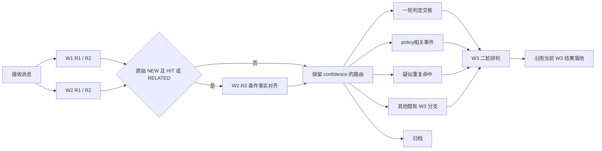

# 持久化运行 W2-R3 编排调整：可执行修改方案

日期：2026-10-10。状态：方案，尚未实施或部署。

依据：[代码勘察发现](persistent_runtime_w2r3_orchestration_recon_20261010.md)及用户对 Q1—Q6 的回答。本文件只规划代码和验证，不修改业务提示词。

## 1. 已确定的开发边界

| 事项 | 已确定处理 |
|---|---|
| 两条继承链 | W1-R2→W1-R3；W2-R2→W2-R3。W2-R3 额外输入仅为 W1-R2 reason |
| R1/R2 请求 | 维持现有显式业务输入及传输行为，不顺便启用 R1→R2 提供方继承 |
| 提示词 | 由用户修改；开发不编辑 `prompts/` 下任何业务 md，不用代码拼接隐蔽业务提示来代替用户修改 |
| R3 语义 | 对 Policy 依据是否属于 W1 reason 的 NEW 范围进行标记；不覆盖原始 W1 verdict |
| HIT/RELATED 混合 | HIT 全不通过但 RELATED 有通过→policy相关事件→W3，不标一轮判定交易 |
| RELATED 全不通过 | 正常置信度、无 HIT 时归档；原 W1 NEW 事实继续捕获 |
| W3 目标 | 最终 NEW+HIT 也应允许 W3 按预期差、交易价值否决交易；该输出契约调整属于后续阶段 |
| 本阶段 W3 工作 | 接好入口、模式、原始判定、R3 结果和标签传递；取消其新 BADCASE 写入，不修改专家交易判断合同 |
| 父响应不可用 | 实际发生明确的父响应失效错误后，允许从本地冻结的父输入/输出恢复可见上下文 |
| 校验 | 不新增业务阻塞校验。保留结构化输出解析、既有技术重试、引用清洗及独立执行幂等 |
| 本轮交付 | 本方案 MD。后续实施另行进行，本文件不代表已有代码或生产验收 |

**阶段限制必须如实保留：** 本阶段完成后，一轮 HIT 不再直接产意图，全部先到 W3；但是现有 W3 最终 NEW+HIT 仍按 Policy 方向交易。独立交易否决权尚未实现，不能以“已接入 W3”宣称它已生效。此次不加等待后续契约的运行阻塞、不伪造 expert_trade 结果。

## 2. 总体做法

继续使用现有 Case、ModelTurn、效果表、执行包、W3RouteCase 和读模型。只增加必要的结果字段及三个一轮标签，不增加执行器、消息通道、全局锁或新的生命周期。



图中的疑似重复命中是后台标签和筛选项；前端运行图仅新增用户要求的一轮判定交易、policy相关事件两个节点。W1-R3 继续由原有事实捕获路径触发，不变成每条消息的必经步骤。

## 3. 数据合同：先明确各字段唯一含义

### 3.1 新 W2-R2 输出

新输出采用如下形状。字段全部按结构化输出合同声明；两个布尔值必须输出，三个列表均可为空。

```json
{
  "policy_hit": true,
  "policy_related": true,
  "policy_ids": ["policy_A"],
  "hit_condition_ids": [
    {"policy_id": "policy_A", "condition_ids": ["C1"]}
  ],
  "matched_condition_ids": [
    {"policy_id": "policy_B", "condition_ids": ["C2"]}
  ],
  "confidence": "normal",
  "reason": "模型的判定理由"
}
```

固定含义：

1. `policy_hit` 是消息级 HIT 判断；`policy_related` 是消息级 RELATED 判断。使用 JSON boolean，取值只允许 true/false，不接受字符串、0/1。
2. `policy_ids` **继续仅表示 HIT Policy**，保持交易身份、命中统计和历史字段语义。
3. `hit_condition_ids` 是 HIT 的分 Policy 条件归因；`matched_condition_ids` 改为 RELATED 的分 Policy 条件归因。两者沿用现有 `{policy_id, condition_ids[]}` 结构。
4. RELATED Policy 的身份由 `matched_condition_ids[*].policy_id` 表达；若只能确认相关 Policy、没有具体条件，可返回该 Policy 加空 `condition_ids`。不新增另一套 related_policy_ids。
5. 原有最多 3 个 R1 候选及 HIT Policy 上限不扩张。两类结果都来自同轮召回的 Policy；不会额外调用新的召回服务。
6. 两个布尔同时 true 合法。不添加互斥校验。同一 Policy 的自然分类是有触发则 HIT，其他 Policy 可 RELATED；即使模型返回交叠归因，也记录、清洗和按对应集合计算，不以冲突阻塞。
7. 布尔字段为路由入口，不能继续以 `bool(policy_ids)` 代替 HIT 判断；Policy 身份为空不让交易意图直接产生。

### 3.2 新 W2-R3 输出

采用顶层对象以适配当前 transport，业务内容只包含条件引用与 boolean：

```json
{
  "condition_results": [
    {"condition_ids": ["policy_A/C1"], "is_new": true},
    {"condition_ids": ["policy_B/C2"], "is_new": false}
  ]
}
```

- 新模型名建议 `W2NovelFactAlignmentResult`；元素名 `W2ConditionNovelty`。`is_new` 使用严格布尔。
- `condition_results`、每项两个字段必填；允许空列表，不设置非空或全覆盖约束。不增加 reason、confidence、Policy ID 第三字段。
- 引用采用 `<escaped_policy_id>/<escaped_condition_id>`。两段分别将 `~` 转 `~0`、`/` 转 `~1`，以 `/` 分隔；统一使用两个小函数编码/解码，避免跨 Policy 的 C1 混淆。
- 一项多个 condition_ids 表示这些条件具有相同 boolean；无需强迫每项只放一个条件。
- 不使用 enum 列表锁定本 Case 的 Condition，不增加模型输出全集匹配、重复冲突、引用非空等语义拒绝器。
- 原始结果原样保存。未知或格式无法识别的引用不计入路由聚合，可产生已有机制支持的 warning，不重试、不失败。

### 3.3 聚合函数：只计算本轮有效引用

在 `router.py` 附近增加纯函数，输入 W2-R2、W2-R3，返回 `hit_new`、`related_new`。具体规则：

```text
hit_refs     = hit_condition_ids 中经既有 Policy Detail 清洗后的限定引用集合
related_refs = matched_condition_ids 中经同样清洗后的限定引用集合
true_refs    = R3 原始输出中所有 is_new=true 的可识别引用

hit_new     = policy_hit     AND bool(hit_refs     ∩ true_refs)
related_new = policy_related AND bool(related_refs ∩ true_refs)
```

- 不能用一个 RELATED 条件 TRUE 给另一个 HIT 条件授权。
- 对重复 TRUE/FALSE 不增加拒绝器；按“任一 TRUE”的既定规则聚合，不让后出现的 FALSE 覆盖已经出现的 TRUE。
- 未输出的条件、归因空列表、输出空列表均不构成 TRUE。这里表示“没有对齐成功证据”，不伪称已证实旧事实。
- 当前 `_sanitize_condition_attribution` 拆成一个共享的分组清洗辅助函数，分别清洗 HIT/RELATED；RELATED 不再必须出现在 HIT `policy_ids` 中。

### 3.4 Case 保存与语义标签

给 `RuntimeCase` 增加：

```text
orchestration_revision: Literal[1,2] = 1
w2_alignment: W2NovelFactAlignmentResult | None = None
first_round_tags: list[FirstRoundTag] = []
```

新建 Case 显式设置 revision=2；缺失该字段的旧 Case 默认 revision=1，不能被默认值误认作新编排。

三个标签固定为：

| 内部值 | 展示 |
|---|---|
| FIRST_ROUND_TRADE | 一轮判定交易 |
| POLICY_RELATED_EVENT | policy相关事件 |
| SUSPECTED_DUPLICATE_HIT | 疑似重复命中 |

- 标签在首次路由成功时和 Case、路由效果一起保存；W3 完结不抹掉或改写这批标签。
- 不新增 primary_route 值或 CaseStatus 值，三个标签均不直接生成意图。
- 不新增保存一份改写后 W1 的字段，不把 R3 FALSE 写入 `w1_final.result`。
- “Policy 依据有效 NEW/OLD”由聚合结果在读侧计算。R3 未执行时显示未执行/不可用，不能默认显示 OLD。
- 不为 R3 另加一套状态机。已有 attempt/task 表决定待执行、失败、完成；Case 的空 alignment 配合资格和 attempts 可区分各情形。

## 4. 完整路由与标签优先级

### 4.1 执行资格

新编排中 W2-R3 仅当：

```text
w1_final.result == NEW AND (w2_final.policy_hit OR w2_final.policy_related)
```

confidence=LOW 不取消符合资格的 R3 调用；最终路由仍由 LOW 优先进入 W3。W2 无候选时生成显式两个 false 的本地 W2 结果，不执行 R2/R3。

### 4.2 正常置信度矩阵

下表 `hit_new/related_new` 仅指相应类型 Condition 对齐成功，不是全文新旧。

| 原 W1 | HIT | RELATED | hit_new | related_new | 一轮标签 | 去向 |
|---|---:|---:|---:|---:|---|---|
| NEW | false | false | — | — | 无 | W3，维持原未覆盖新消息路径 |
| NEW | true | false | true | — | 一轮判定交易 | W3 |
| NEW | true | false | false | — | 疑似重复命中 | W3 |
| NEW | false | true | — | true | policy相关事件 | W3 |
| NEW | false | true | — | false | 无 | ARCHIVE + EMIT_DELTA |
| NEW | true | true | true | true | 一轮判定交易、policy相关事件 | W3，只派发一次 |
| NEW | true | true | true | false | 一轮判定交易 | W3 |
| NEW | true | true | false | true | policy相关事件 | W3；HIT 未通过证据保留在 R3 |
| NEW | true | true | false | false | 疑似重复命中 | W3 |
| OLD | true | 任意 | — | — | 疑似重复命中 | W3，不调用 R3 |
| OLD | false | 任意 | — | — | 无 | ARCHIVE，不调用 R3 |

### 4.3 LOW 与效果

1. 任一一轮 confidence=LOW→W3，无论上表正常分支原本指向何处。
2. LOW Case 不标确定的 FIRST_ROUND_TRADE；已对齐的 RELATED 可以保留 POLICY_RELATED_EVENT，未通过 HIT 的疑似标签仍可保留。R3 明细保留所有结果。
3. 一轮 Router 不再返回 TRADE，不再生成 CREATE_TRADE_RECORD，不再生成 MARK_BADCASE。
4. W3 路由只生成 ROUTE_TO_W3，Delta 仍由 W3 负责；CLOSED W1 阶段已捕获的 provisional 保留原有幂等/合并行为。
5. 原始 NEW 但仅 RELATED 未通过而归档：生成 ARCHIVE_MESSAGE + EMIT_DELTA，由 W1-R3 捕获文章其他新事实。
6. 原始 OLD 的正常归档不生成 Delta。LOW→W3 交 W3 决定最终事实写入。
7. `route_w3_result` 和 `_apply_w3_result` 同步停止 MARK_BADCASE/BadcaseRecord 新写入；W3 最终 OLD+HIT 仅归档并保留原判定证据。

## 5. 服务层实施步骤

修改 `persistent_runtime_v2/service.py`：

1. `_run_w2_hot` 返回 R1、规范化 R2 结果、最后 response ID，保留现有三元返回形状；汇合处不能再丢弃第三项。
2. 增加 `_run_w2_r3(case, w1_final, w2_final, w2_response_id)`，内部复用 `_call_with_retry`。输出 schema_name 为 `w2_novel_fact_alignment_result`，不传业务语义 validate 回调。
3. REALTIME 在 W1/W2 futures 全部成功返回后运行 R3；不要将 R3 再提交到同一个 max_workers=2 的 executor，避免无意义的嵌套调度。
4. CLOSED 的 W1-only 阶段不运行 W2-R3。ALL 阶段获得 W1/W2 后按同一资格执行；不改正常 OLD 跳过 W2 的现有扫描机制。
5. 对需要执行 R3 的 Case，在调用前保存一次仍为 RUNNING 的 W1/W2 结果检查点，不保存路由/标签、不派发效果。这样 R3 失败或进程中断时，原始判定仍可查看。R3 完成后把输出、标签放入拟保存 Case，再计算物理路由；复用 `_enqueue_route_effects` 和 `save_case_with_effects` 一起持久化。
6. Crash 发生于 R3 成功、Case 路由提交前：resume 从成功 R3 turn 复用输出，再确定性重算标签/路由；不重复模型调用。
7. Crash 发生于事务提交后：复用已有效果幂等键，不重复派发 W3。
8. R3 格式/网络失败仍走既有有限重试和 `_fail_case`；不自动当成 FALSE，也不跳过 R3放行。失败是技术失败，不是标签判断。
9. W1-R3 `_execute_r3` 的新编排 payload 改为 `{}`，保留已有 capture mode 及本轮 instructions 传递；父 ID 指向本 Case 成功 W1-R2。原有是否调用 W1-R3 的路径不扩张。
10. `_call_with_retry` 的 R3 后缀逻辑限制为 W1-R3；W2-R3 使用自身冻结提示词。保留现有 W1 capture mode 附加机制，不借此新增业务提示词。

## 6. 提供方上下文继承与异常恢复

### 6.1 最小请求合同

`RuntimeResponsesRequest` 增加 `inherit_context: bool = False`，保持 `previous_response_id` 原有本地 lineage 含义。仅当 `inherit_context=true` 才向提供方发送该字段。

| 请求 | 新编排业务 payload | inherit_context |
|---|---|---:|
| W1-R1 / W2-R1 | 原样 | false |
| W1-R2 / W2-R2 | 原样 | false |
| W1-R3 | `{}` | true，父为 W1-R2 |
| W2-R3 | `{"w1_r2_reason": w1_final.reason}` | true，父为 W2-R2 |

W1-R3 线上 input 可使用当前 JSON 渲染出的 `{}`，无需空字符串。W2-R3 不再发送 source_message、Policy Detail、W2 result、W1 全量结果；这些业务内容由父上下文提供或不属于本轮输入。

每轮仍发送当前 core+round instructions、模型/effort、严格 schema 和 store=true。当前 Exact Output Contract 是已有传输合同，保留；不在代码增加 Policy 判断话术。

将继承方式和父 turn 身份冻结进 `round_inputs`。resume 以冻结值为准，不能因为新部署而让旧 R1/R2 突然继承。

### 6.2 异常恢复只处理明确的父响应错误

`transport.py:_safe_transport_error` 新增一个窄分类 `provider_previous_response_unavailable`：需从提供方 HTTP 状态、结构化 error code/param/message 确认错误指向 previous_response_id 不存在、过期或不可访问。普通 404、模型不存在、鉴权、schema 错误、429、超时均不得触发此恢复。

恢复过程：

1. 正常继承请求失败，保存这次失败 attempt。
2. 找到本 Case 对应的成功 R2 turn、冻结 R2 输入、实际 assistant 输出；不重新执行成功父轮，不读取当前版本的消息/Policy替代。
3. 使用冻结 R2 的实际可见输入和成功输出构造历史 user/assistant 两项，再附加当前 R3 的业务输入；本次请求不发送失效的 previous_response_id。
4. 使用当前 R3 的冻结 instructions/schema；不把旧 R2 的 top-level instructions 当作当前系统指令。
5. 恢复保证可见业务输入/输出一致，不承诺恢复提供方隐藏推理或内部缓存。

在现有 journal 的 `runtime_values` 中新增一个小的 `round_context_recovery` 命名空间，key=`case_id:lane:round`，记录触发 attempt、父 turn、冻结内容引用及使用恢复模式的事实。不修改既有 immutable round_inputs/snapshots；不建新表或新的恢复队列。

给 turn 增加 `context_mode = EXPLICIT | PREVIOUS_RESPONSE | REPLAY_PARENT`，历史缺失默认为 EXPLICIT。`previous_response_id` 继续记录逻辑父关系；mode 决定是否实际发给提供方。必要时保存渲染后输入的内容引用，避免恢复时序列化方式改变。

### 6.3 尝试预算与重启

- 恢复请求占用现有每轮两次尝试预算，不附赠第三次；首次就是父失效时，第二次做恢复。原有限重试延迟沿用。
- 若前一次已经消耗预算，随后才发现父失效，Case 按现有规则失败，显式 resume 后按新预算恢复；不突破技术调用上限。
- 重启后通过已保存的恢复记录直接选择恢复模式，避免反复向已知失效父 ID 发请求。
- 本地父输入/输出确实缺失则记录具体技术缺口并隔离失败；不编造父输出，不使用另一个 Case 的上下文。
- 无 journal 的测试/兼容入口从 Case 冻结输入及本地 turn 构造同样可见上下文，当前调用内完成有限恢复；不另建全局缓存。

## 7. W3 接入：当前改动与后续契约分开

### 7.1 当前必须修改

给 `W3RouteCase` 增加有默认值的 `w2_alignment`、`first_round_tags`、`orchestration_revision`，与 Case 同步保存。`w3.py` task input 透传上述证据，不以标签冒充最终 verdict。

本阶段仍接现有 W3提示词，因此其旧输入 `original_w2.matched_condition_ids` 不能突然从 HIT 改成 RELATED。具体使用一次小的输入适配：

- `original_w1` 原样传递。
- `original_w2` 保留旧 HIT 视图：policy_ids 只放 HIT Policy，matched_condition_ids 取新结果的 hit_condition_ids，confidence/reason 原样；当 policy_hit=false 时该视图的 HIT 列表为空。
- 新增 `first_round_policy_assessment`，完整传递 Case 中原始新 W2结果，包括两个布尔和两组归因；`w2_alignment`、`first_round_tags` 独立传递。
- 这里只适配现有 W3输入字段含义，不改变 Case/turn 中的原始输出，不重做模型判断。后续 W3契约直接使用完整新字段。

模式选择：

| 情形 | 模式 |
|---|---|
| 任一一轮 LOW | REVALIDATE_THEN_EVALUATE |
| 原 W2 HIT=true，包括混合 RELATED、HIT 全不通过、OLD+HIT | REVALIDATE_THEN_EVALUATE |
| 正常原始 NEW、HIT=false，RELATED 对齐通过或没有 RELATED | UNCOVERED_NEW |
| 正常仅 RELATED 未通过 | 已归档，不派发 W3 |

不能把 HIT 全不通过后临时清空 `policy_ids` 送 Mode 1，否则会丢失复核证据，且 Mode 1 的现有合同不允许改成 OLD/Policy HIT。

取消 W3 最终 OLD+HIT 的新 BADCASE 写入；其余 Delta、Policy方向、专家结果落地保持当前合同。

### 7.2 本阶段不修改的 W3 内容

- 不修改 `W3CaseResult.final_route_shape_is_consistent` 中 NEW+HIT 禁止 expert_trade 的规则。
- 不修改 W3 业务提示词，不增加新 W3 模式，不编造一个“已否决交易”的占位布尔。
- 不将 W2-R3 TRUE 当成 W3 必须交易的授权，也不将 FALSE 当成 W3 不允许推翻的结论；这里只传递证据。
- 后续独立任务修改 W3 schema、NEW+HIT 的专家研判、交易否决及方向权责。届时现有传入证据和标签可直接使用，不需要再改前置编排。

## 8. 暂停 Policy 自动冻结

### 8.1 使用一个统一的阶段策略

本次不要求运营侧动态切换，采用一个共享模块中的显式策略值 `POLICY_AUTO_FREEZE_ENABLED = False`，例如放在 `persistent_runtime_v2/policy_consumption.py`。运行侧和读投影引用同一值，不分别硬编码；不新增 UI、远端配置管理或多级开关。

该值是代码阶段策略，不是新业务门槛。后续若确需动态重启配置，再单独迁入现有 Settings；本次不为未提出的需求设计配置框架。

### 8.2 逐处修改

1. `service.py:_without_consumed_policies`：关闭时直接保留原投影；W2 前后均不得排除历史已消费 Policy。
2. `w3.py` 的 context loader：关闭时不应用消费过滤，包括重用缓存后的二次过滤。
3. `_claim_first_policy`：关闭时只解析已固定版本中的 Policy 身份、activation_revision、decision、HIT 条件归因，返回首个可用命中 Policy；不写一次性认领，不因历史消费换 Policy。
4. 新 W2 结果的 HIT 条件归因读 `hit_condition_ids`；现有 W3PolicyResult 的 HIT 归因仍读 `matched_condition_ids`。用一个小辅助函数区分，不能把 W3 schema 的同名字段顺手改成 RELATED。
5. `TradeOutputService.record`：关闭时不读消费 ledger 来判 DUPLICATE_POLICY、不插入新的消费认领；保持 executed_policy_id、activation_revision 和实际 HIT 条件等交易审计字段。
6. CLOSED selection 使用相同 TradeOutputService 策略，不能 REALTIME 关闭而 CLOSED 继续冻结。
7. `v2_read/projectors.py` 和 `lifecycle.py`：历史 consumed/consumed_at 可保留，但不再因 consumed 将 effective 设为 false；effective 仍服从原有 ACTIVE、到期及正式生效规则。
8. 历史已消费但仍正式有效的 Policy 重新参与未来执行。历史消费表保留，不清空、不回填伪造消费记录。

保留 Case/intent 幂等、lease/fencing、交易日期到期、CLOSED 与实时输出去重、`event_trade_key` 专家事件去重。它们不是本次要关闭的一次性 Policy 冻结。

**恢复冻结的边界：** 暂停期不写新消费认领，因此将来重新开启时只能按保留的历史 ledger 生效；不能声称暂停期所有交易自动补录为已消费。若需要追认，必须作为后续独立业务决定。

## 9. 新旧 schema、冻结包与在途任务

### 9.1 新输出严格必填，旧数据单独解释

建议保留现有 `W2PolicyResult` 定义作为旧 R2 wire model，避免其冻结 schema hash 改变；增加新严格输出类 `W2PolicyAssessmentResult`，供 revision=2 的 R2 使用。

新 Case 的 `w2_final` 统一使用新结果；增加一个小的 `normalize_w2_result` 读适配函数：

```text
旧结果：
  policy_hit = bool(old.policy_ids)
  policy_related = false（仅供旧路径计算，不表示当时做过 RELATED 判断）
  policy_ids = old.policy_ids
  hit_condition_ids = old.matched_condition_ids
  matched_condition_ids = []
  confidence / reason = 原值
```

- 在 RuntimeCase、TradeRecord、W3RouteCase 的存量读取入口和成功旧 R2 turn 复用处调用该适配。
- read/API 看到 revision=1 时，RELATED/R3 显示“历史未记录”，不把上述内部兼容 false 展示成当时已判 FALSE。
- 旧 raw turn、冻结输出和 schema hash 不重写。旧未完成 R2 用原旧 wire model 完成，再适配；不拿新字段强迫旧提示词产出。
- 新模型输出不经过“缺字段就按旧格式补齐”的适配；缺少必填 boolean 继续走现有格式重试，保证新合同真实成立。

### 9.2 执行包

- `RuntimeV2PromptSet` 追加可缺省的 `w2_r3` 字段，以便读旧包；从当前 prompt root 创建新包时读取用户提供的该文件。
- `ExecutionBundles` 增加 `orchestration_revision` 元数据。既有 bundle compatibility=1、内容哈希规则不变；旧包缺失元数据视为 revision=1。
- factory 明确发布 revision=2 的新包。manifest 的新版本支持该字段及 w2_r3 文件；旧 manifest 仍按 revision=1 加载，不能静默变成新包。
- 当前 bundle 的空资产检查需识别旧包的可缺省项；新包需要的文件存在性仍按既有配置错误机制处理，不添加逐 Case 业务门槛。
- 提示词原文由用户负责，代码只加载、固定、发送，不改变文案。

### 9.3 在途旧 Case 的具体处理

1. 新 Case 使用 revision=2 的新 R2/R3 与继承链。
2. 旧 Case 已成功的 R1/R2/R3 继续复用；未完成的旧 R1/R2/W1-R3 沿用原冻结请求。旧包没有 W2-R3 时不临时混入当前 prompt、不假造复核结果。
3. 尚未形成路由的旧 Case 完成原轮次后使用新的无直达交易 Router：旧 NEW+HIT 因没有 R3 对齐证据进入 W3复核，不标 FIRST_ROUND_TRADE；OLD+HIT 同样进入 W3。页面标明旧合同未执行 R3。
4. 旧 Case 已排队但尚未产出的“一轮 CREATE_TRADE_RECORD”效果：在该效果处理入口识别其来源，改为事务性保存 W3 路由/任务，并将原效果完成为已转交。复用 `save_case_with_effects` 保存新路由和唯一 W3 效果，原效果完成仍走现有 `save_effect` lease 校验；若两次提交之间 crash，重做转交也只命中同一 W3幂等键。无需扩展一套跨效果状态事务API，不删除队列、不新增失败门槛。这样发布后不再执行旧的一轮直达意图路径。
5. 上一步仅处理尚未产生交易输出的旧效果。判断使用按 Case 的单点读取：交易记录、`trade_intents`、CLOSED 的 `candidate:case_id`，不扫描全日交易。仓库 Protocol/InMemory/SQLite 可增加一个 `has_trade_for_case` 小方法，SQLite 使用 case_id 查询。
6. 已经落地的正式意图、交易记录和 CLOSED候选都保留原身份和幂等。旧 CLOSED候选已是持久化业务输出，沿既有 selection_snapshot/选择流程完成，不重建候选或补W3；否则当前候选 `INSERT OR IGNORE` 和冻结选择证据会相互冲突。这是发布前输出的过渡边界，新编排不会再从一轮产生 CLOSED候选。不撤单、不补发、不伪造 W3历史。
7. 旧 MARK_BADCASE 待处理效果：尚无 W3结果则复用上述转交帮助函数路由 W3，完成原效果；已有 W3结果则仅完成空操作。均不新写 BadcaseRecord。旧历史数据保留；W3旧结果新落地时也停止新增 BADCASE。
8. 不做全量历史重判、补执行 R3、批量改旧 verdict 或恢复整库快照。

该兼容工作只覆盖已知旧合同，不设计任意版本迁移引擎。

## 10. 后端读模型与 API

### 10.1 共享合同

修改 `dev_plan/workflow_v2/api_contract/doxagent-v2-api.types.ts`，先确定 DTO，再生成两侧 schema：

- CaseSummary 增加可选 `first_round_tags?: FirstRoundTag[]`；新读投影统一输出数组，旧 Case 为 []。可选性仅用于旧物化读记录和部署过渡，前端缺失按 [] 处理，避免读库重建前旧列表因新增必填字段失效。
- W2Detail 增加 `policy_related: Value<boolean>`、`related_policies: PolicyLink[]`、`novel_fact_alignment`；现有 `policies` 继续表示 HIT Policy。
- alignment 包含是否执行/是否适用的证据状态及 R3 原始条目；引用可关联到本 Case 固定 Policy，不读取 current head。
- W1Detail 增加 W1-R3 的事实抽取结果入口；可复用已有 Candidate 列表和 originating_node 过滤，不再存一份事实集合。
- RuntimeRound 追加确证的未执行原因：例如 `NOVELTY_NOT_NEW`、`NO_POLICY_HIT_OR_RELATED`、`LEGACY_CONTRACT`、`DELTA_OWNED_BY_W3`、`NO_DELTA_CAPTURE_REQUIRED`。FAILED/PENDING 不是未执行原因。
- NodeId 增加 FIRST_ROUND_TRADE、POLICY_RELATED_EVENT。历史 BADCASE 作为兼容结果可保留在 DTO，不再作为现行图节点或前端筛选入口。
- ResultKind/列表查询增加三个一轮语义筛选值，原最终 POLICY_HIT 仍表示最终命中，不改成 RELATED/HIT 并集。

R3 明细 DTO 固定为以下形状，状态只在读侧从现有 Case/attempt 推导，不新增持久化状态机：

```typescript
export type FirstRoundTag =
  | "FIRST_ROUND_TRADE"
  | "POLICY_RELATED_EVENT"
  | "SUSPECTED_DUPLICATE_HIT";
export interface ConditionNovelty {
  condition_ids: Id[];
  is_new: boolean;
}
export interface W2NovelFactAlignmentDetail {
  status: "PENDING" | "RUNNING" | "SUCCEEDED" | "FAILED" | "NOT_EXECUTED" | "NOT_RECORDED";
  not_executed_reason: RuntimeRound["not_executed_reason"];
  policy_fact_novelty: Value<"NEW" | "OLD">;
  condition_results: ConditionNovelty[];
}
```

`W2Detail.novel_fact_alignment` 使用该对象，`W2Detail.policy_related` 为 `Value<boolean>`，`W2Detail.related_policies` 为 `PolicyLink[]`。执行成功且至少一个有效 HIT/RELATED引用 TRUE 时 policy_fact_novelty=NEW，否则成功结果为OLD；未执行/失败时该 Value不可用，不显示OLD。UNKNOWN引用即使TRUE也不改变该聚合。旧 Case 为 NOT_RECORDED，原 RELATED判断也为 NOT_RECORDED。

W1Detail 只补 `extraction: Resource<{ capture_mode: "NEW_CAPTURE" | "AMBIGUOUS_CAPTURE"; candidate_count: Count }>` 摘要；全文候选复用既有 `/runtime/cases/{case_id}/candidates` 分页资源及 Candidate.originating_node，不嵌套复制一份所有候选。W1-R3轮次展开时复用该列表组件，仅显示 W1_R3 来源；为支持分页只过滤到该来源，候选接口增加可选 `originating_node=W1_R3|W3` 参数，查询、游标作用域和导出一起带该过滤，不在单页数据上假装完成全量过滤。

生成命令：

```powershell
node scripts/generate_v2_schema.cjs
pnpm --dir frontend/v2 schema
```

### 10.2 投影与查询

- `v2_read/projectors.py` 保存一轮标签及原始结果来源；最终 W3 改 verdict 不能把标签清掉。
- `policy_hits.py` 和既有 hit metrics 继续统计最终 HIT，不将 RELATED Policy 加进去。
- `api_v2/runtime.py` 白名单、`v2_read/repository.py` 查询同步添加标签筛选；按 ticker/日期现有范围查询 JSON 标签，暂不加无证据需要的新索引。
- `api_v2/case_detail.py` 读取新增证据，HIT 从 hit_condition_ids 展示，RELATED 从 matched_condition_ids 展示；W3 的旧 matched 字段仍表示 W3 HIT。旧失败/在途 Case 尚无最终汇总时，可从相同 view 水位下的成功 R2 turn 读取原始判定；不跳到当前最新水位。
- Policy详情/导出引用许可集合并入两组归因中的 policy_id，包括仅 RELATED 的 Policy；仍限定本 Case 固定版本，不扩大为任意Policy导出。
- `case_evidence.py` 根据实际 attempts、Case 路由和资格生成 R3 状态，不能因为当前 attempts 分页没返回 R3 就断言没执行。
- `v2_read/runtime.py`、`case_evidence.py` 热路径计时纳入 W2-R3，排除 W1-R3；按并行开始到路由判定结束的墙钟区间计算，不累加并行 W1/W2 的耗时。
- token/cost 聚合继续使用通用 turns；异常恢复 attempt 的真实 token 计入相应 R3，不做缓存抵扣或估算。

### 10.3 图成员与边

- SOURCE/W1/W2/W3 保留既有实际执行成员判断。
- 两个新增标签节点在一轮路由提交时即可计数，W3 尚未开始也应可筛选到 Case。
- 有标签节点的 Case：W1/W2→对应标签节点；有实际 W3 执行时→W3。无两类图标签的 Case，保留既有 W1/W2→W3 路径。
- 同 Case 同时两个标签，两个节点都计入，W3 只计一次；每条边也按 Case 去重。不要假设两个标签节点数量相加等于 W3 总数。
- 标签节点只向 W3连出，不向意图或执行连出；结果节点只能由实际下游结果产生。
- 现行图移除 BADCASE 节点及所有一轮→TRADE_INTENT 边。历史直接交易保留结果计数和明细，不补虚构的 W3 节点/路径。
- 投影需把旧 graph_case 中被移除的边/节点贡献归零，避免重放后计数残留。

## 11. 前端具体修改

### 11.1 运行链路图与筛选

修改 `frontend/v2/src/pages/runtime.tsx` 的节点集合、label、位置、颜色、筛选、连线算法：

1. 移除 BADCASE 卡片和筛选项。
2. 在 W3 上下分别放一轮判定交易、policy相关事件；保持截图现有紧凑仪表盘风格。
3. 两节点仅向 W3连线。为同列上下连接明确设置出入口和折线/曲线控制点，不能套用默认向右连线后穿过 W3卡片。
4. FIRST_ROUND_TRADE、POLICY_RELATED_EVENT 点击使用对应图成员筛选；疑似重复命中增加列表筛选，不另加图节点。
5. 列表展示一轮标签；最终结果仍单独展示。W3否决后标签保留，不让用户误读为已经产生交易意图。
6. 不新增营销说明、引导卡、额外全屏布局或无关页面重构。

### 11.2 研判明细和导出

修改 `runtime-case.tsx`、`runtime-case-export.ts`：

- W1 区显示原始判定/理由及 W1-R3 轮次、抽取候选；按既有 Candidate 资源展开查看。
- W2 区分别显示命中、相关两个判断及两组 Policy/Condition；R3 单独展示每组条件的 TRUE/FALSE。
- 原文、W1 reason、W2 reason 仍可查看；R3无 reason 字段，不显示空“推理理由”占位。
- 显示 R3 已执行、待执行、失败或确证未执行；历史没记录与新编排 FALSE 分开。
- 可显示父轮次和 EXPLICIT/PREVIOUS_RESPONSE/REPLAY_PARENT 的技术证据；默认不把传输诊断塞进普通业务操作流。
- 导出同步包含两类 Policy、R3、标签、W1-R3；不只改页面。

## 12. 文件与实施顺序

文件路径前缀：后台为 `src/doxagent/`。

| 步骤 | 文件/函数 | 具体完成条件 |
|---|---|---|
| 1 合同与兼容 | `persistent_runtime_v2/schema.py`；W2 规范化辅助函数 | 新输出严格必填；旧 Case/Trade/W3 输入可读；旧 R2 schema hash 不变 |
| 2 执行包 | `prompts.py`、`execution_bundle.py`、`factory.py` | 只加载用户新文件；revision 固定；旧包可读 |
| 3 传输与恢复 | `transport.py`、`service.py:_call_with_retry`、turn/journal 记录 | 只有新 R3 实际继承；明确父错误后有限恢复 |
| 4 热路径与 Router | `service.py:_resume_hot/_run_w2_hot/_execute_r3`、`router.py` | 路由表全部成立；不产生一轮意图/BADCASE |
| 5 W3入口 | `schema.py:W3RouteCase`、`service.py:_w3_mode/_apply_w3_result`、`w3.py` | 证据和模式准确；不改 W3专家输出合同 |
| 6 冻结暂停 | 共享策略模块、`service.py`、`w3.py`、`trade_output.py`、`selection.py` 调用链 | 实时和 CLOSED 都不消费/排除有效 Policy |
| 7 读合同与投影 | 共享 types、`v2_read/{projectors,lifecycle,graph,repository,runtime,policy_hits}.py`、`api_v2/{runtime,case_detail,case_evidence,graph}.py`及现有候选分页接口 | 筛选/统计/详情/热路径一致，生成 schema 同步 |
| 8 前端 | 两个 runtime 页面、导出、单元与浏览器 fixtures | 新图/筛选/轮次/明细完整 |
| 9 兼容效果和读重建 | `service.py:_execute_effect`、repository单点输出检查、现有 read rebuild/switch 流程 | 在途旧直达/BADCASE效果转 W3；已生成旧候选按原选择流程；旧图贡献不残留 |
| 10 验证与留痕 | 相关 tests、验证记录、根目录 `changelog` | 明确记录修改和实际验证，不宣称后续 W3已完成 |

不修改消息总线、Document1/2/3 内容生产、交易执行器、V1、全局模型默认值；不调整 W3线程并发机制或 CLOSED wave 大小。

## 13. 验证计划与验收口径

### 13.1 必须有的定向测试

| 测试组 | 要证明的实际风险 |
|---|---|
| Router 参数化 | 第 4 节每行×confidence 优先级；混合时 RELATED TRUE 不授权 HIT；零直接意图/新 BADCASE |
| R2/R3 合同 | 两 bool 必填且严格；可同时 true；空归因/空结果不阻塞；跨 Policy C1；未知/重复引用不阻塞 |
| 服务 fake-model | R3仅符合资格调用、输入只有 reason、W2 response ID正确、W1-R3无业务包、CLOSED两阶段不重复执行 |
| 崩溃/恢复 | R3成功后 crash 复用、事务后 crash 不重复W3、成功旧轮次复用、旧 R2 schema不变 |
| 父响应失效 | 一次继承失败→预算内恢复；不重跑父轮；恢复后重启沿用；普通404/429/鉴权不错误恢复 |
| 冻结暂停 | 历史 consumed 有效 Policy 在 W2/W3可用；不同 Case 同 Policy 可输出；同 Case/intent 仍幂等；CLOSED不再消费 |
| 在途旧效果 | 未输出的一轮交易/BADCASE效果改路由 W3；已落地意图不重发；旧 CLOSED候选不覆盖、不重复生成；旧 BADCASE不新写 |
| API/投影 | 标签在 W3前可筛选、W3完结仍保留；HIT/RELATED计数区分；旧数据不伪造 FALSE/R3；W2-R3耗时纳入；候选来源过滤进入游标作用域 |
| 图与明细 | 两节点同列边不穿卡、唯一W3、无BADCASE/直达意图边、W1-R3候选、导出一致 |

以原有测试文件增补为主，不另建一套测试框架；参数化覆盖业务分支，不为字段赋值写镜像测试。

### 13.2 建议执行命令

```powershell
uv run pytest tests/test_persistent_runtime_v2.py tests/test_persistent_runtime_w3.py tests/test_runtime_orchestration_foundation.py tests/test_runtime_orchestration_execution.py tests/test_runtime_orchestration_recovery.py -q
uv run pytest tests/v2_backend/test_wire.py tests/v2_backend/test_policy_consumption_coverage.py -q
pnpm --dir frontend/v2 typecheck
pnpm --dir frontend/v2 exec vitest run tests/runtime-case.test.ts tests/runtime-case-export.test.ts
pnpm --dir frontend/v2 test:browser -- tests/browser/runtime-trade.spec.ts
pnpm --dir frontend/v2 build
```

新增的 API/graph/filter 用例按所在文件追加到定向命令，不以全仓无限重复测试代替具体验证。当前 browser spec 使用 5174 端口的 fixture；运行前在另一个终端启动 `pnpm --dir frontend/v2 exec vite --host 127.0.0.1 --port 5174`。浏览器按前端 AGENTS 在 1262/1559 两个桌面宽度实看；构建通过不等于界面验收。

### 13.3 当前百炼最小真实请求验证

后续实施时使用合成数据，限定验证传输和合同：

1. W1-R2→W1-R3：父含独有事实，子 `{}`，核对确实继承。
2. W2-R2→W2-R3：子仅 W1 reason；至少覆盖 HIT通过、RELATED通过、全不通过三种输入，确认严格 schema可接受。
3. 一个明确不存在的父 ID，观察当前百炼真实错误类别，再验证恢复请求；据此固定错误分类 fixture。不将凭空猜测的 error text 当已验证支持。
4. 保存脱敏请求结构、response ID、输出、每次 token/latency 和恢复模式；不输出 API key。

合成 transport 测试可用测试专用 instructions，不编辑业务 prompt。真实业务质量、RELATED召回完整性和 W3独立否决权均不由这组测试证明；用户更新业务提示词后再做相应业务样本验收。

## 14. 发布、读投影更新与回退边界

实施产物准备好后再决定部署。本阶段不主动执行远端修改。

1. 同一发布交付 backend、生成合同、frontend和读投影代码，避免页面请求新字段而后端仍给旧合同。
2. 发布新执行包，只有新 Case 标记 revision=2；存量执行包保留。
3. 本地冻结数据不做数据库列迁移；新增信息主要进入现有 JSON/turn。必要的读投影更新使用现有 shadow rebuild→verify→switch流程，显式提供原 source集合及 artifact roots。
4. shadow 重建用于修正历史 consumed 对 effective 的影响、移除旧 graph贡献，读取原业务数据，不触发模型、交易或旧 Case重判。不删除线上 read DB 或消费 ledger。
5. 观察新增 W2-R3成功/重试/恢复率、耗时/token、W3进入数/完成数/等待时长、可用Policy数量；不新加常驻告警或定时任务。
6. 本次更多 Case进入 W3，但不无依据增加限流器/并发门槛。出现真实资源问题再按实际积压和Worker证据调整。
7. 新字段落库后，旧二进制的 extra=forbid 可能不能读。回退需使用保留新字段读取兼容的修复构建，或回退前先验证读取能力；不能把“直接切回旧镜像”写成已经验证可行。
8. 不通过恢复旧业务 DB、清空新Case或撤销已产生意图实现回退。Policy冻结恢复也遵守第8节暂停期不补认领的边界。

## 15. 完成定义

本阶段代码完成需要同时满足：

- 新 R2可区分 HIT/RELATED，两个必填 boolean和可空归因符合合同。
- 新 R3仅在规定条件运行，以两条独立继承链执行，正常路径不重发 R3业务上下文。
- R3只形成语义标签，不篡改 W1；混合、全不通过和 LOW 路径符合表格。
- 一轮不再产意图；原 BADCASE入口转 W3且不再新写 BADCASE。
- Policy一次性冻结在运行和读侧都暂停，存量有效Policy重新可用。
- W3收到完整前置证据、使用正确模式，最终专家交易否决契约仍明确标为后续工作。
- 前端新节点、筛选、明细、W1-R3、导出、计数与耗时同步。
- 旧数据、冻结包和在途任务按本文边界处理；异常恢复有实际调用记录且有限重试。
- 重要代码修改追加根目录 `changelog`，验证记录区分离线、真实API、浏览器、部署和业务验收。

**不以本阶段完成宣称：** W3已具有独立交易否决权；用户业务提示词已经修复；生产全量鲁棒性已经验收。这三项各自需要对应后续工作和证据。
