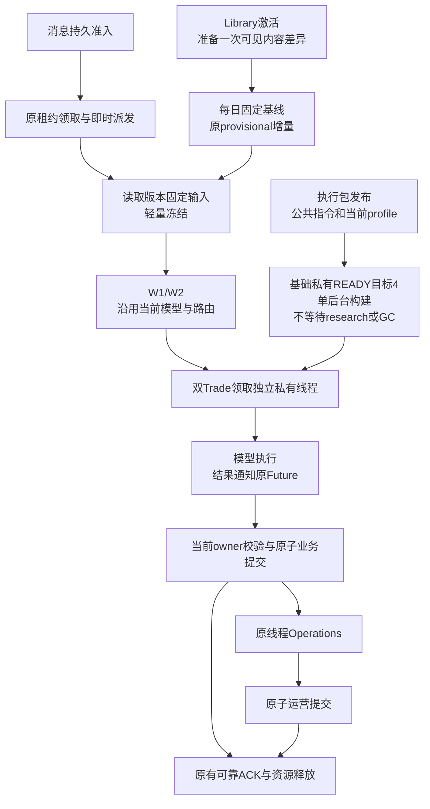

# DoxAgent Runtime 非 SDK 延时全局精益修复方案

日期：2026-11-18。交付阶段：代码审查、只读生产探测、机制测试与实施设计；**本轮未修改产品代码、生产参数或发布服务**。

## 1. 总体决策

本方案的核心不是再加一层调度保护，而是将实时 Case 的必要工作缩到：**领取已准备好的独立线程、读取明确版本的输入、发起模型请求、消费成功结果、一次性提交业务事实**。将公共计算、可再生资料编译、进度展示和维护从这条同步链中移出，减少它们产生的 CPU、内存、文件和 SQLite 工作。

采用一套相互衔接的改动：

1. **一个当前 profile 的基础私有 READY 目标，首发设为 4**。补货和 PRESSURE 回收使用同一目标；取消 W3 独立的通用 warm 库存目标。已有干净通用 Capsule 可直接被私有构建借用，不额外维持一套常驻池。
2. **基础补货不再服从投机预热的严格 CPU/I/O 滞回**。普通压力下按现有单后台构建通道补足基础库存；严重内存压力保留保护。真实 Case 缺货仍直接启动，不进新并发队列。
3. **私有准备只同步持久化不可丢失的恢复屏障**。删除 BOOTING 导入微阶段的 SQL 往返，合并 child/operation 登记；用现有 preparation task 和 MCP 通知取代正常路径轮询。降低缺货时的实际成本。
4. **冻结输入的重工作改为版本发布工作**。公共 Template 不读取 ticker 全业务输入；Fact Bridge 改成日基线与 Library 激活的内容差异，取消逐 Case 首次入库追溯。
5. **同时减少共享 writer 和源回执的写入放大**。修复 GC 写事务内文件工作，精简 ACK/状态投影，筛掉无业务变化的 Case 源回执。否则更积极补货仍会被相同 I/O 竞争拖慢。

目标是**完整 Runtime 非 SDK 内部耗时 P95≤10 秒**，并尽量恢复更低常态；Trade、Operations、完整 W3 仍分别验收。不改变 W1/W2 判断与路由、双任务一致性规则、Case 线程隔离、Trade→Operations 同线程、模型/参数/Fast、Prompt/Skill、业务 Schema、交易规则或固定上下文的业务边界。

必须明确一个工程边界：有限服务器、任意突发下完全不排队和无限预热覆盖不能同时保证。这里不引入实时限流门槛；以实际生产流量验收，并让缺货路径自身足够快。**4 是首发设计值，不是足以保证达标的数学结论，也不是绝对上限。**

## 2. 本轮核验与新增证据

### 2.1 版本与既有修复

本地审查 HEAD 为 `6f8386a59`；最新生产 Worker、Scheduler 及共享后端实际镜像 revision 均为 **`486931723`**。Worker 于 11-17 15:40:50 UTC、Scheduler 于 15:43:21 UTC 启动，即北京时间 23:40:50、23:43:21。与上轮不同，已是昨晚整包发布后的自然运行窗口。

核对后，W3/Runtime/Event Library 相关核心实现仍保留上轮修复：正式镜像 checked-hash 编译、模板 partial index、实时 Case 即时派发、批量固定版本 Event/Fact 读取、Future 当前 owner 消费、v6 原子运营提交、可靠 ACK/resident release。近期新增的是 Message Bus 去重及宿主内存保护阈值等改动，**不是这些延时修复被回滚**。

两份前置报告仍作为历史证据，不能与新窗口混算：

- [前轮实施与验收](runtime_nonsdk_latency_optimization_implementation_and_release_20261117.md)：最终 12 个完整 Case 的 Runtime 内部 P95 为 **25.51s**，W3 为 **21.84s**，实际未达标。
- [前轮预热与 Fact 勘察](runtime_latency_warm_fork_and_fact_business_audit_20261117.md)：重启后的 126 次绑定全 MISS；维护前 15 个分支 bound→READY P95 **37.74s**。不是完整交易日或本轮新版本的 P95。

### 2.2 新生产样本

本轮采用短超时、有限 SQL、原资源接口、两次 cgroup/进程计数及 60 秒新增文件通知。没有发起真实模型或新 Fork，没有扫描历史目录，没有停止/重启服务。

| 观测 | 结果 | 含义与边界 |
|---|---|---|
| 最近 256 行中的有效绑定 | 255：MISS 204、HIT 51；分支命中率 **20%** | 绑定窗口 11-17 15:56:36–17:24:23 UTC；不代表全天 |
| 17:24:32 UTC 资源快照 | 安全级别 NORMAL，可用内存约 **12.7GiB**；`startup_pressure=true`；未认领 READY/BUILDING=0 | 基础补货并非仅被严重内存压力阻止 |
| CPU/I/O PSI avg10 | CPU some **54.45**；I/O some **5.20**、full **0.79** | CPU 已处于旧滞回的 40–60 区间，不能解除曾触发的暂停；不等于 CPU 利用率54% |
| Worker 执行 | 实时6、后台4，无 Job 队列，事件循环最大 lag 3432ms | 无 Job 队列不能排除 Job 前准备等待；最大 lag 是本次启动以来累计观测 |
| 到达突发 | 1秒6次、5秒8次、10秒12次、30秒18次、60秒22次绑定 | 4份库存只能吸收其中两组双任务，必须配合准备提速 |
| 新捕获的一次通用热 Capsule 私有准备 | operation **2.180s**，Native Fork **1.412s**；6次 io.write 执行共41ms、排队约8ms；14次 io.read 执行约27ms、排队约172ms | 没有 capsule.spawn/BOOTING，走现有干净通用 Capsule。只有一个完整 operation，不能当 P95 |

监听收到的 `.progress` 与终态文件会重复包含同一 trace；上述只算一次完整 operation，不把四个文件当作四个 Fork。这个新样本说明：**Native Fork 不必然固定3–5秒，整条准备也有约2秒的现成可达路径；仍需解释高负载时它为何退化。**

### 2.3 资源与写入：证实到哪一层

北京时间 01:24:32 起约 15.56 秒的 cgroup 设备计数增量如下，均为 **253:0 单设备计数**，不是磁盘长期平均，也不是 fsync 次数：

| 容器 | 匿名/文件内存 GiB | 读 MiB/s | 写 MiB/s |
|---|---:|---:|---:|
| Worker | 3.89 / 3.86 | 1.98 | **11.53** |
| Projector | 0.08 / 0.22 | 1.82 | **5.74** |
| Scheduler | 2.30 / 0.41 | 1.72 | **4.95** |
| Message Collector | 0.36 / 0.14 | 0.84 | **4.02** |
| Site Access | 2.95 / 0.49 | 2.04 | 1.80 |
| Chrome Supervisor | 3.93 / 1.47 | 2.60 | 0.49 |

另一个独立 10 秒窗口，Worker **主 Python 进程**写入约 **9.99MiB/s**，同窗列出的单个 Native Codex 进程仅约0.03–0.08MiB/s；Projector约0.58MiB/s、Scheduler约0.38MiB/s。两窗差异大，禁止线性外推全天写入或将所有 Worker 写入归为模型日志。主 Python 的瞬时 FD 未捕获到具体文件，**还不能断言9.99MiB/s全部来自 worker-jobs WAL、workspace快照或某个checkpoint**。

当时 Runtime 主库约 **33.46GiB**，Worker 主库约 **1.46GiB**；WAL分别约10.75MiB和8KiB。WAL大小是存量，不是写入速率；小 WAL 不证明没有大量 checkpoint/反复页写。

一次进程抽样中，活跃 Native Codex 的 Pss_Anon 约180–370MiB，Python Capsule约106–109MiB，还可能带额外工具进程。**这些是活跃进程，不是4份空闲READY的实测成本。** 后续必须实测整组空闲子树PSS，不能按单进程RSS或容器总量估算库存收益。

前次假死的新证据见 [整包发布与宿主资源报告](../../docs/server-hang-and-main-release-20261117.md)：文件缓存下降到约1GiB、直接回收/后台扫描激增，伴随184–196MiB/s磁盘读及116–192ms平均等待。支持“匿名内存挤压工作文件页→回收重读→磁盘排队”的失速链；尚无事故前逐容器证据证明唯一首发进程。**本方案保护文件缓存余量，不以增加Swap或扩池掩盖。**

## 3. 目标执行链：减少必要工作总量

物理通用 Capsule 是构建材料，不再是额外 W3 库存目标；公共 Template 是版本化指令母本，不再被当成可执行库存；只有**活着、完成独立Fork和必要工具准备、尚未绑定Case的私有线程**算 READY。

成功结果的解析、校验、保存、业务提交继续绕过 Provider Pause；已有Job/Thread身份、暂停探测及恢复职责不改。后台维护既不作为 Case 前置，也不与 READY 补货共用一个串行长步骤。

## 4. 一体化预热与资源策略

### 4.1 统一目标与职责，避免多份控制状态

使用现有 `w3_ready_luna` 配置作为**当前活动 profile 的唯一基础目标**，默认改为4。未来换模型通过同一活动配置确定目标，不为历史Sol额外保留库存。scope沿用模板/模型/契约兼容身份；不按ticker分池。

| 项目 | 修改后 |
|---|---|
| 公共Template | 原有持久身份/版本和恢复；不新增物理保温进程 |
| W3私有库存 | READY＋未认领BUILDING按同一scope目标4补足；BOUND/USED不计库存 |
| 通用warm目标 | W3不再额外维持1个；已有干净位可借用；共享Worker内其他workflow确有需要的通用位纳入同一空闲资源预算 |
| PRESSURE回收 | 普通压力保留最多目标4份当前profile的可用私有READY；不保留旧profile投机库存 |
| CRITICAL/真实内存不足 | 停止额外创建，回收未绑定空闲资源；活跃/交接/清理所有权保护继续存在 |
| 实时缺货 | 原身份直建，仍bypass背景冷启动门槛；不等待凑齐库存 |
| 配置/Worker换代 | 原public/configure重新注册当前scope，恢复原Case；清理无活跃引用旧库存 |

复用 `W3ReadySlots.tasks/configs`、现有后台 cold gate 和内存安全状态；**不新增“基础池/快速池/应急池”三套表或状态机**。活动profile来自现有执行包/配置，退役scope不是删除历史Case绑定。

实施时注意两个现有细节：`configure()`目前直接给整个共享Runtime设置`w3_warm_target=1`，不能简单删除该覆盖而意外恢复成`launch_wave_size`份通用预热，也不能用全局0误伤非W3需求；`jobs`的warm调用应按当前共享空闲预算传入目标。reaper目前的`ready_profile`只有模型名，保留4份必须进一步对齐当前模板scope及完整profile，不能让旧模板同名模型占满保护名额。复用现有slot/config映射，无需新持久字段或注册表。

### 4.2 基础补货与额外投机：准入规则

当前 `allow_speculation()` 同时承担“还有没有内存”和“CPU/I/O是否足够空闲”两种职责。调整为小型纯判断：基础目标缺口与投机分别调用，但共用现有采样结果与所有权通道。

- **基础补货**：NORMAL且有内存余量时允许；普通CPU/I/O压力或PRESSURE恢复滞回不一票否决。仍只占用原有一个后台构建owner；真实Case可优先借走正在构建的线程并提升实时身份。不能因为4份都在建就另起4个背景冷进程。
- **严重内存信号**：CRITICAL、物理清理隔离未解决、接近aggregate硬边界、实际回收/换页伴随可用内存低于现有安全余量时停止基础新建；保留在途和busy保护。安全状态PRESSURE的历史滞回可通过其现有metrics判断“当前仍有真实内存不足”，不新增第二份内存状态。
- **额外投机**：第一版不在4之外常态追加库存。保留通用投机接口给非W3或后续目标调整，CPU some PSI触发阈值从60试调为**80**、恢复阈值从40试调为**60**；I/O some从20试调为**30**、恢复从10试调为**15**，仍保留10秒连续恢复。它们只约束可选工作，不是实时或基础4的准入条件。
- **持续严重CPU/I/O竞争但内存充足**：基础构建不无限自激，保留单后台owner、复用已有低频安全/维护唤醒，不忙轮询、不并发扩大builder；一旦实测构建抢占实时P95，先削减导入/写放大和无关后台工作，不能反过来封锁实时Case。

80/60、30/15是基于当前CPU PSI长期处于40–60、I/O some约5的**首发试验参数**，不是经充分容量测试得到的最优点。宿主内存阈值的近期修复不回退；Swap占用存量、load average或单次CPU PSI均不能独立判定内存危机。

### 4.3 补货调度：一个owner，直接事件驱动

修改 `codex_worker/app.py:prepare_assets`、`w3_ready.py:configure/claim/build.finally/fill`：

1. 当前public配置完成、每次成功认领、build完成/失败、物理资源退出、压力恢复时，调用同一个现有 `_schedule_fill(scope)`。
2. `fill`先做当前scope小集合库存判断，缺货才检查失败冷却并安排下一份；已在构建则直接返回。不要每次先全局 `reconcile_residents`、再扫历史成功/失败。
3. 原 `prepare_assets` 循环只作低频恢复兜底。research.reconcile、market固定视图、retire和GC各自完成一小段后退出，不再阻塞即时fill；不另建常驻线程池。可在同一循环先补库存，再做有界维护。
4. MCP就绪、build task结束直接唤醒等待者。SQL仍为重启/跨请求的持久来源；内存通知只减少同进程轮询，丢通知时可以按原operation恢复。

### 4.4 为什么不是“只把2改成4”

将新样本255次绑定按原时间回放：初始库存已满、一个后台builder、补货没有任何压力暂停；每次MISS直接冷建供该Case，不回灌库存。模拟值是敏感性分析，**不是生产性能预测**，未模拟CPU/I/O反馈且绑定时刻不一定等于消息原始到达时刻。

| 单份后台构建时间 | 库存2分支命中 | 库存4分支命中 / 两分支均命中 | 库存6分支命中 / 两分支均命中 |
|---|---:|---:|---:|
| 2.18s | 77.3% | **91.4% / 89.0%** | 96.1% / 94.5% |
| 5s | 66.3% | **81.6% / 73.2%** | 88.2% / 82.7% |
| 10s | 55.7% | **71.8% / 63.8%** | 78.8% / 71.7% |

因此4优先试，6作为按实际缺口/资源余量验证的下一候选；**不能指望把库存翻倍就让95%的Case全热命中**。端到端达标也可以来自“少量MISS的冷准备本身足够短”，不将命中率当成唯一验收。

首发前在隔离测试实例预建0→4份、不开模型turn，测完整空闲子树PSS、CPU秒、I/O字节及填满时间；与现有2私有+1通用比较净增。当前活跃树数据只能作容量参考。基础4若净增资源导致文件缓存/实时性能明显退化，应先减小每份成本；不能在报告中把4份内存成本写成已验证。

## 5. Fork、冷启动与就绪交接的具体精简

### 5.1 同步持久化缩为少量必要屏障

修改 `codex_worker/thread_lifecycle.py`、`capsules.py`、`capsule_child.py`、`w3_ready.py`，不引入另一套operation：

| 必要屏障 | 必须保存的内容 | 精简方式 |
|---|---|---|
| 接受prepare | 原request hash、operation key、原期限、generation/owner | 原子受理/CAS保留；重试读同一operation |
| 物理启动前 | 启动次数与capsule身份 | 一个短写，不逐个BOOTING写；沿用有限启动尝试规则 |
| Fork发送前 | `fork_dispatched_at`、原owner、最终期限和capsule | 一次fenced短写之后才发请求；保留未知结果恢复边界 |
| child身份确认 | Native thread ID、原parent/run、receipt | 子进程原receipt保留；父进程在一个事务登记registry＋operation完成 |
| 私有slot发布 | 工具确实就绪、thread/capsule、当前绑定身份 | 一个事务更新ready_at、thread/state及必要registry绑定；先检查是否已完成，避免重复写 |

删除SCHEMA_IMPORT、SDK_IMPORT、RUNTIME_CONSTRUCT、SDK_INITIALIZE等微阶段的operation SELECT/UPDATE。进度留在已有本地boot receipt，终态/失败时保存最新startup_receipt即可。SDK_READY微进度不必再成为一笔独立SQL屏障；首次物理身份、Fork前状态和child身份不可删除。

`checkpoint`每次先read owner再write owner并不能避免read/write之间换代；用现有owner条件UPDATE的rowcount判定替代重复SELECT。期限使用原冻结deadline和单调钟剩余量，实际绑定时更新一次；后台→实时提升通过现有绑定通知刷新，不反复写同一期限。保留CAS失败后的取消/清理，不把取消或LeaseLost吞为普通可重试失败。

本轮真实Lifecycle隔离实验：同一fake冷启动，5个BOOTING微写存在时 **14事务/12次update**，去掉后 **9事务/7次update**，BOOT_ATTEMPT、Fork前标记、CHILD_KNOWN、READY仍保留。这个实验只证明可以减少5次正常协议往返，尚未实现最终上述合并、也不替代重启正确性测试。

### 5.2 正常路径不再轮询自己的task

- `W3ReadySlots.build`已持有对应preparation task：正常同进程等待该task结果，不每100ms查询operation。重启后没有task时，仍加载原operation并进入原恢复路径。
- 绑定实时Case后，通过已有slot owner注册传播deadline/priority，取消无绑定状态下250ms SQL监视；恢复兜底保留有界检查。
- Research MCP的 `tools/list`就绪在现有内存ready标记之外同时完成一个Event/Future；build等待它，不50ms查询100次。断线/Worker换代的ready标记失效，不能跨generation复用成功证明。
- HTTP claim保留原身份和幂等；已有20秒边界不加长。客户端重查只join原task，不重复materialize、configure、重新Fork。
- slot发布后的private handoff可随已认领结果一次完成必要内存标记；不为同一次正常交接再读取一遍已知绑定。跨请求/恢复仍按SQL原身份校验。

### 5.3 冷启动必须真正减成本

依次实施，不先换进程模型：

1. **缩小导入图**：`codex_worker/schema.py`、`sdk_runtime.py`不应为W3 v6禁用的data/source_capture/D2/O4能力构建全部契约。将非W3专用依赖移至对应分支；必要节点枚举可移到现有轻量契约文件后兼容重导出，保持字段、类型、序列化和schema hash不变。优先依据import profile裁剪，不能仅把导入延后到第一个真实turn。
2. **预热到真正可执行**：私有READY必须包含必要SDK初始化、Native Fork和W3研究MCP就绪，不能只做Python启动就宣布成功。原profile、母本和工具能力保持一致。
3. **删除纯派生文件的重复写**：`sdk_runtime._start`正常准备/运行多次写model_selection、创建同一control目录等，改为内容相同时不重写；冻结输入和身份校验仍完整。基础SDK配置可按该物理client的现有配置值构造一次，Case cwd、阶段tier、scope等变化仍逐次准确应用，不缓存错误权限。
4. **分开量Native Fork**：已启用`include_turns=False`，保留。用现有trace+有限已知PID采样区分app-server请求、MCP初始化、pipe收发及父进程落库；检查同一Codex home的状态库/日志写竞争。只有发现明确重复的初始化/配置，才删那一项；不直接修改Native内部数据库。

新样本warm准备2.18秒可作为第一批合理参考；历史冷进程约2秒CPU则说明，若仍为每份反复构建同样Python/Schema，空库存时不会天然亚秒。目标是热认领P95≤300ms、常态冷准备P95争取≤3秒；后者是待验证工程目标，不是已获得结果。

### 5.4 干净物理能力复用的边界

第一批复用**尚未执行过Case的通用Capsule**，然后转换为私有READY，不创建第二个通用warm目标；这是当前已经支持且新trace证实的路径。

完成过Case的SDK进程跨Case回收复用，可能减少Python/SDK启动，但当前有resident/prepared thread、time control、MCP就绪/预算、未结束handle和清理状态，不能仅置`thread_id=None`就入池。第一批不把这项作为达标前提。

若第一批后CPU/内存仍由反复进程初始化主导，第二批才实现一个**无业务副作用的reset验证**：仅在原Case终态、结果与释放意图已持久、无在途turn/工具/回调、旧scope已清除时，清空已有resident/prepared缓存；新Case仍从公共母本新Fork，验证新Thread ID、cwd、工具scope及模型可见历史。任一项无法证明则继续退出原进程。复用不改变原Case逻辑Thread和恢复记录，不新增Case并发上限，不引入pre-fork Python服务或常驻进程管理层。

## 6. Runtime实时主链与成功结果消费

### 6.1 已有正确机制保留，删除剩余无关工作

| 环节/文件 | 保留 | 本轮实施动作 |
|---|---|---|
| `coordinator.dispatch_realtime/_submit_task` | 原Task claim、租约和注册锁，即时派发 | 准入返回已知task ID时直接按主键领取；不要每条消息列出本ticker全部PENDING/RUNNING再筛选。恢复tick仍用原列表 |
| `service.accept/_case_guarded` | 选定版本、日冻结、并行W1/W2 | 只读选定head的必要输入；Bridge/公共准备改走下文发布路径。记录claim前和executor等待，不归入SDK |
| W1/W2模型等待与W1R3 | 既有模型/并行与业务职责 | 不因W1R3未结束阻止W3；原per-ticker W1/W2容量不降低，若实测入口排队超标再单独处理，不误认为W3已有并发门槛 |
| Effect claim、实时W3线程、Future续接 | 当前实时直派、成功结果当前owner消费；实时不受8线程后台池限制 | 不回收到共享限额线程池；claim只处理到期短元数据，已完成Future立即唤醒原续接，不等ticker tick或Provider恢复 |
| Trade提交/Operations enqueue | 决策、共识、交易outbox及原子边界 | route投影可与必要提交同事务；只在业务变化时写，编码在writer外 |
| v6 Operations | 已有Pin/Watch＋applied guard＋stage/Case/route原子提交 | 保留，别重复实现旧版多事务合并。只剔除确认重复的外层状态投影 |
| ACK/resident release | 成功结果不得重跑；busy-safe物理释放、可靠意图 | release flag删除并入成功ACK commit；已ACK小收据不重复压缩/写回，仍需兑现后续release意图和新generation CAS |

`Journal`、repository和Worker的写事务分开计数：短写owner/gate等待、SQLite BEGIN等待、事务hold、commit分别计时。不得将`io.read`线程池等待或重试睡眠记作磁盘执行；跨进程writer也不能因进程内gate空闲就忽略。

### 6.2 状态持久化的删除与保留原则

正常v6路径不默认每个中间状态都要写两处。以**恢复所需事实**为唯一依据：

- 必须保留：Task/Effect租约与fencing、原request/Job身份、Fork前未知结果屏障、child身份、付费结果durable receipt、双分支结果与一次共识、Trade及运营业务提交、ACK/释放意图。
- 删除/合并：导入进度SQL、同一owner重复读后再CAS、同一事务可完成的registry/operation写、无变化的Case/route镜像、重复ACK压缩、为确认本进程task仍在运行而轮询数据库。
- Effect COMPLETED与阶段COMMITTED当前属于不同恢复边界，**第一批不为了少一笔写而直接删其中之一**；只有把现有后续工作全部可靠登记、证明当前owner可一次完成时再合并。
- 心跳继续现有批量续租；不延长lease或减少必要续租去压低统计。原Job查询404才可能按既有规则新派；超时、5xx、断链绝不等于未受理。

## 7. GC与写入放大：与预热一起治理

### 7.1 `gc_derivatives`具体改法

当前持`BEGIN IMMEDIATE`读全体context manifest、hash及删除的路径必须替换。只把BEGIN后移还不够：候选发现与删除之间可能有新Case绑定同一资产，且`extend_context`能延长旧引用。

推荐最小数据调整：在已有`w3_asset_builds`增加一个**`retained_until`引用保护高水位**，不新增引用表/GC队列：

1. `bind(case,phase)`在原context插入的**同一短事务**中，核对本次components资产状态/身份，并批量把其`retained_until`提高至该context期限。已存在且内容一致的绑定直接复用原token/文件；期限未增加不更新。`extend_context`同样提高这些已知component的保护期限。
2. 未迁移旧资产的高水位保持NULL，GC不能删；一次性后台按有效context分批回填，事务外读manifest，不能在发布启动或第一Case全量扫描。新绑定/延期的同事务高水位覆盖回填竞争。
3. 候选通过现有asset元数据、期限和有限SQL页选取，保留每ticker/kind最新必要源；源文件/hash在事务外验证，预算覆盖整个发现与处理过程。不要每轮扫所有目录、manifest或成功历史。
4. 最终删除前一个短事务复核资产仍可退休、保护期限已过、状态/源hash身份未变，标记为既有COLD；**仅保留同文件系统目录原子rename作为必要的最小文件屏障**，把目录移到唯一tombstone。rename不包含读取、hash、复制或递归删除，单次耗时单列，必须符合短事务预算；异常回滚/恢复需处理tombstone与状态对应。
5. commit后在writer/公共锁外删除tombstone。build/bind看见COLD则按原源重建，不可能删掉新的目标目录；所有资产写入口须遵守同一短事务协议。旧CLI直写入口同时适配，不能只依赖单进程RLock。
6. 若物理文件系统上atomic rename也出现可观长尾，不把它留在writer：改用同一asset行短暂RETIRING标记、事务外rename，再落COLD；build/bind必须识别该短暂状态并先恢复/完成原退休。**仅在实测需要时采用这一额外状态**，首选前述最小原子屏障。

新增一个高水位字段会给首次绑定带来少量SQL，换取移除周期性全context文件扫描和正确引用保护；这是有明确必要性的取舍。保护至最长context期限可能略延迟回收，不影响Case可见性。干跑只读，不取得writer；禁止用GC延长SQLite timeout。

### 7.2 当前源回执的确定冗余

`v2_read/outbox.py`对`runtime_v2_cases`的UPDATE比较所有字段，包括技术更新时间；触发后复制整行。当前任务续租已有部分thin处理，不能据此认为Case已同样处理。

本轮真实`SourceOutbox.migrate`＋临时SQLite测试：262,189字节Case payload，INSERT后仅修改`updated_at`，产生两份源回执，总524,602字节。**证明技术更新可重复捕获大payload；不证明当前生产每行都内联这么大，NativeContent外置情况需分开统计。**

修改时先取消费者实际字段集合：排除纯心跳/同业务状态更新时间触发，保留首次准入、NEW/OLD/Policy结论、Trade方向、阶段终态、错误及必要时间变化。不要把整个Case回执变成“只传ID再读最新行”，那会破坏原事件版本/修复语义。利用现有不可变内容引用，不重复展开冻结输入；投影需要的薄字段随原序号固定。旧回执继续按旧格式读取，不重写历史。

Worker `JobStore.save/event`、Runtime多份worker_invocations/receipts、Projector ingest及日志列为同批写入审查对象：分别测事务数、逻辑payload字节、WAL页、checkpoint和物理I/O；**先删确定重复写，不预先放宽FULL同步、删除durable receipt、改journal_mode或无界缓冲事件**。

### 7.3 未归因的高写入如何收口

实施前用现有已知PID及文件做短窗差分：Worker主Python、Native、Scheduler、Projector的`/proc/io`；WorkerJobs、Runtime、read-serving、Codex状态库/日志的大小、mtime和WAL/checkpoint计数。必要时使用一次性、有界低频文件通知，不上长期全量trace。

若主Python高写入定位为快照/同内容原子重写，改为内容身份命中免写；若为重复Job/事件页写，按同一状态/序号去重、保留结果与SSE可恢复边界；若为Projector源捕获/无变化ingest，按上述业务字段与原事件身份消重。没有定位前不把11.53MiB/s全部算作GC、SSE或checkpoint收益。

Message Collector、Chrome/Site的资源成本计入整体容量背景，但不在本方案擅自关闭源、降低采集质量或重启浏览器。跨组件优化只处理已证实的冗余，避免借W3修复重写消息总线。

## 8. Fact Bridge与每日冻结的最终设计

### 8.1 保持什么，删除什么

保留美东**02:00语义切日**；Known Event Index仍为Reference ACTIVE、首次入库14日、实质Fact首次入库7日的并集，包含当天。保留当日索引内容/顺序100%固定、召回ID可在同一固定版本读详情、当日eligible provisional全量可见及PROCESSED结算后可见。

删除Case路径的`new_library_facts→fact_admissions→分支历史`资格追溯。历史原始入库记录继续保留供审计；“不在每条Case上查”不等于删除数据。旧内容重新可见只作为已有信息帮助OLD识别，不代表新催化。

### 8.2 一次激活处理，原provisional承接

修改 `daily_index.py`、`providers.py`、`service.accept`、`maintenance.py`及现有激活入口：

1. **每日基线**：原ticker/day冻结root、version、索引和详情保持。以它的归一化事实内容集为当日已知基线，继续复用现有不可变快照/本地已存在集合，不新增另一个业务缓存层。
2. **激活准备**：已完成候选Library发布后，可在维护任务原frame下预计算候选当前可见内容与基线的差异；输出一份已有内容存储形式的不可变批次，身份包含ticker、可见语义日、激活revision、root/version。不能在Control真正激活前将它写成全局可见provisional。
3. **激活生效后应用**：在Runtime同一个短事务内，批量加入原`already_published=True/PROCESSED` provisional，并记录该激活批次已应用；source ID由激活身份＋Fact/内容确定，不再依赖首次历史版本。内容去重、ID分配与完成标记原子提交。
4. **Case读取**：只确认其选定激活head的bridge已应用，然后取原日内provisional快照。没有激活变化时只有精确键读取，不扫Library。
5. **跨库提交缝隙/人工激活**：Control已切换但Runtime批次未提交时，第一条选中该head的Case复用同一个head处理owner，读取当前固定版本做一次扁平内容差异；并发Case join这次有限工作，不各展开历史。复用现有激活/维护Future注册与持久完成标记，无需新任务队列。旧版本Case继续原冻结输入。
6. **进程重启/重复通知**：先查同一激活批次完成标记；丢失内存通知时从选定Control revision和原frame恢复。新旧root版本不作跨root大小比较；head标记不能被较旧激活覆盖。

对发布时间跨语义日的late O2，使用**实际激活可见日**补充当天基线，不能只写回原维护日。前一日已结算provisional不自动全搬到今天；只补今天基线未覆盖的当前可见内容。批次失败不能静默标记完成，不能将prepared-but-unactivated内容提前透露给W1。

当前root改变时`after=0`、同root时`after=frozen_version`造成差异；统一改为**相对日基线的新可见内容**，包含同root恢复的旧内容。这是明确修正可见性不一致，不宣称与旧bug逐项完全等价。日内已加入的provisional仍按原机制保持可见，不在Library后来撤销时反向改写已冻结Case。

### 8.3 14/7筛选的历史追溯不留首Case长尾

Bridge移除历史读取后，每日索引首次筛选仍可能展开谱系，不能遗漏。优先在Library发布完成时准备**当前head/语义日的14/7选择结果**，复用发布文件/已有daily index存储；首Case只按当前head选择已编译结果并原子冻结，预编译不提前冻结当天版本。O2发布、人工激活、切日均复用同一准备函数。

长期从根本上消除每日深历史读取：在既有canonical元数据中保留Event首次发布语义日、Fact revision的**该业务内容首次发布语义日**，由发布器维护并随minimal branch继承，不加到Prompt/业务Schema。内容A→B→A仍回到A的首次时间，维护Reference/review不重置。先一次性后台补齐；缺失时保留旧不确定性逻辑或离线编译，不在热Case逐Fact追查。不要用`created_version`对应的当前分支时间、最新revision日期或事件发生日期替代。

此项范围比Bridge大，作为第二批的发布数据优化；不为赶第一批上线做全库在线回填，也不通过“等O2完成才接收Case”规避首Case问题。

## 9. 公共准备、READY历史和research上下文去重

### 9.1 公共准备仅与公共身份有关

`W3Execution.prepare_public`目前先`input_snapshot_loader(ticker)`再构造全局模板键。改为从现有execution bundle、指令hash、模型profile、工具/契约hash直接确定Template身份；同一版本多ticker只准备一次母本并configure当前库存。

ticker的D1/D2等research pin刷新独立走原激活路径，不能随Template公共化删除。Worker重启后即使Template记录READY也必须恢复当前配置及物理库存；完成标记包含现有Worker generation，不能仅凭旧数据库标记跳过。不要新增另一份模板注册表。

### 9.2 READY fill不随历史行数变慢

当前`max(ready_at)`历史扫描本地100→10,000行的VM工作约100倍。改为：

- 先用现有scope/state索引查READY/未绑定BUILDING计数；已足量立即返回，不做历史失败检查。
- 确有缺口时，以同一scope最近成功时间及最近两次失败判断冷却；用有序索引/现有最新行查询替代无索引MAX，必要时只加一个`(scope,ready_at DESC)`索引，不再复制成功时间到另一张状态表。
- reconcile仅检查现有内存resident与活跃候选，重启恢复单独有界执行；不把全局扫描带入每次认领。
- readiness接口按当前active profile检查；去掉已无业务用途的“Luna和Sol都READY”条件。将带写reconcile移出健康GET，健康检查本身只读；不能因为接口变绿就当库存达标。

### 9.3 research bind/manifest

当前`W3ResearchStore.bind`即使同Case/phase和同manifest仍可能重写文件，且global RLock涵盖文件处理。先在writer外完成确定性manifest编译、校验与内容寻址免写；同phase同内容返回原token；真正新绑定才在短事务登记与提升资产保护高水位。不同Case内容不能因缓存命中混用token/范围。

同样的research component按已存在身份安装，不反复read/hash全部pack来确认“仍存在”；首次使用/损坏/版本改变做必要验证。只消除实测重复工作，不新建跨Case可变业务缓存；原冻结hash与读取边界保留。

## 10. 实施分批与回归边界

### A：同批交付可执行库存与低放大准备

| 修改集 | 主要文件 | 完成条件 |
|---|---|---|
| 统一目标4、取消额外W3 warm、回收一致 | settings、startup_admission、capsules、w3_ready、jobs | 4份可认领库存；普通压力可补、严重内存不新建；实时bypass不退化 |
| 即时fill脱离维护 | codex_worker/app、w3_ready | claim/build/恢复事件即时触发；长research/retire不阻塞补货 |
| 持久屏障及通知精简 | thread_lifecycle、capsule_child、capsules、w3_ready、research_mcp | 无正常微阶段SQL轮询；原Fork/恢复身份与工具就绪完整 |
| 导入/派生免写 | schema、sdk_runtime、相关轻量契约 | 无模型/Schema变化；冷准备CPU、文件写入真实下降 |
| 结果/ACK与无变化投影 | w3_execution、job_store、v2_read/outbox | 不重复提交；终态结果原子；源回执只排除确定无业务变化 |
| GC短事务 | w3_resources、w3_research_store、延期/恢复入口 | 新引用并发安全、旧数据分批回填、无writer内扫描/hash/rmtree |

这批不是把所有已知优化强行绑成一次不可审查提交；按上述文件组独立提交、组合测试和发布，业务启用版本一起核验。4份库存不先单独“裸上线”后等待CPU/I/O成本优化。

### B：输入发布与长期增长脱离Case

实现日基线＋激活差异、公共准备解耦、READY历史查询和research bind去重；完成14/7预编译/入库元数据的一次性迁移路径。保持旧Case按旧冻结版本恢复；不重写历史事实时间或旧回执。若A已改善W3但完整Runtime仍超标，B属于达标必需工作，不能只验W3就结束。

### 必要测试矩阵

- **预热**：目标4时两个双Case四份独立Thread全HIT；第三Case缺货直建；相同请求返回相同slot；配置换代、压力恢复、旧scope退役；无孤儿/串用；memory NORMAL＋CPU中间区间仍补基础库存。
- **启动恢复**：每个必要屏障前后取消/重启；Fork已发未回、child已知未登记、工具断连、owner被替换；保持原期限、不盲目新Fork。
- **实时链**：准备中/已完成Future不受Provider Pause拦消费；新Case不等维护；已受理Job的5xx/超时与确定404严格区分；高并发下Effect/心跳owner换代不重复模型或业务提交。
- **业务**：双结果留存/共识选择、Operations同线程与标准tier、W1R3并行、W1/W2结论不被W3改判；Prompt/Schema/Fast逐项不变。
- **GC**：bind/extend/build与退休交错、rename失败/SQL回滚/进程退出、旧NULL高水位、源缺失、干跑；不能删活跃资产或阻塞writer读取大文件。
- **事实**：切日、晚到O2、日内补充、root切换、同root内容恢复、A→B→A、维护元数据变化、prepared未激活、激活后Runtime提交前崩溃、重复激活；Bridge不重复进入O2；索引字节与详情固定版本兼容。
- **投影**：技术无变化不产生多份回执；真实终态/错误/时间变化仍到达；旧回执可回放，消费者不因读取最新行丢失原事件语义。
- **增长**：固定活跃集下历史slot/context/Case规模增加10倍，热准备/claim/已应用bridge不发生相应扫描增长；测试检查查询计划/VM工作及实际wall，不仅断言输出。

本轮新增5项机制测试已通过，前轮10项提供独立既有证据；两组不冒充最终实现回归。修改产品代码后按用户要求追加`changelog`，本轮仅审计原型不记录为已实施能力。

## 11. 统一验收与发布防回退

### 11.1 性能口径与预算

完整Runtime从持久消息准入至Case全部必需业务终态计算，沿用前轮统一源时钟/模型区间联合口径；并行W1/W2、A/B不相加，W1R3并行不能掩盖内部等待。单独列Trade、Operations和完整W3，另列原来准入/冻结之前的消息投递时间。

**所有内部领取、executor/事件循环等待、准备、Native Fork、SDK初始化、SQL锁等待、内部重试/退避、结果消费都计入。** 真实Provider等待单列；SDK方法名不等于模型推理。不得把慢内部RPC从指标中删除，缺失时钟不按0算。

| 必要环节 | P50先验 | P95工程预算 |
|---|---:|---:|
| 准入/精确Task领取/调度交接 | 10–50ms | 300ms |
| 已发布版本读取与冻结 | 100–300ms | 1s |
| W1/W2各轮本地组装、校验、持久化合计 | 数百ms | 2s |
| W3双分支热领取/派发 | ≤100ms | 500ms，按关键链而非相加 |
| W3冷准备 | 单列 | 争取≤3s，全部计入整体 |
| Trade成功结果→业务提交 | ≤200ms | 700ms |
| Operations准备/成功结果提交本地合计 | 数百ms | 1.5s |
| 其他必要内部交接余量 | — | 1s |

这是工程预算，不是各项P95可相加的概率保证；最终必须用每Case完整区间直接重算。目标整体**P95≤10s**，并报告P50、P99/max及超标原因。已异步ACK/资源清理另报时长和资源驻留；不能把必需业务提交挪成异步来冒充完成。

### 11.2 生产验收

- 最终组合至少100个连续自然完整Case，覆盖正常开盘高峰、多个ticker和双任务；不剔除冷MISS、慢Case、失败或缺时钟，分别报告其类别；发布/重启瞬间单列但不可隐瞒。
- 先做单实例非业务预热试验测4份成本，正式发布后核验相同代码与有效参数。真实流量下可比较4与6，只有CPU/I/O/PSS允许且关键链仍受缺货影响时才提高；不为追命中比例损害整体P95。
- 同时报告单分支HIT率、双分支均HIT率、缺货冷准备分布、补货完成吞吐/空库存时长、后台被抑制原因；不能只看dispatcher healthy。
- 资源至少跨开盘高峰和维护周期观察；对照每Case CPU秒、物理I/O、写事务数/逻辑字节、整组空闲PSS、文件缓存余量、memory/IO PSI、Swap实际流量及清理完成数。不得用重启后的内存下降声称长期改善。
- 不降低实时W3并发、不扩大常驻executor、不延长timeout/lease。若资源与延时不能同时通过，如实判失败，继续处理已定位的准备/写放大，不用新的保护队列隐藏问题。

### 11.3 轻量防回退

1. 正式`storage_release`归档/镜像路径继续执行checked-hash编译；检查关键模块hash、有效profile/target、PRESSURE保留数和实际READY存活，不只核验Git HEAD。
2. 部署冒烟使用无模型私有准备确认模板、MCP、4份库存；生产切换保持原Job/请求恢复身份，不重放全部历史积压。实时仍直派，历史沿既有一次性恢复授权方式处理。
3. CI加入少量结构性断言：正常启动事务预算、GC无大文件操作持writer、已应用Bridge不调用历史追溯、命中路径不轮询operation、技术更新时间不复制Case回执。避免依赖CI机器wall的脆弱绝对耗时断言。
4. 复用现有日志/资源接口增加有限计数，不落每Case高频诊断表：READY命中/缺口、启动各段、writer wait/hold、按进程/组件短窗I/O。readiness GET只读且仅检查当前profile。
5. 保留旧请求/旧Case读取和模型适配；回滚部署不重置Job/Thread、不删除已应用Bridge批次。新语义日内容可见性修正属于有意行为变化，应在发布记录说明。

## 12. 确证、假设与交付物

**已证实**：基础补货与压力滞回/回收不匹配；库存少且突发需求超过4；冷准备有真实长尾；干净热Capsule约2秒路径存在；微阶段SQL可减少；GC写事务包含文件重工作；Case技术UPDATE可重复复制源回执；新窗口Worker主Python写入较高。

**仍待定量验证**：4份空闲READY真实资源成本及高峰填满时间；主Python高写入的具体文件/事务组成；Native Fork及boot wall–CPU差额中的调度/文件页/SDK内部占比；跨Case物理client安全reset的收益。方案已给出各自最小验证和决策分支，不把这些假设当修复收益。

本轮原始只读证据、分析和5项测试位于 `eval/runtime_global_latency_design_20261118/`：`production.json`、`analysis.json`、`processes.json`、`io.json`、`live-traces.json`、`test_design.py`、`test_results.json`、`tests.xml`。`analyze.py`保存库存敏感性回放口径。原始FD路径/PID仅留审计目录，不放产品界面。

本方案要交付的是：**更少的实时必要工作、一个能实际补起来的私有库存、显著更短的缺货路径，以及不会随历史规模放大的持久化与输入准备。** 在组合生产数据达到完整Runtime P95≤10秒之前，不以单SQL变快、命中率提高或测试全绿代替整体性能完成。
