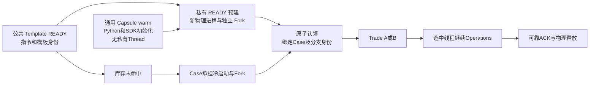

# Runtime 非模型延时：预热、私有 Fork 与事实可见性根因勘察

日期：2026-11-17。性质：**只读生产勘察、离线机制测试和优化建议，未实施业务代码修改或发布**。

## 1. 结论与证据边界

当前最值得优先解决的是：**公共模板已经 READY，但可直接认领的物理私有线程没有准备好；新 Case 因而承担了完整冷启动、私有 Fork 及多轮持久化交接。** 现有预热和回收各自有保护意义，但它们对库存的定义、压力恢复条件和双任务消耗量没有对齐。继续压缩普通查询，不能独立解决这一问题。

本轮有五项主要发现：

1. **生产确认预热未覆盖实际领取。** Worker 本次启动后、外部维护停机前，126 次私有领取全部记录为 `POOL_MISS`；剔除启动最初两分钟仍为 112/112 MISS。运行中的未认领 READY/BUILDING 查询结果为空，同时 `startup_pressure=true`。这证明所观测窗口存在持续库存不足，不能把它仅解释为启动瞬间。
2. **准备等待是真实时间，不是双任务指标简单相加。** 新捕获且在维护停机前准备完成的 15 个分支，绑定至 READY 的 P50/P95 为 **17.17/37.74 秒**；operation 创建至 `FORK_DISPATCHED` 为 **12.93/26.22 秒**。子进程启动至 SDK_READY 的 wall 为 **10.19/16.95 秒**，对应子进程 CPU 约 **1.98/2.10 秒**。Native `thread_fork` 自身另需 **3.20/5.03 秒**。这些阶段尚未发起模型 turn。
3. **有可复现的预热机制冲突。** CPU/I/O 压力滞回会同时停止私有 READY 补货和通用 Capsule 预热；压力回收仅保留每个 profile 的一个 READY，而一个双任务 Case 需要两个。当前 Luna 默认目标 2 也是全局库存，只覆盖一个双任务 Case，并非每个 ticker 各有两个。
4. **Fact Bridge 的热路径历史追溯可以从业务设计上精简。** 日冻结后的事实可见性仍有必要；但常见的 O2 分支发布切换 root 时，现代码将历史过滤下界设为 0，首次入库版本追溯实际不再筛掉正版本事实。推荐改为“每日固定基线 + 每次 Library 激活的可见内容差异”，复用 provisional，不再逐 Case 沿谱系追溯。
5. **另发现一个确证的共享 writer 风险。** `gc_derivatives` 在 `BEGIN IMMEDIATE` 之后读取所有有效 context 的 manifest，并可能继续读文件、hash、rename、rmtree；0.25 秒预算不覆盖前置扫描。它可以阻塞 Ready/Thread/Job 的同一个 Worker SQLite writer。但没有证据表明它在本次重启后短窗口运行，**不能将它认定为本次冷启动长尾的主因**。

**整体非模型延时 P95≤10 秒尚未达成，本轮也没有产生修复后的达标结果。** 15 分支是针对新完成 Fork 的小样本，不是全量 Case 性能验收；126 次领取也不代表全天或稳定运行数日后的命中率。

### 1.1 当前版本、窗口与干扰控制

| 项目 | 本轮依据 |
|---|---|
| 本地审查起点 | `2cc0f6bf2`；Worker/Runtime 核心目录与上轮部署后的相关实现一致 |
| 实际 Worker 镜像 revision | `6006500ca`，包含正式镜像编译修复 |
| 实际 Scheduler 镜像 revision | `86b1f9864`，包含截至 `82fc441d0` 的延时修复及后续独立缓存改动 |
| 本次 Worker 启动 | 2026-11-17 **14:52:44 UTC / 22:52:44 北京时间** |
| 运行中库存/资源快照 | **15:07:59 UTC / 23:07:59 北京时间** |
| 小文件新增通知监听 | 15:08:15–15:10:45 UTC，158 个通知、18 份 Native Fork 回执，无 overflow |
| 外部维护停机 | Scheduler 15:09:47、Worker 15:10:17 UTC；用户已说明由其他操作负责，本轮不排查或干预 |

用于分段统计的 15 个分支，其 slot READY 均早于 Scheduler 停机；另外三个跨越维护边界，不纳入该组统计。后置 SQL 快照用于读取已落盘的领取记录，不将停止后的 HTTP 失败计作业务故障或零负载。

勘察期间另一对话新增本地 `1bfb08fa9`，只调整 `scripts/resource_safety_controller.py` 的低可用内存压力阈值及测试、changelog，没有修改本轮审查的 Runtime/Worker 核心目录。此变化可能让 PRESSURE 更早触发；后续实施必须与之对齐，不能一边提高保护阈值、一边继续沿用“压力下 READY 只留一个”的不匹配规则。本轮不推断该提交已在观测窗口生效。

只读诊断使用短超时、有限结果的 SQLite 查询及原有 `/v1/resources`，没有模型请求或重启。第一次 2048 行历史领取查询触发 0.8 秒中断，后缩小为 128 行并记录异常。128 行最早创建于 14:10:56，早于本次启动，足以覆盖本次启动后的 126 条绑定记录。没有为补证据扫描整棵 timing 历史目录。`sar` 未返回目标窗口的采样行，因此本轮**没有可用于逐秒归因的宿主机 CPU/磁盘/Swap 历史序列**。

## 2. 历时机制：哪些已修、哪些仍然存在

上轮实施报告为 `runtime_nonsdk_latency_optimization_implementation_and_release_20261117.md`。其最终纯版本窗口为 12:37:06–12:42:06 UTC，共 12 个完整自然双任务 Case：Trade 内部耗时 P95 **17.61 秒**、Operations **7.24 秒**、完整 W3 **21.84 秒**、完整 Runtime **25.51 秒**。

| 时间/提交 | 机制变化 | 本轮判断 |
|---|---|---|
| 10-19 `0ac584949` | 衍生资源 GC 等机制进入主线 | GC 文件操作持有 writer 的问题仍在；不等于最近才引入 |
| 10-21 `039d67758` | 启动压力滞回/预热准入保护 | 保留资源保护目的，但长期空库存与补货恢复条件需调整 |
| 10-27 `50d6b0219` | PRESSURE 回收时每 profile 保留一个 READY | 对单任务尚能提供一次命中；与当前双任务需求冲突 |
| 11-10 `f8bf76541` | 实时启动绕过普通冷启动门槛、物理所有权和回收保护 | 已有正确机制，不能误诊成实时 Case 必须等待 cold gate |
| 11-16 `c401cdc3b` | v6、Case 隔离、双 Trade 进入当前链路 | 增加私有资源消耗，暴露旧库存/回收策略不匹配；不是简单统计问题 |
| 11-17 `6006500ca` 及后续修复 | 正式镜像编译、模板索引、Future 当前 owner 保存、实时准入直派、批量 Fact 读取、v6/ACK 收尾优化 | 必须保留，不回滚；未消除冷准备及其持久化交接成本 |

上轮已有修复不能遗漏：ticker 维护已从实时准入前置移开；新 Case 已即时派发；模板 partial index 已正确使用；成功 Future 由当前 Effect owner 消费；大对象编码已尽量移出 writer；非选中 Trade 和完成 Operations 的物理资源已支持可靠释放。**不能再次以“删除现有全部保护”“恢复跨 Case Thread Reuse”代替优化。**

## 3. P0：三层 READY 的实际含义与库存失效

### 3.1 当前链路

- **公共 Template READY**：`w3_execution.py:72`、`w3_threads.py`。v5/v6 兼容键不带 ticker，冻结 AGENTS/Skill/operations、模型和契约等身份，不带其他 Case 历史。逻辑模板 READY 不保证活着的 Python/SDK 进程，也不保证私有线程库存。
- **通用 Capsule warm**：`capsules.py:444`。当前目标为 1；它已完成 Python/SDK 初始化，但尚无 Case 私有 Fork 和就绪工具证明。
- **未认领私有 READY**：`w3_ready.py:73,100,214`。从模板创建独立子线程并完成准备，库存由 scope/profile 全局共享；默认 Luna 2。Case 通过 SQLite 原子认领绑定 `(case_id, record_id)`，之后不再给其他 Case 使用。
- **Case 私有 Thread READY**：保持原绑定身份交给 Job；同一 Case 的选中 Trade→Operations 继续使用原线程。恢复、未知派发和 ACK 继续按原身份处理。

**预先创建尚未归属任何 Case 的独立空子线程，再一次性认领，符合 Case 隔离；复用已经处理过其他 Case 的线程则不符合。** 两者不能混淆。

### 3.2 实测库存与冷启动

| 观测 | 结果 | 可以证明什么 |
|---|---:|---|
| 本次启动后全部绑定 | 126 MISS / 126 次 | 所观测窗口内领取命中率 0% |
| 跳过最初两分钟 | 112 MISS / 112 次 | 未迅速恢复成稳定预热覆盖 |
| 15:07:59 未认领 READY/BUILDING | 0 | 该时点没有可直接认领或尚未绑定的补货库存 |
| 同时 startup_pressure | true | 当时补货准入被压力规则抑制；不能推断全窗口每秒都为 true |
| active executions | 22，实时 21、后台 1 | 存在真实并发需求 |
| 实时 Job 排队 | 0 | 不能据此说没有准备等待；等待发生在 Job 前 |
| cold_starts | 18 | Worker 的该计数不等于全部私有 Fork 数，不能替代领取统计 |
| 事件循环最大 lag | 12,917ms，超过 250ms 共 68 次 | 自本次启动以来出现过严重迟调度；不能定位为某条 SQL 或当时持续 lag |

快照的一个 cold gate waiter 属于预热/后台路径，实时启动已有 bypass；`cold_active=false` 也不能推导为“所有私有准备没有等待”。通用空闲 Capsule 的精确存活库存没有在本次接口中暴露，**不把配置目标 1 当作实际库存 1**。

历史纯版本 12 Case 窗口中，24 个分支的 ready-claim HTTP 持续时间 P50/P95 为 5.22/10.32 秒，其中 17 个超过 1 秒、12 个超过 5 秒。这是请求耗时，不是 POOL_HIT 比例。已有 Job 的 `boot_already_ready=true` 只说明**到 Job 启动时**准备已完成；相关 SDK boot 已在 Case 前置准备中消耗约 3–4 秒，不能据此判断 Case 到达时命中了预热。

### 3.3 已复现的机制冲突

**补货被视为可以无限推迟的投机工作。** `StartupAdmission.allow_speculation()` 在 CPU PSI≥60 或 I/O PSI≥20 后进入压力滞回，只有 CPU<40 且 I/O<10 连续 10 秒才解除。离线测试中，内存始终 NORMAL，CPU PSI 从 65 降至 45 后持续 600 秒，预热仍不恢复。`ready.fill()` 与通用 `warm()` 同时受此限制。实时需求仍可冷启动，于是可能形成“补货被停→新 Case 冷启动→继续产生压力→补货仍被停”的反馈。**代码路径和反馈条件已证实；生产中各时刻 PSI 与反馈的定量贡献尚未完整记录。**

**回收与双任务库存定义冲突。** `capsules.py:609` 的 PRESSURE 回收只保留每 profile 一个 READY。真实类测试：2 私有 READY + 1 通用 warm，回收后只剩 1 私有 READY。普通 NORMAL 路径不会按普通闲置 TTL 清掉 `ready_slot`，不能把这次问题归为普通 TTL 提前释放。

**默认 2 个是全局两个。** 真实 SQLite 认领测试：两个双任务 Case 共四次领取，只能得到 HIT、HIT、MISS、MISS。并发没有人为上限时，固定库存无法保证任意突发 100% 命中；这不是靠一个更大的固定数字就能彻底解决的问题。

**补货存在无关前置依赖。** Worker 已有独立 `prepare_assets()` 30 秒循环，不能说补货只靠 ticker scheduler；但其顺序是 research reconcile→market warm→各 scope fill→retire→到期 GC→sleep。多个 research pack 编译、退役 RPC 和 GC 会推迟下一次库存修复。claim/build.finally 已有直接 `_schedule_fill`，应复用并保证它能有效补货，不新增另一套长期调度器。

### 3.4 推荐方向：保底预热与可选投机分开，保留实时直派

1. 用**同一个现有目标值**定义当前 profile 的补货下限和 PRESSURE 回收保留数，至少覆盖一个双任务的两份私有 READY；不再一处目标 2、另一处保护 1。只针对当前实际 Luna profile，不为不用的 Sol 额外常驻资源。
2. 将现有小额基础库存与额外投机区分：普通 CPU/I/O 压力下，内存允许时仍可由原冷启动通道有界补足基础库存；CRITICAL 内存、未完成的物理清理与所有权隔离继续有效。滞回主要限制额外投机，不应让基础库存长期为零。**不取消实时 bypass、不用冷启动 semaphore 限制真实 Case。**
3. 优先在现有“2 私有 + 1 通用”的空闲资源预算内验证利用率：例如将低价值通用空闲位转为直接可认领私有位，或让通用位直接服务补货。先量每种空闲位的 PSS/RSS、进程数、补货完成率，再决定目标；不直接增加为 16/每 ticker 一池，也不增加新的常驻进程。
4. 将补货从 research reconcile、批量 retire/GC 的串行前置关系中移开，复用现有通知及 Worker 维护循环。保持一次有限后台 build、认领后即时补货、generation/config 变化重新配置和进程重启恢复。
5. 保留实时缺货时的直接创建；降低这一路径本身的成本。不能为了库存命中率把 Case 隐藏排在库外，也不能通过不释放已完成 Case 资源“维持热度”。

## 4. P0：真实私有准备分段——时间在哪里

以下 15 分支均为 `POOL_MISS`，startup_attempts=1，无 recovery_count，准备在维护停机前完成。单位秒，P95 使用线性分位数；分位数不可逐行相加。

| 分段 | P50 | P95 | 最大值 | 解释 |
|---|---:|---:|---:|---|
| slot bound→slot READY | 17.167 | 37.743 | 37.764 | Case 真正承担的前置等待，不含模型推理 |
| operation 创建→FORK_DISPATCHED 标记 | 12.934 | 26.215 | 29.741 | 包含启动、checkpoint、恢复身份检查及调度间隙 |
| 子进程 boot 起点→SDK_READY wall | 10.187 | 16.946 | 21.005 | 子进程内导入、构造、SDK 初始化及其等待 |
| 同期子进程累计 CPU | 1.977 | 2.099 | 2.183 | 与 wall 差异显著；不包含 SDK 子孙进程全部 CPU |
| FORK 标记→Native prepare trace 开始 | 0.117 | 1.229 | 1.860 | 标记持久化、pipe/父子交接等，不能全叫 Native Fork |
| Native `sdk.thread_fork` | 3.204 | 5.032 | 5.582 | 原生 SDK 请求；`include_turns=False` 已有，不涉及模型 turn |
| Native trace 结束→operation READY | 0.717 | 3.838 | 5.991 | 子线程回执、父进程消费、registry/checkpoint 与调度等 |
| operation READY→slot READY | 0.275 | 0.955 | 1.346 | 后续就绪/发布步骤，应继续削减交接 |

根据 boot.json 的 mtime 与 boot wall 估算，operation 创建至子进程开始 P50/P95 约 2.23/5.92 秒；子进程写出 SDK_READY 至 FORK 标记约 1.99/6.29 秒。**这是文件时间推算，不是独立插桩精确边界**，不能将其直接宣布为 writer 锁等待。

代表分支 `case_81980c19e21c459b9251938c2cd9a69e / d9eaebc1d4c242d7a7cd8e2b6feea53c`：绑定至 READY **32.85 秒**，其中 operation 创建至 Fork 标记 **21.24 秒**；boot wall **13.57 秒**、子进程 CPU **1.95 秒**；Native Fork **5.58 秒**；Native 完成至 operation READY **2.92 秒**。这足以排除“只有统计口径异常”的解释。

### 4.1 已知工作与尚未定位的等待

- **已知**：每个冷 Capsule 重新导入 Worker Schema、SDK Runtime 及其广泛依赖，再启动 SDK。正式镜像已有 checked-hash 编译，仍约 2 秒子进程 CPU，说明继续依赖 `.pyc` 不能把它自然变成亚秒。
- **已知**：父进程收到每个 boot 微进度，会 await checkpoint；收到 SDK_READY 后仍有 checkpoint，之后才写 Fork 标记、发 pipe。就绪协议中还存在 operation 轮询及 slot 再发布。
- **已知**：部分 HTTP ready-claim 20 秒后结束，再以原身份继续等待；同一绑定有多次 trace，不能把某次 HTTP 计时当作完整准备，也不能把重查当作新 Fork。捕获 trace 中单请求出现最多 100 次 `io.read`；其队列时间是内部耗时。
- **尚未证实**：boot wall–CPU 的差值分别有多少来自 runnable 竞争、文件页缺失/回收、SDK 子进程、父进程事件循环迟调度。现有 CPU/文件回执不能把这部分全算为物理 I/O。
- **尚未证实**：Native Fork 的 3–5 秒里哪些是 app-server 自身持久化、配置/MCP 初始化、进程调度。`include_turns=False` 已经启用，不能再提出“加上它就修好”。

建议只对**已有 owner 和已知 PID**做下一轮小窗口探测：记录 checkpoint 提交/执行/结束、父进程收到 boot 的时刻、子进程各 import 边界，补 `/proc/PID/stat`、`io` 和 cgroup PSI 增量。使用已有 trace/receipt，不新增每 Case 的高频数据库诊断；禁止全进程树/全目录持续扫描。先把剩余间隙闭合，再决定是否裁剪 SDK Runtime 的不必要导入或配置重复工作。

### 4.2 可直接精简的持久化微步骤

对真实 `WorkerThreadLifecycle.prepare` + 实际 JobStore 的隔离测试，最小正常启动（fake SDK、无模型）得到：**13 次 operation update，15 个 BEGIN/COMMIT、18 SELECT、13 UPDATE、2 INSERT**。其中 6 次 BOOTING 包含初始状态及各导入/构造微进度。双分支至少将这部分协议工作翻倍；这个数字不是完整生产 Case 的事务总数，也没有证明每个事务都发生了长锁等待。

建议将同一 Capsule 的 SCHEMA_IMPORT/SDK_IMPORT/RUNTIME_CONSTRUCT/SDK_INITIALIZE 等微进度留在已有 boot.json/终态 receipt，减少同步 operation 读改写；保留首次物理身份、启动次数、owner/deadline 核验、Fork 派发前屏障、child identity 和终态提交。owner 可在每次关键写 CAS 校验，不能用纯内存所有权替代恢复保障。正常路径优先 await 已有 preparation task 完成通知，SQL 重读留给跨进程恢复及必要身份确认，不维持 100ms 的无差别进度查询。

## 5. P0/P1：共享 I/O 与事务必要性

### 5.1 数据库边界必须分清

- **Worker `worker-jobs.sqlite3`**：Job、Ready Slot、Thread operation/registry，以及 research context/asset 元数据。Ready 与衍生资源 GC 会争同一 writer。
- **Runtime `runtime.sqlite3`**：Case/Task/Effect/阶段结果、路由投影、幂等标记、provisional/维护状态。通常不是上述 Worker 文件锁的同一把锁。
- **Event Library/control 及 Native SDK 状态**：另有各自持久化和发布边界，不能统称为“一把 SQLite 锁”。

现有 `control_io` 已按数据库短写 owner 和优先级组织工作，但直接 SQLite 写入不自动经过该进程内队列；它也不能抢占已开始的长事务。延长 SQLite timeout、增加重试只会延后失败，不会减少内部耗时。

### 5.2 已证实：衍生资源 GC 持 writer 做文件工作

代码：`codex_worker/w3_resources.py:209`。进入 `BEGIN IMMEDIATE` 后，读取所有未过期 context 的 manifest，再读取最新资源记录、遍历 pack、校验源文件/hash，并可能 rename+rmtree。64 个候选/0.25 秒的预算在后面的 pack 循环才检查，既不约束前置 manifest 扫描，也不能截断单次文件删除。`apply=False` 同样取得写锁。

隔离测试仅 6 个 manifest、每次人为延迟 50ms：两个 apply 模式都让另一 SQLite writer 在 6/6 次探测中无法写入，总计约 **379–380ms**，且没有删除任何候选。它证明了锁持有机制与预算遗漏，**不是生产 GC 的耗时实测**。

本次 Worker 从 14:52 启动，代码的首轮自动 GC 约在启动一小时后，观测结束前通常尚未到期。没有额外调用证据，因此不把它解释为本次 126 次 MISS 或 Fork 长尾的直接原因。

推荐修改边界：候选发现、manifest/source 读取和 hash 在写事务外且受整体预算限制；选中候选后，仅在短事务中按现有有效 context/版本身份复核并完成可恢复退休标记；文件 rename/delete 在事务外执行。必须处理“候选发现后被新 Case 引用”的竞态，不能删除最后一次引用检查，也不能仅把 `BEGIN` 移后却失去正确性屏障。干跑只读。复用已有退休状态，不引入新 GC 服务或全局暂停。

### 5.3 v6 正常执行的事务清点与取舍

| 当前步骤 | 必要性 | 推荐处理及正确性边界 |
|---|---|---|
| Case 准入、Task/Effect claim、租约/fencing | 必要恢复及并发所有权 | 保留短原子事务；不得用内存标志取代 |
| Thread prepare 受理、原 request/operation 身份 | 必要 | 保留；重复请求查原 operation，不新建 Fork |
| BOOT_ATTEMPT / 首次 capsule 身份 | 必要 | 保留有限启动次数和物理 owner；微阶段不逐个持久化 |
| 每次 BOOTING 的 operation SELECT+UPDATE | 大部分是进度投影 | 合并/移到已有本地 boot receipt，减少正常启动同步交接 |
| FORK_DISPATCHED 前屏障 | 必要 | 保留；未知结果继续查原 child/receipt，不能当作未受理重派 |
| CHILD_KNOWN、thread registry、operation COMPLETED | 必要事实，存在相邻重复提交空间 | 在同一 Worker DB 合并可合并的字段更新，不能先发 READY 后补 child 身份 |
| MCP/工具就绪与 slot READY | 必要 | 保留一次实际就绪证明；去掉重复的状态投影/等待，不以模板 READY 替代 |
| Job 请求/受理、原始结果 durable receipt | 必要 | 保留付费结果可恢复性；网络异常与确定性 404 继续严格区分 |
| 双分支结果保存、共识选择 | 必要 | 保存两份原结果、一次共识；不重复请求模型，不改变选择规则 |
| Trade 业务提交、Operations outbox | 必要原子边界 | 保留同事务；可将单独路由投影编码/短写与其合并，避免提交后同步依赖 |
| v6 Operations Pin/Watch、applied guard、阶段 COMMITTED、Case/路由 | 已有合并原子实现 | `w3_execution.py:1065` 已同事务提交，不重复提出“把旧多事务改为一次” |
| Effect COMPLETED 与阶段 COMMITTED | 所属恢复边界不同 | 不直接删除一层；只有证明可统一 owner/后续收尾已可靠登记后才考虑合并 |
| 心跳/批量续租 | 必要 | 保留现有批量短写；不靠减少正确性心跳伪造低耗时 |
| ACK、收据压缩、resident release | 必要可恢复收尾，部分重复 | 已有业务提交后异步意图。释放成功后的 release flag 删除可并入 ACK commit；已压缩对象避免重复读写，仍校验原 Job/新 generation 的 CAS |
| 物理终止/退出确认、隔离失败 owner | 必要 | 保留，不能为保温留下孤儿进程；不能同步阻塞 Trade 业务提交 |
| 全量历史 GC/重复公共准备 | 非 Case 的必要前置 | 移出实时依赖、按实际变更驱动；不扩大常驻线程池 |

具体实现优先位置：`thread_lifecycle.py:394`、`w3_ready.py:214,395,645`、`w3_execution.py:1282`、`job_store.py:117`。上述清点是对当前 v6 路径的去重判断，不把兼容旧契约的 `_commit_operations` 多分支都算作每个新 Case 实际执行。

## 6. P1：Fact Library 追溯的业务必要性

### 6.1 对业务假设的核实

| 假设 | 核实结论 |
|---|---|
| Library 主要由每日 O2 maintain 改变 | 是主要正常路径，但不是唯一：晚到 Case 的补充维护、Sweep、初始化或人工激活也能改变当前 Library |
| O2 完成后可按语义日冻结 | 可作为稳定基线；现有已按 ticker/day 冻结 Known Index 和兼容详情版本，必须保留。不能要求实时 Case 等 O2 才开始 |
| 首次入库窗口可按完整语义日 | 当前 14/7 天筛选已经如此：当天及之前 13/6 个语义日。语义日是 **美东 02:00 切日**，不是北京时间/UTC/美东午夜 |
| provisional 全量进入 W1R1，无需首次入库校验 | 当前当日 eligible provisional 已不做 Library 首次入库校验，PROCESSED 事实也仍可见。保留原 admission exclusion 等业务排除，不等于把被明确排除的记录重新放回 |
| 因此可以直接删除 Fact Bridge | 不成立：冻结后 Library-only 新事实和前一日 O2 晚发布的事实，未必在今日 provisional 中 |

`maintenance.py` 的冻结 frame 与 copy-on-write 发布、`coordinator.py:1104` 的补充维护，说明 Library 可见性不是每天只改变一次的硬约束。不能把“主要每日整理”提升为“当日绝无其他激活”。

隔离业务测试：今天已冻结基线，昨天的 provisional 经晚到 O2 才进入 Library；今日 provisional 查询不会读昨天那条，冻结 Library 又没有它。直接删 Bridge 就出现 W1 去重盲区。现有 `already_published=True` 的 PROCESSED bridge 可补足可见性，又不会作为新待整理事实重复送入 O2。

### 6.2 历史时间的三种不同含义

Canonical 数据里有 Event/Fact 的 `created_version`，Fact revision 有 `library_version`，成员关系另有有效区间。当前 `_fact_admission_map()` 还跨当前库/来源分支历史，求**同一 Fact ID 当前业务内容第一次出现**的版本及其发布时间，归一化空白、排除维护字段。

它并不等于：事件发生日期、Fact ID 首次建立、最近修改时间、或当前 revision 的创建时间。测试中原内容→新内容→恢复原内容，当前 revision 为 v3，但原内容首次入库仍为 v1。维护 reference/review 不应重置窗口。若以后将 14/7 天筛选改成显式元数据，必须记录恰当的业务属性，不能随便用 `updated_at` 替换。

### 6.3 新发现：Bridge 的历史过滤依赖存储 root

`daily_index.py:80`：同 root 使用 `after=frozen_version`；root 改变使用 `after=0`。`providers.py:75` 仍对候选求 Fact 首次入库历史再比较版本。

由于合法首次入库版本为正，**root 改变时这个过滤对候选几乎恒真**；最终可见集合主要由“当前已发布内容 − 冻结内容 − 今日已可见内容”决定，历史读取还影响排序和 source ID，却不再承担时间资格筛选。

真实类复现：v1 的旧 Fact F3 从冻结可见集合移除，v2 恢复相同内容。同 root 路径因其首次版本为 v1 将其排除；相同内容经最小分支 root 切换后被纳入；直接可见内容差异也会纳入。**当前业务可见性会随存储 root 身份改变，这是应该明确修正的语义不一致，而不能声称替换算法在所有情形与旧实现完全等价。** 推荐采用可见性语义：相对当日基线新可见的内容应提供给今日去重，即使内容很早曾经存在。

### 6.4 推荐：每日固定基线 + 每次激活的可见事实差异

这是本轮对 Fact 热路径的首选方案，无需新表、每日搬运整库或新常驻服务：

1. 延续现有 ticker/day 固定 root/version、Known Index 字节和 W1R2 兼容详情。首 Case 不等待后台维护；原 Case 冻结输入不重写。
2. 在现有 Library 发布/激活版本变化处，一次性读取该版本当前可见 Fact，与当天冻结内容及已存在的今日 provisional 做内容差异。**不读取候选的首次入库谱系**；root/version/head 本身已足够标识一次激活。
3. 差异内容走原 `allocate_provisional(...already_published=True)`，沿用 PROCESSED、内容去重和 O2 不再导入规则。source ID 使用确定性的发布身份+Fact/内容身份，不再依赖深历史求得的首次版本；旧记录/旧 Case 不迁移重写。
4. 完成标记复用现有 activation/head/frame/runtime_values 身份；发布完成后异步准备，Case 读取时仅核对当前已冻结头的一致性。若确实撞上尚未完成的激活，不允许静默忽略新事实：复用一次共享的版本处理，做有限当前快照差异，不能每个并发 Case 各展开谱系。
5. 当日已加入的 provisional 保持可见，结算/维护不得清掉去重保护；次日由新冻结基线接管。Known Index 前缀和顺序当日完全不变。

需明确的业务边界：采用“日内可见内容差异”，包含同 root 下重新变可见的旧内容；这是消除现存 root 差异的合理统一，不修改 NEW/OLD 判定方法、模型或 Schema。不是将旧内容重新宣称为新发生事实。

### 6.5 轻量方案比较

| 方案 | 资源/实现 | 判断 |
|---|---|---|
| 当天只读冻结 Library，删掉所有 bridge | 最省，但晚 O2、日内新 Library-only 内容不可见 | 不推荐直接使用 |
| **日冻结 + 每激活一次内容差异，原 provisional 承接** | 使用当前快照/现有身份；移除逐 Case 历史链 | 推荐优先实施 |
| 首次入库/当前内容首次入库语义日写入 canonical 元数据 | 从根本上减轻每日 14/7 筛选历史读取；需一次回填、发布器维护和分支继承 | 后续独立小迭代，不作为预热修复前置 |
| 只在每天冻结时跑一次旧历史算法 | 无新 schema，短期迁移容易 | 可作为过渡，不能让首个实时 Case 同步承担不可控全历史读取 |

显式属性若实施，优先复用现有 canonical metadata/revision 体系，不将维护时间写入模型输入、不额外每日复制 Fact 表。内容回退、分支迁移、旧版本发布时间缺失应保留可追溯的不确定性，不生成虚假首次入库日期。

## 7. P2：其他放大点与待验证问题

| 项目 | 已有证据 | 推荐处理 |
|---|---|---|
| 公共模板准备反复加载 ticker 全部激活输入 | `prepare_public()` 在每次准备时先读取 input_snapshot，再计算已全局共享的模板身份 | 将公共指令/模型兼容准备与 ticker research pin 刷新拆开，复用现有 bundle/template key；保留重启重新 configure 和真实研究资产刷新 |
| READY fill 的历史成功/失败判断 | `_fill()` 求全 scope `max(ready_at)`；100→10,000 历史行测试 VM 工作约 500→50,000，线性增长 | 先用真实范围 EXPLAIN/计时确认；优先让成功/失败判断走现有最新有效行/索引，不引入另一套缓存状态 |
| readiness 健康接口仍要求 Luna 和 Sol | `/v1/w3/readiness` 硬编码两种模型；统一 Luna 后不匹配；该接口还会 reconcile 写入 | 改为当前 active profile；本轮未找到仓内实际调用者，不宣称它已阻塞生产准入；诊断不调用带写副作用接口 |
| 健康/Job 指标掩盖前置准备 | dispatcher ready、Job warm 均可能为真，但 Case 在 Job 前冷准备十几秒 | 必须保留 Case arrival/claim、真实 POOL_HIT、Native Fork、Job start 的区别 |
| research store bind/manifest 读取与锁 | 有同步文件/锁路径 | 先量选定 Case 的真实持锁区间；不将其预先定为主要瓶颈 |
| 独立维护与实时竞争 | 资源快照显示迟调度、后台队列；新内存控制阈值独立变化 | 补低开销 cgroup/进程归因，记录保护动作与 READY 库存；不增加全局 I/O 串行门槛 |
| 配置/旧 scope 与历史行增长 | 每行保存配置、历史成功/失败持续增长；存在旧配置退役兼容路径 | 保留旧 Case 恢复，只退役已无活跃引用的旧公共库存；不扫描/清空所有历史绑定来求快 |

这些项中，代码复杂度或线性工作量不等于已经证明生产耗时占比高。尤其不能把所有待解释的秒数笼统分配给 SQLite、线程池或 GC。

## 8. 推荐实施顺序与合理耗时先验

### 第一批：直接解决库存与准备放大

1. 对齐基础 READY 补货/回收和双任务消耗，解除基础补货与无关维护的依赖；保留实时无门槛直派、物理隔离和恢复身份。
2. 减少 BOOTING 微进度 SQL，合并同库相邻终态登记；以已有 task 完成通知替代正常路径重复进度轮询。
3. 修复 GC 的 writer 内文件操作/预算缺口。此项是确定缺陷，应解决，但不将其收益算进当前 Fork 长尾预期。

每项单独保留前后固定窗口。若冷启动 CPU 仍约 2 秒、Native Fork P95 仍 5 秒，即使 checkpoint 全优化，也不能保证冷路径端到端 10 秒；优先提高实际 READY 覆盖，同时对 Native 和 import 做证据驱动的小范围精简。

### 第二批：移除 Fact 热路径的不必要历史工作

4. 将 Bridge 改为每日基线+激活差异，复用 provisional 与现有版本身份；覆盖 late O2、root 切换、同 root 重现、重启重放。
5. 公共模板 prepare 不再重复展开 ticker 业务输入；单独保留必要 research 资产激活检查。
6. 视真实计时处理历史 fill 查询、重复 ACK 编码等小项。每日 14/7 入库元数据优化后做，不扩张第一批范围。

### 每阶段工程预期

以下是按必要工作量设定的初始目标，不以现有十几秒作为合理值，也不承诺各分位数相加就是端到端分位数。

| 必要工作 | 目标 P50 | 目标 P95 | 原则 |
|---|---:|---:|---|
| 内存判断、已有 task 通知、实时派发注册 | 1–10ms | ≤50ms | 不读全历史、不等下一轮 tick |
| 单个精确键短事务/小批索引读取 | 5–30ms | ≤100ms | 锁等待单列并计入；不用更大 timeout 隐藏 |
| 已 READY 的原子认领、验证与交接 | ≤100ms | ≤300ms | 不在命中路径重新做冷准备 |
| 已冻结输入的常规组装 | ≤300ms | ≤1s | 限当前所需快照，不逐 Case 追谱系 |
| Native Fork / 冷进程准备 | 脱离实时常规路径 | 缺货时全部计入内部耗时 | 不给冷路径虚设亚秒承诺，单列持续降本 |
| 一次结果本地解析/校验/短提交 | ≤200ms | ≤500ms | 本地业务检查完整；不等待非必要资源清理 |
| Operations 成功结果→业务 COMMITTED | ≤300ms | ≤1s | v6 现有原子提交基础上减少冗余交接 |
| 业务后 ACK/释放 | ≤500ms | ≤2s | 保持可恢复，不作为交易结果同步前置；实际占用仍单列 |

总体验收必须直接测完整 Case；不能通过把延时改名为后台、准备或 SDK 辅助步骤就将其排除。

## 9. 验收标准与下一轮最小探测

### 性能与资源

- 生产自然双任务 Case 至少 100 个、覆盖活跃 ticker 和并发高峰；Trade、Operations、完整 W3、完整 Runtime 分别报告 P50/P95/max，**完整 Runtime 非模型耗时 P95≤10 秒**。继续披露之前 5 秒目标的差距，不缩小指标范围。
- 沿用上轮 agreed 的模型 turn 起止与 Provider 等待区间联合口径。并行 A/B、W1/W2 不相加；内部领取、重试、退避、锁等待、Native Fork、进程/SDK 初始化都不算外部 Provider 等待。各阶段 P95 不简单相加；缺失计时保持未知，不按零处理。
- READY 实际命中、POOL_MISS、运行存活证明和冷准备比例独立统计；按单分支及“双分支均命中”两种口径报告。正常窗口初始目标为≥95% Case 两分支均命中，**它是需实测验证的目标，不是由库存2直接保证的结论**。任意突发无法保证全命中，缺货请求仍直接启动。
- 非模型 P95 达标与内存/Swap/物理 I/O 验收同时通过；不降低实时并发、不新增长期常驻线程/进程，不靠保留完成 Case 的进程或无限 READY 达标。空闲资源与现有预算比较 PSS/RSS/进程数，发布重启窗口单列。
- 对 operation→Fork、Native→READY 的未闭合秒数，用已有 trace 加有限选样补证；不部署长期高频全量诊断。

### 正确性

- 同 Case Trade→Operations 原线程，双分支彼此隔离、两份结果留存；新 Case 不继承其他 Case 历史。
- 请求已受理、明确未受理、受理未知严格区分；网络超时/5xx 不触发新 Job/Fork；恢复不重复模型调用或交易提交。
- 在 boot、Fork 已发未回、child 已知、结果已落盘未提交、ACK/物理释放各边界模拟重启，保持幂等、租约、取消与进程所有权。
- 缓存前缀同 ticker/day 字节与顺序 100% 一致，W1R1 召回 ID 可在原固定版本读取详情；当日 provisional 经 O2 结算仍可见。
- Bridge 覆盖前一日 O2 晚到、日内补充发布、同 root 内容重现、root 切换、内容回退、重复激活/重启，且 PROCESSED bridge 不重复进入 O2。首次入库日期不由事件发生日期或维护时间替代。
- GC 与认领/绑定并发时不删除有效资产；干跑不持 writer；文件读取/删除不在写事务内；清理失败仍可恢复。

## 10. 本轮产物与可复核入口

全部审计文件位于 `eval/runtime_latency_mechanism_audit_20261117/`：

- `live-initial.json`：运行中资源、空库存及查询中断记录。
- `live-second.json`：有限 128 行领取、配置和 operation 元数据；HTTP 失败发生在外部维护停止后。
- `live-prepare.json`、`prepare-details.json`：18 份 Native 回执、精确绑定/operation/boot 关联和所选请求 trace。
- `live_analysis.json`、`analyze_live.py`：126/112 次 MISS、维护前 15 分支统计及逐条分段；HTTP trace 是单请求范围，不代替完整绑定时长。
- `historical_sample.json`、`historical_sample.py`：上轮纯版本 12 Case 窗口离线复核，未与本轮重启窗口混算。
- `test_mechanisms.py`、`mechanism_results.json`、`mechanism_tests.xml`：**10 项测试全部通过，约 4.6 秒**，覆盖压力滞回、双任务库存、回收、checkpoint SQL、历史查询增长、GC writer、late O2、root 差异与内容回退。使用真实控制/存储类和本地临时库，SDK fake，无付费模型或生产写入。
- `host-history.txt`：目标窗口缺少 sar 样本的边界说明，不作为已取得资源归因的证据。

本轮没有修改业务源代码、Prompt、Schema 或生产配置，没有提交/发布，没有启动或停止服务。后续应先执行第一批的可验证小改动；对尚未解释的 Native/进程调度等待继续补证，避免以更多队列、缓存、状态机掩盖原路径成本。
