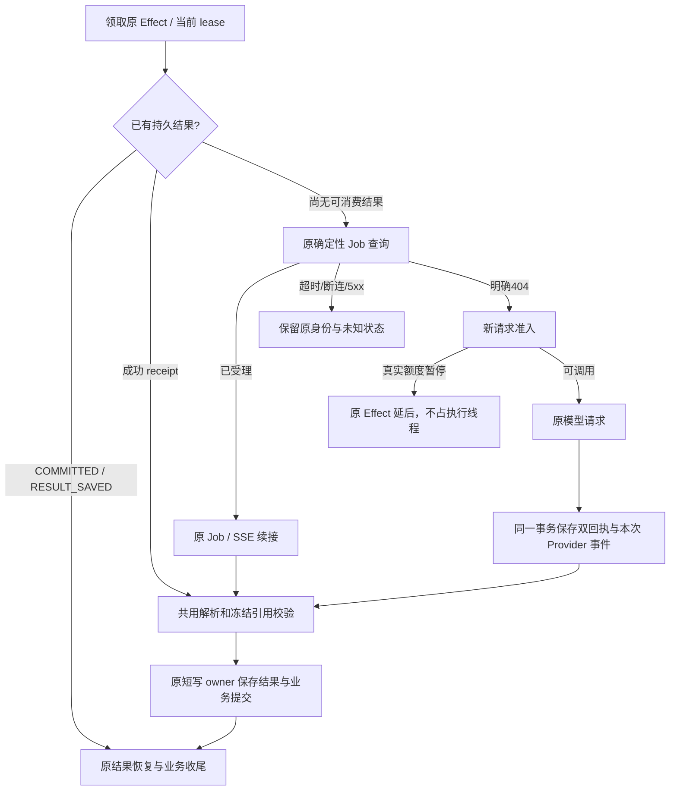

# W3 时效与执行架构优化：实现、验证与发布边界

日期：2026-11-10。时间注明 UTC 或北京时间 CST。对应 `runtime_w3_latency_and_execution_optimization_plan_20261110.md` 及用户追加的三个要求。

## 1. 交付状态

P0/P1 已实现，Ready 全局锁倒置做了窄范围修正；未改 Prompt、Skill、模型、推理参数、输出 Schema、W1/W2 路由、交易规则、冻结资料与两阶段职责。实现位于隔离工作区 `DoxAgent-w3-execution-20261110`，分支 `codex/w3-execution-optimization-20261110`，没有清理或覆盖原脏工作区。

**生产尚未应用本轮代码。非 SDK 累计 P95 ≤5 秒尚未完成生产验收，不能用单测通过代替。** 发布前只读检查发现解除错误暂停可能集中释放大量积压新请求，在现有内存余量和 Swap 状态下有再次耗尽资源的风险。已向用户说明并请求明确一次性积压恢复的处理方式；本实现没有擅自给实时 Case 加并发门槛，也没有偷偷改变旧 Case 的业务状态或执行通道。

## 2. 现在的执行逻辑



在物理准备之前还有一个只读暂停预检：只挡住明确需要新调用的阶段；成功结果或可能已受理的冻结 request 不被它拦住。最终准入才原子领取 probe，并发布允许的派发代际。没有增加新的队列、服务或线程池。

## 3. Provider Pause 的职责收敛

### 3.1 字段和持久记录

继续使用原 `runtime_values('w3_provider_pause','codex')`：

| 字段/原记录 | 唯一职责 |
| --- | --- |
| pause.job_id | 触发该次真实额度暂停的失败 Job；同时作为故障代际 |
| pause.code | 区分明确额度问题和升级前遗留的普通限流暂停 |
| pause.until | 从真实失败结束时间/首次观察时间计算的一次性额度截止 |
| pause.probe_owner | 本次实际 Worker dispatch 的确定性 Job ID |
| pause.probe_until | 本次探测所有权的固定截止；重读不续期 |
| worker_generation | 原模型派发代际；不充当 Provider 暂停代际 |
| worker_invocations[job_id] | 每个真实终态一次落库；附本次 provider_outcome / provider_retry_at |
| 原 Effect.payload.provider_wait | 该次延后的 Provider、原因、依赖的暂停代际；用于唤醒与统计 |

没有新增 pause history 表、事件计数器、独立断路器状态、probe 排队器或 Redis。旧记录按原结构读取，没有迁移全部历史 Case。

### 3.2 新请求与已有结果

- 普通模型 HTTP 429：仅原 Effect 按该失败的固定截止约 60 秒局部等待；不再暂停全部 Case。
- 明确 usage limit：保留原约 15 分钟暂停和期满单请求探测。只有新失败事件能更新暂停。
- 成功 receipt、已受理 Job、RESULT_SAVED、COMMITTED：不经过新请求准入，不因其他 Case 的 pause 等待。
- probe 的 token 同时包含暂停代际和实际 Job ID；迟到旧成功不能清除新的暂停。
- probe 成功或非额度终态失败会解除对应旧 pause，后者仍按原 Case 错误/输出修复逻辑处理；取消只释放可证明未发起的所有权。
- 同 owner 观察、SSE 重连和旧失败重读都不延长原 deadline。历史 invocation 不被重新解释为新故障。
- 暂停消失/代际改变后，在原 pending 索引内分小批校正匹配的 PENDING_RETRY.available_at，同时唤醒现有 coordinator。只改 Provider 延后，不重置业务失败预算、不改 RUNNING lease、不重放交易。

升级前的逻辑 Case probe_owner 会先映射回原 frozen request/receipt，再查询真实 Job。不会拿 `runtime-worker:...` 字符串的 404 当作原模型 Job 不存在，也不会拿很早结束的成功 Job 冒充新探测成功。

## 4. 原 Job、未知派发与重复调用

`codex_runtime/client.py` 增加 `lookup_job` / `resume_job`，复用原 GET 与 SSE，不增加 Worker HTTP API。

1. Job ID 使用 Worker 现行算法：`sha256(run_id + ':' + idempotency_key)`。
2. 查询到 Job 时，核对 Job ID、run_id、attempt_id 和 Worker 原 canonical request SHA256。
3. 只有 HTTP GET 明确 404 才允许走原新派发规则。HTTP 5xx、超时、连接失败保持原 key，不递增 generation，不 POST 第二个请求。
4. POST 响应丢失后，客户端下一轮先 GET 原 Job；已有 Job 则接回，不能将传输异常解释为未受理。
5. 只有已确认的终态失败/原规则允许的输出修复才能计算下一代；被暂停时不提前持久递增代际或清空 receipt。
6. 前置取消只有在客户端能证明尚未 POST 时才释放 probe；POST 后未知不释放为“未受理”。

健康新请求当前也会做确定性 GET；Receipt 层和客户端在各自的派发边界核对，可能有两次轻量 GET。它们不调用模型、不开启轮询线程、不扫描 Job 列表。为满足本轮“明确不存在才能新派发”的要求，未按旧方案省掉健康新调用的查证。

## 5. Future、结果恢复及 SQLite

### 5.1 Future 续接

已完成、失败、取消的 Future 都先由原 reader 收尾。continuation 从现有字典取出并移除后才执行，异常不使下次再读同一个 reader，也不先重建上下文或重复领取 Ready。

现有 Future 仅附带原 Effect ID/lease token，用于识别已经结束的旧 owner 控制错误。新 owner 可以重新查证同一个原 Job；没有另建恢复表或取消未知的原模型调用。业务保存/提交仍受原当前 lease fencing 保护。

### 5.2 成功结果恢复

W3 两阶段在需要材料化/行情/Ready 准备之前先读原成功 receipt；使用原冻结 context 和同一个解析、Schema、引用及跨字段校验 helper。RESULT_SAVED/COMMITTED 继续原短路。已有成功答案不再需要重新发布 pack、绑定准备材料或领取 Capsule。

输出拒绝记录在异步路径中改为 await 既有短写 owner，不再同步堵住共享 loop。原 operations 输出修复上限、提示内容与业务校验保留。

### 5.3 不放宽 SQL timeout

用户追加要求优先于旧方案 §8.1 的同步正常预算建议：**本实现没有修改 journal.py、control_io.py 的 timeout、retry 次数或退避配置。**

实际修法是缩小宽泛的 `short_write` 范围，把 save_result 和两阶段实际 SQL commit 回调移到原 priority=0 `write_io(retry=True)`。复用其原有 100ms 短事务、让出及既有重试语义，避免同步异常直接放大成 5 秒 Effect 延后。没有引入新的重试层或更长预算；等待仍全量计入非 SDK 耗时，不能因原 owner 有较长极限就宣称满足 5 秒。

两份终态回执先在原 read_io 中编码，再在单个短写事务保存 invocation、当前 receipt 和必要的 Provider 事件。当前 receipt 发布核对冻结派发 key，迟到旧代不能覆盖新 receipt。保留 invocation 历史和现有消费者。SQL commit 完成后的多余 operations Case 保存已消除；必要 stage、业务提交、Effect 收尾及 ACK 机制保留。

## 6. Ready 的窄范围改动

确定性测试持有后台 inventory mutex 时，旧新 claim 路径会等待；现在领取直接提交给原 SQLite 原子仲裁，task 去重仍在同一个 loop 的无 await 短段进行。

实时领取只验证选中的 READY 候选物理 owner，失效候选先退休再挑选；全池 reconcile 留在原后台周期。没有扩库存，没有取消同 Case 幂等、Thread 身份、物理 owner 与释放竞态保护，也没有扩大物理启动并发。该文件属于 Worker 发布项，应与 Scheduler 发布范围分开核对。

## 7. 5 秒累计底线如何验收

新增只读工具 `scripts/ops/w3_latency_audit.py`，不增加常驻监控线程或逐 Case 指标表。沿用原 boundary trace，补记 Effect 完整处理结束时间和 Provider wait 原因/截止。

口径是**整个 Case 两阶段累计**：最早 W3 Effect 创建到最终 Effect 业务处理及收尾结束，减去有证据的 SDK 区间并集和真实 Provider 等待区间并集。不能将两个阶段各 3 秒误报为“每阶段都小于 5 秒”。

- due/claim、准备、Ready、HTTP、回执、解析、SQL 等内部时间保留在分子里。
- 暂停提前解除后，使用校正后的 available_at 截断外部等待；恢复后未调度的时间仍算内部时间。
- 重试 Job 的 SDK 区间取并集，避免重叠扣除；缺少 trace/SDK/提交信息的 Case 明确报 incomplete，不按零耗时处理。
- 先限定最新 Case rowid 小窗，再按 since/until 固定 cohort，按 Case/Job 索引查证；窗口不够则标记 truncated。
- 工具同时输出含 Provider wait 的原始非 SDK 耗时、扣除明确外部等待后的非 SDK 耗时、P50/P95/max、缺证据数量。
- 自动 acceptance_ready 仅在至少 60 个完整可测 Case、无 incomplete/窗口截断且累计 P95≤5000ms 时为真。另需按方案覆盖至少一小时和真实开盘负载，并人工查看异常长尾。

异步 ACK 及后台清理不处于该实时业务完成临界路径，尚未纳入这个 Case 截止。若其反过来争用并拖慢业务，延迟仍会反映在该业务墙钟内。计时日志自身的落盘也不被当成业务完成前置依赖。旧版本 trace 不覆盖完整收尾时，不能用它声称新口径达标。

执行例（先选定窗口，不在实时服务上扫全历史）：

```powershell
python scripts/ops/w3_latency_audit.py --runtime PATH/runtime.sqlite3 --jobs PATH/worker-jobs.sqlite3 --since 2026-11-10T15:00:00+00:00 --until 2026-11-10T16:00:00+00:00 --limit 1000
```

## 8. 本地验证

- 主回归 155 项通过：receipt/Provider、Future、两阶段、Ready、资源释放、租约、提交后 ACK、研究冻结与启动准入。
- 补充事务回滚、POST 前取消、非额度探测恢复后，25 项定向回归通过；这里与主回归有重合，不能相加成独立测试数量。
- 整 Case 5 秒统计测试另行通过，覆盖两个阶段各 3 秒应累计失败、Provider 等待及固定窗口不串扰。
- 整合最新 origin/main（e93e2557，含独立 R1 发布）后，最终完整回归 **158 项通过 / 80.85 秒**，3 条依赖弃用警告。代码提交为 `e697595e`，测试证据为 `integrated-regression.xml`；本分支没有覆盖 R1 模型配置或 fallback。
- 真实本地 SQLite writer 占用约 300ms 后，结果在释放后不到 1 秒完成，没有修改 timeout 配置，也不走原 5 秒 Effect 延后。
- 模拟 POST 已受理但返回超时，实际序列为 GET404→POST超时→GET原成功 Job，仅一次 POST。
- GET500、503、timeout 均断言无 POST、无 generation 变化。
- 双回执事务在提交前注入异常，两份均回滚；下一次接回原 Job，未第二次发起。

本地回归没有真实模型调用或交易提交。证据 XML 位于 `eval/w3_execution_optimization_20261110/`。最终 main 整合后的验证以同目录最新 XML 为准。

## 9. 发布前新增资源证据与边界

2026-11-10 23:07:28 CST 的只读快照：

| 指标 | 实测 |
| --- | --- |
| 生产 Git | e93e255748dbe5d70d07ddf467bcb84b3978a6e9，包含另一个开发项的 R1 发布 |
| 可用 RAM | 10,441,268KiB，约 9.96GiB |
| Swap | 总 2,097,148KiB，仅余 172KiB |
| Capsule 进程树根数 | 13；稍早同轮检查为 24，说明数量动态变化 |
| 三个现存 Capsule 树 PSS | 644.4 / 548.2 / 558.1MiB；是抽样，不代表每个都相同 |
| 最新 300 Case 内 Provider 等待 Effect | 103，所属 Case 均标 REALTIME；不是全库统计或 103 个独立 Case |
| 最早相关 Case 创建时间 | 20:33:08 CST |
| 当前 pause KV | null；旧 Effect deadline 仍残留 |

稍早约 22:57 的受限分类还发现约 58 个等待阶段没有冻结 Worker request，另有已有结果可直接消费的阶段。**不能把全部积压视为只需提交原结果、不会增加物理进程。** 也不能仅因当前 RAM 还有余量，推断解除全部旧 deadline 一定安全。

此处证明的是发布/集中恢复有资源风险，不证明该风险已经发生，更不把某个线程池定为根因。Swap 存量也不等于当前持续换页；本轮没有据此扩大 Swap、改 OOM 阈值或停止其他业务服务。

推荐先得到一次性历史积压恢复边界，再按现有 canonical release 工具发布 Scheduler，Ready 改动另核对 Worker。不能为此给新实时 Case 加共享容量上限、偷偷修改 Case 模式、延长 pause、永久保留错误 gate 或重放已过期交易。积压恢复方式未确定前，本轮只完成代码与可审查验证，不触发批量生产恢复。

## 10. 生产验收待办

1. 核对当前镜像及实际源文件，接纳期间 main 的独立 R1 开发，保留远端 changelog 私有尾部；不按旧镜像基线覆盖新代码。
2. 发布前列出受影响原 Effect/Job 身份；只处理原 pending 恢复，不手工将 FAILED 批量重排、不新建交易意图。
3. 用规范部署链发布并核对镜像、源文件 hash、重启次数、内存/Swap增量/IO PSI、Capsule 与原 Job 关联；不可只核对 Git HEAD。
4. 观察原成功结果跨 pause 立即提交、原 Job 查询恢复、新请求合法探测、旧 deadline 唤醒；确认没有重复模型 POST 或旧代覆盖。
5. 固定一小时以上新 REALTIME cohort，至少 60 个完整 Case，按两阶段累计非 SDK P95≤5 秒验收。缺样本、trace缺失或未达标均如实保留，不称为完成生产时效验收。
