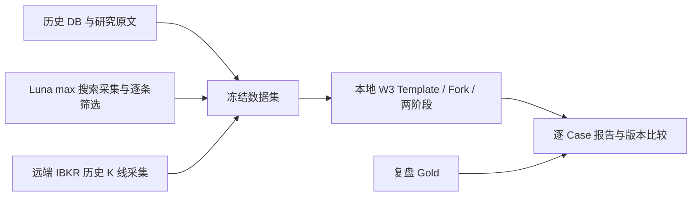

# W3 本地历史 Case 回测能力实施方案

日期：2026-10-14。状态：排查与开发方案，尚未实现回测功能、构造完整测试集或执行批量模型回放。

## 1. 目标与本轮决策

建立一个独立的本地命令入口，反复用同一批历史输入评估当前 W3。主要回答：旧 badcase 是否仍被错误交易、历史有效机会是否仍能识别，以及提示词或编排调整具体改变了什么。

采用“冻结历史情景 + 当前 W3 两阶段执行 + 独立 Gold 对照”。复用现有 W3 业务代码，不另外实现一个简化的交易判断 Agent。第一版做 CLI、数据文件和 Markdown/JSON 报告，不开发 Web 页面、任务平台或完整交易收益模拟器。

本方案明确采用以下边界：

- 用户已补充澄清：**仅在构造数据集时，通过远端 IBKR 拉行情；回放时直接注入行情文件。**不做模拟 IBKR API、代理端点或运行时行情请求。
- 回测 W3 关闭 live Web Search、全部 Data MCP、其他辅助 MCP 和子 Agent 权限。只有准备搜索材料的独立采集 Agent 可以联网。
- AGENTS.md、唯一 skill.md、交易决策和后置运营输出 schema 沿用被测版本。允许在工程生成的 task 中交代离线环境和材料位置；不另写一套回测交易策略。
- 原需求“截止到原 W3 启动时间以后的消息”按上下文理解为：**仅使用启动时点及以前可知的消息与价格**，删除其后的信息。
- 这是情景模拟评估。处理明显未来信息、材料错配和答案泄漏即可；不建立严格金融时点数据库，不要求逐网页历史存档证明，不把日期不明或材料不全变成全批次阻塞。
- 第一批目标为 **73 条：44 条复盘 + 4 条额外样本 + 25 条随机普通样本**。身份去重后冻结清单，避免每次运行换一批噪音。



Gold、原 Case 的最终 W3 结果、成交与后验收益均不进入被测 Agent 的工作区。

## 2. 排查已确认的实现与数据现状

### 2.1 可直接复用的代码

| 文件 | 本功能使用方式 |
|---|---|
| `persistent_runtime_v2/w3.py` | 复用 `CodexW3AgentRunner`、`W3PreparedContext` 和 `run_phase/_run_phase`。现有 Context Provider 已是可注入接口。 |
| `persistent_runtime_v2/w3_execution.py` | 复用 `W3Execution.trade()`、`operations()`、模板初始化、Fork、阶段保存与恢复、宿主交易处理及运营动作。 |
| `persistent_runtime_v2/w3_threads.py` | 复用 Thread 注册、阶段状态和 Case 独占；回测使用自己的注册表和 SDK Thread。 |
| `persistent_runtime_v2/w3_context.py` | 复用主类型、附加标签、72h 历史输入及输入字段构造。必须使用历史状态，不能读取今天的 WATCH/PIN 或成交终态。 |
| `persistent_runtime_v2/w3_models.py` | 沿用 HIT → gpt-6-sol/medium，其余 → gpt-6-luna/max。采集 Agent 的 Luna/max 不覆盖被测 W3 的模型路由。 |
| `persistent_runtime_v2/w3_research_assets.py` | 复用 D1 章节、D2 完整 Unit、D3 完整 Policy 与原文索引。旧 D2 本身也有 shells/units，不需重新生成研究。 |
| `codex_worker/local_client.py`、`jobs.py`、`thread_lifecycle.py` | 现有 `EmbeddedCodexWorkerClient`、`LocalWorkspaceClient`、`WorkerJobManager` 支持本地执行及真实 Template/Fork；不用生产 HTTP Worker。 |
| `codex_worker/sdk_runtime.py` | 已支持请求级 web_search_mode、read_only、data_mcp_enabled；W3 Runner 目前硬编码 live/True，需要提供一个生产默认不变的环境入口。 |
| `tools/providers/ibkr_tws.py` | `historical_bars(..., end_datetime=...)` 已有显式历史结束时点；仅用于数据准备，不进入回测执行依赖。 |

现有编排是 Template 公共上下文 → Case Fork → `trade_decision` 四字段 → 宿主持久化 → 同 Thread `post_decision_operations` 五字段。周末 sweep 是另一类任务，第一版回测不执行 sweep，也不额外注入其 Skill。

### 2.2 44 条样本和旧研究可恢复性

已核对 `eval/w3_trade_intent_review_20261010/revised_export` 中 10 个分片，共 44 条，分布 MU 16、BE 15、INTC 9、RKLB 4。对应的远端 Runtime Case **44/44 存在**。

导出已经包含 source_messages 正文、W1/W2、旧 W3、交易状态和后验收益，但不是完整回放包：缺少完整 frozen_inputs、D1/D2/D3 原文、Reference View、当时状态与可靠的 W3 开始时间。因此不能直接把整个导出 JSON 塞给新 W3。

远端进一步确认：

- 44 条均保存有 `context_version_pin`，并有原 D1/D2 run ID；4 个 ticker 的 8 个 D1/D2 handoff 都能找到对应非空 Published 正文。
- 44 条涉及的 **21 个 ticker + D3 version 组合全部存在**，均为 `document3.v2.2`；冻结 Projection 全部为 `document3.runtime_projection.v4`。
- 原始 Case 的 source 正文、研究等可能使用 `$doxagent_content_v1` 外置文件。不能仅拿 SQLite 行或直接对 payload 做 JSON 路径查询就认为材料缺失；要一起读取相应 native-files 内容。
- 同时间段四个 ticker 的 COMPLETED Case 初步共有 4,106 条，普通样本候选充足；这不是最终可采样池数量，尚需去重、排除本次重点样本并确认 W1/W2 可用。

**关键工程差异：**旧 D3 的方向在 Policy 顶层，新 W3 的 Policy Trade 使用 Condition 方向、revision 和方向消费状态。必须做无研究增量的兼容适配，不能换成今天的新 D3 来“解决”schema 不兼容。

### 2.3 额外样本的准确身份

| 额外样本 | 选择与处理 |
|---|---|
| INTC：Stocks Sink After OpenAI Report Sours AI Trade | 选择 `case_1514e9e49e654055ab92d1428ec9afaf`。同标题还有 BE Case，不能串 ticker。原 Case 进入过 W3。 |
| INTC：Stock Jumps Overnight…Terafab…Stocktwits | 选择 `case_9dd6c3ac9c8a4796adae3f93d31d93a1`，2026-10-07 最早进入 W3 的 Stocktwits 版本。另有同日重复稿与 10-12 再摄入版本，不替换主样本。 |
| RKLB：Synspective 20-Launch Contract | 选择 `case_cb774ab16f154c5c9535f8453b99ff86`。当时 NEW + HIT 直接走 TRADE，**没有原 W3**。保留其真实 W1/W2，直接送入本地被测 W3；不伪称复现了历史 W3。 |
| RKLB：NASA Eyes Bulk Rocket Buy… | 按用户指定新闻新增合成 Case，准备正文及当时旧研究，再离线运行一轮现有 W1/W2。不得用次日另一篇 NASA/RKLB 稿件替代原文。 |

NASA 原文公开页面标示 2026-10-06 12:00 UTC，来源为 Loren Grush / Bloomberg News。[原文页面](https://news.bloomberglaw.com/federal-contracting/nasa-eyes-bulk-rocket-buy-for-moon-base-amid-spacex-phaseout)。数据准备时需要保存可取得的正文，而非仅搜索摘要；尚未取得的部分标为缺失，不编造。其模拟研判时点默认设为发布后 5 分钟，即 12:05 UTC，并明确这是人工设定的情景时间。

本轮只做只读定位和可恢复性检查，没有抽出最终 25 条、运行 NASA W1/W2、启动搜索采集 Agent 或生成 73 条完整行情包。

## 3. 本地入口、执行隔离与复用方式

### 3.1 独立入口与目录

新增 `python -m doxagent.w3_backtest`，不接入生产 Runtime CLI 的执行命令，不在生产 scheduler、API 或 compose 中增加回测服务。

```text
eval/w3_backtest/datasets/w3_history_20261014/
  manifest.json
  cases.jsonl
  gold.jsonl
  gold_review.md
  research/<research_key>/
    document1.md
    document2.json
    policy_set.original.json
    policy_execution_view.json
    reference_view.md
    manifest.json
  inputs/<case_key>/
    case.json
    historical_state.json
    evidence/index.json
    evidence/web_search.jsonl
    evidence/sources/<source_key>.md
    evidence/price_10m.json
    evidence/price_daily.json
  preparation/
    selection.json
    research_resolution.json
    web_raw/<case_key>/...
    web_review/<case_key>.json
    price_raw/...
    original_outcomes/...

eval/w3_backtest/runs/<run_id>/
  run_manifest.json
  results.jsonl
  report.md
  comparison.json
  cases/<case_key>/
    runtime.sqlite3
    worker/
    decision.json
    operations.json
    host_receipt.json
    audit/
```

实际提供给 SDK 的工作区只复制该 Case 的输入、已筛选证据和相应旧研究；不把整个 dataset 或 preparation 目录复制进去。Gold 与当前 Case 的历史最终结果留给报告程序。

本地 Worker 使用独立工作目录、作业库、Thread 注册和最小配置。只配置模型调用所需的账号/密钥，不继承 `.env.v2`、生产 Worker URL/token、远端数据库路径、Site Access 或生产 MCP 配置。SDK Thread ID 从新模板创建，绝不 resume 历史生产 Thread。

### 3.2 复用同一条业务执行链

`ReplayRunner.run_case()` 负责以下装配，不自己做交易推理：

1. 创建该 Case 独立的 RuntimeJournal、SQLite repository、本地 Worker 和文件 Context Provider。
2. 安装当前提示词执行包，明确 `W3_CONTRACT` 与双文件资产布局。保留历史版本 pin，但不使用历史旧 Skill 或旧输出 schema。
3. 导入输入、截至 t0 的历史状态和旧研究执行视图；删除原 Case 的结果、效果、生产 Thread ID 与 worker receipt。
4. 生成新的 replay Case 身份，另存 original_case_id 映射；冻结当前模型路由。
5. 用正常 `ROUTE_TO_W3` effect 进入 `W3Execution`，顺序执行到交易阶段和运营阶段结束；保存模拟宿主处理结果。
6. 所有 trade_intents、候选、Delta、WATCH/PIN 写入本地隔离账本。**不启动 delivery worker、Executor、MAINTAIN、投影推送或 Message Bus ACK。**

第一版默认每个 Case 独立情景。原有 Thread 选择算法会在无可关联子 Thread 的状态下正常初始化/Fork，两阶段仍在同一 Thread。历史意图通过输入恢复，不靠前一条回测 Case 的新结果产生。这样能够公平比较同一 Case 的提示词版本；本版不声称已经验证跨 Case 会话复用的长期效应。连续时间流回测以后按需要单独增加。

**进入 W3 的口径：**本批是 W3 决策能力测试，选中的 73 条均允许直接回放 W3。程序另外调用现行 Router 记录 `production_route` 与 `would_enter_w3`。正常 OLD 等生产中不应进入 W3 的 Case，标记 `direct_replay_only=true`，不得算成生产路由错误，也不因此跳过它。Synspective 正是这种需要明确入口来源的样本。

### 3.3 关闭实时能力，但直接交付证据文件

给 `CodexW3AgentRunner` 增加可选 `W3ExecutionEnvironment`，生产默认值保持 live Web Search + 当前只读 IBKR MCP。回测显式使用：

```json
{
  "mode": "OFFLINE_REPLAY",
  "web_search_mode": "disabled",
  "data_mcp_enabled": false,
  "allow_subagents": false,
  "evidence_delivery": "PRECOLLECTED_FILES"
}
```

Template、Fork 恢复与两个阶段都使用该环境；Thread 兼容键包含环境身份，避免线上线下配置混用。Worker 同时禁用 Source Capture 等辅助 MCP，IBKR 工具配置 disabled。回测运行命令不创建任何 IBKR session。

在阶段 task 的工程字段中加入 `execution_environment` 和 `evidence` 路径，并明确：**本轮是离线回放，所列文件是已经准备好的搜索/行情结果，用文件完成现有核验，不再发起 Web 或 IBKR 请求。**这是用户要求的交付方式替换，不调整交易门槛、价格完成态标准或运营规则。

必须正面处理提示词冲突：当前 Skill 要求拟交易时实际调用历史行情方法；回测又明确禁止 API。仅关掉权限、任由 Agent 报工具失败不能满足本需求。上述 task 环境说明是唯一的执行方式适配，不修改两份被测提示词，也不引入假 API 来绕行。

证据仅在 Case 交易阶段交付，不能进入 Template 公共上下文。运营阶段继承已有证据与研判，遵守原逻辑，不额外研究。

## 4. 时间、旧研究与历史状态

### 4.1 时间锚点

每条记录区分 `message_time`、`original_w3_started_at`、`evidence_cutoff_at` 和真实本地执行时间。

- 有原 W3：优先取对应初次研判 Worker job 的 started_at；其次取可恢复的 W3 执行记录；再退到 W3RouteCase.created_at，并标记精度为入口时间。
- 无原 W3 的已存在 Case：取原 W1/W2 完成并做出路由的时间。不能用交易释放、成交或出场时点替代。
- NASA：使用上一节明确的 synthetic t0。离线补跑 W1/W2 的机器当前时间不成为历史时点。
- 回测 `cutoff_at`、行情结束时点和 72h 历史上界统一为 t0。原 source 的采集/发布/Message Bus 时间保留，不篡改原消息字段。

现有 Runner 从 source.message_bus_event_time 取 cutoff，需要让回测环境显式提供阶段 cutoff，并在业务输入、Worker 请求及行情 metadata 中一致使用。生产默认不变。

业务时钟固定在该 Case 的 t0，用于语义日、TTL、消费状态和模拟宿主受理；模型耗时、超时、作业管理与报告使用真实时间。复用既有重试和阶段恢复，不开发事件时钟引擎。

INTC-02-03 原研判和后续释放相差数日，是不能使用 intent_released_at 作为 t0 的现成反例。本地回放评估 t0 的判断，同时在报告保留原跨周期问题标签。

### 4.2 研究选择与 legacy 适配

恢复顺序：原 W3 pin 指向的 D1/D2/D3 → 原 Case 冻结 pin → 同 ticker 在 t0 前最近的可用版本。不要默认 current，不因为完整重部署而把新研究放入旧情景。

采用已有解析器读取 Document2 v2/v2.1、PolicySet v2.2/v3。旧 D1/D2/Policy 正文原样保存；切片从这些原文派生，不能让模型重新总结或重新编写旧 Policy。

新增 `LegacyReplayAdapter`，只做以下确定性变换：

| 原数据 | 执行视图 |
|---|---|
| 旧 Policy 顶层 decision | 原样复制到该 Policy 每个已有 Condition 的 decision。 |
| 原 policy_id / condition_id / criterion / calibration | 保留，不重编号、不重写边界。 |
| 旧 source_refs | 保留，并生成已有 Shell/Expectation/Gap 的定位映射。 |
| 旧 W2 policy_ids 与 matched_condition_ids | 用现有 normalize_w2_result：旧非空 Policy 列表表示 HIT；旧 matched 归到 hit_condition_ids。没有 RELATED 证据时保持 false，不为测试扩充 RELATED。 |
| Condition revision | 按已有规范哈希生成，输入仅含旧条件和方向；保留旧 activation revision 对照。 |
| Policy 消费 | 将能确认在 t0 前发生的旧单向消费映射为该方向状态；不把今天的消费状态整表搬入。 |
| 新版独有 transmission / trigger_layer 等 | 旧材料没有就保留缺失说明，不猜测业务层级或补写新研究。 |

**不把旧数据伪装成完整的原生 PolicySetV3。**`W3PreparedContext` 已支持旧 PolicySet，可继续用于原文与条件身份校验；回测适配器单独提供带 Condition 方向/revision 的执行视图，供模型输入与宿主交易映射使用。`_trade_record` 依赖的冻结 projection / policy_usage 必须由同一执行视图生成，避免“模型看到一个条件，宿主校验另一个条件”。必要的 legacy 输入兼容处理集中在回测模块和输入装配钩子内，不放宽正式 V3 schema。

如果原版本不可恢复，用已明确标记的最近旧版本继续；只有无可解析研究、无必要条件身份等真正无法执行的单条记为 INPUT_ERROR。其他 Case 照常运行。未知来源归 unassigned，不作为入场阻塞。

### 4.3 72h、WATCH/PIN、Event 与执行状态

- 取 `[t0-72h,t0)` 的原真实意图和分析态记录，排除当前 Case 自身。注入当时已有的正文、Prior/Delta、方向及能确认的状态。
- 历史成交、失败、出场等状态只有在 t0 前已有证据时才带入；若只有现在的终态，改为 UNKNOWN，不猜当时已成交或失败。
- 未释放 CLOSED 候选不伪装成真实近期意图。RECENT_TRADE、WATCH 入口和类型标签继续由现有函数计算。
- 优先恢复原冻结 WATCH、消费和 provisional；旧系统没有 PIN 时使用空列表，标注真实来源或重建假设，不从 Gold 推导应当有什么 PIN。
- 原 Event Library root/version、Reference View 和 W1 引用的完整 Event 同步恢复。改成本地路径时保留原 scope 映射，避免跨日 E 编号串身份。
- 既有旧 W3 运营结果如尚未在 t0 产生，不能当作该 Case 的事实输入；未来生成的 Fact/Delta 不混入 Reference View。

历史回测状态属于输入。除同 Case 的交易→运营衔接外，第一版不把回放新产生的结果反向改写其他样本的历史。

## 5. 第一批数据集构造

### 5.1 样本清单与随机规则

1. 按分片文件和记录顺序导入 44 条，稳定映射 `MU-01-01` 等复盘编号到真实 case_id。校验 ticker、标题、方向和时间，不能按远端查询返回顺序绑定 Gold。
2. 加入第 2.3 节的三个已定位 Case 和 NASA 合成 Case。其 Gold 留空，不继承本次排查或旧审计中的交易观点。
3. 普通样本池默认限制在同四个 ticker、2026-09-22 至 2026-10-09 历史窗口，已完成且有可用 W1/W2；排除以上重点身份，不依据盈亏筛选。
4. 对候选 case_id 排序后，使用 seed=20261014 均匀抽取 25 条。保存候选数、seed 和抽中身份；运行评估时不重新抽样。不人为要求它们全部无交易或全部进入过 W3。

抽样遇到材料确实不可读时，在 selection.json 留原因，从同一固定排序/随机序列的后续候选补足。正文缺失本身可作为 BODY_MISSING 情景，不能仅为让结果整齐而过滤。

### 5.2 搜索模拟产物：采集与筛选

准备阶段启动独立的 **gpt-6-luna / max Codex 采集 Agent**。默认同时 4 个，每个处理一个 Case，直到覆盖 73 条；失败只重试该条。使用子 Agent/独立 SDK 研究任务，不创建用户侧的一批新聊天，也不赋予被测 W3 子 Agent 权限。

采集 Agent 获得当前 W3 方法、该消息、t0、旧研究与必要的事前历史，按 W3 的来源追溯、Prior/Surprise、关键反证和同期事件要求做针对性 Web Search。**不提供 Gold、旧 W3 最终判断、Case 后验盈亏或作者评估。**任务只交付研究证据，不替被测 W3写交易结论。

交付三种数据：

- 原始 query / open 等调用记录与获取结果，存在 preparation/web_raw，用于筛选追溯。
- 有 URL、标题、公开时间/原精度、相关片段、来源角色的候选 source 文件。
- 筛选后可供 W3 阅读的 web_search.jsonl 与 sources 文本。

模拟结果采用 MCP 检索结果常见的 arguments + content/structuredContent 形式；它是静态文件，不开 MCP Server。例如：

```json
{
  "tool_name": "web_search",
  "arguments": {"query": "..."},
  "as_of": "<t0 UTC>",
  "result": {
    "content": [{"type": "text", "text": "仅保留当时可知的相关内容"}],
    "structuredContent": {
      "sources": [{
        "source_id": "S1", "url": "...", "title": "...",
        "published_at": null, "time_precision": "UNKNOWN",
        "snapshot_path": "sources/S1.md"
      }]
    }
  }
}
```

自动时间比较先标出明显晚于 t0 的项，随后整理者逐条阅读筛除：未来消息、后续修订中才出现的段落、后验股价/收益和没有来源的采集 Agent 结论。保存简单的 keep/drop、原因与保留片段即可，不建立审批系统。**人工筛除在数据集准备时完成，不要求每次回放重新审批。**

日期不明或网页已更新，不自动保留整页，也不自动废弃整个 Case；保留可确认的旧内容，必要时将时间标为 UNKNOWN 并说明局限。相同事件可复用搜索原始材料，但每个 Case 必须按各自 t0 单独裁切。研究原始文件可能含未来内容，因此绝不整体交付给回测 W3。

被测 W3 直接读筛选后的文件，不再搜索或打开链接。不实现动态检索服务、向量库或对采集结果的问答代理。

### 5.3 远端采集历史 K 线，回放只读文件

新增独立 prepare-prices 步骤，通过 SSH 在远端已有 IBKR 环境执行只读采集：

- `bar_size="10 mins"`、`what_to_show="TRADES"`、`use_rth=False`。
- 每个 Case 默认覆盖 t0 前 20 个自然日；来源核验发现关键披露更早且需要对应行情时，延长到披露前至少一个交易日，不全量下载多年历史。
- 调用 end_datetime=t0，使用独立 client ID 和现有配置。可按 ticker/时间段缓存原始数据并合并请求，控制为 1–2 个采集连接，不做 73 条并发打 IBKR。
- 将 bar 统一为 UTC，保留原始时间值、时区口径、OHLC、volume、bar_start_at/bar_end_at，以及查询参数和覆盖区间。
- Case 文件仅保留 `bar_end_at <= t0` 的完整 10 分钟 bar；跨 cutoff 的末条直接去掉。不填补夜间无成交，不把不足区间当作已完成定价。
- 同时从这些已裁切 10 分钟数据生成日线视图，供现有 Skill 的“跨度超过一天看日线”规则使用；按美东交易日期归组，标明当日是否完整。无须再取未来完整日线。

原始 ticker 缓存可能覆盖别的较晚 Case，只有裁切后的 `price_10m.json` 和 `price_daily.json` 能进入当前工作区。导出的收益、出场价和意图后价格不混入这些文件。

无行情时明确记 availability/coverage，而不是生成零价或假 K 线；保留该 Case，单独统计材料不完整。采集失败可以重试并补录单个文件；已准备完的数据集回放不依赖远端、TWS 登录或行情权限。

本轮 2026-10-14 04:03（北京时间）在远端 Worker 环境重做只读查询探针，仍在 nextValidId 握手阶段超时，尚未取得历史 K 线。不能只把 TCP 连通当作 prepare-prices 可用。构造数据集前需恢复 API 并完成一个真实历史查询探针；该问题只影响材料准备，不应成为离线回放服务的长期依赖。证据为 `backtest_recon_ibkr_20261014.jsonl`。

### 5.4 NASA 补跑 W1/W2

单独 prepare-nasa：保存原文、t0 前最近可用的 RKLB Event/Policy/旧研究，构造正常 Runtime source，再用当前 W1/W2 提示词和实际配置模型运行一轮现有流程。

使用本地隔离 Service、文件 KnownEvent/Policy Provider 和 `dispatch_effects=False`；旧 Projection 走现有兼容分支，不先升级成今天的新 Policy。保存 W1/W2 每轮输入、输出、模型和原因，得到结果后停下，不派发 W3、交易或下游效果。按 t0 构造业务时间；这些模型调用只发生在数据准备时。

把保存的 W1/W2 纳入 fixture，后续 W3 版本比较均复用它，不每次重跑上游。其他 72 条优先沿用已有 W1/W2，不借数据准备重新判断这些 Case。

## 6. 数据合同、Gold 与评分

### 6.1 最小合同

`manifest.json`：dataset_id、schema_version、73 条身份、分组、随机 seed、研究/证据文件引用及 hash、时间口径、准备状态。

`case.json`：case_key、original_case_id、ticker、原 source、t0 与来源、runtime_mode/semantic_day、W1/W2/alignment、历史 version pin 和研究键。生产终态不放入该文件。

`historical_state.json`：72h 原历史意图与可知状态、当时 WATCH/PIN、方向消费、provisional 与已定位 Event。不能引用运行时远端查询。

`evidence/index.json`：仅列本 Case 已筛选的搜索和行情文件、适用 cutoff、availability/coverage；不包含“建议 LONG/SHORT/NO_TRADE”等答案性摘要。

`run_manifest.json`：dataset/input fingerprint、prompt hashes、代码版本与 dirty 状态、实际模型/effort、工具环境、运行参数、SDK/依赖版本、真实启动结束时间。

数据集输入 hash 与 Gold hash 分开。修改 Gold 可直接重新生成评分；修改提示词、编排、模型或 fixture 输入必须创建新的模型 run，不能误复用上一轮成功结果。失败恢复复用同一 run 的已保存阶段。

### 6.2 Gold 导入原则

44 条按 `DoxAgent_W3_44_Cases_merged.md` 的统一表和逐条诊断导入，保留原结论、标签及段落定位。不能用实际收益正负自动生成交易 Gold。

```json
{
  "case_key": "MU-01-01",
  "original_case_id": "...",
  "gold_source": "DoxAgent_W3_44_Cases_merged.md#MU-01-01",
  "assessment_text": "原评估结论",
  "issue_tags": ["门槛过低", "时点过晚"],
  "expected_action": "NO_TRADE",
  "expected_direction": null,
  "conditions_or_notes": "原文中的判断边界"
}
```

明确认为不构成可交易变化的记录可映射 NO_TRADE；明确支持方向与当前机会的记录映射 TRADE + LONG/SHORT。原文仅认可方向、但对剩余机会持条件判断时，保留文字 Gold 与条件，expected_action 允许 null，不替作者补出唯一交易答案。

“基本合理”不自动等于必须交易，“时点过晚”也不因涨跌幅或经过几小时就自动等于 NO_TRADE。旧复盘与当前策略存在的这类差异在 gold_review.md 集中说明，不能偷偷改 Gold 来迁就新模型结果。

**额外 4 条与随机 25 条：assessment_text、issue_tags、expected_action、expected_direction 均为空/null。**不由采集 Agent、回测 Agent 或报告模型补判。旧审计资料和本轮定位信息不变成这些 Case 的 Gold。

### 6.3 报告与版本比较

主评分比较第一阶段模型决策。POLICY_TRADE 从选中 Condition 解析方向，EXPERT_TRADE 从其方向解析，统一为 LONG/SHORT/NO_TRADE。宿主因为消费、控制或过期拒绝交易，不能被记成模型正确 NO_TRADE。

每条展示：消息标题/ticker/t0、主类型和标签、生产入口观察、Gold 原文、新决策与原因、实际模型、模拟受理状态、运营结果、证据缺口、阶段耗时/token、错误。

汇总包括：

- 可明确评分子集的决策一致率、错误交易率、漏机会率、方向错误数，并显示分母。
- 按问题标签查看旧错误是否仍出现，保留理由对照供人工阅读；不强制另调模型给全量语义“打分”。
- 29 条未标注样本只报交易比例、方向分布、执行成功率和具体输出，**不称为假阳性率**。
- 后置运营单独报 schema/事实引用/动作接纳及失败，不把运营失败混成第一阶段交易判断错误。
- 两个 run 对比只在相同 fixture 输入上配对，列改善、退化、不变、不可比较和未标注决策变化。

第一版不计算新的收益率、自动优化提示词、设一个全局发布通过分数或增加上线审批。稳定保留结果，供日后迭代选择。

## 7. 具体开发改动

### 7.1 新增回测模块

| 文件 | 主要职责 |
|---|---|
| `src/doxagent/w3_backtest/__main__.py`、`cli.py` | 独立命令入口及 prepare/run/report/compare/resume。 |
| `schema.py` | Case、Evidence、Gold、RunResult 的文件合同；不污染生产业务 schema。 |
| `dataset.py` | 73 条清单、只读导出、外置内容解码、旧研究解析、历史状态裁切、文件包和 Gold 导入。 |
| `legacy.py` | 旧 W2/Policy/消费状态到当前执行视图的确定性映射，保留原文。 |
| `collect.py` | Luna/max 搜索任务输入与结果整理、review 文件、远端价格采集及裁切；准备阶段才可联网。 |
| `runner.py` | 本地 Service/Worker 装配、FrozenContextProvider、回测环境、时钟、两阶段运行与恢复。 |
| `report.py` | 决策归一、明确 Gold 子集评分、Markdown 报告和两个 run 的配对比较。 |

不新增数据库服务、线上管理表、模拟行情服务器或通用研究框架。

### 7.2 对公共 W3 的有限修改

1. `w3.py`：增加默认保持生产行为的环境参数；在生成 task、写文件并进入 ReceiptWorker 之前注入离线证据路径/环境说明及 legacy 输入视图。不能在 receipt 已冻结后偷偷改 Worker 请求。
2. `w3_execution.py`：Thread 兼容键从同一环境对象取能力标识；允许回测提供业务 cutoff，沿用原执行方法。交易事务、运营 schema、路由关联优先级不另写回测版。
3. `w3_context.py`：让 cutoff/交易上下文的回测覆盖统一来自环境；需要的输入适配通过明确的装配入口完成，生产不传参数时行为不变。
4. `codex_worker/sdk_runtime.py`：优先复用现有禁用能力。若本地配置仍继承 MCP，仅给本地回测装配增加显式关闭/最小配置；不改变生产权限。
5. 模型统计读取 SDK `model_selection.json` 或实际执行请求。当前通用 worker_invocations 的 model 字段仍经过全局别名计算，不能单凭它判断本次 Sol 实际用了 6.1；不要让报告继承这个统计偏差。

工程默认保持生产行为。本轮功能实现不得顺带改 AGENTS.md/skill.md、生产模型分配、交易判断或现行入口规则。

### 7.3 命令界面

以下为计划中的接口，不是当前已可运行的命令：

```powershell
python -m doxagent.w3_backtest prepare-cases --dataset w3_history_20261014 --seed 20261014
python -m doxagent.w3_backtest prepare-nasa --dataset w3_history_20261014
python -m doxagent.w3_backtest prepare-search --dataset w3_history_20261014 --workers 4
python -m doxagent.w3_backtest prepare-prices --dataset w3_history_20261014 --ssh-host doxagent-sg
python -m doxagent.w3_backtest build --dataset w3_history_20261014
python -m doxagent.w3_backtest run --dataset w3_history_20261014 --run-id baseline-01 --concurrency 4
python -m doxagent.w3_backtest resume --run-id baseline-01
python -m doxagent.w3_backtest report --run-id baseline-01
python -m doxagent.w3_backtest compare --before baseline-01 --after prompt-02
```

准备命令和 run 均支持 `--case <case_key>`；默认一次回放，不为“稳定性”自动跑多次。并发 4 是本地默认，可按实际账号和机器调整，不改变生产调度限制。

## 8. 实施顺序与验收

| 顺序 | 开发内容 | 验收点 |
|---|---|---|
| 1 | 文件合同、独立入口、只读导出和 legacy 适配 | 44 条正确映射；三个额外身份准确；8 个 D1/D2 handoff、21 个 D3 版本恢复；原文保留且无新研究混入。 |
| 2 | NASA W1/W2、固定 seed 的 25 条与 Gold 导入 | 清单 73 条、身份唯一、29 条 Gold 为空；NASA 输入/轮次可追溯。 |
| 3 | 搜索采集/筛选和远端历史行情采集 | Luna/max 采集身份明确；未来结果去除；已筛选搜索和裁切行情文件齐备，缺口如实标记。 |
| 4 | 本地 Worker 与当前 W3 执行链接入 | 真正 Template/Fork/两阶段；禁用 Web/MCP/IBKR；第一阶段 durable 后才运营；不产生生产侧写入。 |
| 5 | 报告、比较与恢复 | Gold 不进 Agent；失败不冒充 NO_TRADE；已保存决策不因运营重试重跑；同输入两个版本可配对。 |
| 6 | 少量真实模型验收，再完整批次 | 先选 HIT、OPEN、重复/历史依赖场景各一条，确认环境与产物；随后同一实现跑全部 73 条。 |

必要的自动测试集中在有实际失效风险的边界：

- 旧 Policy 方向继承、Condition/revision/消费映射一致，旧 W2 HIT 不被误转成 RELATED。
- 截止时点前后两条搜索材料、跨 cutoff K 线、历史意图当前 Case 自身以及未来成交状态的裁切。
- SDK 最终配置和审计中 Web disabled、MCP disabled；回放构造与执行期间不调用 IBKR session，不使用生产 HTTP Worker。
- 公共 Skill 未修改；Template 不拿 Case 证据；Gold、当前 Case 旧 W3 结果及收益不进入模型输入。
- 第一阶段结果保存后恢复、第二阶段失败后继续、拒绝交易与模型 NO_TRADE 区分。
- 空 Gold 不计正确/错误；同 dataset 输入变化不得沿用旧模型结果。
- 生产默认参数下的现有 W3 回归通过，防止为离线功能改变线上能力。

不要求为每个静态字段、文件读写或表格生成镜像测试；不把 73 条全部标注、严格证明零未来函数或行情覆盖完美作为功能开发的前置门槛。

## 9. 交付物与完成边界

完整实现交付独立 CLI、第一批冻结数据集、44 条可追溯 Gold 和 29 条空 Gold、搜索筛选记录、远端行情采集记录、至少一轮完整 W3 结果，以及逐 Case 报告/版本比较入口。重要代码变更追加 changelog。

本方案阶段已保存只读排查证据于 `eval/w3_refactor_20261013/backtest_recon_*_20261014.jsonl`，包括原 Case 覆盖、额外标题定位、旧研究版本和 handoff 正文可用性。它们只是勘察证据，不能代替最终数据集。

此次方案不部署生产，不调整已完成提示词，不替 29 条未评估样本制定交易结论。实现后能力的核心是：**同一份历史情景可以反复交给不同版本的真实 W3 执行链，结果和差异可查看、可复跑，而不依赖实时搜索或实时行情。**
