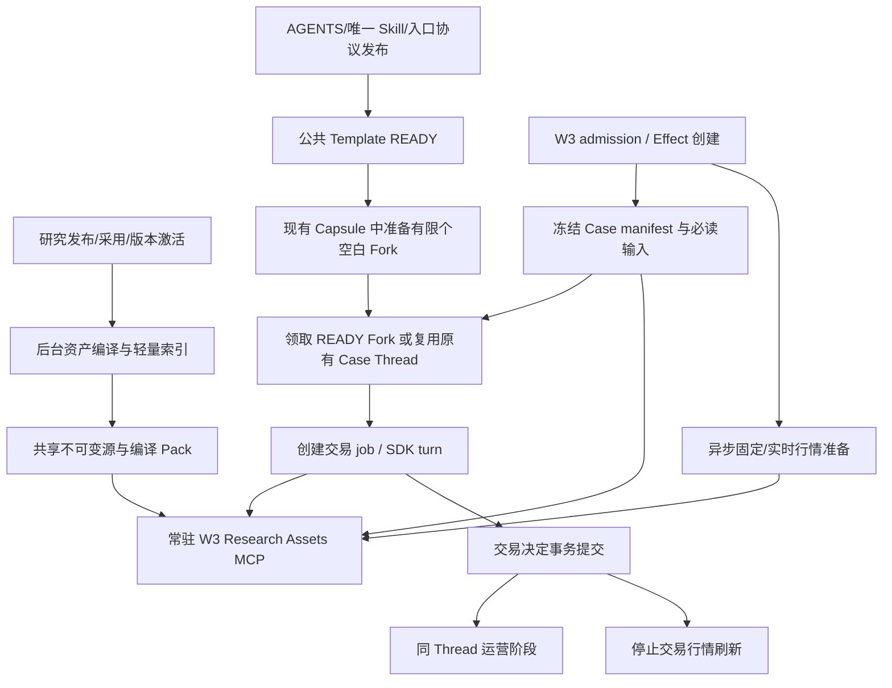

# W3 编排层重构与时效优化最终实施方案

日期：2026-10-19。状态：完成代码与能力审查，待实施。本轮只新增方案和只读分析证据；未修改生产代码、部署、启动模型、调用券商或删除数据。

本方案以 [W3 业务与时效优化方案](w3_business_latency_optimization_plan_20261017.md) 的业务审查为背景，以本轮用户五项要求为最终边界。旧方案 §5.1、§5.2 延续；§5.3 的文件导航/本地读取函数及 Agent 行情调用方案，由本方案的 Research Assets MCP、后台行情和共享资产架构替代。此前“Shell 母线程预载研究”的实验作为容量证据，不纳入本次默认架构。

## 1. 最终决策与交付边界

实施一条协调的改造链：**公共合同一次继承 → Case 只交付必读输入和冻结上下文凭据 → 可选资料统一通过常驻 Research Assets MCP 读取 → 行情后台准备 → Case 领取已经 Fork 就绪的 Capsule。**

| 用户要求 | 最终实现 | 明确边界 |
|---|---|---|
| 一次交付合同 | 新 W3 入口协议；Template 继承 AGENTS 与唯一 Skill；阶段输入和输出约束随当前 turn 交付 | 不要求每例重新 cat AGENTS、Skill、task、Schema；保留文件用于审计/排障 |
| Policy 状态按需 | 关联完整 Policy、对应使用状态内联；全库目录、正文及完整冻结使用状态经 MCP 可读 | 未内联不等于可执行；OPEN 可自主发现，提交仍走现有事务检查 |
| 可选研究资产统一读取 | Worker 常驻 HTTP MCP、按版本预编译的轻量索引、业务阅读视图、原文/来源续读 | 不限制跨 Unit/Shell 研究；不增加模型分类/摘要步骤，不做向量数据库 |
| 消除 Workspace 完整研究复制 | 共享只读源与编译产物；Case 只存控制文件和小型 manifest | 不用定期删副本掩盖持续复制；旧 Case 按旧版本恢复 |
| 专用行情 | 后台准备固定行情与 Case 实时行情；同一个 MCP `market_view` 返回统一视图 | 默认候选为 5 个完成交易日日线、24h 小时线、4h 五分钟线、30s 更新；不沿用旧测试的 3h |
| 非交易 SDK turn 开销 <5s | SDK 真初始化、MCP 常驻、有限 READY Fork 池、Template 准备后切换、轻量幂等恢复 | 不以延长超时、排除失败/冷启动样本或挪动计时起点达标 |

本次不改变 W1/W2 路由、Case 类型/标签含义、Policy OR 与方向消费、Expert 资格、线程按 Policy/Event 复用的业务规则，也不引入行情决定方向。HIT 继续 `gpt-6-sol/medium`，其他 Case 继续 `gpt-6-luna/max`；保留交易决定先提交、运营第二阶段继续处理及周末 Sweep 单独附加的现行结构。

特别回归：正常置信OLD+HIT且无有效WATCH不进入W3；有效WATCH或W1/W2低置信仍可让OLD进入；已进入的OLD不被自动否决交易。标签不控制入口/权限/消费，RECENT_TRADE不自动拦截。行情后台只随真实W3准入启动，不因看到HIT标签额外启动Case任务。

“先做编排层”不等于可以保留相互矛盾的工具指令。现有 Skill §5 明确要求 Python 调 `IbkrTwsSession.historical_bars()`；上线新接口前，必须把这一段**调用方式**改成 MCP，并同步研究入口、分页与状态口径的交付说明。该小范围接口适配随本方案实施；核验深度、交易判断、最早原发、是否读资料等业务方法不在本轮重写。只改代码而不处理这条指令，不能验收“停止人工调用 API”。

### 1.1 目标及不能承诺的事

- 主业务指标仍是 `route_to_w3 Effect.created_at → trade_decision.committed_at`，目标 p95 ≤100s；这轮提供实现该目标的编排与输入基础，不能预先宣称仅这些改动必然使总时效达标。
- 非 SDK 指标为上述区间扣除**所有交易阶段实际 SDK turn 区间的并集**，包括重试之间的等待、准备、提交；不扣除 Fork/MCP 初始化，不把运营阶段算进交易完成时间。目标自然流量 p95 <5s，并同时公布超过 5s 的逐例原因。<5s 是工程 SLO，不是任意网络故障和无限突发下的逐例绝对保证。
- 工具读取应减少定位/解析/重复返回，而不替 Agent 决定哪些资料不准看。业务内容本身很长时允许完整续读，不用截断或自动摘要换取时效。
- 这轮不调整模型 effort，不自动取消 Web，不限制研究轮数，不把行情缺失自动映射为 NO_TRADE 或放行。

## 2. 本轮重新审查的实现与证据

### 2.1 代码与能力核对

本地工作区存在其他会话未提交修改，尤其 `sdk_runtime.py`、`data_server.py`、`settings.py`；本方案按当前可见文件审查，实施时应在变更合并后复核。没有覆盖这些修改。

| 位置 | 当前行为 | 本次需要改变的机制 |
|---|---|---|
| `persistent_runtime_v2/w3.py::_run_phase_materialized` | 每阶段组 task/schema；研究 Pack、Reference Pack 绑定到 Workspace；唯一 Skill 只在 Template 内联 | 新入口保留审计文件，交付 context_ref，停止 Case 研究/Reference 全量物化 |
| `w3_context.py::build_case_payload` | 完整 W1/W2 与当前关联 Policy；同时内联冻结的全库 `policy_usage`；向 Agent 给 IBKR client_id/截止 | 投影关联状态；完整状态可查；移除新协议中的底层 API 参数 |
| `w3_research_assets.py::derive_research_assets` | 单个总 key 包含 D1/D2/D3；原件与切片都保存；D2 Unit pretty JSON；索引含完整 Shell 元信息 | 按源组件 hash 编译，目录只含导航，业务视图/来源分离 |
| `w3_assets.py::research_assets` | Scheduler 持久化整套派生文件字典至 `runtime/w3-assets/<identity>.json`，LRU 只优化进程复用 | 新版不再保存同一份大文件字典；只缓存 manifest/定位信息 |
| `codex_worker/workspace_store.py::materialize_case` | Pack 自身共享，但 `read_bytes → _atomic_write` 将各文件复制进每个 Case；marker 只防同一 Workspace 重做 | 研究 Pack 不再进入 materialize_case；不能把现状误称为跨 Case 共享 |
| `codex_runtime/published_storage.py` | 已有校验 hash 的 `published-contents/<sha256>` 原件缓存 | 作为研究原件源复用，不再给每个 Pack/Case 复制一份原件 |
| `w3_execution.py::prepare_public/_thread` | instructions-only Template 仍按 ticker/profile 建立；未 READY 时 Case 会进入初始化等待/重入 | 公共 Template 去 ticker 化；准备完整后才切换入口；提前备好空白子线程 |
| `capsule_child.py`、`capsules.py` | Runtime/SDK 对象构造后立即 `boot_ready`；未等待 SDK 初始化 | 区分 PROCESS_READY、SDK_READY、FORK_READY；调度只领取最后一种 |
| `sdk_runtime.py::_start` | 第一次 Fork 才触发延迟 SDK 初始化；按 attempt/cutoff 配置 stdio Data MCP；Fork 10s 超时 | 稳定 HTTP MCP 配置，业务 scope 从进程配置分离，后台真正完成 Fork |
| `thread_lifecycle.py::AppServerThreads` | 每次 request 新 client、start、initialize、close；恢复 `thread/list` 默认 limit100 | 常驻专用生命周期客户端；正常 GET 查 operation；故障才做有界精确接回 |
| `tools/providers/ibkr.py` | `_session_lock` 包住 connect→请求→close；各调用重建连接 | W3 使用专用后台常驻行情连接与请求队列，不再复用每次开关的包装方式 |
| `tools/providers/ibkr_tws.py::_to_official_contract` | 最终官方 Contract 强制 SMART | 只读行情链路贯通真实 venue；不改变下单路由 |

2026-10-19 通过现有只读远端执行通道核对 Worker：`openai-codex=0.159.3`、`mcp=2.0.0`。该 SDK 有公开异步上下文初始化入口、`thread_fork(include_turns=False)`、`mcpServerStatus/list`；MCP 包已有 `StreamableHTTPSessionManager`。没有启动 SDK 或调用模型。证据：[remote_capabilities.json](../../eval/w3_orchestration_final_20261019/remote_capabilities.json)。

SDK 的公开 `async with AsyncCodex(...)` 会执行 start/initialize；单纯构造 `AsyncCodex(...)` 不会。`include_turns=False` 只避免 RPC 返回完整历史，不删除模型继承的上下文。协议 `thread/list` 还有 `useStateDbOnly`，可在故障恢复中先避免扫描 JSONL；无记录不能直接判定不存在，见 §8。

### 2.2 新的资产实测：清洗能解决多少

本轮直接分析此前已导出的、生产 Case 实际冻结使用的 INTC/BE/MU/RKLB 四份 D1/D2，不把它们声称为最新发布版本。共 29 Shell、56 Unit；没有模型摘要、网络研究或新行情请求。

| Ticker | Shell / Unit | D3 目录条目 | 已有 Shell 来源的 Policy |
|---|---:|---:|---:|
| INTC | 6 / 12 | 173 | 0 |
| BE | 6 / 10 | 124 | 0 |
| MU | 12 / 22 | 264 | 0 |
| RKLB | 5 / 12 | 138 | 0 |

56 个 Unit 的合计代理 Token：当前缩进 JSON **1,143,385**；仅紧凑 JSON **973,484**；移出 `ref` 后 **855,907**；进一步把相同列名只写一次的无摘要布局草图 **798,699**。相对当前布局约减 **30.1%**，并非业务阅读耗时可同比减少。简单改成逐字段缩进文本反而为 921,607，说明“转 Markdown”本身不保证更省。

这里的 Unit 内嵌 URL 数为 0，`ref` 主要是 `【cite:O…】` 标记；D1 有引用标记、少量链接及来源段，D2 顶层 `input_manifest`/验收元信息也占空间。不能假定所有 `ref` 都是 URL 垃圾，更不能全局删掉引用后宣称没有语义损失。

最大的 Unit 即使移出引用、紧凑化仍为 37,803、36,165、34,339 代理 Token。**必须保留内容块选择和续读，不能要求任何一个完整 Unit 都塞进一次工具响应。** 所有计数使用 o200k_base 代理，不是已确认的 GPT-6 计费 Token。脚本与明细：[audit_frozen_assets.py](../../eval/w3_orchestration_final_20261019/audit_frozen_assets.py)、[frozen_asset_metrics.json](../../eval/w3_orchestration_final_20261019/frozen_asset_metrics.json)。

### 2.3 时效与磁盘基线怎么使用

用户补充的 53 条配对证据：非交易 turn 总耗时 p50 12.14s、p90 19.76s；stage→job p50 9.40s、p90 13.40s，占总开销约 81%；53 条均超过 5s。成功 Fork p50 6.39s、p90 8.54s，Data MCP 导入 p50 4.04s、p90 5.50s，后者包含在 Fork 内，不能相加。41.6/30.3s 恢复尾部、70.6s Template 未完成样本分别要求修复恢复协议成本与切换时机。本轮没有重新制造这些生产样本；数字按该补充证据引用。

磁盘基线采用仓库同名规范文档 [remote-disk-regrowth-and-cleanup-20261017.md §3.3](../../docs/remote-disk-regrowth-and-cleanup-20261017.md)：当时 Context 258,224 个独立 inode、内容约4.99GiB，其中重复分配约4.58GiB。这是历史证据，不是当前可直接删除的空间承诺。10月18日[存储重构方案](../../docs/doxagent-storage-architecture-refactor-plan-20261018.md)明确暂缓 W3 Context，本方案承接该独立部分；不重复接管 Read、Docker、Event 分支和全部 SDK session 清理。

## 3. 目标架构与一次 Case 的时序



1. **发布侧**：源文件落 canonical store 并校验后，通知既有 Worker 预编译。通知失败不回滚研究发布；已有发布记录作为可重扫的持久事实，Worker 启动与低频补偿发现缺项。
2. **就绪侧**：新公共 Template 完成初始化；空白子线程已 Fork、其 SDK 和 Research MCP 连接/工具目录已就绪。没有当前消息或交易研究，没有新 Case 模型 turn。
3. **Case 入口**：沿现有路由进入 W3 时冻结消息/W1/W2、资产版本、关联 Policy、使用状态、72h 历史成员及 WATCH/PIN。登记 `context_ref`。同时只入队行情后台任务，不等待行情、编译或 API。
4. **线程侧**：保持原 Policy/Event Thread 复用优先级；没有可复用线程才领取 READY 空白 Fork。绑定小 manifest，写少量控制文件，创建交易 job。
5. **Agent 侧**：继承合同，直接处理当前输入。已知对象可以直接 read；不知道时才 catalog/search；行情需要时读统一视图。读取不会触发同步行情采集。
6. **收尾侧**：交易决定持久提交后停行情；运营阶段继承研究，以独立阶段快照读取刷新状态。上下文在可恢复期限内保留，Workspace 不再保存完整研究副本。

不为该结构另建服务集群。新增 MCP、资产准备器、行情准备器挂在**现有 Codex Worker FastAPI lifespan**，共享现有 `/data` 卷、SQLite 和资源治理。耗时文件读取/编译放工作线程，IBKR socket 放专用线程；不在 ASGI/event loop 上同步等待大 JSON 或行情。

## 4. 一次交付合同与 Policy 按需状态

### 4.1 新入口版本，不改业务输出版本

新增入口协议 `w3-entry-v5`，资产编译协议 `w3-research-v2`；业务输出合同继续 `persistent-runtime.w3.v4`。入口/编译版本纳入 Template、执行 profile、Case manifest、回测 fingerprint，不用修改原 v1 Pack 内容冒充新版本。

- 公共 Template 只加载 AGENTS 与唯一 Skill，执行原初始化任务。两模型 profile 分开准备，Template key 为 `instructions_sha + entry_version + profile + tool_capability_version + environment`，不含 ticker、D1/D2/D3。
- SDK 的 W3 专用 `base_instructions` 明确：公共指令已经继承；当前 user input 是本次阶段权威输入；仅在版本/字段真实存疑时回查审计文件。其他治理节点和旧合同继续原读取要求。
- Case 当前 turn 给 `phase`、`case_id`、`contract_version`、四字段/五字段及分支约束、当前业务输入、`context_ref` 和直接对象入口。严格 JSON Schema继续通过 `thread.turn(output_schema=...)` 传递和宿主校验；文件留存但不要求全文 reread，也不额外在 prompt 重复整套 Schema。
- `task.json` 为本次实际 user input 的审计镜像，不是再次 fetch 的前置步骤。运营任务给明确的已提交决定/受理结果/阶段状态，避免误用母线程初始化路径或上一 Case 的 task。
- 小型 AGENTS/Skill 文件可保留在子 Workspace 以支持 SDK 自动指令加载；**模型实际交付的合同不得再通过额外工具重复读一遍**。验收统计 SDK 自动指令、继承历史和工具读取，不能仅以“Python 没再发 Skill 字符串”作证明。

交付说明只描述接口和输入优先级，不新增第三份研究决策 Prompt。`prompts/persistent_runtime_v2/w3/skills/weekend_sweep.md` 不混入交易 Template；Sweep 保持现行专用附加方式。

### 4.2 必读输入保留什么

消息正文/来源、W1/W2 完整依据与已选 Event/Fact、类型标签、trading_context、与当前任务有关的完整 Policy、对应使用状态、既有必读 WATCH/PIN/历史意图摘要仍随输入交付。不要把它们全部变成“Agent 先读 MCP 才知道本案是什么”。W1 已给 Event 正文不再默认去完整 Reference 重找。

示意增量字段（旧业务字段沿用）：

```json
{
  "entry_version": "w3-entry-v5",
  "phase": "trade_decision",
  "context_ref": "w3ctx_<opaque-capability>",
  "context_manifest_sha": "<sha256>",
  "policy_usage_scope": "ASSOCIATED_ONLY",
  "policy_usage_ref": {"kind": "policy_usage", "snapshot": "FROZEN"},
  "research": {
    "catalog_available": true,
    "direct_objects": [
      {"kind": "policy", "id": "<真实PolicyID>"},
      {"kind": "d2_unit", "shell": "<已有Shell名称>", "id": "<已有Unit名称>"}
    ]
  },
  "market": {"access": "research_assets.market_view", "preparation": "BACKGROUND"}
}
```

`direct_objects` 只放已可确认的关联，不因为缺映射就阻断 Case，不用相似标题生成“确定关联”。旧字段保留在旧 Case/读模型兼容解析中；新版不再给 `ibkr_history.client_id`、人工 API 参数和可选研究物化路径。

对象若已完整内联，入口标记 `provided_inline=true`，免得“有一个read入口”又被理解为必须重读；Agent仍可主动回查。服务端不强制以“曾经交付过”为由拒绝重复读取或压缩后的恢复。

### 4.3 Policy 内容与状态的具体算法

1. `inline_ids = W2真实HIT ∪ 规范RELATED ∪ 当前有效WATCH明确关联Policy`，去重保留业务顺序。完整 Policy 原有 Condition、calibration、transmission、match_scope、方向均保留；不截成一句话。旧版 Condition 自带 decision、trigger_layer 的阅读兼容同样保留，不强行转成新格式丢字段。
2. 内联 `policy_usage` 只筛这些 ID 对应行及该 Case 已明确需要解释的方向；`policy_usage_scope=ASSOCIATED_ONLY`。任一 ID 无状态，返回 UNKNOWN，不推断未消费。
3. 完整冻结使用状态存到 Case 上下文共享对象，MCP `read(policy_usage, id=...)` 精确取行；不传 id 可分页读全表。全表 `policy_usage_path` 的旧方案改为 `policy_usage_ref`，无需每个 Workspace 再复制文件。
4. `catalog/search` 可看冻结 PolicySet 中全部 Policy。Agent 自主找到其他 Policy 时，`read(policy,id=...)` **同一次返回完整 Policy 及其冻结使用行**，省掉额外查状态一轮。不从当前实时表偷偷替换交易阶段冻结快照。
5. 历史旧 W2 仅 RELATED、明确候选 ID 落在旧字段而未进入规范组的，只在旧合同的**阅读投影**补全完整 Policy。不能补造 HIT、改路由/Thread 关联或猜理由文本中的 ID。
6. 最终 Policy Trade 仍由现有输出事务按真实当前状态验证，维持幂等/方向消费；冻结输入不构成预授权。Expert 不因某 Policy 被消费而自动禁止。

WATCH集合从当前有效WATCH快照的真实关联字段取，不以标签 `WATCH_FOLLOWUP` 反推任意Policy。读取投影和业务线程关联仍分别计算，防止“为多交一条Policy”顺带改变复用线程或交易资格。

## 5. W3 Research Assets MCP：接口、阅读与完整性

### 5.1 常驻 HTTP，而非换名的 Case stdio 进程

在 Worker 挂载 `/mcp/w3-research`，复用 `mcp.server.lowlevel.Server` 和已安装的 `StreamableHTTPSessionManager(stateless=True,json_response=True)`；其 `run()` 随 Worker lifespan 管理。不引入新 FastMCP 依赖、不每个 Capsule `python -m ...` 启服务。

SDK 配置固定为 `mcp_servers.w3_research.url=http://127.0.0.1:<worker-port>/mcp/w3-research`，只读 MCP 专用凭据通过 env bearer 传递，不把 Worker 管理 token 给 Agent。HTTP 仅在 Worker 内部访问；服务端严格验证工具、context capability 和对象版本，不接受文件路径/SQL/Python/API方法名。

**所有调用显式传 `context_ref`**。它是不可猜测的窄 Case/阶段读取凭据，映射到不可变 manifest；不在 MCP 全局/session 变量保存“当前 ticker/Case”。相同 SDK/MCP 连接可被准备后绑定到不同 Case，不会因共享进程读到别人的冻结状态。工具日志保留 context 的摘要/Case 身份，避免明文记录凭据。现有能力签名工具可复用，但不为 HTTP 再启动旧 Data MCP 或构造所有 Provider。

该设计和 SDK 的 Streamable HTTP 配置相容；当前官方支持 URL 与凭据配置，参见 [Codex MCP](https://learn.chatgpt.com/docs/extend/mcp?surface=cli)。本轮确认了包/协议能力，没有实测新端点，实施必须做真实 SDK 握手与工具可见性验收。

### 5.2 四个稳定工具足够

工具短名如下，SDK 实际注册名以配置生成的工具名为准，不要求 Agent 猜命名空间：

| 工具 | 参数核心 | 返回与用途 |
|---|---|---|
| `catalog` | context_ref，kind可选，shell可选，cursor可选 | 轻量名称/范围/层级/版本/长度；不含研究正文 |
| `search` | context_ref，query，kinds可选，cursor可选 | 当前授权资产中的名称/范围/正文文本检索；返回对象定位与有界片段 |
| `read` | context_ref，objects数组，view，cursor可选 | 直接读取已知对象；支持一批多个对象，总响应统一预算 |
| `market_view` | context_ref，event_time可选，since_version可选，cursor可选 | 已准备的统一行情视图；必要时只入队补充，不同步调 IBKR |

`read.objects` 支持下列业务对象，数量多少只是单次容量问题，不是访问资格限制：

| kind | 定位/默认阅读内容 |
|---|---|
| `d1_section` | `id=C1/C3/C5` 等真实主章节；必要时加原有小节标题；保留完整表格、时间口径与不确定性 |
| `d2_unit` | `id=Unit已有name`，歧义时 `shell=Shell已有name`；返回 Unit、父 Shell 的 scope/boundary 和业务块 |
| `policy` / `policy_usage` | Policy ID；完整规则和同快照使用状态；全库状态可分页 |
| `reference_event` / `reference` | 已有 Event/Fact ID，或冻结 Reference 视图；明确 root/version/provisional 身份 |
| `historical_message` / `trade_intent` | message_id / case_id / intent_id；冻结成员列表和当时可见正文/意图/执行状态 |
| `runtime_state` | 已有业务名 watch、pins、阶段受理结果等；明确冻结阶段与 as_of |
| `source` / `raw_document` | 上述对象所指来源或原始发布件；超长同样续读 |

具体补充：

- 全部可选 W3 上游阅读入口纳入该工具；现有必读字段仍内联。既有授权范围内的全局/跨对象资产也可读，不因为“不在 direct_objects”而拒绝。
- D2 目录仅到 Shell→Unit，不为 Factor、StateValue、Gap 建新 ID 或单独目录。`read` 可选 `parts=["state","baseline","factors","gaps"]` 直接读取 Unit 的既有业务块；这是读取范围，不是新增索引层级。省略 parts 表示完整 Unit，超长明确续读。
- 单 Unit 名字在四份样本中没有重复，仍用 `(ticker,shell,name)` 处理未来歧义；不偷偷选同名第一条。Agent 可以只提供唯一 name，服务器自动解析，不强制额外 catalog。
- `search` 先对名称/scope 用现有业务文本检索，不接远端模型/embedding；全文扫描只针对已授权版本、可按 kind 限范围。不给简单目录强加复杂语义索引基础设施。
- Case 的消息 cutoff、研究发布 as_of、历史成员冻结时间分别保留。Historical search 不返回截止后消息；72h 是默认意图集合，不把它误作所有已授权历史资料的永久访问上限。
- Operations 有自己的阶段 context_ref：研究版本沿用本 Case，状态使用其已冻结刷新版本；交易阶段旧 context 仍可复查。不能修改原 manifest 让同一个 ref 在两阶段语义漂移。
- 这些资料均作为数据返回，不把资产正文当宿主指令；调用不执行其中Shell/代码。新入口停用旧W3 Data MCP并去除原人工API调用引导，其他节点继续其工具配置；不靠关闭研究内容访问来证明提速。

### 5.3 索引预生成与共享源布局

复用现有内容寻址、hash 校验、原子安装和已有发布存储。新增编译目录按**单个源组件**管理，而不是 D1+D2+D3 拼成一个总大包：

```text
/data/research/published-contents/<source_sha>       # 已有原件，继续复用
/data/workspaces/.w3-packs/v2/<source_sha+renderer>/
    index.json                                     # 名称、层级、偏移/大小
    business.txt                                   # 无摘要业务阅读视图
    sources.json                                   # 来源/引用映射
    manifest.json                                  # 输入hash、renderer、文件hash
/data/workspaces/.w3-contexts/<manifest_sha>.json    # 引用组件及小型阶段快照
/data/workspaces/<run>/attempts/<attempt>/...        # task/schema/审计/实际输出
```

一个源编译产物可含多个 Unit/Policy 的区间，按字节/记录边界取页；不为每页、每个 Factor 生成文件。不重复把整个 raw D2 写进每个派生包。对尚无 canonical 文件的 PolicySet/Reference 冻结原件，先按内容 hash 存一份共享原件，之后复用。Reference 可以指向仍受保护的精确 Event Library 版本及编译视图，不能读取 latest 代替旧版本。

Case manifest 至少含：Case/phase/entry/profile、context identity、news cutoff、version_pin、各源 hash/renderer、冻结 Policy usage/历史成员/状态快照引用、直接对象定位与可用性。历史成员除了ID，还冻结其实际使用的正文/决定/命中身份/执行状态版本或内容hash；后续read不能用相同case_id查询“现在的Case”代替当时版本。Case 本地只保留这个小 manifest 或其 hash。不可变研究版本与 Case 易变状态分开：研究一次编译，多 Case 共用；小型状态按真实内容去重，变化后另存，不给每个 Case复制全研究。

预生成落点：

1. D1/D2 发布器完成 `cache_local_published_content` 与 `save_published_document` 后提交幂等 `source_sha+renderer` 准备请求；D3 publication/PolicySet publish、Event Library 版本发布和 research adoption 完成后做相同通知。
2. Worker 使用一张轻量 `w3_asset_builds` 表承接 PENDING/BUILDING/READY/FAILED、源定位、hash、renderer、错误与更新时间；实际正文仍在文件。每源 single-flight，原子 rename 后 READY，多 Thread 只读同一产物。
3. 发布成功但通知失败时，由启动/30s 补偿扫描**当前激活/在途 Case 所 pin 的发布记录**发现未编译项，不扫描全部历史文档、不在发布事务内做大解析。已有发布/版本 pin 是恢复事实，避免再引入跨数据库事务 outbox 平台。
4. 为所有当前 active ticker/version 先回填，Case 启动只解析已生成的小 manifest。D3 更新只重编译 D3，D1/D2 原件及编译产物不变。
5. 不能让可选资产的索引构建失败成为所有 Case 的入口硬闸。若精确原件已在共享库但派生视图未就绪，MCP 允许按已知对象读取原件/有界即时适配，并登记 `INDEX_PREPARING`、触发单飞补建；这不回退到 Workspace 全量复制。完全缺失则如实 `SOURCE_UNAVAILABLE`，不默默换版本。

D1 真实文件有 C1、C3、C5 标题和同为 `##` 的内部中文章节。新解析按真实 C 编号主边界归属，而不是简单按 Markdown heading level 平铺，否则不同 C 章节的“一、…”会混在一起。D2 使用现有 Shell/Unit 名称和父层 scope/boundary，目录不再嵌完整 Shell 内容。

Policy→Shell/Unit 优先使用发布产物已有的 `ref`/origin 及来源回执，保留可验证的关系；旧包的 `policy_origins` 空不代表原始来源永远不存在。能从正式来源恢复才回填，未恢复明确 unassigned。它影响便捷定位，不影响 Policy 可读/可选，也不因此建设新的业务关联推断模型。

### 5.4 阅读内容清洗：保留含义，移走附属传输成本

新 renderer 是确定性格式转换，不调用 LLM、不按“看起来不重要”删业务段落。

| 内容 | 默认 business view | 可追溯/原文路径 |
|---|---|---|
| D1 研究章节 | 原有分析、表格、数字、比较基准、日期、证据边界、未知项全部保留；同章节标题/基础 header 不反复包装 | 引用以短来源标记关联 sources；参考文献大列表按需取 |
| D2 Unit 身份 | ticker、研究as_of、name、scope、horizon；父 Shell scope/boundary 一次呈现 | 精确源 hash、Unit 业务定位、原文可取 |
| State parameter/value | name、definition、value_type；parameter、source_role、value、previous_value、time_scope、as_of、validity_state 全保留 | 不删 SUPERSEDED/冲突值；不把 ACTUAL、管理层预测混成一个值 |
| Baseline | name、baseline、ordinary_progress、open_frontier、time_scope 全保留 | 保留引用所属对象关系 |
| Factor/Gap | mechanism/current_status/materiality_context/scope_boundary；why_live/revision_logic/possibility_space 全保留 | 不只保留 Factor 名称或一句结论 |
| D3 Policy | 完整 match_scope/transmission/Condition/calibration/方向；旧版有效字段同样保留 | ref/origin 用业务名短入口，来源可单独展开 |
| Reference/历史 | 正文、事实、覆盖及时间、状态/归因/主体；消息或意图自身 ID | URL/来源单独展示一次，原始视图可取 |
| 顶层附属字段 | schema/workflow/run ID、input_manifest、shell_outcomes/验收日志不混入每个 Unit 正文 | 放 manifest 或 `view=raw/sources`，保留按需阅读能力 |

渲染采用“字段说明一次＋列/记录内容”，避免每个值反复打印整套 JSON 键、缩进、空数组。列式布局不得把缺失值、显式 null、零混同；参考分析脚本只是体积草图，实施 renderer 要保留字段存在性信息并做往返/叶子值覆盖校验。已知有语义的名称、时间范围、有效状态和所有非引用业务字符串必须能逐项核对。

不能全局按字段名删除 `ref`：D3 `ref` 还承载 Shell/Unit/Gap 业务来源关系。将其编译到可导航的来源关系，而非无痕移除。引用标记要带源文档 namespace，不能把 D1 的 O1 与另一份 Unit 的 O1 合并成同一来源。只有实际可解析的 Observation/URL 才返回解析结果；缺映射时显示原标记和未解析，不制造出处。

长业务段落不省略；未知新业务字段进入附加业务区，未识别字段的内容默认保留。新增 schema 后补 renderer 映射而非悄悄丢失。原件访问始终可用，但不在每个默认响应把 raw 再附送一遍。

### 5.5 输出容量与续读：解决实际多层截断

HTTP 只解决进程启动与共享读取，**不天然解除 Codex 工具历史、Code Mode/`functions.exec` 的外层输出截断**。当前轨迹已经有命令/外层截断和重复读取，新服务必须在端到端链路验收。

初始响应预算：每次 `read` **全部对象合计**以完整序列化后 ≤16KiB UTF-8 且 ≤4,096 代理 Token 中较先达到者分页；catalog/search 更小。正文预留 envelope/续读信息空间，按段落/表格行/UTF-8 边界分页，不把单个过长段落永远卡在页外。最终预算在真实 SDK/Code Mode 测试后可调整，不作为资产访问总量限制。

生产依赖当前没有Python tiktoken；实施时在 `pyproject.toml/uv.lock` 显式加入本轮分析使用的 `tiktoken==0.14.0`，镜像准备o200k_base编码数据并在Worker启动加载。不能误用eval/.deps当生产依赖，不能在首个Case/工具读取时在线下载编码文件。代理计数只用于容量控制，真实SDK可见性仍以上述端到端测试为准；若测试证明安全上限更大，统一调高页预算以减少续读轮次，不固定追求小页。

单页响应形状：

```json
{
  "context_manifest_sha": "...",
  "source_sha": "...",
  "renderer": "w3-research-v2",
  "objects": [{"kind": "d2_unit", "id": "已有Unit名称", "parts": ["baseline"]}],
  "page": {"id": "...", "range": "...", "bytes": 6200, "complete": false},
  "body": "完整的本页业务内容",
  "next_cursor": "<绑定context、源hash、视图和偏移的游标>",
  "receipt": "END <page-id> <page-body-sha> <range>"
}
```

- `complete=false` 是本对象/所选范围尚未读完，不是“未找到”；列出尚未交付对象和 next_cursor。无截断时也返回 `complete=true` 与 receipt。首尾同时给页身份，使外层尾部被裁掉可识别。
- cursor 绑定不可变版本、view、parts 和批次；续读不得切到新源、漏行/重行或从头重发。历史 cursor 在原上下文保留期间可恢复，不需要为每页落盘。
- `read/catalog/search` 接受可选 `max_bytes`，只能缩小默认页预算；外层截断时用相同输入cursor缩小页重取，服务器返回该页真正的next_cursor。请求缺失/过期游标返回明确错误，不回到第一页假装续读。
- `view=business|sources|raw` 共用分页，raw 完整可达。读取指定业务块只是减少无关返回，不禁止读完整 Unit。
- MCP 只返回**一份正文 TextContent**；structuredContent 仅允许少量 receipt 元数据或省略，不重复整段正文。默认不另包一份原始 Provider `raw/output`。
- 标准 Code Mode 示例只打印该 TextContent 一次；批量研究使用 `read.objects` 合并预算，避免若干独立大调用结果一起 `JSON.stringify` 再叠加外层上限。入口交付说明建议外层一次打印预算 ≥8,000 tokens，并明确不靠 sleep/重新全读修复缺页。
- W3 配置使用合适的 `tool_output_token_limit`；官方当前还有 MCP 单工具 `output_token_limit` 配置，但要验证实际 0.159.3 binary 接受，不能仅据最新文档认定已支持。若不支持，以服务端页预算和外层打印预算保证当前可用路径，不为此强制升级整个 SDK。[Codex 配置参考](https://learn.chatgpt.com/docs/config-file/config-reference)
- 服务端不能强行控制 Agent 自行把多次结果合并为一个超长 exec 打印。方案保证可检测/可续读和标准调用路径的完整性，不声称任意调用方式都不会被外层截断。footer 丢失时按页游标缩小/续读，不把已裁掉的内容当业务否定。

**上线必要测试**：用真实新 MCP→生产同版 SDK→Code Mode→最终模型可见工具输出链路，测试短 Unit、>30k Token Unit、超长单行、中文、来源表、多个对象及断线续读；核对 SDK 原生记录实际可见的 receipt/范围。仅 HTTP/JSON 测试或 MCP 原始返回正确，不能证明外层没截断。该真实测试属于后续实施验收，本轮未发新模型任务。

## 6. 后台行情准备与单一行情视图

### 6.1 实测证据修订与默认配置

采用用户指定窗口作为首版候选，不改成旧报告的 3h；首版实施、实测和配置文件都必须统一。

| 层 | 首版候选窗口 | 获取/更新 | 共享 |
|---|---|---|---|
| daily | 最近 **5 个已完成 RTH 交易日**，不是5个自然日 | 预取足够日历跨度，按真实交易日取5条；收盘完成后更新 | 同 ticker/合约/来源/口径共用 |
| hourly | 截至视图时点最近 **24 个自然小时**、60分钟 bar | 初次宽取、裁剪；整点/交易时段变化更新，形成中 bar 单列 | 同 ticker 共用 |
| fine | 截至最新成功准备时点最近 **4 个自然小时**、5分钟 bar | 每 Case 启动入队，之后暂定每30s滚动获取 | Case 独立状态与任务 |

默认 `TRADES`、USD，成交量保持来源单位及核实状态；禁止自行推断 raw volume 是否乘100。固定行情的“低频”不等于永久：缓存 key 含 contract/source/交易时区/调整口径；按下一有效市场更新点过期，不能仅凭“同 ticker 有文件”判 ready。

引用两轮已有实际测试：[10月18日测试与方案](../../eval/w3_market_view_probe_20261018/w3_market_view_test_and_plan_20261018.md)、[10月19日夜盘复核](../../eval/w3_market_view_probe_20261018/night_recheck_findings_20261019.md)。必须同时保留以下事实：

- SMART 小时线 `1 D` 曾只给当天04:00起数据；初始按 `2 D` 宽取再裁24h，节假日按覆盖情况适度加宽，不能只看 duration 字符串声称完整。
- 10月18日30s连续请求中连接断开，随后不同 client_id 仍握手超时；当时附近有 Gateway 重启，不能单凭相邻时间认定唯一根因。换 duration 不修复握手问题。
- 10月19日重新登录后，INTC 的真实 `OVERNIGHT` 与 `IBEOS` 都取得夜盘历史；SMART 对应目标夜盘窗口内为0条。两夜盘源每条数据存在差异，不能无提示互替或叠加成交量。
- 复核视图含5条日线、23条闭合小时线、35条闭合五分钟线、1条形成中，紧凑统一视图约2,503代理Token、4,667 UTF-8字节。**这是3h历史窗口样本**；4h多约12条bar的体积只是估计，不能称已实测4h实时稳定性。
- 该次握手331.5ms、首个夜盘历史请求2.36s，其余约0.48–0.54s；此前日线首请求也曾4.56s。这些是可行性证据，不是并发容量保证。

当前证据足以选择“4h/5min + 30s”作为初始实现，不必再退回10分钟以省 Token。后续必须实际取得4h样本，测序列化/外层可见输出；建议统一视图常态控制在约3–4k代理Token。若超出优先精简包装、列名和重复元数据；改变用户候选窗口/粒度须以实测说明，不偷偷换回3h或抽掉重要bar。

### 6.2 连接、任务与调度

新增 `W3MarketPreparer`，由 Worker lifespan 拥有，内部使用现有 `IbkrTwsSession` 的历史行情能力和请求ID分发，建立**一个专用于 W3 只读行情的常驻连接**。不从 Agent 参数创建 client，不影响交易执行器的账号/订单连接，不注册账户/下单方法。

原 `_IbkrClient._session_lock` 串住整个 connect/request/close 的实现不适合作为新后台层。新层绕过这一 per-call 包装，保留底层已实现的 request_id→结果隔离；并发涉及的共享 map/取消必须定向校验。连接 single-flight，断开时只有一个重连循环，建议初始退避1/2/5/10s、上限10s，成功握手并完成能力检查后恢复；不让每个 Case 各自重连。

行情请求全局有界并发初值 **2**，使用现有资源治理约束；队列区分首次 fine、到期 refresh、缺失 fixed/旧事件补充，按 Case 公平调度，首次数据优先。每个 Case 同时最多一个 fine refresh，慢请求不再排出一串过期30s任务；到期只保留“最新一次需要刷新”。不引入按行情任务数启动新进程的池。

Case停止只取消其仍在途的request_id/待刷新任务，不close共享session导致其他Case失败。底层 `historical_bars()` 当前在finally无条件cancel，新W3路径改为仅在未完成/超时请求取消，并同步清理各request_id结果/错误map；不在其他调用仍在途时清空全连接状态。

触发位置是**W3 路由 admission/Effect 创建之后**，而非等 Fork 完成或交易 job 创建。Scheduler 只提交幂等 start，带 Case/context 身份、ticker、deadline；Worker 立即登记/入队返回，不等待 socket/API。RPC 暂时不可用由 Case 绑定时重发同一幂等 start。Case 研究、SDK 与行情三条路径并行。

固定缓存对 active ticker 预热；发布/激活 ticker、Worker 启动、交易时段边界触发准备，其他 Case 首次请求只合并补建。日线可先请求10个日历日再筛5个完成交易日；小时线从2D起步，只有缺覆盖才补足，不每次固定请求越来越大。fine 初次以 `14400 S` 外加至多一个bar边界余量抓取，按实际返回裁剪；不按“返回48条”硬判完整。

### 6.3 日间、延长时段与隔夜来源

1. 普通/延长时段用 SMART；隔夜以已验证的 OVERNIGHT 为首选来源。实现时让最终官方 Contract.exchange 保留明确的行情路由，测试必须截获实际发送字段；不能只改上层 ResolvedContract 标签。
2. 24h hourly 经实际市场时段拼接 SMART 与 OVERNIGHT，4h fine 跨来源边界时同样处理。单次只查 OVERNIGHT 不覆盖白天，单查 SMART 不保证覆盖夜盘。
3. 按合约交易时区、真实 session/tradingHours、美国夏令时定义区间。五分钟/小时bar的闭合判定要考虑实际 session 结束和缩短交易日，不能仅对所有日线加24h、所有小时线加60min。
4. 同一时间区间多源重叠，按明确来源优先级选一份，并保留来源说明；不累加相同市场的重复volume。IBEOS 是不同源，只有显式 fallback 才采用，视图标识来源变化。
5. 有效区间无成交/未开盘、无权限、合约不支持、历史未覆盖分别标识。不能用前一交易日bar伪装当前4h，不能补平无数据区间。闭合bar和形成中bar分开，形成中价格有时间戳且不充当完成态事实。

只读历史调用中的 venue 参数单独贯通，不顺带修改订单合约转换；若底层共用函数，新增显式的行情用途参数/独立转换路径并给旧调用默认值，验证交易执行路径不变。

### 6.4 `market_view` 的统一语义

Agent 每次只读一个入口，不接 daily/hourly/fine 三个工具，不传 IBKR duration/client_id/连接参数。返回布局以 §5 的分页协议为外壳，正文示意：

```json
{
  "ticker": "INTC",
  "view_version": "<successful-content-hash>",
  "observed_at": "<本次成功采集完成时间>",
  "read_at": "<本次读取时间>",
  "timezone": "America/New_York",
  "use": "TIMELINESS_AND_COMPLETION_ONLY",
  "refresh": {"state": "PREPARING", "next_refresh_at": "...", "last_error": null},
  "series": {
    "daily": {"status": "READY", "columns": ["time","o","h","l","c","volume"], "rows": []},
    "hourly": {"status": "READY", "coverage": {}, "rows": []},
    "fine": {"status": "PREPARING", "coverage": {}, "rows": [], "forming": null}
  },
  "event_coverage": {"event_time": null, "covered": null, "supplement": "NOT_REQUESTED"}
}
```

每层 coverage 包括 requested_from/to、actual_first/last/bar_end、market_session、provider/source、complete/缺口原因、stale状态、形成中标志。顶层不以一个 READY 把三层差异掩盖。读取必须立即使用最近快照；首次 fine 未就绪时，fixed 正常交付并明确 `PREPARING` 和合理 next_refresh_at，不等待首次获取、不要求 Agent 每秒重试。

已有成功 fine 后刷新失败，仍可返回旧成功内容，同时标记 `STALE`、last_success_at、error_layer、retry_at。失败不得更新 data_at 假装新数据。活动市场中初始 stale阈值取90s（3个刷新周期），可配置；市场关闭时按交易日历评价时效，不因闭市超过90s就声称数据异常。准备状态、无权限与未知完成态均不替 Agent做交易结论。

`since_version` 一致时可返回未变化及轻量 freshness/错误状态，避免相同bar再次占上下文。发生了刷新错误即使bar内容未变，也要交付状态变化。三层合成一次读取的视图版本，保证元信息与rows来自同一个捕获时刻，不能半截读到更新。

**时间边界**：生产行情服务观察到“最近允许判断时点”，通常为实际最新成功采集；它独立于冻结新闻/历史检索 cutoff。保留两者，不能把旧 `message_bus_event_time` 无条件作为所有实时行情上限，也不能借实时行情入口开放截止后新闻搜索。离线回测严格使用给定历史文件及其cutoff，不启后台行情连接。

### 6.5 较早披露事件的适度补充

标准视图不一定覆盖原发前基准。`market_view(event_time=...)` 用同一入口请求补充：

- 标准三档先立即返回；若已覆盖，无新请求。
- 初次已知的可靠发布时间可作为准备 hint，不能把转载时间当已证实最早原发。
- 不覆盖时后台合并补充请求：先给现有日/小时背景；需要精细完成态时取事件前约30min到后约60min的5分钟片段，并保留至当前的粗粒度桥接。窗口是默认请求布局，可用同入口继续扩展，不是禁止看其他历史。
- 返回 `supplement=PREPARING/READY/UNAVAILABLE`、基准时间、覆盖差异；同一事件范围 single-flight，不为每次读取重复调API。不默认给每条旧新闻抓数天5分钟线。

该机制不要求 Agent 等行情才做所有研究，也不要求完全不等待就提交交易：如果已准备数据不足以判断一项必要的完成态，Agent如实处理缺口。不得把“异步”实现为把 Broker 等待伪装成纯模型思考。

### 6.6 30s更新、资源与退出

每个活动 Case 单源细线约2次请求/分钟，跨会话边界最多需要两个来源，即约2N～4N次/分钟，另有固定/补充请求。20个活动Case对应约40～80次/分钟，不能只计算 Agent 的工具调用数。源码中频繁开关连接和跨调用全局串行锁必须一起解除。

不把旧“小于等于30秒bar”的60次/10分钟规则机械套到5分钟bar；较大bar仍有软节流和实际服务限制，必须以真实并发、延迟、错误码和Gateway健康验收，不宣称无限请求。参考 [IBKR历史限制](https://interactivebrokers.github.io/tws-api/historical_limitations.html)。第一版按用户构想30s轮询，不同时建设第二套订阅路径；`keepUpToDate` 属于可替代的后续优化，不作为当前上线前置。官方说明订阅对 endDateTime 有额外限制，且会重复更新形成中bar，不能直接当普通30s快照替换。[IBKR Historical Bars](https://www.interactivebrokers.com/docs/tws-api/doc/md/historical-bars)

- fixed 缓存按 ticker/来源只保存当前有效版本及仍被实际读取证据引用的版本，不为每个Case复制。
- fine 常驻内存只保留最新成功快照与刷新状态；必要恢复只覆盖写一个Case文件，不每30s创建新版本目录/Observation全文。
- **实际被 Agent 读过的视图**按hash保存审计引用，随Case证据保留；多次读相同内容去重。未读过的每次刷新不留长期全文。保留使用时的freshness状态，不能事后用更新数据覆盖当时视图。
- 交易结果COMMITTED、失败终止、取消、超deadline均停止刷新；运营阶段不重新拉行情。Scheduler发stop，Worker也监听自身job/上下文终态和deadline兜底，避免stop RPC丢失泄漏。
- Worker重启仅恢复仍有效在途上下文的行情；老终态Case不重新连接Broker。断线恢复一个后台循环，必要取消仅作用于在途请求；已经收到historicalDataEnd的不再发无意义cancel，避免366清理噪声。
- 行情后台不可抢占交易提交/模型启动的关键线程或资源。队列积压时标明准备/过期，合并过时任务；不阻塞W3启动、不增设“行情ready才准入W3”的门槛。

## 7. 非 SDK <5秒：让准备工作真正发生在 Case 之前

### 7.1 显式 SDK 初始化，但不止于此

给 `OpenAICodexRuntime` 增加公开的 `initialize()` 和 `close()` 包装，内部使用 SDK 公开异步上下文初始化/关闭，不直接依赖其私有 `_ensure_initialized`。Capsule 协议发送分层状态：

```text
PROCESS_READY：Python导入和Runtime构造完成
SDK_READY：app-server进程启动、initialize完成
FORK_READY：真实子Thread Fork完成、工具连接/目录可用、身份收据落盘
```

`boot_ready` 不能再表示可承接W3快速启动。MCP服务应先于Capsule准备就绪，且工具配置是稳定HTTP地址；后台 Fork 时完成该配置下的MCP连接。只做 `AsyncCodex.__aenter__` 不能证明某个Thread的MCP已就绪。

首版沿用高层AsyncCodex，不为ready重写turn流。设置 `w3_research.required=true`；配置稳定的每Capsule启动标识HTTP header，由服务记录该Capsule本次启动的initialize/tools-list成功边界，结合Fork成功回执与目录版本确认ready。header只用于观测，授权仍靠凭据和context_ref；它不随Case变化。`required`在同版SDK的真实失败注入测试中必须验证生效，不能仅填一个配置就认定成功。

Worker在自身MCP服务中等待该启动标识对应的目录成功信号，无需通过模型发起工具调用做预热。新W3请求增加独立 `research_assets_mcp_enabled`，不沿用会拉起Provider的旧 `data_mcp_enabled`；旧W3配置分支继续兼容。工具白名单只包含本服务四工具，关闭旧data/source_capture/o4等当前W3本就不需要的服务器，不改变其他治理节点配置。

已安装协议的 `mcpServerStatus/list` 支持threadId/serverName，可用于具备公开低层client的既有诊断路径或隔离验收，但高层AsyncCodex不公开任意RPC。正常ready流程不钻SDK私有 `_client`，也不为查状态启动另一app-server误以为在检查原连接。

### 7.2 在现有 Capsule 内扩展有限 READY Fork 池

只预热SDK虽可减时，但每个正常case仍需Fork，无法依据现有证据保证总预算。第一版直接完成下面的预备：

1. 按公共Template/profile分配一个独立slot `run_id/cwd`，提前放小型指令文件；**不放Case消息或研究资产**。
2. 在Capsule内完成真实SDK初始化、`thread_fork(include_turns=False)`、HTTP MCP工具目录就绪，写出子Thread身份收据；才把slot置READY。
3. 新Case需要新Thread时，Worker通过一个幂等claim请求领取匹配slot，绑定Case/record/context/profile，返回已确定的thread_id/run_id/capsule_id。Scheduler将返回的workspace写入自身记录，再组控制文件和job。
4. 同Case同操作重试返回原绑定；不同Case不可能领取同一slot。领取之后永不重新当“空白”分配，哪怕后来调度失败，交由本Case恢复/退役。
5. 被领取的slot后台补充，不在claim里等待补充成功。池空时使用已初始化SDK的热Fork兜底，明确POOL_MISS，所有实际等待计入SLO，不改路由或换模型。

新增一张 `w3_ready_slots` 小表即可：slot_id、entry/profile/template key、run_id/thread_id/capsule_id、fork_operation_key、state、generation、bound_case/record、时间/错误。state为BUILDING/READY/BOUND/RETIRING；已有 `w3_thread_operations` 继续负责Fork操作与接回，不能另造第二套Fork恢复协议。

预备操作使用 `w3-slot-fork:<slot_id>`，不创建虚构业务Case、消息或交易job；Worker注册为PREPARED，claim后转CASE。绑定操作使用 `w3-slot-bind:<case_id>:<record_id>` 幂等接回；现有 `w3-fork:<record_id>` 保留给旧协议。内部slot准备请求可无source_case_id，不能靠造一个假CaseID满足旧请求校验。

初始建议全局READY目标 **Luna 2、Sol 1**，另保留 **1个SDK_READY未绑定壳**供既有线程冷Resume。总预热4个Capsule，统一计入现有Worker内存/启动并发预算，不能再叠加旧“额外warm3个壳”。后台补池使用现有startup semaphore且让业务优先；profile两类均至少一份，不按ticker准备几十套。资源实测不足则显式调整目标并记录池空率，不能通过无限进程池实现“无冷启动”。

现有 `reap_idle` 对prepared Thread的300s规则**不适用于健康READY空白slot**；否则会每5分钟重建Fork，制造新的会话增长。READY在目标容量内持续保有，只在健康失效、版本退出或减容时退役。已绑定Case的驻留Capsule继续其现有idle策略/实际资源治理，不把所有历史Case都常驻预热。

**已有Case Thread复用不改**：Registry先选择符合原关联与兼容性的Thread。其驻留Capsule仍在时直接用；已退出时从SDK_READY壳Resume，不强制换新Fork丢历史。新协议降低Resume时的Case MCP配置变化，不保证恢复一次都不需要RPC；单列其时延和比例。

新请求可以沿现有prepare endpoint扩展有版本的claim，建议单独 `POST /v1/w3/ready-slots/claim` 表意；返回真实workspace之前，不能先把Case完整输入写到预想的 `w3-case-*` 路径再搬家。跨Worker DB/Runtime journal的绑定以固定operation key幂等接回：Worker绑定成功而Scheduler未落盘，重启再GET/claim返回原run/thread，不另占一个slot。

### 7.3 稳定运行配置与冻结业务数据分离

当前 prepared scope 包含attempt_id/cutoff，直接领取预先Fork的thread后会不匹配，再次Resume/启动Case MCP，从而把成本加回来。必须同步拆分：

- **runtime fingerprint**：cwd、模型/provider/effort、sandbox、web能力、固定MCP配置、入口/工具版本。用于判断能否复用已准备SDK/Thread。
- **business context**：Case/phase/attempt、cutoff、asset pin、context_ref。通过当前turn/manifest交付，不进入MCP进程启动env，不用于触发重建连接。

context_ref服务端负责读取范围，不能只删除cutoff配置却丢失时点隔离。运营阶段同runtime fingerprint可沿驻留Thread直接开turn，传新阶段context；旧Case/旧Data MCP维持旧scope，不在Resume中临时换能力。保留ReceiptWorker持久请求与结果恢复机制。

### 7.4 Template准备与入口切换

公共instructions-only Template目前并不需要ticker私有资料，其初始化payload仍携ticker，导致按ticker重复模型初始化。新版从公共初始化去除ticker和研究快照，只按两类profile/环境/指令版本建立公共Template；Case阶段再交付ticker。

入口管理分 ACTIVE 与 PREPARING：

1. 发布新Prompt/入口/工具版本 → 准备两类公共Template → 各达到最低READY子线程容量 → 才切换新Case默认入口。
2. PREPARING期间新Case继续冻结旧ACTIVE合同；不能先冻结新合同，遇到未ready再偷偷用旧合同。已有Case保持原版本和恢复路径。
3. 首次没有旧ACTIVE的全新部署，在对外宣布W3 ready之前完成上述准备；部署总初始化时间单独记录，但业务已经接入后的等待仍进入Case时效，不能从报表剔除。
4. Registry收到READY变化立即唤醒相关调度，不经固定重试周期再等一轮。公共资产准备不再因为D3某条更新就重新建instructions-only母Thread。

Worker健康与W3 profile ready分开：某个新W3版本未准备好，不让整个Worker及其他治理任务不可用。旧Template只有在不再被任何Case、Fork操作或子孙Thread引用后才退役；不要删父Thread连带破坏后代恢复。

## 8. Fork超时与恢复：不牺牲幂等，也不再叠加重初始化

### 8.1 正常状态查询只看持久operation

所有claim/Fork都有稳定operation_key和generation。轮询GET读取Worker数据库中的CREATING/READY/FAILED/BOUND及step，不发 `thread/list`，不创建生命周期client。Fork主要在后台池补充中执行；Case不因10s慢事件触发新Fork。

把当前 `wait_for(thread_fork,10)` 的含义改为**10s慢操作告警/对外202状态**，保留原在途future和Capsule，继续等它最终回执；不是把10s简单改60s继续阻塞Case。原任务不能因为HTTP调用方等待结束就cancel。后台操作硬deadline初值60s，超出后关闭并fence所属Capsule/SDK进程，标记RECONCILING，再进入未知结果接回。

SDK async RPC实际封装了同步调用的线程。取消async Future不证明底层Fork已停止，因此不能在仍可能完成的旧进程旁立即重发。Capsule取得thread_id后，**先原子写小型fork identity receipt，再发stdout消息**；Worker用operation/generation接收并持久化。这缩小“底层成功、上层丢身份”的窗口。

### 8.2 故障后按最便宜证据接回

| 情况 | 动作 | 禁止 |
|---|---|---|
| 原owner仍在执行 | 返回CREATING/当前step；等原future | 重启新client并发查/再Fork |
| identity receipt存在且generation匹配 | 校验注册身份、恢复operation；需要执行时Resume一次 | 因HTTP超时就抛弃成功thread |
| owner已死、无receipt | 用一个常驻专用生命周期client精确查固定cwd+父thread | 每GET都start/initialize/close |
| State DB有唯一匹配 | 接回原thread并登记 | 另建重复thread |
| State DB暂无匹配 | `useStateDbOnly=true`先快查；结果不充分时一次有界native扫描/修复查询 | 把快查空结果当Fork必未完成 |
| 多个匹配或清理未完成 | 保留CONFLICT/RECONCILING与证据，人工可定位；后台不盲重建 | 随便取第一条或继续制造更多Fork |
| 确认旧owner停止、查询完成且无结果 | 同一operation新的fenced generation重建 | 改idempotency_key绕过恢复 |

恢复client由Worker lifespan管理、初始化一次；status/recovery与delete/archive各自有限并发，避免重新共用无界串行锁。`thread/list` 过滤固定slot cwd和来源，正确处理cursor，不依赖第一页100条。能力不支持快查时按协议退回一次普通查询，不对每次轮询重复扫描sessions。

流程保留“Fork成功最终必须接回并提交交易job”的端到端保障。FAILED必须在Stage/Case读模型显示真实失败/step/error，不能因暂无最终业务结果显示PENDING。重试/慢准备/恢复单独留痕，最后成功不覆盖第一次失败。

### 8.3 完整预算与边界探针

初始单例设计预算（用于定位，不是分位数相加）：Effect调度/接收≤1.0s，冻结小输入+claim/context绑定+控制文件≤1.2s，job排队/启动除turn≤0.8s，结果落盘/交易提交≤1.0s，预留约1s。异步行情/新资产编译不占同步预算；若偶发按需原件读取发生在Agent工具内，计入交易turn，不伪装为零成本。

除Fork外，热路径还要落实以下小范围改造，不能把剩余开销留作不明确的“后续优化”：

1. **Case context不再载入大研究对象。** 当前 `prepare_case → _load` 即使某些缓存命中仍要组完整Reference；未命中还解析D2/PolicySet。新入口直接由version_pin解析预生成manifest及小型Policy投影，原 `_context.prepare_case` 仅供旧入口/兼容后端，不在新入口顺手再跑一遍。
2. **历史意图不做逐条N+1 Case加载。** 保留stage accepted_at和72h成员冻结语义；从持久意图记录批量取摘要、实际Event/Policy命中身份及当时执行状态，缺少兼容字段时一次批量取历史Case。可按ticker＋意图/状态revision复用确定性阅读投影，Case只冻结成员/版本，消息全文经MCP按需读取；不靠TTL返回已变化状态，不用其他Case最终NO_TRADE替当前结论。历史详情/RECENT_TRADE身份仍按原实际命中规则验收。
3. **Effect唤醒与业务job不要等后台准备。** 保留现有commit后wake与W3独立线程；pump只做短claim/派发，慢外部副作用交由其已有执行器，不让它同步阻塞下一批W3 claim。Worker提交job后即时schedule；后台索引/补池/reap不能在dispatch loop里等待数秒完成。先保留现有W3的100ms结果轮询，不为省这至多0.1s另造通知协议，也不继续加快轮询。
4. **提交少做一遍相同持久化。** 当前 `_save_case_in_transaction` 已写同库Case，出事务又调用 `repository.save_case` 重编码/写同一记录。为SQLite同库路径将必要Case/Stage/意图/运营Effect及路由状态在现有事务完成一次，跳过相同save；其他repository保留原接口。大正文引用/派生hash在进入短写事务前准备，不能在写锁里做资产读取、网络或大量重复编码。不得把必须的交易状态/消费检查挪到异步来节时。

上述输入冻结、历史批量读取、锁等待、content encode与重复save分别补span。投影可能受另一会话的Read/存储重构影响，复用其已合并的NativeContent接口，不能另建一份历史全文数据库或覆盖该会话改动。

保留原BoundaryTrace，补齐：

```text
process_boot / sdk_start / sdk_initialize
research_mcp_connect / tools_ready
fork_rpc / fork_receipt_persist / slot_ready
slot_claim / case_context_bind / control_materialize
thread_resume / job_created / job_queue / turn_start
sdk_finished / result_persist / decision_commit
recovery_lookup / native_reconcile / owner_fence
```

同时记录profile、template/entry/source renderer、Case/phase/attempt/operation/generation、slot命中/缺池、Resident/Resume、错误/超时。SDK生命周期探针只记边界和计数，不复制所有正文。非SDK仍按Case配对算整体分布，不能拿“Worker cold_start已很短”替代stage→job；Fork/MCP初始化嵌套耗时不重复加总。

## 9. Workspace、共享资产与资源生命周期

### 9.1 新Case不再制造的副本

- `w3.py` 新入口停止向 `context/research/<key>`、attempt Reference 目录传完整research/reference packs；只写小控制文件和manifest。原 materialize_case 的通用行为保留，避免波及D1/D2/D3/其他治理工作流。
- `w3_assets.py` 新入口停止 `runtime/w3-assets` 全量派生dict快照；只存component manifest引用。旧版本文件只读兼容，不立即全删。
- 共享源完整、编译产物只存一份；新旧renderer并存时各保留自己的可恢复版本，不在旧路径覆盖新内容。
- 所有共享源/派生文件由服务读取，Agent没有修改入口；Case输出、审计、运营动作仍落本Case自己的Workspace/既有事务。
- Research read审计默认记对象/source hash、renderer、页范围、receipt和耗时，不另写一份完整工具正文日志；通过原件可重建阅读页。行情实际读取视图才保存内容寻址快照。SDK原生工具记录继续按受管Thread生命周期管理，不额外复制一套session来充当新MCP审计。

### 9.2 生命周期由既有owner负责

新增 `w3_case_contexts` 小表管理context capability摘要、Case/phase、manifest_sha、状态/deadline/保留期。manifest列出组件引用；不建设全局资源服务、双向永久引用计数平台。GC从当前manifest/版本pin/Worker操作及slot状态建立保护集合，做本owner的mark/sweep。

| 对象 | 必须保护的引用 | 可退出条件 |
|---|---|---|
| 共享源/编译产物 | 当前发布版本、在途/可重试Case、可恢复阶段context | 本W3 owner无引用且超过24h安装/事务宽限；只删W3自有派生文件 |
| canonical原件 | 上游发布库与其独立生命周期 | W3不自行删除上游原件；只退出自己的引用 |
| Case manifest/状态快照 | trade、operations、恢复请求和审计保留 | Case硬终态且运营完成/取消；默认保留7d可原地继续，之后保留恢复manifest/实际读取证据 |
| fine刷新任务 | 活跃交易阶段及deadline | 交易提交即停，错误/取消/超deadline同样停 |
| 未读行情中间版本 | 无 | 下一次成功快照替换，不长期存储 |
| READY空白slot | 当前entry/profile及容量目标 | 版本退出、过期/失效/减容后通过受管生命周期退役；维护目标容量不制造无限累积 |
| 旧Case Thread/父Template | Registry恢复/复用与子孙关系 | 遵守现有生命周期，确认无活跃依赖后调用受管删除/退役；archive不等于回收磁盘 |

7d是初始“可原地继续”的存活窗口，不是只保留7d的业务证据。超过窗口的历史Case保留版本pin、原件hash/恢复manifest、实际工具阅读/行情证据、决定及输出。若支持精确历史重放恢复，则其恢复集合须继续保护所需原件；不能一边承诺可任意恢复，一边GC掉所有唯一原件。用户配置的调查/保留Case可显式延长期限。

区分可重新编译的视图与唯一原件：历史恢复manifest需要保护唯一原件/冻结状态，并不要求永久保留所有旧renderer派生文件。向既有上游/Event生命周期暴露本W3 owner的只读引用清单，防止另一清理器删掉仍需恢复的精确版本；不把所有历史Event分支整库当唯一原件长期保护，已有等价持久源时按该owner原生恢复规则退出。

保护集合至少包括：非终态Case、尚可重试/待接回operation、未完成运营、已绑定未提交job的slot、当前/待切换Template、仍可复用Thread的冻结上下文、回测和被引用审计快照。**job终态≠Case/Thread终态**。GC读到状态不确定时保留该对象并给原因，不让一个不确定引用保护整棵所有历史目录。

Case冻结与GC间使用短期lease/安装宽限：绑定manifest前先登记准备/引用，再原子提交引用；GC不能在这两步间删源。检查与unlink之间有owner锁/再次核对，不只凭一次跨数据库快照删除。补偿在Worker启动和低频维护运行，正常终态先由对应owner主动释放引用。

### 9.3 已有重复Workspace的迁移与安全清理

按业务身份迁移，而非 `find context -mtime`：

1. **盘点**：从W3 Registry/请求node确定W3 Workspace；输出每个已知research/reference副本的绝对路径、大小、hash、对应canonical/Pack、Case/Thread/阶段/重试引用。其它治理Workspace不纳入。
2. **建立恢复映射**：对旧原件/研究切片/Reference逐文件校验hash，建立旧prefix→冻结共享源/renderer映射。当前源与旧Case不一致时保留旧源一份；不可重建的唯一文件不删。
3. **活跃旧Case**：维持旧入口文件路径和内容。首版不强行把正在运行的Shell读取改为MCP，也不unlink它正在依赖的文件。它们完成后进入下一步；这只暂存旧流量，不让新流量继续复制。
4. **已硬终态且无恢复/复用依赖的旧Case**：确认共享源及恢复manifest可重建、原读取证据完整后，按清单退出已知的research/reference副本；保留输出、审计、task/schema、Agent独有文件。要支持未来旧模式重跑时由恢复器按映射**临时重建必需路径**，结束再退役。
5. **仍需长期旧路径的少数场景**：可做同卷只读副本的hash去重硬链接，但这是明确文件清单的迁移兼容手段，不是新架构。禁止对可能被旧Agent修改的输入直接硬链接共享canonical；若不能证明不可写就继续保留，不用chmod硬链接影响所有同inode文件。不要用全局symlink改动破坏Workspace snapshot的现有安全校验。
6. **旧共享层**：只有全部引用退出后才清旧 `.w3-packs/v1`、`runtime/w3-assets`冗余字典；非W3 Pack和上游canonical不删。不存在版本登记的遗留目录先列为未归属，不按“无job”直接删除。

实际清理必须先出dry-run清单和预计按独立inode计算的回收量，分批执行、复核恢复和磁盘占用；不再复制整份备份到同盘加剧增长。已验证的共享唯一原件＋恢复映射为恢复依据。本轮**未授权执行任何删除动作**，这里只定义后续实施清理的具体边界。

## 10. 迁移、兼容与回滚

采用一次新入口版本、旧入口自然排空，不维护永久双写整套研究：

1. 先部署常驻服务/编译/行情准备器及新请求解析能力，保持旧入口ACTIVE；对当前active版本回填索引。不开启新Case前完成包、权限、路径与输出链路检查。
2. 准备新公共Template/两类READY容量，抽查一份manifest和直接对象读取；通过后原子切换新Case入口。切换按冻结Case版本识别，不靠进程环境临时覆盖老Case。
3. 新Case只走新MCP/共享资产，不同时生成旧全量research目录；否则磁盘根因没有消失。旧Case继续原机制至终态或明确迁移，不使用新Prompt重新解释旧输入。
4. 回滚时只让后续Case冻结旧ACTIVE。已使用新MCP的在途Case继续由新服务支持至收尾，不能一键关新服务使其研究入口消失；已领取slot继续保留，禁止返池。
5. 数据清理最后进行；回滚能力不依赖已删除的重复副本，而依赖校验通过的共享源、旧视图renderer/恢复器与manifest。

### 10.1 离线回测必须同步

`OFFLINE_REPLAY` 继续禁止Web、Broker和子代理，但新Research MCP本身可以作为**仅本地冻结文件读取器**运行。它与“可访问外部Provider的旧data_mcp_enabled”分开建能力，不能因为旧环境写了“MCP全部关闭”而让新回测没有资料可读。

- 生产与回测复用同一catalog/read/清洗/分页逻辑；回测backend只取数据集文件/manifest，market_view只编译已准备的历史行情文件，绝不启动Broker连接或实时轮询。
- 新入口在回测用独立Template/Profile/工具能力key，保持与生产入口隔离；数据集原始case/原件/gold不改写。输出记录新entry/renderer及实际资料hash。
- 回测用户提示中的旧“用Shell读文件、MCP disabled”交付语句按新入口调整；Web evidence仍只是预先准备文件，不在本轮补搜或构造新证据。
- 老数据集没有预编译索引时，在**回测准备阶段**生成共享派生视图，不算入每Case研究关键路径，也不覆盖原件。

## 11. 可直接执行的开发分解

建议按以下顺序实现和review；每步产物明确，不拆成大量独立服务或通用框架。重要代码修改按仓库要求追加changelog。

| 步骤 | 文件/模块 | 必须实现与结束条件 |
|---|---|---|
| A：入口与状态投影 | `persistent_runtime_v2/w3.py,w3_context.py,w3_contracts.py,w3_execution.py,w3_threads.py`；`codex_worker/schema.py,sdk_runtime.py` | 增entry_version/context_ref；W3专用base instructions；关联Policy/状态算法；历史批量冻结/投影；输出合同不变；旧入口逐版本兼容 |
| B：确定性资产编译 | 重构 `w3_research_assets.py,w3_assets.py`；新增 `w3_research_store.py`（共享manifest/编译实现）；`pyproject.toml,uv.lock`及镜像编码资源 | D1主章节、D2 Unit名称索引；确定性business/sources/raw；component key、原子安装、批量分页、未知字段保留；容量计数离线可用 |
| C：预生成触发 | D1/D2发布orchestrator、D3 `publication_v21.py`/PolicySet发布、Event Library发布、`research_adoption.py`；既有WorkerClient | 发布后幂等准备通知；Worker当前pins补偿；active版本回填；Case热路径不解析大研究文档 |
| D：常驻MCP与上下文 | 新增 `mcp/w3_research_server.py`；`codex_worker/app.py,job_store.py`；`codex_runtime/client.py` | 复用lowlevel+StreamableHTTPSessionManager；四工具；context显式绑定/权限；`w3_asset_builds,w3_case_contexts`小表；无stdio Provider重建 |
| E：停止研究复制 | `w3.py::_run_phase_materialized`、`workspace_store.py`的W3调用处 | 新入口只写控制文件/manifest；不改通用snapshot/materialize语义；runtime/w3-assets不再写整包字典；旧恢复适配 |
| F：后台行情 | 新增 `codex_worker/w3_market.py`；`tools/providers/ibkr_tws.py`的只读venue适配；Worker lifespan/Case admission与提交、取消钩子 | 固定共享/fine独立、单常驻连接、并发2、30s合并刷新、4h/5min、覆盖/来源/形成中、补充与退出 |
| G：真正就绪与预Fork | `capsule_child.py,capsules.py,sdk_runtime.py,thread_lifecycle.py,job_store.py`；`w3_execution.py,w3_threads.py` | 分层ready、SDK公开初始化、稳定fingerprint、READY池/lease、真实workspace接回、既有Thread Resume、公共Template切换 |
| H：恢复与探针 | 同上加 `w3_timing.py,w3_recovery.py,coordinator.py,service.py`、现有读模型状态投影 | soft timeout不cancel底层；receipt优先接回；常驻lifecycle client；失败真实呈现；短派发/去重复save；完整非SDK与嵌套时序 |
| I：工具说明/回测/迁移 | W3 AGENTS/唯一Skill的接口说明；`w3_backtest/*`；新增W3资产inventory/migrate/gc CLI | 清除人工Python行情指令和旧必读路径冲突；离线纯文件MCP；dry-run与精确清理/恢复；生命周期默认值 |

新增结构限定为：一个常驻MCP端点、两个后台准备职责、三张小表（asset builds/context bindings/ready slots），继续使用已有Fork operations和Worker job/receipt。市场刷新不新增逐轮持久任务表；不引入Redis、向量库、新模型调用链或跨库分布式事务。

### 11.1 参数收敛

放在现有settings/Compose配置路径，默认实现值集中管理，不在Prompt/API/Python各写一份：

| 参数 | 首版值/规则 |
|---|---|
| W3 entry / renderer | `w3-entry-v5` / `w3-research-v2`，Case冻结 |
| MCP页预算 | 全响应16KiB且4096代理Token，预留envelope；可显式请求更小页 |
| READY目标 | Luna2、Sol1；另1个SDK_READY通用壳，统一资源计数 |
| Fork慢/硬deadline | 10s告警状态；后台60s硬deadline，fence后接回 |
| fixed行情 | 5 completed RTH daily、24h/60min；按交易日历更新 |
| fine行情 | 4h/5min、30s刷新、90s活动市场stale阈值 |
| IBKR连接/并发 | W3专用1连接、最多2在途历史请求；单飞重连 |
| Case context原地恢复窗口 | 默认7d；被审计/重试/复用引用时延长 |
| 共享派生GC宽限 | 无引用后至少24h；源原件由上游生命周期负责 |

30s、90s、容量值都可按真实观测调整；调小缓存/并发不能悄悄改变窗口/来源或研究权限。MCP和市场后台允许独立关闭/灰度，但新入口依赖MCP时只能先停止新Case切入/回到旧ACTIVE，再排空关服务；不能让在途新Case失去资料。

## 12. 测试与验收：分别证明速度、完整性和业务等价

### 12.1 不调用真实模型/券商的必做测试

| 组 | 场景与判断 |
|---|---|
| 合同 | 新W3 prompt有阶段/字段约束，无“必须重读AGENTS/task”；Schema仍强约束；旧Template/其他治理节点不变；Sweep不混入 |
| Policy | HIT/RELATED/WATCH union；同Policy双方向；未内联UNKNOWN；OPEN发现非候选Policy可完整读与选择；旧RELATED只补阅读、不改路由；提交并发消费仍由现有事务裁决 |
| 真实资产清洗 | 四ticker56Unit全量字段覆盖；数值/单位/previous/null/状态/范围/不确定性保留；D1 C1/C3/C5与表格无错归；旧新D3字段可读；来源命名空间正确 |
| 索引/分页 | Unit名称直读/歧义；parts不新增Factor索引；>30k Unit/超长单段/中文/空值/原文多页拼接hash等价；多对象总预算受限；cursor版本不能漂移 |
| MCP/并发 | 多Case共享研究但不同cutoff/状态不串；无ambient Case；跨Shell自主搜索；未知/缺失源准确；正常HTTP读取不构造Provider、无Broker同步调用 |
| 预生成/存储 | D3更新不重新写D1/D2；通知丢失后补偿；Case只产生小控制文件；重复启动不增加相同源inode；在途引用与GC竞争、唯一原件缺失不删 |
| 行情编译 | 盘中/盘前/盘后/隔夜/周末/假日/DST/缩短交易日；SMART与OVERNIGHT真路由；3h旧fixture不被冒充4h；左边界bar/形成中分开；不填平缺口、不重叠累计volume |
| 行情后台 | 首次PREPARING仍返回fixed；刷新失败保留last_success；同Case无重叠；30s到期合并；截止/取消/交易提交即停；重启不复活终态；same_version返回状态变化 |
| READY池 | 同Case重试同slot；两Case不可双领；profile/entry不匹配不可领取；跨库绑定崩溃可接回；BOUND不返空；池空路径可用且记时；既有Thread复用优先 |
| Fork恢复 | 10s未完成、稍后成功无重复Fork；回执落盘后stdout丢失；owner崩溃；list分页/快查空结果/多匹配；新generation前旧owner确实fenced；最终成功继续提交job |
| 回测 | 新MCP仅读冻结文件，无网络/Broker/Web；旧数据集不变；gold不修改；相同业务输出合同与现有对照 |

扩展现有 `test_w3_single_skill.py,test_w3_v4.py,test_w3_deterministic_repair.py,test_w3_thread_lifecycle.py,test_w3_ibkr_permissions.py,test_w3_boundary_timing.py,test_w3_backtest_runner.py`，按模块增加research/market/ready-pool定向测试。不要只写“返回了某个状态字符串”镜像实现；重点覆盖丢回执、重复派发、完整字段和回收竞态。

### 12.2 后续实施必须完成的真实能力验收

1. **SDK/HTTP工具链**：生产同版本SDK、隔离工作目录，真实initialize/Fork/MCP连接，确认READY不是对象构造；检查MCP实际注册可用工具。零模型生命周期测试与完整工具可见性模型测试分开记录，后者确实产生模型调用。
2. **截断**：真实Code Mode打印标准single-text及批量read，检查原生记录可见receipt、页范围和完整拼接。先故意触发外层截断验证可识别/续读，再以最终预算完成正常读取；统计对象请求与实际阅读页数。
3. **行情**：在实际允许时段做4h五分钟、24h小时、5完成日日线的完整视图；至少覆盖日间与隔夜，确认实际contract.exchange；有界20并发Case、连续30s更新至少10分钟，记录握手数、API请求数/耗时、缺口、节流、连接错误、资源和Token。复用价格请求，不用模型Case重放替代行情压力测试；此步只读Broker，不调用账户/订单。
4. **准备/恢复**：在隔离Worker做真实零模型Fork正常/变慢/进程死亡实验；确认软超时仍接回、无重复Case job；两profile及复用Thread都覆盖。不能再用mock SDK的4.225s作为生产达标证据。

这些是实施时的验收任务，本轮未执行新模型/Broker测试。异常断连的唯一根因仍未查明；新架构通过单连接、单飞恢复和分层观测减少放大，同时保留必须继续核查的Gateway侧证据。

### 12.3 上线自然流量验收

按新release/entry分别收集自然流量，不人工派消息制造分布，不用历史case替代实时Web研究。建议连续工作时段至少50个不同Case，包含HIT/RELATED/OPEN、交易/不交易和长尾；若不足明确缺哪类，不把20个富集Case混成生产分位数。

必须同时交付：

- 按release/entry、case_type、ticker、是否形成交易意图分组展示样本数和时效，给全量与各组分布；HIT/真实交易样本不足时明确缺口，不拿普通NO_TRADE占多数的总体分位数替代其验收。
- Effect→commit整体p50/p90/p95，非SDK整体p50/p90/p95及>5s逐例；p95<5s作为本轮编排目标，整体≤100s作为共同业务目标。异常、pool miss、重启、失败/partial单列并保留，不能只算最后成功attempt。失败无commit的等待/终止时间单独披露，不以无结果剔除后声称全部达标。
- stage→job、SDK/MCP初始化、Fork后台、slot命中/冷Resume、queue/commit；不能把后台准备花费称“被消灭”，要报告其资源及Case是否实际等待。
- 重复合同读取批次、路径探索/Shell API调用、Research读取定位轮次/页数/重读、正文输出字节、每response上下文/缓存/Token、最大工具返回后间隔。保持“残余时间”口径，不称纯推理。
- 行情工具读取是业务完成态用途还是未读预取；首次读取ready率、实际freshness/覆盖、补充耗时/失败。后台每Case请求数、连接数、停止后泄漏与Gateway健康。
- 同一研究版本新增100个Case的磁盘增量：研究源/编译正文份数不随Case线性增长；只有小manifest、实际输出和审计增长。精确列出共享量/Case小文件量/实际读证据量，不承诺全系统磁盘永不增长。
- 用历史badcase/alpha对照检查Policy选择、Expert机会、OLD/WATCH/低置信路由和交易输出等价；业务判断仍由Agent，不以“工具更快”替代质量验收。

若最终整体p95仍>100s，按新业务步骤/逐response观测继续定位业务核验和模型响应；不为本轮报告好看，新增硬工具轮数、强制NO_TRADE或降低模型配置。

## 13. 收益、风险及优先次序

**必须同批解决的前置冲突**：新MCP若仍按Case启动stdio，仍有冷启动；新接口若仍物化全套文件，仍持续涨盘；预Fork若仍按attempt/cutoff重启工具，预热收益会被抵消；新Skill仍指向Python行情时，Agent仍会绕回旧链路；Template未READY即激活，首次流量仍承受初始化。

建议开发顺序是 **A/B/D → C/E → F → G/H → I/端到端验收 → 新入口切换 → 存量清理**。合同/状态投影可先获得确定减负；完成共享MCP后再做好SDK/Fork就绪，避免为即将退役的stdio工具建设复杂预热。行情和资产编译共用端点/Case上下文，避免两份权限和两份生命周期。

本轮可确认的收益是消除确定的重复数据交付、Case全量复制和启动链上的可提前准备动作；不能直接把节省Token比例乘为时延收益。最大的剩余风险分别是：真实外层输出预算、旧来源映射缺失、市场权限/夜盘差异和连接稳定性、空池/跨库接回、旧Case可恢复引用的清理误判。上述各项都有明确的接口行为、故障路径和验收项，不需要靠另建复杂系统或限制Agent研究范围解决。
