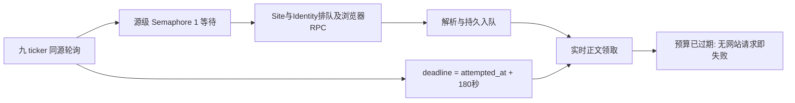

# 正文补全成功率与高轮询延迟：三交易日生产排查

日期：2026-10-23。任务范围：只读统计、机制复现、根因诊断与后续优化优先级。本轮没有修改业务实现、生产配置、身份、Cookie 或认证状态，也没有发布、重启或清理生产数据。

**复查补充：用户四项追问的调查见第10—15节。** 原三日冻结窗口不变；复查纠正了“Chrome身份本身不能并发”和“重复主要因为未发布”的过强表述，并增加实际执行耗时、缓存到期/输入变更证据及共享访问轨迹缺陷。

## 1. 核心结论

下降确实存在，且同时包含真实失败和统计失真。不能只修图表，也不能把所有失败归为浏览器风控。

1. **轮询排队与正文预算耦合是已确认的重要共同机制，但不是全部失败的唯一归因。** Yahoo 等来源的源级列表请求并发仍为1，九 ticker 的列表浏览器/RPC 请求串行排队；实时正文任务的180秒预算却从该轮 `attempted_at` 起算。轮询等待、浏览器访问与入库可先耗尽预算。Bus 正文审计中460次 `deadline_exceeded`，297次在处理函数开始后不足100ms结束；Yahoo和InvestorsHub合计贡献其中418次。此类失败不能诊断成网站正文抓不到。正文Worker本身为8并发；460次也不能全部逐条断言由同一层排队造成，详见复查。
2. **通用RSS有确定的链接解析错误。** Apple Atom 文章链接被后面的图片 enclosure 覆盖，五个图片URL形成177条失败结果。现有解析器在真实feed结构和隔离复现中均选择了 `.jpg`。图片进入浏览器后被资源拦截，报 `ERR_BLOCKED_BY_CLIENT`；这不是应该解除的站点反爬限制。
3. **补全重复执行与两套结果台账存在不一致。** 同一半小时窗口复用同一job ID，但队列终结后仍可能再次创建；已有FULL正文也会被重复补全。同一job ID在Site结果为FULL/SHORT_FULL、Bus审计却为失败的有132个，集中在InvestorsHub和Investing。这是可验证的结果标识/去重分支问题，并非仅仅“两个指标定义不同”。
4. **部分站点存在独立、稳定的失败面。** DIGITIMES英文正文的当前主备不能提供可消费的付费正文能力；Reuters仍受维护、恢复和验证阻塞；Investing国家域部分落入generic策略；ETNews照片短稿有明确的完整性误判。它们不能靠降低轮询间隔统一解决。
5. **其余来源并没有全面失效。** IBKR、The Elec、Benzinga、CTEE、TrendForce在本窗有全成功样本；GlobeNewswire Search、HuggingNews、Tom's Hardware达到90%以上。Yahoo、InvestorsHub、Investing等则为成功/失败混杂。失败来源前六项占Site失败的92.38%。

为核对约80%基线，另外只读回查10月16、19、20日；这三个旧日不混入本次三日分母。历史回查支持用户提到的约80%基线：10月16日Site台账为83.01%，Bus审计为83.50%；10月19日已降至63.61%/61.14%，10月20日为50.95%/43.04%。**下降在10月20日企业IR源上线之前已经出现，不能把总下降直接归因于IR模块。** 本窗IR仅7条结果、6条成功，样本小，但并非总量下降的主要贡献者。唯一失败是BE财报详情URL返回`ir_http_404`（UTC10-22 20:05:42），应单独核对官方feed链接/详情跳转；不是九ticker共享浏览器故障。180秒deadline与轮询起点绑定的代码也早于本次IR实现存在；它是负载上升时被放大的既有耦合。旧日与本窗来源组成、样本量不同，此比较用于定位出现时序，不能单独证明某一次发布的因果效应。

## 2. 时间、版本与统计口径

- 系统语义日以美东02:00切换，依据 `semantic_clock.semantic_day`，不是北京时间自然日，也不是美东00:00。
- 本窗语义交易日：**2026-10-21、10-22、10-23**；UTC **10-21 06:00:00至10-23 11:36:19**，对应北京时间 **10-21 14:00:00至10-23 19:36:19**。23日仅到美东07:36，尚未开盘，不能与完整交易日直接比较日总量。
- 开始调查时本地/生产仓库均为 `3d0ae94cd85edd06df698345b6fe9eb1ee4baa7a`。Bus与正文镜像为`92bbeece85b4`，Site Access为`950fa538a01a`；容器此前运行约15小时，无重启/OOM记录。调查期间另有Site Access相关本地未提交改动，本文源码机制以已核实生产基线为准，不把这些并行改动算作既有故障原因。
- 数据通过SQLite `mode=ro`、`PRAGMA query_only=ON`读取；没有构造Owner服务执行迁移或apply。Site原始访问结果覆盖本窗，正文按job ID关联。采样、脚本和汇总位于 [`eval/body_poll_diagnosis_20261023/`](../eval/body_poll_diagnosis_20261023/)。

### 2.1 三种数字不能混用

|台账/界面|分母与时间|可以证明什么|
|---|---|---|
|Site `body_outcomes`|按job_id存的一条结果；按completed_at分日|该job ID回写过的正文结果，含未分发的共享文章；outbox首写去重意味着不能一概称为最新一次执行结果|
|Bus `audit_log:body_completion`|按attempt_id/job_id首次写入的审计；按started_at分日|页面正文成功率的主要事实来源；不是逐HTTP请求计数，也不是按文章URL去重的成功率|
|Read `bus_body_attempts/succeeded`|正文审计投影，并接受消息/source等界面筛选|页面显示的业务指标；本轮抽查21、22日计数与Bus完全一致，未发现这两日Read漏投影造成下降|

完整正文成功只计 `FULL`、`SHORT_FULL`；PARTIAL和UNAVAILABLE不冒充成功。百分比按总成功数/总数计算，不平均各日百分比。

|语义日|Site成功/结果数|Site比例|Bus审计成功/次数|审计比例|
|---|---:|---:|---:|---:|
|2026-10-21|676/1067|63.36%|574/994|57.75%|
|2026-10-22|703/1187|59.22%|578/1113|51.93%|
|2026-10-23|114/250|45.60%|81/241|33.61%|
|合计|1493/2504|59.62%|1233/2348|52.51%|

Read独立抽查：21日574/994、22日578/1113，与固定截点审计完全一致；抽查稍晚的23日已变为86/250，而固定截点是81/241。后者是截点后正常新增，不能拿它与冻结窗口强行对账。两套台账的分日时间基础和覆盖责任不同，因此每日行数无需相等。

## 3. 失败集中位置：来源与实际发布站点

### 3.1 全部有正文结果的来源

下表使用Site台账同一窗口；它包含共享来源在进入ticker相关性分发之前完成的正文工作。零样本来源不列为健康。

|来源|成功|失败|比例|
|---|---:|---:|---:|
|`yahoo_finance_news`|70|280|20.00%|
|`google_news_search_rss`|301|253|54.33%|
|`newswire_rss`|56|183|23.43%|
|`investorshub_ticker_news`|443|103|81.14%|
|`digitimes_semiconductors`|0|63|0.00%|
|`reuters_site_search`|3|52|5.45%|
|`investing_ticker_news`|79|25|75.96%|
|`etnews_rss`|25|15|62.50%|
|`finnhub_company_news`|13|8|61.90%|
|`barrons_ticker_news`|34|7|82.93%|
|`globenewswire_search`|114|6|95.00%|
|`lakehouse_platform_official_rss`|5|5|50.00%|
|`huggingnews_rss`|83|4|95.40%|
|`tomshardware_rss`|38|4|90.48%|
|`enterprise_apps_official_rss`|5|1|83.33%|
|`corporate_ir_press_releases`|6|1|85.71%|
|`nbis_official_actor_rss`|3|1|75.00%|
|`trendforce_news`|11|0|100.00%|
|`benzinga_news`|15|0|100.00%|
|`thelec_semiconductors_rss`|21|0|100.00%|
|`globenewswire_semiconductors_rss`|4|0|100.00%|
|`observability_vendors_official_rss`|1|0|100.00%|
|`ibkr_news`|147|0|100.00%|
|`ctee_semiconductor`|10|0|100.00%|
|`digitimes_tw_rss`|2|0|100.00%|
|`trendforce_press_releases`|3|0|100.00%|
|`aws_platform_marketplace_rss`|1|0|100.00%|


Yahoo、Google News和RSS是采集来源，不一定是最终发布者。必须继续按最终URL拆分，不能把Google外跳到Reuters、Fool、Investing的失败都归为Google RSS失败。

### 3.2 主要最终域名

|最终域名|成功/结果数|失败|比例|
|---|---:|---:|---:|
|`finance.yahoo.com`|83/261|178|31.80%|
|`www.apple.com`|0/177|177|0.00%|
|`investorshub.advfn.com`|443/546|103|81.14%|
|`www.digitimes.com`|0/68|68|0.00%|
|`www.reuters.com`|3/57|54|5.26%|
|`www.fool.com`|15/48|33|31.25%|
|`www.investing.com`|88/118|30|74.58%|
|`247wallst.com`|11/41|30|26.83%|
|`stocktwits.com`|3/25|22|12.00%|
|`www.marketscreener.com`|1/19|18|5.26%|
|`www.etnews.com`|25/40|15|62.50%|
|`in.investing.com`|0/13|13|0.00%|
|`www.marketbeat.com`|19/30|11|63.33%|
|`uk.investing.com`|0/11|11|0.00%|
|`ca.investing.com`|0/11|11|0.00%|
|`ng.investing.com`|0/9|9|0.00%|
|`www.investors.com`|4/13|9|30.77%|
|`www.moomoo.com`|0/8|8|0.00%|
|`www.on3.com`|5/13|8|38.46%|
|`www.benzinga.com`|20/27|7|74.07%|


其中Apple在本窗全部是图片URL，具有同一种确定机制；DIGITIMES英文基本是同一种认证/能力门禁。Yahoo、InvestorsHub、Fool、Investing主站、247wallst、ETNews均是成败混杂。Marketscreener、Stocktwits虽有少量成功，但失败占多数，不能归入“基本正常”。

`final_site_id=finance.yahoo.com`、`investorshub.advfn.com`的无trace结果主要是deadline在resolve之前已经耗尽时的域名兜底，**不能据此认定这些请求真的走了错误的generic身份**。同域还有正确识别为`yahoo_finance`/`investorshub`并成功的记录。

## 4. 共同根因：源级排队先消耗正文180秒

### 4.1 已确认的执行链



生产配置：Yahoo与InvestorsHub均为源级`max_concurrency=1`，minimum gap分别1秒和3秒。`SchedulerGroupLimiter.permit`先持有Semaphore，再等待spacing，再包住实际RPC。一个等待浏览器/Identity的请求会继续占住该源唯一请求槽。

`GlobalPollScheduler._poll_binding`在进入adapter前启动耗时计时。结果回到`_accept_poll_result`时仍使用原`attempted_at`作为`now`，再传给`enqueue_enrichment(collected_at=now)`。后者设置：

```python
created_at = collected_at
deadline_at = collected_at + timedelta(seconds=180)
```

所以慢轮询不是单纯晚一点发现新闻，而是把本应用于正文抓取的有限预算提前用掉。即使正文Worker此时空闲，第一次领取也可能已经过期。

`claim_enrichment_jobs`已经给distribution/CLOSED_SWEEP首次领取重置抓取预算，但**实时ticker_binding没有同等处理**。隔离库的同一181秒老任务复现：实时首次领取剩余 **-1秒**，distribution首次领取剩余 **180秒**。没有网站、浏览器或生产队列参与此复现。

### 4.2 生产结果支持，而非只靠代码推断

- 固定窗口Bus审计有460次deadline失败，297次处理函数耗时<100ms，337次<1秒。它们不是一次耗时180秒的网站抓取。
- Yahoo贡献262次、InvestorsHub贡献156次，合计418/460=90.87%。Yahoo审计280次失败中262次为deadline；InvestorsHub审计222次失败中156次为deadline。
- Site中大量相应记录的`access_trace=[]`；没有status/HTML/身份尝试，不能要求换XPath或重新登录来修复。
- 当前Worker配置确认为并发8、180秒预算。调查时队列曾为空，正文主线程短采样主要等待I/O；不能把所有历史deadline一概归为“正文Worker并发不足”。历史队列等待量没有完整逐任务时间戳，具体份额不能编造。
- 请求级退避重试与整个job重新创建是两件事。重试不能无限重置deadline，但首次真实抓取预算也不能由此前九ticker的请求队列预先耗尽。

## 5. 高轮询延迟究竟包含什么

### 5.1 先还原页面指标

`api_v2.bus.source_status`直接显示`poll.last_latency_ms/1000`。`aggregates_many`对**当前启用binding最后一次**succeeded/partial/failed的耗时求平均，既不按请求次数加权，也不是近三天历史平均。

该耗时主要覆盖：query/limiter准备、源级Semaphore和spacing等待、Site Access RPC（内部又有Site/Identity/worker等待）、网络/页面/recipe处理、接纳与存储。计时记录点之后的最后一次save等待未必包含。**计划due→调度启动**发生在另一段，不能由这个数字直接读出。

|来源（快照）|启用绑定样本|最后耗时均值秒|最大秒|
|---|---:|---:|---:|
|`yahoo_finance_news`|9|168.23|187.92|
|`investorshub_ticker_news`|9|132.61|141.71|
|`investing_ticker_news`|9|87.67|105.08|
|`barrons_ticker_news`|9|66.19|71.90|
|`globenewswire_search`|9|63.30|95.50|
|`reuters_site_search`|9|2.42|4.50|
|`google_news_search_rss`|2|3.53|4.59|
|`newswire_rss`|6|3.41|6.16|
|`corporate_ir_press_releases`|9|0.38|1.10|


本次快照各ticker同口径平均约34.87—53.06秒；没有在该时点复现“当前ticker平均均超过60秒”。但历史来源的300秒以上实例已证实，不能用当前快照否定此前观察。

当前耗时快照读取时间为UTC10-23 11:48:38左右，晚于正文统计冻结截点；它只描述调查时的源状态。

### 5.2 三日保留回执抽样及582秒实例

全量扫描高频poll CDC达到90秒只读诊断预算后主动中止，未为统计增加索引或改生产表。随后改为每UTC小时最多前100条poll-state回执，54个小时桶，共5400条、去重4048个(binding_id,last_attempt_at)。**这是分层定位样本，不是随机样本或三天全量，不能将其p95/均值写成整体SLA。** 下表只报告样本中已见最大值。

|来源|抽样状态尝试数|观察到的最大轮询秒|
|---|---:|---:|
|`yahoo_finance_news`|64|582.554|
|`investorshub_ticker_news`|93|197.418|
|`globenewswire_search`|129|191.755|
|`investing_ticker_news`|129|162.399|
|`barrons_ticker_news`|158|133.213|
|`finnhub_company_news`|143|44.699|
|`lakehouse_platform_official_rss`|15|32.090|
|`enterprise_apps_official_rss`|15|28.468|
|`newswire_rss`|86|26.520|
|`aws_platform_marketplace_rss`|16|23.482|


明确实例：`MU:yahoo_finance_news`，UTC **10-22 18:50:38.791488**开始，该次完成状态于 **19:00:22.585**进入源回执，记录`582554ms`。墙钟跨度583.794秒与该耗时相符，属于完成回执，不是从累计失败时长猜出的数。另有COHR Yahoo约496.6秒样本。Yahoo样本中的这些慢轮询最终标为succeeded，说明“最后成功”也不能证明时效正常。

### 5.3 可测到的步骤与尚未留存的步骤

|步骤|本轮证据|判断|
|---|---|---|
|轮询前调度/StorageLane等待|轮询计时起点在读取state之后；未保存每次dispatch的全链路span|不可把全部300秒称为计划启动延迟；不能还原每次精确占比|
|源请求槽与spacing|Yahoo/InvestorsHub源级并发1，九binding；permit包住完整RPC|确定存在同源串行队列；九ticker负载与单槽服务能力不匹配|
|Site/Identity等待|UTC12:00左右只读diagnostics看到InvestorsHub等待JointBudget；`queue_waiters=2`|与BODY/CRAWLER共享Identity能力直接相关，非只有新闻网站慢|
|Identity worker/浏览器|同一快照Yahoo操作27.8秒停在`_roundtrip→wait`，InvestorsHub约17.2秒；Globe停在worker acquire|有真实浏览器/控制操作等待；当时`stalled=false`，不能冒称已证明死锁|
|Site记录的network_ms|三日Yahoo平均约11.3秒、最大<45秒；InvestorsHub平均约11.6秒、最大<50秒|明显小于源级170—580秒；network_ms也不等于完整RPC往返，不含所有队列/外层回退|
|解析、结果接纳、入库|Bus主线程15秒采样约89%在selector等待；近段150条慢存储日志最大2.923秒、主要为ingest|本窗短采样未复现10/19主线程97%卡SQLite；存储有成本，但当前证据不支持拿它独自解释582秒|
|正文抓取|独立Worker和durable队列；但deadline从poll起点传递|正文网络没有同步包在轮询中；通过预算和共享Site/Identity能力产生间接关联|

Yahoo adapter还会尝试browser→NCP→RSS；源级槽可被前一阶段的慢RPC占住，之后再进行回退。managed browser路径并不因`_browser_retry_at`而自动跳过下一ticker的浏览器尝试。站点连续延期/端点不可用时，九ticker仍可能重复支付慢路径成本，最终靠RSS成功。

因此**只提高全局并发不是充分修复**：即使绕过源级单槽，如果Site/Identity的配置及Worker协议仍只准入一个操作，按每次约11秒计算，九次一轮本身已超过60秒。这里的“只能并发1”是当前软件限制，Chrome本身可以开多个页面；具体解除位置与所需的取消隔离见第13节。

### 5.4 相关性与非相关性

Yahoo/InvestorsHub的高轮询耗时与deadline失败，有上文可复现的预算传递机制，应该一起修。Reuters的列表与正文共用恢复/维护门禁，也应合并诊断身份恢复。

但关系不是“延迟高必然正文失败”：InvestorsHub最终Site台账仍有81.14%成功，Barron's约82.93%；DIGITIMES可以在auth门禁快速失败，Newswire RSS列表约几秒却仅23.43%正文成功。Apple图片、地区域名策略、短稿完整性、订阅权益是独立机制，不能靠轮询调优解决。

## 6. 其余主要失败机制

### 6.1 Apple Atom enclosure覆盖文章URL：已确认解析缺陷

官方RSS中每entry先有普通文章link，后有`rel=enclosure,type=image/jpeg`的图片link。`adapters._rss_rows`逐子元素无差别执行`row[key]=text`，后者覆盖前者；Newswire随后直接使用`row['link']`。

现场读取官方RSS核对了五个entry，隔离XML复现亦选择图片。三日五个图片URL形成177条失败：136次ERR_BLOCKED_BY_CLIENT、38次Timeout、2次SSL、1次ConnectionError。相同raw可被半小时复查反复补全，放大失败分母及Worker/浏览器消耗。

正确修复点是RSS/Atom主链接选择与非文章准入；**不应取消图片资源拦截，也不应给图片创建浏览器身份重试。** 仅移除此类错误输入的诊断反事实比例为1493/2327=64.16%，仍达不到80%，故不能把Apple当唯一根因或把排除分母当作已完成优化。

### 6.2 已有FULL重复补全、outbox与audit去重不对齐：已确认机制

`enqueue_enrichment`的intake/job身份含`recheck_window=floor(collected_at/1800)`。终结删除queue行；同一窗口的再次轮询可以重新入队同一job ID。`observe_input`复用要求有stream发布记录或bootstrap抑制标记、输入兼容且checked_at<30分钟。**即使已有FULL且已经发布，半小时后也会重抓；并非只有未发布材料重复。** 第14节对54次、53次、41次及Apple样本进一步区分了实际机制。

`record_raw`在`_dedup_candidate`命中已有raw时提前返回，但finally仍以job_id向site outbox `INSERT OR IGNORE`。部分matching/new raw分支才执行`_record_body_attempt`，audit_id同样是job_id且`INSERT OR IGNORE`。于是**不同次实际执行可能各自成为两套台账的首次写入**：Site先保留成功，之后同ID重复执行过期/短稿失败才首次进入audit。它们并非同一个“最后一次结果”。

本窗同ID相矛盾132个，全部为Site成功/Bus失败：InvestorsHub119、Investing13；仅这一对账差异相当于Bus分母的5.62个百分点。例：`enrich-eb84809c…`，UTC10-23 10:53:29 Site为SHORT_FULL，10:55:38审计为incomplete_extract。完整ID与时间位于summary.json。

重复压力也有明确实例：一个InvestorsHub raw在窗口内54个job审计，26次成功、24次deadline、4次budget；一个Yahoo raw有41次审计，38次deadline；Apple两个raw分别约46次审计。**这些不是54篇/41篇独立新文章。** raw的首次collected_at不能当成每个重复job的created_at，本报告没有用两者相减伪造精确队列等待。

这既增加真实负载，也使指标低估已有正文的可用性。应修正实际执行身份、canonical结果投影和验证正文复用，不能把失败审计直接改成成功、删除失败历史，或把未发布raw直接当成已消费。

### 6.3 DIGITIMES英文：CRAWLER成功不满足付费BODY资格

最终域名`www.digitimes.com`有68条结果、0成功，其中本源63条。正文requirement继承`required`且仅browser；列表requirement为`none`。

当前scope主身份`digitimes-nl-1`、备用`digitimes-en-backup`；实际active为备用。备用只有CRAWLER的READY证明、authenticated=false，没有已验证BODY能力。主身份的旧auth虽为VALID且session revision相符，但BODY capability记录为ENTITLEMENT_MISSING、instance_id为空，旧证明不能作为当前可消费付费正文。备用还要满足身份认证及两篇订阅正文验证，不能因能开列表就被提升。

所以no_authenticated_profile_available是门禁汇总原因；不能简单等同“完全没有VALID字段”，也不能仅把数据库auth_state手动设VALID。需要独立核对当下登录/订阅权益、session、原Profile及BODY能力激活。旧capability不是本轮新登录实测，本文不声称今天实际账户已无订阅。

### 6.4 Reuters：恢复/维护与正文身份问题共存

Reuters源3/55成功，实际域名3/57成功。记录包括identity_in_maintenance、site_recovery_pending、manual_attention_required、deadline、egress unavailable等。开始调查后读取的备用恢复记录仍有DATADOME SLIDER/HUMAN、automatic_verification_stalled，且影响CRAWLER与BODY上下文。它与单纯正文selector错误不同。

应按同一scope/identity/recovery事件统一修复列表和正文，并在恢复后分别验证搜索和文章。不能把旧的auth VALID或某次无验证码页面当成已恢复，也不能将全部Reuters失败都记成网络慢。当前字段中不同身份的证明、验证码状态不完全一致，不能跨身份互相借用成功结论。

### 6.5 Google外跳发布者：部分地区域名走generic

窗口内`in/uk/ca/ng.investing.com`分别13/11/11/9条，全部失败；记录的策略为generic，scope为各自`publisher:<host>`，有risk_combinations_exhausted等拒绝。与此同时`www.investing.com`88/118成功，不能说Investing全站都不可用。

Fool、Stocktwits、Marketscreener也有低成功率但成败混杂；应按最终域名及失败phase处理，避免把其错误转嫁成Google RSS抓取失败。需要核对国家域允许名单、页面配方和身份所有权，再决定复用已验证publisher能力或独立策略；不能无条件跨国域复制Cookie。

Site台账中ERR_BLOCKED_BY_CLIENT共202次，Apple贡献136次；剩余66次含其他资源/发布页面，不能照搬Apple结论。浏览器声明SERVICE_UNAVAILABLE也不自动代表整个浏览器驱动死亡，仍需请求URL、phase、资源类别证据。

### 6.6 ETNews：照片稿短正文被拒、reader覆盖了首因

本窗25/40成功；12条empty_extract均为标题`[포토]`的照片稿。代表URL `https://www.etnews.com/20261022000126` 正文节点存在，取到201字符，尾部为记者署名/邮箱而非句号；生产同版choose_candidate返回PARTIAL/incomplete_extract。正常长稿样本能取1112字符并成功。

现有SHORT_FULL要求结构化短正文末尾标点；署名尾巴未完整剔除，所以真实短文被拒。随后browser/reader回退仍未提供合格候选，最后记录empty_extract，掩盖先前已有短正文但不满足gate的事实。历史样本曾为此耗时约91秒。

应精确清理该站的署名/照片稿容器并保留各阶段首因，验证完整短稿合同；不应全局取消完整性、标题一致性或付费墙识别。其余3次失败仍分别保留预算/网络原因，不合并成短稿问题。

## 7. 建议的优化顺序与验收

以下是由本次证据导出的实施优先级，本轮未执行。

|优先级|具体动作|完成条件|
|---|---|---|
|P0|修正Atom主link选择；enclosure独立保留，非文章资源在进入BODY前识别|Apple真实feed选文章URL；五图片不再反复入队；不放松资源拦截|
|P0|分离poll观察时间、持久排队时间与首次真实BODY预算；实时首次claim也有有界抓取预算|慢poll结束后新鲜消息有可用BODY时间；重试不反复续命；30分钟准入及原发布时间完全保留|
|P0|对齐job与实际执行身份、outbox/audit写入分支；复用已验证同版本FULL正文|同次执行两账一致；同raw重复处理可追踪且不会污染分母；无未发布材料冒充已消费|
|P1|优化Yahoo慢browser端点的共同回退/可用性判断；核对source与Site/Identity两层容量|不让九ticker重复支付已知不可用端点的长RPC；减浏览器占用后实测容量，再调整有界并行，不能只抬全局并发|
|P1|DIGITIMES恢复当前认证/订阅BODY能力；Reuters按同一恢复责任处理|主备及BODY各有真实正文证明；未具备权益时保留明确失败，不写假VALID|
|P1|ETNews署名/照片短稿配方及phase原因保留|完整短稿SHORT_FULL；摘要/截断稿仍被拒；避免无意义browser→reader多轮回退|
|P1|按国家域/发布者修正文策略与有限重试|Investing国家域有明确归属与测试；对risk/auth/内容错误区别处理，不跨身份借证明|
|P1|补最小执行时间字段：dispatch、source permit等待、Site queue、RPC、parse、intake、first claim、BODY start/end|能按同一poll_run_id/job执行串起耗时；沿用现有有界诊断/retention，不另建无界成功日志或第二任务系统|

验收需同时看：相同语义日/来源过滤的UI比例；不可变尝试和最终可用正文两种口径；真实新文章去重后成功率；失败原因构成；first_seen→BODY→stream时效；各入口p50/p95及超时数。不能仅靠排除失败分母、降低质量标准、增加deadline、扩浏览器内存或重启来宣称恢复到80%。

## 8. 调查末期新增停服事件：与三日冻结窗口分开

UTC **2026-10-23 12:01:05**（北京时间20:01:05），Site Access出现Docker `stop`/`die`，exit=143、OOM=false，日志为正常Shutting down/Application shutdown complete；随后正文容器连接Site Access失败。12:00:40左右的只读diagnostics此前仍正常返回，且当时stalled=false。

这是冻结数据截点11:36:19之后的新增可用性事件，**不能倒推为三日前述全部失败的原因**。143和stop支持服务收到终止指令，但现有事件没有操作者身份，本报告不推测是谁停止。调查工具没有发出该容器的stop/restart/kill；采样仅使用现有py-spy，另结束的是本轮自己的Docker事件读取进程。

用户随后明确确认“有其他维护，已完成”。因此将该stop/143归入已确认的并行维护事件，不作为消息源历史自发崩溃证据。本文保持原冻结窗口与版本基线，未把维护后的状态混入三日统计，也未实施重启。收尾只读复查时Site Access已恢复healthy、Bus和正文服务也在运行；这是其他维护完成后的状态，不是本轮修复成果。

## 9. 证据清单与未证明事项

|证据文件|内容|
|---|---|
|`summary.json`|冻结窗口的来源、site、域名、原因、deadline与台账对账汇总|
|`site-data.json` / `bus-data.json`|只读导出的job/访问/审计与裁剪元数据；不导出Cookie、token或完整文章正文|
|`collect_site.py` / `collect_bus.py` / `analyze.py`|查询窗口、提取逻辑和可复算统计|
|`poll-history.json` / `collect_poll_history.py`|5400条分层CDC抽样、4048去重状态尝试、慢例原始seq与时间|
|`source-constraints.json` / `worker-settings.json`|源级单并发配置与正文8并发/180秒实际配置|
|`isolated-mechanism-proof.json`|本地隔离库首次claim预算与Atom图片覆盖复现|
|`apple-feed-links.json`|真实官方Atom条目两种link证据，只读XML未下载图片|
|`etnews-public-probe.json` / `etnews-quality-proof.json`|原页候选正文长度与完整性拒绝原因|
|`targeted-registry.json`|关键scope、身份、正文认证/策略配置|
|`access-diagnostics-current.json` / `*-stack.raw`|调查时的等待链、短执行栈采样及worker资源快照|
|`site-exit-observation.txt`|截点后stop/143、正常退出日志及事件|

上述路径均相对[`eval/body_poll_diagnosis_20261023/`](../eval/body_poll_diagnosis_20261023/)。原始大JSON和诊断日志只保存在本地评估目录；未提交、推送或写入生产业务库。短进程采样另在服务器`/tmp/doxagent-body-poll-20261023-*.raw`留下三个诊断产物，没有改应用文件或持久化浏览器资源。

边界：未对全部失败URL逐一重抓；没有完成当前每个账号/订阅的人工验收；没有逐poll的全部阶段持久span，故不能给582秒捏造精确的各步骤百分比；15秒进程采样不代表三天CPU曲线；历史poll样本不能作为全量p95；用户已确认末期停服属于其他维护。已确认的解析、预算、重复责任与台账机制足以启动上述窄范围修复，无需先重构整个消息管线。

## 10. 四项追问复查：边界及更正

本次复查继续使用第2节冻结的三日数据，另读取重复文章的当前观察记录、身份并发配置，运行隔离机制复现，并进行了**不调用Bus enqueue/accept/publish的影子访问**。影子采样UTC **13:29:15—13:33:08**（北京时间21:29—21:33），共10次列表、10次正文流程；各源顺序执行，每个样本两次，未人为制造九ticker并发。正常访问会留下Site事件并执行其既有访问/恢复策略，本轮没有发出登录、身份切换、恢复确认、配置apply或重启命令。

复查时Bus/正文仍为原`92bbeece85b4`镜像；Site Access已由其他维护更新为`challenge-repair-937d7159`，启动于UTC12:57:10。本地HEAD为`2414d3ef`。本次所述Bus去重、正文pipeline及Worker串行协议文件，相对`3d0ae94c`未变；Site预算/捕获复用已有维护变更。因此**历史统计和当前影子样本分开列示**，当前恢复状态、捕获缓存速度不能倒推为三日原始行为。

需要明确纠正三处理解：

1. 轮询计时没有同步等待独立正文队列结束，不能从UI轮询均值直接扣掉“正文队列平均等待”。共用Site/Identity带来的等待在列表RPC内，过早起算的正文deadline则把慢轮询成本传给下一阶段。
2. Chrome可以多页面并发。现有限制来自源级permit、Site/Identity配置，以及父子Worker协议，不能把它表述成浏览器的物理能力限制。
3. InvestorsHub的54次和53次样本都已有stream记录；其重复主要符合30分钟主动复查合同。“FULL但未发布”是另一条可复现的放行路径，不能拿来概括这两个样本。

## 11. 问题一：除排队、超时和局部站点外，还有哪些机制

答案是**有，而且其中存在跨来源的通用实现问题**。当前失败面应分开看，不能把下表各行当成互斥分组相加：

|机制|确认的事实|对成功率/时效的影响|
|---|---|---|
|预算生命周期错误|实时首次claim不重建180秒预算；大量deadline在处理函数开始后立即结束|文章尚未实际抓取即失败；和慢列表/排队相互放大|
|回退原因码合同不一致，新增确认|Site可能返回`Timeout`，managed transport原样传给pipeline；reader允许列表仅含小写`timeout`|有剩余预算也跳过可用reader路径，有限重试仍可能只重复direct|
|配置访问顺序未被遵守，新增确认|`access_order`被当作成员允许名单：只要包含`http_public`，就先走HTTP；`[browser,http_public,reader]`也如此|声明browser优先的站点仍先支付HTTP成本/拒绝；策略与实际行为不一致|
|输入不是文章、正文完整性误判|Apple图片覆盖文章link；ETNews完整照片短稿被判PARTIAL；付费/标题身份校验也有独立拒绝|无法通过增加排队预算解决；质量失败可能触发多轮无效回退|
|复查与去重层次不一致|30分钟正文复用到期；输入字段变化重新放行；任务终结后可重建同ID；claim前不再核对已有正文|重复消耗正文资源；某个已成功raw可继续产生失败审计，压低按尝试统计的比例|
|结果与诊断归属失真|132个两账冲突；另有共享`access_trace`列表的并发串扰|统计并非文章最终可用率；组合/身份归因可能被其他任务的轨迹污染|
|浏览器执行本身与容量不匹配|正文单次执行及列表单次执行常为数秒至十多秒，同时默认单身份串行|即使没有持久队列等待，九ticker目标周期也可能无法达到|

### 11.1 `Timeout`回退中断：不是“网站只能超时”的解释

路径为`site_strategy.service.classify_exception` → `SiteAccessTransport._reason` → `ArticlePipeline.extract`。前两者可以保留异常类名`Timeout`；pipeline的reader分支比较固定的小写原因集合。Hub虽将原因转小写判断是否有限重试，但每次重试进入同一pipeline，**并没有修复阶段回退选择**。

冻结Site结果有102条最终原因`Timeout`；其末条trace为direct的有101条、reader为1条。考虑到下面的trace串扰，另核对各raw自身的`media_enrichment.attempts`：49个保留最终`Timeout`的raw全部只有direct阶段，其中有Fool、MarketScreener、MarketBeat及其他发布者，不仅是Apple图片。

隔离运行真实managed transport和真实pipeline：输入`Timeout`仅调用一次direct；改成`timeout`则调用direct及reader。这个复现只证明**回退被原因码阻断**，不证明这102次若回退就一定成功；图片、订阅内容仍不应送去无意义回退。优化应统一稳定的错误类别/原因码并保留原始异常供诊断，不能粗暴对所有403、认证失败或非文章目标增加重试。

### 11.2 `access_order`是实际行为缺陷

隔离配置`[browser,http_public,reader]`，提供可完成的HTTP正文，真实pipeline只调用`HTTP_PUBLIC`并直接返回正文，browser未被调用。源码在HTTP阶段只判断`"http_public" in access_order`，而非按列表迭代。Yahoo当前BODY配置恰好属于browser在前、HTTP在后的情况。

HTTP成功时它可能更省资源，所以不能把每次HTTP优先都算失败；问题是**策略表达失效**，HTTP不稳定时也无法正确使用已验证的优先顺序。应按每站已验证的成本和可用性确定顺序，让实现遵守该顺序，而非一律browser优先。

### 11.3 并发任务共用访问轨迹：新增确认的观测缺陷

`SharedContentExtractor`只有一个managed pipeline；它的`SiteAccessTransport.access_trace`是实例上的共享list。每个任务追加trace，结束时`list(access_trace)`后`clear()`。8并发时，A等待browser期间，B可以取走A的direct记录并清空。

真实pipeline隔离复现结果：A、B正文均为FULL；B的trace包含`A/direct + B/direct`，A仅剩`A/browser`。冻结raw快照筛得18个无`source_chain`且混有其他具名站点的可疑trace，例如Investing正文含`yahoo_finance/direct/source:yahoo_finance_news`，Barron's正文也混入Yahoo direct。这里18是线索数，不把所有跨站trace自动判错；原始跳转和reader本来可能合法跨站。

已确认的是可复现的任务轨迹串扰。它**没有改变本复现的正文结果，也不能据此把59.62%修正为更高比例**。`final_site_id`通常有显式site字段，不能声称全部site统计已错；但使用trace末项推导combination、或据trace分配身份责任时存在污染风险。修复点应是任务局部trace及取消路径清理，无需新增一套诊断服务。

## 12. 问题二：排除排队后到底多慢，各步骤占多少

### 12.1 先区分三种耗时

|口径|包含|不包含/限制|
|---|---|---|
|UI `last_latency_ms`|本次列表poll内查询计划、源permit等待、Site RPC、解析、接纳/入库等|独立正文Worker排队和抓取不直接包含；不是消息发布时间到发现的总延迟|
|Bus审计`completed_at-started_at`|正文处理函数开始后的执行，含pipeline、域名controller、Site争用与有限回退|不含首次claim前持久队列等待；仍不能叫“完全不排队”|
|Site `network_ms`|`_attempt`中runtime执行及响应/正文合同验证|在显式Site permit准入之后计时；但包括全局browser slot、Worker锁、导航、JS/DOM/recipe等，**并非纯HTTP网络时间**|

Site历史`ACCESS_RESULT`事件只持久化`network_ms`，没有持久化`queue_wait_ms`及全部poll span。因此三日全量的“扣除所有排队后平均poll及每阶段百分比”**无法从现存数据准确重建**。下面分别给历史可计算量、当前同一次请求的分段测量，不用跨样本均值相减冒充精确分解。

另发现两个计时陷阱：Site的`_result`失败构造路径没有填入queue等待，`site_queue_timeout`耗时约10秒也可能返回`queue_wait_ms=0`；维护后的共享capture命中会返回原捕获的`network_ms`。本次Barron's列表RPC只有约14—20ms，却带原捕获7801ms的runtime；已查到两条对应`CAPTURE_CONSUMED`事件。因此不能把这些字段机械相加，或把负残差解释成计时错误/抓取加速。

### 12.2 三日成功访问中，单次执行本身的成本

下表按冻结Site访问事件统计，**只选SUCCESS**。BODY为访问请求，可能同一job多次调用；不等于文章数或成功job数。CRAWLER为全窗事件聚合，不是第5节的5400条poll-state抽样。

|Site|列表成功访问数|列表runtime均值/最大，秒|BODY成功访问数|BODY runtime均值/p95，秒|
|---|---:|---:|---:|---:|
|Yahoo Finance|5287|15.366 / 44.609|112|2.088 / 4.481|
|InvestorsHub|12116|11.714 / 49.222|1155|8.853 / 15.854|
|Investing|13739|8.833 / 44.420|218|11.057 / 18.673|
|Barron's|19518|6.800 / 44.304|45|7.128 / 11.779|
|GlobeNewswire|45434|2.936 / 40.006|118|0.672 / 1.482|

这已经回答“是否抓取本身偏慢”：**InvestorsHub/Investing的正文、Yahoo/InvestorsHub的列表都有明显单次执行成本**。但runtime中仍可能有下游容量等待，不能断言全部是网站响应慢。另按Bus成功审计计算，首次claim后正文处理均值/p95：Yahoo 3.380/8.208秒（n=73）、InvestorsHub 17.039/33.388秒（264）、Investing 16.718/31.300秒（55）、Barron's 9.977/15.568秒（40）、Globe Search 1.318/3.445秒（113）。两张表口径不同，不做逐项相减归因。

即使取历史成功runtime均值作为每ticker一次列表调用的成本，九ticker单槽一轮约为Yahoo **138秒**、InvestorsHub **105秒**、Investing **79秒**、Barron's **61秒**。这是容量量级检查，忽略了正文争用、失败回退、多query/分页和额外存储，**不是准确的逐轮预测**；但足以证明“只消除持久正文队列”不能自动实现60秒列表周期。

### 12.3 当前列表影子抓取：同一次调用分段

使用生产当前绑定与真实adapter，源级permit在影子进程内不排队；保留现有Site服务的真实争用。`site:auto`包装及resolve同样执行。Globe Search仅配置一个`MU`查询，不代表生产完整query plan。没有执行Bus接纳/入库，所以以下不是完整生产poll耗时。

|样本|总耗时|可确认的阶段分解|排除可测等待后的结论|
|---|---:|---|---|
|InvestorsHub，2次均成功，各14条|均值25.374秒|Site显式等待14.714秒（58.0%）；runtime10.201秒（40.2%）；resolve0.208秒、RPC残差0.209秒、解析/映射约0.042秒（合计1.8%）|扣除显式Site等待后约**10.660秒**；仍包含runtime内部slot/Worker等待，不能叫绝对无队列时间|
|Yahoo，2次均靠RSS成功，各12条|均值11.592秒|browser排队后延期的RPC均值10.134秒（87.4%）；NCP块0.453秒（3.9%）；RSS块0.998秒（8.6%）；其余约0.007秒|两个browser结果均为`site_queue_timeout`、没有实际runtime；NCP+RSS+解析约**1.458秒**。第二次NCP块仅约0.4ms即返回失败，不能当两次独立联网均值|
|Globe Search，第一次成功10条|9.161秒|显式Site等待0.726秒（7.9%）；runtime8.184秒（89.3%）；resolve/RPC残差/解析合计0.251秒（2.7%）|扣显式等待约**8.435秒**；第二次10.271秒为队列超时，无正常抓取，不能合成健康均值|
|Investing，第一次延期|27.970秒|显式等待0.507秒；runtime27.339秒；其余约0.124秒；结果`site_recovery_pending`|本次大量时间确实在runtime/恢复判定而非显式准入队列；第二次0.080秒直接恢复门禁。均不算列表抓取成功|
|Barron's，2次成功，各37条|0.081 / 0.041秒|均命中维护版本已存在的15秒共享capture；沿用原7801ms runtime证据|可证明缓存消费很快；不能据此断言一次新导航只需几十毫秒，也不能混入原三日runtime均值|

### 12.4 当前BODY影子抓取：排队外仍有多大成本

每站选一个当前已有成功正文的URL，连做2次，**10次均FULL**。没有人为先排空生产、切换身份或避开当前真实负载，也没有claim前持久等待。下表百分比为同两次样本各阶段耗时之和占总耗时之和，因四舍五入可能差0.1个百分点。

|实际发布站点|总耗时均值，秒|显式Site等待，秒/占比|runtime，秒/占比|resolve + RPC残差 + pipeline其余，秒/占比|扣显式Site等待后，秒|
|---|---:|---:|---:|---:|---:|
|Yahoo Finance|3.068|0 / 0%|1.902 / 62.0%|1.166 / 38.0%|**3.068**|
|InvestorsHub|21.513|11.829 / 55.0%|9.320 / 43.3%|0.364 / 1.7%|**9.684**|
|Investing|15.845|3.924 / 24.8%|11.468 / 72.4%|0.453 / 2.9%|**11.921**|
|Barron's|13.658|6.180 / 45.2%|6.534 / 47.8%|0.944 / 6.9%|**7.479**|
|GlobeNewswire|0.792|0 / 0%|0.567 / 71.6%|0.225 / 28.4%|**0.792**|

这部分的“扣等待”只扣除响应明确提供的Site queue，runtime内部等待仍未分离，故是**可测排队外成本，而非严格纯抓取平均**。Yahoo pipeline其余第一次约1.896秒、第二次0.162秒，包含本地候选提取/校验及可能的首次初始化；不足以归为持久在线CPU瓶颈。其余四站pipeline其余均值约0.04—0.23秒。本样本没有显示解析/映射普遍占数十秒。

对低轮询延迟的直接含义：优先缩短列表占用、减少明知延期仍重复探测的成本、消除重复正文及身份串行瓶颈；同时保留正文质量。不能因为正文异步，就忽略每篇8—12秒的浏览器占用对下一次列表准入的影响。

## 13. 问题三：同一Chrome Identity为什么当前不能并发

**可以实现多页并发；限制是当前软件设计。** 以下各层容量必须分开，不能只改一个数字：

|位置|当前限制/持有范围|为什么影响并发|
|---|---|---|
|Bus `SchedulerGroupLimiter.permit`|源/调度组`max_concurrency=1`；permit跨整个列表RPC持有|同源九ticker请求串行；它不约束独立正文Worker|
|正文Hub及SharedContentExtractor|Hub最多8个处理任务；extractor最多8；browser阶段还有DomainFetchController|Yahoo域名browser并发2，其余默认4，部分域名1；等待仍消耗处理任务和deadline，不能把8个任务等同8次实际浏览器操作|
|Site `JointBudget`|同时满足scope/site及identity容量；相关身份`access.max_concurrency=1`，常见间隔3000ms|CRAWLER与BODY共用容量；BODY初始优先，CRAWLER有老化提升。备用也不是默认同时工作的第二槽|
|`WorkerSiteAccessRuntime._business_slots`|当前生产全局browser pages=4；进程数配置8不是同身份8任务|不同站点也竞争4个实际browser操作名额；HTTP_PUBLIC不必占浏览器名额|
|父进程`IdentityWorkerManager.command`|每identity的`operation_lock`从发命令前持有至roundtrip结束|即使上面准入放到2，此处仍把同identity的长操作串行|
|子进程`identity_worker.Worker.run`|只有一个`self._active`；第二条业务命令返回`IdentityBusy`|协议本身不支持同identity多在途操作；单改父锁也不够|
|页面分配`BrowserRuntimeManager.page`|全局page slots；identity锁只围绕页面分配，随后释放|它没有把锁一直持有到文章抓取结束，不是上述长串行的主要原因；已有独立page/target生命周期可继续利用|

只读配置确认：`yahoo-main`、`yahoo-backup`、`investorshub-main`、`investorshub-backup`、`public-markets-nl`、`investing-backup`、`dowjones-main`、`dowjones-backup`等相关身份均为单并发；当前实际样本使用InvestorsHub备用、Investing备用、Yahoo备用和Dow Jones主身份。历史身份路由可能不同，不能只看旧组合显示名定位当时使用的Chrome。

这套串行设计也有具体关联约束：父进程超时/取消发送的是未指定任务ID的`cancel`，随后可能退役整个identity Worker；子进程只有单个`_active`，身份快照/会话状态也按一次操作处理。**若直接移除锁并放入两个任务，一个任务超时就可能取消或退役另一个任务使用的控制进程。** 这是当前不能“仅改并发数”的原因，不是证明同Chrome不能多页。

最小可行改造方向是：在同一既有Chrome/登录Context中分配每请求独立page/target；父子协议支持少量按operation ID管理的在途任务与精确取消；业务读页允许有界并发，登录、会话恢复、profile快照/替换保留身份级独占。然后同步调整该源和对应Site/Identity准入，先测2页及列表时效，不复制九套profile，也不需要先建设新浏览器平台。不同Context若要共享登录证明，不能假定天然继承Cookie；已有认证源可直接复用原登录Context的不同页面。

## 14. 问题四：正文之前有去重，为什么仍重复几十次

### 14.1 目前有四种不同责任，前置去重不是永久文章缓存

实际路径为：

`列表 → admission → resolve_first_seen → observe_input → enqueue(active job) → claim/正文 → record_raw/_dedup_candidate → standard/stream`

1. `observe_input`是**有时效的输入复用**：同ticker候选必须有stream发布记录或bootstrap抑制证明，URL身份兼容，title/summary/body/published_at/updated_at/provider_version等已提供字段兼容，并且`checked_at`距调用传入的now小于30分钟。它没有“已有FULL就永远跳过”的规则，也没有要求候选一定FULL；已经发布摘要的文章同样可能缓存30分钟。
2. `enqueue_enrichment_job`只对**活跃队列行**的intake_key去重。key含binding、identity、稳定输入fingerprint及半小时桶。原始payload里的缩略图/传输噪声不直接改变稳定fingerprint，但summary和发布时间会；跨ticker也不会自动共享该job。
3. 正文完成后`_dedup_candidate`是**逻辑文章与发布去重**，可以抑制再次推送并合并正文，但这时网络成本已经发生。它和前置输入复用的成功标准并不相同。
4. Site Access原`request_id`缓存是**RPC幂等**；新请求有新request_id，即使`body:<phase>:hash(url)` operation_id相同也不等于正文缓存命中。维护新增的短时shared capture只覆盖符合条件的CRAWLER，不能拿来当BODY长期缓存。

### 14.2 实际重复样本：多数并不是“完全漏掉去重”

下表审计及时间仍来自三日冻结窗；观察记录/stream关联来自UTC13:28左右只读快照。后者能证明当前保留的关系及历史观察字段，但不能当作每次调用当时的完整数据库快照。不同审计数也不等于全部物理抓取次数，同ID重复执行可能未新增审计。

|raw样本|冻结审计/其中成功|前置字段与时间证据|最符合证据的解释|
|---|---:|---|---|
|InvestorsHub NBIS `raw_1e884c…`|54 / 26|已有1 standard、1 stream member；保留FULL；观察中的发布时间/summary各只有1个稳定值；最短相邻审计间隔1937.402秒（32.29分钟），没有小于30分钟的间隔|**30分钟复用到期后的主动重查是主机制**；不能说因为未发布。观察raw payload哈希变化也没有持续突破稳定字段复用|
|InvestorsHub SNOW `raw_356f74…`|53 / 33|同样1 standard、1 stream member；当前证据kind=BODY；发布时间/summary各1个值；最短间隔1902.909秒（31.72分钟），没有小于30分钟间隔|同样符合TTL复查；成功SHORT_FULL不一定被去重证据标为FULL，二者质量用途不同，不能因此说没有成功过|
|Yahoo `raw_a491a0…`|41 / 0|当前已有stream但只有摘要；40个相邻间隔中38个小于30分钟，最短143.090秒；截点前保留46条观察、36种发布时间、2种summary|**输入变化突破复用**，不是单纯等TTL；同一文章身份反复生成新fingerprint/job，最终逻辑文章去重仍会合到同raw|
|Apple `raw_1686ee…`、`raw_541f93…`|各46 / 0|都有stream，均为SUMMARY；各只保留一种稳定输入；绝大多数间隔约31分钟|错误图片目标已按摘要发布，30分钟后仍重查，缺乏对确定性非文章目标的终止处理；少量短间隔不能仅用审计起点断定入队时未去重|

Yahoo的发布时间变化不是本轮推测出的相对时间误算：导出的provider payload本身有不同`pubDate`，同时出现RSS和`page_network_ncp`路径。例如UTC22日20:49:28、20:59:08、21:16:20、21:35:03，次日仍继续变化。现有比较允许“时间变了但raw_hash相同”的特殊兼容；provider pubDate连同payload一起变时，raw_hash也改变，该特例失效。summary变化也会独立使复用失败。**不能仅凭这些字段变化就认定报道有重大更新，也不能未经正文核对把所有变化当噪声丢弃**；需要把稳定文章身份、版本提示和正文获取复用分开处理。

### 14.3 还存在三个可复现的放大环节

**FULL但未发布不能复用。** `observe_input`候选SQL要求stream关联或bootstrap抑制；即使raw正文FULL、checked_at很新，未满足该发布条件也返回false。这个条件防止把未完成发布冒充消费完成，动机合理；但把正文下载缓存绑在发布收据上，导致发布失败时连已经验证的正文也重抓。应复用下载结果并继续履行原发布责任，两件事无需互相替代。

**终结删除队列行后，同窗口同ID可以重建。** `enqueue_enrichment_job`查的是活跃queue，不查outbox/audit作为正文复用收据。本地真实repository复现：首次入队true、活跃重复false、删除本地隔离库中的终结queue后再次入队true，前后job_id相同。若观察复用因未发布、字段变化等不成立，就会进入这条路径。这样会真实执行更多次，但`INSERT OR IGNORE`只保留某次首次结果，进一步造成第6.2节两账不一致。

**已经在队列内的工作不会在首次抓取前再次核对同版本已有正文。** Hub `_process`先做admission，然后走native/正文；没有正文缓存二次检查。跨半小时桶、输入版本变化或不同binding先后入队后，即使其中一个任务已完成，其余任务仍可执行。claim本身已有按host分散选择，不能误称完全FIFO，但它解决的是公平性，不解决同文章下载复用。Apple少量很短的审计间隔可能涉及这类排队交叠，历史缺少每次created/claim span，本文不逐条指定其成因。

隔离复现真实`observe_input`结果如下，均未访问生产业务库：

|输入/状态|是否复用|
|---|---|
|已经发布FULL，同输入，1分钟|是|
|已经发布FULL，同输入，31分钟|否|
|仅raw payload传输噪声变化，2分钟|是|
|summary变化，2分钟|否|
|发布时间变化但raw_hash不变，2分钟|是，命中特殊兼容|
|发布时间及provider payload一起变化，2分钟|否|
|FULL未发布，同输入，1分钟|否|

这解释了去重的现状：**发布去重通常仍有效，下载去重却只是一层30分钟且受字段变化/发布状态约束的缓存。** 不是可以简单删除某个重复判断，也不是应把所有同URL后续更新永久忽略。

## 15. 复查后的优化判断与补充证据

后续实施应优先围绕业务新鲜度，采取以下窄范围改动；本轮仅诊断，未执行：

1. 修正Atom主链接和确定性非文章目标处理；修正稳定错误类别与回退条件、让实际访问顺序符合每站配置。减少无效BODY调用，保留订阅/身份/完整性边界。
2. 分离正文下载复用、文章版本判断和发布责任。已验证正文能用于重走发布流程；稳定FULL不再只因半小时TTL就进入高优实时正文抓取；确有更新提示时有界复查。未抓到正文的确定性失败不要按新文章无限周期重试，暂时性失败仍保留有限重试。
3. 修正实时首次抓取预算及实际执行ID；对齐outbox/audit所有分支，trace改为任务局部。指标同时呈现“新文章最终可用率”和“实际尝试成功率”，保留失败历史，不能靠合并/排除分母宣称恢复。
4. 列表低延迟与正文容量一起优化：优先使健康列表少付延期探测/多阶段回退成本；允许同Chrome有界多页读操作，按operation精准取消，维护写操作独占。同步配置源与Site/Identity，不能只把Hub从8调大。正文旧文复查不得持续挤压新文章发现。
5. 沿用现有诊断持久化最小阶段时间，并标注shared capture原始获取耗时与本次消费耗时；失败准入也记录等待。验收看列表新鲜度、p50/p95、捕获年龄和正文完成时效，不能把快速恢复门禁/延期误算为快速成功轮询。

新增证据均位于原评估目录：

|文件|用途|
|---|---|
|`followup-summary.json` / `analyze_followup.py`|冻结成功访问runtime、正文处理耗时、重复间隔及影子分段汇总|
|`followup-dedup-current.json` / `collect_followup_dedup.py`|五个重复raw的stream关联、字段摘要/哈希、provider时间及历史观察；不导出文章正文|
|`followup-limits.json` / `collect_followup_limits.py`|当前身份容量、scope主备、全局page配置、两条Barron's共享capture命中事件|
|`followup-shadow.json` / `followup-shadow-v2.raw` / `probe_followup_stages.py`|10次列表、10次正文的完整分段测量及采样器|
|`followup-input-reuse-proof.json` / `prove_input_reuse.py`|真实repository的七种复用条件与同窗口job重建复现|
|`followup-fallback-proof.json` / `prove_fallback_contract.py`|真实pipeline的大小写回退中断与访问顺序复现|
|`followup-trace-proof.json` / `prove_shared_trace.py`|真实pipeline的并发trace串扰复现，两篇正文均FULL|

影子采样器首次运行遇到旧Bus容器模型缺少`served_from_shared_capture`字段的兼容问题，日志`followup-shadow.raw`仅用于记录采样器错误，**不作为业务失败或阶段统计依据**；修正采样器后完整重跑，使用`v2`数据。Barron's共享capture另由Site事件核实，未把继承的7801ms加入本次几十毫秒调用的步骤总和。所有本地隔离断言通过；没有把10次成功正文样本外推为所有站点或全天100%成功，也没有声称本轮已完成成功率恢复。
