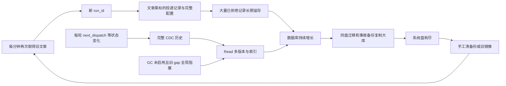

# 新加坡服务器反复满盘：根因审计与修复方案

> 后续实施状态：P1–P3 主要修复与物理回收已完成，P4 已按用户要求重审、精简并实施；结果及未完成验收见 [执行记录](disk-repair-execution-20261013.md)。以下“只读/未执行”描述属于最初审计时点。

审计日期：2026-10-13，北京时间约 02:35–02:55。目标：`doxagent-sg` / `VM-0-15-ubuntu` / `/home/ubuntu/doxagent`。

本轮扫描、查询和生产代码核对均为只读；没有删除文件、数据库、镜像、容器或浏览器状态，没有部署代码、修改生产配置或重启业务。只对本轮扫描进程降低优先级，并终止了本轮耗时过长的 dbstat 查询。证据保存于 `eval/disk_rootcause_20261013/`。以下容量统一用 GiB，文件大小、目录实际分配空间分别说明。

## 1. 结论

180 GiB 系统盘已经完整分区使用。问题是几条持续写入路径缺少有效的幂等与生命周期管理，再叠加部署、研究测试和备份占用；不是系统盘没有挂上，也不是单纯日志失控。

两个最明确的应用根因：

1. **共享新闻分发按每轮轮询重新生成文章×标的投递记录。** 约 2,287 篇共享文章产生约 378 万条观察记录、1,134 万条投递记录。后一个独立状态快照中，11,137,121 条、98.21% 为 `ADMISSION_REJECTED`。现场样本是已经过期的旧文章，仍持续生成 `EXPIRED_PUBLICATION` 投递记录，并重复保存完整 binding/admission JSON。幂等键包含每轮变化的 run_id，只避免同一轮重复，不能避免跨轮重复。
2. **轮询状态的技术变化被写成永久历史，再复制到 Read；实际回收链没有生效。** Bus 已有 2,000,408 条 poll_states 回执，占采样时全部 CDC 回执的 88.05%；Read 有 1,995,828 个对应版本，当前状态实际只有 68 个。线上没有 Read GC 服务；配置将它放在可选 maintenance profile。即使只把服务启动起来，现有代码遇到任何 gaps 就将全库回收边界设为 0；现场有四条旧 runtime provenance gaps，Read retained_floor=0。

备份、旧镜像、SDK 会话记录、浏览器缓存和生产盘上的研究测试进一步放大上述问题。**只释放历史备份或镜像，会降低一次使用量，却不会降低这些路径的新增速度。**

## 2. 180 GiB 到底去了哪里

`lsblk`：vda=180 GiB，vda3≈179.5 GiB，挂载 `/`；`df` 文件系统总量 189,559,676,928 bytes，约 176.54 GiB。02:45 采样已用约 165.43 GiB、普通进程可用约 3.82 GiB、使用率 98%。约 7.29 GiB 是 df 总量/已用/普通用户可用之间的保留空间差额，不是漏挂的数据盘。inode 使用率约 27%。

02:55:27 收尾复查：已用 177,908,195,328 bytes、可用 3,827,347,456 bytes，约 3.56 GiB，仍为 98%。本轮扫描进程已结束。这个短窗口变化不作为未来每日增长预测。

| 一级归属 | 实际分配空间约 | 判断 |
|---|---:|---|
| 应用卷 `doxagent-v2_v2-data/_data` | 100.69 | 最大占用，业务、重复过程记录、备份和测试共用 |
| Site Strategy 卷 | 12.00 | 其中 profiles≈11.04，含身份与可再生缓存 |
| `/var/lib/containerd` | 32.52 | 镜像内容与文件系统层；不是全部可删 |
| `/home` | 8.13 | 含约 2.17 的旧备份、多份部署/研究 checkout |
| `/var/lib/doxagent` | 2.39 | 几乎都是 initialization-repair/backups |
| `/usr` | 4.50 | 系统程序、库、驱动等 |
| `/opt` | 1.03 | Chrome、IB Gateway 等 |

一级项互不包含；采样跨分钟，表内不承诺与某一瞬间 df 完全相等。文件系统元数据和其他小目录未逐项列出。

应用卷的下表是父目录 100.69 GiB 的拆解，不能再与父项相加：

| 子目录 | 实际分配空间约 | 主要内容 |
|---|---:|---|
| read | 30.82 | Read 主库及外置内容；主库文件约 29.39 |
| bus | 20.83 | Bus 主库约 19.86，另有约 0.87 专项备份 |
| runtime | 9.95 | 主库约 4.85，runtime_artifacts≈4.08、native-files≈1.02 |
| codex-home | 9.20 | sessions≈5.59，logs_2.sqlite≈1.96、thread_history_1.sqlite≈1.56 |
| production-backups | 8.81 | 10/12 v2.1 发布压缩备份及清单 |
| backups | 3.83 | 主要为 10/06 Event maintenance 恢复副本 |
| workspaces | 5.57 | 模型任务输入、输出及 attempt 产物 |
| MU/INTC/BE/RKLB 测试与 v21-production-validation | 9.23 | 测试数据库、工作区和验证产物 |
| initialization | 1.37 | 初始化库及文件 |
| research | 0.88 | 研究库及文件 |

不能把上述工作区、SDK 历史、测试库全判定为垃圾：采样时四个 ticker 的隔离 Worker 仍在运行，RKLB D3 也在运行；研究发布引用和任务恢复依赖需要逐项解析。

其他核对：

- `/var/log`≈0.38 GiB，journal≈0.29 GiB；不是此次主因。
- Docker 容器可写层合计约 133 MB，当前日志文件合计约 0.81 GiB；正式多数服务已有 20m×3 轮转。若干研究 Worker 和 egress 没有日志上限，是后续治理项，不能说正式所有容器都无限日志。
- 主库采样时 Read/Bus/Runtime WAL 都为 0；不是几十 GiB WAL 未 checkpoint。
- 三库 freelist 分别为 0、1、0 页。当前几乎没有可立即靠 VACUUM 收回的整页空洞；大量空间仍是实际记录和索引。
- lsof 的已删除打开文件采样主要是 memfd/共享内存和小系统文件，没有发现能解释几十 GiB 的根盘 deleted 文件。该检查只保留了前 30 行，不当作全量排除证明。

## 3. 共享分发为什么会越抓越大

已核对实际运行 Message Bus 容器代码，并保存 SHA-256 与关键行：

- `message_bus_v2/scheduler.py:272–273`：REALTIME work_key 包含 `timestamp // interval`，每轮生成新 run。
- `distribution_repository.py:314`：每个 run/article 插入 observation。
- `distribution_repository.py:320–337`：delivery_id 由 run_id/article_id/ticker 生成，唯一键也是三者；每条投递保存完整 binding_json、admission_json。准入失败仍插入一条 ADMISSION_REJECTED。
- `expire_runs()` 仅更新状态与原因；没有物理回收记录。

独立查询的准确计数：

| 对象 | 条数 |
|---|---:|
| raw_messages | 6,567 |
| distribution_articles | 2,287 |
| distribution_runs | 143,055 |
| distribution_observations | 3,779,966 |
| distribution_deliveries | 11,339,967 |

稍后状态快照总量为 11,340,648，差异来自正常持续写入。其中：拒绝 11,137,121，去重 123,821，无关 78,307，无公共正文 90，发布 1,309。`PUBLISHED` 只是此分发表的状态，不是全站新闻总数，也不代表 broker 成交。

相对 2,287 篇共享文章，平均约 1,653 个 run/article observation、4,958 条 delivery/article。这个平均值反映累计留存放大，不表示每篇文章完全相同。

现场末尾样本中，HuggingNews 和 TrendForce 旧文章都被再次为 BE/INTC/MU 建立拒绝投递。仅一个 TrendForce 样本的 binding_json 就有 634–638 字符，admission_json 为 110 字符，还另存 ID、状态、原因及多份索引；这类配置应被引用，不能随每分钟每篇旧文章重复存储。

**审计中特别防止了一个误判：** message_admission_results 的最大 rowid 超过 1,317 万，但真实 COUNT(*) 只有 9,725。其 INSERT OR REPLACE 会推动 rowid。本文不把 rowid 当作记录数；分发表大计数来自实际 COUNT(*)。

没有完成全库 dbstat 的逐表字节分摊：该查询在繁忙主机低优先级下耗时过长，已终止。因而不声称“某张表恰好可释放 X GiB”，也不把 COUNT 或字符样本直接当物理回收量。

## 4. CDC / Read 的历史放大与回收失效

线上 poll_states UPDATE 触发器会比较 next_dispatch_at 和完整 data_json；这些每轮变化的技术字段使一次轮询也生成完整 v2_source_receipts/outbox，而不是只有新新闻才产生记录。

准确聚合中：poll_states 2,000,408、standard_messages 151,258、acquisition_failures 78,879、audit_log 23,293，其余较少。88.05% 的 CDC 记录是轮询状态。

Read 的 objects 会保存版本，object_current 保存当前副本，业务对象关闭版本还会复制进 business_revisions。Read 当前高水位约 438 万，objects 最大 rowid 约 836 万；后两者是坐标，不冒充 COUNT(*)。已经实际 COUNT 的 poll_states 版本为 1,995,828，当前 68 个。

回收失效有三层：

1. **部署未启用。** 本地及远端 Compose 都把 v2-maintenance 放在 profiles:[maintenance]；实际容器清单没有 gc-worker，系统 timers 也没有本应用回收任务。
2. **全局阻塞。** 线上 maintenance.py:110–111 遇到任何 gap 就 floor=0。当前四条 runtime gaps 是 1240145、1240148、1240191、1240193，PROVENANCE_UNVERIFIED，已被反复重试。Read retained_floor=0。不能删除或伪造这些缺口来让 GC 看起来成功。
3. **源归档未形成运行闭环。** Bus/Runtime v2_receipt_archive 为空，retained_floor=0；Runtime 还有 1240145 的 repair pin。现有 archive() 需要消费确认、同 epoch 的恢复 checkpoint、至少七天窗口和 pins。它把历史原文转为本机 receipt-files；仅调用现有 archive，不等于磁盘被收回，也没有提供长期冷存储和收缩机制。

三库 auto_vacuum=0，删除记录之后数据库文件通常先保留原尺寸、复用空页。物理缩小须另做受控重整。这与 [SQLite 官方说明](https://www.sqlite.org/pragma.html#pragma_auto_vacuum)一致。线上现有 compact() 又要求目标盘至少有源文件 3 倍空间；Read 约 29.4 GiB 时需要约 88 GiB，当前根盘显然不满足。不能先在这块盘上盲跑大库 VACUUM/compact。

## 5. 为什么多次清出空间仍很快复发

| 时间/Case | 有记录的变化 | 复发机制 |
|---|---|---|
| 9/28 | 清除旧镜像/缓存和旧备份释放 81.15 GiB；可用升至 90.21；随后新建约 19G 恢复集，最终可用 71.94 | 一部分空间立即重新用于同盘全量备份；分发/CDC 写入源头未修 |
| 10/2 | 可用又降至 8.4 GiB；清除约 9 GiB 旧快照和指定旧镜像后升至约 29 GiB | 备份目录约 47 GiB、镜像又到 53 个，手工治理缺少发布完成后的自动退役 |
| 10/9 | 满盘可用 0；删除 9/27 与 9/29 两份全量备份，约释放 37.2 GiB，可用恢复约 34.9 GiB | 删除的是下游快照；持续膨胀的原数据库、分发记录、CDC 历史仍在。两份备份未外移，永久失去历史恢复点 |
| 10/12 | 早期只读快照可用约 14.37 GiB；清缓存/旧副本后发布前可用约 20.20；工作流发布验收最后约 5.8 | 发布新镜像与压缩备份、研究测试继续占用，数据库仍增长；compressed backup 仍放系统盘 |
| 10/13 本轮 | 可用约 3.82 GiB、98% | 上述新增路径与留存政策继续有效，释放量再次被消耗 |

证据：`docs/disk-cleanup-execution-20260928.md`、changelog 的 10/2 记录、`eval/message_source_repair_20261009/cleanup-receipt.json`、`eval/message_source_diagnosis_20261012/storage.json`、`docs/message-source-recurring-recovery-20261012.md`、`dev_plan/workflow_v2.1/v21_production_deployment_acceptance_20261012.md`。

Read 主库约从 9/28 的 12.51 GiB 增至 29.39，Bus 从约 2.65 增至 19.86，合计增加约 34 GiB。这是跨版本、跨部署的历史净增量，不能直接外推成未来固定每日增长率，也不能据此逐字节分解每次满盘的全部增量。

## 6. 其他留存问题

**备份多入口。** 除 `/data/backups`，还有 production-backups、bus/backups、bus/repair-backups、`/home/ubuntu/doxagent-backups/runtime-trade-20260930` 和 `/var/lib/doxagent/initialization-repair/backups`。仅管理一个目录无法控制总占用。9/28 已提出保留策略，但历史方案明确没有实施对应配置/任务。

10/12 本地 D 盘已有部分异机备份，但实查缺少 bus.sqlite3.gz、read.sqlite3.gz；远端这两份合计约 6.77 GiB。不能因清单在本地就误认为完整恢复集都已异地保存。远端还保留了一些已复制到异机的压缩数据库/文件归档，后续可核对同内容再退役，但本轮没有删除。

**镜像与发布完成后退役。** 84 个镜像、14 个被容器引用，存在 10/2 多个 preview、10/4 多个 r1–r5、10/6 多个 r1–r3 等临时版本。48 个容器中有多份已退出测试容器与两个 Created 模板，会继续固定镜像引用。Guardian 当前还动态依赖 `doxagent-initialization-repair-agent:codex-gpt6-0.159.3` 和正式 repair-template，不能按 Containers=0 或 Created 就删。

镜像历史可见 1.02 GB Chromium、SDK 升级 1.18 GB，以及多代约 204–206 MB COPY src 层；在旧镜像上继续叠加删除/覆盖并不会移除底层旧字节。应该从规范依赖基线做周期性干净构建。共享层不能重复计数。

Docker 本轮 system df 的 reclaimable 居然为负数（约 -82%），与 df/du 的物理归属不可直接对应。实际 containerd 约 32.52 GiB可信；不能用异常 API 数字承诺回收量。Build Cache 报告 3.415 GB，但非共享可回收只有约 67 MB，目前不是最大问题。

实查 BuildKit v0.26.2 默认 builder 已有 GC：Reserved≈16.76 GiB、Max Used≈132.2 GiB、Min Free≈33.53 GiB。**不能说没有 daemon.json 就没有 GC。** 这些策略针对构建缓存，不能替代已命名镜像、业务卷和备份的生命周期。配置调整应按当前 docker driver，而不是把独立 buildkitd 配置写到无效位置；参见 [Docker 官方 GC 文档](https://docs.docker.com/build/cache/garbage-collection/)。

**浏览器缓存。** 两个正式身份 dowjones-main/yahoo-main 的 Default/Cache 合计约 2.07 GiB，Code Cache 合计约 0.58 GiB；这只是两个 Profile 的核对值。profiles 同时包含 cookies、IndexedDB、登录态和人工身份，不能整目录清理。通用 Profile 数量也需要结合 Registry/租约识别，不能只按目录名删除。

**模型记录与测试。** SDK sessions、内部日志库、thread history、runtime_artifacts、workspaces 都在增长；一部分是可恢复任务和审计原件，一部分是终态调试副本。不能让“保留所有原件”默认等于“所有原件永远留在生产系统盘”。生产盘同时承担四 ticker 隔离研究和验证，形成明确的额外空间竞争。

## 7. 修复方案及顺序

### P0：获得一次必要的施工余量

先完成 10/12 恢复集的异机转存：缺失的 bus/read gzip 传输、SHA-256 校验、恢复集文件映射核对，再退役根盘上已经验证冗余的副本。可以把约 6.77 GiB 的两份大压缩库作为优先转存对象；这里只是候选字节量，未批准或执行删除。

并按完整 ID 与动态依赖审计旧镜像/退出容器，选定一份可用回滚版本。已完成测试的副本只有在发布引用、Worker、租约和恢复依赖均结束后才可转存退役；活跃 RKLB/其他研究不因本方案自动停止。

一次性释放空间是修复施工条件。若不足以安全转换大库，用临时数据盘或离线恢复环境承接 shadow，不在仅剩 3.8 GiB 的根盘上边跑业务边复制几十 GiB 数据。扩容能提供施工余量，但单独扩容不会改变增长机制。

### P1：优先消除分发重复写入

改动重点：`message_bus_v2/{scheduler,distribution_repository,distribution}.py`。

- 把“轮询执行身份”和“文章对某标的的业务处理身份”分开。后者以稳定文章/内容版本、ticker、terms/classifier 版本及必要 admission 语义确定；REALTIME 不能以每分钟 run_id 作为新投递依据。CLOSED_SWEEP 的窗口/任务身份仍保留。
- 文章已过期且未发生新内容/语义变化时，直接记录每轮汇总与必要的首次/变更拒绝证据，更新 last_seen/次数；不为每个标的每分钟再次创建完整 rejection delivery。前置过滤不能妨碍未知日期 first_seen 固定、真实正文修订、词表变化或有效补扫。
- binding/source/admission 配置保存为版本化不可变快照并引用；不在千万条投递中重复复制完整 JSON。
- 对已有成功发布、有效待处理、失败重试、sweep 和审计引用保持原业务 ID/幂等语义。历史旧重复终态记录在验证后分批归档/回收，不把状态改成 EXPIRED 当作已释放空间。

验收：用同一份包含过期卡片的真实冻结 feed 连续重复轮询，第二轮起重复 rejection delivery 不再线性增加；新文章、真实内容修订、terms 更新、有效 sweep 仍各按契约处理。崩溃重试不能重复发布。

### P2：让技术状态历史有边界，让 GC 真正运行

改动重点：`v2_read/{outbox,repository,maintenance,cli}.py` 与生产 Compose。

- poll_states 的调度时间、采样延迟等技术变化不再触发无限完整历史。保留最新状态、必要状态转换、限定窗口的查询版本及聚合指标。需要先核对现有 24h view/cursor 语义，不能直接删 capture 表或丢 freshness。
- 将有界 Read GC 纳入正常生产装配，状态可观测，异常时不静默只报“运行中”。维持短事务与已有业务并发。
- 将 gap 对历史的保护限定到实际 source/对象/坐标与依赖；至少允许健康来源及与该缺口无关的技术状态回收。不能粗暴去掉 floor=0、保留同样的全局最小 pin 后宣称问题已解决；也不能伪造 provenance 或删除 gaps。
- 建立受消费 ACK、必要恢复 checkpoint 和精确 pins 约束的源传输归档闭环。原文压缩去重后转冷存储，热库保留查询索引/摘要；当前 archive 写本机无压缩文件的方式不能单独作为容量修复。
- 回收对象仅限可证明的重复过程数据或过期技术版本。新闻正文、交易/Policy 命中、发布研究、未完成任务和必要恢复证据保留可检索的原件。

验收：保留四条真实 gap 的离线副本，健康来源 GC 仍推进且缺口所需原件可恢复；未过期 tokens 和 REMOVE pre-image 正常；pins 阻止相关回收；GC 速度跟得上写入，事务耗时不拖慢业务。

### P3：一次受控历史整理与物理回收

先部署 P1/P2 减少新增，再归档既有重复拒绝投递、过期轮询版本和运输历史。建立可恢复清单，短批次处理，保留仍被引用的业务历史、源 epoch、checkpoint、capture proof、public sequence IDs 和消费/交易去重身份。

随后在有足够余量的目标盘构建 shadow，核验数据库和相应 native/content/receipt files、业务计数、保留 token、来源坐标和实际页面。追平增量后，在可控短窗口切换；跨文件系统不能假装 rename 是原子切换。回滚只恢复投影/代码的对应版本，不用旧全库覆盖切换后正常交易和消息。

现有 compact() 只解决 Read 的部分格式/空间问题，既不会修分发重复写入，也不会自动整理 Bus；不能原样执行一次就宣称本方案全部完成。容量收益以切换后的 df 和实际分配空间验证，当前不承诺逐表回收 GiB。

### P4：重新审计后的精简留存规则

原 P4 由 [P4 留存规则重新审计](disk-p4-retention-audit-20261013.md) 替代。按实际收益执行：已完成且无依赖的旧维修快照/施工临时资源直接删除、不再备份；迁移入口仅保留最新成功回滚集；补受管临时容器日志轮转；发布结束退役自己的中间镜像；补齐现有只读容量报告。保留正式恢复集、业务原件与活跃任务。删除 SDK 内部库裁剪、活跃任务归档框架、正式目录改名、浏览器重启清缓存、新建 CI 平台/全局 prune/笼统磁盘配额等低收益动作。不创建 Codex heartbeat。

## 8. 成功标准

不能以“清完后 df 好看”作为完成：

1. 反复收到相同 feed 时，持久化体量主要随新文章/内容版本/语义变更增长，重复过期文章不再随轮询次数×标的数增长。
2. poll 状态历史受窗口约束，68 个当前状态不再无界累积百万级永久版本；真实 business 证据仍可追溯。
3. 保留问题 gaps/pins 时，健康部分仍可回收；回收、冷归档、物理空间复用都有实际推进指标。
4. 新做一次备份、发布及终态研究任务后，过渡空间按规则退役，不再长期叠加多份全量副本。
5. 在至少一周自然业务与发布/备份循环中验证净增长；按整理后的基线、观测增速及最大施工峰值确定容量预算。不能拿本次十余分钟采样承诺长期 180 GiB 永不满。

如果业务要求所有历史原文永久可检索，有限系统盘不可能无限存储。需要可校验的冷热分层和恢复/读取路径；这与减少重复写入同时实施，才能摆脱频繁人工清理。

## 9. 验证边界

已完成：真实根盘/目录扫描、准确关键表 COUNT、状态聚合、CDC 聚合与抽样、线上代码 SHA/关键逻辑核对、现有部署和动态镜像依赖核对、历史清理/发布凭证复盘。

未完成：逐表精确物理字节分摊、完整恢复演练、所有 Profile/工作区的引用判定、长期增长窗口，以及上述修复的实现与上线。本轮未修改业务代码，没有通过删除来“验证”可回收量。
