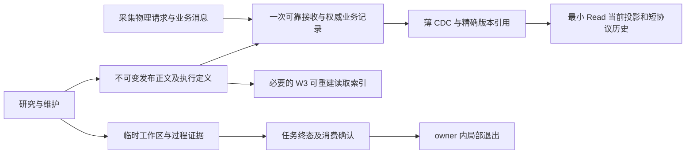

# DoxAgent 全局存储源头减量与生命周期优化方案

日期：2026-11-18。性质：**深度审查与后续开发方案；本轮未实施生产代码修复、迁移、清理、发布或服务重启。**

## 1. 决策结论

本轮应当从“定期清垃圾”转向三项具体改变：

1. **一份业务内容只确定一个权威保存位置。** 维护过程、发布记录、CDC 和 Read 保存身份、版本与必要字段；不再各自携带完整正文和完整运行上下文。不同语义的业务产物仍分别保留，不能把 JSON、Markdown、执行投影误当字节重复。
2. **运行结束即结算过程资源。** 在现有 Worker、Runtime、维护业务自己的终态/消费确认中确定退出资格。后台只执行已经确定的局部退出；不再通过扫描所有历史任务、解析所有资产来重新证明每个目录能否删除。
3. **清理必须持续推进，但不占住实时写锁做文件工作。** 保留短事务、fence、精确版本引用和必要业务持久性；删除逐事件无价值写入、反复整包序列化、锁内解码/遍历/递归删除，以及必须等全系统空闲才能推进的普通退出工作。

最优先修复的是 Maintenance/D3/Research 多重物化、Worker 终态退出、Acquisition 物理请求证明与小时归档，以及 CDC/Native 引用链。Runtime 和 Read 应基于最新实现做增量收敛，**不能恢复已移除的全局重扫描，也不能把已有优化重新列为待开发成果。** 不建设全局资源管理平台，不迁移数据库产品，不通过减少业务并发、降低采集频率或改变模型/提示词解决问题。

当前风险很具体：11 月 14 日清理后可用 83.42 GiB；本轮 11 月 18 日 04:26 起采样结束时只剩 **2.49 GiB**，04:43:41 复核为 **2.57 GiB**，df 显示 100%。这已不适合进行建索引、全库备份、VACUUM 或本机生产镜像构建。后续实施必须先单独恢复余量；本轮遵守只审查、只出方案的边界，没有擅自清理。末次容器清单共 22 个在运行，未出现 unhealthy/Restarting；这只证明该采样时点，不能据此忽视满盘风险。

## 2. 审查依据、版本与量化口径

### 2.1 证据与版本

完整现场证据位于 [`artifacts/audits/global_storage_design_20261118/`](../artifacts/audits/global_storage_design_20261118/)。主要文件：

| 文件 | 用途 |
|---|---|
| `root-scan.jsonl`、`root-breakdown.json` | 全根分区 allocated 扫描、目录层级、前后 df |
| `live-inventory.json` | SQLite 物理分配、空闲页、实际 schema/trigger/index、目录族数量 |
| `research-lengths.jsonl` | Research 关键表和记录类型的逻辑字节统计 |
| `runtime-lengths.jsonl` | Runtime 表分批长度统计；以各项 complete 标记为准 |
| `pool-body-sample.json` | 内容池 inode/压缩分配抽样与发布正文压缩样本 |
| `io-sample.json` | 30 秒 cgroup 实际块设备写入采样 |
| `owner-probe.json` | 维护回执、Acquisition 退出进度、W3 注册状态、SDK 日志类别 |
| `deployed-hashes.json`、`version-comparison.json` | 生产运行镜像内代码与 Git blob 核对 |
| `static-storage-inventory.json` | 743 个产品 Python 文件的持久化调用与建表静态清单 |

开始审查时本地 HEAD 为 `0a0d6b7a50fe8b189812604d3ea87cfd4f92e9fe`，服务器 checkout 为 `15eaf515fcb22ef8517cd722041cbe1909cb4f47`。运行角色并非统一镜像 SHA：Worker/API/Projector 为 `d227e762...`，Collector/BODY 为 `b940e012...`，Bus 为 `2dd5f5d6...`，Executor/Transport 为 `48693172...`，Site 为 `ec5355db...`。对选定关键文件逐项读取运行容器文件，比较 **Git blob**，确认 Runtime/Bus/Worker/Read 的受审实现已经部署；不能拿 Windows CRLF 文件哈希直接判定生产漂移。

审查期间其他会话继续提交 Site 与 Bloomberg listing/realtime 代码，本地 HEAD 经 `f511e939cce77525382b0246c3109ca12a0eb6b1` 前进到 `b938abe8fb12de62a4d77922d25b9b95b1b69beb`。后续三个 Bloomberg 提交涉及 realtime metadata backlog、Latest fallback 和 cookie state 隔离，并非本轮存储改造；它们不改变本报告已核对的 Runtime/Read/Worker/Acquisition store 结论，但实施前仍须复核新采集行为与现场版本。同期另有实施回执文档修改。它们不是本轮修改，也不等于已在生产运行。后续开发须重新固定实施 SHA，保留并适配同期业务变化。本轮没有覆盖或回滚这些工作。

静态清单覆盖全产品目录，深读聚焦大块实际占用及其跨模块消费者。4489 个持久化调用位置、305 个建表语句是静态命中数，不是独立数据库数量，也不代表逐行人工审完全部文件。未完成的现场查询会明确记录 `interrupted`，不能把缺测当零。

### 2.2 根盘占用比例

根盘容量 400,937,631,744 B，即约 **373.40 GiB**。全盘扫描使用 `du -x -B1 -d8 /`，低优先级执行，不跨文件系统；结束北京时间 04:22。扫描期间有一个浏览器缓存文件消失导致退出码 1，但获得根目录总计，未发现整块目录权限失败。此为运行中非原子快照。

以下比例分母是 `du` 实际遍历分配总计 **368.41 GiB**，不是商业标称容量；同次遍历硬链接只计一次。根盘 df 与 du 的小幅差额包括扫描时间差、文件系统元数据及打开后删除的文件，不捏造归属。

| 互斥大项 | GiB | 占本次 du |
|---|---:|---:|
| 主应用数据卷 `doxagent-v2_v2-data` | 310.85 | 84.38% |
| Site Strategy 数据卷 | 21.92 | 5.95% |
| containerd 内容与 snapshot | 16.38 | 4.45% |
| 其余系统、宿主机发布/修复目录、日志、swap、其他卷等 | 19.26 | 5.23% |

**BuildKit 仅约 0.089 GiB，Docker 容器目录约 0.085 GiB。** containerd 的 16.38 GiB 包含当前镜像层、内容包及快照，不能全算旧镜像，也不能与 Docker CLI 的共享镜像逻辑大小叠加。这次主体确实是应用数据；只清构建缓存无法逆转增长。

主应用卷内部以下各项互斥，分母 310.85 GiB：

| 项目 | GiB | 卷内比例 | 组成和判断 |
|---|---:|---:|---|
| Workspaces | 88.09 | 28.34% | `runtime-maintain-*` 60.29；`.w3-packs` 8.70、sources 3.68、contexts 2.32；其余 Worker 控制库、运行目录等 |
| Runtime | 87.38 | 28.11% | SQLite 主库约 34.31、Native 内容池 27.69、运行事件分支 `runtime_artifacts` 23.77；其余时延/轮次回执等 |
| Research | 45.61 | 14.67% | 主库约 42.33、Native 2.65、adoptions 0.55；现有 published-contents 仅 0.012 |
| Bus，包含 Acquisition | 36.20 | 11.65% | Bus 主库 13.32、Acquisition 19.08、Native 3.76 等；不能再额外加一遍 Acquisition |
| Codex Home | 21.56 | 6.94% | sessions 11.57、logs SQLite 5.75、thread_history SQLite 3.53、state 等 |
| Read | 20.71 | 6.66% | 活跃主库约 17.18，外置内容等约 3.53 |
| Ops 初始化/修复副本 | 5.20 | 1.67% | 多次 ticker refresh 留下的控制库和现场 |
| Initialization | 3.03 | 0.97% | 主库 0.54，主要其余为 Native 内容 |
| Production Validation 与四个 ticker 测试根 | 2.49 | 0.80% | 可重建验证资产，需 owner 终态，不是业务权威根 |
| 其余 | 0.60 | 0.19% | prebuilt、备份、诊断、调度等 |

`read/v2.sqlite3` 是 `serving-v4-20261018/v2.sqlite3` 的软链接，核对设备号/inode 一致。不存在两份各 17 GiB 的 Read 库。`.init` 仅剩 37 个目录，归属标记 2376 个；11 月 14 日的历史漏管快照退出有效，不能继续将其描述为当前十几 GiB 的新增来源。

### 2.3 四天增长与写放大证据

11 月 14 日 02:25 验收 df 已用 310,383,546,368 B；11 月 18 日 owner probe 结束已用 397,281,443,840 B，**净增约 80.93 GiB**，含正常业务和同期发布，不等于全部无价值数据。没有取得各目录清理后同一时刻的完整基线，不能编造精确分摊。

但主要业务放大链有直接增量证据：

| 对象 | 11/14 记录 | 本次 | 解释 |
|---|---:|---:|---|
| Maintenance 工作区数量 | 7337 | 11003 | 新增 3666 个，当前族占 60.29 GiB |
| D3 staged 版本 | 3137 | 4864 | 新增 1727 个，各自保留大 payload 与 receipt |
| published_documents | 16121 条、约 9.53 GiB 逻辑 JSON | 24836 条、约 14.38 GiB | 增加 8715 条，约每新增 staged 版本 5 个发布产物 |
| Research 主库 | 约 30.97 GiB；清理产生约 4.97 GiB 空闲页 | 42.33 GiB，几乎无空闲页 | 既消耗先前空闲页，又继续向文件系统分配；不能只看文件增长低估写入 |
| Read 主库 | 压缩后 12.56 GiB | 17.18 GiB，空闲页约 0.001 GiB | 目前再 VACUUM 不会凭空释放 17 GiB |
| Acquisition 最老已终态原始周期 | 历史积压 | 11/11 20:00 UTC（11/12 04:00 北京时间），状态 CAPTURED | 当前维护 hours 阶段仍 `interrupted`，48h 规则没有形成有效退出闭环；另有 10/28 SCHEDULE，不能混称原始请求积压 |

Research 的分批长度统计是逻辑值，不是可直接回收的物理页：

| 表/类型 | 行数 | 逻辑内容 GiB |
|---|---:|---:|
| `codex_runtime_records/published_documents` | 24836 | 14.38 |
| `v2_source_receipts` | 38392 | 7.88 |
| `codex_document3_v21_staged_sets.payload` | 4864 | 4.46 |
| 同表 `.receipt` | 4864 | 4.64 |
| `codex_document3_v21_runs.payload` | 4990 | 1.37 |
| `codex_document3_v21_tasks.payload` | 6506 | 0.206 |

发布文档按 artifact_id 顺序选取 12 个样本，正文合计 6,329,346 B，gzip 后 2,272,659 B，为 **35.9%**。这是小样本压缩可行性，不是全库压缩收益保证，更不能把它与去重/退出收益重复相加。

Runtime 补充统计采用同样的短只读事务，读取固定 rowid 高水位；两个大表各限定 60 秒，未完成部分仅是**已扫描前缀下界**：

- `runtime_tasks` 完成统计 42794 行，inputs 约 149.54 MiB、receipt 约 25.25 MiB；`runtime_v2_cases` 完成统计 33497 行，SQL payload 约 378.30 MiB。大对象部分已是 Native 引用，不能把小 SQL 长度误认为其引用文件也很小。
- `runtime_values` 扫描 241664 行、约 3.07 GiB 逻辑 payload，尚未扫描完；其中 reference_deliveries 717 行约 786.27 MiB、reference_baselines 803 行约 417.37 MiB、w3_citation_scope 5410 行约 570.83 MiB、round_inputs 54193 行约 495.37 MiB。这扩展出旧报告没有充分量化的引用快照/引用范围复制链。
- Runtime `v2_source_receipts` 扫描 428288 行约 3.50 GiB，尚未完成，不能当作全量总计。

因此不能把 Runtime 34.31 GiB 主库笼统归因于 task receipt，也不能只压缩这张小表。大块责任在多 namespace 业务输入快照、传输回放、索引及它们引用的 Native 内容，需要分别处理。

30 秒 cgroup 块设备写入：Collector 84.69 MiB、Worker 31.97、Projector 27.54、Scheduler 23.79、ChromeSupervisor 15.85、Maintenance 7.59、Site 6.42、Bus 3.85、BODY 3.32。此采样表明采集与投影链的 I/O 值得优先处理，**不能外推全天增长、CPU 归因或延时因果**；一个进程打开某库，也不足以把其全部块写入都归给该库。

## 3. 历次治理复盘：哪些保留，哪些推翻

历史基线包括 10/18 架构方案、10/28 Bus 精益实现、10/29 资源精益实现、11/11 生命周期方案、11/14 清理与机制记录，以及本地 11/16–17 W3/Runtime 延时改动。结论以当前代码和现场回执重新核实。

| 历史动作 | 当前判断 | 本轮设计约束 |
|---|---|---|
| Docker 稳定依赖层移除动态提交身份；发布后自动 retire | 有效。当前 BuildKit 不是大头；Dockerfile 的 commit ARG 在依赖层之后 | 保留现有 `storage_release.py`，完善其他发布入口的统一接入，不重建发布平台 |
| Read V4 current/history 分离、definitions 共享、30min 协议历史 | 已存在，不能重新建议“从永久 MVCC 改 30min”冒充新改造 | 保留当前分页、view/stream、一致性协议；审查输入与 materialization 是否必要 |
| 11/14 Read 物理压缩 | 确实释放约 19.80 GiB；只是存量处理 | 当前空闲页极少，根因要看持续投影和内容引用，而非重复压缩 |
| `.init` owner 与历史漏管快照退出 | 本轮未见同规模再生，37 份遗留不构成当前大头 | 不反复清同一对象；未来初始化仍应减少预节点完整树快照 |
| 11/14 Research 已 ACK 回放临时按 48h 退出 | 产生约 4.97 GiB 库内余量，但普通代码仍用 7d | 一次手工参数不等于正式产品策略；须修 source/consumer 契约与常驻任务 |
| Acquisition captures ACK 变薄、共享 checkpoint、WAL anchor 无长读事务 | 最新代码已实现并部署 | 保留；不能再次以“长事务 anchor”作为当前已证根因 |
| Acquisition 候选分页和 `captures_run` 索引 | 物理/小项退出已有产出，但 hours 前置重计算仍失败 | 修整小时取全量样本再归档的结构；不是继续加同一个索引或只减 batch |
| Worker workspace/snapshot 自动收集 | 最新性能修复故意取消自动 `collect_inputs`；全局引用证明不受候选 LIMIT 约束 | **不直接重新接回原收集器。** 用终态 owner 局部退出补上自动责任 |
| Runtime 私有 READY、当前 owner 共识、轻状态 SQL、Native 引用保留 | 已部署，减少准备和完整解码；4 个 READY 当前有效 | 不新增通用 warm pool，不改变模型/并发，不恢复全历史共识扫描 |
| W3 派生数据 GC | `app.prepare_assets` 已自动调用；近期 retained_until 与锁外文件工作有效 | 继续审查保护范围与退出吞吐，不能声称“没有定时 GC” |
| SDK Session 退出 | 现场已有大量 W3 thread 标记 DELETED；普通 Session 也有成功删除回执 | 不是完全没清理。全树扫描、全局 quiet、过宽保护和日志/投影另存仍有空间 |

过去多轮优化没有阻止复发，核心不是所有修复都失败，而是**一次性压缩/清退与源头减量混淆、性能修复暂停了昂贵退出但没有及时替换、跨模块复制仍持续、生命周期验收未覆盖真实生产率**。修复记录中的短期测试不能替代跨保留期的容量闭环。

## 4. 全局数据职责与退出原则

### 4.1 保存价值的具体判断

| 数据类别 | 必须保存的内容 | 退出或减量决策 |
|---|---|---|
| 订单、成交、持仓、决策与引用到的事实 | 身份、金额/数量、时点、因果链、精确输入版本/必要证据 | 小型事实长期保留；完整过程目录与供应商原始日志不随之永久保留 |
| D1/D2/D3 正式产物、有效 activation | 唯一规范正文、版本映射、引用关系 | 一正文一份；历史版本按真实引用和恢复点保存，不给每份中间态同等地位 |
| Task 执行恢复 | 领取 fence、外部副作用身份、阶段、未消费结果、重试必要输入 | 终态且已消费后转小收据；不再承诺永远从原 SDK 线程/工作目录继续 |
| 消息接收与传递 | 稳定消息身份、去重键、未 ACK 载荷、消费进度 | 已消费的传输包是有限回放窗口，不是永久业务审计库 |
| 实时 UI、分页、stream、延时指标 | 当前事实、有效 view 所需短历史、已有指标精度所需薄证明 | 不镜像全部后台账本；禁止为缩容伪造百分位或遗漏失败/空采集 |
| 索引、编译 pack、浏览器缓存、过程镜像 | 重建依据与有限热缓存 | 无独立历史价值，按使用和重建成本退出，不为清缓存制作大备份 |
| 恢复快照 | 当前有效恢复责任、兼容代码与必要身份状态 | 一份明确恢复点优于每个节点一棵整树；保护须有业务终点 |

引用需要区分“正文仍须存在”和“原运行现场仍须存在”。历史记录出现过路径、thread_id 或 run_id，不意味着永久保护整个目录。真正活跃的 Case、待执行 effect、未完成交接、持仓管理及有效回滚版本必须保留精确可读内容。

### 4.2 统一执行方式

复用各业务现有状态表/metadata/退出表，不新增全局 owner 服务：

- 生产者先确定本次执行的不可变输入身份，文件发布完成后才在短业务事务中提交引用；事务失败产生的孤立临时文件由本 owner 小批清理。
- 终态与“结果已被消费”共同决定退出资格。需要外部 ACK 的不能只看 Worker succeeded；实际已归档的不可逆业务副作用不能靠重新执行来“恢复”。
- 已确定资格的退出保存 `owner_id + owner_revision/fence + state + retry_at` 等最小字段。优先扩展已有表；只有缺失时新增本组件的窄表。
- 读候选与文件枚举在锁外；短写事务重查 owner/fence 与精确引用，原子改名到同文件系统 owner 专用退役区；提交后递归删除，重启继续删除。共享 canonical 内容必须由自身 ref 判定，不能因工作区退出而连带删除。
- 普通退出允许持续少量进展；遇实时压力缩批、让出并重试。重建大库、整树校验、供应商 SDK 全树列表等重操作单独限额，不能把它们塞进一笔“短事务”。
- 回执只累计数量、字节、最老积压时点、失败分类；不要为治理再生成逐对象完整镜像和长日志。

## 5. 可执行工作包

下列 P0/P1 是开发优先级；所有措施均为后续工作，本轮未执行。每项必须先复核当前 SHA。不得把后续发现的独立问题扩散成重新设计整个运行框架。

### P0-01：Maintenance/D3 从生产端取消过程副本，并建立终态局部退出

**证据与消费者：** `workflows/codex_document3/orchestrator_v21.py:_write_view`（约 414–460）反复读取运行状态并写完整 `v21_state.json`；产品内直接文件消费者为 `pilot.py`。发布阶段还写 `artifacts/releases`、`output/final`；`codex_runtime/workspace_store.py:publish` 再产生 published 副本。`StateV21` 保存 prepared/final/handoff 等大过程字段；已有 `retire_process` 能保留小收据，但运行终态没有可靠完成全链结算。当前 11003 个 Maintenance 工作区、60.29 GiB 是首要治理对象。

**实施：**

1. 将完整 `_write_view` 变成显式 Pilot/诊断导出。生产运行只维护现有数据库状态与必要小摘要，不在每个 turn 写整份镜像。Pilot 直接调用同一按需构建函数，保持诊断能力。
2. 发布只生成一套不可变 canonical 文件。`output/final` 和 published manifest 指向该内容；确需兼容路径时提供只读别名或在确认不可变后硬链接。不能对仍可能被模型原地修改的文件直接硬链接，污染已发布版本。
3. `StateV21` 的 staged 交接保留一份 policy/projection 权威定义，receipt 改存身份、校验和、路径与 handoff 证明，不重复嵌入整套 policy/projection。run prepared/base/final 在交接已确认后转小收据。保留旧记录解码及在途任务旧格式。
4. 在 Runtime maintenance 终态及 activation/消费确认后，调用可幂等的本 run 退出结算；Worker 读取本 run 的 Jobs 与 manifest 即可处理 context、attempt input、view、重复输出等。利用现有 `process_retired`、退出 cursor/fence，明确退出后新建运行，不从已退役现场恢复。
5. 将 `resource_maintenance.run` 改为消费局部已结算候选。**不要恢复原 `collect_inputs()` 全局扫描。** 显式人工/离线历史修复入口可保留，用于旧数据一次性补归属。

**不变条件：** 未消费结果、RUNNING/queued 同族任务、当前恢复中的 run 不退出；正式发布产物、O# 引用、业务版本和有效回滚不删。FAILED 有实际恢复入口时短期保留，已关闭 incident 不无限期承诺整现场恢复。

**收益与验证：** 对 60.29 GiB 过程族直接有较大减量空间，但不能全算可删；相同 fixture 的每次 Maintenance 新增过程字节目标降低至少 70%，这是验收目标，不是现已测得的收益。覆盖成功、取消、失败后恢复、发布成功但 ACK 丢失、终态后 crash/重复退出，逐字节比较正式产物和业务 receipt。生产 observe 要同时证明新目录产生率、终态退出积压最老年龄和 W3 延时。

### P0-02：Research 正文单份保存，发布记录和 CDC 只传引用

**证据：** `publication_v21.py:约 94` 仅对大于 2 MiB 的文件调用本地缓存/外部存储。没有外部存储时，写了本地缓存也可能仍携带 inline `content_text`；小文档更直接全部 inline。`repository.py:_upsert/save_published_document` 将完整模型 JSON 写 SQL；CDC 的 `codex_runtime_records` 进一步完整捕获 payload。已有 `published-contents` 并不意味着全链单份化完成。

**推荐设计：** 扩展现有 Research `published-contents`，以未压缩内容 SHA 为身份，保存一份压缩不可变正文。`PublishedDocument` 增加明确版本的本地正文引用及 codec/size，数据库只保存元数据。采用现有内容读写工具的原子发布、hash 校验和目录 fsync 语义；小正文可用单文件，避免一个几 KiB 文本建目录、manifest、chunk 三个 inode。压缩不是新建对象存储平台。

**实施顺序：**

1. 先部署能同时读旧 inline、旧 storage_path、新 local body ref 的 reader：Research 下载、Read projector/API、W3 编译入口、导出与恢复工具。内部统一 `read_content(ref)`；不能把 gzip 路径直接交给旧 `Path.read_text()`。
2. 新 writer 先 fsync 内容、验证 SHA，再短事务发布元数据/引用；同 SHA 不重复写。W3 编译接受 canonical 内容读取适配，复用原始 SHA，不额外生成 `.w3-sources` 的完整同文副本。当前编译 pack 是必要索引，另见 P1-03。
3. Research CDC 只传播稳定身份、SHA、字节数、版本和业务所需字段。Read 内容详情读 canonical ref；当前消息正文的词法搜索索引另行保留，不能因瘦身破坏搜索。
4. 对历史 inline 分页转换，验证正文哈希/导出/依赖引用后切换记录；不在线一口气重写 42 GiB 库。引用变更与 CDC 兼容版本一起提交，未覆盖旧消费者前不开新 writer。
5. 已承诺外部备份的不可替代正文继续按现有恢复责任保存；不把热读取改为每次云端 GET，也不新增云盘前置条件。外部 Supabase 保持 private bucket、服务端凭据；重复远程读取有带宽与时延成本，参见 [官方 Storage bandwidth 说明](https://supabase.com/docs/guides/storage/serving/bandwidth)。

同类修复必须扩散至 D1/D2/旧 D3 发布和 Research adoption：`workflows/codex_document1/orchestrator.py`、`codex_document2/orchestrator.py`、`codex_document3/orchestrator.py`、`research_adoption.py`、Pilot driver 均调用 `save_published_document`，不能只改 v21 的一个调用点。正文保存收敛到 repository/shared publication helper；兼容本地、远端、组合 repository 的现有契约，避免绕过 helper 的调用重新引入 inline。迁移前逐一验证这些 writer 与其读取/导出消费者。

**收益：** published_documents 的 14.38 GiB 逻辑 JSON 是明确目标之一；按样本正文压缩可减少约 64% 正文字节，同时消除完整正文的 CDC、Read 和 W3 原文副本。它们存在引用和重复关系，**不能将这些数字机械相加为物理回收承诺**。仅压缩而不改复制链，不算本项完成。

**恢复边界：** 保留每个正式业务版本的元数据及必要正文，不为省空间删当前 policy 定义或裁剪审计事实。纯检查没有任何业务变化的维护，可记录 `NO_CHANGE` 小结果并复用原版本；先用类型化语义对比和真实样本验证，只忽略明确技术字段，不能用模糊文本相似度或忽略业务日期来合并版本。此进一步收益尚未量化，不纳入基准承诺。

### P0-03：Acquisition 单份物理证明、薄逻辑周期、可续批小时归档

**当前问题：** `message_bus_v2/collection_plane/store.py` 已共享 physical checkpoint、ACK 后清空 capture 大载荷，但仍为每个 logical unit 保存 DISPATCHED、完整 unit state/head、完成证明。physical requests 保存一份，logical cycles 又携带相似 winning/validated/timing/proof 数据。`maintenance.py:_retire_hour` 先找最老小时，再一次加载该小时所有 cycle、反序列化 physical requests、调用 cadence，之后才删除最多 512 行；0.5 秒前置预算在真实规模下可反复中断。现场 hours 报错、归档止于 11/11、最老已终态 cycle 为 11/11 20:00 UTC；physical 阶段能删除 512 行，说明“整个 GC 全没运行”也不准确。额外核实发现 10/28 最老记录实际是 SCHEDULE，不能用这个日期证明原始采集结果全部积压至 10/28，相关证据分别保存在 `acquisition-oldest*.json`。

**改造：**

1. 每次物理请求仅一条权威完成记录，保留首发现/响应/完成时点、有效空结果、错误分类、winning request 和 frozen binding roster 所需事实。logical unit 仅保留 physical_run_id、binding generation、接受结果及不能由物理证明推导的差异。
2. 去掉相同值的 state/head 重写；从同一完成事务写必要的 unit 结果/共享 checkpoint，衍生 head 在读时组合或维护小缓存。领取 fence、pending capture 和 Bus acceptance ACK 仍持久化，不能用“反正可重采”制造漏消息或假覆盖。
3. 将小时归档改为按 `(binding, unit, hour, dispatch_at, run_id)` keyset 分批读取薄证明、保存小型归档进度，完成后发布归档并批量删原行。优先复用现有 unit_hours/meta，必要时仅加本小时工作状态，不新增指标系统。
4. 修复晚完成/跨轮重试语义：当前 `known archive` 分支不再更新统计，却仍可能删除晚到样本，这是代码可达风险，尚未证明现场已丢统计。新归档必须有终态水位；晚到记录合并并幂等推进，或待该小时所有在途周期结算后 seal。不能 `INSERT OR IGNORE` 后默默删掉晚到证明。
5. UI 的延时/覆盖/cadence 确有消费者。保留其真实精度和失败/空结果语义；不可平均各批 P95 得到“小时 P95”。若原合同需要精确分布，则保留薄时点样本到窗口结束，或保留能严格重建的分布结构，不能借本项暗改指标。
6. 原始请求详细调试仅保留异常样本与短窗口；默认原始薄周期 48h、小时摘要沿用 7d；更老的历史若无产品消费者直接退出，不为其补算全量昂贵摘要。创建和退出吞吐按实际 physical poll 数验收。

**收益：** Collector 是本次写入采样最高角色。目标是每次 physical poll 持久化字节和事务次数显著下降，重放相同负载时块写入降低至少 50% 作为验收门槛；最终比例需 A/B 实测。现有 19.08 GiB Acquisition 含约 2.99 GiB 可复用空闲页，不等于可删除 19 GiB。

### P0-04：CDC 与 Native ref 减少包体和写放大，退出不再反复扫年轻尾部

**必须保留的近期改动：** `v2_read/outbox.py` 已排除 Runtime task 大输入/receipt、poll checkpoint、正文结果 content/diagnostics；已对 technical updated_at、lease、部分 live_deliveries/live_articles 更新做过滤。`NativeContent` 的薄状态与 frozen 引用路径也已存在。这些都不再重做。

**剩余问题与执行：**

1. 对仍进入 CDC 的 Research 正文、过程 run payload、无 UI 消费字段做字段级契约清单；权威表不因此丢数据，但 CDC 不应复制完整后台对象。Native ref 不能只机械外置整个 mutable JSON；拆成稳定大定义引用加小可变状态，沿用已有 `definitions`/Native 引用能力。
2. `artifact_registry.py:native_triggers` 当前 UPDATE OF JSON 会删旧 owner 全部 ref 再重建。改为哈希集合差量或明确 old/new ref 未变则跳过，原引用与业务行在同一事务提交。避免 timestamp/状态更新触发相同大集合写入、删除队列再撤销。
3. `source_lifecycle.expire` 当前 7d、BEGIN IMMEDIATE 内 migrate、读包和逐行 age 检查；cursor 会遍历尚年轻的 ACK 尾部，`transport_archive` 又在 expired=0 时停止。将 hot outbox 过期条件下推到有索引的 SQL，保留可续批 cursor 和每源独立进度；未 pin 的过期包不需要逐个展开大正文证明其可删。
4. 先将已 ACK、可由权威数据恢复的 Research/Bus 传输载荷默认缩到 48h。Runtime 的长期业务事实由现有 serving fact owner/权威小账本承担；保留精确 repair pins、未 ACK 消费者和源 epoch。历史不足须走现有 snapshot-required 恢复，不能跳 checkpoint 伪造追平。
5. 传输源快照持有者的 24h lease、临时 importer fence 与普通消费者显式退出分别处理；过期 snapshot owner 不长期阻塞整个文件池。实际仍在使用的 snapshot 必须续租并保护精确文件，不能按当前“没有活跃任务”直接删。
6. `transport_archive` 的压力门禁不能长期阻止所有短退出。保证每源小批可提交进展，重活分离。只因一源无删除不退出其他源；回执同时统计 scanned/expired/oldest eligible，避免“任务活着=治理有效”。

旧 archive/pack 映射若没有 recorded_at，不要每轮重新打开完整包判断年龄。新归档同时保存来源 recorded_at/到期元数据；旧映射以 keyset 小批一次补齐，无法核实的个别项保留并单独报错。具体索引以现场 EXPLAIN 和 selectivity 为准，不为每个字段机械建索引。schema/migrate 移到显式版本升级，正常每批退出不重复执行 DDL。

**验证：** 精确 pins、多个 Read generation、消费者落后超过窗口、接受后 crash、快照中断/续租、业务事实重放、Native ref 替换与并行退出。比较 CDC before/after 字段消费清单，缺字段应失败，不静默降级。不能为了 48h 配置把业务历史事实本身改成 48h。

### P0-05：把 Native 文件 I/O 移出 SQLite writer，并减少无意义 inode/fsync

`ContentFiles.put` 当前每 128 KiB 一 chunk，每 chunk fsync，加 manifest fsync 和目录 fsync。一个小 JSON 也有目录、manifest、数据文件。六个池各抽样 39 份：Bus allocated/压缩文件字节约 3.12 倍，Read content-files 约 2.32 倍；Runtime 约 1.10 倍。池目录计数分别约 Runtime 139963、Bus 291483、Read content 143786。样本不是随机全库估计，但足以说明**小对象布局和同步成本不应一刀切**。

`source_native_gc.collect/reconcile` 的 BEGIN IMMEDIATE 内还存在包解析、目录操作、递归删除；名义 seconds/limit 不会中断一个大 `rmtree`。这会争用同一个源库的业务 writer。

**实施顺序：**

1. 先修事务边界：锁外准备/解码/枚举；写锁内只做 owner/ref 二次确认、状态变更和原子 rename；锁外 unlink/rmtree，失败可重试。沿用现有 quarantine/exit 表，不另造框架。共享文件发布前后的引用竞态需要同一 owner fence，不能只依赖一次 data_version 观察。
2. 内容 codec 增加“小对象单压缩文件”读取支持，阈值由真实对象分布/读取方式选择，初版建议 ≤128 KiB 原文只一个文件；大对象保留支持 range 的 chunk 布局。不强行将 Runtime 27.69 GiB 已压缩大对象全部重新编码。
3. 全部 reader、备份/恢复/校验、GC 先兼容新格式，writer 再启用。新格式显式 codec，hash 仍对未压缩内容；目录/单文件原子发布与必要 fsync 保留。禁止通过 `synchronous=OFF` 或省掉文件持久性换取跑分。
4. 同一业务操作内相同 SHA 复用；现有事务外 prepared 机制继续使用。对轻状态更新保留现成 Native ref，不每次 text→完整 decode→重新 hash/写大包。只对确认相同内容跳过，不取消有业务意义的状态事件。

**验收：** 以相同新闻/Case/维护输入比较 fsync 次数、创建 inode、SQLite 写锁持有时长、物理写字节、range/hash 读取正确性。进程在文件完成前/后、SQL commit 前/后崩溃均可恢复。小对象格式收益与 P0-02/P0-04 重叠，预算只记一次。

### P1-01：Runtime 运行分支、frame 与终态过程输入收敛

**真实职责：** Event Library 权威事实、当前可执行版本与 Case 的精确历史引用需要保留；每个 Maintenance 独立可写分支是执行隔离手段，不是天然永久历史资产。当前 `event_branch.branch_library` 已按选定版本创建分支、不继承全部 CDC/过程历史，不能再描述成“每次完整备份所有版本”。23.77 GiB 分支仍持续积累，因为每次运行新建分支、历史 activation 引用、Case/任务过程引用及重压缩退出成本叠加。

**改造：**

- 复用 `resource_gc.compact_process/compact_frame`、`retained_events` 和既有 selected-version compaction。成功 activation 后的 task receipt 保存 base_revision、正式输出、effect 结果、必要 provenance；prepared/candidates/context 全量 frame 在已消费后退出。移除过程引用时同时排入本 owner Native exit，不能只删字符串留下注册保护。
- 区分历史 activation 的小型审计事实与完整可写分支依赖。将确有历史消费者的精确事件版本收敛到现有 retained snapshot/发布物后再改引用；当前 activation、在途维护、未闭环持仓/operations/watch 仍保护。历史 activation 不应永远 pin 原分支全目录。
- 保留实际冻结输入/决策正文，mutable receipt 只保存对它们的引用与小状态。`Journal._save_receipt` 仍会合并 receipt、调用 encode；对大稳定 frame 拆引用、只变状态，不恢复已优化掉的完整 current-owner 查询。
- 扩散审查 `reference_capture.py`：snapshot 同时物化完整 events 和逐事件 rendered，prepare 又保存 before/after 两份；settle 改一个 status 时会重写完整 delivery。`Journal.set` 只有少数 namespace 使用 Native encode，reference_deliveries/reference_baselines/w3_citation_scope 默认完整 inline，已有相同值 UPSERT guard 并不能消除此类真实状态更新的放大。把精确 before/after 快照按不可变 SHA 各保存一次，delivery 保存 snapshot refs、submitted_feed、时点和状态；基线交接完成后解除过程引用，仍保留重建当时实际交付内容所需的 renderer/schema 身份或精确正文，不能用今天的 renderer 推算历史。沿用现有内容设施，不再建一份 snapshot 数据平台。
- `w3.py:_citation_context` 为 loaded-events 复制完整 canonical/provisional Events 到 w3_citation_scope；`service.py` 又将已写 round_inputs 的 frozen 对象附回 Case frozen_inputs。将真实加载范围保存为 ID+精确版本/hash，正文复用同一冻结对象，Case 保存 round ref。W3 校验和工具看到的 Event 内容、loaded scope 与模型请求必须逐字节一致；不要把重构做成取消引用校验或丢失 provisional 证据。新增 namespace 显式说明 consumer 与退出责任，不继续默认把任意大 JSON 当永久 value 保存。
- 采用本 run/branch 的终态工作项替代周期遍历所有根。5 秒候选预算和 30 秒 heavy compaction 分开；实时期短退出继续，大重建推迟但不丢进度。

**方案比较：** 直接删除历史分支会损坏引用；全局事件 overlay/多层 parent 链会带来读放大和迁移复杂度。本轮选择现有 selected-version 小快照与终态结算，不引入全新 Event 存储模型。是否进一步改 membership-only 分支，待本项完成后按剩余体积决策，不作为其他 P0 的前提。

**验收：** active/previous rollback、历史 Case 事件读取、恢复中 FAILED、旧 activation、持仓 operations 分别对照。分支数量与物理字节在成熟窗口不再只增；不以 canonical Event 数下降冒充成功。

### P1-02：Read 继续最小投影，取消后台账本镜像责任

Read 的职责是前端当前工作台、详情、搜索、分页/stream、必要业务历史和指标；不是 Research、Runtime、Acquisition 的通用全量备份。当前 V4 已拥有一份 current、独立短 history、共享 definitions 和分阶段 GC，方向正确。

**实施：**

1. 按 API handler→query→projector 列出消费字段；对每个 `native:*` 及 payload 字段明确 UI/导出/指标消费者。没有消费者的 Task frame、维护准备包、完整 CDC envelope 不再物化进 Read；需要诊断时回权威 owner 按 ID 读取。
2. 发布正文引用沿用 P0-02，不复制 SQL 字符串→Read Native→Read content-files 多套全量体。新闻正文检索和引用定位仍保留必要索引；不要以统一 shared pool 为由跨卷引入失控路径权限。
3. 当前 UI 的 view 15min、stream/MVCC 30min（配置上限 120min）已是短协议，先保证 floor 与 pinned scope 下真实退出。不做全面缩短到几秒，避免换页和断线恢复损坏。业务版本历史留 canonical 元数据/正文引用，不保留每个技术 commit 的完整对象图。
4. `serving_gc` 10 个阶段已有独立提交，继续修具体慢阶段与固定前置成本；以执行计划、oldest eligible、committed deletes 验收。不能只检查循环有无执行或预算数值。
5. 历史重投影需要时使用现有 generation builder/cutover；先保证缺口修复、source pin 与公开进度一致。只为瘦身不重放所有源、不生成第三份整库。出现真实空闲页且余量足够再安排一次物理压缩，日常依靠页复用。

当前 20.71 GiB Read 值得减量，但“Read 大导致前端慢”尚未通过端到端因果实验成立。本项分别测 API P50/P95、队列等待、SQL、内容解压、投影 lag 与磁盘，不许只看库缩小宣布前端提速。

### P1-03：W3 冻结 Context、编译资产与 Session 按实际责任退出

必须保留近期延时优化：私有 READY 作用域、版本兼容校验、current-owner consensus、prepare 先保护再暴露、retained_until 高水位、bounded legacy backfill、锁外 hash/delete。`codex_worker/app.py:prepare_assets` 已自动执行 `gc_derivatives`；其 store 在进程内复用，不能误认 cursor 每 tick 重置。

现场 Worker registry：CASE ACTIVE 4348、DELETED 14181、DELETING 8；另 LEGACY_CASE DELETED 999。READY slots 当前 READY 4、RETIRED 865、USED 17594。它们证明新链路有退出，但 registry ACTIVE 不等于当前 4348 个业务任务同时运行。W3 assets READY 3929、COLD 47；全量 context 状态聚合超时，**不把未知量写成全都过期**。

**实施：**

- `.w3-contexts` 当前 2.32 GiB。bind 已把部分大快照按 SHA 分拆，保留该共享能力；新增“Case/phase 实际完成且后续 obligation 已解除”的 context 退出，不只等固定 7d，也不按 Case COMPLETED 一刀切，因为持仓/operations/watch 可能继续引用。精确组件引用跟随责任终止释放。
- `.w3-packs` 8.70 GiB 是可再生、为 MCP 分页提速的派生索引，不能全部取消后把实时读取重新变成全文解析。按 current/有效 frozen refs 保留热 pack，冷 pack 依 canonical source 重建；保留少量失败诊断，终态退役区自动续删。
- `.w3-sources` 3.68 GiB 中与正式研究正文相同的部分复用 canonical body；独有市场证据必须保留被决策引用的原始快照身份，不能把历史行情替换成“重新请求今天的数据”。
- `session_retention` 只扫描已完成 owner 候选，避免每 6 小时全 SDK 树再要求所有 Jobs quiet。调用供应商支持的 thread archive/delete，W3 registry DELETED 才允许对应 Session 退出；parent/fork/active session 保护必须保留，但已终态 fork 不永久连带保护整棵模板树。
- SDK 原始 logs/history 是 SDK 自有实现，不直接修改其 schema、拼接删除 DB 行或猜配置。现场最近 2000 行中 TRACE outgoing_message 1285 行，存在源头降噪空间；先核实当前 SDK 支持的日志级别/保留参数和业务消费者再调整。若供应商不提供持久历史退出接口，保留明确未解决项及容量上限，不能伪称本地 Session 删除已解决 logs_2/thread_history。

Worker Jobs 的 W3 result ACK 已清理部分 final_response/events/request 和 telemetry 文件，保留该机制。非 W3 Maintenance 的等价消费 ACK/诊断退出接入 P0-01；`job.json`、DB payload、agent_loop.jsonl、原生 Session 不再各自无限期保完整事件。未证实按 token 重写，**不将其描述为 O(n²) token 日志根因**。

### P1-04：初始化、Observation、CDECR、修复与验证现场减量

| 链路 | 代码与真实消费者 | 具体改法与安全边界 |
|---|---|---|
| 初始化预节点快照 | `workspace_store.snapshot`、`snapshot_retention`；节点恢复和人工 resume | 新运行改为不可变输入 manifest +确实会原地改变的小型状态备份；不每节点快照整个目录树。当前在途旧格式仍可读；共享 CAS 的 hardlink 已降低字节，但并未取消树遍历/副本责任 |
| Observation | `observations/store.py`；O# 引用、工具结果、alias/projection | 保留被正文引用的 canonical observation block、来源/hash/alias；成功后退 raw transport、重复 mirror 与未引用失败响应。合并同一次工具结果的可合并写入；不要因 O# 小表长期保留而保护完整上下文树 |
| CDECR prebuilt | `cdecr_integration/prebuilt.py:export_sqlite/validate_bundle` | 已是严格 manifest+registry 的交付包，保留当前兼容包及必要回滚；构建过程库/临时副本在包校验与消费者接受后退出。不把正式资产本身当缓存删 |
| Source Maintenance | `source_maintenance/workspace.py/apply.py/controller.py` | incident 已固定精确部署基线，方向正确；终态保留 commit、diff、执行结果与必要证据，移除临时 worktree/build、过期 profile snapshot。保留当前修复中分支和唯一待发布代码 |
| Initialization Repair | `initialization_repair/guardian.py/git_workspace.py/repository.py` | 关闭 incident 后收敛 round context、重复验证日志、临时代码 checkout；保留最终变更与原因。恢复点与生产 activation 明确对应，不永久保每轮完整现场 |
| Ops refresh/test/validation | 当前 ops 5.20 GiB，测试根 2.49 GiB | 以 refresh/validation 的终态和正式资产导入回执判断退出；唯一未导入研究产物先归入正式资产。临时测试库默认成功 48h、失败 7d，最多保留一个可复现失败输入；不再把生产数据全量复制到每个测试根 |

这些项目优先复用当前 owner 与 manifest；小型不可替代 O#、费用、交易记录长期留存的收益远大于激进删小表，不做低收益重写。

### P2-01：浏览器身份、恢复快照与诊断

Site 卷 21.92 GiB：profiles 14.72、registry 3.98、snapshots 2.74、challenge evidence 0.26、backups 0.23。当前身份数据库、Cookies、登录/反爬状态是真实业务依赖；普通缓存和已结束实验 profile 不是。

`profile_storage` 已排除可再生缓存、支持 batch registry backup。需收敛普通 snapshot 默认为独立 batch 导致的 registry 大备份、protected snapshot 无期限、按每 profile 重扫全部 manifest 的成本。一次恢复事务只存一致的一个 registry 恢复点加相关 profile；保护理由绑定正在进行的 incident/有效回滚，关闭后退出。restore 成功后 `.quarantine-*` 旧目录交给同 owner 有界退出，失败才保留恢复责任。

BrowserMetrics、Cache、GPUCache 等可再生内容按非活跃、无 fd/mmap、小型容量阈值治理；已删除但仍 mmap 的文件必须等待持有者释放，不能把 unlink 当即时回收。不要为了释放诊断文件重启全部身份会话。宿主 Reuters legacy 路径也要纳入同一 owner，不能只覆盖容器 profile。

近期 Reuters localStorage `VisitedPages` 上限等 Site 修复已存在，本轮不能再将它当待实施收益。同期 dirty Site 代码须按后续固定 SHA 重审。对 challenge 原始页面/截图保留代表性失败样本与短恢复窗口，成功后不要保每次完整相同挑战。

### P2-02：发布、备份、日志与治理本身的退出

- 继续使用 `scripts/ops/storage_release.py` 的 current、组件 rollback、模板/动态运行依赖保护和自动 reconcile；所有常用发布入口最终调用同一流程。运行镜像 ID 与有效组件回滚为保护依据，不能按 tag 年龄盲删所有旧层。
- 当前依赖层问题已修，BuildKit 仅 0.09 GiB；不投入大量工作重写 Dockerfile 或死磕此处容量。容器日志很小也不成为优先改造对象。
- `production_v2.migrate` 已有 schema-current 快路径，普通重启不会全量备份；保留。对真正 domain 迁移仍需恢复点和 writer fence；只改可逆 trigger/index/CDC 字段时，优先复用显式小版本迁移、保存旧 DDL/精确水位和兼容 reader，**不默认再备份 Research+Runtime+Bus+Read 全部大库**。可逆 DDL 与不可逆数据转换分别设计回滚，不能用小 DDL 回滚冒充已删除数据可恢复。
- 备份保留“当前有效恢复集合+一个验证过的前版本”，由完成/验证状态退出；未完成的失败备份不永远留住。存量迁移时不可替代数据必须有独立恢复保障，普通缓存和验证过的重复副本不额外备份。
- 诊断/执行日志使用现有 Exit Strategy 的采样、压缩、按小时容量上限模式；普通成功过程建议 48h、异常样本 7d，加每 owner 字节上限。业务费用/成交事实长期保留。治理统计用现有 capacity receipts 和分钟聚合，不再建立全文件审计账本或周期全盘 du。

## 6. 备选方案比较与否决项

| 方向 | 收益与代价 | 决策 |
|---|---|---|
| 只加盘/每几天 prune | 仅延迟耗尽，不降低写入与锁竞争 | 可救急，不构成本方案完成 |
| 仅把 GC 加速/缩短所有保留天数 | 能收一部分存量，仍持续产生无用全量体，且破坏不同业务责任 | 与源头减量配套，不单独作为根治 |
| 全量搬云端/冷存储 | 可能降低本机空间，但热读取变慢、有外部费用和恢复依赖 | 冷的不可替代历史可用现有后端；热链路优先本地 canonical |
| 一套全局资源管理/跨组件统一大 CAS | 引入新 registry、跨库事务、恢复与迁移负担 | 不做。复用现有 store 和 owner，定义窄接口 |
| Event 多层 overlay、替换 SQLite、全链 event sourcing | 架构和迁移复杂，短期不能证明优于局部修复 | 本轮不选 |
| 关 FULL、删 ACK/fence、降并发/采集频率 | 能降 I/O，但牺牲可靠性或业务能力 | 不选 |
| 重新启用旧全局引用 GC | 容易撤销近期延时成果 | 不选，用终态局部退出 |

## 7. 实施顺序、迁移与回滚

### 7.1 开发批次

1. **批次 A：止住过程生产。** P0-01 的 full view/output 副本取消、非 W3 消费确认、小收据；P0-03 的归档可推进与薄物理证明。两条链独立交付，每项先保留业务语义。所有重要代码修改按仓库要求追加 changelog。
2. **批次 B：单正文与薄 CDC。** P0-02 reader-first → writer → P0-04 引用/包体契约 → 小批旧数据转换；随后 P1-02 Read 取消多余物化。旧格式在途兼容，不能同时切所有 reader/writer 后靠重试恢复。
3. **批次 C：退出锁边界与 Runtime。** P0-05 锁内文件工作移除优先；再推进小对象格式、P1-01 分支/frame 退出、P1-03 W3/Session。已修的准备/原子 ACK/短事务保持原实现，不顺手重构业务调度。
4. **批次 D：次级 owner。** 初始化/Observation/修复/验证、Site 恢复快照、发布入口接入与治理统计。根据实测余量和生产率，不为边角几百 MiB 推迟主链交付。

小对象 codec 与单正文 reader 的兼容测试可同时准备，但不要求建立全局内容服务后才能交付批次 A。各项先开发后按实际依赖分批发布；本报告不是授权本轮立即发布。

### 7.2 生产迁移边界

- **先恢复容量再大迁移。** 后续授权执行时先退出可验证的终态过程副本和无引用资源，目标恢复至少 40–60 GiB 余量；真正整库重建需另算输出库、WAL、并发业务增长与恢复点，不把 40 GiB 当任何迁移都够用。
- 只读前后兼容先行，固定运行 SHA 与角色镜像、有效配置和可回滚集合。任何新增 ref/codec 必须覆盖 projector/API/Worker/Executor、备份和恢复工具，不能只有 producer 会写。
- 历史转换用主键游标、每批短事务，保存轻进度；内容 hash 校验完成后再切引用。转换过程中保留旧 reader 与待转换源，不先删旧体再重建。
- 新 writer 关闭可立即回到旧写法，但已写新格式仍需要兼容 reader。只有旧格式仍存在时才能回滚旧镜像；格式迁移后的回滚镜像必须是“读新写旧”版本。
- 文件删除只在提交后的异步退出执行；未完成的退役区重启可继续。删除共享正文需要 canonical 引用与恢复责任都解除，不以某个工作区终态替代全体引用。
- 不能用线上大库长时间只读事务做验证，尤其当前满盘容易因 WAL 无法 checkpoint 加剧故障。查询与验收也必须 keyset、小快照、可取消。

## 8. 收益预算：一次性回收与长期减少分开计算

### 8.1 现有存量的判断

| 存量范围 | 决策 | 收益口径 |
|---|---|---|
| 60.29 GiB Maintenance 工作区 | 优先退已结算过程体与重复发布文件；正式唯一产物先迁 canonical | 很可能是最大直接释放来源之一；本轮未逐目录 prove，不报“60 GiB 可全删” |
| Research 正文/暂存/回放 | 去重复定义、短过程链与 48h ACK 回放，之后页复用/必要压缩 | 逻辑目标 14.38+4.46+4.64+7.88 GiB 含重叠且非全可删；不可加成回收量 |
| Runtime 23.77 GiB 分支+27.69 GiB Native+34.31 GiB SQL | 按终态和真实引用清过程 frame/branch/旧包，保留精确历史 | 先改变保护责任再收存量，不能只靠年龄；相同内容退出收益只归 canonical 一处 |
| Acquisition 19.08 GiB | 48h 外细账在摘要/恢复责任明确后退出 | 约 2.99 GiB 已是空闲页；剩余能退多少需按终态/引用测量，不把空闲页算 df 收益 |
| Read 20.71 GiB | 薄投影、正文引用、到期历史/内容退出 | 主库当前几乎无空闲页，重复 VACUUM 收益很低；先减少保留对象 |
| Codex 21.56 GiB | owner Session、重复 telemetry、SDK 支持的日志退出 | 已有退出不代表 21.56 GiB 全无价值；SDK 自有日志治理是明确能力缺口，不能用强删活跃数据库掩盖 |
| Site 21.92 GiB | 已结束实验、可再生缓存、过期恢复副本 | 身份与有效恢复点不清；按 incident/profile 终态判断，远大于几百 MiB 边角才优先 |
| Ops/验证约 7.69 GiB | 退出已导入、终态的刷新/测试现场 | 较低改造复杂度，适合未来恢复余量批次，唯一未导入产物须先确权 |
| BuildKit 0.09 GiB | 沿用现成自动清理 | 本次收益微小，不作为主任务 |

这是后续存量转换的范围，不是本轮已执行清单。真正收益记录使用整盘 df 净变化，并注明期间业务增长；细分目录用同一次 inode 去重测量。SQLite 删除释放库内空闲页与物理缩库严格分开。

### 8.2 持续收益与容量验收

可确定的方向是：取消每 turn 完整 view、每次维护多套 final/prepared、正文随 CDC/Read 多次写入、每 logical unit 的重证明、相同 Native ref 全删全插；这些直接减少新生产和 I/O。具体总体下降比例仍需相同业务量 A/B，**本轮不承诺“所有空间问题已永久解决”或假定所有 Runtime 数据可再生**。

每项开发交付前后至少记录：每 physical poll、每新文章、每 Case、每 Maintenance 版本的新增 allocated bytes、WAL bytes、fsync/事务数、writer 等待、终态过程退出年龄；复用已有时延指标和容量快照，不再写完整事件诊断副本。

建议容量目标：整改与一次存量转换完成后先恢复 ≥60 GiB 可用，40 GiB 为低余量、20 GiB 为严重风险；阈值只触发已有 owner 清理与告警，不授权丢业务数据。长期净增长应能拆成**有价值的新增正式资产+有明确上限的窗口数据**。如果归一化过程占用仍单调增长，或最老 eligible 连续一日不推进，即判定生命周期验收失败，不能因为服务仍健康就结案。

## 9. 验证计划与完成标准

### 9.1 确定性验证

使用脱敏冻结输入，覆盖至少 100 篇文章×多 ticker 分发、多个维护版本与完整保留期模拟；目标是比对业务结果，不镜像实现写一套低价值测试。

- **采集/Bus：** 有结果与有效空结果、首次发现/正文时间、binding epoch 改动、完成晚到、重试、Bus 接收后 capture ACK 前 crash；不漏消息、不重复副作用、不伪造覆盖。
- **发布/Research：** 正文 hash 与所有公开产物一致，旧 inline/外部/本地新 ref 可读；同 SHA 一份文件、不同业务版本映射仍在；published 后 ACK 丢失可幂等恢复。
- **Runtime/W3：** frozen inputs、Policy/事实版本、模型请求/提示词/并发、决策/effect 结果一致；READY admission、原子 ACK、当前 owner consensus 的既有回归全部保留。当前持仓/Operations/watch 能读取原冻结资料。
- **引用/退出：** 文件写入未提交、SQL 提交未发 ACK、终态已结算未删文件、改名后进程崩溃、删除失败、引用重新建立、共享正文被两个 owner 使用等边界均覆盖。
- **Read：** 当前与历史详情、搜索、分页/stream 重连、有效 cursor、gaps 修复、source snapshot-required、generation 切换、指标数值与精度不变。删除技术包不能丢业务事实。
- **迁移/恢复：** 新 reader 读旧数据、旧在途运行继续、新格式回滚 reader、备份还原后的正文/hash/引用一致。不能只 quick_check 就宣称业务恢复正确。

### 9.2 性能和长期验证

先用隔离副本和相同固定负载 A/B，生产只做有界观察，不重新跑付费模型或真实交易来测 I/O。至少比较 physical writes/业务单位、SQLite writer wait/持锁时长、实时链各段 P50/P95、projector lag、CPU 与 inode 创建量。

发布后观察一个完整业务日，并跨越修改的 48h 原始保留窗口；对 7d 策略使用时间推进模拟加后续自然验证。输入量、市场日、活跃 ticker、失败率和发布次数必须同时列出。没有足够自然样本时明确标记长期验收未完成，不用 10 分钟健康检查替代。

**完成条件：** 正式业务结果与引用可恢复性保持；主要无价值生产链已取消；每个大块 owner 有可持续退出产出；无全局重扫描重返实时链；存量回收和持续生产下降分别有证据；容量增长可以按业务新增解释。若任何一项只改了 GC 预算而没有消除多重物化或证明真实退出吞吐，不算完成。

## 10. 本轮明确未做与后续需补证项

本轮只生成本方案和只读审计证据。没有清生产目录、删除数据库行、VACUUM、建索引、调用业务模型、触发交易、重启服务或修改应用代码；因此没有新增代码 changelog 项。

尚需在实施对应项时补证：全量各历史版本真实引用后可退比例、W3 contexts 过期/实际 obligation 的完整分布、SDK 当前版本的官方日志退出能力、类型化 NO_CHANGE 的真实命中率、各项 A/B 的写入下降及端到端延时。它们不阻止已证实的 full view/重复输出/小时归档/锁内文件工作修复，但不能被包装成已量化收益。

本方案明确反对用“业务目录”三个字豁免全部内容，也反对用“可重建”三个字删除仍承担恢复责任的数据。判断单位是**具体产物、真实消费者、当前引用和退出责任**。优先取消没有必要存在的数据，再让剩余数据的保存与退出足够简单。
