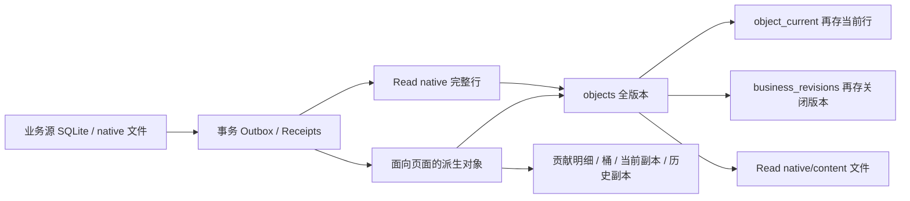

# DoxAgent 生产存储架构重构与存量深度清理方案

2026-10-18，Asia/Shanghai。状态：**审查完成后的实施设计，尚未执行重构、迁移或清理**。

本方案依据 [10/17 排查报告](remote-disk-regrowth-and-cleanup-20261017.md)，补充审阅当前代码、前端读取合同、生产数据库结构、业务引用和真实目录分布。供后续 Codex 分批实施。本轮只在本地新增取证脚本、证据和本文档；未修改生产数据、运行配置或容器，未运行清理、VACUUM、迁移、发布或业务模型任务。

## 结论与实施边界

1. **Read 应从“业务源的完整历史镜像＋页面投影＋多套历史保护”收敛为“必要的页面模型＋短期一致性版本＋按业务身份索引的历史证据”。** 当前约 37.54 GiB 的在线体积具有明显可消除的结构性成本，不能只调整 GC 窗口。
2. Read 的主要浪费包括：`objects` 与 `object_current` 的当前行重复；关闭版本再次复制到 `business_revisions`；无消费者的全量 native 字段；每次发布全量物化 Event/Fact 快照；对每个 Case × Policy 保存未命中观察和零值贡献；不可释放的 append-only 文件引用。需要逐项消除。
3. **前端慢与 Read 体积有关联路径，但没有证据支持“37 GiB 就是全部原因”。** 实测 Case/消息首屏仍可很快；Policy 查询、历史排序、整包解码、前端刷新重放、进程队列及缺失的线上索引应分别治理、验收。
4. Docker 的提交参数位置在最新 MAIN 中已经部分修正，不能重复报告为完全未修复。仍需补齐稳定依赖阶段、终止“从上一版完整应用镜像继续叠层”的临时发布模式，以及**由发布入口自动执行的旧资源退役**。
5. 统一生命周期采用一套原则和各组件自己的退出责任，不建立全局资源服务。发布资源由发布器负责，Read 由 Projector/GC 负责，分支由 Runtime Maintenance 负责，会话由 Worker 负责，浏览器由 Site Access/Supervisor 负责。
6. **Worker/W3 的完整研究复制、Context 重复物化明确暂缓。** 不改其物化方式、共享方式、目录合同和 W3 冻结输入；不把此前测得的 4.58 GiB 重复输入列入本轮收益。其他 Runtime、Read、发布及非 W3 资源治理独立推进。
7. 当前生产盘处于极低余量。未来施工应先用本文第二部分取得空间，再构建精简 Read。**不能直接在满盘上复制 30 GiB 主库或执行 VACUUM。** 本文不是清理授权；实际实施应以之后的执行请求及刷新后的精确清单为准。

“不再每几天人工清理”的可验收含义是：可再生资源和技术历史有自动退出，发布不复制稳定大依赖，Read 不按所有更新永久膨胀。真正新增的业务成果仍会增长；暂缓的 Context 复制也仍会增长。不能在保留该例外时承诺整台有限容量服务器永不增容。

## 证据口径与当前基线

### 取证版本、时间及限制

- 审阅 MAIN：`160f352ec3b7b627391959ed005178367e937a0b`（短号 `160f352e`）。工作区有其他进行中的修改，不纳入本方案实施。
- 生产不是单一 MAIN 镜像：API 为 `main-3c30365a`，Projector 为 `doxagent-cohr-recovery:projector-00983e64`，Worker/Initialization/Guardian 仍含恢复版本，Site Access 为 `main-fe4a768b`。这些事实决定了升级和回滚保护集，不能只看当前 checkout。
- 10/18 北京时间约 20:08 起分批取证；目录 `du`、数据库统计和 `df` 非同一瞬间。生产持续写入，数字是带时间的容量基线，不能把差异全归因于某条新代码。
- SQLite 均以 `mode=ro`、`query_only` 访问；耗时 SQL 有截止时间，临时运算放内存。未建立整库副本，未生成新的 ReadContext/cursor。68 个 B-tree 完成物理页归属统计，之后因磁盘余量低终止本次审计自己的扫描进程；未扫描部分不冒充完整索引分摊。
- 单次查询探针不是 p95，不含浏览器渲染、网络和鉴权。未清空生产页缓存，查询顺序和并行业务 I/O 会影响时间。
- 证据位于 [`eval/storage_architecture_review_20261018`](../eval/storage_architecture_review_20261018/)；此前清理回执继续保留原路径和时间，不重复计作本轮收益。

### 物理空间分布

根文件系统容量约 **176.54 GiB**，不是 180 GiB 的可用业务配额。20:12 的 `df` 已用约 **174.10 GiB**，普通进程可用约 **0.63 GiB**；取证过程中最低观测约 **0.12 GiB**，随后约 0.34 GiB。保留块、元数据及时间差不能误算成可清理业务数据。

20:35 左右补充观测 available 约 **1.07 GiB**，仍属极低余量；本轮没有执行释放空间操作，不将波动归为本轮回收。非主数据的大项补充：`/var/log` 约 0.91、Docker containers 目录约 0.67、`/var/cache` 0.15、`/opt` 1.03、`/tmp` 0.09 GiB。没有看到可解释几十 GiB 增长的 OS 日志/临时文件池。

下表使用实际分配字节，百分比以 20:12 `df` 已用字节为分母。各目录扫描非原子快照，百分比用于判断优先级。

| 不重叠的资源根 | 分配 GiB | 已用盘占比 | 业务组成/判断 |
| --- | ---: | ---: | --- |
| Read | **37.54** | **21.56%** | 主库约 29.5；native 文件约 7.59；正文文件约 0.45；首要重构对象 |
| Workspaces | **28.50** | **16.37%** | 新研究/初始化/运行工作区及输入、尝试、输出；需分 owner，W3 Context 本轮不动 |
| Runtime | **16.35** | **9.39%** | 主库约 4.93、维护分支、native、transport；不能笼统全保留或全删除 |
| Codex Home | **11.18** | **6.42%** | sessions 约 6.44，另有日志库、thread history、状态库 |
| Bus | **6.82** | **3.92%** | 主库约 5.90，其中约 2.24 是可复用空闲页，另有内容/运输文件 |
| Initialization | **4.17** | **2.40%** | 主库约 0.53、native 约 2.72、工作资料约 0.49，新增初始化产生明显增长 |
| Research | **3.85** | **2.21%** | 主库约 3.27、发布原件等；与 10/17 相比也有新业务增长 |
| 四套旧隔离研究目录 | **6.49** | **3.73%** | MU 3.64 / INTC 1.16 / BE 0.99 / RKLB 0.70，独立的深清对象池 |
| Production Validation | **3.00** | **1.72%** | 含约 2.69 的 adoptions，不能按目录名整删 |
| 数据卷其他目录 | **约 0.32** | **约 0.18%** | events/prebuilt/备份及多个小目录 |
| containerd | **30.18** | **17.33%** | overlayfs 约 22.75、content 约 7.41；不是镜像 `SIZE` 求和 |
| Site Strategy 独立卷 | **10.54** | **6.06%** | profiles 7.20、snapshots 1.68、registry 1.43、backups 0.23 |
| `/var/lib/doxagent` | **3.20** | **1.84%** | 近期修复/发布资料与回滚副本；有当前恢复责任的子集 |
| 远端代码 checkout | **0.78** | **0.45%** | 不是磁盘耗尽主因 |
| OS、其他卷及统计差额 | **约 11.19** | **约 6.43%** | 不据差额假定有同等可删空间 |

数据主卷合计约 **118.21 GiB**。不能把 Read 表大小、native 文件、Runtime 子分支和整个卷再分别累加。

### 再次长满的机制：历史与本次新增证据

10/15 清理后的可用 51.514 GiB，到 10/17 清理前约 0.989 GiB，约 49 小时净消耗 **50.525 GiB**，已有回执。10/17 本次清理净释放约 18.50 GiB 后可用约 19.49 GiB。期间还有其他获授权清理/修复，不能拿两个 `df` 相减就认定某个组件一天增长同样多。

本次与 10/17 的同名根对比：Read 32.53 → 37.54（约 +5.01），Workspaces 12.51 → 28.50（约 +15.99），Runtime 14.03 → 16.35（约 +2.31），Codex Home 9.90 → 11.18（约 +1.28），Research 2.04 → 3.85（约 +1.81），Initialization 1.37 → 4.17（约 +2.80）。containerd 则从约 38.74 降到 30.18；它已被其他清理影响，不能再次承诺回收已删缓存。

因此复发来自多条创建链没有闭环：频繁构建/发布；每批真实任务产生工作资料；完整源行和业务投影重复进入 Read；状态更新制造 MVCC/业务历史；每次维护复制 Event 分支；源收据压缩后仍永久保留；SDK 会话在业务完成后没有恢复责任退出。**不是简单的日志暴涨，也不是 Bus 主库重新涨回 20 GiB。**

---

# 第一部分：长期资源占用治理的整体架构重构

## A. Read：从业务读取职责重新设计

### A1. 前端真正需要什么

当前 `frontend/v2/src/pages`、`core/page-query.ts`、`api_v2/views.py` 和业务路由形成如下读取合同：

| 页面/流程 | 必要在线数据 | 必要历史 | 不构成保存理由的内容 |
| --- | --- | --- | --- |
| Overview、Cost | 当前控制/健康状态；按语义日汇总的计数、usage、费用及完整性 | 日汇总和小型用量事实可长期保留；明确的 UNKNOWN/coverage | 每次轮询的完整 native 行、每次聚合变化的永久版本 |
| Research / Expectations | 当前发布的 D1/D2，Shell/Unit/未来节点、引用、按需正文 | 被 Policy/Activation/Case 指向的确切发布版本；独有成果 | 每次 checkpoint、模型过程、无关源表字段都进入 Read |
| Policies | 生效定义/方向状态、发布变更、命中/执行事实；按版本详情 | 确切 policy revision、activation revision、变更及必要审计 | Case × 所有输入 Policy 的“未命中”实体、相同定义在每版整包重存 |
| Events | 当前 Library 的 Event/Fact 概览、按需详情、Reference Delta | 已引用的确切 Event/Fact revision、发布映射及变化 | 为所有旧 snapshot 各存一份完全相同的 Fact 正文 |
| Message Bus | 列表摘要、来源/路由/正文引用、短期变更流 | 被 Case/交易引用的消息原文；历史列表摘要 | 全量原始抓取响应、所有 poll native 历史和重复正文 |
| Runtime / Case | Case 摘要、图关系、阶段/尝试时间、结果、证据引用、交易链 | 决策依据、最终输出、确切业务版本；近期恢复中的任务 | 为详情页复制完整 Worker 上下文、整份 frozen_inputs 再解码 |
| 分页 / SSE | 短期同一水位的一致页面、REMOVE 前像、断线续接 | 有界的协议状态 | 把一个浏览器页面的 24 小时令牌变成所有业务更新的永久保留权 |

**业务历史与读取协议历史必须分开。** “近 7/30 天”筛选的是消息/事件/费用发生的语义日；并不要求在线保留这些日期内每次投影更新的整行旧值。确切 Policy/Event 发布版是业务身份；全局 `seq=5280xxx` 是投影协议坐标，两者不能互相代替。

### A2. 当前真实写入和重复链



具体根因及代码落点：

1. `v2_read/outbox.py:TABLES` 捕获 Runtime、Initialization、Bus、Research 等表；`projectors.py:DomainProjectors` 默认先生成 `native:<table>` 完整行，然后追加 DTO 和指标。`formal.py:activation()` 再物化正式研究、Policy、Library。Read 已承担源镜像、投影状态、页面服务、历史保险四种责任。
2. `repository.py:migrate()/ingest()` 为当前行同时写 `objects` 和触发器维护的 `object_current`。历史关闭时 `preserve_business_revision` 又复制完整行到 `business_revisions`。
3. 全仓搜索显示 `business_revisions` 的调用来自建表/写入、GC 搬入、压缩迁移；**未发现产品 API/Projector 用它读业务历史的路径**。它是无退出的保险副本，不应默认成为业务权威。删除前仍需一次完整性比对确认没有仅存于此的孤本；“无消费者”不等于已验证全部可再生。
4. `maintenance.py:collect()` 因任一 source gap 进入保护模式；当前存在 33 条 Runtime `PROVENANCE_UNVERIFIED`。健康 Bus poll 版本可以收集，其他对象及贡献/桶被大面积保护。即使消除 gap，GC 仍把普通业务版本搬到不收集的 `business_revisions`，只是换地方留存。
5. `artifact_registry.py:native_triggers()` 在 INSERT/UPDATE 追加文件引用，没有对应旧 owner 退出的 DELETE/替换释放；默认 native 为 BUSINESS，历史引用不断积累。`NativeContent` 以本数据库目录作为文件根，因此源与 Read 可分别保存同一内容。压缩/CAS 只减少完全相同字节在单个根内的重复，不能解决跨根重复和不再有价值的不同版本。
6. `libraries.py:LibraryIndexer.index()` 逐 snapshot 写 `event`、`event_detail`、`fact`；Fact 的 key 带 snapshot/event parent。当前计数：Event/Detail 各 30,373，Fact 203,916，而逻辑 catalog Event 1,282 / Fact 4,225。并非所有行都是同一字节，但现有组织方式会把未改变的事实随发布重复展开。
7. `policy_hits.py:project()` 遍历 Case 冻结 Policy 列表，逐个存 `policy_hit_observation`，对未命中项仍发出两个值为 `"0"` 的贡献。`repository.py` 把零值视为普通有效明细。当前观察数 825,071，约占该次 `object_current` 1,672,472 行的一半；它们不都是真命中，不能将观察总量当业务价值总量。
8. `contributions`、`metric_buckets` 同样有完整历史及 current 副本，桶还写 `day='*'`。某些二次指标可以直接从同一份稀疏事实计算，不需要两个通用贡献实体和多套历史。
9. `NativeContent.row()` 选择 `payload` 时透明递归解码外置内容；`get()`/`page()` 很容易为一个页面字段加载无关大对象。`CaseEvidence.fields()` 已采用指定 JSON 字段、64 KiB 限额，说明可以复用现有按需读取方向，而无需保留完整 native 镜像以方便任何未来查询。

### A3. Read 的物理证据与规模判断

`dbstat` 逐 B-tree 扫描结果（**表本身**与已完成的附属索引分开）：

| 对象 | 表本身 GiB | 已扫描表＋索引 GiB，下界 | 判断 |
| --- | ---: | ---: | --- |
| `objects` | **7.76** | **12.97** | current＋历史，并有多套面向所有 kind 的通用索引 |
| `business_revisions` | **4.83** | **4.83** | 主键索引尚未计入该下界；并非零成本保险 |
| `object_current` | **1.75** | **3.08** | 必要 serving current 的一部分，也包含大量可取消物化对象 |
| `contributions` | **0.66** | **1.39** | 多指标明细、零值和历史 |
| `contributions_current` | **0.66** | **1.68** | current 再物化及多维索引 |
| `metric_buckets` | **0.27** | **0.81** | 约束不当的聚合更新历史 |
| `metric_buckets_current` | **0.008** | **0.019** | 在线小聚合本身很便宜，应保留 |
| commits / 水位 / retention / changes 等 | 多项 | 其余已扫描约 1.10 | 协议账本需要有界，不是主要业务原文 |
| 未完成扫描的其余 B-tree/页与时间差 | — | 不作精确归属 | 已扫描共约 25.87 GiB，主库约 29.5 GiB |
| `native-files` | — | **7.59，独立目录** | 尚未按真实 owner 做完整可达性核算 |
| `content-files` | — | **0.45，独立目录** | 不能与 DB 表重算；正文按需读取合理，额外复制未必合理 |

主库 freelist 当时为 0，**不是“已经删了只是没 VACUUM”**。需要先停止不必要的写入和保留，再迁出必要数据，才能回收这部分真实占用。`dbstat.ncell` 包括 B-tree 结构单元，不作为精确业务行数。

首轮目标是同等业务数据下把 Read **37.54 GiB 收敛到约 6–10 GiB**，预计一次性减少约 **27.5–31.5 GiB**。这是根据现有重复结构提出的工程目标，**尚未生成 V4 必要数据清单，不能当成已验证回收量或强制丢数据配额**。正式迁移预演必须给出实际输出字节和孤本例外；若存在真实必要孤本，保留它并解释偏差，不用容量目标覆盖正确性。

### A4. 性能因果：证实了什么，尚未证实什么

生产 API 容器内的只读函数/SQL 探针，21 条首屏，上限 3 秒，使用已有 view 水位 `5158090` 与采样 head `5280479`：

| 样本 | head 薄字段 SQL | frozen 薄字段 SQL | 实际 page 解码 frozen |
| --- | ---: | ---: | ---: |
| MU Case | 13 ms | 24 ms | 29 ms |
| MU Message | 14 ms | 18 ms | 44 ms |
| MU Event | 11 ms | 9 ms | 10 ms |
| MU Policy catalog | 9 ms | **289 ms** | **379 ms** |
| RKLB Policy catalog | 3 ms | 7 ms | **276 ms** |

MU Policy metrics 一次约 **2.13 s**，后续 frozen 样本约 0.18 s；不能因后者更快就宣称历史更快，缓存、数据集合和查询路径均不同。COHR/NBIS 的旧水位在相应数据进入 Read 前，返回 0 行的快查询不能用于性能验收。

已证实的机制：

- `snapshot_table()/metric_table()` 只有 `seq == global highwater` 才走纯 current；其他任意 source 的更新都会让一个已有页面转入历史分支。
- `EXPLAIN` 显示 current 页使用 `current_page`，history 页使用 `history_recent` 后还需要临时 B-tree 排序。历史尾部越长，这个负担越容易放大。
- 当前生产不存在 `policy_positive_current/history`，代码中已有显式迁移及优化路径；不能把“本地已完成”当线上已生效。
- `page-query.ts` 的手动刷新会依次重放已加载的分页，并等所有 active 查询完成后再更新 context。加载的页数越多，刷新完成越慢；这不要求服务器永久保留全部旧版本。
- API 读取池默认 2 个进程、排队上限 16、查询 3 秒；满盘/竞争 I/O 可放大排队。不要首先靠增加进程数或放宽超时掩盖查询成本。
- deferred 30 秒查询仅用于匹配路径的**带关键词 metrics**，不是所有慢查询都有该路径。新增大框架或把所有请求都异步化不是本方案。

未证实：浏览器真实导航的瓶颈占比、冷启动/RUM p95、用户某次慢请求是否命中该 SQL。因此后续验收要同时记录服务端耗时、queue、SQL/解码、响应体和浏览器请求瀑布，不能只用新 DB 文件更小证明前端已快。

### A5. 方案比较及选择

| 方向 | 空间/性能收益 | 复杂性与副作用 | 决策 |
| --- | --- | --- | --- |
| 只缩 MVCC 时间、修 GC | 历史尾部变短，但 native/current/业务副本、全快照和零值扇出仍在 | 改动小；无法根治 | 只作过渡，不能作为最终方案 |
| 保持现状，压缩/转冷所有历史 | 可省部分盘，HTTP 仍面对通用 JSON/历史结构 | 归档越来越多，增加恢复和冷存储依赖 | 不采用为主方向 |
| 前端直接跨多个源库查询 | 无 Read 复制 | 恢复强耦合、跨库不一致、原生 schema 外泄、多个写库承担 HTTP I/O | 不采用 |
| 全部迁入新 Postgres/对象存储/通用资源平台 | 可有更强基础设施 | 不能自行消除错误物化和无限保留；引入运维/迁移成本 | 当前不需要 |
| **精简 Read 当前模型＋短历史尾部＋业务历史按确切身份解析** | 同时去掉重复、减轻写入与查询；继续本地 SQLite 服务 | 需要一次 V4 迁移和前端令牌合同调整 | **推荐，分两步完成，不永久双轨** |

### A6. 推荐的 V4 目标结构

不要求为每个 DTO 建新数据库，也不引入全局 CAS 服务。继续使用一个 Read SQLite、现有 Projector、ContentFiles 和 API 服务；明确以下四类存储：

1. **当前页面模型。** 从现有 `object_current` 收敛，单份 current；只含列表/详情真正使用的字段及有意义的正文/证据引用。不再让 `objects` 保存另一份 current。
2. **有界协议历史。** `object_history` 只留页面模型的关闭版本；默认 15 分钟固定 view 有效期，30 分钟的变更流及前像尾部，超界返回已有的 reset/410 路径。指标也只为这段读取一致性留短版本。不保留所有 native 更新历史。尾部以 seq 和生成代际隔离，不能用语义日混算。
3. **必要业务历史索引。** 小型 `business_version`/关系表保存发布版本、Case、artifact id、内容 hash、逻辑原件来源及可用状态。Policy/Fact/Event 定义以实际 revision identity 单份存储，snapshot 与 revision 的关系单独保存；旧完整快照不默认在线展开。当前版与被引用的业务版可直接访问；更旧的大正文可以从已验证权威原件按需读取/恢复。
4. **少量投影状态与稀疏事实。** 保留消费位点、明确依赖的 scalar/source-state 和 Case 命中/执行事实，不保留“万用 native 镜像以备以后用”。API metrics 从日桶和必要事实索引读；金额继续 Decimal，不以浮点换空间。

建议的最小结构草图，字段/命名由实施保持现有 DTO 合同，不为了统一而重写全部 Repository：

```text
object_current(kind,ticker,id,revision,sort_key,parent,day,必要筛选列,payload)
object_history(同类页面字段,valid_from,valid_to)       # 仅短尾部
changes(seq,ordinal,kind,ticker,id,必要前像/后像引用) # 仅 Message/Graph 等消费者需要
business_version(kind,ticker,business_id,revision_id,artifact_ref,availability)
snapshot_member(snapshot_id,kind,business_id,revision_id,ordinal,state)
metric_current(metric,ticker,day,dimensions,value)
metric_recent(...)                                  # 仅短尾部
case_policy_hit(case_id,policy_id,activation_revision,semantic_day,settlement_revision)
checkpoints / generation / 有界 tokens / 小型 coverage / projector_state
```

`business_version` 可以直接复用/整理现有 `policy_detail`、catalog、artifact/ref 表，避免再做一套重复身份层。对小且常读的定义，Read 保留一份是合理的；对大正文优先引用已有权威 `published-contents`/immutable content，由 API 使用业务身份和 ticker/权限解析，不能把任意文件路径暴露为下载接口。

#### 原生镜像的具体退出方式

先提交一份**代码可检查的 projector 输入/状态字段清单**，按消费者迁移，而不是直接删所有 `native:*`：

- Bus：source/binding/poll/monitoring 的页面字段、消息摘要/正文引用；`standard_messages/stream_*` 中构建聚合确实用到的标识与少量状态。
- Initialization：状态、节点/阶段、错误摘要、usage 和 activation 关系；不镜像全部初始化事件/模型过程。Projector 的阶段聚合使用有界的显式状态。
- Runtime：Case/attempt/候选/交易/图的页面字段；只为 CaseEvidence 留所需输出字段或确切内容引用；交易 lot/fill/allocation 保留构建 PnL 所需状态。
- Research：只索引被发布/引用的文档、版本和页面结构；不镜像所有 `codex_runtime_records` 行。
- API 的静态 `native:` 查找之外，必须检查 `executions.py` 等动态 `native:` 拼接路径。静态 grep 没命中不能直接证明无消费者。
- W3 的源 frozen_inputs、Context 文件、Worker 复制方式保持原状；**取消 Read 自己多存一份无用字段**与改变 W3 输入架构是不同改动。用只读兼容提取器取得页面证据，不重写原 W3 数据。

#### 零值扇出的具体替换

`policy_hits.project()` 不再为每个未命中 Policy 建实体。每个 Case 保存最终状态/是否已判定，并保存实际 positive hit 集合及其业务 revision；`false` 与 `unknown` 从 Case 判定状态区分，不能用“没有正命中行”直接当成已判定 false。

一次 Case 重投影比较旧/新 positive 集，按旧日/旧 ar 撤销、按新日/新 ar 增加；没有命中则不写 contributions。Policy 与 activation 两种计数共用同一事实，distinct 和跨日集合语义保持现有合同。必要的“从命中改为未命中”修正留下小型 settlement revision，不永存 Case × Policy 的负事实矩阵。

#### Event/Policy 的重复物化替换

- Event/Fact：以真实 birth identity＋revision 为定义键；Library snapshot 保存成员关系、ordinal、生命周期/成员状态。未变化的 Fact 正文不因新 snapshot 再复制。
- Policy：定义内容、发布 artifact、activation/方向状态分别表达；同样定义不随状态变化或全库 admission 重存正文。业务 revision 身份仍完整保留，不能只按 policy_id 覆盖历史。
- catalog 只放当前索引/展示字段；小的变更事件和版本关系可长期保存。Case 详情根据确切 revision 解引用，不改读“当前最新定义”。
- 历史恢复从必要业务版本/权威原件得到，不依赖通用 `business_revisions` 中所有轮询旧行。

### A7. view、SSE、GC 与 gap 重新定责

**默认 15 分钟 view，30 分钟 stream tail**是本方案的产品取舍，不是从当前代码直接改一个 env 即可实现。当前 `Limits.mvcc_hours` 最低 24，token 也是一天；必须一起修改合同、代码、前端与回归。

- 页面在过期前更新 view；手动刷新或后台 view 到期只先取首屏与必要 KPI，不阻塞等待历史已加载页逐页重放。保留筛选和滚动锚点，需要更多页再按需加载。
- 一个有效 view 内的分页/指标必须一致。跨 view 的更新由前端整体换代，不混用两个 seq；业务详情使用 immutable revision 则不受普通 view 到期影响。
- SSE 尾部保存足够的 REMOVE 前像与 scope 判断字段；断线超过 tail 直接取得新 baseline，再接增量。不要静默跳 seq 或错把“变为不匹配”当新建。
- cursor 的失效不晚于所属 view；延迟查询 pin 只到查询截止，不续成永久 pin。导出大正文使用 immutable artifact/hash，不能以导出为由冻结整个 Read 一天。
- GC 只保护活跃协议尾部和具体业务身份。gap 保存 source/seq/受影响 entity、reason、repair 定位信息；源不可用最多影响该 source 的读取完整性，不能冻结无关 source 和所有 kind。
- 当前 33 条来源不可核实 gap 必须逐条按源事实恢复或明确归类为旧/测试/不可核实记录，保留小型证据及 UI coverage。**不能为了 GC 直接把不确定记录补成 BUSINESS_V2，也不能按年龄删 gap 然后宣称完整。**
- `artifact_ref` 在 owner 被替换/退出时同步释放；扫描 GC 的标记集合是现存 current、短尾部、业务版本、恢复中的执行及有效备份。老“引用曾经存在”不再是永久保护。不同数据库各自维护真实文件 owner，不新增全局引用数据库。
- 短尾部按 `valid_to`/seq 做有索引的小批收集，沿用现有维护进程。避免每轮从全库 rowid 起点重扫；维护时间/删除数/最老待处理坐标能证明追得上新增速度。

### A8. Read 实施任务与迁移

| ID / 优先级 | 文件与动作 | 交付与验收 | 依赖 |
| --- | --- | --- | --- |
| R0 / P0 | `api_v2/policy_queries.py`、`ReadStore.migrate_policy_query_indexes()`、既有 `policy-query-indexes` CLI：核对线上代码/索引缺口，显式补齐该优化；不在 GET/启动时 DDL | 生产等量 fixture 上查看 EXPLAIN，Policy 列表/指标与旧结果一致；记录按 scope 的 p95 | 先有索引施工余量；这是过渡优化，可独立上线 |
| R1 / P0 | `repository.py`、`maintenance.py`、`artifact_registry.py`：取消业务旧行自动复制；补 owner 释放和 scoped gap；先给写入设明确类别 | 关闭版本不再进入无退出副本；gap 只阻止实际依赖；重复 replay 幂等 | 先形成 R2 的业务版本保留清单；不可只删 trigger 不管孤本 |
| R2 / P0 | `projectors.py/formal.py/initialization.py/runtime.py` 与 API CaseEvidence：产出必要字段表，显式 projector state，页面按需读取 | 每类 native 消费者都有对应字段/引用；未使用的大字段不进入新 Read；Case 业务证据、UNKNOWN/coverage 等价 | 不依赖 W3 Context 改造 |
| R3 / P0 | `policy_hits.py`、`repository.py`、`policy_queries.py/metrics.py`：稀疏命中、去零值、合并事实来源 | false/unknown、true→false、改 ar、改日、乱序/重复、跨日 distinct 全部一致；无命中 Case 的写入量不随输入 Policy 数线性扩大 | 与 R2 并行设计，迁移一并落地 |
| R4 / P0 | `libraries.py/artifacts.py/lifecycle.py`、API Library/Policy/Case 查找：定义单份＋snapshot 成员关系 | 当前页、变更、历史 Case 显示确切版本；两个 snapshot 同一 Fact 正文只存一份 | R2 的历史消费者映射 |
| R5 / P1 | `views.py/settings.py/streaming.py/graph.py`、前端 `page-query.ts/live-query.ts/updates.ts`、合同源与生成 schema | view 15min / tail 30min；过期/断线 reset、REMOVE、refresh 首屏、权限/scope 正常；不静默改变公共错误码 | 与 R2–R4 同一代际切换 |
| R6 / P1 | `cli.py/maintenance.py/shadow_compact.py`：新增精简 generation 构建入口，复用已有 alias/catchup/verify | 必要数据清单、孤本核对、实际字节、端点对照、源 epoch/heads 记录；原 alias 可回退 | 第二部分先取得空间 |

迁移使用“**选必要行构建新代际**”，不用现有 `compact()` 原样全复制（它仍补齐 business_revisions，且有 3× 空间要求）。步骤：

1. 在新 schema fixture 完成 API 合同、业务引用、幂等与生命周期验证；保留旧代际但不让旧垃圾写入逻辑继续制造新副本。
2. 按 source epoch/consistent snapshot 确定基线；新的 consumer 注册只保护本次实际追赶区间。由权威当前源＋必要 immutable 版本构建，不能只从已裁剪 outbox 从头 replay 过去所有事件。
3. 对 `business_revisions` 做一次键/hash 对照：有权威原件/现存对应版本的直接不迁；唯一且有真实业务价值的转入明确业务版本存储；纯技术旧状态不迁。对 native 文件按新清单选择性复制/复用，不再将全部 `native-files` 目录备份一遍。
4. 小批追赶源 outbox；无法核实的历史缺口保留真实 coverage 并隔离，不让全库 GC 暂停。切换前保证新数据的 admission/activation/Case 关系已闭合。
5. 使用现有 alias＋generation，短窗口停止 Projector、完成追赶/水位核对，切换 API/Projector/GC。旧 generation 的 token 明确 reset；不中断源业务写入，不要求全服务器重启。
6. 生产代表性端点验收后，保留一份可回退旧代际，默认在线 **24 小时**；Read 可重建且已有验证的 D 盘回滚材料时，旧大代际可退出线上。若有仅存旧 Read 的业务孤本，先完成它的持久保存，不能沿用“Read 全可重建”的口号。
7. 退役旧 consumer、旧 alias 指向外的文件及旧代际；释放旧的短历史和 content refs。迁移失败只收尾本次新代际/consumer，不碰现行数据。**不能在切换成功后又永远留下旧库和全部 native 备份。**

性能验收：相同业务样本和并发条件下，分别测当前/15 分钟旧 view、7/30 天/ALL、Policy ACTIVE/HIT/MODIFIED、Case Evidence、Bus 过滤/SSE。目标普通列表/指标服务端 p95 ≤500 ms，浏览器导航首批可用内容 p95 ≤2 s；大正文按需加载单独计时。目标未达时保留定位结果，不能凭总平均值通过。正确性、空间与性能各自验收，不能互相替代。

## B. Docker 构建与发布自动退出

### B1. 当前修复状态和仍存在的问题

- 10/17 证据确认动态 commit/source ARG 曾位于依赖安装前，导致 Playwright/uv 等稳定层反复生成。10/18 最新 `Dockerfile.v2` 已将提交身份移到首次依赖/Playwright 安装之后，应保留该修正。
- 但 `uv sync` 的项目安装、IBKR 包拷贝/`protobuf` 校验仍在源码与动态身份之后；Site Access 以完整应用镜像作 base 再 apt 装依赖；仍有可独立缓存的稳定工作处于易变化路径。
- `build_source_isolation_release.py` 已能验证 lockfile、依赖层继承并输出 build receipt，复用它。但它从当前运行的完整应用镜像打 `doxagent-source-deps:*` 标签，再 `FROM` 继承。多次发布不断把旧应用层留在下一版祖先中；`RUN rm -rf /app/src` 不会从镜像历史中扣除旧层。它还使用工作目录 build context，只排除 tracked dirty，没有覆盖“已跟踪文件被忽略”等所有来源校验，不宜作为所有未来发布的长期边界。
- 最新实时盘点为 **34 个 tag 条目、19 个容器、106 个 BuildKit 记录**；此次未见 private＋reclaimable cache。shared 记录不能按 SIZE 再报成独立回收量。今天其他清理已释放的缓存不在未来收益内。
- Compose、Guardian 的 repair agent/template、approved Chrome/IBKR、未运行但有效的回滚 image 都是引用；仅 `Containers=0` 远远不够。
- 当前没有一个发布入口对“验证成功→登记回滚→退役自己不再需要的旧资源→失败重试”闭环负责。Markdown 指令无法承担此责任。

### B2. 稳定依赖阶段与应用阶段

推荐把现有 Dockerfile 整理为稳定的命名阶段/依赖镜像，不引入新 CI 平台：

1. backend deps：固定 OS/uv base、apt、`pyproject.toml/uv.lock`、Python 依赖、Playwright、approved ibapi/protobuf。只依赖这些输入及 Dockerfile 的依赖段。应用导入路径/必要元数据也在此确定；源码阶段不再次同步整个环境而把 approved SDK 当作“额外包”删除，依赖变动则重新构建并校验该阶段。
2. site deps：基于稳定 backend deps 增加 xvfb/vnc/locales/用户；不要每次以变动的完整 app 作 base 重装 apt。
3. supervisor deps：approved Chrome runtime＋稳定 Python deps。继续按 `/app/.venv` 与 source 分别 COPY，保留已完成的优化。
4. app stages：从固定 deps digest 拷贝**该次提交的确定源树**、prompts、合同及启动脚本；最后设置 commit/source label。源码修改不改变依赖阶段的 diffID。前端同理先 lockfile 安装依赖，再 COPY source/build。
5. 依赖键包含 lockfile、Python/base digest、依赖段、Playwright/Chrome/IBKR 版本；不得只验证两个 lockfile 就假定所有 OS/浏览器输入相同。使用清晰的小 JSON receipt 即可，不建立通用构建图服务。
6. 普通新版本总从同一 deps base 构建，禁止把上一版完整应用当下一版 deps。历史恢复基线只在首次提取/验证稳定依赖时使用，完成后退出永久祖先链。
7. build context 用该 commit 的 archive/staging，明确带入必要脚本/合同，继续 `.dockerignore`；避免再次 COPY 整个 `dev_plan` 中约 186 MB 的无关 catalog，或通过递归 chmod 把整个 virtualenv/大目录 copy-up 到新层。

验收连续构建两个仅改 Python 的提交：依赖步骤 CACHED、稳定层 diffID 完全相同、层数不随发布次数增加；净新增只来自源码/必要资产，给出实际物理字节。依赖发生变化时才允许重建稳定阶段，并验证 IBKR/Chrome/Playwright 功能。固定“每次只能 100 MB”不是正确性门；为未变更的大目录反复新增同量数据才是失败。

Docker 关于 ARG 使用点和缓存失效的语义见 [Dockerfile 参考](https://docs.docker.com/reference/dockerfile/#impact-on-build-caching)；缓存策略见 [Docker GC 文档](https://docs.docker.com/build/cache/garbage-collection/)。本地历史层及实际新构建回执仍是验收依据。

### B3. 发布器拥有自动生命周期

在 `scripts/ops/build_source_isolation_release.py` 旁收敛出一个受支持的发布 CLI（可拆小模块），复用现有 build receipt、Compose、health 检查及动态 agent 配置解析。提供 `build/deploy/reconcile-resources` 阶段，普通发布由一个入口串联，不能要求 Agent 再照文档手动 prune。

最小持久状态：每次 release 的 commit、component→image ID/digest、deps ID、实际部署结果；每个组件的 current 与 previous successful。保存在 `/var/lib/doxagent/releases/` 的原子 JSON 和发布锁即可。

保护集按**组件**建立，不能简单保留“最后两个全局 commit”：

- 所有运行及仍有明确恢复责任的停止容器引用；当前 Compose/env 实际生效 image；当前部署中的候选 image。
- 每个组件一个有效 previous successful 回滚版本，默认在线 7 天；连续无新发布也保留这一份，不按日历清到没有回滚。上一个已被新 previous 替代的版本立即有资格退出。
- Guardian/RepairAgent 的实际 image/template、仍在使用的 approved deps/Chrome/IBKR 基线，明确的限期人工 hold。
- 其他仍在运行的项目/未归属资源不会因为没有 DoxAgent label 被误删。**已确认属于 DoxAgent 的旧无引用资源应积极退役，不把缺失新 label 当永久保护。**首次接管生成一次旧资源归属清单。

执行流程：

```text
锁定本项目发布 → 构建并写候选 receipt → 按组件发布/健康验收
→ 原子记录各组件 current/previous → 重新计算真实引用集合
→ 删除本发布体系内保护集之外的旧 image/tag/停止临时容器
→ 对可回收 BuildKit 记录执行有界 GC → 记录 before/after 和 cleanup_pending
```

约束：

1. 镜像删除交给 Docker API/CLI；不直接 `rm /var/lib/containerd`，不删除 snapshots、blobs 或 volume。
2. `reconcile-resources` 幂等；清理失败不把健康发布回滚，而是记录 `cleanup_pending`，下一次发布及现有主机 ops 定时执行同一个 reconcile。正常部署成功必须自动尝试收尾；后台重试负责中断漏项。单个 systemd timer 调同一命令足够，不能把 Docker socket 分发给每个业务容器。
3. 新项目的部署状态混合版本是允许的：API/Worker/Projector 各自 current/previous。数据 schema/receipt codec 不兼容的旧镜像不能虚列为“可回滚”；receipt 登记兼容边界，必要时同时保留匹配数据库回滚集。
4. failed build 的候选和临时 staging 在构建结束清理；发布失败且候选有排障价值的保留 48 小时。正常已退役源码层不额外 export/save 一遍。
5. BuildKit 总缓存初始预算 **6 GiB**，优先退出 48 小时未用的局部上下文/临时 cache，最终策略覆盖可回收的大普通记录；低盘余量目标保留 **20 GiB** 施工/业务余量。按当前 Docker driver 实际支持的 GC 配置实施并验证，不套其他 BuildKit driver 的参数。
6. 自动 prune 仅在没有本项目活跃 build 时执行；Docker 当前使用的引用仍交由引擎判定。配置 GC 不能释放仍被 current/rollback/deps 引用的层，也不能承诺系统 free 永远 ≥20 GiB。

测试覆盖：A→B→C 组件发布、一个组件失败、进程在健康后/清理前退出、回滚、Guardian 动态 template、shared layers、其他项目镜像。故障注入后重跑 reconcile，current 和一个真实有效 previous 均能启动，过期候选自动消失。

## C. 统一资源退出原则与各 owner 的规则

### C1. 价值判断，不机械按天删除

判断顺序：**当前业务引用/恢复责任 → 是否存在唯一业务信息 → 可再生/重复程度 → 再用概率与时间价值 → 占用和维护成本**。不做抽象打分系统。

- 交易/资金事实、业务 birth identity、正式 revision 映射、最终成果、采纳记录等，小而不可替代，长期保留。
- 大型原始过程只有短期排障/继续执行价值，不能因曾被创建或曾受保护而永久在线；保留必要摘要和最终证据后退出。
- 缓存、验证过的副本、可从固定输入重建的投影不增加备份；有价值孤本先有可验证恢复来源。
- 保护引用必须有 owner、对象、原因和释放条件。current/未完成业务保护可持续；一次性修复/调试 hold 应显式结束。未知对象隔离到自己的清单，不让它阻塞所有目录回收。
- 组件终态是退出检查的触发器，不是删除的充分条件；日期是价值信号，不是覆盖引用的依据。
- 一个小型 tombstone/回执说明“何物被退役、依据和恢复定位”足够，不把被删大 payload 重新写进回执。

### C2. 初始保留规则

以下天数为实施默认值及产品决策，除明确业务记录外均由 owner 本地配置；不要把一个总的 `RETENTION_DAYS` 套所有数据。

| 资源/owner | 持续保留 | 默认退出条件 | 实现位置/触发 |
| --- | --- | --- | --- |
| Read 页面模型 | 当前必要对象、15min view / 30min tail；小型业务版本索引 | 业务对象退出或短尾部到期，释放真实 refs；不保留全 native/history | 现有 Projector / `maintenance.py` |
| 发布镜像/缓存 | 各组件 current＋一个有效 previous、实际 deps/模板 | 被替代且无运行/配置/回滚引用；构建缓存按预算 | 发布 CLI 成功后＋同入口补偿执行 |
| Event Maintenance 分支 | 当前发布根、在途 frame、可继续执行 Case/W3/template 的确切版本 | 未发布已终止无引用：48h；失败需排障：7d；发布历史完成确切版本持久化后退出整库副本 | `RuntimeMaintenance` 收尾＋已有 maintenance worker 定期补偿 |
| 源 Outbox/Receipt/Packs | 活跃消费者尚未消费区间、明确 repair/shadow 坐标；7d 在线重放 | 已 ACK 且超 7d、权威当前数据/必要业务历史可重建；旧 checkpoint 不是永久最高回收水位 | `SourceOutbox` / `transport_archive.py` |
| Runtime 调度/重试状态 | 活跃任务、有效重试、幂等/资金交易责任 | 终态且无未完成下游后，7d 退出大 worker request/过程缓存；小型去重/tombstone/最终回执长期 | journal owner；按 namespace 制定白名单 |
| Runtime 业务历史 | Case 摘要、最终结果、准确版本、资金/交易/用量与修正 | 大原始过程默认 30d 在线；确有审计/恢复价值保留一份压缩证据；无价值过程直接退役 | Case/maintenance 终态及 owner GC |
| W3 Context/全量研究物化 | **本轮保持当前机制** | **本轮不改、不列去重收益**；真正无关 Runtime 资源不因此全被冻结 | 独立后续优化项 |
| 非 W3 完成研究工作区 | 被发布原件/Observation/最终输出指向的确切资料 | 成果持久化后 7d 退出无引用尝试/下载副本；失败排障 14d；正式原件不随目录全删 | 原工作流收尾；复用 workspace 安全边界 |
| Codex Session | 活跃 job、重试/resume、模板/主线程及其存活子孙、明确调查 hold | 非恢复对象：成功且成果已落库 7d；失败终止 14d；独立重要案例按显式 hold | Worker job/thread owner，使用 SDK lifecycle |
| 浏览器 | cookies、账户/Profile、Local Storage/IndexedDB/Service Worker 的业务状态 | HTTP/Code/GPU 等可再生缓存 512MiB→256MiB；PMA/dump 48h＋128MiB；使用现有轻量治理 | `resource_gc.py`、Supervisor 退出/周期维护 |
| Site Registry 过程 | 当前身份/路由、有效挑战/维护会话，必要账号操作审计 | 已有 success 7d/摘要90d、普通失败30d、已闭会话7d 等规则继续使用 | `RetentionWorker`，确认线上生效与 backlog |
| Profile 快照 | 升级当前恢复集＋每 Profile 两个正常版本；限期显式 hold | 超出版本数且无当前恢复责任；protected 必须在升级验收后释放；registry batch 复用 | `ProfileSnapshotManager._prune()` 复用并加周期补偿 |
| 测试/Validation | 生产实际采用的最终对象、采纳 manifest、少量验收证据 | 未采用且结束 7d；失败排障14d；重复数据库/中间产物无需备份 | Pilot/validation 收尾，生产路径与临时路径分开 |
| 迁移/维修备份 | 当前 coherent 回滚集及其文件；正式异机恢复集 | 同一 owner 新集验证成功后退役旧集；失败/当前责任先保留；维修验收7d收尾 | 已有 `backup_retention.py` 扩展到实际维修入口 |
| 日志/临时 staging | 有界排障窗口和当前写入文件 | Docker 20m×3 已有；受管临时容器同默认；完成 staging 立即退出、失败48h | 创建方/发布方；不截断活动日志 |

“长期保留”优先保留唯一小原件，不要求每个组件都复制一份。大原始过程的 30d 也不是必须自动归档 30 天前所有数据，先判断业务价值；不能制造第二个归档垃圾场。

### C3. Event Library：分支创建与终态退出对称

`persistent_runtime_v2/event_branch.py:branch_library()` 使用 SQLite backup 复制源整库，再删除高于 base 的历史。源含历史、捕获元数据和空闲页时，全部随分支复制；`maintenance.py` 每个 run 建 `runtime_artifacts/<run>/events`。终态只关闭 worker，没有对应资源退出。

本次 567 个 run 根中找到 567 个分支 DB，实际约 **5.55 GiB**：

| 引用分类 | DB 数 | 分配 GiB | 不能直接推导的结论 |
| --- | ---: | ---: | --- |
| 当前 activation 根 | 6 | 0.048 | 7 个 active ticker 中 ONDS 使用默认根；不能因此删默认 `/data/events` |
| 只被历史 activation 指向 | 499 | 5.066 | 历史指针不自动等于永远需要整库；也不自动等于无恢复责任 |
| 未见 activation 指向 | 62 | 0.436 | 仍可能是未发布任务/frame/Case/W3/lineage 引用，不能直接全删 |

Runtime Case 的确切 root 还分布在 262 个 root/status 分组；有 29 RUNNING、892 FAILED，并有 1 个正在跑的 Maintenance。FAILED 也可能承担明确恢复责任。**这些引用已经证明“仅保留最新两份分支、其余直接删”会破坏真实链路。**

推荐分两步，不等待 W3 Context 改造：

1. 现在补 owner 收尾：branch 的 task/run、base、状态、publish revision 都在现有 frame/activation/journal 中取得，不创建全局资源图；失败重试或 lease 不确定保留对应分支，明确终止无引用后退出。历史 activation 的 `root` 作为审计定位保留小型记录，但不能独自永久 pin 一整个已替代数据库。
2. 分支构造只带选中版本的必要原生业务状态、birth identity、membership/review scheduling 和本 run 写入，不复制所有已消费 CDC 和无关旧 maintenance 状态。候选隔离/原子发布继续保留，不用共享活动 SQLite inode、硬链接或原地覆盖当前库节省空间。
3. 旧已发布根如需退出：先逐版本导出/验证实际被引用的 Event/Fact revision、membership、状态、SHA、出生身份与 provenance，并提供 Event Library owner 的明确恢复/解析入口。历史 Case 的只读证据可读必要快照；若未来需要继续执行，恢复同一冻结版本后再接纳任务，不能偷偷改读 current。
4. **仍被 W3 存活线程/模板/冻结输入直接访问的路径继续保留。** 不改写 W3 Context 来帮助清理，也不让这部分保护覆盖所有老分支。只做 Event owner 可独立完成的退出；无法完成原生等价恢复的分支在本轮清单中逐项留下理由。

不立即开发跨 ticker 的大 DAG 版本平台。若对新分支的“最小选中版本”构造已经显著降低体积，就先采用它；以后只有分支容量仍是主要增长源，才考虑把已发布 lineage 归并到一个原生 revision store。

### C4. Bus/Runtime 技术历史：压缩不是退出

现有 `transport_archive.py` 7d 后将源收据打 pack，但仍为每 seq 留索引，pack 没有最终过期。回收上限还受固定 checkpoint head 和最小 pin 约束。压缩帮助了空间，但不断新增的“已打包历史”仍可无限增长。

本次：Bus head 2,948,199、retained_floor 2,209,157、consumer 已追上、无 pin；Runtime head 约 1,977,547、retained_floor 1,240,144，repair pin 在 1,240,145。那个旧 Runtime 坐标不能因此保护后面所有无关成功任务的所有完整过程。

修改边界：

- 活跃 consumer 注册、generation、最后成功/归属可核对。旧 Read generation 退役时删除它的 consumer/pin，不能靠离线 consumer 永久保护；也不能因为网络短暂不在线就过期当前 consumer。
- 当前源表＋必要不可变业务版本是 rebuild 的根。7d 外已 ACK 的技术变化最终删除；只有承担恢复/审计责任的具体 receipts 保留。repair 所需单条记录可移入源自己的小 exception 区，不以 `min(seq)` 永久阻止整个后缀退出。
- 重建从一致性当前 snapshot＋后续 outbox 桥接，不要求无限从第一条变更重放。新 checkpoint 成功替代旧 checkpoint 后旧运输包才真正退出；不能用 10/12 的固定备份永远限定 10/18 后的新历史。
- 当前七天约束是源码校验，不靠绕过时间参数强删。增加显式“可重建基线/保留责任”路径并覆盖 lost consumer、旧 pin、pack 部分仍被引用、crash 中断测试。
- native 文件 GC 对现存源行、必要 receipt/pack、有效业务版本和备份逐项可达；不会因为都是 BUSINESS 就全保留，也不会只看 `artifact_ref` 曾写入过即认为仍有效。

本次 Bus 空闲约 **2.24 GiB**、Runtime 空闲约 **0.44 GiB**。它们已能复用，尚未等于文件系统已释放；与删 receipt 后的新增 freelist 不能重复计入清理收益。

### C5. Worker、Session 和旧研究：保留成果与恢复能力，退出原始过程

Codex Home 当前 sessions 约 6.44 GiB；`logs_2.sqlite` 约 1.96、`thread_history_1.sqlite` 约 2.28，另有 state。不能把整个目录叫日志，也不能把整个目录都叫不可替代会话。

只读 PRAGMA 显示 state、logs、thread_history 分别已有约 0.27、0.11、0.41 GiB freelist，合计约 0.79 GiB，说明内部已存在页复用。不能仅凭文件大小断言 SDK 从未清理；这些页也不算 Session 文件删除已释放的空间。

- 先从 `worker-jobs.sqlite3`、Runtime worker_requests/receipts、Initialization nodes、W3 thread registry/bindings、主/模板及父子关系建立**本 owner 的保护集合**。当时仍有 2 个 running Worker job；无活动 job 也不代表该 thread 不再会 fork/resume。
- 将 thread 的恢复责任和到期条件写入现有 job/thread 记录：本次 task 已结束、最终成果/usage/错误摘要已持久化、没有挂起继续执行或保留的子孙，才可进入退出。
- 非 W3 临时成功线程 7d、终止失败14d 后通过实际 SDK 支持的 `thread/delete` 清理，而不直接删 `sessions` 文件或改 SQLite。SDK 删除会递归影响 spawned descendants，必须检查整个拟删除子树；主/模板不能因为自己无 job 就被删。
- **archive 仅移动日志，不能当作回收。** `history.max_bytes` 仅约束 history.jsonl，不是 sessions/日志库通用配额。已经存在的 W3 lifecycle 边界继续遵守；本轮不改 Context 物化。
- SDK 内部日志库按已安装版本的实际保留机制和 freelist 判断。对已退出对象导致的空闲页，只在受控停止相应 writer 的维护窗口压缩；不新增一套猜表名、每天 DELETE 内部库的清理器。终态 Session 删除与原始诊断库轮转分别验收。

以上 SDK 行为依据 [OpenAI App Server 文档](https://learn.chatgpt.com/docs/app-server) 与 [配置参考](https://learn.chatgpt.com/docs/config-file/config-reference)，实施时还要对服务器安装版的 RPC schema 做兼容测试，不以文档新版本直接推断旧版支持。

旧研究应把已发布正文、Observation/source 的唯一证据、采纳引用与完整重试目录分开。Research 当前有 artifacts 2,462、attempts 1,906、bundles 232、published_documents 1,075、threads 646；“232 个 bundle”不意味着所有尝试都具有同等长期价值。保留正式唯一成果，退出原始下载/失败重试/重复源库。源文件被唯一 citation/Observation 指向时，要先保留其必要快照，不能只留一个会失效的 URL。

### C6. 浏览器与小项：接续已有能力

当前 `resource_gc.py` 已有缓存 512→256 MiB、诊断 48h/128MiB、预算扫描、owner 锁；Supervisor 传入 `--disk-cache-size=268435456`；`RetentionWorker` 每 600 秒维护 Registry 并调用 managed resource 收尾。这些能力复用，**不再另装一套浏览器 cron 清全 Profile**。

补的重点是闭环：冷/退役 Profile 也在 owner 的有界枚举中被处理；热 Profile 通过正常关闭时收尾，正在人机挑战/写入时不清；缓存扫描要能跨轮前进，不能一秒预算永远扫不完而不删。普通 HTTP/代码缓存无需备份；不删除 cookies、Login Data、Local Storage、IndexedDB、Service Worker 业务状态或挑战保留页。

快照已有每 Profile 保留两份和 registry batch 复用；检查 protected 的释放、只在 create 时触发 prune 的漏项和旧版本 registry 的退出。当前 Site Access unhealthy 是线上观察，不在本轮修故障；不能借清缓存重启/替换它的浏览器。

日志 20m×3 和成功迁移压缩/只保留最新同 owner 集已有实现。只补未接管入口及完成态收尾，不用为了几百 MiB 全机重启，也不把 `truncate` 活跃日志列作长期治理。

## D. 实施顺序、验收与持续容量

### D1. 分批执行顺序

| 批次 | 工作 | 与其他批次关系 | 必须看到的结果 |
| --- | --- | --- | --- |
| P0 施工准备 | 刷新精确清单，执行第二部分低风险/已核实退出，保留一个实际恢复集 | 先于大索引、新 Read/依赖构建 | 实际 available 字节足够，不用大备份把盘再写满 |
| P1 双高优先级 | Docker deps/自动发布收尾；Read R0/R1–R4 开发与离线预演 | 两条可独立上线；不用等待 W3 | 小代码发布不重装大依赖；Read 新模型写放大明显下降 |
| P2 Read 正式换代 | R5/R6，去掉旧代际和旧保护 | 需 P0 staging 与正确性证据 | 当前数据/历史证据可读，旧 token reset；实际回收有 `df` 回执 |
| P3 其他大增长闭环 | Event 分支退出、源 receipt 最终退出、Session/旧测试/维修副本收尾 | 各 owner 独立，不被 W3 Context 暂缓阻塞 | 周期维护能清掉错过终态 hook 的资源，无无人认领的大目录 |
| P4 稳态验收 | 自然业务/频繁发布 7d，核对存量、流量和退役 | 不为观察创建本轮自动任务；在实施批次安排 | 增长能归于新增成果/暂缓项，cache/history 不再单向增长 |

建议拆成约 7 个可独立 review 的改动：Read 消费者/稀疏事实；Read 业务版本与 schema；view/frontend/迁移；稳定构建；发布 reconcile；Runtime/Event/transport 生命周期；Worker/旧研究及浏览器补偿。每次重要代码修改按仓库要求追加 `changelog`。不要把它们绑成一次全服务器大爆炸部署。

### D2. 最小持续观测

复用现有 `v2_read.cli diagnose` 和各维护回执，增加一个小型运维汇总入口（历史文档称为 `storage_report`，当前仓库未发现该同名产品函数，实施时不要假定已经存在）：各 owner 总分配字节、current/业务版本/短尾部/可回收字节、最老待退出对象、pin/hold 原因、最近一次成功回收和失败原因；发布记录相同 deps diffID 与净新增。无需高频全盘 `du` 或新指标数据库。

- 每日一个小型聚合快照保留 30d，每次发布/清理附 before/after；复用已有运维调度。持续检查不需要把整个目录树路径永久存档。
- Read 至少按每 1,000 个新增 Case、一次 Library 发布、一次初始化的输入 Policy 数归一化写入量；证明不再产生负事实矩阵或全量重复正文。
- 7d 超时技术历史的 bytes 应趋于平台；cache 在预算内波动；旧 generation/failed staging 不累积。
- 容量预警从 free <20 GiB 或 7d 预测不足进入现有运维告警；free <10 GiB 暂缓可推迟的大构建/迁移，不封锁普通读取或合法交易/业务流程。不要为磁盘治理引入新的业务阻塞大门。
- 余量目标 **20–30 GiB**；施工峰值按新产物＋不可少的回滚集＋预计追赶 WAL 估算。不硬套全目录 3×，也不以固定 2 GiB 判断任何规模迁移都安全。

暂缓 Context 的新增字节必须单列。若它仍以数 GiB/日增加，则报告剩余天数与对应 run，而不是把其他清理每次重复执行掩盖它。需要长期解决时另开该模块的改造；本轮不以其为前置。

### D3. 其他 owner 的实施任务

| ID | 修改落点和具体动作 | 有区分度的验收 |
| --- | --- | --- |
| D1 构建 | `Dockerfile.v2`、`deploy/Dockerfile.site-access`、`deploy/Dockerfile.chrome-supervisor`、`deploy/Dockerfile.source-release`、前端 Dockerfile；拆稳定依赖与 source，终止 app 祖先链 | 两个源码提交复用依赖层；lock/browser 变动才失效；IBKR 包与浏览器版本仍正确 |
| D2 发布 | 复用 `scripts/ops/build_source_isolation_release.py` 的 receipt/检查，加入 deploy/reconcile、component current/previous、失败补偿及主机单个 timer 配置 | 中断后自动退出旧候选；模拟混合版本、动态 Guardian template、shared layer，实际回滚仍可启动 |
| E1 分支 | `persistent_runtime_v2/event_branch.py:branch_library` 最小版本构造；`maintenance.py` 成功/失败/被替代收尾；在现有维护 worker 加低频 bounded 补偿 | 当前发布/在途 Case 原生读取不变；同一终态执行两次不重复计收益；断点恢复和分支同 version 不同内容测试 |
| T1 运输 | `v2_read/outbox.py:acknowledge/archive`、`transport_archive.py`、`maintenance.py` generation 切换收尾 | 已退役 consumer 退出；仅被 pin 的例外保留；超过 checkpoint 的健康新区间也能按新基线退出；精简 rebuild 仍追得上 |
| N1 源文件 | `artifact_registry.py:native_triggers/retain` 及各源 owner 调用；owner 替换/删除时释放旧 refs，维护小批可达性回收 | 两个 owner 引用同 hash 时删一个不会丢文件；最后一个有效 owner 退出才回收；必要历史/备份 marker 保留 |
| W1 线程 | `codex_worker/jobs.py`、`job_store.py`、`app.py` 生命周期，结合 `thread_lifecycle.py` 的 SDK client；给受管临时线程登记终态/恢复责任/退出时间，增加 Worker 内低频有界清理 | 成功结果仍可查；无活跃子孙时才 delete；故障后幂等；不放宽现有公开 W3 delete 的注册/模板限制，不重写 Context |
| A1 旧研究/验证 | 工作流/Pilot 完成入口及 `codex_runtime` 发布原件保存路径：写小型 adoption/必要源文件清单，成果持久化后收尾临时目录；历史数据用一次性清单迁移 | 每个 adopted artifact/hash 与引用可解析；未采用临时根退出；唯一 Observation/citation 原件仍能读取 |
| S1 浏览器 | `site_strategy/resource_gc.py`、`service.py:_maintain_managed_resources`、`chrome_supervisor.py:_resource_loop/_finalize`、`profile_storage.py:_prune` | 复用已有阈值；冷 Profile/超时 partial scan 跨轮前进；hot/challenge 不被破坏；不新设并行清理器 |
| B1 备份/小项 | `v2_read/backup_retention.py`、`production_v2.py` 与实际维修/发布生产入口；沿用 Docker logging 配置 | 新集验证成功才退役旧同 owner 集；失败保留有效集但清本次临时文件；不复制全部无引用 native；大备份不重复创建 |

`N1` 先作用于 Read 与非暂缓源对象。W3 完整冻结资料只作为现存有效引用保留，不借“修 refs”改变其输入存储机制。Scheduler/O4/usage 小库、prebuilt/CDECR 固定资产目前不是大增长池：保留当前配置和当前/有效回滚执行资产，只收尾生产入口明确过期的下载/临时镜像，不单独引入迁移或 GC 系统。

---

# 第二部分：服务器现有数据的深度清理方案

## E. 清理分类与收益口径

**本部分是待实施清单与判定流程，不代表本轮已经执行。** 每个执行批次生成精确 manifest：绝对路径/DB key/image ID、实际 allocated、业务 owner、引用依据、是否唯一、退出原因、恢复方式、预期/实际释放。无需为普通缓存、已验证副本再生成大备份。

收益分三层：

1. **确定的可复用空间**：例如 SQLite freelist，可以立即被同库写入复用；未经压缩不能叫 `df` 已释放。
2. **已证实的重复结构/对象池**：例如 4.83 GiB business_revisions 表、6.49 GiB 旧研究根、5.55 GiB 分支根。池大小不是可删收益。
3. **工程预测**：根据目标模型和引用迁移预计的净释放，必须在执行 dry-run 用实际输出字节替换。不同层不能相加。

## F. 第一批：施工空间与可再生/完成态资源

### F1. 浏览器可再生缓存

- 范围：Site Strategy 卷 `/profiles/<owned-profile>/{Default/,}<Cache/Code Cache/GPUCache/Shader...>` 与明确定义的旧 PMA/dump；使用 `resource_gc.py` 白名单。
- 现有 profiles 共 7.20 GiB。10/17 的 3.02 GiB 缓存统计已过时，期间已发生清理，**本次不再把 3.02 当承诺收益**。实施前按白名单刷新实际 allocated；收益不高也不强行删身份数据。
- 普通缓存无需备份；由持有 Profile 所有权的组件在无 writer 时退出，热 Profile 的生效时机随正常轮转安排。不是为清空间强制重启所有浏览器。
- 预计收益先不入确定合计；设计预算约 0–2 GiB，以执行清单为准。

### F2. 旧镜像与 BuildKit

- 当前 containerd 30.18 GiB 是总池，包括运行和共享层。实时没有 private reclaimable cache；这里的立即确定收益记 **0**，不能复用昨天的 14/19 GB 数字。
- 用 B3 的保护集刷新 34 个 tag 条目的 image ID：运行 current、各组件 previous、approved deps、动态 template、兼容 receipt-pack 回滚版本。精确去掉多余 tag 与无引用旧镜像，不执行全局 `docker system prune -a --volumes`。
- 当前继承链使删 tag 未必释放祖先层；只有新的稳定依赖体系被采用、旧引用退役后才出现主要收益。迁移后的 containerd 目标约 12–18 GiB，预计 12–18 GiB 潜力属于**构建架构/版本切换后**，不是当前立即可删。
- 先只做能验证的旧候选和停止临时容器。唯一可用 approved Chrome/ibapi 基线及活跃恢复镜像不靠“可重建”口号删除。

### F3. 完工维修、旧 predeploy、失败 staging

- `/var/lib/doxagent` 共 3.20 GiB：initialization-repair 约 1.07、cohr-recovery 约 1.61，其余 release/lease 等。部分仍被 Guardian mount、当前修复任务或回滚 receipt 引用，不能整根删。
- 分别核对 task 完成、发布验收、配置已不引用、进程 cwd/fd/mount、更新的 coherent 恢复集。符合条件的旧压缩/未压缩重复副本和完工 staging 直接退役，保留小回执。
- 10/18 其他恢复已对一批副本压缩、对旧副本做过物理处理；不能再按旧文件逻辑大小报收益。所有目标重新读 `st_blocks`，尤其 sparse 文件。
- 预计约 0.5–1.5 GiB，条件不满足的当前恢复集列保留理由；不把这项当获得全部 Read staging 空间的唯一来源。

## G. 第二批：旧隔离研究与 Validation 的实质退役

### G1. 四套旧隔离目录：6.49 GiB 池

路径：主数据卷内 `mu-v21-test`、`intc-v21-test`、`be-v21-test`、`rklb-v21-test`。生产容器共享整个 `/data`，所以“目录没有独立 mount”不是无引用证明。本次活跃配置指向正式 research/runtime/initialization/workspaces，activation artifact 记录未直接出现这些测试路径；这缩小范围，但尚不足以整根删除。

每套按此顺序生成确定清单：

1. 读取 run/bundle/artifact/Observation/Pilot completion/adoption 记录；找出被正式激活或导入的最终成果、唯一来源证据和 SHA。对照正式 `research.sqlite3`、发布原件和 adoptions。
2. 已采用且正式原件及必要来源文件校验一致：退出重复测试 DB、未发布尝试、旧过程目录、无价值日志。唯一但有业务价值的最终文件先转为正式 artifact 或保留一个压缩包＋manifest，不能为了保留 5 MB 成果继续 pin 3 GB 根。
3. 当前任务、受恢复保护的线程/工作区、仅存在测试目录的来源快照单独留下。W3 Context 的物化方式不改；本轮也不从生产 W3 Context 中抽掉文件来凑收益。
4. 无唯一成果/恢复责任的已终止测试直接删除；不先备份整目录。再次引用校验通过后允许整根退出，而不是永久保留一个空的“测试业务数据都不能动”类别。

预计净收益 **4–6 GiB**，不是确定 6.49 GiB。实施清单若发现更多唯一成果，按实际调整，不能绕过引用检查。

### G2. Production Validation：3.00 GiB 池

`v21-production-validation/adoptions` 约 2.69 GiB 可能已成为正式 Event Library/研究原件；当前 activation 不直接出现 validation 字符串也不能排除间接引用。追踪 adoption manifest → 正式 artifact / Event root → source/citation → current/恢复任务。

- 非 adoption 的约 0.31 GiB 先按完成态收尾，预计 0.2–0.3 GiB。
- adoption 内原件按必要数据重组：已正式复制且 hash 一致的副本可退出；仍为权威的数据保留原地或迁入正式 owner 并更新所有读者。**仅改目录名、mv、同盘打包不产生同等净收益。**
- adoption 的额外潜力约 0–2 GiB，仅在发布/引用迁移验证后确认；不与 Event 分支或正式 research DB 重复计算。

## H. 第三批：Read 存量的结构性回收

### H1. 先退出无消费者的保险副本，而非再造冷 Read

`business_revisions` 表本身 4.83 GiB。对每个 `(kind,ticker,id,valid_from)` 判定：

- `objects` 仍有同键且原始 payload/hash 一致：明确重复。
- 能映射到权威原件或必要 immutable revision：新 Read 只保留所需定义/引用。
- 只包含无业务恢复/审计价值的技术状态：不迁。
- 真实业务孤本：进入明确业务版本/证据存储，记录来源和不可重建理由；不因保险表废弃而丢失。

R1 停止继续复制，R6 构建时不带重复行/索引。**不要单独 DROP 后声称释放 4.83 GiB 盘空间**；旧库通常只增加 freelist，物理收益通过新库切换后退役旧文件取得。唯一数据核对可以分批输出摘要/manifest，不需要把所有 payload 再复制一份做比较。

### H2. 当前模型与短历史尾部

迁出 R2–R4 必要数据：不迁 native 全字段、负命中实体、零值贡献、过时全快照和无引用通用历史；保留正事实、必要审计和业务版本。新增 current 单份及必要索引；按真实 API 过滤设计复合索引，不保留所有旧通用索引。

`objects` 已扫描表＋索引至少 12.97、`object_current` 3.08、贡献双套至少 3.07 GiB，这些不能相互独立报全额收益，因为目标系统仍需要一份 current/必要事实。整体目标统一在 H4 计净值。

### H3. 文件：可达性与权威来源

Read native 7.59 GiB、正文 0.45 GiB，按新代际 owner 清单判定：

- 新 current/短尾部/业务版本确实引用的保留。
- 只被旧通用历史或失效 append-only artifact_ref 指向的退出。
- 和正式 Research/Runtime/Initialization 等权威 immutable 内容完全一致的，若页面 resolver 已能按原业务身份读取且 source owner 已登记该有效依赖，Read 不再复制；否则先留一份，不制造断链。
- 对 CAS 文件名相同不能直接算已验证副本，迁移时核对 manifest、chunk 和未压缩 SHA；只把验证通过的对象列入删除清单。
- 旧 generation/备份仍使用的文件在它退出时一起释放，不允许先删文件、后发现旧库还需要它。

新代际的 online refs 小集合是重建根。无法证明引用释放正确时，只保留具体 hash，不把 7.59 GiB 全部打成永久 BUSINESS。

### H4. 收益、窗口和回滚

- 基线约 37.54 GiB；新代际设计目标 6–10 GiB；**净预测 27.5–31.5 GiB**。H1/H2/H3 的子项均包含其中，不能再加一遍。
- 先取得 staging。若新库实际为 8 GiB，按新库、该轮 WAL/追赶及必要临时文件实测预算，通常需至少约 10–12 GiB；执行时按预演峰值确定。没有空间则在 D 盘完成一致性副本和新库构建预演，再选择可落地的传输/切换窗口，不能强行开工。
- 本机 D 盘本次只读查询约余 **71.5 GiB**，可承接一次明确的异机回滚材料；C 盘仅约 1.6 GiB，不使用 C。D 盘不是服务器一直可访问的在线冷存储，不能把它设计为 API 常态读依赖。
- 复用一致性 SQLite backup/已验证流式压缩方案并收集当前所需文件；不直接对持续写入的主库 `cp`、不遗漏 WAL、不用旧 10/14 恢复集冒充新任务已备份。
- read-only 端点对照、精确业务版本/引用完整性与 reset 测试通过后才切换；保留短期实际可回退旧 generation。成功后自动收尾旧库/旧文件，不永久同时保存 old/new/full-backup 三套。

SQLite 删除与物理文件回收的区别见 [VACUUM 官方说明](https://www.sqlite.org/lang_vacuum.html)；本方案优先构建精简目标，不能靠 VACUUM 修复业务无限保留。

## I. 第四批：Runtime、Event、源技术历史及 Session

### I1. Event 分支：5.55 GiB 池

先对 62 个未见 activation 指向的 DB 做 frame/task/Case root、W3 存活线程/模板、`w3_library_lineage`、reference_baselines/deliveries、pending selection、实际 fd 的闭包核对。无发布、无恢复、无引用且终止超过窗口的，直接退役，收益上限该子池 **0.436 GiB**，不是整个 5.55。

499 个历史 activation 根逐个区分：

- 仍需继续执行或明确回滚的原生版本：在线保留。
- 仅历史 Case 查看/审计需要：按 C3 保留必要确切版本/身份，再退役完整分支 DB。
- 本质是前一整库的重复历史：在原生版本/出生身份/provenance 对照成功后合并恢复责任；不能只比较文件大小或版本整数，两个 branch 的 version=3 未必同一内容。

架构迁移后预估净释放 **2.5–4.5 GiB**，含上述 0.436 子池；当前不能直接取得这全部收益。维护 prompts 等小副本随已退出 run 收尾，收益计入同一 Runtime 根，不能再次加 branch 池。

### I2. Bus / Runtime / Initialization / Research 的技术变化与 native

先盘点每个源 DB 的 current domain、outbox/receipts、archive/pack 映射、artifact/ref、freelist；按 C4 基线/ACK/精确 pins 收尾技术变化。已被有效消费且再生来源完整的历史过程不需要为了删除再导出全部原始日志。

本次源业务主库大小：Bus 5.90、Runtime 4.93、Initialization 0.53、Research 3.27 GiB；这不是全部不可删，也不是全部可删。Runtime 的交易和执行事实长期保留；初始化/Research 正式输出和必要 Observation/citation 保留；同一对象每次中间更新的完整捕获及孤立 CAS 可以退出。

源 native 尚无完整可达性字节分摊，尤其 Initialization native 约 2.72 GiB 伴随新 D3 任务增加，不能直接按年龄清。预估这类源技术历史/无引用内容净 **1–3 GiB**，必须在 owner dry-run 证实后计入；**不包含 W3 Context/完整 frozen inputs 的重构收益**。

已存在 Bus 2.24＋Runtime 0.44≈**2.68 GiB** 空闲页，额外物理压缩收益上限约此值，需正常维护窗口及 staging。若 I2 新删行后的压缩总量已包含旧 freelist，这 2.68 不能再另加。不要为重复省空间同时留两个完整 shadow。

### I3. Runtime namespace 的具体边界

- 可先治理：已成功终态 maintenance 的过时调度/worker 过程、已 ACK 的传输、无引用 prompts/失败候选、旧 source sweep 过程和完工修复资料。
- 继续保留：trade_intents/receipts、positions/fills/allocations、幂等 claim/consumption、current control/activation、未完成 delivery、当前 maintenance frame。
- `round_inputs` 25,370、worker_requests 4,628、worker_receipts 5,992、maintenance_assets 567 等有不同职责，不能 namespace 全删。先判断业务终态与下游已提交、最终回执是否完整，保留小型去重和可解释摘要。
- `w3_case_research`、`w3_workspace_assets`、完整 W3 Context 及其复制链本轮暂缓，相关收益明确为 0。非相关 Runtime 生命周期照常实施。

### I4. Session：6.44 GiB 池

按 C5 的 job/线程/父子保护集合，生成可删除 terminal thread ID 和实际 rollout bytes 清单。最终报告、usage、error 摘要已在业务 owner 中落地的旧成功临时线程，可直接用 SDK lifecycle 删除；旧失败终止线程同理。不因它是 Agent Session 就一概留存，也不因为它没在运行中就删除。

预计 session 文件净 **1–3 GiB**，不是全删 6.44。`thread_history`/state 的同步退出由 SDK 支持路径承担，释放成 freelist 后不等于 `df` 已回收；内部日志库是否仍有独立物理压缩机会单列，当前不额外报 4.2 GiB 确定收益。

如果 SDK 版本不支持目标 lifecycle，则先做一个受控版本适配/验证；不能把直接 unlink sessions＋SQLite metadata 悬挂作为产品长期规则。活跃 W3 主/模板的子树留在保护集中，该限制不阻塞其他明确终态临时线程退出。

## J. 不重复计算的收益表与施工选择

以下均是**预测/池**，尚无本轮已释放空间：

| 不重叠对象 | 基线/对象池 GiB | 预测净释放 GiB | 实施条件 |
| --- | ---: | ---: | --- |
| Read 整体 | 37.54 | **27.5–31.5** | V4 必要数据迁移与旧代际退出；含 business_revisions/current/history/native 子收益 |
| containerd | 30.18 | **12–18** | 稳定 deps 新版本采用＋组件回滚/动态引用退役；当前无 private cache 确定收益 |
| 四套旧隔离研究 | 6.49 | **4–6** | adopted/唯一成果校验与必要小原件持久化 |
| Event 分支 | 5.55，Runtime 子集 | **2.5–4.5** | 原生版本/Case/W3 引用重整与恢复可用；包含无 activation 子池 |
| Codex sessions | 6.44，Codex Home 子集 | **1–3** | SDK 支持的终态线程删除及父子引用确认 |
| 非 adoption Validation | 约 0.31 | **0.2–0.3** | 完工且无业务引用 |
| 完工维修/旧副本 | 3.20 根中的子集 | **0.5–1.5** | 当前恢复集不受影响，按 allocated 计 |
| 浏览器可再生缓存 | profiles 7.20 中子集 | **0–2** | 白名单即时盘点；旧缓存回执不可复用 |
| 源技术历史/native | 多源根中的限定子集 | **1–3** | 当前源、业务原件、ACK 与可达性验证；不含前述 Event/Session/Read |
| 现有 SQLite freelist | 约 2.68 | **0–2.68，另列** | 物理压缩；可能与源历史回收交叉，默认不加入合计 |
| adoption 内进一步重复 | 2.69 中子集 | **0–2，另列** | 迁移正式引用；不加入基本合计 |
| W3 Context 重复输入 | 曾证实约 4.58 重复 | **0，本轮暂缓** | 不作为其他批次条件 |

前九行粗略工程区间约 **49–70 GiB**，是完成多项架构迁移后的容量规划，**不能作为今天可立即删除的承诺**。正式执行以每批实际输入/输出/保护集和文件系统净变化替换。当前可以直接证明的收益少，不代表大部分业务目录永远不能清；主要收益依赖解除真实重复与不合理保留责任。

建议施工顺序：

1. 精确退出 F/G 中已核实可再生/无引用对象，取得新 Read staging 所需空间。此步如果不足，不越界删除当前业务原件；使用有余量的 D 盘做一次性预演/回滚承接，或调整分批迁移，而不是假装 120 MiB 足够施工。
2. 优先停止 Read 新的无价值写放大，构建/切换精简 Read，退役旧 generation。它提供最大可解释的单项存量收益。
3. 用释放的施工空间完成稳定依赖和自动发布收尾，让频繁小发布不再带回大层。
4. 执行 Event、源技术历史、Session 等 owner 清理；最后处理有明显收益的 SQLite 物理压缩与 adoption 重组。
5. 不为几 MB 小项追加繁复归档、审批或全机重启。业务引用无法确认的对象只列具体例外与剩余工作，不让整个清理停在“研究/会话都不能动”。

## K. 清理与重构的安全、恢复和完成标准

### K1. 真正必要的保护边界

- **业务权威与不可替代原件**：删除前有一致性恢复集、对应 immutable 文件、manifest 和可验证恢复路径。既有 D 盘 10/14 集可证明那一时点的资料，不能覆盖之后新 ONDS/CEG/COHR/NBIS 任务。
- **当前引用**：运行/配置/已冻结执行/可继续的线程/有效回滚均纳入具体保护集；已结束的审计指针允许被转换为历史 artifact 定位，不永久 pin 整个目录。
- **并发**：候选阶段只读，执行前在 owning component 的锁/生命周期事务内复核引用，删除后写小 tombstone/receipt；缓存使用现有 owner 锁。无需实现跨系统两阶段提交。
- **路径**：按解析后的绝对目录和具体 ID，禁止跟随外部 symlink/Junction、跨卷递归；SQLite 不删活跃 WAL/SHM，不直接操作 containerd 内部目录。
- **失败**：中断后可由同 owner 重试，旧有效版本仍可用；失败临时文件有明确短保留/退出，不以“失败保护”为名再永久留一套。

### K2. 每批执行回执

写明实际执行边界、对象数、allocated before/after、`df available` before/after、跳过的具体引用和必要回滚位置；数据库删除行数与物理回收分列。恢复校验用真实代表对象，包括一个历史 Policy/Fact、一个含来源证据的 Case、一个交易/usage 事实、一个可继续执行的在途任务；普通缓存只验证页面/身份功能，无需为缓存做恢复演练。

### K3. 全部工作完成的判据

1. Read 不再是全量 native 历史仓库：single current、短尾部、稀疏正事实、定义单份；旧 business_revisions 保险副本和旧 generation 已退出，真实业务孤本有归宿。
2. 当前/历史页面和 Case 精确引用正确，前端 view/SSE reset 合同稳定，性能按端点/范围达标；不把少量 SQL 快样本当整体达标。
3. 两次小发布稳定依赖 diffID 相同，不增加历史 app 层链；发布自动收尾和中断补偿真实运行，current/有效 previous/Guardian 均可用。
4. 所有大资源 owner 均有终态退出和漏项补偿；旧 consumer/repair hold 不无限冻结无关对象；“压缩了”不再被当成最终退出。
5. 7d 自然业务中，技术历史/缓存/旧版本容量有界；新增空间能对应真实成果和明确暂缓的 Context。正常不需要每隔几天手工 prune。
6. W3 Context 复制机制本轮未改、收益未虚列；若其残余增速仍导致容量期限，应单独报告并按用户后续节奏处理，不能宣称本轮已经永久消除所有增长。

## L. 证据索引与实施入口

| 证据 | 用途 |
| --- | --- |
| `eval/storage_architecture_review_20261018/current-space.txt`、`site-space.txt`、`subdirectory-space.txt` | 本次物理目录分布；`du` 的临时 SHM 消失及首次 Site 卷名称纠正不影响已返回目录数值 |
| `read-inventory.jsonl` | Read schema/trigger、当前 kind 计数、gaps/health/水位、历史抽样；超时项明确不作为精确统计 |
| `read-pages.jsonl` | 68 个 B-tree 的物理页归属，下界统计；因余量低提前停止，不冒充全库分摊 |
| `read-perf.jsonl` | 只读 SQL/真实 page 函数样本及 EXPLAIN；无浏览器 p95 含义 |
| `resource-refs.jsonl`、`business-refs.jsonl` | 源库大小/freelist、consumer/pin、activation/Case root、配置路径、任务终态、research 类型 |
| `docker-state.jsonl` | 本次 BuildKit/image/container 实时枚举；shared 引用不重算 |
| `host-overhead.txt` | 非数据卷的 Docker metadata/容器日志、OS 日志/缓存与末次空间观测 |
| `sdk-state.jsonl` | SDK 内部库的 schema/物理页，只读识别；不作为直接手改内部库的脚本 |
| `eval/storage_rescan_20261017/`、10/17 报告 | 历史增长/清理与 Context 重复证据，明确时间与暂缓边界 |
| `eval/containerd_cleanup_20261018/`、`ticker_disk_recovery_20261018/` | 其他恢复已完成的清理/压缩记录，避免重复计算 |

后续 Codex 应先读取本文与当时 `AGENTS.md`，刷新清单后按批次实施并追加 changelog。本文没有预先批准删除任何仍有未解引用的对象，也不要求每一小步重新人工确认；在后续获得实施授权后，按明确规则和验收自主完成该批次。
