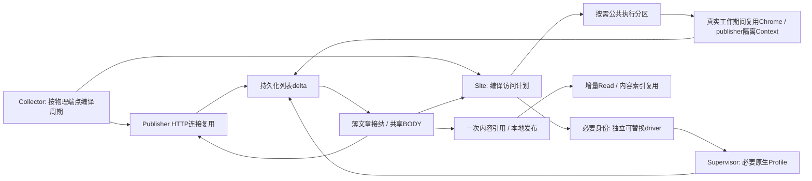

# DoxAgent 全局资源精益架构与修复方案（2026-10-29）

状态：本文为2026-10-29历史坏例复审后的执行版本；现已按工作包实施并正式build发布，实际迁移、生产发现、追加修复和固定90分钟观察见[实施记录](host-resource-lean-implementation-20261029.md)。性能与长期稳定性验收尚未全部通过，不能将方案落地等同于目标已经实现。下文事故/停机快照保留原勘查时点，不改写成当前状态。

## 0. 统一架构方向（先固定，随后按证据修订）

正常路径收敛为：低成本物理取网 → 薄delta接纳 → 一次有效正文获取/复用 → 薄业务发布与增量投影。身份数据隔离和driver故障隔离是两件事；取消没有真实需求的整套常驻，不把所有必要身份合并进同一Node，也不预设固定两套控制器。

优先删除无效控制层、重复预热/恢复与旧实时兼容工作；再将必须保留的浏览器、正文和存储工作做小。容量保护只为实际成本的已测结果，不以新增长期延期、统一W1/W2/W3门禁或降低覆盖完成任务。历史诊断用于提出可验证的坏例，不作为当前设计禁令；原“两套Python/Node上限”和通用冻结表述已撤销，具体复核见第13节。

本文结构：

1. 两次卡死及停机后资源对照、因果证据和不确定项。
2. 全部常驻进程/浏览器及其必要性，控制资源共享与身份隔离的边界。
3. 单次访问阶段、页面/iframe/driver生命周期、实际失败和重建。
4. Collector/BODY路线、正文复用和消息质量的联合设计。
5. 旧任务接回、数据库/Native/投影的真实工作量及精简。
6. Worker/研究/初始化、Supervisor与宿主服务的资源贡献。
7. 统一目标架构、全部业务变化清单、资源预算及容量验证。
8. 按依赖执行的修改位置、迁移/回退与持续验收。

证据目录：`eval/host-resource-redesign-20261029/`；上一轮原始证据：`eval/host-freeze-20261029/`。已有事故还原见`host-freeze-incident-diagnosis-20261029.md`。所有用户展示时间使用北京时间。

## 1. 两次事故、停机对照与根因收敛

### 1.1 本轮止损状态

04:03:28本次重启；04:04已停止正式Collector、Bus、BODY、Site、Chrome Supervisor五容器，并停止宿主Reuters Chrome/relay及Site网络守护timer/service，防止自动拉起。没有删除Volume/Profile/Cookie，也没有变更restart policy。Worker、Scheduler及W1/W2/W3相关服务保留运行。消息新采集与BODY在此期间暂停，**停机窗口必须记入采集/交付验收，不做成功轮次过滤**。恢复由本方案的正式上线步骤负责，不在勘查结束时自动重启失稳架构。

04:08可用内存约9.56GiB，Swap使用0；对照是单次干预，不把释放的全部内存机械归为Site，因为此次同时停止了五角色，并且业务负载随时间变化。

### 1.2 新证据修正上一轮的归因权重

|故障窗口|Site峰值/累计读盘|Worker峰值/累计读盘|Supervisor峰值/累计读盘|
|---|---|---|---|
|00:30—03:11；Site约67分钟|6G / 250.3G|10.5G / 165.4G|4.5G / 126.4G|
|03:11—04:03；Site约50分钟|6G / **267.1G**|**3.1G** / 12.5G|4.6G / 13.1G|

数字来自systemd关机scope核算，G沿用原日志单位；累计时间不同，峰值不能相加。第二次没有Worker10.5G峰值仍复发，说明它不是事故必要条件，**本轮首要直接治理域是Site的局部内存工作集与浏览器生命周期**。Worker及投影仍需降正常成本，但不能通过限制W1/W2/W3来替代Site修复。

已证实的链：

1. Site自身6GiB硬边界反复命中；即使宿主尚有1—3GiB available，其局部匿名工作集仍挤压同一cgroup内的文件页。
2. 浏览器/控制器树常驻、页面导航和冷建使工作集反复装入。上轮重启数分钟后Site的file refault约80万页、pgscan约169万页、major fault约1.2万；这不等于全部I/O都是swap，也不是全部I/O来自DB。
3. 应用父slice14G/15G、应用swap1G及其它业务进一步压缩缓存余量；回收与重读占住磁盘，任务排队和超时增多。
4. 02:51 load307、222 blocked、内存/I/O PSI接近100%；03:28再现load121和I/O PSI96.67%。日志/DNS/登录/数据库都成为受害域；取消、重试、重建又可能反馈放大。

尚未证实：某一条iframe或孤儿target泄漏是唯一触发器；控制器3→1秒取消单独引发事故；某一个代理出口单独导致整机停顿。这些必须通过任务/target/native实例的因果记录验证，不能以猜测代替设计依据。

### 1.3 本次优化的责任边界与代码来源

原始每identity Python/Node隔离、24控制器/Managed8/External16上限及单Node1.2GB/4小时轮换来自`c2a6b679`（10/18）；热身份与恢复页豁免在10/23—10/27继续扩展。它把“必要Profile隔离”扩展成“整套进程隔离”，与真实内存容量没有闭环。

本轮`dcd7333b`（10/29 00:47）恢复后台执行、放宽BODY准入、缩短取消等待，并将anchor90秒改30秒、空闲2页改1页。它没有收缩上述进程放大层，没有证明铺开后的驻留平台；因此不能用“代码早已存在”否认本轮组合影响。详细Git逐行来源沿用事故报告，并在本方案工作包中标明要删除/替换的路径。

`7026fc21`已修复的curl CFFI回调崩溃是独立问题；两轮整机失稳不能重新默认归因于它。当前Supervisor和Worker仍是旧兼容镜像，尤其不能以本地共享pressure函数的新实现推断旧Worker也执行了新行为。

## 2. 必要业务与当前放大层

|现状|实际业务需要|精简方向|
|---|---|---|
|每identity独立Python+Node，必要时再起Chrome；上轮15个Node、17个Python|Profile隔离、必要driver进程故障隔离、同身份维护互斥|先退出无需求的publisher控制器/Chrome；必要身份保留独立可替换driver。共享API、配置和无状态工作，不用对象隔离代替进程故障隔离|
|592个启用身份配置：570 Managed、22 External，其中523个publisher scope|聚合源跨publisher路由；历史配置可追溯|配置数不等于需要常驻数。普通公开站不再自动创建独立Chrome/Profile；保留现有目录作为冷数据，不批量删或预热|
|多个热External Chrome+8个Managed原生树并行驻留|少数真实身份站需要原生Profile；部分公开页面也依赖匿名风控状态/启动方式|已做成消息源的对应site保留既有访问设计；聚合源发现的普通publisher可按需共享Chrome/Context或按需恢复原生身份，但不长期驻留|
|控制器/Node单体阈值1.2GB，4小时轮换|能发现失联与真正异常增长|整棵实例的实际cost归属，先消除多套重复常驻；不再把“每个Node都不大”当作合计容量安全|
|预热→回收→probe串在60秒维护循环，扫描历史身份|保证必要热源可用、回收真实空闲资源|回收与正常lease释放紧邻；预热只准备已有真实近期需求；probes/历史维护不成为回收前置|
|358个required逻辑单元、71个源，318单元60s、39单元30s、1单元600s|完整频道与配置周期兑现|容量按实际端点/查询/共享请求计算，不按固定9ticker设阈值，也不把358逻辑单元直接当358物理请求|

以上清单来自冻结的生产状态；后续实施应从同一配置编译单元，防止旧generation和共享频道误入分母。最多20ticker是负载验证维度，不是直接把所有并发设成20。

### 2.1 最值得先删除的工作：没有当前业务义务的历史浏览器恢复

新增取证将问题从“浏览器太多”收敛到可执行机制：02:04—04:02有120次`PROBE_FINISHED`，其中普通generic publisher **75次、BUSINESS_READY=0**；42次仍阻断、24次队列延期，其余超时/运行不可用/取消。整个窗口取得浏览器阶段字段的真实BODY执行仅62次。两种口径并非完整浏览器工作量，不能据此相除估算全部CPU，但已证明恢复不是可忽略的边缘工作。

当前8个未结束恢复中，TechPowerUp旧稿attempt_count=430、generation=1612；StocksDownUnder旧稿390次，OpenPR82次、SecurityBoulevard49次、BHPioneer一篇图片页29次。它们的identity恰与上轮Managed Chrome根进程profile对应。**不是已证明的“每次真实新稿都必须起8棵树”，而是历史恢复将这些树反复保持活跃。**

直接代码链：

- `recovery.py:run_once`每轮遍历所有未RESOLVED恢复，缺少当前消息/必需频道需求判定；`challenge-autorecovery-v1`启用后还每60秒再做旧恢复迁移扫描。
- `service._run_due_probes`枚举所有enabled scope；`failover._canary`固定`mode=BROWSER`，即使该publisher真正BODY路线已经是HTTP或Reader。
- `worker_runtime.close_idle`对未解决且页面非LOST的Managed恢复直接豁免回收；恢复每次触达又刷新使用时间。
- 生成/探测/保留浏览器能力成了独立永久业务，实际文章交付是否仍需要它没有退出关联。上述核心来自10/18 source隔离与`fadb2562`（10/22 00:10）自动恢复，10/26—10/28继续扩展；本轮恢复执行量后没有消除这条反馈链。

**P0修改**：普通publisher取消“独立、永久、自驱”的浏览器恢复与定时冷canary；仅真实待补正文需要Browser时执行该文章的一次有界尝试/必要恢复。没有待处理Browser业务、文章已FULL/SHORT_FULL或路线不再使用Browser，则恢复转为按需状态并释放非人工原生运行环境，保留历史和Profile。真实必需浏览器列表依然按配置周期执行，其业务请求本身承担半开探测；不能先做一次同页canary再抓一遍。

这是一项**明确的业务策略变更**：不再主动长期修复无人消费的公共publisher旧页面。损失是下次真的需要该Browser时可能承担冷启/重新Challenge；收益是消除零产出的持续读盘、常驻与重建，不减少应发现消息或已存在正文任务的交付义务。对正在进行的人工作业/付费solver及被必需source实际阻断的身份保留原场景和必要恢复，不一刀切关闭。

## 3. 单次操作：慢在哪里（已完成事件勘查）

生产取样02:04—04:02，共5339条Site事件，其中4959条ACCESS_RESULT，覆盖成功4332、预算延期502及其它失败。下表仅是**取得浏览器执行阶段字段的完成样本**，没有阶段证明的失败/未开始轮次不塞进时延分子；它不能替代周期兑现/全量端到端验收。

|CRAWLER站点|样本|执行均值/P95|页面获取均值|导航均值（有该字段样本）|capture生成→Access结果P95|
|---|---:|---:|---:|---:|---:|
|Yahoo|989|2.24s / 11.28s|0.13s|该路径未记navigation字段|8.91s|
|Investing|510|4.10s / 15.41s|0.47s|0.70s，91项|13.12s|
|InvestorsHub|438|7.97s / 19.86s|0.56s|3.61s，142项|12.73s|
|DIGITIMES|58|10.58s / 27.76s|6.11s|1.20s|11.26s|
|Globe|61|2.61s / 11.58s|0.64s|0.32s|10.81s|
|CTEE|44|4.47s / 17.79s|1.33s|0.19s|10.86s|

`network_ms/attempt_ms`包含浏览器、控制和收尾，不是纯取网。上述阶段嵌套，**不能将它们直接相加或用P95相减求阶段比例**。多数worker_wait为0；主要优化不是再加identity排队层。

具体样例DIGITIMES：23.87s总执行中页面获取10.15s、导航2.17s，capture生成后又过11.26s才记录Access结果。其后的gate关闭、target关闭、所有权ACK、IPC及Registry可能都在这段；缺少内层计时，不能直接把11.26s全部写成page.close。

方案先删除普通操作的重复控制/持久化交接，使用长期可复用的少量业务槽位页面及轻提取；capture返回与物理释放分离，但**未释放资源仍由原lease计入真实占用**，不以“先返回”掩盖后台泄漏或通过无限清理队列转移压力。新增计时只落一个小span，不再存整套阶段快照。

## 4. 旧BODY兼容：实测纠正与简化边界

27.4GB Bus库中旧job为completed8514、failed20501、queued325；新旧状态不能混为仍有全部历史工作待执行。前台查询使用partial index `idx_mbv2_enrichment_foreground_ready`，**不是全表扫描**。

在停机、低压力只读测试中：前台查询0行约1.73ms；过期claim查询0行约0.85ms；旧recheck领取候选约155ms，走due索引后临时排序，选中packet仅4702字节。不能把事故231s都归因于单个巨大JSON解析。事故日志中的约10.2s写事务确实会传播锁等待，但正常SQL成本与回收/I/O停顿必须分开。

仍应做的减法：用一次有界兼容迁移把325个待续作转成live的薄continuation，保留原first_seen、due/next_check、结果引用、canonical/URL别名和发布身份；旧terminal仅保留历史按需访问。正常BODY领取不再扫描/改写旧job，不因本地接纳/发布失败重新下载。FULL复用消除重复下载，不重置原到期时间；重要更新和原到期复查继续有实际进展。迁移状态只要一个cursor/完成标记；不新增第二套实时兼容队列，不直接把旧工作标完成。

## 5. 其它组件、存储与维护的共同成本

### 5.1 BODY路线已经存在的有效收益，以及仍需纠偏的地方

窗口内960条BODY结果含FULL711、SHORT_FULL17、PARTIAL59、UNAVAILABLE173；其中有复用、旧稿和不同完成时点，**75.8%只能称该结果集合的完整比例，不能冒充真实新文章最终成功率**。

路线证据支持按站选择，而不是全部先Browser或全部取消Browser：

|实际路线集合|结果证据|下一步|
|---|---|---|
|Globe direct|178/178 FULL|保留HTTP为主，不为浏览器能力另起canary|
|Yahoo direct|86项，78 FULL；浏览器阶段7项全部CONTENT_ERROR|HTTP主路继续；Browser换成只对已确认可处理的页面类型触发，失败原因指向wrapper/付费/非文章时不盲试|
|CTEE direct|26项全部FULL/SHORT_FULL|正文HTTP充分，列表能力与BODY能力分开维护|
|Barron's browser|16项全部FULL|保留现有订阅身份Browser；不为了统一路线降质或绕过权益|
|Investing browser|25项，17 FULL/SHORT_FULL、8不可用|保留身份路线，修复本地成本与国家域/真实登录状态；不凭HTTP 200替换|
|generic direct|174项，141 FULL/SHORT_FULL|普通公开HTTP优先；必要Reader作为唯一有价值fallback|
|generic direct→Reader|17项，6 FULL、11不可用|按publisher/失败原因检验Reader价值，避免把全局未知站重复送一遍Reader|
|Seeking Alpha direct→direct→browser|8项，2 FULL、6不可用|区分重定向与真正重试；保留有效订阅访问，删除已知无效路径，不能把summary算FULL|

`pipeline.py`最多两种有效获取方式不等于全链路只发生两次HTTP：wrapper解析、合法原文跳转、重定向与正文获取是同一路线的必要步骤，不占另一种fallback名额。统一沿原始article/attempt记录路由，不在各层再启动一次“恢复后重试”。每publisher主获取方式+至多一种有证据的fallback，按归一原因码实际执行；仅普通瞬态网络失败允许一次5秒后重试，不能把fallback和外层重试相乘。Budget/本地提交延期不计入网络失败次数，已取得正文不重新下载。

5秒不是全局重试周期：有效`Retry-After`、`retry_not_before`、真实Challenge/付费恢复节奏和端点429期限继续生效；同端点/身份适用边界取较晚时点，不能把某一路冷却扩大为无关Reader/端点的禁用。等待由持久due续作，不睡眠占Chrome/正文执行槽，也不趁等待重复改写无进展覆盖。

当前`managed._retry_seconds`已传Site恢复时点，`LiveRepository.defer`按`job.not_before`落due，因此不能说今天所有BODY仍把60秒压成5秒。另核对到`content_enrichment.service._retry_after`仍将delay封顶180秒：它不能截短更长的有效provider期限。R4只需在现有延期链保留provider下界，若超出本次执行预算则释放槽位并保留续作时点，不提前取网；没有必要重写已经正确的defer或新增退避系统。回归同时检查旧入口/TAIL没有覆盖恢复时点。

### 5.2 代理：按实际端点验证直连收益，身份出口不静默变更

在正式Worker中仅运行独立只读HTTP客户端诊断（没有模型调用、浏览器或业务入队），相同curl impersonation、每出口两次请求，INTC RSS/Globe search/CEG列表均返回200且响应长度相同。名为server-direct的第二次耗时分别4ms/17ms/237ms，JP为212/1020/346ms，US为208/576/338ms。

该小样本有连接/CDN缓存影响，未验证各route实际公网IP和解析后的项目完整性，不能推出所有直连都更快，也不是刷新覆盖证明。**公开RSS/HTTP端点可在验证实际出口、完整列表及validator后固定直连主路；已验证Profile、地区、登录与高风控源保持原出口。** 如切换受保护身份出口，必须单列业务/风控影响并重新验证，不能作为隐蔽性能开关。

### 5.3 Read/Projector：在展开之前过滤，在内容变化时才重写内容

当前磁盘量：Bus约25.52GiB、Read约21.76GiB、Runtime约6.67GiB、Site Registry约765MiB、采集库约771MiB。文件大小不是当前热集或本轮新增量；不能因文件大就全库VACUUM/重建。

代码确认两个剩余放大点：

1. `SourceOutbox.event`/`NativeContent.source_row`在mapper/`serving_fields.select`之前展开Native；随后才丢弃无需Serving的runtime字段。应先按table/namespace/header选允许投影字段，再按必要引用读取，保持源端原始事实、W3冻结输入不变。只支持本轮用到的字段选择，不新增通用查询语言。
2. `ProjectionMapper.message()`每次生成message都调用`message_search()`读取完整body。`ReadStore.close_current`将旧payload及search_text复制进history。Case路由或状态变化也可能重复读正文、重写搜索文本。改成正文内容索引以内容digest存一次，ticker/message只保存关联；同body_digest重用搜索记录。沿现有contents/content_locations扩展，不另建搜索服务；保留现有Unicode casefold/substring查询语义，不借机换分词/排序规则。

保留逐业务事件原子发布、current水位与必要历史时间旅行；去掉技术状态引起的全文/搜索重写。已有23GiB历史按现有保留/引用规则逐段退休、复用空页；不把上线正确性建立在一次性全库迁移成功上，不删W1/W2/W3引用的事实或文件。

### 5.4 Worker：保留业务并行，减少重复扫描与空闲运行环境

Worker继续运行期间，04:08样本约2.18GiB匿名内存、0.76GiB文件页；Projector约583MiB匿名+1.31GiB文件页，Scheduler约887MiB匿名+784MiB文件页。cgroup总量包含可回收文件页，不能把每个峰值都写成Python堆泄漏。

`CapsuleRuntime.recover()`会遍历历史owner记录，对每条调用全`/proc`环境变量扫描；正常`memory_for`及`terminate_owned`也反复扫描全宿主进程。CLOSED owner记录仍保留。这是代码可确认的成本乘法，实际owner样本及受控差值见证据，不能把前述165G全部归为它。

现场前2000个owner样本中330个已CLOSED、1670个无cleanup_state字段，样本被截断。没有证据说1670个都是活跃或泄漏；它说明启动恢复还要反复面对大量历史/旧格式owner。最近2000条Runtime CDC中1723条为effects，Serving已不保留其native记录，却仍先走Native展开；可以在传输/mapper边界删除这些无用读取，不能删除Runtime源端的业务effects。

修复：正常闭环后owner记录明确退出恢复集合；启动只处理非CLOSED/真实未收尾项；一次进程归属快照同时服务全部待恢复owner，禁止“历史owner数×宿主进程数”重复扫描。正常运行以已记录的PID+start_ticks/子进程归属复用采样；仅丢失归属的异常路径做一次全扫描。保留随机capsule身份和PID启动时刻校验，避免杀错进程，不通过删除证据或忽略脱离进程组的MCP子进程来节省成本。

保持W1/W2/W3模型、并发、ready语义、冻结资产和交易处置不变；清退已用/已退休/失联的SDK及MCP运行实例，合并同一实际ready owner的重复维护。当前READY=3本身不是冗余证明，不能机械改成1。对真正活跃模型任务的正常内存需求以现有真实峰值测量，不新增研究/交易启动硬门禁。

### 5.5 宿主及历史维护

- 宿主Reuters旧服务因DISPLAY缺失5秒重启。核实无消费者后退役其自动启动；存在消费者则统一迁至已验证Supervisor身份接口，保留原Profile冷备，不能另起第三套Reuters身份。
- Site retention每600秒会进入`_maintain_managed_resources`，遍历全部Profile，每个`maintain_profile`又做进程/文件及可能的du扫描。普通publisher配置增长会持续放大这项历史维护。改为已退出/已变更Profile的短cursor，只有明确磁盘治理需求才检查其可再生缓存；正常轮询不触碰几百个冷Profile，不清Cookie/Storage。
- `recovery.run_once`每60秒重复旧迁移改成一次性cursor+完成边界；晚结束的人工作业通过已有会话结束回调续作，不再重扫全部旧Challenge。
- 不把全局压力信号重新变成业务硬阻断；保留现有宿主最后隔离边界，但它不能替代工作量收缩。无需新增Redis、消息中间件、新DB或通用资源治理服务。

### 5.6 Bus正常路径：保留已完成的减法，清退剩余重路径

本轮逐行复核不能沿用旧诊断说“CaptureBridge仍全局串行”：`collection_plane/bridge.py:63—77`已经将最多8个delta并行prepare，随后进入短writer；`live_repository.prepare_publication:1130—1132`也已在writer之外编码Raw/Standard并收集Native引用。`commit_result`先有落盘spool，再短事务提交。这些是应保留的既有收益，不能再次叠加第二条接纳队列或另一套正文结果台账。

剩余的明确重路径在兼容入口：`repository.finalize_standard:2432—2494`持有写事务时仍做证据合并、模型解析和`_json`；`_json`会调用`NativeContent.encode`，较大字段可触发`ContentFiles.put`。`service.flush_binding:1611`甚至为只读控制水位开启写事务。它们不是已经证明的整机触发器，却会把慢文件I/O/序列化扩大成同库所有写者的等待。`storage_lane.call`还在整个operation期间持有进程writer，不能仅把SQLite事务变短而把长文件工作留在writer外壳内。

具体收敛：

1. API/旧buffer/恢复完成入口统一使用现有prepare→薄commit形式；Native文件写入、完整模型构建、正文与证据解码均在writer之外。提交只保留文章结果revision、有效binding/terms、真实owner边界及唯一发布的标量比较和必要行写。控制水位用只读连接，不为读配置抢写锁。
2. 不再因每个ticker读取同一完整result_ref后再各自展开正文。一次article/result revision准备不可变正文与基础解析，各ticker只追加自己的相关性/权限/发布数据；跨ticker不共享可变metadata。复用不越过订阅权益或配置修订边界。
3. `CaptureBridge.once`现有8项`gather`批次可能让下一批等待最慢一项；先测逐capture的pending→prepare→commit→ack，不先增加并发。只有仍明显阻塞时，改成同一有界活动集合“完成一个补一个”，失败capture按自身due重入，不等待整批、不开新broker，也不让历史大delta独占writer。一次薄commit按article/必要小批形成可恢复边界，acceptance只有全部本delta内容被接纳或明确拒绝后才完成。
4. 保留durable delta、原子acceptance、ARTICLE_ONCE和业务owner一致性；删除的是重复整对象/重复body工作。现场live路径已经具备的标量fence不再扩张成source roster快照复核。技术心跳和未变结果不引起全文重写。

验收同时量`operation_ms / writer_slot_ms / begin_wait_ms / transaction_ms / commit_ms`；用必要断言证明writer内没有Native文件读写、网络或完整正文解码。不能把“数据库锁等待降低、writer仍占槽数秒”算完成，也不能把快路径已有优化宣称为本轮新增收益。

## 6. 统一目标架构（实施采用此版本）

### 6.1 按真实需要保留driver故障域，先减驻留再决定控制分区

**撤销固定两套Python/Node结论。** 10/02共享Node堆退出、10/17全局driver lock/epoch扩散的结构在“所有受保护身份共用一个Node”中仍可能存在。当前`IdentityWorkerManager.workers/epochs/_locks`和`SnapshotRepository`按identity组织，仍是有效的隔离能力；cookie/Context、不可变配置并不能隔离Node堆耗尽或driver transport死亡。反过来，这也不证明592个配置都需要独立常驻进程。

执行采用最小改动的两条路径：

1. **已有必要浏览器身份**：保留每物理identity独立可替换的driver、自己的lock/epoch，以及现有必要worker进程边界；保持Supervisor Chrome/Profile/出口和启动方式。单页超时只处理其owned资源；Node死亡只重建该identity控制通道，不能detach其它identity，也不能停止仍健康的原生Chrome/人工页。空闲控制worker能否退出由实际下一次需求决定，不触发活动Reuters Chrome停止。
2. **聚合源普通publisher**：HTTP/Reader完全不启动driver；确需Browser才用按需公共执行分区，在真实在途/排队任务间复用Chrome，publisher用隔离Context。不再为每个发现的publisher创建一套长期worker。分区数量按真实活跃需求、驻留成本及允许的故障半径确定，不按9/20ticker，也不固定为1或2；一个公共分区失效只使其中可重执行任务续作，不触及必要身份driver。
3. **共享不需要进程隔离的工作**：沿用单一Site owner API、配置/路由缓存、薄IPC协议、统一成本采样；去掉每命令整包配置复制和等价重复排队。当前已有snapshot缓存，不宣称每次仍全量读库。配置改变只更新对应view，必要Profile writer与维护互斥保留。公共多identity执行view必须显式绑定身份，不能直接放松当前SnapshotRepository的identity检查而串用cookie/Target。

R1完成后先测真实必要身份及公共分区的增量成本，再决定是否值得把薄Python宿主进一步合并；这不是本次P0前置，也不要求新增通用多driver调度框架。若以后合并Python宿主，必要Node仍独立，需明确宿主崩溃范围后另作成本判断。**本轮不以合并数量证明优化，只以实际常驻、单次成本和故障影响范围证明。**

### 6.2 原生Profile与普通公开Context两条路径

**身份路径**：已有验证登录、权益、真实Challenge或必须稳定原生/匿名风控状态的来源保留原Profile、出口、Chrome channel、启动方式及身份driver设计。现有Dow Jones/Barron's、Investing、IHub、Reuters、DIGITIMES等必要身份不迁移到公共Context；Managed/External类别不因合并控制而暗换。现已做成独立消息源的对应site同样不纳入B2批量迁移，内部轻提取/请求复用仍可优化。

**公开publisher路径**：Yahoo/Google News等聚合发现的其它publisher可采用HTTP/必要Reader；需要JS时，按egress/locale/浏览器环境复用普通Chrome，以Context隔离publisher。准入分类不能只看“无登录”：先检查是否属于已配置的独立消息源site，是否依赖已验证匿名状态/普通Chrome启动路径，以及新的路径能否取得真实完整正文。该清单从现有source、adapter/site路由和策略形成一次可review映射，不新增每请求全站复核。

公开publisher可以更换实现，但**不能依靠定时探测、历史恢复或预热维持Chrome常驻**。只在真实在途/排队Browser工作期间复用；工作清空后释放Context和不再使用的公共Chrome/driver。确需旧匿名Profile/原生启动方式的公共站保留冷Profile、按真实任务启动并在结束后退出，不把“需身份状态”再解释成“必须永久热驻留”。代价是罕用Browser稿件冷启动；因此同时测冷/warm全文率与端到端尾部，不伪装成无成本变更。OPEN人工/付费在途是明确当前工作，不能当空闲销毁。

公开Context不等价于原Persistent Profile；不能把cookies从付费/高风控身份随意复制进共享环境。可复用匿名state只在实际改变时保存，不每次完整导出Profile。不将历史公开站坏例扩大成“公开Context一律不可用”，有限对照完成后直接按验证路径执行，热路径不新增迁移验证门禁。

官方API边界：[Playwright Context隔离](https://playwright.dev/python/docs/browser-contexts)、[Persistent Context/Profile](https://playwright.dev/python/docs/api/class-browsertype#browser-type-launch-persistent-context)。同一user_data_dir不能并发启动两个原生Chrome；Context隔离不能被宣传成完整持久Profile/访问指纹完全等价。

### 6.3 页面、内容和清理闭环

1. 必需Browser频道按**物理身份及实际活跃槽位**复用少量页面，不按ticker各保留一页。复用的是浏览器执行载体，不是上一查询结果；每次显式绑定site/scope/ticker/query/channel、重置上次响应并验证本次request/recipe。只有实际同一次物理响应确实覆盖多个单元时才共享证明，不能凭同origin混用频道或旧DOM。
2. 是否保留anchor由真实复用收益决定。30秒固定expiry会与30/60秒调度竞争，替换为必要热身份下一次due感知的idle保留；池容量跟随真实活跃槽位，避免已有2并发却只留1页导致一路每轮冷建。Reuters仍按既有最多1张普通搜索页策略，不为统一池强增；其活动Chrome不因worker idle停止。罕用公共publisher则按6.2释放，不跟随全部scope保温。
3. **默认不冻结脚本、不清空业务DOM；仅逐站明确允许。Reuters普通搜索业务页、正文活动页、Challenge和人工页全部排除冻结。** 现有Reuters调用已`freeze=False`，改池不能丢失该例外；保留commit、业务内容就绪与后台timer polling。其他站仅在idle冻结/恢复后的完整列表、身份和成本对照有收益时启用；不因一次freeze失败就重复冷建整棵浏览器。不得把5秒优化目标变成所有站的统一5秒截断。
4. 普通公开Context由本次真实工作持有，结束关闭Context回收其iframe/worker。身份路径只关闭应用owned target，保留必要原生Profile；使用复用页面后，持久化一次target创建/交接/销毁事实，普通同一页面内的每次读取不再走allocate→bind→close_claim→closed四次DB交接。
5. 精简capture：列表只返实际recipe rows+meta；正文一次读取验证所需article DOM/JSON-LD/完整段落及必要表格，不重复传广告全DOM、再多轮inspect。遇超长正文走既有内容引用，不能截断后标FULL。来源页结构不适用轻提取时保留有证据的完整提取路径；Investing保留有价值的有限就绪等待/原导航Response读取，不为5秒目标把尚未就绪当空列表。
6. capture可先作为完成结果交付；清理继续由原lease持有资源直至真正完成。`_PageLease/_ExternalLease/FetchAnchor`当前先置closed再await清理，失败后会释放活动计数且内存lease不再重试；持久CLOSE_PENDING仍可能恢复，但两种占用口径已经脱节。改为CLOSING→实际完成CLOSED，失败保留准确target引用；正常收尾只做一次短关闭，未确认则进入现有cleanup精确续作，不在请求上无限等。后续仍按精确target确认/关闭，driver失联只替换对应故障域；原生实例确实卡死时沿既有单实例恢复条件处理，不因一个close失败重建全部身份。待清理真实占用不假归还，不开无界清理队列，也不靠多开实例掩盖残留。
7. 使用CDP正常关闭响应和targetDestroyed事件完成收尾，异常才查询目标；不每次再枚举全部targets。CDP的`closeTarget.success`已弃用并总为true，不能新增一套“检查false”的伪修复；以协议错误/销毁事件为准。[官方协议](https://chromedevtools.github.io/devtools-protocol/tot/Target/#method-closeTarget)

公开站可测试关闭视频、图片、字体及已知广告资源的成本收益；这会改变实际访问行为，**不默认施加到高风控/登录身份**，也不阻断完成列表/正文所需JS/API。只有同源完整性、身份稳定和CPU/内存收益均通过的站点才纳入配置。

### 6.4 恢复只服务真实业务，不再自行制造工作

删除全部scope定时Browser冷canary。真实必需列表轮询就是列表健康探测；真实文章HTTP成功只证明HTTP/BODY能力，不强行清除Browser Challenge，也不要求Browser先恢复才能使用HTTP。

恢复记录增加一个明确的`automation_active`标量（或等价既有字段），不再用“未RESOLVED”同时表示历史记录、当前义务、永久常驻豁免。普通publisher无真实Browser义务时自动工作退出，UI显示“按需恢复/没有后台探测”，不伪装已恢复；下一真实Browser任务按既有Profile尝试。必需source若Browser被阻断，使用一个实际业务请求执行半开恢复/原场景自动或人工恢复，同identity合并，不先canary再重抓。已付款solver和OPEN人工会话保留其在途责任。

停止协调器必须同时打通`effective_candidates/health`、ProfileUse、manual_attention及恢复状态到真实访问的入口：历史未RESOLVED不能在无人再推进时永久拒绝新任务。无人工writer冲突、无有效provider延期时，由该真实任务进行一次半开访问；新登录/业务恢复沿现有同site/scope/identity与CRAWLER/BODY各自证明解除旧阻断。真实人工会话/仍存在的Challenge不能被统一清零；HTTP成功不清Browser状态，但可直接完成允许的HTTP任务。这里只收敛既有判断，不新增每篇canary或全量健康复核。

“人工/付费在途”指真实持有的维护会话或尚未结算的动作，不是任意历史未关闭待办。无真实任务、未被人工接管、无付费在途的generic旧Challenge可保留证据/Profile后释放运行资源，显示“原现场已释放，需按需重开”；不伪造Challenge通过。独立消息源必要恢复与真实人工现场仍按原身份设计保护，不能借此误关闭。

没有当前义务不是“延期一项应做业务”：应交付文章和必需频道仍在各自原队列，其失败/未完成全部保留；删除的是与它们脱离的独立恢复循环。技术恢复状态不再无限期豁免空闲资源释放。

## 7. 并发、容量及8核16G的兑现方法

### 7.1 先改变单位成本，再计算需要多少并行

现有358个逻辑必需单元对应258个不同`(source,unit,input_key)`组合；后者也**不是实测物理请求数**，SDK共享请求、共享RSS及缓存证明还需按physical_request_id归并。保留逻辑单元和物理操作之间的多对一关联。

每种实际端点/查询/频道计算：`λ=周期内真实必需物理操作数/周期秒数`；`所需活动槽位≈ceil(λ×E[真实lease占用秒]/0.7)`。Chrome驻留另算`必要原生实例成本 + 活动Context/Page增量 + 控制器固定成本`。CPU用cgroup/process CPU时间差和受控操作样本测，**不能用wall time×并发冒充CPU core需求**。失败、创建、恢复、释放都进入成本；共享请求一次计物理成本，各逻辑频道仍各有新鲜证明。

控制收敛为一个Site执行准入点与一个identity维护/业务互斥：HTTP不占Chrome；已存在native实例上的轻fetch不按“冷开整棵Chrome”计价；公开Context、冷建原生及正文渲染分别有实测成本。移除joint/worker/runtime重复的等价排队和静态BODY额外借2个槽的分支，使用同一实际空闲资源记录。已有source公平性、真正网站节奏与维护一致性保留，不为提高并发绕过它们。

额外请求优先靠复用现有实例、关闭无当前业务义务的恢复页面、回收闲置公共Context取得资源；不把它转成无限等待，也不把一个请求超时变成整identity重建。默认不开“看到PSI就无限延期”的门禁，不新增W1/W2/W3/研究/交易硬限制。

### 7.2 初始工程预算是验收约束，不是新增硬限额

|对象|目标/约束|如何证明|
|---|---|---|
|控制进程|必要身份driver独立可替换；普通publisher无真实Browser工作时0常驻；公共分区数量依实际成本确定|分别列Python/Node/Chrome实测成本、driver故障影响的site数；不以固定2套或固定ticker阈值验收|
|浏览器运行域（Site+Supervisor）|既定正常负载下anon+shmem目标≤3GiB；含必要活跃file/kernel工作集目标≤4.5GiB|分实例测量，保持原生身份/必需频道后成立；这是待证设计预算，不是把容器限制强改成4.5GiB|
|其它业务|W1/W2/W3现有并发/模型/ready契约保持；降低闲置/重复成本|真实高峰同跑，分清anon与file，不拿单个cgroup峰值相加|
|全机余量|真实峰值后MemAvailable持续有约2GiB余量，无持续swap-in/out与refault恶化|连续交易窗口及72h增长；CPU短峰允许，不能持续I/O/内存双停顿|
|warm Site|正常操作P95≤5s为优化目标，不是统一5秒deadline；来源有必要的有限就绪/恢复仍保留|所有应请求样本，capture与真实释放分别计时；冷启、Challenge及超过5秒的正常样本都不删|
|本地接纳/发布|正常处理P95≤1s；写事务P99≤100ms，>1s逐项归因|真实事务计时与内容I/O断言，不靠延长timeout|
|业务目标|周期兑现接近100%；真实新文首次列表采集→下游可消费尽可能≤10s；真实新文FULL/SHORT_FULL>80%|见第10节统一分母；不能用减少任务或放宽FULL门槛达标|

如果保持全部必要Profile/频道后这些预算仍不成立，判定本架构未验收，继续减少实际工作或提出明确的硬件/访问策略选择；不悄悄延长周期、跳过频道或限制W1/W2/W3。现有6G/8G/父14G隔离先保留，不能以放大它们作为修复证明。Linux明确说明memory.high可导致持续回收但不触发OOM；“没有OOM”不是验收。[内核文档](https://www.kernel.org/doc/html/latest/admin-guide/cgroup-v2.html)

### 7.3 30秒及最多20ticker必须单独验

- Barron's：20ticker×2必需频道的上界先按40个操作/30秒评估，存在物理共享则用实际证明扣除；正文复用同一订阅Profile，不能将OTHER_HEAD藏进RSS成功。验证native新闻API/轻提取能否在相同身份下兑现，不只测一个ticker。
- Investing/IHub：20个ticker查询/30秒，保留市场/频道语义；优先现有同身份fetch、稳定列表页面及轻解析，检查当前IHub约8s均值如何降至目标，不能以排队转移为CPU争用。
- Yahoo：RSS与必需Browser频道分别计量，公开publisher正文不共用Yahoo cookie；保护已有timestamp/验证字段。
- Reuters/DIGITIMES：保留真实搜索/频道；逐项甄别固定3秒等节奏是程序默认还是已证明网站约束。程序默认经对照后可改，真实429/访问能力不足则明确列出容量缺口；不得拿Google/RSS替代未刷新的必需搜索并宣称完整。
- 公共RSS、IR、JSON及IBKR：共享端点实际请求一次；独立HTTP/SDK故障域与checkpoint恢复继续保留。IR一个子页面失败不影响其它页面。SDK不可用不计有效采集。

20ticker受控负载与当前自然9ticker分开标注。冻结端点/查询集合、配置周期、身份及数据量；并发1→2→4等只用于测成本曲线，最终值由上述需求和成本决定，不把9或20写进资源阈值。真实网站测试不能超过既定业务需求速率；内部replay不进入自然成功分子。

## 8. 业务变化清单（实施必须逐项落记录）

|编号|实际改变|合理性/收益|代价及覆盖/质量/身份影响|启用条件与回退|
|---|---|---|---|---|
|B1|删除无需求控制实例，共享API/配置与公共执行；必要身份driver独立|先去无效驻留和复制，不再按每个publisher铺控制树|公共分区故障会影响其当前任务；必要身份间不能发生全局detach/epoch联动|取消两套硬结论；分区数按实测成本和故障影响决定；独立driver退出/重接不改变Profile|
|B2|聚合源普通publisher按需HTTP/Reader或共享Chrome+Context；需匿名身份者冷Profile按需启动|不让普通publisher Chrome常驻，保留必要状态数据|Context不等价于Profile，启动方式也影响访问；低频Browser有冷启代价|现有独立消息源site与已明确需身份站保留原设计；其余按真实全文/匿名状态对照选择，不用“无登录”一键归类|
|B3|删除无人消费的永久Browser恢复、全scope冷canary及重复迁移|去掉75次零产出generic探测及长期驻留义务|下次实际Browser需求可能重新Challenge；停协调器却残留旧门禁会形成永久阻断|真实任务可唤醒/半开；已有人工/付费在途保留；恢复证明按site/scope/identity及CRAWLER/BODY，不伪造RESOLVED|
|B4|必要高频身份按真实活跃槽位复用，罕用公共Browser退出|减少无效预热，同时不每轮重新冷建高频源|热页有必要驻留成本，公共冷启增加尾延迟|下一due覆盖、两并发槽位与冷/warm成本实测；活动Reuters Chrome不因控制worker idle停止|
|B5|复用执行页面，按下一需求保留；冻结改逐站显式允许|减少冷导航/交接，保留真实刷新与查询身份|同origin不能代表同查询结果；冻结会改变JS运行|Reuters普通业务页也禁止冻结；每轮query/channel/scope证明独立；禁止5秒统一截断|
|B6|capture先交付，真实清理独立完成且不假还槽位|缩短已取得消息等待收尾时间|未清理仍有真实成本，不能仅转移为后台积压或无限等待|精确target有限关闭/既有续作，取消及断连注入证明无残留增长；不靠全identity重启或多开Chrome兜底|
|B7|逐站轻提取、必要时直接HTTP/同origin fetch|减少渲染和重复读取|过早取DOM、资源阻断可能丢卡片/时间或触发风控|保留recipe/ticker/时间/频道及必要有限等待；Investing原导航Response有效路径保留；高风控站不默认拦资源|
|B8|逐HTTP端点验证后固定直连主路|降低不必要代理成本|实际出口/地区/状态差异可能损失完整列表或全文|不按“公开”批量改站；验证真实出口及完整结果、时点与validator；仅保留有价值备用，受保护Profile出口不静默变|
|B9|每publisher主方式+至多一种有效fallback；普通瞬态失败最多重试一次|减少重复失败与跨层尝试乘法|误删有价值Reader或提前重试会降成功率、增请求|wrapper/跳转不算第二方法；原因码及顺序有效；5秒只用于普通失败，保留Retry-After/retry_not_before/Challenge节奏|
|B10|旧job有界迁移后退出实时领取；完整正文跨发现源复用|减少旧状态读取与重复下载|迁移/新URL键可能丢续作或掩盖真实更新|保留canonical别名、first_seen、未完成续作及原到期复查；FULL复用不续期、不永久跳过更新；ARTICLE_ONCE不变|
|B11|投影先筛字段；搜索内容按digest复用|减少无用Native展开、全文与历史写放大|schema/事件错配可能已发布却前端停更|Owner→Projector→schema→API/UI同时回归content_update/搜索/权限/水位；保留可见故障与现有修复入口，源事实/W3输入不变|
|B12|Worker恢复/采样合并进程归属，清退真实已结束运行实例|降低历史owner×宿主进程数扫描，保留并行能力|归属错会漏清或误清，属于真实一致性要求|随机owner+PID start_ticks/脱离MCP用例通过；未知旧owner一次对账，不机械信任空cleanup_state|
|B13|退役无效宿主Reuters自动启动；Profile维护改增量|消除5秒重启与1271Profile重复扫描|若仍有消费者会中断其访问；冷缓存清理策略改变磁盘增长|先核实消费者再迁移，保留冷Profile/业务证据；磁盘维护按真实变化及容量触发|

本方案不改变：消息源/ticker范围、配置轮询周期、必需频道、正文FULL/SHORT_FULL定义、订阅权益、ARTICLE_ONCE、真正实质内容修订、首次观察时间、共享交易日历、W1/W2/W3模型及业务处置。任何测试发现这些边界必须改变，需单列取舍及用户决定，不能作为“内部优化”静默合入。

## 9. 按依赖执行的工作包与修改位置

实施顺序是**先删除无意义工作，再收缩运行环境，最后兑现容量与长期验收**。每包有独立可review结果，但不能只完成R1止损就宣布整体修复。

|包|优先级/依赖|可执行修改|完成条件|
|---|---|---|---|
|R0 固化与隔离|首先|记录boot、镜像、Profile/Checkpoint/旧job清单；保持本轮五角色停止；新增真实controller/instance/target成本小span，不复制全文|可复现两个boot证据；维护停机状态清晰，W1/W2/W3未新增限制|
|R1 删除自驱历史工作|P0，R0后|`recovery.py`按需判断、退出重复迁移；`service._run_due_probes`删除全scope冷canary；贯通`effective_candidates/health/ProfileUse`的真实任务唤醒与目的级半开；取消历史恢复永久驻留豁免|5个普通publisher旧恢复退出后台，generic零需求0 Chrome/探测；已有旧manual状态不永久堵新任务，真实人工/付费工作不误停|
|R2 按需公共执行与必要故障隔离|P0，R1后依据成本实施|`worker_manager.py/identity_worker.py/worker_runtime.py`保留必要identity独立driver/epoch；新增或复用按需公共执行路径，缓存薄配置/减少整包传输；删除无需求publisher实例，不强制合并必要身份|公共工作清空后无常驻Chrome；Node死亡不影响其它必要身份；按实测证明驻留下降，无固定2套验收；进一步合并Python仅在有净收益时做|
|R3 Browser执行与生命周期|P0，可与R2并行，按现有lease接口先落地|必要身份页面池按活跃槽位/下一due复用；Reuters保留freeze=False/活动Chrome；`fetch_anchors.py`真实释放；recipe轻提取；`targets.py`只对生命周期/交接写小事实；公共Context随工作结束释放|warm P95≤5s目标但无统一5秒截断；独立查询每轮实际取网；无重复冷建和残留增长，清理既不假还槽也不无限等|
|R4 HTTP/BODY路线与旧任务、薄Bus提交|P0/P1，R1后|`pipeline.py/managed.py/publisher_http.py`站点主路及原因码；`content_enrichment/service.py/live*.py/repository.py`一次迁移325旧待续作；兼容发布/flush移除writer内Native与只读写事务；按article/result revision复用准备；按实测决定bridge滚动补位|正常领取不再查旧job；writer内0正文/Native I/O；下载成功后SQL故障0次重抓；路线质量与发布唯一性不退化|
|R5 Projection/Native减法|P0长期，R0可独立推进|`v2_read/outbox.py/projectors.py/serving_fields.py/repository.py`展开前选必要字段、digest索引复用；旧技术历史分段退出；同步核对schema生成清单和API/UI读者|Serving无需字段不再全文展开；未变正文Native读写0；真实发布及content_update通过Owner→Read→API/UI、搜索/权限/历史对照|
|R6 Worker与维护成本|P1，可与R2并行|`codex_worker/capsules.py/process_tree.py/thread_lifecycle.py`一次owner归属快照、已结束退出恢复；`site_strategy/retention.py/resource_gc.py/service.py`dirty/retired Profile增量维护；退役确认无消费者的旧Reuters服务|W1/W2/W3契约/并发不变；历史owner增长不增加每次启动的全proc扫描次数；冷Profile不被每轮全扫描|
|R7 编译容量/30秒/20ticker|P0最终兑现，R2—R6后|`collection_plane/worker.py/scheduler.py`保留period和物理共享；`budget.py`收敛准入；配置/时序证明与测试清单逐source/unit对照|不靠跳过频道/延长周期达到稳定；资源成本和周期/正文/发布共同达标|
|R8 正式发布与持续验收|必需，R1—R7完毕|按第11节重建必要角色，保护Profile/数据/W1W2W3；真实窗口、增长及故障恢复验证|完整交易时段+至少24h自然稳定，再验证72h平台；未达标项闭环，不以部署成功结案|

### 9.1 迁移的具体边界

- Site只增必要访问执行策略与恢复automation_active，旧identity/profile ID不变。公开Context启用是显式策略值，不偷偷把persistent runtime_kind解释成不同访问方式；更新UI/DTO读者及默认值。
- 仅公共执行协议在Site内部按需调整；必要身份保留独立driver及现有访问启动方式，外部AccessRequest/Result兼容。确有新字段时默认可读，不以全部组件同hash代替契约验证。同Profile迁移时只交接该owner，不同时启动两套writer，不为共享配置而全体detach。
- 历史恢复按真实pending正文/必需source/人工/付费在途逐项分类，保留理由和原记录。不能批量改RESOLVED或直接删除Challenge。
- R1—R3先消除独立历史恢复与无需求驻留；按现有due/公平调度接回真正未完成TAIL、旧BODY及更新复查，保留原窗口和进度。不一次性强制全部到期、不清空retry_not_before、不突增并发“清历史”；也不新设无限延期门禁。若实时与到期工作仍不能共同推进，判成本/容量尚未通过而继续修复。
- 旧BODY迁移按小批锁外解码、短CAS写入、保存continuation ID；中断后cursor续作，结束后停旧claim路径。失败pending保留，不在Bus启动做一次全27GB迁移。
- 停旧claim前逐一核对所有生产入队点，包括API、CLOSED_SWEEP、backfill和恢复均写同一live入口；不允许仍有生产者写旧队列而消费者已关闭。迁移结束后的新任务不能再次把兼容层带回热路径。
- Read新索引/关联只增量建设，新写直接用digest；旧数据按需/有界回填。同一查询兼容两种表示直到对账完成；引用归属跨ticker要保留权限，不能因digest相同跨越订阅权益。
- 重要代码变更逐包追加changelog。工作区/远端其它会话改动先核对，使用不可变已提交源码正式build，不覆盖、reset或混入未review的交易/UI变更。

### 9.2 R3/R4逐来源落点

|路径|具体动作|保留的约束|
|---|---|---|
|`origin_listing.py`、IHub/Investing recipes|优先已有同origin真实fetch；在稳定页上取实际响应，只在需要bootstrap/挑战时导航；验证市场、ticker、分页和全部新闻条目|每轮有真实请求/解析，错误页和空壳不能当空列表成功；保留国家域与有效cookie|
|`yahoo_sources.py`的latest-news/XHR/时间补全|保留现有known_dates与max_probes，不谎称目前全无缓存；将同article跨ticker的时间/已取得HTML与BODY复用，避免下一周期才处理真正新候选。必要日期仍在发布准入前核验|RSS与必需Browser频道独立新鲜证明；缺时间不伪造发布时间或将旧稿当新稿|
|`runtime.py`的DIGITIMES/Globe/CTEE|修复页面获取与target ACK成本，复用必要身份页面；CTEE正文保持已证明HTTP路径；Globe列表HTTP与Browser备份不因历史失败永久双跑|每个必需频道清单不变，Browser备份须由实际主路错误触发|
|`runtime.py`的Barron's正文|保持订阅Profile，提取完整article；12秒循环中重复page.content/inspect_html改成一次DOM就绪判断+一次验证所需内容读取|真实完整正文与订阅边界不变；未就绪明确失败/必要一次回退，不能超时后用摘要代替|
|`pipeline.py`及专用body reader|按已验证public HTTP/Browser/Reader路线统一文章attempt；重定向不被误报为同类重试；FULL结果共享给所有发现源/目标ticker|语言与权益隔离、真实重要更新、旧FULL不被晚到失败覆盖|
|`recovery.py`/`failover.py`及`health/service`候选入口|撤掉公共publisher自驱恢复并贯通真实任务唤醒；使用实际请求半开/证明；不由旧manual/未RESOLVED形成永久拒绝|真实人工/付费原场景保留；CRAWLER/BODY证明分开；HTTP成功不冒充Browser恢复|

## 10. 验证、持续稳定性与明确失败条件

### 10.1 小而必要的自动化测试

测试覆盖业务风险和资源闭环，不为每个实现细节镜像写一套mock。

|测试组|必须验证|
|---|---|
|恢复需求|430/390次旧公共恢复无当前义务时0 Browser工作；旧未RESOLVED/manual状态下真实任务可半开，不必等永不运行的协调器；恢复证明按目的解除旧阻断；必需source/真实人工/付费在途不误停|
|身份与driver故障域|两必要identity并发cookie/locale/出口/Target不串；同Profile单writer；复现一个Node退出/堆上限/transport失联，只替换该driver，不detach兄弟、不递增兄弟epoch/停止原生Chrome；公共分区故障不影响必要身份|
|页面就绪/复用|Reuters普通业务页保持freeze=False、后台timer polling、活动Chrome不因worker idle停止；两并发热身份不反复冷建第二页；不同ticker/query/channel不复用旧响应；Investing未就绪DOM与原导航Response坏例保留|
|释放与取消|在new_page/createTarget/绑定/内容返回/close中分别取消或抛错；没有假归还槽位、孤儿Context/iframe/Node；丢失ACK按精确owner恢复，不按URL批量清人工作业；CFFI回调与池异常回归保留|
|BODY/事务|历史325任务逐项continuation对账；spool后SQL故障不重复取网；20ticker一次正文与基础准备；所有现行/兼容发布入口writer内0 Native/正文I/O；慢capture不阻挡已完成capture，ack不提前；未变复查0全文写、真实内容更新原消息不重复stream；Apple/ETNews/国家域/订阅墙等已有质量坏例保留|
|路线/重试/更新|Timeout大小写和access_order真实顺序；wrapper→原文不占fallback；普通失败最多一次5秒重试，60秒期限不变5秒、600秒有效provider期限不封顶180秒；延期不阻断无关Reader；旧URL别名复用不刷新next_check；到期recheck/TAIL能推进且不重发|
|投影/搜索|Serving先忽略无用Native；同body digest状态变化不读正文；真实published及content_update事件经Owner→Projector→严格schema→API/UI可见，搜索/权限/水位/历史/Case/交易记录对照；失败可见且既有repair继续工作|
|Worker/维护|2000 owner样本含330 CLOSED、1670旧字段缺失；CLOSED不进入恢复，旧未知项一次归属核查；全proc扫描次数不随历史owner数增长；脱离MCP子进程仍可清理；1271冷Profile不成为每轮工作|
|节奏/覆盖|完整required unit集合、共享HTTP/SDK关联、429/失败/未完成与延期全分母；30秒配置不被内部改回60秒；IR子任务隔离、checkpoint重启和ARTICLE_ONCE保持|

owner样本只取前2000条且被截断，不将1670缺字段直接当作活进程或泄漏；测试和修复必须完成其真实归属核查。

### 10.2 实验顺序：总工作量差值与效果一起看

1. **静态/离线**：冻结两个事故数据集、策略、必需单元及坏例，验证上述契约与迁移。不能用修改后的质量规则重新标历史成功。
2. **控制成本A/B**：同一端点/文章集合、身份、出口、数据量下，先比较删除自驱恢复前后必要身份/公共实例驻留，再比较公共按需Context及必要身份原路径；不预设两类controller合并一定有收益，不让两个实例同时打开同一Profile。测CPU秒、anon/shmem/file/refault、RSS/PSS、总进程、native/page/iframe数、启动/关闭次数、请求数及输出质量。capture提前返回后还要等待真实释放，统计全成本；公共站同时报告冷启动成本。
3. **20ticker受控容量**：数据/本地处理replay与网站取网分别跑；按真实物理端点需求测试30秒，不给网站额外无意义探测。真实高风控测试先用现有已验证身份和请求量，逐步达到20ticker需求；带上W1/W2/W3真实高峰或等价成本，不能测试时关掉它们偷出容量。
4. **生产恢复首小时**：只作为完整来源smoke，按逐unit新鲜证明、逐新文章端到端和资源差分发现问题；不得再把60分钟内几篇成功当最终验收。
5. **至少24小时连续自然业务**：含完整交易时段、BODY/列表、W1/W2/W3及正常维护；继续看72小时增长曲线。冷启动铺开后的0/5/15/30/60分钟和每日同负载时点比较，不只截取重启后低内存瞬间。出现同类失稳即判失败并修正，不等到SSH不可用才重启。

### 10.3 统一指标定义

|指标|分子/起止|分母/边界|
|---|---|---|
|周期兑现|每required unit按配置due的真实有效取网启动和列表完成|全部应执行轮次，包括failed/deferred/skipped/pending；停服/回退窗口单列且仍计入，不改period消掉分母|
|有效新鲜覆盖|真实HTTP/SDK/browser物理请求+有效响应/解析，关联全部所服务逻辑单元|保留UNKNOWN/UNPROVEN，不把调用开始、已有DOM、RSS或共享旧结果当必需Browser频道已刷新|
|实际刷新间隔|相邻真实request start、相邻fresh list acquired分别计算P50/P95/max|逐source/unit，纳入连续失败后的长缺口；窗尾在途右删失明确保留|
|新稿交付|`first_list_acquired → candidate_persisted → body_started/result_ready → owner_consumable → Read可查/下游可消费`|全部真实新canonical article及各应交付ticker，包含拒绝原因、失败与未完成；复用旧稿/纯修订不混入新稿分子|
|正文真实完整率|公开或有权限publisher的真实FULL/SHORT_FULL|所有需补正文真实新文章；无正文、权益不足、失败、排队未完成分别展示，不从总量删掉；按最终publisher抽查，不只信程序label|
|操作时效|排队、控制器取得、page/context取得、导航/HTTP、提取、capture交付、真实释放|有字段的完成样本与没字段的失败分开报告；不将嵌套阶段相加，不用成功样本代表未启动请求|
|全成本/增长|cgroup CPU/io增量、anon/shmem/file/kernel、swap-in/out、refault、实例/target/Node数量、DB/Native增长和写事务|同负载前后差分；累计I/O按实际生命周期归一；PIDs含线程、RSS共享页、缓存/堆和各自峰值均须正确解释|

跨模块验收固定保留Yahoo RSS/Browser补充/必要日期、Barron's两个频道、Reuters HEAD/QUERY与TAIL等各自应执行单元。BODY复用只消除下载，不能给未刷新的列表补“成功”；共享请求只在同一物理收据实际覆盖单元时一对多关联。真实到期更新和未完成续作还需报告最老等待、进展/完成数，不能以新稿均值掩盖其长期饥饿。

周期目标以现有容差（默认10%）统计覆盖率并提供0/5/10秒超期分布；目标接近100%至少以≥99%有效覆盖作为可检查门槛，同时列出最差unit，不能用总体均值掩盖某source长期失效。站点真实拒绝/无访问能力仍保留为未达标，不补统计算性能。

≤10秒和>80%须有足够真实新文；建议自然窗口累计至少100篇且覆盖高成本publisher，样本不足则列“尚未证明”，不是降低质量或伪造测试新闻。冷启动/Challenge/错误长期尾部保留，不仅验收warm正常样本。

### 10.4 立即判失败的迹象

- 正常运行重新出现类似局部6GiB反复命中、持续refault、I/O/内存双停顿；或者释放后进程/Context/target仍线性增长。
- 连续两次同负载检查（约5分钟级）内存some PSI≥5%且I/O some PSI≥20%、swap持续换入换出或有效列表进展停滞：**这是人工验收失败触发，不是自动冻结业务的新门禁**。
- 仍需数十秒普通warm操作、长时间capture后未返回、>1秒写事务未解释；清理只是转移到后台且实际成本没有减少。
- 靠停掉W1/W2/W3、延长period、减少必需查询、过期后伪造成功、降FULL规则或删除业务引用过关。

## 11. 正式发布、恢复与失败处置

1. 本轮结束维持已授权停止的五个角色与相关guard；记录具体停机时间和原因。API可展示历史，不能把Collector停止解释成0个消息源或整体正常。不要在方案阶段自动恢复当前失稳版本。
2. 实施前整合本地main与远端脏工作；按实际变更构建Site、Collector、Bus、BODY、API/Projector及确实修改的Worker镜像。Supervisor若只改变启停策略不必为了同hash重建；涉及控制协议则共同更新。所有生产角色使用正式compose，不用临时容器替代，不覆盖配置/身份/数据。
3. 新旧Profile owner切换时只停本包受影响角色，保护W1/W2/W3在途。Worker修复若需替换，按既有drain协议让旧owner停止新claim、在途正常完成并保存receipt/ready状态，随即切到新owner；这是发布owner切换，不是新增业务压力门禁，不强杀活跃交易任务换取部署窗口。
4. 小表/标量字段及有界旧job迁移先完成；禁止启动全库Native展开、全量ANALYZE/VACUUM或一次复制几百Profile作为正常发布步骤。新旧数据表示可按需共存，保留可核验的源码/配置回退点。
5. 恢复顺序：R1无需求自驱工作已退出、R2/R3驻留与单次成本验证 → Site必要身份独立driver与公共按需路径就绪（不全scope预热）→ 必需Supervisor身份按需求启动 → BODY/Bus/Collector按现有checkpoint/due接回真实工作 → Projector/schema/API/UI核对。不得先恢复旧全部后台工作/放大准入再等容量验证，也不按阶段修改业务period或新增历史压力门禁。停服轮次如实留档，按provider窗口/分页回补；不可追回RSS窗口明确报gap，旧文不重发。
6. guard只对desired=running的组件协调网络namespace；planned stop状态写入现有发布意图并被guard识别，避免自动拉起刚停止的组件。旧Reuters服务确认退役后不再随host启动。Message Bus临时采集开关仍只作用本系统，不修改共享交易日历；测试需休市运行时按已有授权/开关范围显式设置。
7. 首小时保持低频全链路观察，接着按第10节完成真实连续窗口。失败首先归因到controller/native/context/HTTP/SQL具体域，精准停止失控的消息运行域保留证据；不能用整机重启无限续命。回退某站路线/控制器不得恢复已删除的永久公共恢复循环。
8. 验收报告列明新旧成本、全source/unit缺口、逐篇未完成及质量抽查、W1/W2/W3合同回归、已删除机制和仍需决策项。**部署成功、没有OOM、一次FULL或短时健康200都不是完成条件。**

## 12. 整体review与当前交付状态

修订后选择的是：先删除脱离业务的自驱恢复和重复扫描；必要身份driver独立可替换，公共publisher按需执行、不常驻；共享API/配置与无状态工作，是否进一步合并以净成本和故障域实测决定；正常页面槽位及正文/搜索内容复用，旧兼容退出热路径。取消固定两套控制器结论，不恢复旧共享Node全局detach架构，也不因历史坏例禁止公共Context或轻量HTTP。没有新增通用工作流、分布式许可、全局PSI业务门禁或W1/W2/W3限制。

风险集中在B1/B2的故障域与身份语义、B3的按需恢复边界、B5/B6的真实页面释放和B11的Read契约，已经给出对应测试、灰度单位和回退边界。单纯删除历史恢复或多给Site内存都不足以代表整体完成；只有正常总工作量及常驻平台下降，并且覆盖/完整正文/真实交付一起通过，才能验收。

本轮已完成止损、深度代码/两次生产事故与当前状态勘查、统一架构和逐包执行方案；**尚未实现R1—R8，不宣称长期稳定或业务目标达标**。本轮未修改业务源码、数据或身份，除明确授权停止事故运行域及其自动拉起服务外没有发布/变更生产。

04:46复查：五个事故相关容器均exited，Site guard timer与宿主Reuters服务inactive；Worker等其它角色保留运行。宿主MemAvailable约8.21GiB、load1约6.48，Swap使用约968MiB。Swap已用量不等于正在严重换页；本轮没有以它非零直接判定再次崩溃，也不将消息域停机后的余量当成全业务稳定性验收。

04:53最终复核（`final-stopped-state.json`）：五容器仍退出，guard timer/service及Reuters Chrome均inactive，relay为failed且未运行；没有自动复活。可用内存约6.11GiB、load1=5.65、Swap使用约1.09GiB；1秒样本pswpin增加4页、pswpout为0，memory some PSI avg60=0.16%、I/O some PSI avg60=10.09%。剩余业务仍有资源消耗和I/O压力，单点不能证明增长趋势或长期稳定；本方案因此要求其它业务与消息栈共同实载验收，不把停消息栈等同于整机根因已消除。Site/Collector的137来自本轮限时手动stop后的退出记录，不能当作OOM证据。

## 13. 历史坏例对照后的方案复审（2026-10-29）

### 13.1 评判方法与本轮实际范围

本节对照用户提供的历史留存、当前代码和本次两boot冻结证据。历史事件只证明某种失效路径曾真实发生，不能证明当前仍有同样触发条件，更不能把当年补丁永久奉为不可删规则。修订优先找“正常路径仍可更轻”的实现，必要的隔离/恢复条件放在准确故障域，不恢复无效探测、全量复核或压力硬门禁。

本次直接修订第0/2/4—12节，不仅在末尾附加风险提示；第13节保留判断依据。未修改业务代码、配置和生产运行状态，未新增线上验证流量。生产数字仍是原勘查窗口，不宣称本次文档复审证明了性能或稳定性。

### 13.2 逐项决策与当前条件

|项|历史警示与当前核对|修订结论/实施位置|
|---|---|---|
|B1 driver故障域|[10/04记录§2](message-source-recurring-repair-20261004.md#2-根因与本次修改)证实共享Node堆退出；[10/17审计§6.3](../dev_plan/workflow_v2/message_source_recurrence_architecture_audit_20261017.md)证实全局lock/epoch会使全体detach。当前`external_runtime`每实例仍持有一个Playwright，`worker_manager`按identity独立worker/epoch；合并全部必要身份Node会重新引入该结构。尚无证据证明当前Node必然再次同样泄漏|**修改**：撤销固定两套。R1先删自驱驻留；R2保留必要身份独立driver，公开按需分区；共享无状态工作。若后续合并Python有净收益再做，不是P0前置|
|B2 公开≠无状态|[9/15公开站坏例§2](../dev_plan/workflow_v2/v2_body_trial_badcase_repair_20260915.md)、[9/22 Barron's对照](../dev_plan/workflow_v2/barrons_cdp_attach_control_experiment_20260922.md)显示启动路径有影响，未证明Context必败。当前已配置source对应site与generic publisher应分开|**修改**：B2不迁移现有独立消息源site/必要身份；聚合发现的其它publisher允许积极改HTTP/Context。匿名状态必要时保留冷Profile按需启动，公开publisher无真实工作不留Chrome常驻。不是将所有公开站保守保留原进程|
|B3 唤醒与旧门禁|[10/20 Investing记录](investing-persistent-failure-diagnosis-20261020.md)确认新登录与旧Challenge阻断脱节。当前`health`、`effective_candidates`与恢复记录仍联合影响路由，只停run_once不够|**细化**：R1同时打通真实任务半开/目的级证明；不统一清Challenge或manual标志，不为有效HTTP等Browser全绿|
|B4 高频冷建|[10/26实测](message-pipeline-freshness-and-fast-delivery-implementation-20261026.md)已见两槽只留一页的成本。当前`FetchAnchors.put`通用limit默认为1、idle为30s，仍需按实际调用和需求判定|**细化**：必要热身份池跟随真实活跃槽位与下一due；公共publisher无任务即退出，两类生命周期不混为一个TTL。保留Reuters单搜索页专有策略|
|B5 冻结和后台就绪|[10/19后台坏例](site-login-independent-sessions-and-verification-repair-20261019.md)及[10/26生命周期](reuters-reliability-repair-20261026.md)有明确Reuters差异；当前`runtime.py`Reuters分支确已`freeze=False, limit=1`，`worker_runtime`保留活动Reuters Chrome|**修正上一轮遗漏**：默认不冻结，Reuters普通业务页也明确禁止；其他站按实际收益显式允许。保留commit/业务就绪/timer polling；复用载体不混用查询结果|
|B6 假释放/残留|[10/17审计§6.1](../dev_plan/workflow_v2/message_source_recurrence_architecture_audit_20261017.md)有21个残留业务target；当前lease先置closed/活动计数释放而物理关闭未确认的风险仍需修复|**保持并细化**：capture提前交付仍可做；原lease计真实占用，短关闭失败走现有精确续作，不无限阻塞请求，也不全体重建/假归还|
|B7 轻获取和5秒|[10/20 Investing实测](investing-persistent-failure-diagnosis-20261020.md)区分未就绪DOM与有效原导航Response。当前已有对应有限观察路径，并非每站都需新增完整导航|**细化**：减少重复获取/提取，保留必要recipe/时间/频道与有限等待；5秒是warm成本优化目标，不是统一截止时间|
|B8 直连|[10/06修复](reuters-investing-repair-20261006.md)有直连拒绝与后续Challenge；本次3端点小样本也未证明真实出口/完整性|**保持并收紧分类**：逐端点改变，不按“公开site”批量直连；已有受保护身份出口不改。验证放在迁移对照中，不加每请求IP检查|
|B9 路线顺序/Reader|[10/23诊断§11](body-completion-and-poll-latency-diagnosis-20261023.md)有Timeout大小写、access_order未执行。不能因精简路径又跳过有价值Reader|**细化**：每publisher最多两种有效方式，实际顺序/原因码回归；wrapper、原文解析、重定向不是第二种方式；不简单限制两次HTTP|
|B9 5秒重试|[10/26运行记录§7](message-pipeline-live-test-and-fixes-20261026.md)有60秒变5秒空转；当前`managed._retry_seconds`传递期限，`live.defer`保留not_before；但service普通重试delay仍封顶180秒，存在截短更长provider期限的代码路径|**修订**：5秒仅普通瞬态失败、每article revision有限次数；有效provider下界不被180秒封顶截断，预算不足留续作；无关Reader不跟随其它端点冷却。不重写正确defer或加新系统|
|B10 复用与更新|[10/26运行记录§5](message-pipeline-live-test-and-fixes-20261026.md)有URL变体重复下载；历史压力门禁也饿死recheck。当前已有live canonical/origin及结果引用，不另建缓存身份|**保持并细化**：复用不续期、不抹去首次观察/到期复查；迁移未完成续作与别名到live，真实更新修订原消息，旧本地失败不重抓|
|B11 薄投影|[10/26发布事故](message-bus-production-recovery-and-release-audit-20261026.md)是content_update/schema失配及读路径故障，不是digest复用本身不可行；当前应保留严格协议与既有repair|**保持并补验收**：继续减少Native/全文重复工作，同时验证真实published/content_update经Owner→Projector→schema→API/UI，不以SQL快或Bus有记录结案|
|B12 Worker|当前owner全proc扫描乘法有代码证据，历史未证实减少重复扫描会损失业务，也没有证据可删正常ready|**保持**：只合并扫描/清退真实结束实例；PID start_ticks、随机owner、脱离MCP归属及W1/W2/W3原容量保留|
|B13 宿主与Profile维护|旧宿主Chrome曾被正文消费者使用；本次DISPLAY缺失重启循环是真实浪费，但不能推出所有消费者已迁移|**保持边界**：核对消费者后退役自动启动，必要迁移保留Profile/有效访问路径；增量维护不删除业务引用|
|独立新鲜证明|[10/24逐频道合同](message-source-polling-cadence-implementation-20261024.md)已明确Yahoo/Barron's/Reuters独立单元；当前仍有358 required units，不能合为一个source绿灯|**补强跨模块验收**：复用BODY不刷新列表证明，实际共享响应才可关联多个逻辑单元；TAIL/日期责任及失败/未完成都保留|
|完整负载接回|[本次事故责任边界](host-freeze-incident-diagnosis-20261029.md)和第二boot支持“过重驻留+恢复执行量”的组合风险，不支持把关闭压力门禁单独定罪|**调整上线依赖**：先R1减自驱工作、R2/R3减真实成本，再按原due/公平机制接回全部真实义务；不全历史强制到期、不清provider期限、不新加无限期门禁|

### 13.3 复审后的执行差异与完成判定

主方向没有收回：公共publisher不常驻、删除零产出自驱恢复、薄Bus/Native/投影、一次BODY复用、退出旧兼容热路径及Worker扫描减法继续执行。真正撤销的是**未经成本/故障证明就固定合并两套driver**；明确修正的是**Reuters普通业务页冻结遗漏**；其余将来源差异落实到既有策略、必要测试和迁移边界，避免再引入全量校验或新的长期等待。

R1/R3/R4/R5可按当前接口并行准备、按依赖落地；不必等一场大型共享控制层重写才修掉恢复、释放和写放大。先用已有坏例及当前配置做有限回归，再按第10节共同负载验收；验证失败时针对该publisher/driver/字段路径修正，不让历史例外泛化成全系统保守默认。**本次完成的是方案复审，未实施修复或证明业务目标已达到。**
