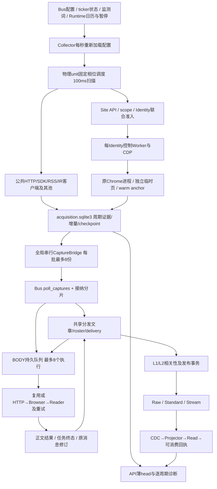

# Message Bus 现状、问题与复发机制勘察

日期：2026-10-28，北京时间。范围：消息源轮询、接纳与分发、正文补全、Site/Identity/Chrome、Bus/Read存储、监控指标，以及本对话10月23—28日的诊断与修复记录。

**本轮是只读勘察，不修改生产代码、周期、身份、数据库或容器。** HTTP池故障注入是在现有容器启动的独立Python进程中创建临时客户端，不发网络请求、不接触运行中客户端和业务数据；失败checkpoint另在本地临时fixture数据库复现。报告列出的可改业务决策不是已实施变更。

## 1. 结论：哪些地方确实坏了

当前不是一次普通的网站响应变慢，也不是把服务器升级到8核便会自动解决的问题。已确认至少三条可以独立造成广泛失败或高延迟的链路：

1. **共享公开HTTP客户端已出现请求池等待故障，没有功能性自愈。** 科技、能源和TheFly共用一个`TechnologyHttp`及4个总槽。一批来源约9小时没有新鲜列表，超时堆栈停在`curl_cffi.AsyncSession.pop_curl → pool.get()`，尚未到实际发送。客户端故障被当作单篇/单源的普通超时不断重试；配置心跳正常，Collector健康仍为绿色。
2. **独立采集没有消除业务库中的超长写事务。** `PollJournal.accept_and_claim`实测单次持事务约1,338秒、另一次约1,249秒。它不是等SQLite写锁等了22分钟：日志中的BEGIN等待约0.013ms，主要时间在事务体内。正文续约也实测在事务体内约80秒。复杂对象读取、NativeContent解压/验签/编码、分发、重复复核和业务写入仍可发生在同一写边界内。
3. **当前正文失败和延迟也有执行路径本身的原因。** 最近一小时20个首见正文key只有7个取得FULL/SHORT_FULL标签；20个对应任务中，入队到首次执行中位数约0.37秒，但首次执行到终态中位数约76.46秒，最大135.76秒。执行生命周期含退避和重试，不等于纯下载时间；然而足以否定“当前主要还是正文排队”的统一解释。

同时确认一个上轮新增Collector中的实现缺陷：失败结果的`next_checkpoint`只有`valid or pages`时才保存；失败计数、端点退避及部分续抓状态因此不能可靠推进。当前多处来源head已是TimeoutError，但checkpoint中的`failures=0、retry_at=null`仍停留在昨天的成功状态。单次`site_access_retry_not_before`仍可能生效，不能说完全无退避；**递增失败状态没有按设计持久恢复**才是准确结论。

范围方面，不能含混地说“所有来源都坏了”：固定快照有71个应执行来源、356个必需逻辑采集单元；其中164个单元的最新head为failed，192个为succeeded。最近一小时有156个单元完全没有新鲜列表证明，25个来源覆盖为0；42个来源的全部必需单元在最近120秒内曾取得列表，另有4个来源好坏频道混杂。**这些健康样本不抵消约一半的全量周期缺口，也不能拿来否定用户看到的大面积失效。**

上轮拆分解决了一部分问题，但没有完成结构闭环：从“Bus阻挡取网”移到了“共享传输池可以整体失效，Bus仍可长事务阻挡接纳/正文/发布”。继续只调并发、补超时或增加审计字段，会沿着同一失效链复发。

## 2. 时间、版本与证据边界

### 2.1 固定统计窗口

主数据截止：**2026-10-28 08:22:29.528062 UTC = 北京时间16:22:29 = 纽约04:22:29**。

|窗口|UTC边界|用途|
|---|---|---|
|纽约10月27日自然日|10-27 04:00—10-28 04:00|昨天，分旧采集和独立Collector两段|
|纽约10月28日截至取证|10-28 04:00—08:22:29|今天未完成日，约4小时22分，不能当完整交易日|
|滚动48小时|10-26 08:22:29—10-28 08:22:29|补充两天整体量级，包含26日后半段|
|最近一小时|10-28 07:22:29—08:22:29|当前失效程度|

项目`semantic_clock.py`把**美东02:00**作为业务日边界，当前为06:00 UTC，和纽约自然日零点不一致。UI“今日”和本报告自然日不能直接相减；原始复算同时提供`semantic27`、`semantic28_partial`。交易日历判断与具体盘前/盘中时间也不同：Collector配置使用语义日`is_session(day)`，不是每分钟判断交易所是否正在开盘。本次大量失败不因“现在休市”而免计。

数据在08:22—08:55 UTC分批只读取得，**不是原子快照**。周期按原始请求/列表时点限制到固定截止；当前队列、Read水位、Site诊断另标注采样时点。晚到终态不倒填成及时刷新。正文表为当前状态，无法凭一行最新记录完整重建昨天收盘瞬间的全部结果，正文表格明确使用“该日首见、截至固定取证截止已取得的标签”。

### 2.2 实际部署，不能用仓库HEAD替代运行代码

取证开始本地main=`7e7e3538`、远端仓库=`416fb2fa`。本地另有Google过滤、交易、前端和Compose未提交工作；不将其当作已部署行为，也未覆盖它们。生产在上轮之后已有来源恢复和Runtime发布。

|组件|实际release提交|当前实例启动UTC|当前重启/健康|
|---|---|---|---|
|Collector|`30a2a184`|10-27 18:44:12|0，healthy|
|BODY|`30a2a184`|10-27 18:44:27|0，无Docker healthcheck|
|Site Access|`30a2a184`|10-27 18:43:50|0，healthy|
|Bus|`24a5fde5`|10-27 20:37:52|0，无Docker healthcheck|
|API / Projector / Web|`24a5fde5`|10-27 20:35—20:49|API/Web healthy|
|Worker / Scheduler|`416fb2fa`|10-27 20:52|Worker healthy|
|Chrome Supervisor|`f2f0bcd6`|10-25 13:31:18|0，healthy，既有实例|
|初始化 / Control / 两类维护|`8f7992d2`|10-27 16时段|分角色运行|
|CDECR Executor|`f2f0bcd6`|不断重启|319次、unhealthy|

因此：没有证据说所有问题都只由某一个最新提交造成；也不能把后续其他会话发布作为上轮架构缺口的免责理由。下文明确区分新增缺陷、继承缺陷和未确认的触发因素。

### 2.3 证据与读取成本

目录：`eval/message-bus-current-state-20261028/`。

|证据|内容|
|---|---|
|`initial-host.json`、`metadata.json`|实际镜像、启动、资源、DB大小、真实schema/trigger/index|
|`current-acquisition.json`、`config-inventory.json`|单元薄head、当前配置、99源/285绑定、数值预算|
|`cadence-runs.jsonl.gz`、`legacy-remaining.jsonl.gz`|旧/新周期薄记录、原始请求证明，按(origin,run_id)去重后857,731条；旧段首次55秒预算中断，随后从最后已读时点续取，续取footer完整|
|`cadence-analysis.json`、`unit-cadence.csv`、`source-state.csv`|逐窗口、逐来源、逐必需单元对账|
|`cohorts.json`、`business-analysis.json`|正文首见、失败、可消费审计及精确body-key关联|
|`recent-body-jobs.json`|最近一小时20个任务的首次执行、重试及终态时点|
|`log-census.json`、`writer-examples.json`|当前实例日志范围内的错误与慢事务；阈值采样，不是全部调用分布|
|`pool-error-context.json`、`production-curl-pool-code.json`、`pool-cleanup-reproduction.json`|实际0.15.0依赖代码、清理异常及独立进程故障注入|
|`endpoint-backoff.json`|head失败但endpoint失败状态未推进|
|`queue-plans.json`、`read-state.json`、`site-diagnostics.json.gz`|真实查询计划、队列、水位、联合准入与在途操作|

一次capture状态全表聚合达到12秒预算后中断；一次跨全cohort的正文任务关联达到15秒预算后中断，**没有将空结果当成无积压/无任务**。之后以20个最近正文key、已有表达式索引取回任务。诊断本身有I/O成本，初始主机快照早于大范围导出；不将导出期间的资源增量全部归咎业务。

## 3. 现行详细架构

### 3.1 端到端路径与故障域

这不是一个队列，也不是“有16个分片便能并行写16次”：采集账本、Bus业务库、Site Registry、Runtime与Read是不同数据库，但仍共用同一宿主机磁盘、CPU、内存；Bus内多个异步任务仍经过单writer，Bus/BODY等进程还会争同一个SQLite物理写锁。

### 3.2 组件、状态及占槽范围

|层|实现位置/现状|实际占用与薄弱边界|
|---|---|---|
|配置/日历|`collection_plane/config.py`；读取源、绑定、运行ticker、词表、override、暂停；Runtime日历只读|每秒重新建立业务快照和计划。失败保留上个快照；不变配置仍解析、计算并写configuration meta。控制正确性和工作频率绑定过紧|
|物理调度|`collection_plane/worker.py`；按端点/查询/必需频道；BY_DISTRIBUTION相同source+unit共享|一个物理unit最多一条在途任务，100ms扫描。普通总timeout45秒、TAIL30秒；范围包含网络与回调，finally持久化、取消排空可能超出timeout|
|源许可|复用`scheduler.py`的limiter及`capacity.py`估算|源/组容量、间隔、HTTP池、Site预算叠加。需求只统计非TAIL，BODY/恢复也有真实成本。动态容量不是总资源容量证明|
|通用HTTP|AdapterRegistry持有一个httpx客户端，16连接；poll_trace再加全局16和每host4|发送池、外层信号量与源限额多次排队。不同服务使用独立池，不能把16当整机总上限|
|科技/能源/Fly HTTP|`technology_sources.py`、`energy_sources.py`；**共用TechnologyHttp**，全局4、每publisher2、间隔0.5秒，内层15秒，curl请求8秒|全局槽在内层deadline之前取得；一类客户端错误能影响大量无关publisher。当前已见池等待，没有自动隔离/重建|
|IR / SEC / 防务|各有独立轻量客户端、并发及解析器|已隔离大部分站点请求，仍会共享进程线程池和磁盘；IR/SEC独立于普通交易日历门禁。配置/解析/状态故障仍须逐endpoint核对|
|Site联合预算|`site_strategy/budget.py`；当前global8、BODY2、BODY每identity最多1；身份常见2路|原子取Site+Identity+global，避免旧的拿一个等另一个，但名额覆盖worker控制、导航、提取与收尾，不只是网络；同身份实际成本/必要独占仍会堵塞|
|Identity Worker|`worker_manager.py`、`identity_worker.py`；同身份普通execute少量并发，维护操作独占|父子RPC、快照读取、operation gate、target ownership仍在路径上；冷attach、控制器重建、取消与遗留页收尾不是免费动作|
|Chrome|Supervisor保留Profile/进程，Worker使用临时页或warm origin fetch|操作槽不约束全部驻留Chrome、iframe、人工/挑战页及驱动进程。已有登录身份可以保留而不要求所有普通页面/驱动无限驻留|
|采集账本|`collection_plane/store.py`，当前约491MB；cycles、units、captures、inputs、first_seen|进程内RLock只保护本实例短写，跨进程仍由SQLite互斥；每逻辑消费者复制证明和完整状态。start/page/finish/meta/ack多次写，状态保存仍有JSON成本|
|增量桥|`collection_plane/bridge.py`；prepare在事务外；capture接纳幂等键与Bus任务同事务，随后ack|所有源的增量通过一个串行for循环。它仍落到旧poll_captures系统和分发事务，不能将“已ack”理解成“文章已接纳、正文已好、下游可用”|
|接纳|`polling.py`；16异步分片、2准备槽、单writer；每片新候选16、旧输入可批量推进|不是16个独立写故障域。`accept_piece`在atomic_intake内复核、解快照、分发、入队、更新旧状态及receipt；`accept_and_claim`又衔接下一claim|
|共享分发|`distribution_repository.py`、`distribution.py`；article、run、delivery、snapshot、observation、decision/continuation|文章×ticker仍生成多份必要/技术事实；共享BODY并不免除逐ticker分发成本。到期清理每分钟仍进同一存储lane和业务写事务|
|BODY|`content_enrichment/service.py`；8任务，先复用，专用reader或通用pipeline；执行budget默认180秒|8个逻辑任务不是8个浏览器实际槽。恢复、阶段预算、Scope/Identity、重试及最终写都可能等待；当前失败生命周期75—136秒已有真实样本|
|正文结果/复用|`body_results.py`；URL/语言/访问scope、hint、check_seq、fetch_owner等|与publication dedup、distribution article及job台账叠加。公开正文也可能按发现源scope分割，导致可复用命中不足；旧文recheck实际服务机会不足|
|发布/下游|Raw→Standard→Stream，相关性L1/L2；ARTICLE_ONCE；正文更新改原消息与revision|要求完整正文的分发先等FULL，相关性和writer再收尾；Stream提交仍不等于Read已服务。L2两槽及远端provider是独立延期点|
|NativeContent/CDC/Read|`v2_read/native_content.py`、`content_files.py`、outbox、projector|16KB以上对象字段外置、gzip、SHA、fsync；row factory可隐式展开。调用在事务内时，文件I/O会被计入业务持锁；当前Read已追平，不代表取网与正文正常|

### 3.3 当前资源与存量

- 9个ticker，99个源定义、80个enabled，285个绑定、252个enabled且未删除绑定；实际有应执行周期的来源71个。当前313个物理任务包含可选TAIL，必需逻辑unit为356个。配置推导的非TAIL物理需求约**5.052请求/秒**，不是包含所有重试、正文、恢复与浏览器内部fetch的总请求量。
- Bus约**27.26GB（25.39GiB）**，acquisition约**491MB（468MiB）**，Site Registry约792MB，Runtime约6.81GB。拆出小账本并未自动缩小Bus/NativeContent的热工作集。
- 08:22主机load约12.69/15.65/15.74，可用内存约1.69GiB；CPU PSI some avg60 **34.88%**、I/O **12.85%**、memory **0.70%**。PSI是受阻时间比例，不能说CPU占用34.88%，也不能因memory较低否定此前换页。
- 同一快照Site约3.63GiB、Chrome约3.03GiB、Worker约1.92GiB、Scheduler约1.38GiB；Chrome约248% CPU、Scheduler约164%。这是短时采样，不是两日平均。
- 当前实例累计块I/O：Site读约1.55TB、Supervisor约3.09TB、Worker约1.26TB，实例年龄不同，不能直接相除当同窗读速率；初始快照在本轮批量导出之前。
- 08:33附近正文队列1253个recheck、1个新文retry_wait。旧文最早10月26日；**不能叫1254篇新文积压**。但这证明旧文更新检查已被长期饿死，不是“后台任务所以没有业务影响”。
- 08:38分发存量3616 PENDING、489 RUNNING、166 CAPTURED；delivery仅18 WAIT_BODY、1 L2_WAIT。两者明显不等量，不能把run计数当独立未发布新文章。历史run生命周期与过期扫描本身也有成本。

## 4. 指标定义、口径与近两天表现

### 4.1 指标字典：什么能证明，什么不能

|编号/指标|定义与分母|失败、延期和边界|当前证据限制|
|---|---|---|---|
|M1 应执行周期|按每个binding×必需unit的生效SCHEDULE、epoch、周期和启停边界枚举槽；共享请求展开逻辑消费者|包含没派发、失败、延期、超时和末尾在途；不含可选TAIL|旧/新Owner以16:11:46切换边界分段；初始相位和发布间断不当正常网络时间|
|M2 派发兑现|槽内实际进入acquire的周期/M1|缺任务仍是缺口|不是物理网络启动|
|M3 请求启动证据|原始请求start时点映射槽/M1|旧结果不产生新start；共享者引用同一ID|**httpx trace在发送headers时记录；curl路径在session.request之前记录，可能尚在pool.get排队。当前M3不能统称真实socket启动率**|
|M4 新鲜有效列表覆盖|原始winning request起返位于同一配置周期，解析验证有效，并匹配配置代际/M1|失败、未刷新和无证明不算成功；pending保留分母|新账本有list_validated；旧段只能提供CAPTURED+原始起返的候选列表证明，不能冒充同等合同盲审；200/304也不自动证明源站内容最新|
|M5 实际刷新间隔/距今|同一必需unit相邻真实有效列表的间隔；最末成功到截止的右删失年龄另报|没有两次成功的unit也保留其无成功/陈旧年龄|成功间隔均值不包含“永远没有下一次成功”的尾部，不能单独验收|
|M6 单次轮询生命周期|dispatch→finished，分成功/失败/未完成；ABANDONED的结束为追认时点|未完成不能丢掉；失败成本不能排除|包含源许可、队列、浏览器、DB、finally，不是纯站点或CPU执行成本|
|M7 列表→Bus提交|winning列表实际取得→业务capture committed；另报采集账本→bridge ack|未交付的变化capture仍保留|bridge ack只是进入旧业务队列，不是最终发布|
|M8 接纳准备时延|Bus capture commit→candidate_prepared；之后另分job入队|含分片等待、准备与复核失败|只看有发布轨迹者会漏掉失败/未发布长尾|
|M9 正文完整标签率|合格首见body key中，截至固定截止拥有FULL/SHORT_FULL的比例；排除NOT_APPLICABLE、legacy和明确旧发布导入|失败、pending、无权益保留；按key去重，不按重试次数|这是已发现文章的标签率，**不是全文盲审率，也不包含因源失效完全没发现的文章**；最新行不能完整还原过去每次结果|
|M10 正文执行成功率/复用率|真正取网执行的成功/全部取网执行，缓存复用另计|不能把reuse算一次新下载成功，也不能删失败重试|本轮未重新扫描全部执行审计；不以M9替代M10|
|M11 首见→可消费|首见body key→POST_COMMIT_BUS_STREAM_READ的最早readable_at；raw metadata body key精确关联|未见可消费的key另报，不能都推定为故障：可能无关/去重/失败/未完成|统计是已可消费子集；不提供未发布总体的虚假平均数|
|M12 队列等待/执行生命周期|job.created→first_fetch；first_fetch→最终updated，重试/退避另说明|多次执行不可只用最后开始，不能把退避算纯下载|最近20任务可取全；全48h关联预算中断，不补造分阶段百分比|
|M13 正文更新覆盖|应到期检查key、实际检查和变更修订；不重复触发ARTICLE_ONCE下游|被压力门禁饿死要报告|当前1253个recheck长期排队，无完整两日逐检查SLO|
|M14 写槽/事务成本|应用lane排队、BEGIN等待、事务体、commit分别计|慢日志只记录超过阈值的样本|不能把慢样本均值当全部调用均值，也不能把大事务时间统称I/O慢|
|M15 Read延迟|各源head/checkpoint及业务at差、真实可消费时点|Read健康不证明上游工作正常|08:44四源已追平；不是两日持续无滞后证明|
|M16 资源与健康|CPU、内存、PSI、块I/O、进程/target数量、重启、功能新鲜度分开|缺数据写未采样，不从当前点倒推两日平均|没有完整两日连续CPU/PSI时序；容器healthy主要证明进程/配置活着|

特别需要纠正此前用词：`poll_trace.request_started`在部分curl客户端中只是**调用起点**。一条“有start、没有response”的记录，在本次pool枯竭下甚至可能从未离开本机。把它称作实际取网会错误判断调度已兑现，只剩网站慢。

### 4.2 周期兑现：旧段与新段分列

|窗口/Owner|应执行周期|新鲜证明/候选|比例|说明|
|---|---:|---:|---:|---|
|纽约27日，旧Owner截至16:11:46 UTC|288,422|101,388|35.15%|旧段候选证据口径，不当严格验证率|
|纽约27日，独立Collector启用后|279,074|141,974|50.87%|有效列表证明；含发布、失败与延期|
|纽约28日截至04:22纽约时间|103,391|48,448|46.86%|当天不完整窗口|
|滚动48h，旧Owner段|727,740|455,148|62.54%|范围内来源启用数量有变化，不强行与新段归为同分布|
|滚动48h，新Collector段|382,465|190,446|49.79%|旧/新段不可只平均百分比|
|最近一小时，新Collector|23,646|12,002|**50.76%**|356个unit中156个没有任何新鲜列表|

新段纽约28日的派发槽96,151/103,391约93.00%，请求调用起点67,353/103,391约65.14%，最后只有46.86%有新鲜列表。**“任务按时启动了”到“真正拿到新列表”之间仍有巨大损失。**

最近一小时重点来源：Barron’s89.35%、InvestorsHub53.70%、Investing0%、Yahoo全部必需频道合计29.03%、Globe Search70.21%、企业IR94.31%、Reuters0%、IBKR96.85%。IBKR在后续维护后已恢复，不能把上轮0覆盖沿用为当前事实。

### 4.3 首见正文与可消费交付

按发现日分cohort、结果统计到同一固定截止。FULL包括SHORT_FULL；不同发现源/访问scope的key不凭猜测合并未知Google目标。

|首见窗口|合格首见key|完整标签|标签率|已可消费key|≤10秒/已可消费|首见→可消费均值 / P95 / 最大|
|---|---:|---:|---:|---:|---:|---:|
|滚动48h|1601|1142|71.33%|1261|289/1261|248.86 / 779.69 / 97,891.63秒|
|纽约27日|771|516|66.93%|643|95/643|287.30 / 1152.48 / 2801.88秒|
|纽约28日截至取证|60|27|45.00%|46|11/46|70.83 / 184.14 / 283.57秒|
|最近一小时|20|7|35.00%|14|3/14|82.32 / 139.25 / 139.25秒|

正文key已排除明确legacy/旧发布导入，但不保证所有未还原别名均已合并成真实唯一文章；它仍是key cohort，不能把这一限制隐藏为“唯一新文章真值”。

48h最大样本约27.2小时，保留原值，不裁掉作为“异常”。它仍需逐篇核对跨日复用/首见修订的形成过程，不能直接称连续下载27小时。滚动48h另有340个key未见可消费证明，27日128、28日14、最近一小时6；这些数值不能直接命名为“应发布却丢失”。

以下按发现源统计，不等于最终失败publisher；Google包装链接未能还原者不能武断归因为Google网站正文失败。纽约28日正文来源差异：Google 4/21完整，Investing0/2，Globe半导体RSS0/3，AviationWeek RSS0/4；TrendForce News7/7、ETNews6/7、HuggingNews5/7、Globe Search2/2。不是所有BODY都同时失败，但成功/失败来源组成已严重偏移。

**本轮尤其不能用“剩下健康来源的正文率提高”来验收：失效来源的新文章根本没有进入首见分母。** 源覆盖和正文成功必须共同满足，单看正文标签有幸存者偏差。FULL标签的DCD推荐区污染、聚合站正文与原出版者全文区别仍未被本轮抽样覆盖修复，真实完整率不能由表格直接宣称。

### 4.4 端到端慢点会随时段转移

|已发布轨迹子样本|列表→Bus平均 / P95 / 最大|Bus→候选平均 / P95 / 最大|
|---|---:|---:|
|纽约27日，964条|46.81 / 199.79 / 1433.07秒|40.05 / 217.26 / 723.48秒|
|纽约28日，73条|0.452 / 0.989 / 3.512秒|0.281 / 0.390 / 0.477秒|
|最近一小时，14条|0.294 / 0.598 / 0.598秒|0.303 / 0.477 / 0.477秒|

可消费与完整正文也是不同状态：最近小时的14个已可消费key中，仅5个当前拥有完整标签；其余可能按既有来源策略交付摘要/不完整内容。不能用可消费数量替代P1质量，也不能一概称任务COMPLETED就是BODY成功。

当前少量新文的前段已经快，不能因此倒推昨天接纳也快；昨天存在超长事务，也不能因此把当前82秒交付全部解释成接纳排队。最近20任务入队→首次执行平均约2.18秒，2个约14.9秒，其余≤2.43秒；执行到终态有12个≥40秒、其中11个约76—136秒，11个任务有两次执行。**需治理有效获取路线和失败恢复，而不是一律增加BODY任务数。**

所有分阶段数字均为能关联到的样本，不提供“所有来源各阶段占比”的伪精确百分比。20个任务的执行生命周期包含退避、重试和收尾；Site慢阶段还需独立记录才能再拆成纯网络/浏览器/写入。

## 5. 当前故障的结构机制

证据等级：**A=生产数据直接证实；B=代码路径确定、但本窗未量化单项贡献；C=待进一步验证的触发假说。** 不将B/C写成已证明的唯一事故根因。

### 5.1 公开HTTP池：从局部错误变成跨来源长期断粮

**A：** 23时起持续出现`pool.get()`等待栈；科技、能源和TheFly多个来源的最后新鲜时间集中在10-27 23:14—23:29 UTC。固定快照中相关来源已经约8.9—9.1小时无更新。`AdapterRegistry`明确把TechnologyAdapter的`.http`交给EnergyAdapter和TheFlyAdapter，故不是仅“相同网站不稳定”。

**B：** `TechnologyHttp.fetch`先拿publisher的2槽、再拿共享4槽，然后进入15秒timeout，最后才调用curl池。一个坏客户端可以使四个公共槽都拿着publisher额度等待，其他完全无关域名不能利用服务器剩余能力。它没有池健康、不变量校验、只对公开transport的隔离重建或成功超时看门狗；进程重启之外可一直重复失败。

**A/B的边界：** 生产Yahoo独立传输循环实际出现过`release_curl → remove_handle → CurlError multi:(4)`；0.15.0的`release_curl`先remove/reset、最后才归还池槽，没有finally保障。独立进程用真实安装的库注入两次清理失败后，2槽变0，下一次pop超时；无网络、无生产状态修改。这证明清理异常可以永久耗尽池。**尚未取得TechnologyHttp进程内实时池对象及最初丢槽栈，不能把Yahoo的清理错误直接当成共享Technology客户端最初触发点。** 当前确认的是共享客户端等待枯竭、缺少隔离恢复；具体首发原因仍有这一证据缺口。

依赖源码还存在另一个B级窗口：`_request_once`在取得handle后调用`set_curl_options`，其位置早于非stream请求的释放finally；设置选项异常也可能丢槽。之前“改非stream便只有一个finally释放”的判断并不覆盖这两个窗口。

**重新审视的约束：** 公开RSS/HTTP的短生命周期传输会话不等于用户已验证的Chrome身份。保留Chrome/Profile稳定性，不要求永远保留一个已损坏的公开AsyncSession。按publisher/transport故障域重建、隔离坏池，不是重置付费登录身份。

### 5.2 新Collector丢失失败checkpoint，恢复状态不能累积

`TechnologyAdapter`在失败时返回`next_checkpoint.endpoints`，含`failures`、`retry_at`、错误及成功状态；原设计为60→120→240→480→最高900秒退避。Collector在`valid or pages`才更新checkpoint，而普通失败的`valid=False、pages=[]`。

**A：** `endpoint-backoff.json`中Canary Media、Data Center Frontier等head已超时，endpoint仍`failures=0、retry_at=null`、last_success_at停在昨天。**B：** 单次返回的`site_access_retry_not_before`仍被保存到调度时钟，因此通常还有一轮60秒退避；但下一次又从失败计数0开始，无法形成预期的递增恢复。普通异常中断时连结果都没有，状态更少。现有head快照本身不能证明每个TimeoutError都曾返回PollResult：外层45秒取消可能使adapter来不及返回。失败结果丢checkpoint是确定的承接缺陷，不宣称它单独解释了全部断粮。

`on_page`完成后会清空`pages`；若后续分页失败，使用这个列表判断“此前是否取得部分有效进展”也不可靠。列表证明和checkpoint应分别表达已覆盖的页面、失败重试状态、下一恢复位置，不能一个总valid布尔决定所有状态是否值得保存。

另在本地临时fixture数据库运行真实Collector、让adapter返回明确失败checkpoint，结果`failure_checkpoint_saved=false`，同时单次retry_not_before仍保存成功；证据`checkpoint-reproduction.json`。这排除了仅凭head快照推断返回值的歧义。

这是上轮`12ffb9a9`独立采集路径中的**新增实现缺陷**，不能归给SQLite或站点风控。它同时放大传输故障重试、旧列表重复处理和诊断信息失真。

### 5.3 22分钟业务事务：拆进程没有拆掉重工作边界

生产实例日志中的原始记录：

|结束UTC / 操作|操作执行|BEGIN等待|事务体|commit|
|---|---:|---:|---:|---:|
|10-27 22:34:44，`PollJournal.accept_and_claim`|1338.229秒|0.013ms|1338.208秒|13.054ms|
|10-27 22:11:19，同上|1248.634秒|0.012ms|1248.623秒|0.718ms|
|10-28 00:38:10，同上|264.861秒|0.071ms|264.843秒|0.772ms|
|10-27 20:42:09，`renew_enrichment_claim`|81.834秒|0.011ms|80.348秒|1.479秒|

这些记录直接证明**业务持锁范围错误或过大**。不能把前两项解释为“SQLite锁竞争使该事务等了22分钟”；相反，该事务正在占住锁，其他任务才被它挡住。提交耗时也不是主要部分。

代码中的确定路径：

1. `accept_piece`先进入`atomic_intake/BEGIN IMMEDIATE`。
2. 在里面查询旧发布身份、Source/Binding、原始状态及共享roster；快照可能展开，模型可能重新校验。
3. 共享分发`ingest`在这一外层事务内逐篇、逐ticker创建/查询article、delivery、observation、body result和job；内层事务借用同一连接，并不会自动释放外层锁。
4. 仍在原事务内更新兼容PollState、unit计数、receipt、peer reuse和下一接纳位置。
5. Source/Job/Message读取可经Native row factory展开文件；写入可触发编码、artifact引用维护及CDC。

**尚不能把1338秒精确分配到某一SQL或某个文件。** 父operation计时没有statement级归因，SQL执行、Native读、gzip/SHA、Pydantic、文件fsync和CPU调度暂停都可能在事务体内。结构性问题已经明确：这些耗时项目被允许持有同一个全局业务写锁，缺少工作量和持锁时间上界。继续只给StorageLane加优先级无法抢占已经开始的22分钟事务。

### 5.4 “只更新租约列”仍可读取整个任务：校验被当作不可动边界

`renew_enrichment_claim`虽只写`lease_expires_at`，但先在事务内调用`_assert_enrichment_claim`：

`SELECT data_json,lease_expires_at → NativeContent.row自动展开 → EnrichmentJob.model_validate_json → model_copy → UPDATE租约列`。

Claim的安全条件实际是任务存在、RUNNING、token仍相等、租约字段存在，不需要重新加载source、binding、message、raw_payload、prior_attempts和result全文。**必要的fencing不等于必须在每次心跳完整反序列化业务对象。**

本次核对还排除了一个看似合理但不成立的归因：当前生产`content_enrichment_jobs`的CDC UPDATE trigger已经只在status改变时触发，artifact trigger也只看data_json更新。不能把每次窄租约续约的80秒一概怪给“全量CDC”。真正仍保留的是事务内的完整读取/验证，以及存储和资源等待。

### 5.5 NativeContent：把正确的不可变证据保护做成重复热路径工作

`NativeContent.encode`会递归序列化，16KB以上字段写内容文件；`ContentFiles.put`对chunk、manifest、父目录执行同步持久化。`decode`逐次读manifest、gzip解压、验每块hash，最后再验整体hash。row factory会在查询选中了特定JSON列时隐式做这些操作。

- 业务事实完整、原始文章可恢复是必要目标。
- **每次claim、renew、status、接纳复核都展开同一份完整对象，不是必要目标。**
- 内容引用在业务事务可见前必须有效，不要求所有字段每次改动都递归hash和逐文件fsync。
- 父事务里调用一个看似普通的`SELECT data_json`，实际可能跨数据库、读文件、解压并验签；代码审查只看SQL毫秒数会漏掉这一层。

缺少一次性验证后的受版本约束缓存、明确的轻标量模型与重内容模型分离，意味着历史变大、内存缓存被Chrome挤掉之后，同样的“短SQL”会再次变成长事务。业务证据保留与重复检查频率必须分开决策。

### 5.6 接纳、分发与清理仍竞争同一writer

`StorageLane`是每个MessageBusV2Service的应用层队列，不是跨进程全局调度器。Bus和BODY各有lane，仍争同一SQLite。`WriteAdmissionBusy`以25ms节奏重试、最多30秒；复合操作已经有提交时，会切回SQLite最长30秒等待。它能避免部分重放，不能控制每个operation持锁时间。

接纳16分片、prepare2槽，最终仍单写；Bridge按8个capture串行prepare/commit/ack。一个重capture可阻挡其他源的业务增量。每轮`accept_and_claim`在接纳后又做下一claim，优先级与公平条件不会中断正在做的重工作。

生产EXPLAIN显示接纳claim、BODY前台claim、分发expire均有`USE TEMP B-TREE FOR ORDER BY`；接纳claim还有OR状态与多表join。LIMIT限制返回数，不一定限制扫描/排序数。相反，发布复核的Raw→Standard→Stream JOIN本窗执行计划均有合适索引，**没有证据说所有JOIN都应移除**。

`DistributionWorker`每60秒把`expire_runs`送进同一lane；该函数在写事务内枚举旧run、展开admission、逐delivery验证和更新。慢样本最大50.57秒；其排队等待最大1285.85秒。上轮移走了空接纳清理和BODY已确认回执扫描，但**同性质的维护仍留在分发实时路径**。

### 5.7 小账本也在增长：单写与薄头不等于低成本

当前acquisition约491MB，不再依赖27GB Bus取网是实质进步；同时仍存在：

- 一个物理请求向多个消费者复制整份requests证明；start、page、finish重复更新，每次保存state和head。
- checkpoint里的列表去重集合、first_seen及source状态随轮次反复序列化；RLock串短写时，序列化工作量本身没有严格上界。
- 一个Store实例的RLock不能协调其他进程/实例的写入；SQLite仍是最终互斥者。
- 配置每秒加载、建查询计划和写meta，历史清理每10秒。可选维护和配置工作与网络操作共用默认thread executor。
- `maintain`清cycles和已接纳capture，但没有清`inputs`及`first_seen`。它们有业务意义，但其无限增长责任未被单独设计；源/绑定/词表版本进入input key，配置变动可制造大量新键。
- 删除预算在32键提交后检查，不能保证32键事务本身≤50ms；当前3日历史还未充分触发未来清理峰值，不能用上线半小时证明保留期到达后的成本。

这不是要求删除checkpoint或首次观察，而是要求只存不可替代的标量事实，避免把每轮运行对象和证明展开为多份永久热历史。

### 5.8 同身份并发已生效，仍有局部饱和和不可见驻留成本

08:41 Site诊断：global limit=8、active=4、BODY active=0、2个waiter；Investing的`public-markets-nl`占2槽，Dow Jones占2槽。Investing两个请求age约44.9秒和25.7秒、预算45秒；`stalled=false`只表示没超过内部预算加宽限，不表示满足10秒业务目标。

因此当前不能再归因为“同一Chrome只允许一个网页”；普通2页并发是有效的。另一方面，全局仍有4个空位，也不能给已满的2槽身份自动增加真实吞吐。等待发生在身份执行及worker roundtrip时，全局扩容没有针对性。

保留Profile、cookie与人工挑战现场，不要求保留所有历史BUSINESS页面、iframe或不健康控制器。后续来源恢复记录曾实测单身份122 iframe、约862线程，CLOSE_PENDING页面仍物理存活；清理后又回升的风险来自逻辑任务完成与物理target释放分离。联合预算统计的是在途operation，不等于全部Chrome进程/页都已受预算控制。

“已发close”“lease已退出”“已detach控制器”和“原生页已关闭”是四个事实。若不能核实关闭，继续把名额借给新任务会累积驻留成本；但为了保留登录把所有普通坏页无限留着也同样不合理。

### 5.9 BODY失败不只是慢队列：复用、路线、恢复和终结仍有耦合

- 通用pipeline每hop先Site resolve，再按配置选HTTP/browser/reader，最多3跳；阶段上限通常8/25/12秒，随后可能有一次30秒退避及第二次执行。多个阶段的正常上界合计本就远大于10秒。
- 对已知公开publisher，仍可能为路由/策略多次依赖Site控制读；Site resolve超时也会表现为BODY readtimeout，而不是网站正文下载失败。
- `RESUME_STAGE`保存阶段名，不等于计划要求的“已验证HTTP中间产物及完整解析证据都可重用”。当前Inspection从新对象起步，需检查实际续作保留了什么，不能把补了resume字段当完整阶段恢复。
- 无认证身份、缺订阅、挑战等失败需要有效路线或权益，重复HTTP→browser→reader不会改变事实；公开版本与付费版本也不能仅凭同域名混为一条路径。
- `ArticleBodyResults`先取owner、完成后结果表、任务、共享article、逐ticker发布分别收尾。已得完整正文仍可能在后续写入/发布失败，任务状态与业务结果需通过幂等恢复接回，不能重新下载弥补本地收尾错误。
- public scope、source scope、最终publisher、语言、hint和TTL是多个复用门禁。对付费内容需保留权益隔离；对明确公开且相同正文，按发现源再隔离会压低命中率。哪些限制来自真实权益，哪些来自默认表结构，需要逐项分开。
- 原来的排队年龄即下载超时已修改，不能把本次全部deadline_exceeded又称同一个旧bug复发。当前执行预算仍是墙钟，包含恢复/重试和阶段等待；上轮修复并没有证明所有合法恢复都能在该预算内完成。

### 5.10 压力门禁与旧文更新形成饥饿

`background_allowed`在CPU PSI avg60≥10，或IO≥10，或memory≥2时整体关闭TAIL和旧文recheck；Worker可延期新研究也使用同类准入。门禁没有按单个任务业务价值、已等多久、最低保障服务机会区分。

当前1253个recheck已排队超过一天；`enqueue_due`遇到≥8个现存recheck又停止补充，而旧recheck的执行还受同一个全局压力开关控制。它可以长期阻断实质更新发现。**ARTICLE_ONCE只禁止重复触发已消费下游，不意味着正文更新检查是可无限延后的无价值维护。**

W1/W2/W3不新增限制是用户明确要求，不应偷偷取消。需要重新设计的是消息与受保护业务的实测容量、低成本路径和可延期工作，不是用保留W3作为其他任何低效实现都不可变的借口。

### 5.11 可观测性仍会掩盖功能失效

- Collector健康主要检查配置at是否小于60秒。公共池全部失效但配置刷新正常，仍可健康数小时。
- Site的stalled阈值、容器无重启、API ready均是技术存活检查，不是配置周期或10秒交付承诺。
- API `source_status`调用`binding_states([ticker])`；每张源卡重新读取同ticker全部unit，批量head仍可能被按卡重复使用；通常不大，但这是可直接去掉的重复读。
- 源卡取最旧必需频道的capture，这是正确揭露缺口；同时一个频道失败便显示源partial，必须提供频道明细，不能让用户误以为RSS也停止。
- `on_page`保存有效页面后会清空临时`pages`；随后尾页失败时，Collector可能把内存state标成failed，而Store保留此前已验证的CAPTURED证明。新鲜证据、完整分页覆盖和最终head.status因此可能不一致。这是状态表达的B级缺陷，不等于所有红色head都没有取到首页；同样不能用它解释本次九小时断粮。
- UI平均last_latency是最近已结束单元的聚合，不是“新消息从发现到可消费”，未运行任务没有耗时值；仅看它会隐藏饥饿和长空窗。
- 标签率只见已发现的文章；发布延迟只见已发布样本；成功刷新gap只见相邻成功。三个幸存者筛选叠在一起，会让系统坏得越多，剩余样本看起来反而越快。
- Read现在追平是已证实收益；不能继续将当前源失效统归为旧投影滞后。另一方面业务与实时薄状态的观察时点不同，需要明确展示。

## 6. 薄弱点总账：哪些层还会再卡住

下表覆盖本次静态和生产取证发现的主要风险，不声称通过一次审查穷尽所有未来故障。A/B等级见第5节。

|ID / 优先级|设计或实现薄弱点|失败/延迟放大方式|证据|
|---|---|---|---|
|T01 P0|多个公开publisher共享长期存活客户端和4总槽|坏池变跨来源断粮|A/B，5.1|
|T02 P0|curl调用前便记request_started|本机池等待被误认真实请求|B，poll_trace/TechnologyHttp|
|T03 P0|失败checkpoint不保存|失败计数、递增退避与续抓状态不恢复|A/B，5.2|
|T04 P0|接纳事务覆盖整个重业务片|一个慢对象阻挡所有源的接纳/正文/发布|A，22分钟|
|T05 P0|租约验证完整hydrate任务|心跳也受文件/模型展开影响，超60秒租约|A/B，80秒|
|T06 P0|Native读/写隐藏在普通Repository操作|SQL短而持锁长，解压/hash/fsync反复执行|B及长事务样本|
|T07 P0|没有statement与文件阶段定位|每次只知道慢在父函数，反复修外围|A，现有日志粒度|
|T08 P0|压力门禁全局关掉所有更新检查|重要正文更新长期饿死|A/B，1253 recheck|
|T09 P0|浏览器operation预算不包含全部驻留成本|遗留页/iframe/driver在名额外耗CPU内存|A/B，恢复记录|
|T10 P0|身份局部容量与冷控制成本混在执行中|全局有空槽仍无法刷新指定站点|A，Site当前诊断|
|T11 P0|无新鲜度功能检查/故障域自愈|healthy但多小时无列表，不触发有效隔离|A/B|
|T12 P1|Bridge全源串行、8份批处理|大/坏增量阻挡小新消息进入Bus|B|
|T13 P1|16分片共享单writer、prepare仅2槽|并发任务数增加，吞吐并不线性增加|B|
|T14 P1|claim的OR与表达式排序|LIMIT1仍扫描/排序全候选|A计划，B贡献|
|T15 P1|分发每分钟在业务lane清理|历史量增长再次拖慢实时链路|A，50.57秒样本|
|T16 P1|source/roster/terms版本进语义指纹|配置变化后旧输入重新进入去重/复核链|B|
|T17 P1|共享roster逐文章解码和逐ticker落多层状态|20ticker扩展成本不只是20次HTTP|B|
|T18 P1|接纳旧状态兼容写、receipt与peer复用收尾|技术计数参与业务关键事务|B|
|T19 P1|acquisition证明按逻辑消费者重复展开|共享请求省网络但不充分省CPU/写入|B|
|T20 P1|配置每秒全快照/建计划/写meta|历史/配置量变大后持续固定成本|B|
|T21 P1|inputs/first_seen没有生命周期收缩|“小账本”随版本与文章长期增长|B|
|T22 P1|通用8/25/12秒多阶段与重试|正常失败路线就可能占用分钟|A/B，当前任务|
|T23 P1|scope/language/hint/TTL复用门禁叠加|同公开文章跨发现源再取正文|B，需逐类测命中|
|T24 P1|恢复阶段名不等于中间成果恢复|跳过/重复阶段与首因记录仍可能不一致|B|
|T25 P1|结果、任务、共享article、发布多台账收尾|取得FULL后仍可能迟交付或重取|B，前轮已有badcase|
|T26 P1|反复paid/identity能力失败无有效路径改变|同样失败不断消耗额度/CPU|A失败分布，B路线|
|T27 P1|取消安全排空没有操作类型及时长区分|保护提交也可能无限等待只读/坏socket线程|B|
|T28 P1|same-identity维护/挑战与正常访问界限复杂|本可HTTP访问也可能等控制态恢复|B，需逐publisher合同验证|
|T29 P1|UI源卡重复批读、诊断展开较重|看监控本身增加热库读和CPU|B|
|T30 P1|仅看FULL标签、已发布和成功gap|漏采、失败和未发布长尾被筛掉|A，4节数据边界|
|T31 P1|周期/历史状态跨Owner、代际及日界|统计错配被误称性能改善或故障|A/B|
|T32 P1|角色混合版本、后续发布没有统一功能门槛|依赖跨层改变，健康检查发现不了契约缺口|A版本/上轮启动失败|
|T33 P1|非消息组件持续故障仍占宿主机资源|争CPU/文件缓存，诊断易只看Bus容器|A，CDECR319次；具体贡献未量化|
|T34 P1|没有完整资源与操作成本时间序列|反复从当前PSI推断两天因果，缺回归起点|A，数据缺口|
|T35 P1|已保存有效页、末尾失败与head终态语义不同|UI报failed但该轮有部分列表证明，或误把部分证明当完整分页|B，on_page/pages及finish路径|

以上风险不是同等优先，也不是需要再搭一套平台。T01/T03是当前广泛失效与无效重试的直接切入；T04/T05/T06解释为什么即使传输恢复仍会复发；T22及真实身份能力解释当前正文/P95长尾。先修任何一个，都不能替代其他故障域的验收。

## 7. 反身性审视：此前被视为“必须保留”的东西

需要明确纠正我此前的设计倾向：**经常把“业务事实不能丢、身份不能破坏”推导成“现有整套对象、每层复核、每一步同步持久化和当前资源归属都不能动”。这个推导不成立。** 给同一旧结构不断加幂等、租约、历史复核和回执，可能减少一种逻辑错误，却扩大正常路径资源成本和故障恢复成本。

分类：**A类可改实现**，不改变用户已批准的业务语义；**B类需业务选择**，会改变时效、覆盖、更新或下游输入语义；**C类需保留实质约束**，但检查位置/表示/频率仍可优化。不是要求下一轮把所有校验一刀切删除。

|过去倾向保留的逻辑/约束|它真正保护什么|应重新审视的实现和可做的减法|分类/边界|
|---|---|---|---|
|每轮start/page/finish都同步留完整证明|可解释周期、故障追踪|物理请求证明存一份，消费者挂引用；周期槽可增量汇总，异常保留完整trace。证明不能造假，但不要求所有细节同步阻挡业务或按ticker重复展开|A/C|
|“为了审计”保留每次完整Source/Binding/roster|冻结输入及配置可复现|不可变版本引用足够时，不逐文章解码/重编码整个快照；条款/绑定不变时重用已编译版本|A|
|Claim/renew必须验证完整EnrichmentJob|阻止旧执行写入|用数据库内的status/token/必要租约标量做CAS即可；不需要全文、publisher目录和raw_payload参与心跳|A/C，token fencing保留|
|所有Native读取都逐块和整体SHA验证|发现损坏、保证证据完整|首次加载或内容版本改变时验证，随后使用按hash/版本受限的已验证缓存；冷审计可全验。不要因读个状态展开整篇文章|A/C，不接受损坏内容|
|每个复合JSON变动都需要chunk/manifest/目录fsync|引用不能指向未持久内容|固定原始输入/正文存一次；小状态与内容引用拆开；group commit/先发布内容后短事务引用。不是逐receipt复制持久化同一对象|A/C，崩溃一致性保留|
|接纳整片必须一个大事务才安全|游标、业务结果不能错位|片内工作量可更小，重计算/模型验证在锁外；提交只CAS当前输入版本及必要键。一次事务不必包含所有ticker、全文展开及下一claim|A/C|
|分发每个run都保留完整文章集合快照|精确复用与可追溯|只保存新变化及必要观察关系；已有article/roster/terms引用可共用。不要为了汇总计数重写整个集合|A|
|多个去重台账、peer reuse及旧窗口复核都保留|少做重复工作，不漏更新|先明确唯一业务身份及唯一实质更新信号；减少前后层重复的判断/记账。去重的目的不能反过来消耗比一次业务处理更多资源|A/C，发布唯一性仍保留|
|raw_payload任意变化都值得进入语义指纹|避免遗漏更新|显式列出真正有业务影响的字段；排名、抓取/更新时间戳、无关provider字段不应自动触发旧文重处理。原始证据仍可单独留存|A；忽略真正正文更新属B|
|所有source版本/全部订阅roster变化均使文章输入全失效|配置一致性|物理获取版本、解析版本、路由版本、某ticker相关性版本应分别作用；新增一个ticker不必让其他ticker的公开正文重新失效|A|
|公开正文也按发现source隔离scope|付费或私有权益不串用|确认public的相同publisher/语言/内容可跨来源复用；只有真实认证/权益差异才隔离。Google/Yahoo不应自然变成独立正文副本|A/C，付费内容不越权|
|相同hint到期30分钟便重检，全部历史都要覆盖|捕捉无更新信号的正文变化|按文章年龄、来源更新习惯、重要性、validator和已有重要变更信号分层；优先实际有更新证据的文章。无限频繁检查所有旧文不是唯一保证方式|A/B：检查SLO和最长漏更时间需明确|
|旧文重检是background，可一直关|保护新文/P0|至少应有可兑现的更新预算和最长等待；无界关停等价于悄悄放弃更新覆盖，不能因为任务名叫recheck就认定无业务损失|A；明确放弃历史更新属B|
|所有来源都先完成FULL再进入相关性/发布|下游拿到真实完整文章|能安全用标题/摘要确定无关的先排除，避免无意义BODY；对需完整正文的下游保留FULL门禁。若要“发现即显示/先供部分下游”，应分开DETECTED与FULL_READY而非将摘要冒充FULL|前置低成本筛选A；摘要先消费B|
|通用HTTP→浏览器→Reader整链尽量跑完|提高完整正文机会|按publisher能力直接选已验证的有效路径；无权益失败不重复试无用路线；剩余预算内做有价值回退。不能把多尝试误当更高质量|A/C|
|默认browser25秒、job180秒可容忍任何慢路径|不轻易放弃正文|不同来源的SLO和重试收益应单独设定；慢任务可延后而不占快任务槽。延长timeout不创造≤10秒能力|A；放弃必要抓取路径属B|
|精确时间戳必须在列表热路径补齐|避免旧闻冒充新文|保留原精度与首次观察，时间补齐用独立有预算任务；无精确时间的新闻如何进入下游是明确策略，不能让详情取时无限拖住列表发现|A/C；接纳精度规则改变属B|
|Yahoo RSS与浏览器都是永久必需、同频执行|补充RSS未覆盖文章|这是需要按实际独有消息覆盖验证的频道合同，不能凭感觉删除，也不能不评估它的持续收益。可评估频道分工/频率，但需完整独有消息对账|B，当前必需频道不得静默移除|
|独立身份的HTTP session必须永远稳定|延续TLS/cookie或连接复用|Chrome身份与普通公开HTTP池是两类对象；坏公开池可重建，已验证Chrome/Profile保持。长期保留坏session没有业务价值|A|
|固定每identity最多2、BODY每identity最多1|已验证并发与账号稳定性|应以真实占槽/CPU和站点行为决定；先降低工作成本，再受控验证3/4。数值本身不是不可变业务规则，也不能无证据全局扩大|A，不能破坏必要维护独占|
|为了身份稳定尽量不关闭Chrome/旧页|登录、挑战和人工现场|Profile/cookie持久性与进程驻留分开；普通已完成坏页应准确关闭，公共publisher可小型共享运行时隔离context；不能把所有残留页都归为身份保护|A/C，人工页/付费挑战事实不盲删|
|维护/恢复必须排空整个identity才继续|Profile单写、登录一致性|真正修改会话/Profile的操作独占；公开HTTP和不受该会话影响的业务不应无谓等待。按具体资源及动作区分，避免scope级“大锁”|A/C|
|取消后所有线程都必须等到真正结束|不释放仍在提交的owner|业务提交/付费操作必须接回；只读目录、公开HTTP、可丢弃诊断有不同取消/重建方式。无限排空一条坏只读操作不是必要一致性|A/C|
|实时函数顺便清理过期run/旧回执|控制历史量|历史回收可独立低优先有游标；LIMIT限制扫描/持锁而不只限制返回数。前台不能因“保留审计”承担全历史维护|A|
|每秒重新读取所有配置、词表和日历才可靠|及时响应停止/暂停/配置变化|版本/变更信号+请求边界检查足够；给停止和到期明确applied语义，不要求每秒重建全部对象与查询计划|A/C|
|兼容旧poll状态及汇总计数要同步写|现有UI兼容|UI可从薄状态/增量汇总读取；兼容投影不能阻挡取网或正文。不可重复列两套计数并让它们都成为原始事实|A|
|ARTICLE_ONCE要求复杂状态永不简化|同一文章不重复触发下游|保留原消息+修订及下游消费语义，内部可用清晰唯一键和增量更新，不必保留每次重复观察的大对象。若改成重要更新重新触发，须另外授权|A实现；语义变更B，当前仍保留|
|W1/W2/W3不能受本轮影响，所以只能牺牲消息|用户明确保护持久化运行|先减无意义读写、坏池重试和无效驻留；实算必要峰值。真超过16G时提出隔离部署/扩容，而不是默认牺牲P0或偷偷限W3|C；不新增限制是既定要求|
|所有完整性/身份检查都可以为时效删除|避免复杂性|这是相反的错误。真实文章身份、付费权益、被禁订阅不再新启、旧token不能发布仍需保证；应在正确边界做低成本校验，不把必要约束扩大为全对象复核|C|

上一表中维护/恢复一项也属A/C：可改锁范围和动作分流，真正Profile写入与登录转换的一致性继续保留。

真正需要业务层明确选择的少数项目主要是：是否允许DETECTED先展示或先供特定下游、Yahoo双频道的必要性和频率、旧文更新最长等待、重要更新是否改变ARTICLE_ONCE，以及确有必要时的独立采集资源。**其余大量减法不需要重新征求业务许可，更不应把保留现有实现当作默认前提。**

## 8. 本对话近几天的复发链

### 8.1 记录逐项回顾

|记录/当时证据|当时修法与真实收益|本次现状与复发机制|判断|
|---|---|---|---|
|[10-23两轮诊断](body-completion-and-poll-latency-diagnosis-20261023.md)：队列年龄吞掉BODY预算、同文重复、结果台账不一致、源/身份多层串行|执行预算从首次实际执行起算、正文结果复用、精确执行ID、同身份多页|当前2页已生效；当前慢BODY入队常很短，却在执行/回退耗75—136秒。不能继续套用旧排队根因；复用/认证/重试路径仍复杂|旧问题部分解决，新主导成本未闭环|
|[10-23方案](message-source-polling-and-body-completion-optimization-plan-20261023.md)：P0优先，保留FULL和ARTICLE_ONCE|减少无意义BODY、列表优先、增量接纳，避免九套身份|“保留正文质量和身份”逐渐被实现成更多同步门禁/跨源隔离/重复对象验证，而非只保留实质语义|设计原则扩大为不可变实现|
|[10-24约束勘察](message-source-polling-constraints-and-stage-latency-findings-20261024.md)：源permit内写Bus，4槽、导航后还很慢|移出源许可的同步写，解串行；当前limiter回调只更新内存时间，不再写Bus|这一旧阻塞确实不是当前Collector主因。但其他许可池、客户端与写事务仍可能把一个资源拿住等另一个资源|去掉一层没有全路径闭环|
|[10-24周期方案](message-source-polling-cadence-and-latency-optimization-plan-20261024.md)及[发布记录](message-source-polling-cadence-production-release-20261024.md)：实际gap数百秒、接纳积压继续涨|固定相位、分片、短写优先，周末跳过性能验收|发布记录已写明880→1604 pending，未达标；随后继续在同一重工作模型上加复用与公平性。未来历史增长与冷缓存仍会拉长片内成本|等待变短没有约束持锁工作量|
|[10-26实测](message-pipeline-live-test-and-fixes-20261026.md)：66.0%→70.6%，Reuters/Yahoo仍缺；旧BE样例“37秒”|接纳旧输入批处理、空领不写、BODY复用与临时开关修正|后续证实BE列表真实早约176秒返回，37秒漏掉辅助URL还原；真正列表→发布约212.92秒。记录的起点受加工路径影响，会遮蔽热路径成本|指标定义和实现耦合|
|[10-26有效周期方案](message-pipeline-freshness-and-fast-delivery-optimization-plan-20261026.md)及[实施](message-pipeline-freshness-and-fast-delivery-implementation-20261026.md)|原始请求证明、head/tail、warm fetch、旧文优先级和20ticker探针|20ticker两段探针已经失败，后续小探针12/12不能替代全量复验。当前8全局/2身份仍可身份局部饱和；同一身份2个45秒请求无法服务期望频率|真实容量与能力未验收，配置仍继续发布|
|[10-27业务增量方案](message-pipeline-business-delta-io-and-latency-optimization-plan-20261027.md)：NBIS重复两种输入、CDC放大、BODY后发布46秒|输入指纹/peer复用、薄CDC、新消息优先、L2续作幂等|旧列表业务负载确实减少，当前Read也追平；但去重/复用/快照又在接纳事务内增加工作，22分钟事务显示“减重复”没有变成稳定短提交|修重复工作时引入更重的证明与复核|
|[10-27业务增量实测](message-pipeline-business-delta-implementation-and-production-test-20261027.md)：清理后仍138,854剩余输入、1064 recheck|降低旧输入重复处理；记录未达标并补POWER共享trace|当前1253 recheck依旧饿死。它不是“本次又多出新文积压”，而是旧文更新服务长期没有兑现|同一未完成义务跨轮保留，没有业务SLO|
|[10-27结构方案](message-pipeline-structural-regression-diagnosis-and-redesign-plan-20261027.md)：187秒维护事务、Read落后50分钟、恢复重放|独立Collector/小账本、退休poll CDC、空闲清理移走、续约窄写、异步Registry|Read追平、取网不再等Bus，这是实质收益；但Bus接纳长事务未消失，租约窄写前仍全hydrate，分发清理仍在热lane，小账本外还有共享HTTP故障域|拆组件没有拆重工作与恢复责任|
|[上轮实施实测](message-pipeline-structural-redesign-implementation-and-production-test-20261027.md)：配置别名、只读DDL、due_at、SQLITE_BUSY、100ms重复请求、同秒相位、BODY回执重启|逐个修契约/相位/终态时钟/回执；末段84.38%覆盖、10/11 FULL小样本|完整窗只有58.07%覆盖和54/81完整标签，20ticker仍未验收。数小时后出现公共池等待；失败checkpoint未保存未被测到。样本窗口未覆盖长运行故障与保留期维护|新增Owner契约不完整，短窗与单元测试不足以认证业务可用|
|后续[来源恢复记录](source-recovery-reuters-20261028.md)|原生页清理先于attach、Investing卡页恢复、CTEE游标、TrendForce轻量HTTP、防务路由；当前AviationWeek/IBKR已部分恢复|部分站点恢复与公共HTTP集群故障并存；不能把“已修复几个身份”当所有来源稳定，也不能将今天所有失败都说成上轮未改好的同一原因|按站修复未覆盖公共传输和核心写路径|
|后续[Runtime P0](runtime-p0-repair-20261028.md)|Runtime/Worker循环I/O隔离及写通道调整；不改本轮既定W1/W2/W3语义|消息组件运行版本变为24a5fde5，Collector仍30a2a184；全机负载与热库读竞争继续存在。未证明它是公共HTTP池最初故障的唯一触发|必须按组件/时点关联，不凭共同负载倒推因果|

### 8.2 为什么反复“变快一小段，再明显变坏”

1. **只移动阻塞位置，没有为正常路径建立工作量上界。** 源锁→StorageLane→Native对象→分发事务，外层解耦后内层仍能执行任意长工作。
2. **恢复只保护数据，不保证恢复本身低成本和有进展。** 失败被不断保存/重试，坏客户端不重建；失败checkpoint丢失又使进展无法累积；旧文检查无限等待。
3. **热缓存/刚重启暂时掩盖持续驻留、池状态和历史增长。** 几分钟成功不能覆盖handle泄漏、页/iframe残留、三天保留到期扫描、冷Native文件读取。
4. **每一轮局部修补增加新的正确性门禁和台账。** 这些门禁又回到写事务、Owner目录和状态投影内，逐步抵消上一轮减负。
5. **容量被描述成逻辑并发数，实际服务成本没有完整总账。** 全局8、身份2、BODY2、Hub8等数字同时存在，但不涵盖全部Chrome驻留、公开HTTP共享槽、恢复/TAIL和W3峰值。
6. **验收分母和起点反复需要纠正。** 列表加工结束才记capture、调用开始冒充物理发送、首见key冒充首见文章、已发布子集冒充全部交付，都会让短样本看起来优于真实业务。
7. **“未达标”没有变成阻止继续扩大影响的发布边界。** 报告虽写局限，但系统没有源新鲜度功能性检查、坏池自愈/隔离和有依据的组件回退条件；于是小范围故障能绿色运行数小时。

### 8.3 对上轮交付的责任判断

我上轮完成了大量实现并逐项补测试，但生产验收仍未通过时，交付重点偏向“改造完成、部署成功、末段变快”。虽然报告注明未达标，仍不足以证明系统已经恢复可持续运行。新增Collector的失败状态承接遗漏、公开池长期健康缺口、租约完整校验和分发热维护没有被整体审查出来，**这是实现与验收范围不足，不是用户要求过高或服务器天然做不到简单RSS采集。**

同样不应为了回应当前失败，把已生效的改动全部否定：取网与Bus隔离、Read退休技术历史、同身份2路、窄回执、去掉空闲清理均有事实支持。正确的复盘是识别还在运行的故障链和新增缺陷，而不是把整个架构退回旧串行版本，或继续拿更多测试通过数替代生产覆盖。

## 9. 当前不能混为一谈的结论

|问题|现在能确定|现在不能确定|
|---|---|---|
|广泛来源失效|25源最近一小时0覆盖，公共池等待，多源数小时无列表|所有99源都失效，或所有失败都由相同一行代码造成|
|DB长事务|两次接纳事务体超过20分钟；租约完整读取在锁内|1338秒每一秒具体由哪条SQL/文件/CPU暂停贡献|
|curl池|等待栈、清理异常、异常可丢槽的库不变量缺陷|TechnologyHttp最初丢槽动作已被进程内证据完整捕获|
|同身份并发|2路已经存在，身份局部45秒任务；global8未满|只把global调大即可解决，或Chrome天然不能并发|
|正文|今天45%、最近小时35%标签率，部分执行路径非常长|标签=真实完整质量，或未发现来源的文章已包含在分母|
|Read/UI|08:44四源追平；新鲜head来自采集账本|UI所有历史统计都无偏，或界面看起来慢就只是Read问题|
|资源|真实压力、不同组件共同成本、原生残留页历史证据|8核16G一定不够，或升级/迁机器就能修复坏池与重事务|
|上轮改动因果|失败checkpoint是新增遗漏；重事务与坏池恢复边界未闭环|所有问题都是新增bug，或后续发布可以免除上轮责任|

本报告的用途是冻结现状和问题边界。下一步若执行修复，应优先围绕**独立故障域、自愈与状态进展、真正标量短提交、可兑现的BODY路线及更新服务**开展，而不是先添加新平台、扩大并发，或把上述所有现有逻辑视为不可移除。

## 10. 逐来源现状附表与复算

以下表格按固定截止及最近一小时原始证明生成。`0%`包括真实失败、延期、未请求和无证明，不是仅按错误日志判断；最旧列表年龄来自当前必需单元head，可能含切换前保留的checkpoint。完整原始状态及71源、356单元、多个窗口见`source-state.csv`、`unit-cadence.csv`。

“今天正文”是纽约28日首见key、截至固定取证的完整标签/合格key；`—`是本cohort没有正文，不是100%成功，也不代表该源没有漏采。

|来源|必需逻辑unit|近1h新鲜/应执行|近1h覆盖|近1h无刷新unit|最旧列表距今|今天正文|
|---|---:|---:|---:|---:|---:|---:|
|airspaceforces_space|1|60/60|100.00%|0|3s|—|
|ans_nuclear_newswire|1|0/60|0.00%|1|8.88h|—|
|army_news_releases|1|58/60|96.67%|0|59s|—|
|army_news_rss|1|58/60|96.67%|0|28s|0/1|
|aviationweek_rocketlab|1|60/60|100.00%|0|7s|—|
|aviationweek_rss|1|59/60|98.33%|0|35s|0/4|
|aws_platform_marketplace_rss|2|117/120|97.50%|0|42s|—|
|barrons_ticker_news|18|965/1080|89.35%|0|64s|—|
|benzinga_news|9|529/540|97.96%|0|48s|—|
|breakingdefense_space|1|60/60|100.00%|0|6s|—|
|calcalist_search|3|175/180|97.22%|0|35s|—|
|canary_media|2|0/120|0.00%|2|8.89h|—|
|corporate_ir_press_releases|12|1358/1440|94.31%|0|30s|—|
|crn_cloud_security_datacenter|3|0/180|0.00%|3|9.13h|—|
|ctee_semiconductor|2|0/120|0.00%|2|6.14h|—|
|darpa_news|5|0/300|0.00%|5|9.13h|—|
|data_center_frontier|6|0/360|0.00%|6|8.89h|—|
|dcd_energy_ticker|2|0/120|0.00%|2|9.12h|—|
|dcd_infrastructure_rss|6|0/360|0.00%|6|8.89h|—|
|defensescoop_drones|1|60/60|100.00%|0|56s|—|
|defensescoop_space|1|59/60|98.33%|0|18s|—|
|digitimes_semiconductors|5|240/300|80.00%|0|63s|—|
|digitimes_tw_rss|5|290/300|96.67%|0|40s|—|
|dod_contracts|2|118/120|98.33%|0|23s|—|
|dod_releases|2|114/120|95.00%|0|35s|1/1|
|doe_energy_news|7|0/420|0.00%|7|9.13h|—|
|enterprise_apps_official_rss|3|176/180|97.78%|0|51s|0/1|
|etnews_rss|5|275/300|91.67%|0|5s|6/7|
|finnhub_company_news|9|522/540|96.67%|0|37s|—|
|globenewswire_search|24|1011/1440|70.21%|0|235s|2/2|
|globenewswire_semiconductors_rss|5|240/300|80.00%|0|76s|0/3|
|google_news_search_rss|2|118/120|98.33%|0|58s|4/21|
|huggingnews_rss|5|280/300|93.33%|0|1s|5/7|
|ibkr_news|9|523/540|96.85%|0|45s|—|
|investing_ticker_news|9|0/540|0.00%|9|8.42h|0/2|
|investorshub_ticker_news|9|290/540|53.70%|0|1068s|—|
|iridium_press_releases|1|60/60|100.00%|0|15s|—|
|lakehouse_platform_official_rss|2|118/120|98.33%|0|46s|—|
|nasa_2026_releases|1|60/60|100.00%|0|45s|—|
|nbis_official_actor_rss|2|117/120|97.50%|0|20s|0/1|
|newswire_rss|11|465/660|70.45%|3|11.84h|—|
|nrc_event_notifications|1|0/60|0.00%|1|8.88h|—|
|nrc_news_releases|1|0/60|0.00%|1|8.88h|—|
|observability_vendors_official_rss|2|117/120|97.50%|0|7s|—|
|optical_systems_official_rss|1|58/60|96.67%|0|15s|—|
|power_engineering_energy|7|0/420|0.00%|7|9.13h|—|
|power_magazine_energy|9|0/540|0.00%|9|9.14h|—|
|register_software_cloud_security|3|0/180|0.00%|3|9.13h|—|
|reuters_site_search|24|0/1440|0.00%|24|6.55h|—|
|sdxcentral_news|5|0/300|0.00%|5|8.89h|—|
|sec_edgar|9|1046/1080|96.85%|0|29s|—|
|shephard_uncrewed|1|56/60|93.33%|0|40s|—|
|siliconangle_ai|5|0/300|0.00%|5|9.12h|—|
|siliconangle_software|3|0/180|0.00%|3|9.13h|—|
|spacecom_launches|1|60/60|100.00%|0|1s|—|
|spacenews_rss|1|55/60|91.67%|0|80s|—|
|ssc_newsroom|1|60/60|100.00%|0|45s|—|
|technews_hardware|10|0/600|0.00%|10|9.13h|—|
|thefly_ticker_news|9|0/540|0.00%|9|9.14h|—|
|thelec_semiconductors_rss|5|290/300|96.67%|0|47s|2/3|
|tikhub_x_user_posts|1|6/6|100.00%|0|46s|—|
|tomshardware_rss|5|275/300|91.67%|0|7s|—|
|trendforce_news|5|280/300|93.33%|0|41s|7/7|
|trendforce_press_releases|5|265/300|88.33%|0|53s|—|
|unmannedairspace_counteruas|1|60/60|100.00%|0|44s|—|
|utility_dive|2|112/120|93.33%|0|28s|—|
|venturebeat_ai|5|0/300|0.00%|5|8.88h|—|
|venturebeat_software|3|0/180|0.00%|3|9.13h|—|
|wccftech_hardware|15|0/900|0.00%|15|9.13h|—|
|world_nuclear_news|1|0/60|0.00%|1|8.88h|—|
|yahoo_finance_news|18|627/2160|29.03%|9|8.07h|—|

复算入口：`analyze_cadence.py`、`build_source_table.py`及原始压缩JSONL；正文cohort、body key与delivery join保存在`cohorts.json`和`business-analysis.json`。旧段首批读取中断和续取footer保留，不覆盖失败结果。正文全量执行阶段统计没有完整取得，最近20任务独立提供，不能拿部分结果填充全量均值。

本轮只新增报告及本地审计脚本/证据，没有更改、提交、部署或回退生产业务代码；没有关闭来源、修改周期、切换Profile或丢弃其他会话工作。
