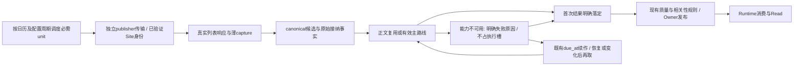

# 部署后观察汇总与精益修复方案（2026-11-01）

**结论：保留已取得收益的资源与采集架构，集中修复访问恢复、BODY无进展续排和少数publisher能力缺口；不再进行无证据的全局重构。** 本文是执行方案，本轮没有修改生产代码、配置、数据、身份、采集开关或服务，也没有发起新的新闻、浏览器或模型业务请求。

## 1. 范围、结论与不能误读的边界

本轮审阅 `eval/lean-architecture-observation-20261029/` 留存的全部12份summary及相关薄证据，重新汇总同版本阶段，并核对当前main、后续Yahoo部署和少量生产当前状态。汇总及本轮证据位于 `eval/post-deployment-review-20261101/`。没有重跑已保存的数百MB周期原始数据，没有推进自动观察水位。

重要边界：

- 留存观察最新水位是 **2026-10-30T13:00:33.797Z**，并没有此后每两小时的完整报告。最新恢复配置从10月29日23:09:34Z开始，只覆盖约13小时51分钟；不能写成完整24小时或72小时稳定通过。
- 32GB、代理额度恢复、Collector连接重建同时发生，资源改善是组合结果，无法把收益全部归给某个代码补丁。部分来源实际未成功访问，低资源也不等于完整健康负载容量通过。
- 七个恢复后窗口的总体新鲜周期为 **325462/353284＝92.12%**；正文首次FULL/SHORT_FULL标签 **300/506＝59.29%**；全部应交付article×ticker中有证据≤10秒 **477/601＝79.37%**。三项目标均未通过。完整正文这里仍是程序标签，不冒充独立质量复核。
- **周期缺口95.36%集中于Reuters、HuggingNews、Calcalist、Newswire四个外部源**。其余来源同窗合计99.58%，仅用于定位，绝不从正式验收分母删除四个源。问题已从广泛资源失稳收敛为少数真实访问失败及发布前长尾，不能仍笼统称“所有来源因I/O慢”。
- 本轮2026-10-31T20:15–20:19Z（北京时间11月1日04:15–04:19）定点复核：两篇原WAIT_BODY文章仍未发布，约等待36/32小时；当前available约19.57GiB、memory PSI为0、IO PSI很低。该问题在有余量的主机上仍持续，是明确的软件工作流问题。
- 当前休市，采集unit被日历/开关到期停用不能视为新故障。只查最后实际业务轮次；不为验收重开开关、不制造新闻。本轮查询失败和不可测字段单列，不把当前快照冒充缺失时段的连续观察。

## 2. 分版本时间线与实际收益

以下均为UTC，北京时间加8小时。各阶段既有失败与停服历史保留，禁止跨阶段相减容器累计值。

|阶段|证据与结果|本轮判断|
|---|---|---|
|10/29 02:09–08:09，16GB旧阶段|前3轮：周期81.05%→62.36%，中间完整周期缺测；约97–156MiB/s读盘、iowait16.7%–24.3%、大量refault/换页、交付小时级长尾|真实资源灾难，不能和32GB阶段混算|
|10/29停服、统一I/O修复、14:30恢复|原停机、短测、90分钟发布验证均有单独记录|不靠删停服区间抬高可用率|
|16:00–17:18，Runtime消费失效|6ticker队首NativeContent别名绕过解码，527条积压；Owner发布不等于Runtime消费|确定性正确性缺陷，随后已专项修复|
|17:18–18:40，混合修复/再高压|周期64.02%；正文28/31；Owner≤10秒19/32，但该窗T0仍有first_seen代理限制|不能拿小样本高正文率证明架构成功|
|18:45浏览器停服、19:36恢复|保留HTTP/RSS和W业务；恢复10分钟Worker约2.41–3.36GiB，已确认预热约0.7–0.8GiB|9.9GiB积压期峰值不能直接解释为正常W3预热|
|20:52主机升级、21:15–22:00新发布|32GB，45分钟原周期93.31%，离线闭合审计95.27%；启动回归与修复另存|资源与正常路径有改善，但不等于长期通过|
|23:06代理额度恢复，23:09仅Collector同镜像重启|原出口恢复，清掉旧连接后Yahoo/HuggingNews自然采集恢复|说明真实网络能力和客户端恢复需要分开，不能靠全局重启长期运维|
|10/30 02:26起|HuggingNews发头前超时持续；CEG指定feed同类失败|通用egress READY没有证明业务端点可用|
|04:14–04:35、04:31之后|IBKR historicalNewsEnd等待中断后恢复；Reuters从准入排队转为DataDome/Challenge阻断|两个独立故障域，不再套用旧4002或统一资源结论|
|06:00维护波|Worker含cache峰值13.18GiB、读9.48GiB；Swap升约1.2GiB，随后缓解|有真实重叠负载，不是TB重读；不能等同泄漏或预热需求|
|08:24之后|Google→Seeking Alpha能力等待，11:04等待2h40、13:00达4h36|Runtime游标0积压仍漏掉Owner之前等待|
|10/30 21:02–21:18后续Yahoo发布|消息相关角色412d5cfa；RSS/Browser/GraphQL三路，UUID合并、相对时间新稿处理|已完成的工作保留，不在本方案重复开发；未证明所有自然新稿延迟已改善|

**架构收益评价：** 32GB恢复后的连续七窗未重现旧TB级重读和持续高memory PSI；多数源与接纳正常路径已经较快。方向中的“删除大历史扫描、薄状态、短事务、轻量列表、独立访问”应继续保留。此前不足在于：把进程健康/通用出口健康当业务能力，异常续作没有收敛，首次处理与更新职责混杂，观察口径仍有错误。继续扩大并发、延长超时或再合并控制故障域，不对应当前主要证据。

## 3. 同口径观察总账

### 3.1 恢复后七个不重叠窗口

采用保留DISABLED闭合事件的离线审计；11:04、13:00另采用截止时点还原。统计纠偏没有增加一次实际取网。正文按非MERGED真实新canonical首次结果；发布按各cohort截止时点，后续成功不回填。

|UTC窗口|有效新鲜/应执行|首次完整标签/新canonical|有证明≤10秒/应交付|截止已发布|
|---|---:|---:|---:|---:|
|10-29T23:09–10-30T01:03|47393/48943（96.83%）|35/53|29/59|58|
|10-30T01:03–10-30T03:00|47044/50455（93.24%）|23/34|27/34|34|
|10-30T03:00–10-30T05:02|49139/52357（93.85%）|18/32|35/53|53|
|10-30T05:02–10-30T07:03|46215/51767（89.28%）|17/21|16/21|21|
|10-30T07:03–10-30T09:00|44179/48931（90.29%）|25/41|45/48|47|
|10-30T09:00–10-30T11:04|47450/52284（90.75%）|77/140|140/176|167|
|10-30T11:04–10-30T13:00|44042/48547（90.72%）|105/185|185/210|208|
|合计|325462/353284（92.12%）|300/506（59.29%）|477/601（79.37%）|588|

合计是逐窗冻结口径，不能将588称为“截至现在最终成功”；跨窗未完成另按ID续记，不能重复计成下一窗新文。没有合并p95/p99，也没有把不同周期混合平均当逐源兑现证明。旧版本、代理故障及人工停服另见第2节，未纳入这张“恢复后”正常阶段表，也没有被删除。

### 3.2 周期缺口的贡献

|来源|有效/应执行|缺口|占全部27822缺口|行动价值|
|---|---:|---:|---:|---|
|Reuters|8429/29018|20589|74.00%|最大覆盖损失；恢复真实能力优于加队列容量|
|HuggingNews|980/4155|3175|11.41%|明确持续失效；五ticker共享一次物理请求，不能按3175次物理请求算成本|
|Calcalist|479/2493|2014|7.24%|CSE拒绝与重复bootstrap，需端点级修复|
|Newswire RSS|10881/11634|753|2.71%|主要是CEG HEAD指定端点，不能替换成其它13unit成功|
|Yahoo|31419/31671|252|0.91%|后续已有独立优化，不重复主架构改造|
|IBKR|8090/8310|220|0.79%|短时中断放大，现有列表恢复；修异常收尾和慢BODY串批|
|InvestorsHub|8126/8310|184|0.66%|少量准入/504及长尾；不做新浏览器系统|
|Finnhub|8209/8310|101|0.36%|先复用HTTP恢复修复，不单设恢复层|

四源合计26531个缺口，占95.36%。其余来源304693/305984＝99.58%。这是收益上限的排序依据，**不是承诺恢复四源就必达100%，也不是允许删掉它们**。

### 3.3 正文缺口的贡献

|发现来源|首次完整/新文|首次非完整或不可测|判断|
|---|---:|---:|---|
|Google News|94/164|70|按最终publisher拆，不能当Google列表失败统一修|
|Investing|9/61|52|BODY认证、国家域与已验证身份/授权路径|
|DIGITIMES英文|0/32|32|subscription_required，列表公开能力与订阅BODY不同|
|TheFly|1/25|24|官方匿名接口大量明确restricted/截断预览；不能改标签伪造FULL|
|Yahoo|67/80|13|按原publisher与新版本复核，含首次结果台账缺口|
|Finnhub|0/5|5|正文指向publisher/预览，不是列表HTTP都失败|
|AviationWeek|4/7|3|真实权益及NO_PUBLIC_BODY，保留应交付责任|
|Barron's|5/7|2|小样本身份/组合失败；避免为2例重构全部浏览器|
|IBKR|22/22|0|原生正文单列，不掩盖其它publisher|

前四类178个缺口，占206个非完整/不可测的86.41%。去掉IBKR后仍278/484＝57.44%。达到506篇中>80%至少需要405篇，即新增105篇真实完整；即使Investing和DIGITIMES全部修好最多补84篇，仍须解决Google publisher等问题。不能只做认证小修就承诺P1达标。

11:04窗口已定点识别Google失败：Moomoo 8 empty_extract、MarketScreener 8 subscription_required、Benzinga 4 http_403、GuruFocus/Nacionale各1 challenge_required，另有Barchart超时、TradingView/Telegraph权益及TechPowerUp抽取失败。这个拆分是单窗样本，不能外推为全部70例的精确构成。

### 3.4 时延、Runtime与资源

- 恢复后已完成Owner交付均值约5.8–14.7秒，但宽分母≤10秒只有477/601；失败、缺T0、NO_PUBLIC_BODY、长期WAIT_BODY仍占缺口。13:00窗完成者p95为22.27秒、max54.92秒；数十小时等待另列，不能让它从“完成者分布”消失。
- DIGITIMES旧样本列表响应→delivery约1.1秒，之后到UNAVAILABLE约37秒；说明该类主要等BODY终态，不是必须再优化列表落盘。IBKR的列表回调与文章正文批次又是另一条路径，见R5。
- 修复后多轮10ticker Runtime consumer pending均0、Read水位一致；本轮已确认游标继续推进，但新的pending总数查询预算中断，不冒充当前0积压。Owner前WAIT_BODY不在stream分母，必须另看。
- W3本地claim常见均值约50–104ms，context.prepare约130–242ms，journal.commit约60–152ms；history.payload均值约1.9–3.2秒，早窗最大14.9秒，仍是有价值的次级减法点。跨度有嵌套，不能相加；thread_start不是完整fork RPC，W1/W2创建与精确fork起止仍不可测。
- 恢复后CPU区间均值约66%–82%，iowait多数0.55%–0.85%；读盘多数0.1–0.4MiB/s，06:00维护窗约2.36MiB/s；可用内存采样最低约13.34GiB。32GB阶段未重现16GB旧事故的百MiB/s持续重读。
- 维护波Worker读9.48GiB、峰值13.18GiB含cache，重叠11个job，其中9个O2；不足以归因为W3预热泄漏。Scheduler匿名从约1.2GiB增长到约3GiB值得跟踪，但没有单调泄漏证据。

## 4. 当前生产与代码的复核结论

本轮只读快照实际时间20:15Z；不是自动观察断档的补采，不重置其水位。主要消息角色412d5cfa、Scheduler/Worker/Supervisor仍3ae8c6c7系列，属于按组件部署，不因标签不同认定错误。当前main为c908236c，另有未提交W3/回测工作，方案执行不得覆盖或顺带发布未完成工作。

1. Yahoo三个INTC HEAD的最后自然轮次均CAPTURED，GraphQL在05:59:24→05:59:54约30秒，已有新路径真实运行；不能继续按旧两路架构设计修复。
2. HuggingNews最后两轮05:58/05:59仍TimeoutError，最近成功22:07；CEG Newswire最后两轮仍TimeoutError，但04:15曾成功。两者并非永久完全无法访问，也不能假定是从02:26连续零恢复至现在。
3. Reuters被抽查的近期QUERY仍human_challenge_pending，个别QUERY05:33取得过列表；不把一个频道偶尔成功当所有频道恢复。旧停用QUERY/TAIL记录不能误作当前必须单元。
4. 两个长尾article：
   - `f6d64a1822725ced7cff969cda2ab1b0448bfaf441d686c53fe0fc7de1586363`：10/30 08:24发现，现input_revision=2、work_kind=content_update、无result/checked/initial_result，delivery仍WAIT_BODY。
   - `f21c1d38040fb7e621f2c1f4fc493c5dda8ca03118bd75959b4c9c2dc39806e6`：10/30 12:22发现，现revision=1、work_kind=new_article，同样无result、WAIT_BODY。
   - 两者最后四次均browser/site_recovery_pending、单次41–113ms、retry_after为空。第一篇36小时里并非一次36小时导航，而是短调用反复续排。本轮没有累计尝试历史，不能编造总重试次数。
5. Yahoo `9f3b4537…`已经PUBLISHED/PARTIAL，initial_result仍空，属于首次台账缺失，不是仍在首次下载。
6. 本轮首次薄查询误用了unit_key及consumer_offsets数据库位置，纠正后保留原失败；其它有界历史查询触发预算中断后停止。单次查询失败不直接认定生产业务DB卡死，不扩大预算重扫。

## 5. 统一修复架构

保持当前Collector按必需unit调度、publisher HTTP隔离、Site身份owner、持久CaptureBridge、canonical正文结果、Owner与Runtime。**只在这些现有边界内减少无效工作，不新增Redis、通用恢复服务、通用队列或第二套BODY台账。**

必须保持三条边界：

- **周期责任**以必需unit为准，物理共享可复用请求，不能共享一个笼统成功状态。TAIL确有未覆盖责任时保留，明确DISABLED才闭合。
- **首次交付**与**后续补全/更新**分开；首次失败必须有可解释结果，不能靠不结束首次状态“保留成功机会”。未取得FULL仍算失败，强制完整源仍不发布不合格正文。
- **能力恢复**与**每篇正文执行**分开；已知同一个身份未通过验证，不让每篇文章每5秒重新执行一次完整准备。依托现有恢复状态、due_at与结果续作，绝不让队列等待吃掉真正下载预算。

## 6. 执行包与优先级

|顺序|修复包|级别|价值与边界|
|---|---|---|---|
|R0|统计/首次结果最小合同修正|P1，随首批提交|防止误诊；无需等完整监控工程才修业务|
|R1|HTTP发头前超时分型与单publisher恢复|P0|直接对应HuggingNews/CEG长段失效，复用已有客户端退休机制|
|R2|BODY首次处理收敛与能力续作|P0|消除32–36小时不交付及5秒无进展循环，关联P0/P1|
|R3|Reuters真实访问与准入定位|P0覆盖；外部能力可能阻断|最大周期缺口，不能用并发和统计修复替代|
|R4|Investing/DIGITIMES与Google publisher正文|P1|最大正文缺口，不为偶发站点建设通用框架|
|R5|IBKR异常收尾与已完成文章增量提交|P1|避免一次回调停滞/慢正文阻挡其它消息|
|R6|Calcalist CSE定点修复|P1|7.24%周期缺口，先小对照明确拒绝原因|
|R7|W3历史物化与低价值异常小修|P2|按实测收益做减法，不占首批主线|

### R0：修口径，补最少事实，不做新监控平台

**位置：** `message_bus_v2/cadence.py:cadence`、`collection_plane/store.py:disable_unit`、`content_enrichment/managed.py`、`live_repository.py:defer/prepare_result/commit_result/accept`；已有观察与验收脚本。

执行：

1. 将SCHEDULE生命周期与required计算分开：DISABLED和必需→非必需转换必须先闭合旧责任；不能在最前面的required过滤时丢弃。新DISABLED显式携带责任标识；仍读取旧格式，不能只修新写入。
2. 按until还原晚写终态，过滤晚于截止的取网/响应。一次unit/run只取第一个真实发送计算采集间隔，redirect/重试另列；携带前一窗真实last_send/last_fresh，持续失效年龄不归零。
3. `managed.py`当前HTTP/BROWSER结果只向FetchAttempt传耗时/原因，没有传播Site已有真实取网时间；直接沿AccessResult的已证明stage时间复制到现有attempt，不用RPC发起时间假造TRANSPORT_SEND。特殊IR/技术源同理；没有证据就保留空。
4. **首次结果不能再以work_kind=='new_article'为唯一条件。** `accept`能在首次未完成时改成content_update并重置attempt；首次结果随之永远不填。保持首次发现/首次接纳事实和首次非bootstrap结果的write-once语义；更新hint可以保存，但不能重新创建一个“首次生命周期”或无限重置首次重试额度。旧UNKNOWN不倒填为成功。
5. 最少保留首次领取、真实发送、首次结果、是否复用这几项。现有字段可复用；仅缺的薄时间/布尔事实加列，不新建逐跳永久事件表。与结果同一短事务落盘，不每个HTTP chunk写DB。

**测试：** 30秒TAIL启用10秒后停用只产生1次责任；旧格式DISABLED、required变化、截止后才完成、重定向、多窗开放空窗；Site没取网时不产生发送；首次尚未结束收到更新hint后仍能记首次失败/成功；MERGED保留最早首次事实，ARTICLE_ONCE不变。

**收益边界：** 修统计不会带来实际取网收益，单独报告纠偏差额；不为补旧证据扫描Native/CDC全历史。已有缺测保留，不回填猜测。

### R1：HTTP客户端可恢复，恢复作用域只到publisher/route

**证据：** HuggingNews失败run存在但无TRANSPORT_SEND，约12秒返回；CEG同类路径。`PublisherClients.request`外层asyncio.timeout抛内建TimeoutError，SharedFeedAdapter只捕获httpx异常；_HttpxSession只在PoolTimeout置broken，活跃客户端又不会180秒idle退休。这证明恢复缺口，不足以断言底层一定池泄漏。

**位置：** `publisher_http.py:PublisherClients/_HttpxSession/PublisherHttpx`、`industry_sources.py:SharedFeedAdapter`、`poll_trace.py:httpx_request`、既有transport_routes调用。

执行：

1. 给单次请求保留轻量阶段：等本地许可、进入transport、connect/TLS、真正发送、响应。使用已有httpcore trace加少数字段/最后阶段，不写每阶段事件表，不把连接尚未建立称为“未执行”。
2. 明确区分本地许可超时与进入HTTP后的超时；只有后者考虑退休客户端。捕获外层TimeoutError并统一成已有可重试传输原因，修SharedFeedAdapter错误类型遗漏。
3. PoolTimeout或已证实损坏立即退休；同key连续2次发头前无进展则退休一次，成功清计数。用现有retired/active/close_later，移除缓存入口后新请求获得新客户端；旧活跃请求不被关闭，active归零才关闭。不能全局清池或影响其它publisher。
4. 新客户端仍失败时不在单轮内无限重建/换路；最多利用剩余预算做一次有价值重试。若一次超时已用完本轮12秒，下一正常周期创建新客户端，不延长周期/超时。持续网络拒绝仍真实失败，不以池重建伪装恢复。
5. 对HuggingNews、CEG分别做一次当前长连接与fresh-client、原绑定出口与已批准同区域路径的对照，验证原feed全文列表/时间/ticker覆盖。只用结果证明有效的路线；不能据通用READY切换国家或全站直连。
6. 将传输原因留在既有cycle.reason薄字段。若fresh与旧client都超时，追该目标的代理握手/上游；停止客户端重建循环，不重启整个Collector/Site。

**测试：** publisher A失效不影响B；本地许可超时不退休好池；外层取消后槽位归还；旧client并发1个正常请求仍可结束；同publisher最多一次替换；慢响应已发送不按“发头前池坏”处理；无预算不第二次取网。

**收益：** 若确为旧连接坏状态，可将小时级无进展变为1–2配置周期内自恢复；若实际出口/端点受阻，软件只能正确隔离与恢复尝试，不能保证200。客户端退休是内存内小状态，没有新常驻进程。

### R2：首次BODY必须落定，能力恢复不再逐篇5秒空转

**确定机制：** `service.py`的延期分支对live_article不检查not_before是否越过deadline，attempt和fetch_round回退；`live.py`只给有效执行累加预算，且从最后少量attempt重建；`live_repository.defer`仅留最后4条。长期能力不恢复时，没有首次结果，Owner永远WAIT_BODY。后续更新hint还可把未完成首次改成content_update。不能把修复简化成“把排队算进20秒然后丢文章”。

**位置：** `content_enrichment/service.py:_execute/_requeue`、`managed.py:_retry_seconds`、`schema.py:EnrichmentJob`、`message_bus_v2/live.py`、`live_repository.py:accept/claim_due/defer/commit_result/enqueue_checks`，以及已有Site恢复状态读取。

执行：

1. 分清三类原因：短暂执行槽等待；明确的恢复/人工验证/权益不可用；真实网络/抽取失败。普通短暂失败仍5秒、最多一次有效重试；Retry-After/retry_not_before优先。不能把人工Challenge恢复节奏改成每5秒访问。
2. 对有明确恢复状态的不可用能力，**结束本次首次BODY尝试为明确UNAVAILABLE或有证据的PARTIAL**，记录原因/真实发送与执行事实；不伪装FULL，不重置首次结果。现有发布策略判断能否发布：非强制完整源按已有相关性/正文政策处理；强制完整源进入现有NO_PUBLIC_BODY，仍在失败/应交付分母。
3. 未完成补全责任继续保存在同一live_article，复用due_at/next_check_at。增补一个明确的`capability_resume` work_kind即可（同步EnrichmentJob枚举/查询），不新建队列。恢复待办与普通30分钟旧文recheck分开，不能让首次恢复等30分钟。
4. 优先使用Site给出的恢复截止；没有下一恢复时间时，同publisher下一次能力确认暂定60秒，期间其他文章复用已知不可用状态。不是降低源列表轮询周期；不是对可正常访问的正文增加60秒等待。若已有恢复generation变化可立即唤醒，复用现有机制，不为此新建跨服务通知总线。
5. `capability_resume`不占BODY执行槽等待，不因content_update标记而永久列为新稿最高优先；能力真正可用后再取正文。一个恢复成功结果可供同canonical全部ticker复用。连续失败仍保留责任/年龄，不以不断移动due_at掩盖。
6. 使用独立薄累计执行耗时维护本次有限尝试预算，不从最后4条诊断重建。诊断仍可仅留4条；仅真实网络/解析耗时计执行预算，本地排队与明确延期不计。首次被更新hint打断不能重置累计执行/首次发现；新实质内容更新在上次结果落定后才建立新的更新责任。
7. 成功结果或失败终态必须与本地提交解耦：已下载正文持久化后，接纳/投影失败仅重做本地提交，不重新下载。继续现有spool与claim token，不增加另一份结果账本。
8. 对已经32–36小时等待的历史样本按原ID一次性落定真实首次不可用结果并保留等待时长；不给它们伪造成功，不制造新实时新闻。之后依原始接纳事实及正常有效期规则续作；业务过期明确拒绝，不强行送过期新闻进入交易。

**业务变化必须明示：** 原来“没有结果一直WAIT_BODY”改为“有真实失败结果+继续补全责任”。允许非强制完整源更早按原政策发布，强制完整源不会降质放行。后续FULL只更新原消息/修订与UI状态，已消费者不再触发，保留ARTICLE_ONCE。没有通过提前结束失败把成功率变好；改善的是首结果可解释性、避免空转及可发布消息不被无效等待卡住。

**测试：** HUMAN持续24小时、恢复时间60秒、普通5秒重试、429、恢复generation变化；100篇同publisher不可用不产生100条每5秒Site调用；强制完整不发布，非强制按既有规则；新稿不被capability_resume饿死；重启不丢续作；首次hint变化、下载成功提交失败、晚返回claim不覆盖新结果、ARTICLE_ONCE不重复。

**资源收益估计：** 单篇从理论每5秒一次无进展调用降到每publisher至多每60秒一次能力确认，持续阻断时最多削减约91.7%的这类确认调用；这是设计上限，现有attempt历史仅4条，不能冒称已实测省掉了多少调用。正常可用正文不增加一次取网。

### R3：Reuters先恢复能力，再处理准入；不能再把所有失败当排队

**证据：** 早窗2565/4811 Site队列超时，后期转为DataDome/人工验证几乎全窗失败；七窗占74%周期缺口。本轮末次QUERY仍Challenge，局部成功不能代表全部查询与TAIL。复用现有独立Identity driver和受保护Chrome/Profile，不回到两个共享Node强故障域。

执行：

1. 按当前实际QUERY、HEAD及仍有后页责任的TAIL，对账identity、恢复状态、原出口和真实取网；停用的旧QUERY不算现责任。对已验证的现有身份确认业务列表，而非只检查登录页/通用URL。
2. 分辨真实仍被Challenge与身份已恢复但旧门禁未解除。前者沿现有允许的人工/solver路径处理并报告外部依赖；后者在一次真实业务成功后推进对应scope恢复状态，不等全站全部验证。仅人工操作需要时向用户明确请求，不在方案阶段冒充已恢复。
3. 身份真实可用后再复测同Identity并发和queue_timeout：按HEAD/QUERY/TAIL持槽时间核对Site、Identity、Chrome层。将解析、DB提交、下游BODY等待移出物理浏览器槽，保留导航/抓取期间的真实所有权。复用已实现能力，不先增大槽数。
4. 新HEAD/QUERY不被无进展TAIL或BODY占槽；TAIL一旦有真实后页覆盖责任不能删除，保留公平续作。仅对同频道/查询且同一次物理列表作共享，不能用首页代替查询，不能用一个QUERY刷新所有ticker。
5. Reuters正常业务页继续禁止冻结脚本；按业务内容就绪与commit取值，不恢复DCL/动画帧无限等待。已有有效暖页按需求复用，不每轮重建Chrome。
6. 30秒/20ticker容量按实际query数q和实测占槽t算需求q×t/30，包含TAIL/BODY，不按ticker数硬设并发。任何加并发前证明CPU及成功率收益；身份仍不可访问时容量实验无意义。

**验收：** 全部当前必需unit分别连续有真实列表响应、实际首发间隔与配置相符；状态恢复不能只凭RSS/其它频道。若上游阻断仍在，Reuters明确未通过，不用全局统计掩盖。既不关闭来源抬分，也不对挑战页疯狂重试。

### R4：按实际publisher修正文，先访问能力再抽取，最多一条有价值fallback

依赖R0/R2，使失败和续作先可解释，之后以历史失败URL和自然新稿验证路线，不用旧文复用成功充新稿成功。

**A. Investing、DIGITIMES：先核对能力合同。**

- 列表无登录≠正文无权益。`site_strategy/seeds.py`已有crawler_auth与BODY auth分离；核对生产已持久化策略、目标国家域、现有identity的BODY override、登录状态、验证URL和文章实际订阅权益。不能仅修改seed假定已保存策略会自动改变。
- 已有身份能读完整正文但BODY选不到，修scope/组合/国家域解析与BODY绑定；保留原Chrome启动路径、Profile和出口，不造新身份。列表HTML的匿名Cookie修复不复制到受保护BODY。
- 账户确无权益时明确外部能力缺口，停止HTTP→相同预览Browser→Reader反复碰壁。记录一次subscription_required并保留恢复/更新责任；不降低质量、不把付费预览标SHORT_FULL，也不以删除来源让成功率通过。
- 修复工作必须给出公开正文/授权正文、未授权预览、会话失效这三类样本（按该站实际支持的能力选择，不虚构授权样本）。权益仍缺则报告需要的账户能力，不能承诺仅靠代码达到80%。

**B. Google/Yahoo聚合源：按publisher top-k做小recipe。**

- 优先Moomoo/TechPowerUp的empty_extract：离线读取已经保存的有限HTML/元数据，核对正文容器、JSON-LD/内嵌正文及语言；修精确提取，不全局放宽长度/相似度。没有完整HTML证据时只定点抓少数获授权URL，不扩大成全站爬取。
- MarketScreener等subscription_required先辨真付费墙与误判；真实权益不够沿A处理，不能默认加Reader即能解决。Benzinga403用现有已验证公开publisher路线；某条合法公开镜像/原文已取得FULL时跨发现来源复用，保留正文身份/语言必要校验。
- wrapper解析、原文定位、正文获取分别处理；最多两种正文方式，不将必要wrapper跳转算成“两次请求额度”而截断。403/challenge与empty_extract使用不同fallback，已知权益失败不再试同样的无权路线。
- 依据真实样本为高频publisher设固定主路线+最多一种已证实fallback；不建动态在线学习路由器，不给几十个长尾site先配常驻Chrome。公开publisher用按需环境，已做成受保护来源的身份设计保持。

**C. TheFly：不做重修。**

代码TheFlyBodyReader已经把restricted、末尾省略号和x占位识别为PARTIAL，并注明detail同样只返预览。25篇中24篇此类缺口暂归能力问题，不为拉高比例再试多浏览器或放宽完整性。只有明确开放短讯且原生API证据完整的少数误判才加窄规则。保留原生FULL能力；购买权益/另接授权源是后续业务选择，不作为本方案隐藏前提。

**验收：** 一份冻结失败样本集按最终publisher覆盖上述大头；公开与授权完整/付费预览/非文章负例同时检查。开发样本用于修recipe，下一交易日自然新稿独立验收；不能把累计复用、历史下载或IBKR成功稀释新文BODY分母。

### R5：IBKR只拆掉真正的等待放大，不取消必要SDK所有权

**位置：** `message_bus_v2/ibkr_news.py:IbkrNewsGateway.poll/_historical/_article/IbkrNewsAdapter.poll/_callback`及现有SDK发送证据。

- 历史列表等待event超时分支当前在清理historical_events/rows前抛异常：将请求字典清理放finally，晚到callback不能重建已结束请求的无主累积；保留必要的已收到新闻事实，下一轮重叠窗口去重接回，不丢数据。
- 有限请求超时结束本request，下一ticker不继承前请求等待；必须明确request_id、真实发送、回调结束/连接错误。没有API断开证据不盲目重连；禁止简单去掉shield后放任线程在后台持socket，保留SDK owner和关闭generation。
- `poll`目前gather全部文章正文后一次on_page；使用既有on_page按已完成小批提交，慢文章保留未完成责任，已提交文章才更新_delivered/checkpoint。兼容处理中又到tick、提交失败重送、取消与重启，不新建通用队列。
- 不扩大现有4个文章SDK槽、不重启Gateway、不套用旧4002。为无回调连接增加一次request级有界恢复，只在证据满足时走现有session关闭/重建路径，不能每次ticker超时都重建连接。

**测试：** 一个historicalNewsEnd永不回调、晚回调、正常另一ticker；一个文章5秒另一个0.2秒，后者及时on_page；提交失败不提前标delivered；重叠回补不重复发布。成本O(在途request)，不保留无期限历史event。

### R6：Calcalist定点解决CSE拒绝，不让403每轮附赠bootstrap

**位置：** `defense_sources.py:DefenseAdapter._search/_poll/parse_search`和该source现有checkpoint。

- 已证实是Google CSE element拒绝；403不能自动等同token过期。只读完响应的短错误类别/状态，不记录token/完整带凭证URL。一次token重取只有在返回类别支持失效时才执行；相同有效token的持续403不每轮清缓存多请求一次bootstrap。
- 实施时用同一L1查询、相同原出口对旧token/新token作一次对照；必要时核对站方当前搜索页实际请求与参数。验证真实query、语言、日期和分页，不用“HTTP200无结果”当成功。
- 若CSE通道真实封禁/配额不可用，优先验证站方等价搜索/公开结构接口；找到覆盖等价端点才替换。没有证明就保留显式失败，不拿首页RSS替代全部L1查询，也不新建长期浏览器军团。
- 保留现有Retry-After及端点局部退避，列表配置周期不变；减少多余bootstrap不等于靠降低轮询频率节省资源。

**测试：** 过期token仅更新一次；持续403不无限bootstrap；成功空结果有合同；分页/多查询/部分失败不推进未覆盖checkpoint。若确为外部访问障碍，结果明确待外部恢复，不谎称软件修好。

### R7：次级性能减法和偶发异常

**W3 history.payload（P2，有价值但不先改业务语义）：** 当前按已冻结member ID分批读取已优于全历史扫描，但仍decode整份runtime_v2_cases，再只取event/policy字段。围绕这一步减少无关对象展开：只取实际event_matches/actual_policy_hits需要的薄投影，冻结业务成员、历史内容与当前已允许的匹配语义保持。已有frozen_payload命中直接复用，不重复hash/生成。先离线比较同一case输出逐字段一致及Native读取字节，再决定是否值得上线。禁止裁掉历史条数或用重新冻结较少上下文节省。

**Bus/Scheduler CPU（P2，先定位再改）：** 早窗约占整机12%/17%，有优化价值，但无证据全归history.payload。针对正常生产或离线相同待办集短时profile，优先取消空轮重复配置加载、同一未变状态准备和过宽本地读取；保留新消息唤醒与最大轮询响应时间。不得把0.1秒pump简单改成数秒sleep制造时效回退。没有证明具体热点前，不引入缓存体系或拆数据库。

**Worker START_THREAD字典异常（P2小修）：** 恢复初窗2例、后续多轮未复现，先定位原exception frame。只在真实跨线程迭代处取快照/保护该字典，不全局串行化、不削减预热。当前部分容器后续重启/本地已有snapshot实现并不证明旧根因修好；无frame则先保留内容无关异常帧，禁止为2例重构整个Worker。

**Bailian两例模型失败（P2）：** MU provider_timeout、INTC incomplete result是模型阶段，不是消息未入Runtime。complete只认finish_reason=stop且有response_id；补finish_reason/response_id是否存在/耗时的薄诊断即可，复用既有有限重试。不得接受不完整输出、增加无界重试/多模型fallback，或把252–290秒case时长当本地性能。若后续真实新稿失败率显著升高再升级优先级。

**内存与维护波（持续记录，不先限制）：** Worker13.18GiB含cache峰值及06:00维护重叠不足以删W3预热。核对相同维护run的重复环境/无进展续作，只删除确实重复工作；不新增W1/W2/W3限制。当前有内存余量，暂不扩盘/扩内存、加Redis或迁移数据库。需要硬件变更时再用完整健康负载下的匿名工作集/物理读/PSI实测决策。

### 正常交付路径的时延预算与成本边界

以下是实施后的诊断/设计预算，不是本轮已测值，也不是所有网站统一截断时间：真实列表T0→薄capture与候选接纳合计尽量≤1秒；正文复用≤0.5秒、可用主路线正文尽量≤5秒；结果提交、相关性及Owner发布尽量≤2秒，留出排队余量。对≥10秒样本逐篇找到最早超预算阶段，避免反复优化已经0.2秒的步骤。

- 先用已完成FULL复用、原生正文及已验证主路线走快路径；不要每轮扫描整列表旧文、重新展开完整body或在正文中途持有Collector/Site列表槽。
- 已可用publisher仍频繁走“5秒失败HTTP→8秒Browser→下一轮重试”时，直接修主路线/解析或选择已有更有效路线。必要的fallback允许超过10秒并保留长尾，不通过统一10秒取消损失正文质量。
- BODY执行容量按真实新文到达率×执行秒数测算；同publisher失效续作不得挤占所有新文席位，已完成结果的本地发布不再等待新的取网。保持现有CRAWLER优先与BODY公平进展，不靠长时间硬阻断旧文任务达标。
- R2首败落定只解决无进展与可解释性；对强制完整且无访问能力的文章，交付目标仍失败。只有R3/R4恢复访问并得到合格正文才是真正业务改善。

## 7. 依赖、实施与上线

1. **冻结当前基线。** 记录本地main/dirty文件、生产各组件代码hash/策略revision、当前必需unit、绑定周期、交易日历与开关。保留其他会话未完成W3/回测工作，不reset/覆盖；方案落实只提交本批及明确完成的整合内容。
2. **首批R0+R1+R2。** R0的薄事实与R2同改，先结束无进展热循环和修客户端恢复。HTTP单publisher问题不必等Reuters人工验证；两个分域分别测试，避免做成一个全局恢复manager。
3. **R3与R4能力核对并行推进。** 可复用已验证身份的绑定/解析bug立即窄修；需要真实权益/人工验证的明确列阻塞项，不延误首批上线。不能用扩大并发替代能力恢复。
4. **R5、R6按各自回归发布。** 不要求为轻量token修复重建所有角色；必要的公共模块变更按受影响角色一次整体build。同一发行包契约有改动的Bus/BODY/Site/Collector/API/Projector一起对齐，不能只部署单边字段。
5. **R7择证据做。** history.payload输出等价且成本明显下降才实施；模型偶发只加薄诊断。不要因为列在文档中就机械地把所有项都建设成系统。
6. 各重要代码修改追加`changelog`，相关测试通过后整体review；使用正式生产容器按实际依赖重建。保留生产DB、NativeContent、checkpoint、Profile、身份和配置，不用临时容器长期旁路。
7. 历史等待修复只处理索引可定位的明确责任，分小批推进；不全量重抓旧文/补扫制造突发负载，不重放旧文章触发交易。发布失败只回滚对应包/镜像，字段改动保持向后可读，不删除有价值事实。

测试入口以现有文件为主：`tests/test_message_bus_lean.py`、`test_unified_io_repair.py`、`test_polling_cadence_pipeline.py`、`test_pipeline_freshness_delivery.py`、`test_content_enrichment_publishers.py`、`test_message_bus_industry_sources.py`、`test_defense_sources.py`、`test_ibkr_tws_bottom_layer.py`、`test_w3_v4.py`。新反例放对应测试，不单建庞大测试平台。运行前选择精确用例和隔离tmp，避免本地盘满/并行会话污染；既有失败单列，不为本方案偷偷改掉无关测试。

## 8. 验收口径与停止扩张条件

### 8.1 必须一起交付的业务结果

|指标|定义与分母|验收|
|---|---|---|
|周期兑现|全部启用source/ticker/真实必需unit按当时日历/配置展开应执行槽；成功必须有真实发送与有效列表响应，包含延期/失败/缺轮/在途|逐源、逐unit接近100%，报告精确值；内部工程检查可用≥99%且无非上游限制导致连续>2周期缺口，但不能用阈值抹掉已知失败|
|实际刷新间隔|unit/run首个真实取网与有效列表返回分别统计；跨窗last证据不归零|p50/p95/p99/max、超配置比例与最长开放空窗都列；重试/redirect不充当下一轮|
|真实新稿BODY|全部真实新canonical，首次与当前FULL/SHORT_FULL分开，按最终publisher；明确排除MERGED/非BODY业务并保留原宽分母|稳定>80%，冻结样本人工/规则核验正文，不能仅改标签、剔除权益失败或增加IBKR权重|
|快速交付|真实列表/SDK响应T0→Owner可消费T1，全部应交付article×ticker；Runtime消费与UI T2另列|尽可能≤10秒，同时报全分母≤10秒比例与失败/未完成/缺T0、长尾；平均<10不等于通过|
|Runtime|stream→cursor/inbox/case及Read分域，Owner前等待另列|无确定性队首堵塞；W本地跨度分开模型/Agent，不以case总长代替|
|稳定性|相同boot/容器epoch的工作集/物理I/O差分和sysstat|完整业务含维护波至少24小时；无持续refault/换页→I/O正反馈，维护后工作集有回落，不把无OOM当通过|

30秒/20ticker容量验证不能只测“20个并发任务能返回”：使用真实端点/查询/频道组合，需求=Σ请求数×平均实际占槽秒/30，观察p95/p99与CPU叠加；同时运行正常BODY和W业务。先成本再并发；受保护身份/权限不允许虚拟复制20份负载。没有足够授权/自然样本就保留容量未验，不制造新闻或LLM任务。

### 8.2 分阶段验证

- 单元/组件故障注入先证明：池损坏有限恢复、能力长期不可用不空转、首次结果不被hint重置、慢文章不阻塞已完成文章、重启续作与ARTICLE_ONCE。
- 上线后先做短链路核对与一个自然活跃窗口的逐源对账；若休市，只核对健康/已持久化续作，性能留到下一交易日，不自动开采集开关。
- 之后恢复每两小时只读观察，明确实际24小时覆盖而非12次执行次数，包含正常交易与日常维护；继续薄增量/≤120分钟窗口/短SQL预算，计划heads从上轮完整本地水位复用，仅导出新变化。
- 观察脚本预算中断保留缺口，只补失败模块；不为“汇总完整”再大表扫描、Native全对象展开或把过去空白时段猜成成功。新版本从实际生效点分段，不丢旧失败。
- 改完R1/R2后，若广泛源仍正常而剩余缺口是明确上游风控/权益，不继续无依据重构Bus/DB；提交真实外部依赖及能改善的有限措施。达不到80%或Reuters仍不可用就明确未达标，不通过换分母宣告完成。

## 9. 整体Review与明确不做

- 每包是否减少工作：R1只替换坏publisher客户端；R2删除逐篇5秒无进展准备；R4减少无权路线/重复抽取；R5及时提交与清request状态；R6减少无依据bootstrap；R7仅移除不需要的整对象展开。
- 是否转移瓶颈：不把BODY恢复变成额外Browser访问，不把IO搬到新服务，不用全局并发掩盖CPU忙；观察原始证据本地计算，不把分析负载压回生产。新增capability_resume只是一种既有任务用途，不能膨胀成第二套恢复状态机。
- 是否保住业务：所有必需频道、有效期、质量/权益、身份/Profile、去重、checkpoint、ARTICLE_ONCE、W1/W2/W3能力保持。任何来源访问路线替换必须证明等价覆盖。
- 不重做已修Native解码；不因旧卡死再添全局压力硬门禁；不把现有受保护身份改共享匿名Context；不冻结Reuters；不按20ticker直接开20个浏览器；不把每站每5秒自驱恢复当稳定性保障。
- 不为少数上游400/429、单次模型异常、一次取证超时建设独立恢复平台。小错小修，真实业务缺口按贡献排序。

## 10. 证据索引与复核限制

- 12轮原报告：`eval/lean-architecture-observation-20261029/20261029T{040836,061238,080909,171819,184000}Z/summary.md`；`20261030T{010325,030026,050228,070359,090000,110432,130033}Z/summary.md`。花括号是索引简写，实际目录逐个存在。
- 同口径汇总：`eval/post-deployment-review-20261101/observation-rollup.json`；按七个不重叠cohort累加计数与source-summary，未将跨窗口重复跟踪样本再当新文。
- 关键根因证据：03:00窗`http-timeout-proof.json`，05:02窗`ibkr-send-proof.json`及有界日志，07:03窗维护/资源归因，11:04窗`google-failure-publishers.json`及能力等待调查，13:00窗`pending-article-current.json`与asof周期核算。原始较早周期尚未全套纠偏，保留原数，不和恢复后表强行相加。
- 后续上线：`docs/yahoo-finance-realtime-optimization-20261031.md`及其正式release receipt；`docs/32gb-main-integration-and-production-observation-20261030.md`、`docs/runtime-stream-consumption-repair-plan-20261030.md`。
- 本轮只读：`eval/post-deployment-review-20261101/host.json`、`health.json`、`current-corrected.json`、`last-cycle.json`、`blocked-articles-only.json`。修正了unit字段及DB位置；原错误和interrupted stderr保留，没有因查询失败修改生产索引/超时。
- 本轮没有新取网对照，因此HuggingNews/CEG底层是池还是代理握手仍为待验证分支；Calcalist403的token/配额/出口原因未确证；当前强制完整策略应在实施前从生产source逐一读回。报告不将假设当已证明根因。

**本轮最终判断：当前最值得做的是“少数故障域可恢复、首次结果明确收敛、恢复责任不丢失、按publisher真正取到正文”。既有资源减法的收益应保留，不能因为业务仍未达标就再把全链路推倒重来。**
