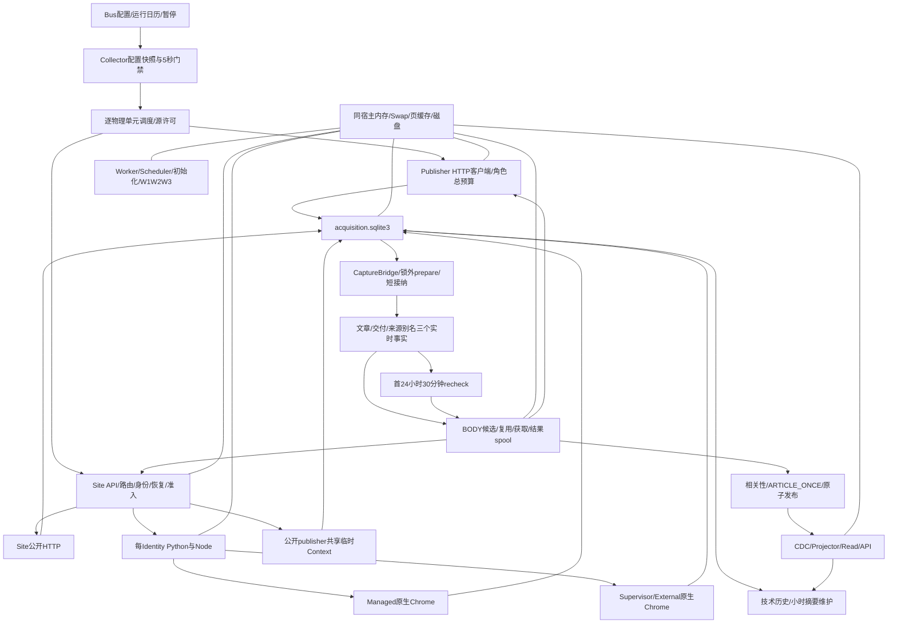

# 消息管线与全局资源联合回退：现状与问题勘察

日期：2026-10-29；展示时间均为北京时间。范围：消息源轮询、Collector、HTTP、Site/Identity/Chrome、Bus接纳与发布、BODY、存储/读取、相关维护及宿主资源。**本轮为排查，不是修复或验收通过报告。**

## 0. 当前处置与结论

用户确认主机再次失稳并重启。17:53:57完成初步取证；17:54:20–17:54:28停止正式Collector、Bus、BODY、Site Access、Chrome Supervisor五容器。保留Volume、Profile、Cookie、checkpoint和发布身份；Worker、Scheduler、交易、API、Projector等没有停止。后续不得自行重启五容器。定时观察协议已注明人工停机，不能将后续无采集进展反复误报为新的来源故障，也不能从整体可用性记录中删除停机。

18:40:45再次只读核对：五容器均为exited，available约11,853MiB、Swap0、load1.86；memory PSI full avg10为0、IO full avg10为0.20%。Site退出143对应本轮主动停止，不是新的故障证据。此为重启及停机后的状态，不代表既定负载下已经恢复稳定，详见`stop-verification.txt`。

**总体判断：前两轮改造有真实的局部减法收益，但没有解决能在既定业务负载下持续兑现的全局工作量与驻留成本问题，最新架构仍未成立。** 当前不是一个SQLite锁、一个网页或某个并发数字的单点故障。已确认的是多条放大链相互连接：

1. 多角色的活跃工作集、浏览器/driver常驻与读取方式没有形成可同时兑现的资源模型。资源紧张后反复回收和重读；普通请求、控制通信、配置读取和数据库都被拖慢。
2. 程序把这些暂时变慢转换成新的业务失败：配置超过5秒即停止取网、控制失败进入原生浏览器恢复、身份重新验证/接替、失去暖页后冷建；这些动作又增加成本。**慢被误当成需要重建/重新证明的状态，恢复工作会进一步放大慢。**
3. 新稿首次处理、抓取恢复、正文更新复查仍存在语义混用。30分钟复查既承担旧文更新，也可能成为首发恢复/再次相关性判断的机会；因此出现数十分钟乃至小时级首次可消费跨度。
4. “小数据库、短事务、独立进程、缓存、单写”只解决了部分成本，并不自动保证读取轻量。正常路径仍反复取配置、会话、路由、恢复和能力对象；通用Native行解码还会把一次读取扩大为文件读取、校验、深复制和再序列化。须优先删除这些读取职责中的冗余，而不是继续给它们加队列。

应区分确定性：资源失稳、源码中的放大机制、Investing身份/暖态断裂及周期损失已有直接证据；**Finnhub旧进程究竟阻塞在哪一个具体await、哪一个文件贡献了Site的全部读盘，现有证据尚不能精确归属。** 不能为了给出一个“根因”而将这些缺口编造成结论。重启已丢失旧进程的任务栈；冷态成功或单次快速SQL不能补写事故时的栈。

## 1. 证据与运行版本

主要证据：

- 三轮观察：[10:09–12:09](../eval/lean-architecture-observation-20261029/20261029T040836Z/summary.md)、[12:09–14:12](../eval/lean-architecture-observation-20261029/20261029T061238Z/summary.md)、[14:12–16:09](../eval/lean-architecture-observation-20261029/20261029T080909Z/summary.md)。原始JSON、逐unit结果、失败片与指标限制均保留。
- 本轮新证据目录：`eval/message-pipeline-joint-regression-20261029/`。包含上次启动的关机核算、sar、重启后PSS/cgroup快照、停服记录、按窗口Site阶段投影、身份事件和读取审查。
- 前两轮执行记录：[全链路精益实施](message-bus-lean-implementation-20261028.md)、[全局资源精益实施](host-resource-lean-implementation-20261029.md)；更早的[结构修复实施](message-pipeline-structural-redesign-implementation-and-production-test-20261027.md)、[10/28现状勘察](message-bus-current-state-and-recurrence-survey-20261028.md)、[此前卡死事故](host-freeze-incident-diagnosis-20261029.md)。历史结论只作对照，未直接套用。

本地main文档HEAD为`6ddefe97`。事故时角色实际版本：Site `f03b6d8f`，Collector `2ea3a48c`，Bus/BODY `0281dbc5`，Supervisor `89eeaac0`，Worker `c691ea40`，API/Projector/Maintenance `fea28e7f`；Scheduler仍为`416fb2fa`。多hash有明确角色边界，不是单凭不同hash就能判断契约失配。五角色停止前后未部署新代码。

本轮仅使用只读SQL、已有日志、/proc/cgroup和受限取证；没有清数据库、重置身份、调额度、增加W1/W2/W3门禁或执行新模型任务。Site统计按既有UTC时间索引读取小字段，在停止高负载角色后的四段查询均约0.11–0.20秒；这不是事故期所有读取都很快的证明。

## 2. 回退发生经过：不是到卡死时才开始坏

|时间|事实|含义|
|---|---|---|
|07:20–08:50|资源精益上线的固定90分钟仅69.30%有效周期、55.17%完整标签；包括约16分36秒修复停机|上一轮本来就没有通过业务验收；不能称已达标后突然回退|
|09:19后|最后Site统计隔离版本上线；09:54仅有数秒资源采样|短快照不足以证明新的驻留平台|
|10:09–12:09|有效周期81.05%；Finnhub1112/1200、Investing914/1200；新稿完整标签9/21；交付均32.24秒|初期已有局部失效，但部分HTTP与浏览器源仍能正常取得列表|
|13:30段|保留的Finnhub记录仍有CAPTURED；13:40段开始集中Timeout/配置变化类失败|普通HTTP来源的断粮早于Investing之后的原生恢复，不能倒置因果|
|14:09:29、14:09:44|Supervisor出现BrokenPipeError，位置在`writer.wait_closed()`/socket send|证明控制通信结束发生异常；不能仅凭该栈认定Chrome本身已死|
|14:10采样|10分钟平均iowait30.63%，先于14:13本轮定时诊断启动|资源恶化不是由该次诊断才开始；诊断额外成本仍不能视为0|
|14:11:33、14:11:48、14:11:59、14:12:07|Investing backup出现四条NATIVE_GRACEFUL_DRAIN、stopped=true记录|原生恢复分支被反复触发；次数解释见第5节，不能直接断言四次不同Chrome实际被杀|
|14:17–14:23|backup进入CAPABILITY_RELAPSE/RECOVERY_STARTED，探测排队最高约265秒，出现RUNTIME_UNAVAILABLE/QUEUE_DEFERRED|恢复机制没有及时恢复业务能力，且自身进入排队|
|14:20后|Investing开始主要使用`public-markets-nl`，此前主要为`investing-backup`|真实身份路径发生变化，并非只改了统计口径|
|14:16瞬时|load70.42，随后IO PSI full avg10约75%；14:20采样磁盘队列115.55、await13.99ms|已发生严重资源停顿；14:22负载回落不等于根因消失|
|14:12–16:09|有效周期62.36%；Finnhub0/1163、Investing7/1165；新增小时级首发长尾|故障扩展并持续，不能用别的RSS成功抵消|
|16:15|218个FETCH_DUE/recheck全部已到期，另1个FETCHING|是实际待执行工作，不是仅看状态误认未来计划|
|17:00采样|iowait58.81%，队列146.15、await26.21ms|短暂缓和后再次进入同类失稳|
|17:51取证|load62.54；memory PSI full avg10 43.16%、IO full72.31%，Swap已用1765MiB|已影响整机，不只前端指标|
|17:51附近–17:53|旧启动结束，用户重启；17:53:57系统刚启动约一分钟|按用户重启记录解释退出；不把关机SIGTERM当成OOM证据|
|17:54:28|五容器停止；available约12,376MiB、Swap0|这是重启后多角色同时停止的对照，不能把全部释放量独占归因给Site|

本轮有界内核日志未发现明确OOM kill/页分配失败记录；不能据此证明旧启动完全没有OOM。**此次失稳不需要以进程OOM退出为前提。**

## 3. 指标与范围：哪些退化是真实的，哪些不能混算

|指标|10:09–12:09|12:09–14:12|14:12–16:09|
|---|---:|---:|---:|
|按全部应执行周期的新鲜覆盖|40374/49812，81.05%|主体缺测；14:09–14:12回补450/1503，29.94%|30174/48383，62.36%|
|missing / pending|863 / 8|缺口保留|3512 / 8|
|新canonical完整标签|9/21，42.86%|15/36，41.67%|20/32，62.5%|
|应交付article×ticker，≤10秒|7/30，23.33%|10/50，20%|13/41，31.71%|
|已可消费交付均值 / 最大|32.24s /72.39s|58.76s /1826.70s|540.67s /5561.01s|
|变化列表→接纳ack均值 / p95|1.56s /4.81s|2.65s /8.25s|3.47s /18.41s|

口径必须保留以下边界：

1. 新鲜周期要求同一实际物理请求的发送层时间、响应和列表验证可关联。它不是调度函数调用数、CAPTURED比例、消息条数或上游全覆盖率。HEAD、查询、频道分别记账；共享请求不伪造多份新取网。
2. 现有cadence统一排除`TAIL:`，代码也将其标为非required。这是实现事实，不足以证明所有TAIL业务上都可选。历史补扫/恢复与持续覆盖所需续页应重新分清，不能以命名前缀决定业务义务。现有62.36%即使还没加入这些争议单元，也已严重不达标。
3. BODY分母为平台首次见canonical、适用补全文章；FULL/SHORT_FULL是读取时的程序标签，会受后来重查影响，尚非独立publisher质量认证，也不等于首次尝试成功率。9个UNAVAILABLE、3个PARTIAL不能删除。
4. 交付是首次采集cohort到Owner首次可消费；包括NO_PUBLIC_BODY、失败及未完成。第三轮39已消费、2未消费。它不等于前端可见T2，也未区分首次即相关和正文更新后才相关；小时长尾不能直接都叫作技术排队。
5. 变化capture的52–54条阶段样本不是数万次全部轮询。列表未变化仍须真正刷新，但不应为它重做接纳/正文。
6. 资源采样有10分钟粒度和窗口边界；瞬时峰值、区间均值、不同角色生命周期峰值不能相加/混算。所有缺测、迟完成和人工停机都保留。

另更正此前一处检索结论：`hot_path_latency_ms`不是没有赋值路径，`persistent_runtime_v2/service.py:_resume_hot`通过model_copy字典赋值，计时包括W1/W2执行。它仍不能充当纯case创建或非LLM编排耗时；已在第三轮观察记录显式追加更正，不修改原始样本。

## 4. 当前详细架构及实际耦合

### 4.1 各域真正负责什么、占住什么

|域|现在的正常路径与持久化|尚未消除的耦合|
|---|---|---|
|Collector|独立正式进程，按endpoint/query/channel错峰；每物理单元一在途；配置编译和checkpoint复用|源许可包住下游HTTP/Site等待；45秒普通总预算包含这些等待；配置刷新还串接维护/元数据写入|
|HTTP|publisher隔离客户端，publisher内部2槽；Collector角色5、Yahoo loop1、Site CRAWLER4等预算分配|仍有共享角色容量；健康来源会等待其他publisher占用。隔离池不等于隔离等待，也没有直接证明所有池/许可持续健康|
|Site|resolve、scope/candidate、权限/会话、恢复、Site/Identity/联合容量；HTTP_PUBLIC有轻路径|仍共享API进程、Registry读写及线程资源；普通resolve async handler中仍有同步调用；一次访问存在多次同事实读取|
|浏览器准入|当前全局8、BODY2、borrow=false；site/identity限制与导航节奏|约束的是活动命令，不是所有驻留Chrome/Node/页面内存；pending physical清理可进一步吃掉全局容量|
|Identity worker|每必要身份独立Python/Node，读操作允许同身份并发，维护写优先|最多24 worker、Managed8/External16是进程数限制；不能当成16GiB可承载证明。父子两层OperationGate及IPC增加恢复/取消成本|
|Chrome|External由Supervisor拥有；Managed走原生启动/CDP；公开publisher有共享匿名Context路径|Profile、driver、页面、native进程生命周期仍多方协作；高频暖态、清理、恢复、控制器轮换会相互干扰|
|采集账本|units/checkpoints/cycles/physical_cycles/captures/inputs；未变列表不创建业务capture|仍每次start/finish、按消费者记cycle、更新head/state及多个索引；维护仍在Collector刷新循环上，技术证明不应成为发网前置依赖|
|Bus|Bridge最多8条并行准备，锁外处理，短接纳事务；live_articles/live_deliveries/live_origins|同一物理SQLite writer仍服务多个业务域；连接初始化PRAGMA也会失败，并非只有事务持锁区存在风险|
|BODY|新稿优先、旧检查最多一个并行机会；主路线与最多一个有效fallback；复用、下载、结果spool与本地提交分开|新稿失败和旧文复查仍会汇合；薄表不意味着取结果时不再读Native、resolve/质量/路由不会重复做|
|发布/Read|ARTICLE_ONCE，完整正文源的质量门禁，修订原消息；薄投影及内容digest复用|原子发布仍需必要读/写；通用Native行工厂/对象模型可导致不必要展开。维护/投影与网络角色共享宿主页缓存|

身份“public-markets-nl”实际是已有External身份，不是公开publisher匿名Context。不能因为名字public就判断发生了错误匿名化迁移。Reuters仍须保留既有身份和不冻结业务页的约束；历史共享Node故障不能作为恢复一个全局Node的理由。

### 4.2 剩余容量矛盾

父应用slice仍是MemoryHigh14GiB、MemoryMax15GiB、应用SwapMax1GiB；Site6GiB、Supervisor8GiB及Worker等各自上限不代表可同时获得这些内存。8核升级没有增加16GiB物理内存。

本次关机核算的Site峰值约5G，未达到其6GiB硬上限，整机仍进入严重停顿。因此“只要Site不触顶就安全”已被本轮实际运行否定；降低某一角色的峰值，也不能替代多个角色同时运行的工作集验证。

16:09 Site约4.07GiB、Supervisor4.31GiB、Worker0.78GiB，另有Scheduler、初始化、Read/API及宿主。14:13 Worker曾约2.57GiB。**不能假设低谷Worker和低谷浏览器永远同时出现。** 更不能把cgroup memory.current全部当不可回收匿名内存：17:54冷态PSS快照中Site约1.61GiB、Supervisor1.83GiB，二者cgroup各约2.5–2.6GiB，还包含文件页。正确目标是减少真正活跃工作集和重读，而不是把所有cache都当泄漏或只看RSS合计。

## 5. 已定位的失效与放大节点

### 5.1 普通HTTP首先断粮：Finnhub不是浏览器风控问题

10:09–12:09 Finnhub有效周期92.67%；保留记录13:30段仍正常，13:40段开始集中失败，14:12–16:09为0/1163。样例NBIS一次dispatch至finish45.006秒、requests为空。

其实际路径是HTTP `_json`，配置却仍是**fixed max_concurrency=1、minimum gap=1秒**，不是动态扩展；当前约10个ticker/60秒共用这个源许可。许可持有范围包括Publisher角色等待和连接/响应。若一次占用升至15秒，单许可吞吐最多约4次/分钟，已低于约10次/分钟需求，等待会把其它ticker也推到45秒总预算。增加其它来源的并发不能修复这一点。

但空传输数组不证明从未发网：它也可能是DNS/连接阶段或发送埋点前失败。旧任务栈已丢失，不能精确裁定最初是源许可、共享HTTP预算、连接还是池状态失效。**确定的是该层没有把准入等待与有效执行分开，使局部变慢扩散成整个source失效；不确定的是最初那个await。** 后续恢复必须先记录一次真实permit/HTTP预算/连接/发送的四段边界，不能冷态成功一次就宣布旧故障解决。

### 5.2 配置刷新与技术维护绑在一起，再用5秒门禁拒绝业务

`SnapshotGate.check`超过5秒未更新config.at就抛STALE；acquire统一将CollectionStopped写成CONFIGURATION_CHANGED。后者在第二/三窗口分别2839/6557条，不是这么多次真实配置变更。

实际依赖：刷新读取Bus配置revision和runtime pause/calendar → 必要时编译 → **即便配置没变仍写acquisition meta** → 同一refresh loop每秒await store.maintain → sleep1秒。maintain包含旧周期/物理记录/输入/小时摘要/checkpoint反向引用等读取和必要删除。忙时这些非取网操作可延迟下一次config.at更新，再让所有来源的发送门禁失败。

这与“独立Collector不受Bus及维护阻塞”的目标不一致：进程独立了，授权新鲜度仍把配置读取和技术维护健康带回正常取网前置。另一个冗余是配置load调用面向UI的CollectionControl.status，额外读acquisition中的applied状态；配置编译只需要控制本身，不需要这份显示回执。

应保留显式禁用、临时截止时间、交易日历、维护互斥和版本一致性，**删除把普通维护/读库超过5秒等同为业务授权失效的隐含语义**；不可仅把5秒改成60秒。

### 5.3 Investing失去暖态后进入恢复—冷建循环

新取证补齐了此前报告缺少的过程：

- 13:50段79个ok，78个有anchor reuse。
- 14:00段仍有33个ok，随后14:11–14:12四条native drain成功报告。
- 14:17:08 CAPABILITY_RELAPSE→RECOVERY_STARTED；14:17:40转HUMAN/verification_observation_unavailable，探测排队记录约265秒，之后还有多次RUNTIME_UNAVAILABLE/QUEUE_DEFERRED。
- 14:20起主要使用primary `public-markets-nl`，此前主要是fallback `investing-backup`。14:12–16:09有浏览器阶段的112条中107条无anchor复用、仅5条复用；而第一窗口950条中922条复用。

|Investing CRAWLER阶段|10:09–12:09|14:12–16:09|
|---|---:|---:|
|ACCESS_RESULT数 / SUCCESS|990 /950|297 /88|
|排队均值|0.410s|4.011s|
|有阶段样本的worker roundtrip均值|2.232s|19.796s|
|page acquire均值|0.208s|5.116s|
|browser runtime均值|1.021s|17.410s|
|冷导航阶段均值|0.661s（28条）|5.303s（107条）|

阶段嵌套且队列失败常无阶段数据，不能将各均值相加。Site SUCCESS也不是Collector最终列表/周期成功，所以88个Site成功不能抵消仅7个有效周期。

代码因果：控制worker执行失败、重试控制仍不可用 → `_attempt`标记UNHEALTHY → `_schedule_native_drain`等待Profile无在途后尝试停止External原生浏览器，并改变Profile operational revision → 后续访问/恢复重新建立环境和验证。`_roundtrip`取消后仅等1秒确认，未确认可retire Python/Node；资源停顿下健康控制器也可能不能及时确认。多层恢复拥有不同状态/epoch，原生浏览器“还活着”和可重新使用的业务暖页不是同一个条件。

**次数校正：四条stopped=true代表四次drain分支报告成功，不足以证明四个不同Chrome实际退出。Facade发现native已不运行时也会返回成功；持久化事件缺少原生instance/PID前后证据，Supervisor仅保存last-exit。** 前面进度说明中的“四次停止”应按这个更严格口径理解。可以确认反复走恢复分支、身份与暖态发生断裂，不能夸大实际重建次数。

这条链不是最初Finnhub失效的原因，因为它发生得更晚；它是已经能定位的独立放大器。删除一个异常日志或拉长控制超时都不等于解决。

### 5.4 API/Registry读取既是成本，也是跨来源耦合

BODY日志有抓取前GET `/v1/resolve`的15秒ReadTimeout，不能全记成publisher订阅/风控失败。该async handler仍同步调用resolver；正常resolve会进入Registry锁和数据库。大部分其它registry_io只读已进独立4线程读池和read_scope，这是真实改进，但没有覆盖所有直接调用。

必须纠正两种误判：list_active_strategies已有revision缓存，不是每次全表解码；但缓存命中仍读revision、遍历域规则，scope/candidate/cache-key构造还重复读取同样的identity/runtime/profile/egress。缩短单次SQL并不能消掉重复调用与连接/对象重建。

### 5.5 8个活动许可不约束8GiB以上的驻留及后台工作

Native Chrome、Node、空闲业务页、iframe与恢复场景可以在请求许可释放后继续存在。hot集合按启用scope和主identity的always_on策略选择实际route身份，不能证明当前该source每次需要Browser；已存在的低成本HTTP路径也不必然撤销暖浏览器义务。

当前public_context确实共享匿名浏览器并随真实burst退出；不能声称这部分没有实施。但protected身份仍有独立worker，控制器4小时轮换/高RSS回收、1秒取消确认、页面freeze 1秒失败后关闭anchor等机制，在压力下可能把复用变为冷建。它们需要按业务场景区分，不能凭“回收更积极”就假定总成本下降。

维护pending physical占用是必要事实，但直接计入全局联合预算，局部清理不确定也可能影响其它身份。真正需要的是某个物理资源由一个生命周期owner关闭/接回，且同一个native实例不被多个请求反复安排恢复；不是再新增一套全局健康门禁。

## 6. 数据库读取专项：先删除职责，再缩字段/范围

### 6.1 本轮能证明的读成本和不能证明的部分

关机scope核算（各自生命周期不同，G沿用日志单位）：

|角色|核算跨度|内存峰值|累计读盘|累计写盘|
|---|---:|---:|---:|---:|
|Site|8h30m|5G|1023.2G|6.2G|
|Supervisor|9h58m|5.7G|920.7G|19.6G|
|Worker|9h22m|3.9G|650.5G|8.3G|
|Maintenance|10h32m|588.9M|173G|3.6G|
|Collector|8h47m|349.6M|130.3G|115.1G|
|Projector|10h32m|1.6G|42.6G|9.5G|
|Bus|9h42m|504.6M|15.7G|7.2G|
|BODY|9h43m|300.7M|6.6G|746.3M|

这些包括文件页缺页、缓存重读及可能的Swap IO，不等于SQL逻辑读取、新闻下载字节或WAL写入字节。尤其不能把Collector的115.1G直接叫作SQLite写放大；该角色Swap峰值达400.7M，本身也发生匿名页反复换入换出。**需要削减DB读取，但当前证据不允许将2TB浏览器角色读盘全部判为DB。**

在停止五角色后对Maintenance做5秒无内容syscall计数，碰到idle段，读调用/字节增量为0、只看到维护executor lock。这个小样本不能推翻历史173G，也不能把历史173G证明为当前持续扫描。没有为了取证执行全库dbstat或复制27GB Bus文件。

### 6.2 正常路径读取清单与精简判断

|读取/对象|当前实际做法与触发范围|业务真正需要|优先处理|
|---|---|---|---|
|Collector配置|每秒至少读Bus revision、runtime pause/calendar；变更时重建配置；未变仍写meta并串接维护|显式配置/暂停变化、日边界/截止时间，实际单元计划|将显示回执与历史维护移出配置新鲜度链；编译快照只随真正配置变动更新|
|CollectionControl.status|配置load为取控制状态，又读Acquisition applied元数据|采集授权只需revision/范围/期限；applied是UI信息|删除正常编译对UI状态回读，不删除UI按需展示|
|SiteResolver|全策略catalog有缓存，但每次resolve仍查generation/遍历匹配，generic还查head/spec|host到已生效策略及版本|按catalog revision编译host/scope索引；不是每URL重建整套策略模型|
|candidate_status/usable|同一调用树反复get_runtime/get_identity/get_profile/get_egress/list_sessions/get_recovery/get_strategy；usable再查同实体|一次请求的候选权限、session和真正的运行时阻断|构造一次小candidate快照，内部复用；不以“安全校验”保留相同事实的多次读取|
|能力fingerprint|包含整个identity model序列化、site revision及session等；依赖再次get_strategy/get_identity_runtime|配置/会话/出口实际变更时失效|预计算版本键；将能力变化与每次请求的模型校验分离|
|Worker snapshot|父端命中缓存仍读profile和catalog revision；子端每command重新model_validate identity/profile/egress/strategies|worker绑定身份不变，配置revision变化才更新|保留绑定检查，在真正snapshot变化时验证/传输；不重复构造同版模型|
|共享/幂等cache key|构造key时读identity运行态、session、egress、scope route；访问前后又构造post_key|同一请求合并、真实配置/实例变化时隔离|一次请求使用一个版本快照，变更时显式失效；不能为cache key反复加载全配置|
|CaptureBridge|读source/授权、Native输入、prepare，再短事务确认|一个变化delta的真实业务接纳|保留原子唯一接纳键；不重新展开完整列表或全部roster来证明同一已接纳输入|
|live文章/交付|领取只需状态、due、token、结果ref；prepare/发布还取source/旧消息/原正文|领取薄事实；只有正文/相关性实际变化时需要内容|状态/判定与内容物化分开；同篇×多个ticker共享一次只读内容视图|
|Native definition|definition引用每次读payload、json.loads、重新SHA256，再递归decode|按内容地址取得可信的不可变定义|写入/首次装载校验，已验证同版本缓存复用；不为每字段读取重复hash整对象|
|Native内容cache|命中仍stat全部chunk签名、deepcopy整对象；text再json.dumps；行工厂按payload/data_json列名隐式展开|需要正文时读取一次；薄状态读取不需要正文|取消按列名的隐式全展开；显式取内容；不可变可信对象复用，变更/完整性检查与普通读分离|
|Read/Projector|已支持薄头/digest；旧状态/历史仍可能经codec展开，维护/检索另有读取|增量消息及实际内容变化、权限、按需历史|保持先过滤后展开；同digest不重做内容/搜索；不在默认列表读历史大对象|
|统计/审计|Site已独立只读统计和UTC索引；历史cohort仍需JSON筛选/旧诊断字典key扫描|解释业务结果、定位异常|薄首态与聚合即可；不把全历史扫描/全量对象统计塞进状态轮询或发网前置|
|Acquisition维护|refresh loop每秒执行多类到期查询，含checkpoint反向引用/归档计算|有限历史保留与可恢复的未确认delta|独立低频增量维护；不每秒重证全库“没有可清理内容”|
|通用Maintenance/Native GC|独立后台已有预算，历史累计173G读盘；普通路径和实际责任仍需分清|真实到期责任、恢复所需不可变事实|只有新增到期范围才扫描，保存游标/引用变化；不因“维护必须运行”保留反复验证全历史|

单`candidate_status`无登录分支的源码调用树约有13次repository读取方法调用，登录分支更多；**这不等于13次磁盘IO**，缓存/同连接可命中，但模型解码和同事实复核仍是真实工作。它经usable再次读取已有实体，属于可以做减法的明确例子。

### 6.3 什么不应再被当作“必须每次读”的业务规则

- Profile隔离不要求每次HTTP获取都加载Profile全对象；scope一致性不要求每个内层函数重新查询同一scope。
- ARTICLE_ONCE需要唯一业务键和原子发布，不要求同一全文在文章、ticker交付、投影各反复验证/复制一份。
- 内容地址/不可变发布需要完整性边界，不要求同一已验证definition每读一次都重新hash；cache也不应以每次扫描全部chunk为命中代价。
- 单次普通只读可重新执行，不应自动套用关键写入的settled/shield“必须等到所有底层IO结束才释放业务路径”。仍在实际占用的Chrome/写事务必须有真实owner，但策略读取和UI状态读取不应继承它们的等待语义。
- 查到一份最新成功快照，不要求每次再扫描历史确认它仍是成功；真正的配置/权限/实例改变应通过小版本事实触发失效。
- 审计应保留有解释价值的首态、变化和失败分母，不要求正常路径携带完整历史、重复输入和全量对象副本。

这些减法的边界是：保留显式授权、真实变更、发布唯一性、原子结果提交及必要完整性；删除的是无业务新信息的重复读取和复核，不是降低正文质量或漏掉更新。

## 7. BODY、复用、复查与交付：不是全部慢在下载

### 7.1 首次失败与30分钟更新复查没有完全分开

`live_repository.commit_result`对24小时内且非NOT_APPLICABLE文章设置now+30分钟；enqueue_checks重领时清first_fetch_at和attempts_json。完整正文/内容digest变化后，IRRELEVANT/NO_PUBLIC_BODY等delivery可再置PENDING。G3是用户授权的首24小时更新责任，不能直接删掉，但它不应兼任新稿技术故障后才有机会恢复的通道。

当前已确认的长尾：GlobeNewswire英文约92.68分钟、法语约62.54分钟、TrendForce约30.65分钟、HuggingNews约30.45分钟。GlobeNewswire require_complete_body=0、TrendForce无强制完整正文策略，故不能全解释为FULL发布门禁。至少存在两种必须分开核算的情形：初次已应交付但失败被拖到复查；初次不相关、后来实质更新或完整内容使其相关。当前列覆盖初次尝试，缺少足够首态，不作虚假的唯一归因。

### 7.2 复查是主要BODY访问类别，但不是已证实的全局槽位唯一占用者

Site ACCESS_RESULT中BODY请求：

|窗口|recheck / foreground记录|recheck network_ms合计|
|---|---:|---:|
|10:09–12:09|513 /10|953,488ms|
|12:09–14:12|411 /15|839,919ms|
|14:12–16:09|203 /10|387,667ms|
|16:09–17:51|192 /8|414,860ms|

复查合计占这些BODY记录约96.8%（各窗口约95.3%–98.1%），确有高比例重复工作；但第一窗口合计约953秒/7200秒，只相当约0.13个平均network占用槽，且其中含HTTP，不可据此声称它独占8个Browser槽。还有BODY直连、resolve前失败、在途及驻留成本没有由这些完成事件覆盖。**按比例看很重，不代表它就是整机停顿的唯一直接负载。**

当前1645篇live文章累计fetch_total5140、full_total3135、cache_total612；work_kind会从new变recheck，因此不能把当前recheck行的累计fetch_total全算成历史重复抓取。应该按实际执行类型/物理请求统计，不再用可变行状态反推过去。

### 7.3 两类当前瓶颈要分别修

首发路径需要：接纳后立即有可兑现的新稿容量；使用现有完整结果/有效路线；首次技术失败有限短重试与正确provider延期；下载成功后本地提交失败只续本地提交。

更新路径需要：同篇公开publisher跨来源复用完整正文；先判断真实更新信号/validators，未变不做昂贵Browser与相关性重算；确有重要变化则修订原消息。不能把“全部FULL每30分钟重新走全套”视为保留更新能力的唯一实现，也不能永久不再检查。

## 8. 前两轮重构的效果和责任判断

|改动|已经取得的收益|没有解决/必须纠偏|
|---|---|---|
|独立Collector、变化delta、短接纳|变化capture仅约52–54条/2小时，不再让数万未变列表全部进入Bus；正常接纳中位较短；Bus内存峰值约505M、读盘远低浏览器角色|配置新鲜度仍依赖DB/维护；许可持有跨层等待；source本身可全断粮|
|薄live事实、结果spool、迁移退出|legacy_pending已0，新旧任务不再继续形成相同庞大实时双账；下载成功后的本地续作有基础|首态被重查覆盖，旧检查与首发恢复混用；同篇×ticker/投影仍可能重复物化|
|publisher分池、curl回调/归还修复|不应回滚到无关publisher共享一个坏curl池；CFFI已知崩溃有独立修复|角色总预算、source许可及关闭生命周期仍能传播等待；本轮不是已证明的同一curl崩溃复发|
|公开Context按需、无需求恢复退出、Worker扫描合并|启动PSS与历史峰值已有不同；Worker本轮峰值3.9G，未复现此前10.5G峰值；普通publisher不再默认一套常驻|这不是全局持续容量证明；必要身份+暖页+恢复仍可形成高驻留；Site5G、Supervisor5.7G峰值与宿主仍失稳|
|FetchAnchor真实复用、删除固定页龄|Yahoo有阶段样本多数复用，page acquire均约几十毫秒；Investing前段复用时runtime均1.02秒|控制/原生恢复破坏暖态后成本翻倍至十余秒；不能用单次定向warm成功代替持续生命周期验证|
|只读连接/统计索引/线程隔离|Site统计接口原问题有实测改善，本轮索引投影0.1–0.2秒可完成|仍有同步resolve及大量重复事实读取；减少锁等待不等于减少读取总量|
|短事务/薄投影/维护预算|保留必要结构，不能为“重构失败”恢复旧全对象CDC和长事务|整体读取/常驻成本未闭环；Maintenance仍173G历史读盘；连接PRAGMA和间接Native展开仍有风险|

方向上，“先减法、按真实物理需求、取网和业务接纳解耦、身份数据与控制故障隔离分开”仍正确。**做法的问题是减法没有贯穿读取和资源生命周期，且保留/新增了会把暂时慢升级为全局失败的规则。** 本轮5秒配置STALE和30分钟live复查均可追到`dcd7333b`（10/29 00:47）；每identity控制、native drain/轮换骨架来自`c2a6b679`（10/18），仍被新运行组合大量触发。不是全为新代码，也不是因为早已存在就与本次优化无关。

`eb7b7b66`已避免部分纯预算Timeout触发浏览器放大，不能说完全没修；但当前真实走到RUNTIME_UNAVAILABLE/control recovery失败的分支仍能drain，未形成跨资源停顿下的稳定行为。

责任上，前两轮都不应视为成功完成的整体优化。测试证明了许多局部契约，短观察还发现并修复真实bug；但没有证明全天/最多20ticker的资源平台，仍安排完整负载运行，让同类失稳复发。**下一轮必须用总工作量、同实例生命周期和持续业务进展证明收益，不能再以测试数、部署成功、无OOM或某个短均值收尾。**

## 9. 疏通当前节点后，还会在哪里形成瓶颈

|只修这一处|随后仍会暴露|
|---|---|
|移除/放宽5秒STALE|更多真实请求进入共享HTTP/Browser；若单位成本和驻留不降，会更快撞上资源平台|
|恢复Investing backup一次|同一控制错误→drain→复验路径仍在，过一段时间可以再次失去暖态|
|增加Source/Chrome并发|Node、Chrome、页缓存与内存需求上升；等待可能变成更严重的CPU/IO竞争|
|把所有站改HTTP优先|不具备有效轻接口的站仍会fallback；错误快路径会每轮多一次无效HTTP，还可能丢频道/正文|
|把DB查询移线程/读连接|重复读取、全对象解码、cache签名扫描和页缓存争用照旧；只是换了等待位置|
|把旧文都暂停/清掉|新稿短期变快，但更新责任积累；不改单位工作量就会恢复后再次爆发|
|只增加内存/Swap|可能延后触发；不会修复全source许可、原因码失真、反复冷建、首发恢复语义及增长工作量|
|只改统计|最多补证；不能增加一次真实取网、完整正文或可消费发布|

容量的硬约束必须直说：IHub初期browser runtime均约6.92秒，两个identity访问槽。在20 ticker、30秒、每ticker一必需请求的假设下，单站平均需要20/30×6.92≈4.61个持续执行槽，已超过2槽，尚未计长尾/BODY。即使DB完全不阻塞也无法在这条路线下兑现。需要改变有效取数路径或显著降低单次成本，或经实测调整同身份并发/资源形态；不能把“动态并发”当作已经解决的证明。8核并不自动解决这项内存/占槽矛盾。

## 10. 下一轮修复应采用的整体方向

### 10.1 保留业务，不保留实现包袱

目标路径：**编译后的最小授权/路线快照 → 独立单元真实取网 → 一份变化delta → 每篇一次必要内容物化/获取 → 按ticker轻判定 → 短原子发布 → 增量投影。**

必要所有权与发布唯一性保留；技术日志、显示状态、历史维护、重复配置/模型校验不得成为所有正常请求必须等到完成的步骤。先删读取和重新证明，再做真正剩余操作的IO/CPU优化，最后定并发。

### 10.2 按依赖推进的工作

1. **先关掉放大而非业务能力。** 处理配置刷新链上的UI回读、每秒元数据/历史维护与全来源5秒STALE耦合；保留显式撤销、期限、日历、Profile维护和真实版本校验。原生恢复收敛到每个物理实例唯一生命周期owner，不由每个失败请求重复安排drain。普通策略读取不套关键写入无限settled语义。
2. **读取专项减法。** 按第6节实现一次请求一个scope/candidate快照；去掉usable嵌套重复读取、同版本worker snapshot反复校验和隐式Native行物化。将正文/完整配置的读取变成显式操作；同篇只读结果给多ticker复用。保留首次/变更完整性校验，不在每次同版读取重hash/重扫chunk。
3. **资源生命周期整合。** 将“必要Profile数据”“必要控制故障域”“下一次真实Browser需求”分开。HTTP-only路径不预热Chrome；实际需要保护的原生身份保持既有访问行为。Driver可独立替换，但不要因控制超时推断native死亡。评估已有轻CDP/HTTP-fetch能力，减少必须经过完整Node/页面导航的次数；不是恢复历史单共享Node或固定两套控制器。
4. **先测单次成本再定容量。** 每个必需单元记录source许可、HTTP角色/连接、Site等待、worker/页面/请求/提取、清理的真实持有时间。修掉Finnhub全源串行在慢请求下的吞吐矛盾；同身份并发以实际Profile能力和工作集验证，不按固定9 ticker，也不盲目铺满20 ticker×各层上限。
5. **把首发恢复与更新检查分开。** 首次适用正文失败采用已有有限短恢复/真实Retry-After；不会自动丢到30分钟旧文重查才有机会首发。24小时更新义务继续履行，但优先validators/真实material信号，未变不再昂贵获取和重判。下载完成后本地提交故障继续只续本地提交。
6. **让正常存储只记必要事实。** 保留原子接纳/发布键、checkpoint和未确认delta；降低start/finish/消费者证明的重复行/索引写入，按物理请求保一份证据再关联单元。技术历史维护移出refresh循环，只处理新增到期范围，不每秒反向扫描全部引用。Read/Native GC保持有界、增量和可解释，不把全历史一致性复核放入正常状态查询。
7. **先证明单条可恢复链，再恢复完整负载。** 在人工停机状态保留数据，先离线/局部受控验证取消、实例接回、真实请求及首发恢复；明确许可后按正式角色恢复。恢复时保留未完成义务，不一股脑重跑全部旧工作，也不把它们直接标完成。当前授权仅停机和勘查，不执行此步骤。

这些是一个依赖顺序，不是七个互相独立的小补丁：只做第1步会放大流量，只做第2步仍会冷建，只做第3步仍可能让新稿等复查。

### 10.3 必须明确评估的业务变化

|拟调整|应保留|应说明/验证|
|---|---|---|
|不再把快照年龄>5秒直接当全源撤销|手动关闭/期限到期不启动新临时请求，显式源禁用与维护安全|撤销传播界限应由明确控制事实保证，不依赖大配置/维护完成；不能悄悄允许无限期旧配置|
|原生恢复从请求驱动改成实例owner驱动|真实坏实例可恢复、人工/Challenge场景和Profile安全|同实例恢复次数、实际关闭证据、原业务页保留与重新取网；不永久阻断已恢复身份|
|减少无实际Browser需求的常驻|必要高频站暖态与已有访问行为|罕用路径冷启代价、完整频道/正文质量；已知依赖身份的站不得按“公开”统一匿名化|
|更新检查先做轻信号、初次失败另走恢复|ARTICLE_ONCE、实质更新修订、既定更新覆盖|失败与更新的责任不会丢失；不能以FULL复用永久跳过所有更新检测|
|去掉重复读取/重hash/模型构造|配置生效边界验证、可信不可变内容、权限与版本一致性|可变对象不能被共享后污染；内容真正变化/损坏仍能发现；不引入另一套庞大校验台账|
|提高必要同身份并发或替换取数方式|Profile/出口稳定、完整必需频道|30秒/20ticker成本及上游真实限制；若仍不成立，明确提出访问能力/硬件/订阅选择，不偷偷降覆盖或限制W1/W2/W3|

## 11. 如何证明修复没有再次转移瓶颈

验收必须同时满足业务与成本，而不是另找一个短窗口：

- **周期**：按实际ticker/source/必需unit的全部应执行周期，记录真实请求启动、新鲜响应、失败、延期、无请求、在途与人工暂停；TAIL义务明确后纳入相应范围。源级/关键单元都接近100%，不能以总体加权掩盖Finnhub/Reuters为0。
- **交付**：首次即应交付的新稿与后来变得相关/实质更新分 cohort；保留所有未完成与长尾。T0采集、接纳、首次BODY开始/结果、首次可消费、UI可见分别有少量稳定字段，不能被recheck覆盖。目标尽可能≤10秒。
- **正文**：真实新文章初次/最终FULL分开，失败、预览、订阅不足不剔除；抽检publisher实际正文，不以CURRENT_FULL标签或旧文复用代替>80%成功率。
- **资源**：相同业务量下，实际逻辑读取/内容物化次数、读取字节、private/PSS/匿名工作集、文件refault、Swap流量与CPU都下降；各角色高峰可同时承受，长时间无持续工作集增长。不是只降低Site而把读盘转到Supervisor或Worker。
- **恢复**：一次控制故障不重建所有身份；同native实例不反复drain；HTTP局部故障不让其他publisher等待到超时；SQLite短写竞争不触发下载重做。
- **持续窗口**：至少完整24小时并覆盖真实盘中/研究与W1/W2/W3重叠负载，再看72小时增长。20ticker/30秒需另做实际容量验证，不由当前10ticker/60秒外推。人工停机和发布窗口保留，正常性能与整体可用性分别评价。
- **诊断成本**：有限只读投影、分片导出/本地计算、少量首态与变化记录；不再为指标解释给每请求加一套全量历史核验。观察本身超时/缺测也必须显示。

## 12. 代码定位与本轮操作留痕

主要定位文件：

- `message_bus_v2/collection_plane/{worker,config,store,maintenance,bridge}.py`：配置门禁/维护耦合、逐单元调度、证据与接纳。
- `message_bus_v2/{scheduler,capacity,publisher_http,poll_trace,storage_lane,live,live_repository,body_results}.py`：占许可范围、成本反馈、HTTP隔离、正文/发布与30分钟检查。
- `site_strategy/{api,service,storage,repository,resolver,scope,failover,health,governance_repository,budget}.py`：同步resolve、重复读取、能力/恢复/准入。
- `site_strategy/{worker_manager,worker_runtime,identity_worker,browser_runtime,public_runtime,fetch_anchors,runtime,chrome_supervisor}.py`：控制器、原生生命周期、暖页与物理占用。
- `content_enrichment/{service,extractor,transport}.py`、`v2_read/{native_content,maintenance}.py`、`control_io.py`：正文恢复、Native隐式展开/校验、维护与取消语义。

操作收据：`reboot-pre-stop.txt`、`resources-after-reboot.json`、`stopped-services.txt`、`stop-verification.txt`、`journal-state.json`、`shutdown-attribution.json`、`sysstat.txt`。技术分析：`db-audit.json`、`site-stage-summary.json`、`identity-transition.json`、`investing-supervisor-transition.log`、`workload.json`、`maintenance-read-sample.json`。其它会话未提交改动保持不变；本轮没有提交、部署或修复生产代码。
