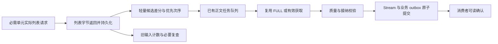

# 消息管线：有效采集周期与新文章快速交付优化方案

日期：2026-10-26，北京时间。范围：Message Bus、其接纳/正文/发布链路，以及直接为它提供服务的 Site Access 执行路径。基线：8 核 16G，当前 9 个 ticker，按最多 20 个 ticker 和实际端点/查询/频道数扩容。

## 1. 结论与本轮边界

下一轮应先消除“列表取得以后仍整轮加工、旧输入与新输入同队、跨周期复用访问结果”这三个共同瓶颈，再推进浏览器路径降本和容量调整。单纯增加并发、把排队超时从 3 秒延长，无法兑现全部周期，也无法把真实新文章交付压到 10 秒内。

本轮做了代码复核、生产只读对账、完成态 capture 的只读准备重放、小范围 30 秒采集探针及公共 HTTP 对照；没有修改生产代码、订阅周期、身份、日历或临时采集开关，没有将探针结果接纳为业务新闻。探针走现有 Site Access scope 或已批准的固定公开 HTTP 出口，不复制登录 Cookie、不轮换出口绕过拒绝。对两个返回 403 的公开 HTTP 尝试没有继续重试。

代码基线：本地与远端仓库 `5aaf3efd`；生产 Bus `77b54fe6`、BODY `aa6cf549`、Site `450c17d4`。核对过 Site 的 `runtime.py`、`barrons_sources.py`，消除 CRLF 差异后与本地代码内容一致，不能把提交号不同直接认定为执行代码缺失。两个其他会话的 wire-schema 工作区文件保留。

当前启用配置读取为 181 个绑定、48 个来源、9 个 ticker；旧窗口中有 232 个产生预期周期的逻辑单元。本方案要求新合同进一步拆开同一 HEAD 内的多个 feed/endpoint，不将 232 写死为今后的单元数。

必须纠正上轮两个验收解释：

1. **BE 的 37.18 秒不是首次列表取得至发布的总耗时。** RSS 实际先返回，再进行了 141 次链接辅助请求，之后才设置 capture 时点。该轮列表返回至 Stream 发布约 **212.92 秒**。37.18 秒仅是链接还原后的 capture 至发布。这里包含计时起点错误和真实的执行阻塞。
2. **70.6% 是旧算法的证据覆盖率，既有漏证明，也有错误信用。** 例如 Yahoo 共享缓存和 Google 链接辅助请求，不能作为当前必需列表单元的新采集。补齐埋点不能直接宣称吞吐、频率或端到端性能改善。

目标保持不变：所有已启用且应执行的必需采集单元基本兑现配置周期；全量有效采集覆盖接近 100%；真实新文章尽可能在首次列表取得后 10 秒内可消费；正文质量、覆盖、ARTICLE_ONCE 和现有身份稳定性保留。被网站挑战、认证或上游服务响应时间阻断的文章仍进入分母和长尾，不能通过改口径移除。

## 2. 对 70.6% 缺口逐周期对账

### 2.1 固定窗口和互斥分解

窗口为 04:55:00–05:04:45，与实测报告末窗一致。重放原 schedules、runs、captures 和共享目标映射，逐槽得到以下结果；断言与原算法的 2658 个预期周期、1876 个新鲜周期、49 个末尾在途周期完全一致。

| 旧定义下的周期分类 | 周期数 | 解释 |
|---|---:|---|
| 被旧算法记为新鲜 | 1876 | 仍需审查列表角色、原始访问时点和跨周期缓存；不等于全部可信 |
| 无关联传输证明 | 434 | 混有缺埋点、共享证据丢失和旧结果复用，不能全算漏采，也不能全部补成功 |
| 访问延期 | 198 | Reuters 184、Yahoo 14 个槽；原始延期 run 数更多，同槽可多次运行 |
| 执行失败 | 59 | TrendForce Press 49、CEG Newswire RSS 10 |
| 无派发槽 | 40 | Reuters 34、Google 4、Yahoo 1、TrendForce Press 1 |
| 窗口末尾在途 | 49 | 继续保留；最终验收需在固定窗口结束后追踪这些原周期结果 |
| 跨槽/结果关联缺口 | 2 | Yahoo，不能用任意一轮成功填补 |
| 合计 | 2658 | 未证明部分合计 782 |

旧报表的 missing=41 不是上述互斥分类的 40：有一个 INTC Google 周期同时被算为 fresh 和 missing。其 due 为 04:57:59.994837，fresh 使用了 `capture_39a09ffacc724b8db437f0215a3d4148`，却没有该槽派发记录。原算法把 `max(due, request_time)` 映射到后续槽，长轮次辅助请求可以“覆盖”未来周期。应修算法与采集机制，保留旧口径做历史对照。

逐 ticker/source/unit/slot 的完整收据：`eval/pipeline-next-plan-20261026/coverage-reconciliation.json`；精简单位表：同目录 `coverage-units.csv`。不是只抽查几个 ticker。

### 2.2 来源清单与处理归属

下表沿用旧窗口的逻辑周期分母；共享源的一次物理请求可以覆盖多个已订阅 ticker，因此逻辑周期数不能直接当物理请求量。

| 来源/必需单元 | 预期 / 旧 fresh | 缺口证据与下一步 |
|---|---:|---|
| Reuters / 23 个 QUERY 单元 | 224 / 0 | 184 延期槽、34 未派发、6 在途；真实人工挑战，不是埋点修复能解决 |
| IBKR / 9 个 HEAD | 88 / 0 | 87 无 SDK/持续订阅证明、1 在途；当前“轮询”主要是读取本地 tick_292 队列 |
| Yahoo / 9 HEAD + 9 SUPPLEMENT_HEAD | 352 / 298 | 29 无传输证明、14 延期、8 在途、2 关联问题、1 未派发；RSS 与浏览器独立验收 |
| DIGITIMES TW RSS / 5 个共享目标 | 50 / 0 | 临时 proxy httpx client 未安装传输观察；先验证真实 HTTP，再关联同一共享 acquisition |
| HuggingNews / 5 个共享目标 | 50 / 0 | 同上，不能将 5 次逻辑 fanout 当 5 次物理请求 |
| TrendForce Press / 5 个共享目标 | 50 / 0 | 49 失败槽、1 未派发；Site 返回 SERVICE_UNAVAILABLE/RuntimeError，当前原始 worker 异常被压平 |
| Calcalist / 3 个共享目标 | 30 / 0 | 自有 curl/重定向路径没有统一 transport receipt；还要按真实搜索请求拆证明 |
| DoD Contracts、DoD Releases / 各 2 个共享目标 | 各 20 / 0 | 自有公开抓取传输与端点分页证明未接到 Bus |
| Army releases、Army RSS、AirspaceForces、AviationWeek RKLB、AviationWeek RSS、BreakingDefense Space、DefenseScoop Drones、DefenseScoop Space、Shephard、UnmannedAirspace、Iridium、NASA、Spacecom、SSC / 各 1 个共享目标 | 各 10 / 0 | 共 140 个逻辑周期，逐源 curl/HTTP/频道核验；不是默认恢复 140 个成功 |
| GlobeNewswire Search / 23 个 QUERY | 224 / 211 | 8 无传输证明、5 在途；完成游标空转已修，还需检查 query 无请求却返回成功的路径 |
| 官方 IR / 12 个 endpoint | 240 / 228 | 12 个末尾在途；各 endpoint 独立保留真实请求/列表证据 |
| Newswire RSS / 各 feed URL | 59 / 48 | CEG `insidelines.pjm.com/feed/` 10 次 ParseError，另 1 在途；当前单次复测 200、RSS 可解析，不能把历史失败直接回填 |
| Barron’s / HEAD 与 OTHER_HEAD | 176 / 171 | 缺口均为末尾在途槽；仍有单次 site_queue_timeout，两个频道不能互相替代 |
| Google News / 2 个 QUERY | 19 / 15 | 4 未派发槽；实际整轮 142 次请求被 URL 还原牵连，且辅助请求被误作列表证明 |
| InvestorsHub / 9 HEAD | 88 / 85 | 3 在途；30 秒承载主要受单次浏览器成本影响 |
| Investing / 9 HEAD | 88 / 86 | 2 在途；新探针发现跨周期共享缓存和单次 20 秒尾部 |
| Benzinga、Finnhub / 各 9 HEAD | 各 88 / 86 | 各 2 在途；日常重复完整列表仍反复进入接纳 |
| SEC / 9 HEAD | 175 / 174 | 1 在途；不改变独立采集、文档完整性及排除项 |
| AWS Platform / 1 HEAD | 10 / 9 | 1 在途 |
| DIGITIMES EN、ETNews、Globe RSS、TheElec、Tom’s Hardware、TrendForce News | 各 50 / 50 | 旧指标无缺口，仍检查每源端点角色、缓存与正文时点，不默认所有文章快交付 |
| CTEE | 20 / 20 | 轮次均值仍约 19 秒，必须拆物理获取、持久化和接纳成本 |
| Optical、NBIS actor、SpaceNews、Observability | 各 10 / 10 | NBIS 930 项的重复扫描是持续成本，不因 fresh=100% 消失 |
| Enterprise Apps、Lakehouse | 各 9 / 9 | 无旧口径缺口 |
| TikHub user posts | 1 / 1 | 窗口仅 1 个应执行周期，不能当作高频承载证明 |

“434 个无证明”中，Yahoo 属于混合机制：窗口中 35 个 CAPTURED、无 requests 的必需浏览器 run 均能关联 CAPTURE_CONSUMED；19 个复用的 capture 早于该 run 的 due，另 16 个仅凭 capture 时点仍不足以证明实际请求在当前周期启动。这 35 个 run 映射为 29 个无证明槽，run 数不能直接相加到周期分母。需回传物理 acquisition 的原始 ID 和请求时点，再逐槽判定。

Reuters 单项仍阻断时，即使其他旧缺口都补好，按此分母全量覆盖上界也只有约 91.6%。必须恢复真实访问能力，不能另立“健康源覆盖率”替换全量验收。

## 3. 新文章慢路径：BE 的真实时点

对应 `poll_78ddb28624ac41fc96408dfc6d559c97`，source=`google_news_search_rss`，BE query 单元。生产原始请求账已重新读取，证据为 `be-timeline.json`。

| 时点 | 北京时间 | 阶段 |
|---|---|---|
| 配置 due | 04:54:29.995 | 应执行周期 |
| 派发 | 04:54:39.119 | 已晚约 9.12 秒 |
| RSS 请求启动 | 04:54:46.744 | 再等待约 7.63 秒 |
| RSS 列表返回 | 04:54:47.033 | 真正应使用的列表取得起点 |
| 最后一个辅助请求返回 | 04:57:42.759 | 其间 94 次文章包装页 GET/重定向和 47 次 decode RPC |
| 当前 capture.observed_at | 04:57:42.770 | 被放到链接还原完成后 |
| capture 持久化 | 04:57:44.301 | 再耗约 1.53 秒 |
| 首次接纳片段完成 | 04:58:14.810 | 入库后又等约 30.51 秒；该字段不是 claim/start 时点 |
| 新正文任务持久化 | 04:58:14.828 | 新文章到此才获得独立处理机会 |
| FULL | 04:58:19.247 | 正文执行约 4.08 秒 |
| Stream 发布 | 04:58:19.951 | 仍未取得该篇下游实际读取/投影提交历史时点 |

列表返回→发布约 **212.92 秒**：175.74 秒发生在 URL 还原后才设置 capture，随后约 32.06 秒到正文入队，再约 5.12 秒到 Stream。下游可消费总时间应至少为此值，不能直接写成已经完成 212.92 秒的消费者验收。

根因位置：

- `news_adapters.py:GoogleNewsSearchRssAdapter.poll` 在持久化前为全部 wrappers 调用解码，年龄/旧文章/域约束判断也晚于解码。
- `google_news.py` 虽有 4 个 item 并发，但每项两阶段网络都争同一个 source permit；生产该组仍为并发 1、启动间隔 1 秒，142 个物理请求将轻量列表变成长轮次。进程内 URL 缓存重启后丢失。
- `scheduler.py:on_page` 未明确传入列表接收时点时，HTTP 路径使用调用时的 utc_now；`polling.py:prepare` 又取最近辅助请求作为 capture.request_started_at。时间被后续工作污染。
- `cadence.py` 没有区分 listing、URL resolution、article body；还存在旧任务移入后续槽的问题。
- 接纳阶段仅有提交时点，没有 claim/读取/准备/入队/写锁的逐段账，所以不能把剩余 30.51 秒全部归给 SQLite 或全部归给队列。

## 4. 30 秒能力与资源成本

### 4.1 当前实测占槽成本

04:55–05:04:45 Site 事件中，以下为 SUCCESS 样本的 attempt/network 成本。它接近占槽执行成本，但不含所有 permit 前后控制写入，作为容量下界；排队、失败样本另保留。不能把它当 CPU 秒。

| 路径 | 成功样本 | 均值 / p95 秒 | 实际执行身份 | 20 ticker、30 秒所需物理请求/s | 75% 利用率所需槽数 |
|---|---:|---:|---|---:|---:|
| Barron’s 两频道 | 179 | 1.905 / 3.375 | dowjones-main，容量 2 | 40/30=1.333 | 4 |
| InvestorsHub | 93 | 7.135 / 12.732 | investorshub-backup，容量 2 | 20/30=0.667 | 7 |
| Investing | 89 | 2.422 / 4.565 | investing-backup，容量 2 | 20/30=0.667 | 3 |
| Yahoo 浏览器补充 | 132 | 6.637 / 10.044 | yahoo-backup，容量 2 | 20/30=0.667 | 6 |

Yahoo 9 ticker、30 秒已产生 1.99 槽的平均工作量，容量 2 几乎没有余量；132 成功之外有 43 次 site_queue_timeout。它不是 Chrome Worker 固定串行的证据：同期物理请求区间重叠已观察到 Yahoo、InvestorsHub 同身份峰值 2，Worker execute 门允许 identity.access.max_concurrency 个并发。不能继续把“实际身份不能并发”作为结论。

实际 source scope 必须一起核对。Site 通用配置里的 public-markets-nl 不是该窗口 InvestorsHub/Investing 的实际执行身份；只读 Site 默认配置会诊断错资源争用对象。维护/身份启动/退出绑定仍需独占；已启动身份的独立业务读取应并行，页面只在分配和所有权登记时短锁，不把整轮抓取锁住。

四种旧浏览器路径在 20 ticker、30 秒时平均合计约 **13.34 个忙槽**，已超过全局 8，尚未计 BODY、其他浏览器源、时间探针与回退。直接把站点/身份上限扩大到 8 不成立。

### 4.2 本轮小范围 30 秒与轻量探针

- 4 轮、每轮间隔 30 秒：MU Barron’s 两频道各 4 次，MU InvestorsHub 4 次，INTC Investing 4 次。全部返回 SUCCESS 且文章解析通过，但 **Investing 一轮为共享缓存命中**，所以不能写成 16 次全部新鲜访问。
- Barron’s 本轮执行均值约 3.01 秒；InvestorsHub 4.71 秒。Investing 有一次真实 20.25 秒执行：导航约 0.83 秒、Worker 等待 0，主要时间在浏览器文档/证据取得阶段；紧接着的下一轮复用了该 capture。这是尾部执行成本和缓存策略的共同问题。
- 无 Cookie、固定批准出口的 HTTP：InvestorsHub、Investing 均 403，停止该方向的重复探测；Barron’s 官方 `/market-data/api/news` 返回有效 JSON。
- Barron’s 公共 JSON 进一步覆盖 9 ticker × 2 频道 × 2 轮，36/36 通过既有 render/parse 合同，均值 **0.536 秒**、p95 **1.168 秒**、最大 **1.35 秒**。MU 两频道与同时间 Chrome 路径的完整 URL 集合对照：主频道 39/39、Other 17/17，公共 HTTP 没有缺项。
- 第二轮部分响应有 Age≈28–29 秒；不能把“HTTP 200/ETag 未变”当作源站重新生成。另一次稍后复查 Date 更新、Age 缺省。落地需保留 Date/Age/ETag、规范重验证及真实响应时点，持续检查源侧缓存；本次只证明公共入口与候选覆盖可行，未证明交易时段源站缓存 SLA。

这些探针是单源/小样本成本与正确性证据，不是 20 ticker、全部来源、交易日或正文稳定性的验收。结果和复现脚本均在本轮证据目录。

### 4.3 动态容量的计算方法和预算

对每个启用的必需单元列出物理请求计划，而非使用 ticker 数乘一个固定并发：

`λ(route)=Σ[单元每周期的实际 listing 请求数 / 配置周期]`。共享 feed 同一物理请求只计一次；Barron’s 两频道计两次；每个 query 分开；分页补齐和正文另外记账。没有新消息也仍有列表获取成本，不能按正文增量估算采集负载。

`K=ceil(λ × 实测占槽均值 / 0.75)`，同时检查 p95 突发窗口和 deadline；源/站点/身份/Worker/全局任一层不足都显式报告缺口。正文使用真实新文章到达率和各路径成本，不能用 20 个 ticker 直接推正文并发。

资源计算还必须包含 `Σλ × 每请求CPU秒 + 常驻/空闲CPU + 非消息组件CPU`。整机 8 核先以持续占用不超过约 6.4 核作为容量验证线，保留突发余量；这是一条验证预算，不是给每个进程新增 CPU 硬限流。按实际其它组件占用扣除可用容量，不能把全部 8 核都分配给采集。

本轮 5 秒进程 CPU 样本和 vmstat 只证明仍存在整机争用，不能据此推导准确的单源 CPU 秒：样本期间整机约 64–80% 忙、run queue 6–12，且短命 renderer 会漏出快照。下一轮基准必须以 cgroup cpu.stat 差值和父子进程累计 CPU、基线空闲对照测量，记录全请求数与失败数。禁止用 wall 秒代替 CPU 秒。

初始资源配置保留浏览器全局 8、BODY 浏览器 2、HTTP 共享池 16/单 host 4；先替换大成本路径，再按实测调整，阈值由当前 roster/单元数和成本算出，不固定 9。对于现有容量 2 的身份：20 ticker、单频道、30 秒要有余量，单次均值应降至 **≤2.25 秒**；Barron’s 双频道仍走 Chrome 则需 ≤1.125 秒，公共 HTTP 方案可以移除这部分 Chrome 压力。

HTTP/BROWSER_FETCH 变成低成本后，才评估将经过验证的业务 execute 身份并发从 2 提至 3/4；不改变同一 profile、出口绑定或维护独占，也不增加 20 套身份。若某个路径降本后仍过载，明确呈现承载缺口并继续降本，不能偷偷降低必需频道频率。

## 5. 目标关键路径和统一证明合同

所有单元统一记录下列语义，复用已有 run/capture/job/outbox ID，不再叠加一套泛化任务平台：

- due/dispatch/permit queued 与 granted、物理请求起止、列表原始 received_at；请求角色为 listing / redirect / url_resolution / article / heartbeat，附必需单元和 endpoint/query/channel。
- capture 的 original_acquisition_id、physical_request_id、immutable payload ref、source/binding/query/scope revision；共享消费者指向原记录，不能复制一个新的 acquired_at。
- capture 持久化提交、候选索引完成、新候选首次识别、正文任务提交/领取/执行、FULL 取得、归一化/发布事务提交、下游消费可用时点。
- 分段 wall、CPU、lane wait、SQLite BEGIN wait、事务执行和 commit、native encode/decode/fsync、Site/Identity/global/Worker/page 的 queued/granted/released。成本字段必须说明嵌套，不能把 worker_roundtrip 与 browser_runtime 再相加。

必需单元由 `work_units` 与端点合同显式导出，额外标记 `required`、transport plan 和 dependency。Barron’s 两频道、Yahoo RSS+SUPPLEMENT、每个 by-search query、每个 IR endpoint、Newswire 各 RSS URL 都独立定义；Globe 窗口覆盖尚未完成的必要续页也有覆盖债务，不能笼统因 TAIL 前缀被验收排除。纯历史补采单列；Yahoo 时间核验是文章发布依赖，单列其任务 SLA，不能藏进可无限延期的普通 backfill。

首轮实现不强行给所有来源设 30 秒；先用现有配置逐单元兑现，并对 Barron’s、InvestorsHub、Investing 做 30 秒阶梯验收。配置变化创建新的 schedule generation，旧在途结果保留归属，不能悄悄填进新周期。

### 有效采集的判定

1. 请求必须是该必需单元的列表/频道/查询请求，不是许可、URL 解码、正文下载或本地队列 drain；空列表也要有通过源合同的空结果证据。
2. 共享请求只允许在**同一轮应执行边界内**合并，消费者沿用原物理时点。新周期至少需要一个满足该周期边界的物理获取；旧缓存不能续期。HTTP 304 只有真实重验证、原内容可恢复、对应端点及版本相符时才有效。
3. 废除 `max(due, request_time)` 替长任务迁移槽的信用；迟到任务仍归原 due。另算它的实际获取时间和恢复覆盖，不能既抵消原周期失败又填未来槽。
4. 完整列表先持久，再进行慢 URL 还原/候选正文工作；否则 raw received_at 必须保持最早原值，不能以处理结束时间替代。
5. HTTP 自建 client、curl、stdlib、SDK 都在真实 send/回调边界产生同类传输收据；不能在 adapter 返回时伪造 request_started。

## 6. 可直接实施的工作包

### P0-A：修正原始列表时点、周期关联和共享缓存

**位置**：`message_bus_v2/{schema,poll_trace,polling,cadence,scheduler}.py`，`site_strategy/{schema,client,service}.py`，IR coordinator/HTTP 层。

1. 给原始采集结果加可选 acquisition evidence；先兼容读取旧记录，新增记录必须带角色和物理 ID。`on_page` 接收明确的 listing_received_at 和对应请求，禁止从 REQUESTS[-1] 或调用时钟猜起点。HTTP 重定向链与辅助请求各自保留父子关系。
2. Site Access 对列表访问使用 cycle freshness fence：缓存或同飞行任务的原始 listing 请求早于当前边界时，不能直接返回满足本轮的新鲜结果。缓存仅复用数据，不改变访问时点；若需要本轮更新，进入真实获取。相同周期、相同 URL/频道/版本的消费者仍可合并。
3. 返回 producer operation/acquisition/request ID 及原始起止；`_observed` 对共享结果记录 consumption edge，不丢弃原请求证明，也不伪造第二次物理请求。原访问正在进行但开始于旧周期时，完成后再做当前轮获取，不能串接旧任务就算当前轮成功。
4. `cadence` 逐 due 归属，分别给出 dispatch/start/list freshness，区分 on-time、late recovered、deferred、failed、missing、unproven、pending、shared/cache-only。物理请求去重和逻辑 ticker 覆盖都保留。
5. 将末窗未完周期的 ID 固定下来，窗口截止后只补这些周期的最终结果；继续新窗口不能重写旧分母。旧 70.6% 保留为旧定义，不自动回填历史成功。

**资源**：数个标量字段/关联 ID 和已有账本索引；阶段时点合并在现有短写，不能每记一个阶段另排一次 writer 或发一次 RPC。

**测试**：Investing 20 秒响应+30 秒下一轮+15 秒缓存必需发新请求；同周期两个消费者只发一次；同频道异 ticker/异 query/异 scope 不误合并；304 与无网络 cache-only 不混淆；长解码不能贡献未来 fresh；迟到、失败、到期取消、版本切换和末窗在途均入账。重放本轮逐槽证据验证计数差异可解释。

### P0-B：Google 列表与链接还原彻底解耦

**位置**：`news_adapters.py:GoogleNewsSearchRssAdapter`、`google_news.py`、`polling.py`，现有 enrichment handler 与 repository。

1. RSS 返回后立即解析基础身份、原始时间、publisher/source URL，记录原始列表时点并持久化完整条目；不等待全部 wrapper 还原。47 个条目里只有一个真正新候选时，不得让该文章等待另外 46 个链接。
2. 年龄与已有候选索引在解码前执行。没有合法绝对地址或域尚无法判定的条目保留待处理及原因，不能以“优化”为由丢弃；先不发布，等必要验证完成。
3. 在现有正文 job 的前置阶段处理 wrapper resolution；持久化 `wrapper identity → verified final URL`，按 Google 稳定 GUID/原链接和内容证据复用，重启不重做全部映射。多 ticker 共用一次地址解析，解析网络只争 URL-resolution 预算，不持有 listing source 槽。
4. 保留 4 个解析工作上限作为初始值，按实际 decode 请求量和站点响应调整；单个慢解码不能阻塞别的候选、下一个 query 或下一轮列表。源站 429/访问限制按真实反馈退避，不无条件扩大。
5. 身份以稳定 provider ID 与已验证别名连接；最后出版商 URL 确认后查询已有 FULL/SHORT_FULL，避免先下载再做 alias 去重。保留 scope、语言和重要更新判据。

**资源**：一个小型持久 URL 映射/候选标量索引，沿用现有 BODY job，不再建设独立抓取队列或新服务。网络成本从“每轮所有 wrappers”降为“新增/变更且映射未取得的 wrappers”。

**测试与阶段目标**：模拟 47 项、46 个慢/旧链接、1 篇新文章；RSS 列表应在返回后约 0.5 秒内进入 durable capture，新文章不能等待慢项，全新的下一周期仍能开始。崩溃于列表提交/解析完成/job 入队任一边界后恢复，GUID/alias/ARTICLE_ONCE 不重复发布。用历史 BE 输入重放；分别报告列表→候选、解析、入队和整篇交付，不能再得到虚假的 37 秒口径。

### P0-C：日常差分接纳，把真正新候选置于旧扫描之前

**证据**：末窗 NBIS actor 10 个 capture、9300 个输入只有 1 个完整输入哈希；Finnhub 88/9、InvestorsHub 93/9、Globe Search 216/23、Investing 89/10。哈希含 binding，所以不能简单称为文章去重率，但足以证明日常相同输入仍持续进入热路径。当前精确 capture 复用只在父输入处理窗口内有积压时生效，清空队列后未来每轮仍重扫。

完成态 capture 的只读重放显示：930 项展开约 1.48MB，每片 load+prepare 约 0.09–0.10 秒 CPU/墙钟，偏移 0/16/32 都重新展开整份内容。该成本单独不足以解释 30 秒排队，但与大量重复轮次、单 writer、跨进程写竞争和 CDC 放大相叠加，不能继续反复支付。

**位置**：`polling.py:{prepare,load,prepare_piece,claim,accept_piece,reuse_waiting_inputs}`；`repository.py` 的 observation/identity 查询；`service.py:_accept_poll_result`；`body_results.py`。

1. 持久化 compact manifest：原始索引、稳定文章键、输入/content hint、发布时间、policy/scope/language/version、已有任务/正文收据、下次必要复查时间。批量读对应现有 observation；不先展开所有旧正文。
2. 将候选分为 NEW、MATERIAL_UPDATE、DUE_RECHECK、UNCHANGED。新增和重要更新先组成本 capture 的工作次序；普通重复项批量记收据/计数；需要复查的已发布文章仍产生到期工作。不能只比较 URL，也不能把“曾发布”视为永远无须检查。
3. 复用跨周期的**业务接纳收据**，条件包含相同输入/版本/接纳规则/语言/scope，且确实有 durable 任务或有效正文记录；设置最早 next_check_at。它不能复用或代替当前周期的物理列表请求。原先仅积压期复用保留作旧记录兜底。
4. 原始列表完整存储不裁剪。优先工作次序持久化为原数组 offset 的小 manifest，游标推进基于该 manifest；重启不得漏掉未处理后缀。字段必须区分原列表总数、已分类数、新候选、跳过重复/过期和待复查，不能重置原 receipt。
5. 将 capture 解码限于每次 capture 的准备生命周期，采用有界缓存/固定块读取；多个片段不重复解码整个 1.48MB。缓存按字节限制，例如初始 32–64MiB，不能随 20 ticker 全历史增长；原内容仍从不可变文件可重建。
6. 5 张流水票据和读/准备槽作为执行上限，不把“5 任务存在”当新文章公平。先就绪的新候选片段优先；每次提交最多 16 个实际业务候选且以约 20–50ms 写执行为分片目标，成本超出则下一片减小。4 片 burst 只用于未变/旧输入批量收尾，已有新候选等待时让出。
7. 必要的 first_seen、bootstrap、已发布竞态重查、版本 fence 与事务去重保留。没有 provider 更新 hint 的已发布文章仍按既有到期检查，不通过无限延后复查换取吞吐；相同完整正文只更新原消息/修订，ARTICLE_ONCE 不重复触发下游。

**验证**：1/9/20 ticker，各源每轮 0、1、10 个新输入及 40/930 个旧项；在列表中间、最后一个位置插入新文章；慢准备/慢站点/大共享 roster 同时存在。新候选入队 p95 先压至 1 秒量级、队列净增长≤0；无新增的下一轮不做逐篇全文展开。提交和重启故障注入证明每个输入最终有处理收据，重要变更和 next_check 到期不能被优化吞掉。

### P0-D：把短写、技术账本和投影成本移出新闻关键路径

**证据**：同一 585 秒窗口产生 **17243 条 Bus outbox 变更**：poll_states=7306、poll_runs=5347、poll_captures=4246，合计约 98%；Stream item 只有 1 条。它们不是 17243 条新新闻。现有 CDC 已排除 capture 大 payload 和部分 lease-only 变化，仍对每片 intake_position 和反复 poll_state 投影；不能再把“已做 CDC 降噪”当问题已经消失。

**位置**：`storage_lane.py`、`repository.py`、`polling.py`、`content_enrichment/service.py`、`v2_read/outbox.py` 的 bus 专属触发条件和 bus 投影分支。

1. 给 writer 增加 lane wait、BEGIN IMMEDIATE wait、实际事务、commit 和内容文件开销分段。现在 slow 日志的 elapsed 与 wait 不能直接拆成跨进程锁与业务执行。
2. 只在真正短事务内做 fence、唯一键/CAS 重查、任务/消息/收据提交；NativeContent 编解码、内容哈希、Pydantic 构造、正文质量分析和不必要的历史展开在准备阶段完成。提交时只验证读版本和必要发表竞态。
3. BODY 与 Bus 各自有 StorageLane，仍是跨进程争同一 SQLite writer。仅在获取写锁之前采用短 busy budget+异步重新排队，失败重入保留任务；已经开始的原子事务及取消排空保持。不要让一个 30 秒 SQLite busy wait 长时间占住本进程 writer。启动 DDL/迁移另走维护预算，不复刻之前把启动也设成 50ms 的重启问题。
4. 保留源轮次 start/terminal、失败/延期、完整 checkpoint 和 cursor 原始账；下游不必每片重建同一个 poll_state/capture 对象。capture 进度以终态、错误、必要的节流进度快照投影；单位 counters 在同一提交合并，避免每片分别写顶层状态与整份 units。
5. bus 专属 CDC 对技术状态按实体在一个投影 batch 内合并最新快照；业务 standard/stream/member/body revisions 不跨越依赖或跳过应用，不用“提前推进全局 checkpoint”换低延迟。审计原始账继续可查，UI 的当前进度/年龄由真实时间与源账生成，不能只显示最终成功轮次。
6. Read GC/历史归档和技术补全低优先级，小批有预算；高频空 claim 先读探测。先消除原始写放大，再考虑存储布局，暂不引入 PostgreSQL、外部消息队列或统一跨进程 writer 服务。

**资源与验证**：目标将重复输入场景的技术 CDC 量至少减半，且新业务事件对账零差异；具体幅度以同一 workload 前后对照。并发启动 Bus/BODY/projector/maintenance 的争锁测试，验证 cancel、lease、失败重试和 UI 对账。新消息原子提交 p95 先以 ≤100ms 实际执行、≤250ms 排队作为局部预算；未达到时保留细分证据继续优化，不延长成功计时起点。

### P0-E：按已验证路径降低浏览器成本

**位置**：`barrons_sources.py`、`industry_sources.py`、`market_sources.py`、`yahoo_sources.py`、`site_strategy/{runtime,fetch_anchors,worker_manager,identity_worker,investing_document}.py`。

**Barron’s：直接落地公共 HTTP JSON 主路径。**

1. 把两个频道的 URL 构造、JSON 合同与现有 render/parse 提取成可共用函数。每个 ticker 的 HEAD、OTHER_HEAD 各有请求和空结果证明，仍取 count=40，保留日期、发布商/IBD 排除与成员集合语义。
2. 使用现有批准出口的持久 HTTP client，不创建一次性 client、不占 Chrome identity/page 槽。执行 HTTP 的 host/global 节奏，记录 Date/Age/ETag、重验证与 payload hash。第二轮 Age≈28 的样本说明还需跨 30/60/90 秒核查上游缓存，而不是只看响应快。
3. 契约失败、403/401 或真实网络不可用时按既有身份走一次有效 Chrome fetch 回退；不每轮串行遍历多个出口或再加 Reader。失败与回退预算共用本轮生命周期；已知 HTTP 暂不可用期间不反复支付相同失败成本。
4. 新鲜 HTTP 成功后，仍验证两个频道各自覆盖，不能靠频道合并隐藏一个频道未更新。当前 MU URL 集合已完全一致，其余 ticker 在短 shadow 对照后切主路径，不需要长时间双倍采集。

**Yahoo：先治浏览器补充成本和饱和，而非放大 3 秒排队。**

1. RSS 继续为独立 HEAD，SUPPLEMENT_HEAD 保持必需。每次浏览器补充建立/导航新页、等 DOMContentLoaded、未命中网络再 JS fetch，使成功均值 6.64 秒；先复用现有已验证 Yahoo identity 的轻量同源 fetch anchor，直接取当前有效 ncp/latest-news 数据。timestamp_only 与普通补充应复用安全的 origin 能力，不能都做整页导航。
2. anchor 按身份和版本/出口绑定，只用于互不改文档的同源读取；并发 fetch 有各自 AbortController/请求 ID，不共用可变 ticker 页面状态。维护/挑战/身份重启/出口变化时失效；不关闭受保护页面，不强制改身份。
3. 如供应商接口已有多 ticker 输入能力，先用 2 ticker 与独立请求的完整集合对照验证，再决定是否小批合并；不把“接口参数是数组”当批量覆盖已成立。单 ticker 路径必须始终可用。
4. 补充/时间探针争用相同身份时，以新列表与当前新候选的必要时间核验优先；旧文章时间探测不占主请求预算。未知日期候选持久保留、限时有序核查，不能丢弃以换取低延迟。
5. 先将正常补充均值压到约 1.5–2 秒，再用成本计算 identity 2 是否足够；必要时验证 3/4 个只读并发。只改总并发到 8 会把当前 2 槽饱和转成 CPU 或 page 等待。

**InvestorsHub：消除每次全导航和渲染。**

1. 已验证无 Cookie 公共 HTTP 403，不能每轮再做一次注定失败的 HTTP 前置。
2. 用现有 investorshub-backup 身份测试同源浏览器 fetch/原始响应中的新闻 HTML/数据接口，按现有 ticker 身份、文章 URL、日期与列表覆盖合同解析；HTTP 请求成功且内容集合一致才替换全页面路径。
3. 只在会话建立、challenge、内容合同变化时导航恢复；新鲜列表获取完成后立即释放业务执行槽，HTML 解析/持久化不占 identity。目标均值 ≤2.25 秒，20 ticker、30 秒、容量 2 才有初步余量。

**Investing：对准导航后的长尾，复用有效原始文档。**

1. 公共 HTTP 同为 403，不照搬 Barron’s。将 navigation、native response body、DOM 证据、challenge 检查、提取、page/content、关闭分别计时，定位本轮 20.25 秒执行中导航之外的约 19 秒。
2. 审查 `capture_listing` 的 native response/DOM 竞速：已取得这次完整 ticker 响应且满足新闻合同后，不再无界等待另一次整页 page.content；保留实际挑战/拒绝证据优先权，不能用旧成功覆盖当前 denial。
3. 优先用现有身份的同源轻量获取，或直接消费当前导航的完整 response body；后台 DOM 使用有界内容判据与 timer polling。BODY 的真实完整正文检查不因列表优化而弱化。
4. 至少验证 2 ticker 同身份并发、不同 ticker 页面/请求隔离与后台不激活场景。平均成本先降至 ≤2.25 秒，并单独收敛尾部；短样本均值 2.42 秒不能代表本轮已观察到的 20 秒慢执行不存在。

**其它来源**：Globe JSON head、RSS、IR HTTP/JSON、SEC 轻量发现继续使用现有路径。TrendForce/CTEE/行业或国防源有多个 endpoint/page 时，各自拆请求成本，不因为 kind=RSS 或 source=by_distribution 就假定每轮仅一次请求。

**资源**：复用现有 client、scope 和 Worker；只读 anchor 初始每个活跃身份最多 1 个，不创建 ticker 常驻页。必须计入 anchor 常驻内存与空闲 CPU，验证它是否占了页槽；保留全局物理页面约束，独立记录活动请求与空闲驻留，不能以扩大驻留页面掩盖泄漏。

### P0-F：跨层准入、相位和动态容量一致化

**位置**：`scheduler.py:{work_units,_initialize_due_slots,_limiter,_prepare_poll_cycle}`、`capacity.py`、`poll_trace.py`、`persistent_runtime_v2/bus_orchestration.py`、`site_strategy/{budget,service,browser_runtime,worker_manager}.py`。

1. 容量输入统一到有效 work unit/实际 route；query 增删、频道、端点、共享 roster 变化即重新计算。缓存命中和无真实尝试的延期不作为“低成本物理请求”样本拉低 EWMA。正文负载按同一 identity 真实占用叠加。
2. 将必需单元的相位分散到周期内，包括同 ticker 的不同 query/频道。不能只分散 ticker，然后让每个 ticker 的多个 query 同秒冲击一个身份；也不能通过推迟第一次采集超过整个周期隐藏启动欠账。
3. source permit 覆盖真正源请求，不包住列表解码、旧输入准备、持久化、BODY 或发布。Site 联合准入已一次拿齐 site/identity/global，不重做一套队列；核对 HTTP pool、Worker operations 和 page 分配是否仍形成第二层长等待。
4. Chrome identity 启动/会话绑定短锁与活动 execute 分开。维护/登录/挑战保留独占；正常已启动身份的独立 tab/fetch 可并行。实际 effective cap 是各层最小值，UI/诊断显示该值、限速原因和真实占用，不只显示配置上限 8。
5. 3 秒 queue cap 的替代是提前按 due 做容量安排、减少持槽、分散相位和返回可用时间，不是普遍增大 cap。接近 deadline 却无实际可用槽时返回具体 blocked_at/next_eligible_at；dispatcher 在容量释放或该时点唤醒，避免同一轮反复 5 秒失败重入。
6. 请求已开始后完整收尾；新旧轮次不在同一 mutable page 并发。每个必需单元保留至多一个实际访问 flight，超时旧任务释放自己的槽/取消子请求后允许下一期恢复；真实源限制导致跳期必须记为 overdue，不能补排一串过时抓取制造 CPU 峰值。
7. CRAWLER 优先约束不等于 BODY 永久饥饿：保留 BODY 总 2、每身份 BODY 1 的初始保护，以及 ready BODY 的公平机会；不让等 BODY 的 job 占 listing 槽。慢正文的浏览器等待/回退不持有 HTTP-only 新任务的通道。

**验证**：2/9/20 ticker、query 数不同、频道数 1/2、多源共享身份、BODY 突发、一个 identity 被挑战/停机、一个慢源到超时。核对真实 start/permit release，而非只测函数同时启动。将 `capacity_shortfall` 连到 UI/审计，显示缺的是 source、site、identity、Worker、page、CPU 或网站恢复能力。

### P0-G：补齐传输证明并恢复失败源

**位置**：`industry_sources.py:SharedFeedAdapter`、`defense_sources.py`、`ibkr_news.py`、`adapters.py:NewswireRSSAdapter`、`site_strategy/{client,identity_worker,worker_manager,failover,verification}.py`。

- **自建 HTTP client**：为每条批准 route 复用带统一 hook 的 client；实际 socket send 与完成记录，代理/重定向仍用现有允许列表。不要在每个 RSS poll 创建未埋点 client。DIGITIMES TW/HuggingNews 先完成真实 HTTP 与共享 capture 的对应测试。
- **国防/Calcalist/curl/stdlib**：在自有 `_fetch` 的每次实际请求和重定向、304 重验证处记录证据，保留 parser endpoint 身份。需要爬多页的 source 给各页/频道建立请求映射；刷新其中一个页不代表所有频道都刷新。
- **Calcalist 头尾节奏**：`DefenseAdapter._poll` 当前将 page=0 与深页交替，头部可变成每两个配置周期才访问。将每个 query 的 HEAD 固定为每 P 刷新，深页另作为窗口覆盖任务；不以 tail 的成功替代 HEAD。其它多 endpoint 源逐一审查同类轮转。
- **IBKR**：明确区分持续订阅活性和周期 SDK 请求。本地 drain 不生成虚假网络请求；记录 connection/session、subscription/provider、真实 reqId/回调/断线和最后事件时点。若按用户的周期请求语义验收，增加真实的按配置周期历史对账请求，受 SDK 实际限流约束；持续 tick_292 主路径保持，历史列表不能阻塞 tick 新闻交付。socket 生命周期/请求号短锁保留，文章下载不要占整个 gateway 全局 RLock。持续订阅和轮询指标分别报告，不能用 TCP 连接存活冒充每 provider 新鲜列表。
- **IBKR 新文章交付**：tick_292 回调应携带真实 callback_at 唤醒现有接纳并及时持久化，不能等下一次 60 秒本地 drain 才算首次采集。周期任务负责 SDK 对账/健康与断线后的历史重合恢复；正文 newsArticle 获取移出 gateway 大锁后仍保留原有完整正文能力，可由现有 job 的 provider reader 完成，不能改成只发 headline。回调入队未落盘即崩溃时，依靠已提交 watermark 和历史重合对账补齐。
- **Globe 的 8 个无证明槽**：先按 query cursor、query_attempt_count、原请求 operation 与 capture 逐条关联；zero-attempt/all-done 的终态/续页收尾不能生成新鲜采集信用。历史 TAIL:SWEEP 的首页/完成/取消租约修复保留。
- **CEG Newswire**：为每个 feed URL 记录 HTTP 状态、Content-Type、响应 hash、首个解析错误位置和受控原始证据。当前 PJM RSS 单次解析通过，历史 10 次不能随意归为永久坏 XML；复现当时 UA/路由与返回体。仅对已证明的合法 RSS 编码/命名空间问题修解析器，HTML 挑战不得宽松解析成空成功。多个 feed 分单元隔离，单项失败不能丢弃其它成功页。
- **TrendForce Press**：已定位 scope=`source:trendforce_press_releases`、活动 identity=`trendforce-press-backup`，Worker 抛出的原始异常在 IPC 中被压成 RuntimeError；主身份还记录 UNHEALTHY/TimeoutError。先加安全的 worker 异常类别/阶段/原始错误码与关联 traceback ID，单次真实 canary 定位启动、页面分配、文档还是 parser。当前不能声称是普通解析失败或单纯容量不足；按得到的确切失败修复，不全局重置身份。
- **Reuters**：当前 scope 活动路由为 reuters-backup；scope 配置的 primary 指向 digitimes-de-1，不能只看配置就认定当前在用它。恢复顺序为核对 challenge task 的原 identity/instance/target 与授权、按现有维护流程完成真实人工挑战/认证、对全部当前 query 做真实抓取，再对一篇当前文章验证 FULL，最后恢复业务路由。确认可用之前保留人工作业页和阻断原因。之后还需重审 source/site 的固定串行和 3 秒间隔：23 queries/60 秒约 0.383 请求/s，已大于单串行 3 秒间隔约 0.333/s 的上限，尚未算执行时间；扩大到 20 ticker 更不成立。只去掉程序过宽锁，网站真实限制通过实测决定，不能盲目放开挑战身份。

这些执行修复与统计补链分别提交、分别验收。接口增加证据字段的改动不能自动把过去未证明的周期改成成功；恢复前后必须拿到真实列表和文章，而不只是 health=AVAILABLE。

### P1-H：新正文可兑现容量、复用与快速发布

**位置**：`body_results.py`、`repository.py:claim_enrichment_jobs`、`content_enrichment/{service,pipeline}.py`、Site BODY reader、`distribution.py`、`jev.py`、Bus compiler/publish/outbox 与实际消费者。

1. 继续以真实 NEW/MATERIAL_UPDATE 优先，旧 recheck 不占满工作票据。已取得 FULL/SHORT_FULL 且 scope/语言/版本/内容条件有效时复用；别名只在稳定身份或既有发布关系证明后关联。已有完整正文也要保留内容变更后的重新获取。
2. 保留已修复的“真正开始 fetch 才启动执行时间预算”；队列等待单独计入 E2E。HTTP→质量检查→必要浏览器→必要 Reader 可以保留，但按站点的近期真实结果选第一条有效路径：已知需要认证/浏览器且 HTTP 稳定无效时不每次重复 HTTP；普通站点不先拿浏览器。
3. 执行 worker 的 8 个任务不能被浏览器慢等待全部占用。把 browser continuation 持久回到现有 job 状态，释放 HTTP 处理机会；沿用租约/阶段状态和一次预算，不并行发同篇多个回退。HTTP 正文与 browser BODY 的物理预算分开，初始 browser BODY 仍为 2。
4. 完整正文、质量验证和不可变内容文件准备完成后，Raw/Standard/revision、Stream/member 和业务 outbox 原子提交；监测/审计批量投影稍后做。终端任务状态、结果台账与业务发布要一致，不先显示 FULL 成功再丢消息。
5. by_distribution 的 regex 确定命中已能先发布，保留此行为；但目前 `_article` 仍等待最长约 60 秒的 L2/比较任务，会占住 article worker 票据。把已完成快速分发与剩余 L2/实验比较的等待拆开，沿用持久 delivery 状态续跑；不能让几个慢 L2 阻塞后续新文章。
6. 补齐 20 ticker 的实际合同：`BailianDecisionClient.classify` 目前限制 16，`_jev_attempts` 可直接传完整 definitions，超过 16 会失败。按上游上限分 16+4，小批有界并行并合并每 ticker 答案；regex、所有正文片段、相关性判定和错误收据不裁剪。不得把 L2-only 新闻提前无判断发布以赶 10 秒。
7. 定义下游可消费而不是仅 Stream.published_at：至少验证原子提交后标准消息、成员及完整正文可读取，业务 outbox 对应 offset 已可被目标消费者读取。另记录 projector 应用完成、实际目标消费者第一次读取/claim；UI read checkpoint=head 的瞬时样本不能倒推出每篇历史时延。

**局部预算**：正常新文章的列表返回→manifest/候选 ≤0.5 秒、候选→任务提交/领取合计约 1 秒、正常正文有效获取约 4–6 秒、最终业务提交及消费者可用约 1 秒，使多数文章有兑现 10 秒的空间。这是各段优化目标，不是给每段重新叠加独立超时；网站真实响应慢或必须长回退的文章保持完整收尾并列入 >10 秒长尾，不能在第 10 秒降级正文质量或从统计中消失。

## 7. 实施顺序、依赖和发布范围

| 批次 | 可执行交付 | 依赖 | 发布组件与通过条件 |
|---|---|---|---|
| 1 | P0-A 时点/证据/缓存周期 fence；P0-B Google 早持久化、只解析必要新候选 | 无 | Bus、Site、BODY；重放 BE 与 cache 跨周期故障测试先通过 |
| 2 | Barron’s 公共 JSON 主路径；自建 client/curl 证明；Newswire endpoint 单元 | 1 的证据合同 | Bus，必要时 Site；两个频道成员覆盖对照、HTTP 回退与原请求证明 |
| 3 | P0-C 差分 manifest、持久收据与新候选优先；P0-D 写事务及技术 CDC 降噪 | 1；两者联合验证 | Bus/BODY、bus 专属 Read projector；快新消息+大重复列表+争锁回放，业务对账不变 |
| 4 | Yahoo/InvestorsHub/Investing 降成本；P0-F 相位与有效动态容量 | 1；优先完成 2/3 降负载 | Site、Bus；按 30 秒阶梯实测决定身份业务并发，不提前放大 |
| 并行修复轨 | Reuters 真恢复；TrendForce 原始 worker 异常定位；IBKR SDK 证明与全局锁 | 身份恢复证据/传输合同 | 仅相关 Bus/Site 路径；真实 query/endpoint 列表与一篇真实正文 |
| 5 | P1-H browser continuation、L2 票据释放、20 ticker 分批、消费者时点 | 1/3 | BODY、Bus、必要消费者/Read；逐篇完整正文与 offset 可消费验证 |

批次不是互相拖延的审批门：已通过的低成本改动可先上线，不等待 Reuters 人工恢复；全量验收的 Reuters 分母仍保留。不同 source 的改动可独立滚动发布，避免一处失败阻塞健康源。重要修改逐项记 changelog。

仅新增必要的 schema 字段/compact manifest/URL map 和索引，采用向后读取兼容。迁移涉及 SQLite DDL/trigger 时先明确相关 writer 的短停写和状态恢复，避免在线抢锁造成启动故障。保留完整生产数据、checkpoint、登录和受保护 target；不把重启所有 Chrome 当发布步骤。合并发布前核对 main 的实际并行改动，不覆盖其它工作；本轮方案本身不包含生产发布。

## 8. 验证矩阵和正式验收

### 8.1 开发阶段必须自动验证的场景

| 场景 | 验证点 |
|---|---|
| 固定周期，有一次 20 秒慢轮次、下一轮缓存仍有效 | 下一轮必须是真正满足新周期边界的访问；旧缓存只能复用内容 |
| 长轮次含几十次 URL/正文辅助请求 | 不产生其它周期的 listing 信用；下一轮列表不等辅助工作 |
| 共享 HTTP、不同 ticker/query/channel、不同 scope/语言/版本 | 同一物理请求的 fanout 正确，异单元不互相填成功 |
| 200 空列表、304、403 HTML、XML 错误、SDK 空 drain/断线 | 空结果需要合同；其它情况不伪造新鲜获取或 FULL |
| 930 旧项+1 新项置于列表头/中/尾，20 ticker | 新任务不被旧扫描阻塞；完整输入和更新义务均有收据 |
| 同篇多 URL/多 source、多 ticker 及正文重要更新 | 证明后的正文复用、ARTICLE_ONCE、原消息修订和更新标识正确 |
| 一个慢站点/一个挑战身份与多个健康源并行 | 不占其它来源 ready 槽；延期/失败样本不遗漏 |
| 8 个 BODY 任务中多个等浏览器或慢 Reader | 快 HTTP 新文章仍获得执行机会；没有重复 fetch 和预算续命 |
| Bus/BODY/Read 同写与取消/重启/租约更换 | 短写可重试、已开始事务排空、无重复发布、无跳 checkpoint |
| 20 ticker、L2-only、多正文片段、部分 provider 错误 | 16+4 正确合并，regex 快分发不被 L2 占槽，相关性覆盖不降 |
| 停临时采集、到期和下一交易日 | 停止新临时请求，已持久候选/BODY 正常收尾，复用和去重不丢 |

### 8.2 生产阶梯与负载计算

1. 先保留当前周期，观察至少覆盖所有必需单元 20 个应执行周期的固定窗口。测试前确定名单、phase、版本和预期槽；恢复源另标恢复 epoch。发布/重启窗口单列，不把它拼成稳定 SLA。
2. Barron’s 先在现有 9 ticker 两频道切 30 秒；InvestorsHub/Investing 在路径降本之后从 2→9 ticker 30 秒推进。保持未参与 ticker 的原周期，短探针/shadow 不重复发布业务消息。若处于休市，单独设置有期限、限定范围的 Message Bus 临时开关，沿用已有审计，不改共享日历。
3. 20 ticker 使用当前真实监测名单与有代表性的不同 ticker/查询/频道分布。先离线回放完整列表与故障，再做公开端点有界 acquisition-only 负载；不虚构公司订阅、不把同一 ticker 的缓存命中当 20 个真实访问。网络测试需要实际不同 endpoint/query/频道，记录每个物理请求。
4. 同时采集 cgroup CPU、Chromium/worker CPU 秒、RSS/PSS、常驻页面、活动请求、线程等待、SQLite wait/执行、队列年龄与净增量。内存统计不相加重复共享页；不要以低采集流量期间的空闲 CPU 推算交易高峰承载。
5. 阶梯若出现失败，先看受限层/slot cost/CPU，不追加超时维持表面成功。功能回归过关后只对失败机制做必要补测，避免无限重复相同全套测试。

### 8.3 三组验收结果都必须提交

**采集周期**：每个必需单元的配置周期、物理请求 start 间隔、真实列表获取间隔，给出均值、p50/p95/p99、最大值、窗口首尾暴露、实际最老未刷新年龄。首轮目标为均值接近 P、p95 不超过 P+max(2秒,10%P)，p99 和超过 2P 的逐轮原因单列；不能以总体平均掩盖未刷新频道。

**有效采集覆盖**：正式目标接近 100%（以 ≥99% 作为验收线），分母包含所有应执行周期及失败/延期/逾期；固定末窗在途继续列出并追到其 budget/最终状态，不删除。报告旧口径与新合同的差异分解：执行改善、证明补链、非法缓存信用移除、日历/版本差异。全部来源和逐源结果同时给出；Reuters 等阻断不从总分母移除。条件不足则如实未达标。

**逐篇真实新文章交付**：使用最早有效列表 response_received_at/SDK callback，并连接原始候选身份、完整正文、首次发布事务及消费者可读 offset。报告 ≤10 秒比例、p50/p95/p99/最大值和每篇 >10 秒的分段原因；失败、没有 FULL、没有发布、没有消费证明的文章作为未完成/失败保留。跨 source 的已发表旧文章 URL 变体不能进入真实新文章分母；重要更新单列，保留 ARTICLE_ONCE 修订语义。正文成功率另以真实新文章 FULL/SHORT_FULL ≥80% 验收，缓存复用和旧 recheck 分开。

统计保留 publication_at、接纳规则使用的 first_seen 锚和真正的 acquisition_first_seen 三种时点，不能互相替代。真实新文章按有证据的稳定文章身份及此前是否已发布判定，不能因新 fetch_key、job 创建时间或 provider 声称的新发布时间而入组；有合法年龄/业务接纳过滤的旧候选单列过滤原因，不混作正文失败。最早观测跨来源取已验证 lineage 的最早列表时点，不把晚来的 URL 变体重置为新文章。

源码可验证时点不等于消费者已读取，CDN 未见更新不等于源站未发布，网站响应 >10 秒不可能在完整正文不降级的情况下硬保证所有文章 ≤10 秒。应压缩可控的内部等待并精确呈现这些边界，不预先许诺物理上无法覆盖的绝对上界。

## 9. 首个开发迭代的具体完成清单

- [ ] 固定所有必需单元合同和原始时点；修缓存 freshness fence 与 due 归属，补兼容读。
- [ ] Google RSS 返回立即持久，未知/新 wrapper 在现有 job 内解析；持久映射复用；BE 47 项坏例通过。
- [ ] Barron’s 两频道 HTTP 实现并完成所有当前 ticker 的覆盖/缓存/回退验证。
- [ ] compact manifest 与新候选优先；未来未变列表复用业务收据；930+1、中尾部新文章与更新到期测试通过。
- [ ] 写锁等待细分；编码出事务；bus 技术 CDC/投影合并，业务事件对账不变。
- [ ] 自建 HTTP/curl/SDK 证明补齐；Globe zero-attempt、PJM 历史坏响应、TrendForce worker 原始错误定位。
- [ ] Yahoo 同源 fetch 与精确准入、InvestorsHub/Investing 降本；核对每层 effective cap 与真实占槽。
- [ ] 真实 BODY/发布/消费者时间线；浏览器 continuation 不占全部 worker；20 ticker 的 L2 16+4 合同修复。
- [ ] 交易时段/限定休市阶梯报告，提交覆盖率的互斥缺口、新文章逐篇长尾、CPU/内存和身份对照。

## 10. 证据与复现

本轮证据目录：`eval/pipeline-next-plan-20261026/`。主要文件：

- `coverage-reconciliation.json`、`coverage-units.csv`、`reconcile.py`：旧指标逐槽对账；明确不是新合同达标报告。
- `be-timeline.json`：原 RSS 请求、142 次物理请求计数、capture/job/Stream 时点；没有导出新闻正文或凭据。
- `site-evidence.json`、`shared-and-routes.json`、`yahoo-cache-reconciliation.json`：Site 成本、scope/实际 identity、共享结果与 due 的关系。
- `probe30-results.jsonl`、`probe30-summary.json`、`probe_cadence.py`：小范围 30 秒采集结果；共享结果单列。
- `http-probe-results.jsonl`、`barrons-http-results.jsonl`、`barrons-comparison.jsonl`、`barrons-cache-check.jsonl`：公开 HTTP、两个频道覆盖、缓存头及与 Chrome 的对照。
- `capacity-model.json`：9/20 ticker、60/30 秒各路径的请求量与槽数模型；CPU 不冒充实测。
- `read-path-profile.json`：只读重放的展开/准备成本和重复输入哈希。
- `outbox-amplification.json`、`outbox_cost.py`：按索引 seq 查固定窗口写放大，避免对整个历史 outbox 按时间全扫。首次无索引诊断触发 15 秒只读预算，已改用索引 seeks，未对生产加索引或停写。
- `browser-cpu-probe.jsonl`、`host-probe.txt`：短资源样本，不能用于宣称单源 CPU 成本已经归因。

既有参照：`message-pipeline-live-test-and-fixes-20261026.md`、2026-10-23 正文/轮询诊断、2026-10-24 两轮约束记录与实际采集周期方案。本方案保留已完成修复，不重新实现旧队列预算、共用身份、ARTICLE_ONCE、lease/cancel 或完整性校验。
