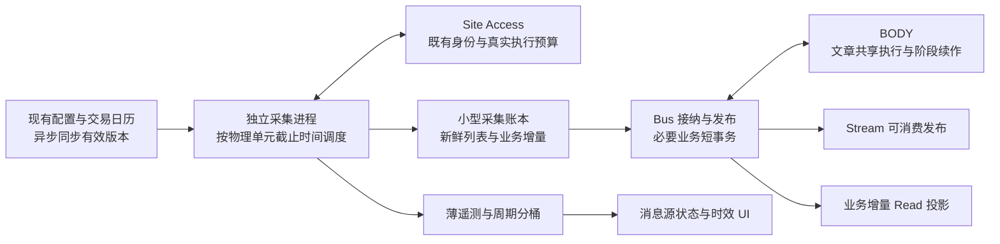

# 消息管线性能回归：结构性诊断与架构重整方案

日期：2026-10-27，北京时间。主分析窗口为 **12:00—13:35 UTC，即北京时间 20:00—21:35、纽约 08:00—09:35**，覆盖盘前及开盘。补充点查截至 14:11 UTC。本轮只读排查并制定方案，**没有修改生产配置、身份、数据或部署，也没有实施以下架构调整**。

## 1. 结论与本轮决策

这次回归的结构性根因是：**系统把采集启动、业务接纳、后台清理、执行租约和技术历史维护，连接到没有执行时长上界的共享写路径；又让业务完成状态决定下一次采集能否开始。主机上的独立资源上限没有形成总容量约束，存储稍慢就会触发续约失败、重复执行和进程重启，反过来继续增加同一路径的负载。**

因此，这不是“某个网站慢”或“增加几路并发”能解决的问题。即使临时清空队列、重启容器、减少一次 I/O，以下机制仍会随历史增长、空闲清理启动、正文回退或其他业务升温重新触发：

1. **无业务积压也会堵塞采集。** 接纳线程没有工作时，每秒可以提交历史清理；清理在业务写事务内执行，单次实际持有事务最长约 187 秒。紧急任务只能排在其后，无法抢占。
2. **采集前后都有业务写队列依赖。** 网络尚未开始，就要排队写开始回执；收到列表之后，又等待同一业务数据库提交和状态收尾，之后才释放该采集单元的在途排除。HTTP 几百毫秒，实际采集间隔却能达到数百秒。
3. **恢复本身会放大故障。** BODY 续约、完成、释放与队列清理争同一个物理写锁；短期竞争被升级成任务失效或进程退出，重启又执行数据库初始化。源轮询、正文、控制和初始化因此一起退化。
4. **正文去重没有消除续作重放。** 已确认一篇文章在约三分钟内执行 32 轮正文任务，多次下载相同 HTTP 页面，只因后续浏览器仍在恢复；这是同一任务内的阶段重放，文章去重无法拦截。
5. **技术状态仍作为业务历史逐条投影。** Read 不能越过大量技术事件直接服务新业务；生产 Read 已有约 50 分钟的事件时点落后。页面陈旧与真实采集延期同时存在。
6. **资源没有总账。** 同身份并发、轻量 HTTP 和 warm fetch 已生效，但持续驻留的 Chrome、控制器、模型进程和历史维护仍共享 16G 与磁盘。限制单次执行数量，没有限制总体驻留成本、历史扫描成本及恢复成本。

**推荐做一次有边界的职责拆分：独立采集进程与小型采集账本；业务库只保存业务增量和必要任务事实；技术运行状态走独立薄遥测；维护不能占业务关键事务；BODY 按文章共享执行并恢复具体阶段。** 保留 SQLite、现有下载器、身份控制与 ARTICLE_ONCE，不引入 Kafka、Redis 或另一套通用调度平台。

用户已明确接受：**可以延后研究和 ticker 初始化，不能影响持久化运行的 W1/W2/W3。** 因而本方案把消息实时链路和 W1/W2/W3 同列为受保障业务；不得通过延后、取消、收紧 W1/W2/W3 的启动/续作或必要预热来兑现消息指标。后台研究、ticker 初始化及其可推迟维护使用剩余资源。这个约束也适用于后续实现和容量验收。

当前不能宣称目标可在所有条件下得到保证：Reuters 的真实访问能力、付费正文权益，以及消息链路与 W1/W2/W3 合计峰值，都是必须独立验证的容量边界；无法访问的必需频道仍进入全量失败分母。

## 2. 版本、取证与口径

### 2.1 实际运行版本

- 本地 main、已知 origin/main、远端仓库 HEAD 为 `222911446e5a352f2d48eab3168ead6bfe4d2cb9`。
- 生产 Bus：`bf5f68c4`；Site Access/BODY：`9e265ea3`；API/Web/Projector/Codex Worker：`50d6b021`。组件按上次实际变更范围发布，版本组合与上次收尾一致。
- Codex Worker 容器本次启动于 10 月 27 日 09:37:40 UTC；它使用相同应用版本。**容器再次启动不等于发布了新代码。** 其他组件存在大量自动重启，见下文。
- 服务器为 8 核、约 15.24GiB 物理内存；Bus、Site、Supervisor、Codex Worker 没有旧四核 CPU quota。浏览器并发/身份稳定性问题不能归结成遗漏了四核配置回退。
- 本地存在其他会话未提交的源码、测试和 changelog 改动；本轮保留它们，不把未部署修改当作生产行为。尤其 `workspace_store.py` 排除部分临时环境目录的改动尚在工作区，不能计作已生效收益。

### 2.2 可复算证据

目录：`eval/pipeline-structural-regression-20261027/`。

|证据|用途|
|---|---|
|`initial-host.json`、`ownership-1/3/4.json`|实际组件、启动/重启、进程与 cgroup 资源；以相同实例的计数差分为准|
|`audit-runs.jsonl.gz`、`audit-captures.jsonl.gz`|主窗口全部取出的执行/采集回执，均有完成 footer；不下载整库或文章全文|
|`audit-bus.json.gz`|SCHEDULE、配置、正文 key、任务及发布审计；采集时间约 13:41 UTC|
|`audit-site.json.gz`|主窗口 1,124 条 Site 事件及身份元数据|
|`audit-logs.json`、`log-file-probe.json`|慢操作分布、异常调用栈、重启事实；慢日志是阈值采样，不是全部调用分布|
|`owner-probes.json`|生产实际清理 SQL 的 EXPLAIN、短查询及中断记录|
|`active-read.json`、`point-timelines.json`|通过 active.json 找到真正生效的 Read，核对 Owner、物理采集和投影时点|
|`audit-analysis.json`、`audit-physical-intervals.json`|沿用上一轮方法复算，保留其终端状态依赖的限制|
|`receipt-reconciliation.json`、`receipt-unit-coverage.csv`|独立使用已持久化采集起返时点，对 356 个必需逻辑单元逐项对账|

注意以下边界：

- 数据是分段只读快照，不是整套系统的同一原子快照；轮次终态、BODY 当前状态可能包含窗口结束后的收尾。后到正文另行指出，不能计入截止时的达标分子。
- 直接读取默认 `read/v2.sqlite3` 的早期结果不作为最终 Read 判断。生产实际使用 `read/active.json` 指向的 `read/serving-v4-20261018/v2.sqlite3`；最终结论使用后者。
- 长历史趋势查询达到执行预算后中断，没有把空结果解释为无轮询。能确认“上次短窗口尚较好、本次已严重退化”，**尚不能精确确定本次回归的第一分钟**。
- 真实列表回执不等于源站内容一定未被 CDN 缓存；仍须保留 Age、ETag、Date、304 基线和来源自身更新机制。本文没有把补齐证据当成执行提速。

## 3. 回归程度：页面陈旧和真实延期分别核实

### 3.1 全部应执行周期

配置快照为 99 个来源、80 个 enabled 来源、285 个绑定；主窗口具有应执行周期的来源为 71 个、必需逻辑单元 356 个。其余不直接算作漏采，按 SCHEDULE 生效范围确定分母。

|口径|分子 / 全部应执行周期|结果|解释|
|---|---:|---:|---|
|旧 due 与终端状态口径|489 / 37,438|1.31%|不能代表全部真实网络采集|
|上一轮真实时间重分配，仍要求 run 已 CAPTURED 且 trace 齐全|3,597 / 37,438|9.61%|会漏掉已有列表但未完成收尾的轮次|
|持久采集回执起返独立对账|4,171 / 37,438|**11.14%**|候选列表证据；不要求业务接纳或 run 终态成功，起返同周期、版本匹配，但未逐一认证列表有效性|
|可证明请求启动周期|4,598 / 37,438|12.28%|含未能证明及时取得列表的轮次|

11.14% 的对账允许使用 `poll_captures.request_started_at` 和原始 `observed_at`，按 targets 中各绑定版本展开共享消费者；没有生成虚构请求、重置观察时间或重写生产记录。它比旧方法多承认的 574 个周期属于**证据/结算关联差异**。仍有约 88.9% 的周期未能证明兑现，远非统计修正可以解决。

进一步检查发现，capture本身没有独立的`list_validated/winning_request_id`契约：普通路径也可能因checkpoint推进创建空capture；有混合403和未记录HTTP状态的fallback请求。不能把每份capture无条件认定有效，也不能因某一次403否认后续成功回退。**因此9.61%和11.14%是两种现有证据口径，不是已经认证的有效覆盖率区间；11.14%不作为质量合格的达标分子。** 下表为候选回执口径，最终有效性应由新增明确验证证据复核。

|来源|候选回执周期 / 应执行周期|回执覆盖|配置|
|---|---:|---:|---|
|Yahoo，含必需浏览器频道|241 / 3,420|7.05%|30s|
|SEC|134 / 1,710|7.84%|30s|
|企业 IR|396 / 2,280|17.37%|30s|
|Barron's，两必需频道|257 / 1,710|15.03%|60s|
|Investing|126 / 855|14.74%|60s|
|InvestorsHub|108 / 855|12.63%|60s|
|GlobeNewswire Search|333 / 2,280|14.61%|60s|
|Google Search RSS|29 / 190|15.26%|60s、共享单元|
|ETNews RSS|60 / 475|12.63%|60s|
|Reuters|7 / 2,280|0.31%|60s、24 QUERY|

轻量 RSS、SEC 和企业 IR 同样退化，已经排除了“只因高风控浏览器网站”这一解释。

取出的 5,524 个轮次中：CAPTURED 3,711、FAILED 753、DEFERRED 442、CANCELLED 319、DISPATCHED 299。FAILED 的原因中，`CancelledError` 472、`WriteAdmissionBusy` 163，两项合计 **635/753=84.33%**；这不是 84.33% 的网站拒绝率。部分取消前已经取得列表，须与采集证据分开判断。

299 个 DISPATCHED 中，有 167 个 dispatch 早于 13:20 UTC，不能全说成窗口末尾在途。例如 12:05 的旧记录在 13:24 已确认重启后仍未结算。当前 run 表没有充分的进程代际/存活关联，验收必须保留并标明“旧执行未结算”，不能一直称 pending 等待，也不能默认成功。

### 3.2 网络快，外围路径极慢

主窗口按 dispatch 分组的十分钟样本中，已记录列表传输均值约 **0.68—1.08s**；dispatch 到真正请求启动均值约 **18—207s**。已收尾 CAPTURED 轮次均值 **237.52s**、P95 **518.34s**。终态可能包含窗口后的收尾，因此它是执行 cohort 的时长，不能当作截止时全量成功率。

3,545 份物理 capture 的列表响应→持久提交均值 **76.41s**、P95 **212.94s**、最大 **387.31s**。13:36 快照只有 6 个 PENDING、5 个 RUNNING capture；13:41 的接纳积压查询为零。**没有大量待接纳工作，并不意味着没有采集前/提交前的排队。** 尚未提交的列表和排队写开始回执的任务，不在 capture backlog 中。

13:00—13:35 UTC 慢日志：

|操作|样本数|执行均值|进入应用写通道前等待均值|关键含义|
|---|---:|---:|---:|---|
|`PollJournal.start`|1,133|51.6ms|86.64s|网络前先被技术记账阻塞|
|`PollJournal.commit`|1,039|384.2ms|62.88s|已获得列表仍无法及时交给接纳|
|`_poll.finish`|826|113.2ms|55.30s|采集单元在途排除继续保持|
|`accept_and_claim`|154|3.81s|30.25s|事务内业务工作本身也过长|
|`PollJournal.maintain`|23|29.10s|61.45s|维护占用关键通道；事务均值29.02s，最大187.39s|

这些日志中的 Bus 写通道执行时间合计约 **2,059.7s**，与 35 分钟的 2,100s 同量级；仅清理、接纳和 capture 提交就分别占记录执行时间的约 32.5%、28.5%、19.4%。日志按结束时点落窗、存在边界及阈值限制，**不把这个比值冒充精确利用率**；但已足以证明关键通道几乎没有余量。等待时间相互重叠，不相加为“总耗时”。

### 3.3 页面为什么可能显示更旧

13:53 UTC 点查生效 Read：Bus head/checkpoint 为 9,245,731 / 9,227,793；最新一千条投影提交中，Bus 事件自身的 at 只推进到约 13:02。健康记录 `error=None` 只表示没有报告读取异常，不表示水位及时。

14:11:46 UTC，再逐绑定点查：

|绑定/频道|真实列表时点|Owner 最新采集|页面依赖的 Read 采集时点|
|---|---|---|---|
|INTC / Yahoo RSS HEAD|14:08:37|14:08:37|13:04:51|
|INTC / Barron's HEAD|14:08:47|14:08:48，含其他单元聚合|12:55:29|
|MU / InvestorsHub HEAD|14:08:58|14:08:58|12:54:33|
|INTC / SEC HEAD|14:08:44|14:08:44|12:55:15|

这些来源的真实列表也已落后约数分钟，Read 又多落后约一小时。**不能只修页面，也不能把页面年龄直接当成该网站最后一次真实请求的年龄。**

此外，后台“平均轮询耗时”来自每个绑定当前 `last_latency_ms` 的横截面平均，不是最近全部应执行轮次的均值；`api_v2/bus.py:aggregates_many()` 对当前终态取样。它再叠加 Read 落后，因此用户看到的约 50 秒并不能准确表达当前实际 200—500 秒的退化。

### 3.4 真正的新消息与正文

- 100 条首次列表时点位于主窗口、且已发生 CONSUMABLE 审计的发布记录：列表→Bus 可读取发布，均值 **463.02s**、P95 **1,399.02s**、最大 **1,746.34s**；**0/100≤10s**。这是文章×ticker 发布记录，不能当成 100 篇唯一文章，也不包括未发布文章。
- 其中列表→capture commit 均值107.89s、commit→candidate69.26s、candidate→可消费285.87s。最后一段含任务排队、正文、提交及相关性判定，不能全部叫正文下载时间。
- 台账记录的 265 次 BODY 执行墙钟均值4.62s、P95 23.75s；它不是原始网络下载时间。126 次属于 recheck，其中102次 `deadline_exceeded`。新文章128次执行中30次 `site_recovery_pending`，高度集中于下述单篇重放。
- 主窗口首见、eligible、非legacy的97个正文key：采集时状态为78 FULL/SHORT_FULL、12失败、7 PENDING。**78/97=80.41%只是稍后快照标签率**；其中2个完整正文到13:37才取得。窗口截止前能证明已取得完整标签的为 **76/97=78.35%**。未进入正文台账的首见输入及真实完整性抽检仍不完备，不能认证真实成功率超过80%。

## 4. 结构性根因：具体设计、传播路径与复发条件

### R1：局部“空闲”触发无时间上界的全局写维护

位置：`message_bus_v2/polling.py:CaptureIntake.run()`、`PollJournal.maintain()`；`storage_lane.py:StorageLane.call()`。

`claim` 为空时，接纳线程每秒可以安排一次 maintain。共享 `_maintenance_at` 在**排队之前**更新时间，没有维护任务的 pending/inflight 合并；等待或执行超过一秒时，其他接纳线程还可能提交后续维护。这里的“无接纳可领”只是局部状态，不能证明采集、BODY 或存储空闲。

maintain 把六类清理放在 `atomic_intake()` 中：包括带子查询、相关 EXISTS 和排序的 capture/run/SCHEDULE 删除。生产 EXPLAIN 已显示 run 清理选择 `status` 前缀索引，再做相关查找及临时排序；`LIMIT 64` 限制返回/删除条数，**不限制找出这64条需要扫描多少历史、触发多少引用清理和CDC**。并非所有查询都缺索引：verdict、expiry、parent等已有索引，不能笼统说“补一个索引即可”。

写通道即便有优先级和“8个紧急后一个普通”的公平规则，也不能抢占已经进入事务的187秒维护。`StorageLane._execute()` 为保护提交而 shield 线程取消，这是必要的提交安全，但**没有让工作本身有界**。外层超时不能中断尚在执行的任意Python/SQL工作。

复发条件：历史变长、三天保留边界推进、旧积压清空后接纳更常为空、页缓存不足。上次优化减少了业务重复工作，却没有取消这条维护占槽路径；本次空 backlog 与极慢轮询完全可以同时成立。

### R2：物理采集生命周期与业务处理生命周期仍捆绑

位置：`scheduler.py:_poll_impl()/on_page()`、`_poll_distribution()`；`persistent_runtime_v2/bus_orchestration.py:run_once()`。

普通单元需要读取兼容 PollState、排队写 start，才能真正发送请求；`on_page()` 需要向业务库提交 capture；结束还要更新run、状态及部分遥测。`_inflight` 直到整个协程完成才移除。**业务收尾慢，会使该单元无法开始下一次有效采集，哪怕网络许可和浏览器都已释放。**

BY_DISTRIBUTION 仍使用包含 roster、目标和接纳状态的 distribution run 协调采集，存在读取 pending capture、返回既有run/旧处理状态的路径。当前必须保留真实请求证据才能区分复用与有效刷新；不能用“run返回成功”替代网络执行。

全局调度 tick 还依赖 activation admission、初始化 heartbeat、请求开始批量落库、完整配置准备、Runtime 日历/任务/暂停状态以及 SCHEDULE 维护。这些不是每个来源自己的网络限制，一个环节慢即可让大量互不相关的来源一起错过周期。

已经正确的部分应保留：多数适配器的 `request_permit()` 已只包网络；Yahoo RSS 与浏览器路径有分离；读/准备通道已独立；不能声称这些尚未实现。此次主要要拆的是**更外层的单元在途生命周期和采集对业务库的依赖**。

### R3：进程内写队列被误当成系统级资源协调

位置：`storage_lane.py`、`repository.py:transaction()/atomic_intake()`、`polling.py:accept_piece()`。

Bus 和 BODY 是不同进程，各自的 StorageLane 不互相认识；控制、初始化、Read确认及维护还会访问相关Owner。应用优先级不能跨进程阻止一个长事务占住SQLite物理写锁。

接纳虽然已在事务外解码/准备分片，事务内仍包含发表状态再验证、旧输入首次观察批量写、配置/状态读取、接纳、分发/任务创建、计数与复用收尾。`accept_and_claim`还把接纳后下一次领取放进同一次writer访问。**候选数有上限，不代表其中查询、模型重建、引用更新和事务持有时间有上限。** 实测执行均值3.81s，事务均值3.77s。

body的准备/领取/开始/审计/结果/完成/释放拆成多次往返，每次受同一物理锁影响；仅 `release` 在35分钟中就出现1,608条慢日志、平均等待12.46s，而大多数没有产生业务变化。给每个进程再加一个优先队列不能解决这种跨进程耦合。

### R4：短租约与故障恢复没有独立的可兑现路径

位置：`content_enrichment/service.py:_renew()/_process_guarded()/run_forever()`；`repository.py:claim_enrichment_jobs()`；各worker入口。

BODY任务租约60s、每20s续约；续约又进入同一写队列并有10s外层等待。队列拥塞时，即使下载器或文章本身正常，也可能被当作 `enrichment_lease_lost` 取消；处理线程退出后还要排队release。取消安全的存储线程可能继续运行，意味着“10s取消”并非可靠的实际资源释放边界。

部分任务或顶层领取路径把存储竞争抛到进程入口；Bus的通用竞争判断只识别SQLite异常，不完整覆盖自定义 `WriteAdmissionBusy`。控制进程heartbeat写失败会退出；BODY重启又实例化会执行DDL的 Repository。日志已实证正文启动时卡在 `repository._initialize():316` 的 `BEGIN IMMEDIATE`，构成重启→初始化争写→再次失败的循环。

13:36快照的累计重启：Bus13、BODY17、Control114、Initialization34；13:51前后的日志状态已为Bus14、Initialization38、Control120。并非本轮进行了这些重启；相关当前状态 `OOMKilled=false`，不能全部归因OOM或运维发布。历史Supervisor子进程有OOM计数，但时间归属不足，不能把它代替已确认的锁失败调用栈。

同一日志尾段还出现2次`distribution_continuation_lease_lost`。这表明分发/L2续作也受同类存储与租约问题影响，不能因为上轮已修复旧token重放就认为后段不会再阻塞。Runtime调度日志亦有锁异常和`effect lease lost`，本轮没有审计其策略/交易业务后果，不能声称W1/W2/W3已经不受当前故障影响；后续资源隔离必须同时保护它们。

复发条件：任何一次长清理、慢提交或全机分页。恢复成本缺少总预算，故障时产生更多租约、审计、初始化和取消收尾写入。

### R5：正文回退缺少阶段续作和“无能力等待”语义

位置：`content_enrichment/service.py:319—352、484—526`，`content_enrichment/pipeline.py`。

实证key：`9f06d3087d125ae3768bd8c76f622d682371f19bec2dacc43a90512b2bcf39b0`；任务 `enrich-2bfe638ad4902b204c22a106abf18a74ad79e6a3b527a451073ef9512d3660bf`。Google发现的 TechPowerUp 文章：

- 12:37:53列表取得，12:39:31提交，12:45:46候选准备，12:46:09入正文任务。
- 12:46:13—12:49:15有32次执行；前30次主要是 HTTP200、约119,908字节的相同页面，随后浏览器 `site_recovery_pending`；末段readtimeout和deadline。
- 阶段续作只查找 `site_budget_deferred`，恢复等待没有同等续作机制。临时延期又递减attempt_count，失败阶段可反复进入。
- 延迟计算在 attempts 非空且所有 `retry_after_seconds=None` 时得到0，而不是默认60，再被压成1秒；于是接近每轮都重新访问HTTP。prior_attempts随执行增长，再被重写到任务里。

HTTP200不证明正文完整，本轮没有据此跳过浏览器或放宽FULL。正确修复是保存可复用中间产物、等待具体能力恢复并从未完成阶段继续，不能把短预览当全文。

此外，代码仍有 `budget_started_at is None && 排队超过10分钟` 的 `queue_expired` 分支，会把已接纳任务在没有下载前置为deadline失败。**时效SLO违约、业务接纳有效期和实际下载预算是三件事**。不能用任意排队年龄代替正文质量失败；已过SLO的文章仍应完成合理补全和可解释收尾。

### R6：技术运行记录进入通用Read历史，形成第二条增长型关键路径

位置：`v2_read/outbox.py`、`projectors.py:109—123`、`repository.py:ingest()/close_current()`、`serving_gc.py`。

薄CDC已经安装，但 poll_run/capture/state、BODY job生命周期仍逐条经过Owner触发器、receipt/outbox、投影读取、当前对象、历史对象、引用/索引及清理。BODY job还产生 native 对象和body_job对象。每个源事件独立 ingest/commit，读取同一源的业务发布不能越过前面的技术序列。

13:36最近1,000条Bus CDC中，poll_states333、poll_captures294、poll_runs102，再加content_enrichment_jobs222，共 **951条技术/任务事件**。这只是事件数，不当成物理I/O比例。生效Read最近2,000条历史对象中，前三种轮询对象1,281条。生产Bus约26.93GB、实际Read约22.25GB，均非本文下载的整库。

故障不是“前端多一个spinner”：同盘投影、技术引用和维护参与资源竞争；技术队列反过来让最新状态和业务消息都显示陈旧。保持现有按对象逐条投影全部运行过程，再只缩小载荷或加速GC，仍会随采集频率和历史量增长。

### R7：局部容量上限相加不受总资源约束

位置：`site_strategy/worker_manager.py`、`worker_runtime.py`、`budget.py`；`codex_worker/jobs.py`、`startup_admission.py`、`session_retention.py`；Compose与host slice。

当前全局浏览器执行额度、BODY额度、同身份并发、controller数量及模型冷启动限制分别存在，但控制的是不同资源：**执行页数不等于驻留进程数；冷启动速率不等于活跃模型数量；终端会话清理limit不等于历史扫描limit。**

13:38快照中Supervisor约168进程、117个Chrome进程；Site约67进程，其中12个Node driver、14个Python及32个Chrome；Codex Worker约42进程。RSS直接相加包含共享页，不能冒充精确物理内存；cgroup计量与实际驻留共同支持容量判断。

相同实例约13:38—13:47的cgroup差分，Codex Worker读取约44.7MiB/s、Site38.5、Supervisor35.2、Projector3.36MiB/s。重启实例的负差值已排除，不能算“负I/O”。进程I/O可能包含回收子进程记账，因此不把主Python累计量直接归因到某一个函数。尚未获取足够Python栈采样，**这些读取在具体调用间的占比仍需实现时补充低开销profile**。

可直接确认的增长型代码路径包括：终端会话维护先列全部SDK线程，再扫描历史jobs JSON；workspace/快照维护有全局库存和输入哈希；Site维护先预热再巡检/回收；公开publisher也能拥有独立controller。它们有部分缓存、TTL和保护，不能说完全没有回收；问题是没有共同的驻留/扫描/恢复成本总账。

同一差分窗口CPU执行约39.0%、iowait57.9%、idle3.1%；13:36 swap2GiB耗尽、I/O PSI avg60 some90.9%、full80.8%。这解释故障的物理传播，但根因是上述工作归属和准入设计。共享应用slice memory.high14GiB、max15GiB、memory.low=0；多个容器各自可到15GiB或6/8GiB，不能视为有足够独立保障。

特别是 `message_bus_v2/pressure.py` 只看CPU PSI决定背景工作。当线程主要等磁盘、CPU PSI不高时，背景重检仍可能进入；“CPU不挤”被误用为“全链路有余量”。不得通过对W1/W2/W3施加新门禁来修正这个问题。

### R8：真实来源限制与错误协议仍需独立闭环

- Investing：140次CRAWLER均成功，Site执行均值3.07s；说明其本轮主要损失在外层调度/存储，不能先放宽其身份数。
- InvestorsHub：140次中122成功、16预算延期、2服务不可用；Site network字段均值7.77s、P95 24.15s，browser_runtime均值5.42s。相同身份并发和warm anchor确实在用，但其执行尾部与容量仍需优化。
- Yahoo浏览器：148次中126成功、22预算延期；14个site_queue_timeout、8个access_budget_exhausted。RSS不允许替代这个必需频道。
- Reuters：20条CRAWLER结果中7成功、11排队超时、2恢复/挑战等待；24个必需QUERY只取得7个有效周期。既有真实访问受阻，也有身份/恢复准入问题；首页或探针绿色不能代替QUERY能力。
- GlobeNewswire有406条CRAWLER事件，需按查询/实际HTTP、browser回退分别计成本，不能把搜索单元串成一个source总任务。
- `identity_worker.py:430` 取消时发送 `failure_category='TRANSIENT'`，schema允许的是 `TRANSIENT_TRANSPORT` 等枚举；生产已见 `ValueError: 'TRANSIENT' is not a valid FailureCategory`。一次正常取消因此可能变成RPC异常和缺失结果，必须修协议边界。

Reuters在本窗口占应执行周期约6.09%。即使其余单元全部成功、它保持当前结果，全局也最多约93.93%，无法接近99%。这是实际能力依赖；如果现有身份/出口无法恢复，需在保留覆盖要求下评估官方或授权替代并征求确认，不能从统计中隐藏该源。本轮没有购买服务或改变来源。

### R9：Site Access异步入口仍同步访问Registry，能冻结所有身份

位置：`site_strategy/api.py:400`、`service.py:execute()/_execute_idempotent()/_cache_key()`、`repository.py:transaction()/append_event()`、`worker_manager.py:snapshot()`。

API直接`await service.execute()`；其中请求合并键、路由/身份快照、部分运行态更新与最终`append_event()`仍同步读取或写入Registry，Repository使用共享连接与RLock。即便普通浏览器操作已有并发gate，**事件循环在一次同步SQLite读取、锁等待或提交上停住时，其他身份的协程、超时和已完成命令回调也都无法及时推进**。

这不是纯理论：13:47:40进程采样中，Site主线程TID/PID 4052672的内核栈正在`filemap_read → pread64`等待文件页；不是只有后台线程在等磁盘。尚无Python栈将这一次读取准确分配到具体SQL，因此不声称已测得各函数占比，但上述阻塞调用路径由代码直接确认。

此外，`_cache_key()`先于`_execute_deadlined()`执行；remaining_budget_ms是传入的整数，内层计时从后者开始。同步前置与结果记账不充分进入内部deadline/phase，不能从小的`global_wait_ms`或`queue_wait_ms`推论整个准入很快。增加Chrome槽数绕不开这个事件循环阻塞点。

## 5. 目标架构：只增加必要隔离，保留现有业务语义

### 5.1 独立采集面

使用同一项目镜像增加一个正式Compose采集角色，例如 `v2-message-collector`。它拥有小型 `acquisition.sqlite3`，只保存配置版本快照、每物理单元checkpoint、待交付capture及必要边界。**不装通用NativeContent/CDC触发器，不查询Read，不在每个tick访问Runtime或初始化写库。**

现有Bus进程保留接纳、相关性判定和发布；BODY进程保留下载。不是把现有大调度器原样复制进新容器：必须同时拆掉它对业务run、全局heartbeat写入和业务收尾的启动依赖。

单元以端点/查询/必需频道为主键，绑定是消费者。完全相同且scope/版本兼容的物理请求共享一次起返；不同ticker查询、不同频道不得合并。一个单元失败只影响自身，不阻止同source其他单元。

调度只保留一个真实网络在途，结束条件为列表验证和采集账本的最小持久提交；**不等待Bus接纳、BODY、分发、Read或技术历史归档**。跨过旧周期时启动一次当前新鲜请求，保留旧missed区间，不突发补发全部过期周期。

请求启动记录先进入有界内存薄事件队列，异步分批落遥测，不作为发送请求的前置条件。崩溃丢失的技术尾段明确UNKNOWN；业务增量必须先持久化才能推进checkpoint或确认交付。变更输入不能被“只留最新列表”覆盖丢弃；相同输入可以合并等待者。

### 5.2 业务面只承担真实增量

沿用已实现的语义指纹、verdict复用和文章正文复用；这轮不重写下载器或再造一套去重。

- 采集账本与业务库采用至少一次交付：Bus在同一业务短事务内写入 `capture_id/item_key` 的幂等接纳与必要任务，再确认采集账本。先业务commit后ack；任一处崩溃重放可去重，不需要跨库两阶段提交。
- 接纳前的解析、日期判断、候选排序、哈希和正文复用判断准备放在事务外。事务内只做按主键/唯一键的必要版本和发表一致性复核、状态转换和最小写入。
- 空/已知/拒绝输入不重复创建文章观察、任务、完整receipt或逐ticker计数历史。必要首次时间证据只首次建立；以后累加薄计数。
- BODY结果和任务收尾尽量合成一次原子业务提交，READY唤醒后立即处理；既有regex/L1正向快速交付、L2正向增量发布继续保留，不作为尚未实现的新收益。
- 保留现有两个受控业务写入者即可，前提是清除长事务和多次无意义往返；不为这次低业务增量强制迁移数据库。**StorageLane不能再被当成跨进程互斥或全系统容量保证。**

增量复用必须包含实际业务版本：source/binding、terms/adapter与适用窗口。不能为减写删除实质更新字段、忽略条款变化或把未知日期重新当作新文章。完整正文按content hash与既有scope/language/quality版本复用；文章实质变化仍更新原消息及修订状态。

### 5.3 技术历史退出业务CDC关键路径

物理请求、周期结算、阶段耗时采用薄结构记录，按短批次写入独立遥测/时间分桶；UI读取当前单元状态和滚动聚合。保留失败、延期、未结算和共享物理请求引用，配置变更有生效时间。

通用Read只接收业务消息、修订、相关性/消费状态及必要配置；不再逐条投影每个poll_run/capture生命周期、BODY lease心跳。排查需要的原始薄事件按既有保留要求归档，正常页面不扫描它们。

这不是把业务审计删掉：ARTICLE_ONCE、正文更新记录、控制原因、真实发布及消费事实仍持久化。技术证据与业务事实使用不同保存路径，避免“为了证明每次轮询，先把轮询堵死”。

### 5.4 维护和恢复的边界

- 维护退出业务关键事务，单实例去重；空闲检测不再自动每秒扫描历史。按时间分桶/可推进游标选择候选，保留每单元边界事实，避免每次删除都查询全部历史寻找边界。
- 维护预算同时约束扫描数、时间、事务持有和字节，不仅是DELETE行数。候选选择在读路径，真正删除短批事务；异步CPU/文件操作不持业务writer。
- 进程启动只验证已安装schema版本；DDL/迁移由正式发布脚本显式执行一次。缺迁移给出明确错误，不能每个角色不断尝试初始化大库。
- 存储竞争在可重放事务/单任务边界恢复，不把一次claim/heartbeat竞争变成整进程退出。提交状态不确定时查原幂等键，不能盲目重复执行网络。
- 不靠简单延长租约/超时解决拥塞：领取尽量靠近实际执行；续约只更新窄lease记录，不编码完整任务、不发业务CDC；完成和释放可幂等，一次实际存活执行不因普通后台维护失去所有权。

单次续约等待超时先标为基础设施待确认，不直接等同于Owner被撤销；真正失去代际/token时才丢弃旧状态写入。已取得正文按内容键保留，后续只有通过当前版本/更新hint验证的结果可接纳，不能为了避免重复下载放开旧执行的发表权限。

## 6. 可直接执行的开发清单与依赖

以下顺序针对共同根因，取代继续按网站零散打补丁。每步都可独立评审，但**不能只发布第1步后宣称本轮完成**。

|工作包|优先级/依赖|改动位置与执行事项|完成证明|
|---|---|---|---|
|A. 取消维护堵塞与重启放大|P0，立即|`polling.py`移除接纳空闲每秒maintain；维护单实例、独立低频循环、候选读与删除分开。`repository.py`/factory及各worker增加运行态不开DDL模式；入口准确处理可重放存储竞争。修TRANSIENT协议。|构造大量三天前记录，空接纳队列下持续采集；清理不得持有业务writer超过预算；竞争不导致Bus/BODY/control重启。|
|I. Site控制路径解除事件循环阻塞|P0，与A/B并行，G容量验收之前|`site_strategy/service.py/repository.py/worker_manager.py`；同步Registry读写进入有界线程工作单元，请求复用带revision的配置快照；技术事件批量异步，必要Owner写优先且短；入口统一截止时间。|注入Registry读/提交迟滞时，其他身份命令回调、超时和健康接口仍可调度；实际准入时点完整，普通页面并发和维护独占语义不变。|
|B. 拆独立采集面|P0，A后，可并行准备|从`scheduler.py`和`bus_orchestration.py`提取单元计算/调度到collector；新小账本、checkpoint、版本、物理共享请求；复用现有adapter及SiteClient。`corporate_ir/coordinator.py`接同一物理采集契约。|人为暂停Bus业务writer/Read投影30s，HTTP与必需浏览器单元仍按周期启动和获得列表；增量不丢，后续可接纳。|
|C. 幂等增量接纳与短事务|P0，B接口先冻结|`polling.py`、`service.py`、`distribution_repository.py`、`repository.py`；capture/item唯一接纳回执；消除技术计数/receipt多次往返；prepare在事务外，最终复核按键；不要重新扫描旧全文列表。|在业务commit前后、采集ack前后逐点崩溃测试；无重复Stream、无漏掉变更输入；事务成本对历史库量不线性增长。|
|D. 薄遥测和消息监控快照|P0，B/C并行|`poll_trace.py`、`cadence.py`、`v2_read/outbox.py/projectors.py`、`api_v2/bus.py/news_timeliness.py`及Message Bus页面；单元状态/周期桶替代技术MVCC。显示数据观察时点、投影水位、最久未刷新必需频道。|Read backlog不能挡源状态或新请求；失败/孤儿执行不再伪装窗口尾pending；Owner与UI时点可对账。|
|E. BODY阶段续作与租约收尾|P0/P1，A后|`content_enrichment/service.py/pipeline.py`、`body_results.py`、任务Repository；恢复/预算延期均保存resume stage和有效HTTP中间产物；零值retry_after修正；等待能力恢复释放任务执行槽；结果/任务完成合并。|同一TechPowerUp badcase重放，浏览器恢复等待不反复下载相同HTTP；真实下载重试仍可执行；续约延迟不丢已取完整正文。|
|F. 全机前台保障与后台准入|P0，与B同批验收|复用`resource_safety`、Worker准入及运维slice；区分W1/W2/W3、消息链路、可延期研究/初始化。限制后台新启动、驻留和重型库存/GC工作；不对W1/W2/W3增加新限制。|消息采集+W1/W2/W3共同峰值下验收，研究/初始化出现可解释等待；保护任务启动、续作及发布不受后台冲击。|
|G. 站点占槽与真实能力|P0/P1，B/F稳定后|Site `budget.py/worker_runtime.py/fetch_anchors.py/origin_listing.py`及来源adapter；统一测实际slot，不把排队计入网站成本；逐站恢复/轻量路径/必要回退；必要时验证同身份3/4并发。|Barron's、IHub、Investing的30s/20ticker容量实测；Yahoo两个频道分验；Reuters逐QUERY恢复；没有身份重置或覆盖下降。|
|H. 正文真实完整性与更新|P1，E及C后|`quality.py`、publisher提取器、`body_results.py`及新文章cohort；修空提取、预览/推荐污染和有权益站点路由；给正文实质更新检查可兑现的小预算。|全部首见文章台账含失败/未完成；盲抽真FULL、SHORT_FULL；文章实质更新改原消息与修订状态，ARTICLE_ONCE无重发。|

### 6.1 A包的具体收缩，不做另一套维护框架

1. 将旧maintain调用从五个接纳循环移出；只有一个维护任务，任务未结束不能再排下一个。
2. 先读出有索引边界的候选主键，再按键短事务删除；run清理避免“按全部status扫描再排序”。发布前对生产规模fixture查看EXPLAIN。
3. “保留每单元最后一个边界capture/SCHEDULE”改为显式边界记录，后台推进一次，而非删除时重复相关EXISTS。未完成capture及其仍需引用的父件继续保护。
4. 起始工程预算：业务短事务P95≤20ms、P99≤100ms；后台一次写持锁≤20—50ms，超预算退出本批并保留游标。它们是开发验收预算，不是生产已达到的数据。
5. 不删除旧数据制造通过，不在线VACUUM大库。旧技术历史保留只读，待切换完成、引用与保留期核对后离线归档/回收。

### 6.2 B/C包的数据契约

最小增加三类结构，不再创建全字段对象快照：

- `unit_head`：物理unit、配置epoch、必需性、周期、下一due、checkpoint、上次真实起返、运行代际。
- `capture_delta`：capture_id、unit/版本、原始起返、输入语义指纹、业务delta引用、交付状态。变化列表不可覆盖；完全相同输入可只挂等待者。
- `accepted_capture_item`：业务库内唯一capture/item接纳回执，连同文章/任务写入同事务。文章级跨源复用沿用canonical key、scope、language与实质更新hint约束。

请求trace保留一个physical_request_id，多个逻辑订阅引用它；**共享旧结果不能获得新时间戳信用**。capture另存明确的列表验证结果、winning_request_id和实际覆盖单元，区分`VALID_CHANGED/VALID_UNCHANGED/NOT_MODIFIED/INVALID/UNPROVEN`，不从最终run状态倒推。304必须有已验证基线；响应缓存/年龄单独记录。HTTP失败后SDK/浏览器回退成功，只有真正提供该列表的请求获得信用。

配置仍以现有Owner为权威。collector异步接收已激活版本并在请求边界应用；停止/禁用/临时开关截止要有applied确认，未确认不能向UI谎报已生效。首次未知配置不启动，已有有效配置不因可选heartbeat写暂慢而停止全部来源。临时休市开关仅作用Message Bus，日历、checkpoint、ARTICLE_ONCE和在途收尾语义全部保留。

### 6.3 E包：按文章执行，按阶段重试

1. 同一fetch_key只有一个真正下载执行，等待者引用结果，不以每个ticker的独立重试任务竞争正文租约。
2. HTTP的有效响应/解析证据按URL、scope、语言、validator保存到已有内容存储；浏览器能力暂不可用时记录`WAIT_CAPABILITY`及具体原因/next_due。可以使用现有任务状态加字段实现，不引入新状态机框架。
3. 恢复等待不减到可无限重放的“新attempt”；能力未变化且未到next_due，不领取、不下载、不追加同义审计。
4. 明确区分没有retry_after、0和合法正值；site_recovery_pending采用有效恢复时点，缺值时合理低频等待，不能默认每秒重试整条链。
5. 已接纳任务不因队列超过10分钟冒充download deadline失败。记录SLO_LATE，下载预算从真实执行开始；原始发布时间、接纳窗口和实质更新判定继续保留。
6. 正文质量不降级：保留FULL/SHORT_FULL判定、付费预览拦截和Reader必要回退；没有权益的完整正文明确失败/能力缺口，不将其从总分母移走。

### 6.4 F包：用户已批准的资源决策如何落地

**不能直接给整个Codex Worker设一个偏小上限**：它承载W1/W2/W3，这样会违反用户要求。也不能简单暂停所有“background”标签；必要的W3恢复/准备必须按实际Owner和任务类型识别并保护。

实现顺序：

1. 在现有Worker准入层识别受保护W1/W2/W3及其必要准备、消息实时任务、可延期研究/ticker初始化。以持久任务字段和Owner为准，不只用run_id字符串猜测。
2. 只对可延期类别控制新启动、可选预热与全历史维护。保留在途任务和交易处置；已有W1/W2/W3限额、路由、模型及续作协议不因本轮被收紧。
3. 给实时采集、业务短写和必要HTTP BODY留出内存/CPU/I/O余量；冷身份cookie、profile持久文件不等于必须让所有控制器、页和driver一直驻留。公开无会话约束的publisher优先HTTP，必要浏览器可使用小型共享managed运行时与隔离Context；已验证高风控身份维持原归属。
4. 将研究/初始化的全库存、哈希、终端历史维护做增量游标/变更队列；limit同时限制扫描量，保护已完成证据。不把这些长操作塞进实时Owner的writer。
5. 容量用总账验收：`OS/页缓存 + 消息固定成本 + 真实Chrome驻留 + W1/W2/W3峰值 + 其他必要服务 + 安全余量 ≤ 16G`。后台研究/初始化只使用剩余量。页缓存不能当作“全可回收的免费空间”。

可先以OS/页缓存约3GiB、消息/接口/投影固定开销约2GiB、受控浏览器约5—6GiB、其他服务/余量约1GiB作为测量起点，**剩余容量必须覆盖实测W1/W2/W3峰值，不给其虚构3GiB硬帽**。若二者必要峰值超过本机容量，即使研究和初始化全部等待也不能承诺目标；届时应提出把后台研究/初始化及重维护迁出、或独立部署采集/浏览器，必要时扩容。迁出后台不能自动解决W1/W2/W3自身过大的峰值，必须实算。

### 6.5 I包：保留身份控制，移除同步控制I/O

1. 不把整个async execute扔到新线程/新事件循环。只将同步Repository访问封装为有界线程工作单元；不得在线程里等待浏览器或持RLock跨网络。
2. 按一次请求形成路由、identity、profile、egress的版本快照，复用已有revision失效机制；不在共享键、尝试、结果缓存等多个阶段重复完整解码目录。必要的配置/维护代际复核仍保留。
3. 所有权、挑战现场、会话和路由转换属于必要Owner事实，短事务优先提交；ACCESS_RESULT/CAPTURE_CONSUMED等技术明细批量异步，不阻止其他身份的网络和回调。丢失的技术尾段标记未证明，不能伪造成功。
4. 从API进入即建立单一monotonic deadline，分别记录排队、Registry准备、Site/Identity准入、worker、物理网络/脚本、Owner提交、结果返回；重试使用剩余预算，不每层重新给满timeout。
5. 明确普通同身份页面并发与配置/登录/恢复独占两类操作；后者仍保留必要一致性边界。恢复探针按身份合并、单次执行，不能24个QUERY分别启动恢复，也不能让恢复控制通道被业务请求占满。

## 7. 30秒、20ticker的容量与来源改动

### 7.1 按物理需求计算，不按固定9ticker设阈值

主窗口逻辑due为 `37,438 / 5,700 ≈ 6.57个周期/s`。这包含共享消费者，**不能直接当成物理HTTP请求量**。实现时由当前端点/查询/频道集合计算去重后的物理需求，再加真实BODY新文/更新需求。

对每个站点/身份池计算：

`λ = Σ(独立物理请求数 / 周期)`；`所需槽数 ≥ ceil(λ × 平均真实占槽 / 0.75)`。

同时核对CPU秒/请求、驻留内存和P95尾部；固定间隔约束必须有网站证据。槽数公式只是平均稳定性下界，不保证99%截止时间。采集与BODY的服务成本、恢复探针分别入账，不能把重试、源许可排队及DB等待全部叫网站响应时间。

|来源|20ticker目标需求|已知成本与判断|执行选择|
|---|---|---|---|
|Barron's|两必需频道，40请求/30s|当前HTTP传输约0.71s；平均在途约0.94，75%预算约2槽；浏览器BODY另算|继续轻量列表，不新造身份；分别验证两个频道、缓存年龄与异常回退。|
|Investing|20请求/30s|上次较健康窗口约0.96s；本次Site约3.07s，平均槽需求约3；本次物理传输仅约0.94s，差异不能丢掉|先消除全机与控制开销，再重测；保留国家域/权益/已验证身份，不盲目加页。|
|InvestorsHub|20请求/30s|上次约3.77s，需约4槽；本次browser_runtime5.42s约需5槽，含重试的Site7.77s约需7槽|不能把当前受压均值直接变成7路并发。先降单次成本；若保留2槽，平均占槽须≤2.25s，否则必须验证更多同身份并发或真实轻量接口。|
|Yahoo|每ticker的RSS和必需浏览器分别计|两个频道不能互相抵账；browser尾部、身份准入仍有真实失败|保留已有分离/warm机制，消除外层阻塞；BODY/恢复不得占满新列表预算。|
|Reuters|按实际QUERY数/周期，不是ticker数|24QUERY仍严重受阻；原有验证不足以推导20ticker|先逐QUERY恢复真实访问和恢复控制；必要的官方/授权数据替代作为需确认的业务依赖，不能静默去掉该源。|
|GlobeNewswire|独立查询数/周期|搜索与正文路径不同，需分别分配预算|保留HTTP/SDK优先，浏览器只用于确需的查询/正文；一个慢查询不锁整个source。|
|其余RSS/JSON/IR/SDK|去重物理端点集合|网络普遍远快于外围等待|首先享受采集隔离与薄账本；不再为每个ticker创建浏览器/完整技术快照。|

已有warm fetch、冻结闲置页和同身份2并发不重复列作“新增优化”。IHub优先在**同一既有身份及出口**验证最小接口/同源轻量获取，不能未经测试复制cookie到另一套HTTP指纹破坏访问能力。需要3/4并发时先做受控稳定性测试，不突破实际profile单写、登录/维护独占及挑战现场保护。

## 8. 切换、历史与故障安全

1. 显式安装新小账本及业务幂等键，记录schema版本；不在所有worker启动时DDL。旧26GB业务库不做整库重编码。
2. 从现有有效配置和最新checkpoint建立collector初始状态；保留首次观察、基线、查询分页及未完成变更输入。不能重新bootstrap全部历史或重置ARTICLE_ONCE。
3. 先将少量HTTP单元交给新collector，再覆盖共享源、IR、Yahoo两个频道和高风控源。**每个物理单元同一时刻只有一个采集Owner**；切换时旧Owner停止新启动，允许在途持久提交，后由新Owner续接。
4. Bus按幂等键接纳新账本；旧未完成capture继续小预算处理。当前已无大规模接纳积压，不安排一次性的全历史重新扫入。
5. 旧run没有终态的保留UNKNOWN/ABANDONED_GENERATION及真实capture关联；不要把它们回填成成功或永久pending。后台recheck保留更新义务，按能力及小预算推进。
6. 停止轮询技术CDC后，通用Read只保留切换前历史用于审计；当前消息源状态改读薄快照。业务消息投影连续，旧Stream和修订ID不变。
7. 回滚按单元Owner代际切回；checkpoint只从已经持久化且验证的采集事实推进，不从UI水位或空heartbeat倒推。跨库ack重放由幂等键处理。
8. 正式发布重build受影响的长期容器，保留生产卷、身份及必要回滚镜像；不以临时容器代替运行，不在实时高峰在线压缩大库。

## 9. 验证与验收

### 9.1 必要自动化测试

- **隔离**：业务writer持锁30s、Read停止、初始化/Runtime库竞争，collector仍有真实请求起返；不只断言scheduler创建了task。
- **Site事件循环**：Registry同步读写注入迟滞，其他身份的已完成网络回调和超时仍及时运行；技术事件写慢不等于整个Site服务停摆。验证所有权/维护切换仍能正确fence旧请求。
- **维护**：生产量级旧run/capture、无接纳工作、刚跨三天边界、没有可删记录；观测扫描量/持锁时间，验证只有一个维护任务，不能因LIMIT小而放过全表扫描。
- **恢复**：claim/renew/result/ack各处注入busy、超时及进程丢失；不整进程循环重启，不丢已取得的完整正文，不越过旧token写新状态。
- **重复与更新**：同一物理响应多个ticker、同文跨源、相同输入持续一小时、真实正文实质更新；下载复用，变更不丢，ARTICLE_ONCE原消息和修订准确，旧消费者不重触发。
- **正文回退**：HTTP200但不完整→浏览器恢复等待→恢复后成功；等待期间不重复HTTP。测试retry_after缺失/0/正值、Reader回退、权限缺口及质量拒绝。
- **周期与证据**：失败、延期、旧代际未结算、304、共享请求、进程在收到列表后/写终态前崩溃；独立采集证明不依赖BODY或run终态。
- **范围开关与配置**：禁用、暂停、临时休市开关提前关闭/到期/重启及下一交易日；禁止新启动、允许在途收尾，跨系统日历语义不变。
- **W1/W2/W3保护**：后台研究/初始化饱和时，不给持久化运行增加新门禁、取消、改模型或破坏续作；必要预热与业务heartbeat正常。测试真实受保护任务路径，不能用空桩代表。

### 9.2 性能验证先有确定性负载，再有盘中真实窗口

先以现有来源payload录制回放模拟9/20ticker的实际端点集合，注入新文章和长历史，至少覆盖一小时持续运行及跨保留边界。隔离网络变量后确认不会因运行时间而积累技术队列/驻留成本；再做真实来源30s受控canary和连续盘中窗口。

真实窗口固定起止、配置版本和所有必需单元，保留：

|目标|主验收方式|禁止替代|
|---|---|---|
|周期兑现接近100%|全部应执行周期中有真实请求起返且列表有效的比例，目标≥99%；全局和逐单元并列，失败/延期/未证明仍入分母|只看成功轮次、启动task数、修改epoch或移除Reuters|
|实际刷新匹配配置|每单元相邻真实request/listing间隔、P50/P95/P99、最大及首尾开放缺口；工程目标P95≤周期+2s，超期逐项说明|仅平均间隔、RSS掩盖浏览器、旧缓存重标时间|
|轮询及交付<10s|分别测due→request、request→validated list、list→durable delta、delta→job/READY、正文、READY→Stream、Stream→Read/UI；新文目标P95尽量≤10s，并报告均值和≤10s占比|把BODY之后的等待叫下载、只看已发布样本、先发摘要算完整交付|
|真实正文>80%|按首次列表新文章canonical key建cohort；FULL/SHORT_FULL经正文边界/权限/完整性核验，失败、未执行和未完成保留；截止及后续收尾分开|attempt成功率、缓存命中率、后到正文挪进截止分子、预览充FULL|
|长期稳定|队列净增长、写持有时间、各类驻留成本与重启数；研究/初始化高负载并存|只观察重启后最初几分钟|
|W1/W2/W3不受影响|保持既有启动/续作/必要准备语义，比较同负载下进度和时点；出现影响即不接受资源策略|把持久化运行降载当消息优化收益|

记录每个首见文章最终状态：未接纳及原因、BODY等待/失败、相关性拒绝/等待、已可消费；同文多ticker另外统计首次/最后一次应交付时点。未发布文章不能消失在时延分母中，相关性明确拒绝则保留其业务结论，不伪装发布失败。

需要至少一次较长稳定性验证覆盖清理边界与后台研究/初始化启动，而不仅是新版本一小时短测。长测可低频采样，不需要持续高频读取生产大表。

## 10. 交付边界与下一步

本轮完成的是结构性诊断与可执行开发设计。已经确认的根因均对应A—I工作包；没有将“减少I/O”“提高并发”单独列为解决方案，也没有将未定位到函数的资源读取强行归因给某个新改动。

下一轮建议先做A/I并建立B/C的数据契约，同时实施用户已批准、只作用于研究和ticker初始化的后台准入边界；随后交付独立采集面、薄遥测及BODY阶段续作，最后在真实来源容量和完整性上闭环。**若只修清理慢SQL而维持当前生命周期耦合，本次症状可能缓解，未来仍会由另一种长事务或恢复负载复发；不把这种局部缓解作为本轮目标完成。**

尚需保留的事实边界：精确回归起始分钟未证实；资源高读取在各具体Python调用间的占比待轻量profile；Reuters及付费站点的实际能力未恢复；20ticker/30s及消息链路与W1/W2/W3共同峰值尚未验收。以上不能用指标补记或更名消除。

本轮执行的是证据完整性与离线复算核对，没有执行尚未开发架构的功能/性能测试。生产当前问题并未在本轮被修复；开发清单中的测试和正式发布属于后续实施工作。
