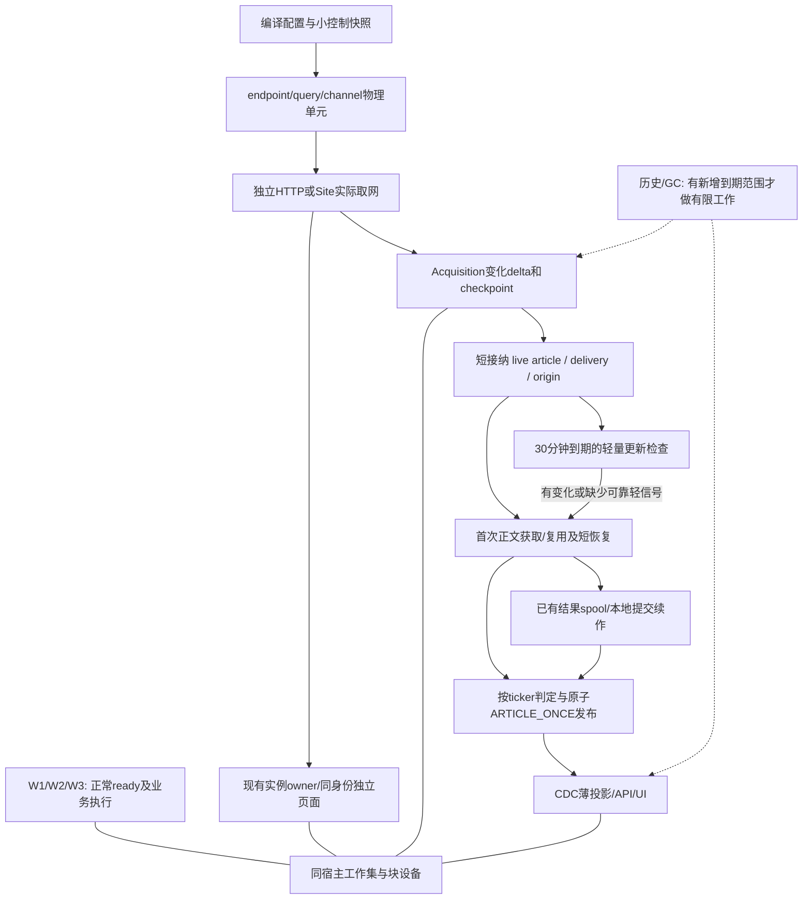

# DoxAgent全链路I/O与业务性能：统一精益修复方案

日期：2026-10-29。基线：8核16GB，ticker动态增长至最多20个。本文是下一轮开发执行规格，本轮不修改生产实现、不启动服务、不部署。

依据：[联合现状勘察](message-pipeline-and-host-resource-regression-survey-20261029.md)、[物理I/O专项](physical-io-attribution-and-lean-repair-plan-20261029.md)，以及当前main `6ddefe97`的实际代码。其它会话尚未提交的交易/UI/提示词修改不属于本方案改动，不覆盖或丢弃。

## 1. 先确定统一架构

目标正常路径：**小控制事实授权 → 必需物理单元真实取网 → 一份变化delta → 每文章一次必要内容读取/获取 → 各ticker薄判定 → 短原子发布 → 增量投影。** 历史清理、状态显示、重复校验、实例恢复不再成为每次业务请求必须完成的前置工作。

保留现有正式角色和SQLite业务事实，不引入Redis、新消息中间件、全局恢复编排器或另一套审计台账。明确三种所有权：物理请求、文章业务结果、实际浏览器实例；一个事实只由其现有owner推进。共享内容与物理请求，不能共享一个笼统“来源成功”状态。

全局依赖顺序：**先删除历史读放大和无业务收尾 → 解除配置/维护对取网的错误耦合 → 降低浏览器单位成本并收敛实例恢复 → 在可兑现容量内疏通采集与首次交付 → 轻量履行正文更新 → 全负载验证资源与业务。** 实施可分提交，生产恢复要按组合依赖执行，不把解除门禁单独上线后再观察压力。

删除的是无新信息的反复工作；不是将同样的工作换到异步队列。实例故障隔离继续按必要identity保留，不能退回一个全局Node或固定“两套控制器”。

## 2. 证据、目标和必须保留的业务事实

### 2.1 证据分级

|问题|已证实|尚不能据此声称|
|---|---|---|
|同一六小时物理读取|2,096.51GiB；Site/Supervisor/Worker占82.24%，文件refault折算与三者读取接近|历史全部字节已定位到具体文件；全部是DB或Swap|
|Worker ready|约3,987条历史、3个READY；约1,331MiB/10秒逻辑读，多条SCAN|加索引后历史454.8GiB物理读一定同比下降99%|
|Site所有权|约23.7万target历史；失效查询约142MiB/次；45秒约2.06GiB逻辑读|每个普通访问必执行该查询；全部Site TB均来自该查询|
|上轮新增放大|`public_runtime._closed_facts`逐逻辑identity调用旧实例失效处理，新增于`c770409d`|公开共享Context的方向整体错误|
|配置与采集|refresh串接maintain；5秒STALE停止取网且原因被折成CONFIGURATION_CHANGED|历史每条CONFIGURATION_CHANGED都一定是STALE|
|Investing|native恢复、身份路径和暖态断裂，runtime均值约1秒→17秒|四条drain成功报告就是四个不同Chrome被杀|
|正文与首发|失败也统一安排30分钟检查；首态被recheck覆盖；小时级长尾存在|所有长尾均是正文下载或技术排队|
|HTTP|Finnhub全源固定1并发，许可包住下游等待；45秒超时样本无发送证据|已找回旧进程最初卡住的确切await|

### 2.2 业务与资源同时验收

- 配置周期按逐source/ticker/必需物理单元兑现；全部应执行周期纳入分母，目标接近100%。实际请求启动、列表收到与验证时点分开，RSS不能替代独立浏览器频道。
- 新文章从首次真实采集到Owner可消费尽可能≤10秒；同时记录UI可见时点，未完成/失败/延期保留。首次即相关与更新后才相关分开分析，不抹掉全体首次观察cohort。
- 新canonical适用正文的FULL/SHORT_FULL最终成功率>80%；初次尝试、最终成功、复用、权益不足和真实短全文分别报告，抽检真实publisher内容。
- 保留ARTICLE_ONCE：实质更新修订原消息、显示更新状态与修订记录，不再次触发已消费下游；不能把下载复用当作永久跳过更新检测。
- 不降低既有轮询周期/频道，不新增W1/W2/W3硬门禁。删除消息系统技术压力硬阻断，不一次性唤醒所有历史工作制造爆发。
- 8核16GB是实测验收基线；最多20ticker按实际端点/查询/频道与持有时间算容量。未在20ticker/30秒实测前不承诺该容量。

### 2.3 只保留这些热事实

|owner|必要薄事实|正常请求不应加载|
|---|---|---|
|Collector|当前编译配置版本、授权/期限、unit下次due、checkpoint引用、未确认delta|全部旧周期、UI applied回执、历史Native poll对象|
|Site/实例owner|identity/profile绑定与小版本、当前会话/权限、实际实例ID、活跃target集合|全体CLOSED/LOST目标及旧会话宽JSON|
|Worker|当前READY/BUILDING/绑定、必要失败时间、真实PID归属|全部历史slot config、历史job全文|
|Bus/BODY|canonical、input/material revision、薄任务状态、结果引用、发布唯一键和首态|每ticker重复全文、完整历史attempt数组、多套正常实时任务账|
|Read/GC|当前投影/水位、到期退出ID及必要引用/hold|每轮全库证明“没有可以删除的东西”|

## 3. P0：删除历史读放大，缩小热状态

### 3.1 Worker：先薄查询，再合并正常状态盘点

改动：`codex_worker/{w3_ready,app,job_store}.py`。

1. 在现有表增加两个薄索引，不新建ready台账：`(state,scope,id,thread_id,case_id)`和`(scope,failed_at DESC,ready_at)`。前者覆盖READY/BUILDING选择与计数；后者使最近失败/成功比较走薄键，而非反复读config行。
2. `_fill`将count和building合成一次聚合；同次configure/readiness只做一次reconcile，返回同份结果，删除重复count。`reconcile_residents`只读当前READY对应thread，按真实运行池变化判断，不扫描历史slot。
3. 未变configure无需再次做完整历史盘点；保留ready缺口补足、原配置的真实失败冷却、绑定/退役责任及原ready数量。临时退役/失败不会永久阻止正常fill。
4. 终态详情按既有审计责任按需保留；到期归档只针对终态且无未完成绑定，不通过清空历史来让查询变快。

验证：复制真实**薄schema和SQL**先校验计划，再在真实历史规模的只读影子/低负载基准核对逻辑字节。目标该组逻辑读≤10MiB/10秒，较已测约1.3GiB下降>99%；READY/BUILDING判定没有宽表SCAN，W1/W2/W3请求、并发和ready能力不减。

### 3.2 Site：实际所有权与目标历史分开

改动：`site_strategy/{governance_repository,public_runtime,worker_runtime,retention}.py`。

1. 添加非终态部分索引：`owned_browser_targets(identity_id,browser_instance_id) WHERE state NOT IN ('CLOSED','LOST')`；`mark_instance_lost`只取实际旧实例的非终态行。
2. 删除匿名共享runtime的逐publisher `_closed_facts→mark_instance_lost`路径，以及无实际身份状态变化的runtime写入。匿名Context由本次runtime持有者管理；真实物理进程启动记录用于崩溃后归属，不为每篇普通公开文章持久化一套受保护身份生命周期。
   同时修改`PublicContexts.page/_ContextLease`：匿名每页的allocate/bind/CLOSE_PENDING/CLOSED不再写Registry，使用现有owner接口的transient分支保存本次真实Context集合；为登记台账才做的额外CDP target查询一并取消。只保留实例级PID/启动时刻等恢复记录，清理以Context关闭和实际实例归属为准。受保护页原持久化owner不变，匿名页面不自动升级为人工登录/Challenge常驻场景。
3. 受保护身份/人工页仍用现有owner记录；同一实例已确定终止只推进一次状态。无法确认关闭的真实target不能假释放；也不能用全历史行来代替当前活页核实。
4. 先索引和删调用，再有界处理CLOSED/LOST历史；近期审计只需薄终态/变化，不能因保留七天审计就让七天宽历史进入每次失效查询。未完成Challenge、人工页及必要引用继续保留。

验证：约23.7万历史行下单实例处理预算≤1MiB逻辑读；无目标的失效处理不能读142MiB。并行匿名burst结束只关闭其Context/实例，无逐publisher历史扫描；受保护Chrome、Profile、登录与人工页不受影响。

### 3.3 Site维护：退出无进展兼容工作

1. 对已停止生产的旧`ACCESS_SUCCEEDED`类别做一次有界结清；结清后移除每10分钟执行的兼容规则，不每轮证明一次不存在旧数据。
2. backlog使用本批是否还有候选、最早候选和上次进度；删除相同范围的第二次扫描。状态显示不需要精确COUNT全历史。
3. SUCCESS用现有部分索引按时间增量处理；失败/恢复保留必要审计。`LIMIT`放到候选选择前，不在复杂过滤之后才限定返回数。
4. 少量维护查询使用实际SQLite progress预算，不只在外层循环计时；每轮无新到期/无变化则退出。

收益边界：约287MiB/维护轮可以消除；它单独不足以解释TB，不将该项节省夸大成全局根治。

### 3.4 Read GC：先选有限退出ID，再检查引用

改动：`v2_read/{artifact_registry,serving_gc,maintenance}.py`，复用现有`serving_content_exit`、`definition_exit`和`read_meta`。

1. 按现有键序读≤一个批次退出ID，再对这批做artifact/ref/hold主键判断；不在全历史anti-join上最后加LIMIT。
2. 为退出候选复用一个小扫描游标；被hold或新引用保护的项可越过，不能反复卡在首批。引用减少、hold释放时重新进入已有退出集合；无法由事件涵盖的存量只做低频有界循环，不新建全局修复协调器。
3. 按实际候选扫描数控制进展；当前`scanned=sum(deleted)`不能代表已扫描工作，改为返回真实candidate_count和next_cursor，避免未删除即重复从头运行。
4. `serving_gc.collect`复用本轮算出的retention floor；仍受有效view/cursor pin约束，只有pin变动/到期才重算相关小集合。前置floor查询也在预算内。
5. 保留删除与重新引用的原子竞争保护。文件hash/文件系统rename/unlink移出写事务：先用现有MARKED/QUARANTINED/DELETING状态完成短原子声明，再执行文件操作，后续沿原状态续作；不新增另一套恢复台账。
   已在写入/装载边界验证、注册为可信不可变CAS的SERVING内容，删除前不再为“证明将被删除的字节没变”全文件重hash。未知导入物先完成必要分类/一次验证，未知分类不删；真实引用、hold和路径所有权才是删除必须保留的判断。
   **具体竞争修订**：当前`native_triggers`的artifact UPSERT可直接恢复LIVE，仅保留现有reference_guard不够。移动文件前，短事务复核引用/hold、记录既有deletion manifest并取得DELETING所有权；Native触发器不得把DELETING直接改LIVE来绕过guard。持有者随后锁外rename/unlink并续原状态；新的引用若已先提交则GC不能取得所有权。后来的引用冲突由Projector从业务owner事实重新物化本地内容/重试，不重新下载BODY。此修订是锁外处理的必要条件，不是声称该竞态已造成历史TB事故。
6. 技术候选无变化时不做相同检查；不得只停GC让数据膨胀。真实回收推进量与读量同时验收。

验证：10秒约428MiB已归属退出反查降≥90%；带hold首批、释放hold、重新引用、重启中断、长时间无新增候选、历史规模10倍均验证。未知分类文件和业务证据不按诊断年龄删除。

## 4. P0：Collector控制、调度和HTTP占槽

### 4.1 配置与控制：保留明确授权，删技术年龄门禁

当前：`ConfigurationLoader`已按revision/day复用编译结果；不能再宣称每秒重编译全部配置。真正问题是未变仍写Acquisition meta，`_refresh_loop`还await历史维护，而`SnapshotGate`把config.at超过5秒视为全源不可用。

实施：

1. 删除SnapshotGate的“年龄>5秒即撤销”规则；保留源/绑定当前有效版本、enabled、日历、暂停、临时范围与截止时间判断。编译配置只随实际配置/日边界改变，普通维护失败不使它失效。
2. 小控制读取与大配置编译拆为同一Collector内的两个职责：轻量watch只读revision、暂停/日历变更及临时控制行，原子替换内存快照；完整计划只在revision真正变化时生成，不每请求读DB。正常传播目标≤1秒。
3. 配置load不再调用UI型`CollectionControl.status()`去回读applied；控制与显示接口分开。applied/运行摘要只在生效变化或低频状态采样时写，未变不每秒落库。
4. 维护放到既有Collector中的独立低频任务，初始30秒检查一次新增到期范围；无到期范围就退出。不得把完整maintenance塞回refresh或真实请求启动路径。
5. 控制读取异常沿用最近明确授权并继续有界重试，不触发全来源技术停机；已知截止时间仍本地精确判断。**手动关闭的“已生效”以Collector applied revision为准**，持久化成功但尚未应用须显示待生效，不能虚报已经关闭。控制面不可达时存在撤销传播风险，此变化必须明确展示；不靠任意5秒快照年龄来假装解决它。
6. 错误码保留实际原因：显式停用、期限到期、绑定变更、配置读取异常、源准入等待分别记录；不能全部写CONFIGURATION_CHANGED。

测试边界：慢维护、DB短暂busy、未变配置、源禁用、期限正好到期、范围改变、重启、日边界。停止新的顶层临时采集，允许既有在途请求及已持久化接纳/BODY收尾；不改共享日历或研究/交易语义。

### 4.2 许可范围：只让真实执行占执行槽

改动：`scheduler.SchedulerGroupLimiter`、`collection_plane.worker`、`adapters._BaseAdapter`、`publisher_http`、Crawler→Site调用。

1. 将“单元一在途/源实际配额节奏”和“下游执行容量”分开。单元可保持逻辑在途，但等待HTTP role、连接或Site准入时不能长期占一个额外的全源执行许可。
2. Browser采集由Site的实际Site/Identity/Chrome许可负责执行容量；删除Collector外层无依据的第二套Browser源并发占槽。真实源节奏/网站配额仍在发网边界执行，不删除上游限额。
3. HTTP采集复用现有source/publisher/role预算，增加一个小的联合预留helper：容量不全时不持有另一层许可睡等；在事件循环内完成可用槽的预留，失败释放后等待容量通知。不要新增持久队列或多级调度服务。
4. `_BaseAdapter._json`当前把response.json也包在源许可中。收到完整响应即释放执行槽，JSON解析、列表校验、capture/checkpoint短提交在槽外；解析工作仍须减量，不能只是搬线程。
5. RequestCost只学习真实网络/页面执行的持有时间；source_wait、role_wait、连接等待和IPC等待分开。禁止等待变长→EWMA成本升高→自动增并发→更大工作集的反馈。
6. overdue单元只保留一个当前执行及一个合并后的最新due，不重放所有过期时隙；缺失周期仍留分母。采集checkpoint继续从上次完成的覆盖边界接回，不因跳过调度时隙而跳过新闻覆盖。

### 4.3 Finnhub与HTTP客户端

1. `manifests.py`的Finnhub仍是fixed/1，运行中已有源配置也必须版本化迁移，不能只改默认值。按账号真实请求额度和实际物理请求量计算并发，初始至少允许两个有效HTTP执行；上限使用共享角色预算和实测执行成本，不按固定9/10个ticker。
2. 20ticker/30秒的该端点至少40请求/分钟，另加同账号其它用途；上线前核对账号额度。1秒实际发网间隔与多请求在途可以并存，不能用“允许1秒间隔”推导“必须串行等待上一响应”。
3. `_json`的连接/发送/响应超时与外层45秒轮询总账分开。等待不得伪装成取网；失败正确推进retry标量，未持久化列表不推进覆盖cursor。长达15秒的正常执行若持续存在，应排实际DNS/连接/出口，不以加并发掩盖。
4. 保留publisher隔离池和已经修复的curl callback/lease释放。`PublisherClients.request`的close_idle在timeout之外，改为独立一次维护，或退休后在请求许可释放后收尾；不得阻塞新请求发网。坏池只替换该publisher的client，旧active请求允许按其真实生命周期结束，不重复关闭或复用坏curl。
5. 每个请求只记录少量阶段：准入起止、连接开始/发送、响应完成、列表验证。复用现有poll_trace，不打印token、头部或完整响应。

### 4.4 必需单元与轻量路径

- Yahoo RSS和SUPPLEMENT_HEAD、Barron’s各频道、Reuters各查询/必要续页、IR各endpoint分别有成功/失败与物理证据；共享一次请求要关联同一个request_id。
- TAIL按“持续覆盖所需续页”或“历史恢复/可选复查”分类，不能统一用名前缀排除。若HEAD未覆盖到上次watermark，必须保留续页义务和延迟；HEAD拿到第一页不等于来源覆盖完成。
- Yahoo优先当前已有效的RSS/轻HTTP，Browser补充保留独立频率；不重复导航同一已取得的响应。GlobeNewswire等HTTP列表验证有效后每轮只走一次有效路径，失败原因才决定fallback。
- IHub/Investing/Barron’s优先当前已验证的同身份fetch/XHR/原导航响应；没有等价轻接口才短导航。保留ticker、时间、分页与频道合同；不统一5秒截断。5秒是正常warm单次目标，不是所有页面的判死阈值。

## 5. P0：Site读取、物理所有权和恢复

### 5.1 同一次访问只构造一次候选快照

改动：`resolver.py`、`scope.py`、`failover.py`、`governance_repository.py`、`worker_manager.py`、`identity_worker.py`、`api.py`。

1. 现有catalog缓存继续用，按catalog revision编译host/scope匹配，不每URL重新遍历/构造完整策略模型。
2. resolve→candidate_status→usable→cache-key→execute共用一次小快照：scope/identity/profile绑定与版本、必要session/egress状态、当前实例。内部函数接收已经读取的事实，不各自再次查同实体。
3. 能力fingerprint在配置、session或出口实际变化时计算；不每次请求序列化整个identity。worker snapshot只在revision改变时验证/发送完整配置，普通命令传版本和命令参数；真正版本不匹配再刷新。
4. async resolve中移除直接同步DB路径。SQL本身变薄、有界后复用现有读通道，不将本次工作仅定义成“加线程”。普通可重新执行读不继承关键写入的无限settled语义；不可取消SQLite底层执行时仍以短查询/progress截止控制实际任务数量。
5. 原子保留绑定/实例版本和发布提交检查；不为每个内层函数重复开连接。读取后发生真实配置变化时，仅影响该请求/身份，不全源失效。

匿名路径取消伪实例状态后，resolve/provenance/cache-key也同步调整：逻辑publisher配置和出口/权益仍保留，物理provenance返回当前共享runtime/Context事实，不靠每publisher递增合成native generation。请求共享键仍包含实际URL/查询/频道/scope，不能同origin复用成同一份列表；新周期不能拿旧结果冒充新取网。受保护身份仍按真实session/instance变化失效。

### 5.2 控制器与native分别判断，恢复只属于一个真实实例

当前`service._attempt`在控制恢复后仍RUNTIME_UNAVAILABLE时可安排native drain；`worker_manager._roundtrip`取消后等1秒便可retire控制器。这会在资源暂慢时破坏已有正常Chrome暖态。

实施：

1. 将错误保留为三个事实：命令超时/控制通信失败、CDP可达但控制器坏、实际native已退出或无法业务访问。前两者不能直接等价为第三者。
2. 控制器替换由现有IdentityWorkerManager管理；External native由现有Supervisor唯一管理，Managed原生实例由其现有owner管理。沿同一个instance_id/generation接回原Chrome、Context及业务target；不引入新恢复服务。
3. 同一实例只允许一个进行中的接回/终止动作，后续请求观察它的结果，不逐请求安排drain。记录真实instance/PID前后与动作结果，`known_missing`不计作“又杀了一个Chrome”。
4. 取消普通只读命令不等待长时间业务提交；若命令控制失联，先隔离该命令/该identity，替换控制器，确认其实际页面后归还物理槽。未确认target按真实唯一target计算，不按重复pending记录倍增，也不能长期污染无关identity的预算。
5. 仅在进程退出、明确崩溃，或一次独立有界重接仍证实native不可用时执行实例级重建；人工/Challenge场景继续保护。普通来源重试不同时再触发控制器、native、scope三套重建。
6. source failover只在实际访问能力失败后选择已有候选；容量延期、DB读慢、控制器接回不把主身份永久降为不可用。登录恢复后由真实任务可半开验证，删除后台自驱探测不能留下永久健康门禁。

验证Investing：保留`investing-backup/public-markets-nl`的真实External身份语义；注入IPC暂停/控制进程退出，原生实例与暖target仍可接回，正常列表继续刷新。另测Chrome真退出、Challenge、人工维护、两个同身份并行页面及取消其中一路；其它身份持续有效采集。

### 5.3 关键来源的具体落点

|来源|优先实施与验证|禁止用来遮盖失败的替代|
|---|---|---|
|Finnhub|默认及存量fixed/1迁移；按账号额度允许多在途，记录连接/发送/响应|全局增Browser并发、扩大45秒总超时|
|Yahoo|RSS与SUPPLEMENT_HEAD各自有效取网；Browser等到实际Site容量才占槽，复用有效fetch document|只报RSS成功或重复使用旧补充列表|
|IHub|同身份fetch/原响应替代重复重导航；按第9节验证≤2.4秒或真实其它可兑现形态|假设20ticker仍只需两个6.92秒槽|
|Investing|接回原native/暖页，主备路由由真实访问能力决定；验证国家域、ticker/时间与完整列表|把public-markets-nl误当匿名identity；控制暂慢就drain/failover|
|Barron’s|独立核对必需新闻/发布频道，保留已验证原生Chrome和订阅BODY能力|公开频道成功冒充全部频道/订阅正文成功|
|Reuters|保留原Profile、活动搜索页和不freeze约束；按业务DOM条件/commit就绪，BODY合理利用已有验证身份|直连偶获卡片就全切公开HTTP；通过冻结停脚本改善表面CPU|
|DIGITIMES等受保护BODY|核对BODY scope实际选中有能力的身份/地区/权益；失效只在该故障域恢复|Reader绕过真实权益或把preview记FULL|
|GlobeNewswire/IR/RSS/JSON源|已验证轻路线每轮一次请求，按endpoint/语言/频道保留验证和独立checkpoint|一处RSS成功抵消其它端点失败；无效方法每轮先试一次|

其余来源按同一物理单元和publisher路线机制处理，不为每ticker另建重控制体系。访问能力真实受阻仍属于未达项；资源减法不能让Reuters等失败从分母消失。

## 6. P0：Chrome、Node与Worker工作集

### 6.1 常驻由真实需求决定

1. 必需高频、已验证依赖身份的站保留Profile、启动路径和足以覆盖真实活跃槽位的暖页；不恢复单共享Node，也不把所有公开站一律匿名化。
2. 只读HTTP/RSS不因启用了source就预热Browser；BODY偶发公开publisher继续匿名共享Chrome+隔离Context，不单独常驻Chrome/Node。
3. 匿名runtime最后一个用户离开时不在execute的finally持全局lock等待5秒关闭。将关闭交给同一owner；默认最多2秒空闲复用，新的真实请求立即接回，延迟的是无用户回收而非业务。只有尚未关闭的同一burst可复用，不新建第二套掩盖清理失败。
4. 受保护FetchAnchor按下一真实请求周期和真实并行槽位保留，不保留跨业务频道的旧结果；每轮仍实际取网。当前freeze失败会直接关闭anchor，改为freeze是可选节流：已验证业务页freeze失败可保持active，不因该优化失败强制冷建。Reuters普通业务页禁止freeze，Challenge/人工页同样排除。
5. 每4小时或RSS阈值的控制器轮换与native分离，不能定时销毁正常native。回收以实际闲置与被替换进程的真实退出为准。

### 6.2 非业务后台功能在真实启动路径关闭

1. UKM/segmentation/optimization后台测量/模型列为明确删除候选；对当前批准Chrome版本核对开关，先公开runtime、后受保护站做同Profile对照。
2. 改动必须覆盖真正使用的`chrome_supervisor.ensure`和Managed原生路径；不能只改备用Playwright launch参数后宣称External已生效。保留浏览器版本、locale/timezone、出口、Profile目录和登录状态。
3. 不删除全部Safe Browsing、Cookie、History或整份Profile。不必要的测量数据库可以停止生产/加载；历史清理在实例无写入时有限处理，不能定时全Profile清空再重建。
4. 预热只触达已有即将使用的路线。页面图片/视频/广告/第三方分析可按现有recipe裁剪，但JS/iframe中真正承载列表/正文的资源必须保留。
5. 显示/VNC等辅助进程只在需要人工查看时启用；正常采集所需的真实有界面Chrome和Xvfb保留。当前`ensure`仍直接启动x11vnc，改为复用已有`_ensure_viewer`在首次人工查看时创建，未创建时沿用已有MissingProcess表示；首次打开查看器会增加短启动时间，不影响采集。删除重复/无需求viewer驻留，不触动登录页。

### 6.3 Worker减少重复环境成本，保持业务容量

复用现有SDK实例/ready归属、PID启动时刻及恢复合同；同一个不可变运行环境、资源包和上下文不要为状态查询重复加载。保留W1/W2/W3模型配置、ready数量和并行业务能力；不以新增启动门禁来换资源曲线。大上下文在实际执行需要时读取一次；已结束任务不在普通健康查询物化历史全文。现有进程归属扫描合并成果保留。

验收必须同时看PSS/private anon、真实target/iframe、Node/Chrome进程及出生/退出、同文件refault；active_pages=0不能代表没有物理残留。调低内存上限/加Swap/调read_ahead不计作本轮实际工作量收益。

## 7. P1：首次交付、BODY恢复和更新复查

### 7.1 先删除接纳与分发重复工作

当前CaptureBridge已最多8条prepare并行、短事务commit；不能回到“全局串行Bridge”的旧判断。真正要改的是单个delta准备和按ticker分发重复物化：`LiveDistributor._prepare`每ticker重新加载result，`classify`又逐条prepare，同篇内容被反复解码/取source/terms。

实施：

1. 变化列表只持久化一份delta；prepare一次解析本delta、一次装载source和相关targets/terms版本，只对新文章/真实内容变化做接纳。未变列表仍有真实取网与验证证据，不再产生业务capture。
2. 分发按article/result_digest批量prepare：一次加载正文与公共元数据，批量读目标薄字段，各ticker保留独立相关性和发布键。只在需要修改的metadata分支复制，不为20个ticker复制20份全文。
3. 同一源大delta分为有界文章批次，首次新稿优先；异常项单独延期，不能让同批其它文章或其它源等待它。保留现有短事务和capture唯一接纳键，Bus提交后Acquisition ack失败只补ack。
4. 同篇L2判断沿现有按article批量definitions和positive callback发布；不因一个ticker的慢结果阻止其它已确定相关ticker发布。source/terms配置确实改变时只重做受影响判定，不重新抓正文。
5. 明确阶段预算：列表→capture提交约0.3秒、prepare/接纳约0.7秒、新稿BODY等待约1秒、正常获取/提取约5秒、必要判定/发布约1.5秒、增量投影约1秒，合计约9.5秒是设计预算。真实慢publisher/远端L2另计，不通过略过质量或判定来凑10秒。

SEC/大体量原生公告继续保留既有正文、表格和完整性合同，不能为了10秒截断内容；长耗时样本同样保留在总体与相应来源分布中。

### 7.2 三种续作，共用现有live事实

|情形|现有数据上如何推进|不再发生|
|---|---|---|
|首次尚无可用完整正文|`work_kind=new_article`，技术失败有限短恢复；明确provider延期按其not_before等待|最终一次失败统一写READY然后只等30分钟复查|
|正文已成功，本地提交/分发失败|复用已有result spool/result_ref/result_id，重试本地提交或发布|重新HTTP/Browser下载同一全文|
|已有结果，到期检查更新|`work_kind=recheck/content_update`，先有效变化检查，必要时刷新正文|重置首次尝试口径，或未变也整篇重新获取/重判/发布|

`live_repository.commit_result`依据成功/可重试/能力阻塞分别决定due和next_check；30分钟检查只承担内容更新义务，不承担新稿技术失败的唯一恢复。

保留已修复的执行预算：`LiveQueue._job`按实际历史attempt执行耗时算剩余预算，不退回从first_seen或排队时长扣完正文预算。普通网络失败最多一次5秒短重试；429/Retry-After、恢复未完成、明确`retry_not_before`按真实时间延期，不能5秒重复空转。

重试次数按完整“获取轮”计，不按HTTP重定向、wrapper解析、最终publisher读取和fallback的FetchAttempt条数机械计数。每轮主方法及至多一个有效fallback；已有attempt用于诊断，现有article增加一个小的fetch_round计数仅在真正获取开始时推进，不把重复领取/本地提交算新轮。预算不足则如实失败，不无限延期或延长总执行预算。

能力等待不消耗实际取网轮：延期超过本轮可执行deadline时保留同一首次义务及已用执行预算，到not_before重新构造剩余执行预算；不能因20秒active预算容不下60秒provider等待就落入30分钟检查。真实长期不可访问保留失败/未完成及原因，不制造FULL。

### 7.3 更新检查必须有可信变化证据

当前`transport.conditional_headers`和`pipeline`已支持HTTP条件请求与304复用，直接完善这条路径，不新增第二套validator系统。

1. 第一次取得FULL/SHORT_FULL时保存最终publisher URL、有效ETag/Last-Modified、访问scope/语言/区域以及body digest；已有字段优先复用。
2. 30分钟到期只先发有效条件请求。**304必须有相同表示和有效完整缓存**，只推进checked_at/next_check，不改最初body acquired_at，不触发相关性或内容投影。304无有效缓存则同一路线无条件重取，不能把空响应当完整正文。
3. 200响应在本次已经取回的内容上提取一次并比较业务digest；不能先HEAD再无条件GET，或为“检查是否更新”多取一份同样正文。正文/实质标题未变只更新小的检查状态。
4. 官方列表的版本/更新时间、JSON正文revision等仅在能代表该篇实际内容变化时作为轻信号。仅标题未变、RSS成功、网页时间戳/请求时间改变都不足以断言正文未变。
5. Browser-only且没有可靠轻信号的来源仍在约定30分钟检查时有效重新读取正文；不能把完整缓存当永久不检查的理由。降低这类成本靠同身份fetch、暖页和正文共享，不能静默减少更新覆盖。
6. 确有变化才沿ARTICLE_ONCE修订原消息；原consumable_at不重写，不再次触发已消费下游，UI明确“已更新”和修订时点。初次不相关但更新后相关，需要第一次发布给适用ticker，不能被ARTICLE_ONCE错误吞掉。

`LiveRepository.prepare_result`已经对同digest复用result_ref，这项实现保留。304且标题/质量合同未变时进一步直接复用已验证digest/引用，只写checked_at、validator和必要小计数，不再重新物化/hash整篇；200或实质标题变化仍需一次真正比较。结果spool目前已有32条上限，但每秒从头重读同一批仍可能空转；沿文件名游标和本次完成article提示推进，优先处理领取article的本地续作，未到恢复条件的同一spool不反复展开。保留原spool持久化，不新增任务库。

### 7.4 BODY路线与复用

- 对一对一publisher，以当前成功率/耗时选择固定主路线HTTP、同身份Browser/fetch或Reader；最多一个经证据有价值的fallback。Reader仍遵守现有权益/登录限制。
- Yahoo/Google等聚合源先有效解析最终publisher并存别名，再按publisher路线获取；解析/跳转属于必要步骤，不能算作“已用完两种方法”。已验证别名在未变发现信息下复用。
- 相同canonical、语言和真实访问权益的完整正文跨发现来源复用。现有`access_scope`已对多个受保护publisher去掉发现source隔离，不重新做一套source绑定cache；只有真实私有scope/语言/区域表示差异才隔离。
- source版本、ticker roster、terms revision、列表请求时间和跟踪URL不是正文变化。`material_hint`只保留实际标题/摘要内容和provider声明的内容版本；normalize不删除数字、实体或有意义正文变化。
- 真正的质量规则、语言/权益范围或解析合同变化按受影响结果重新校验，不能把所有版本变化一律忽略；普通调度参数版本不触发重抓。已有原生完整正文可以直接交付；不采用普遍“先发摘要再补全”来凑10秒，否则ARTICLE_ONCE可能让下游只消费到较差内容。
- 首次未完成正文与旧文更新使用同一下载结果事实；旧article_body_results仅作有限读兼容，已迁移完成后不再每次查旧队列或扫描历史旧任务。已有`legacy-body-complete`标记保留并用于退出兼容。

### 7.5 新稿优先，更新有可兑现容量

保留独立CRAWLER/BODY预算，不让BODY借尽采集页。BODY内部新稿优先、publisher轮转，现有一个background机会按最老due推进；不能由全局压力门禁将其一挡数小时。一个慢publisher只占自己的有限执行，不在领取时拿着一批未执行任务耗尽租约。

更新负载按**唯一article**而不是article×ticker估算：若约469篇处于24小时更新范围，30分钟每篇检查约0.26次/秒；平均实际占用4秒就约1.04个持续执行槽，已有BODY两槽未必不够，但Browser-only比例、尾部和其它工作必须实测。实际观测recheck记录占96.8%却只有约0.13个平均network槽，不能把类别比例当占用结论。轻检查释放的容量优先给新稿与真实到期任务，不用于盲目增加无效旧文重抓。

### 7.6 首态与当前状态分开，避免指标反复失真

在现有article行补最多`initial_request_at/initial_result_at/initial_outcome`三个薄字段；delivery补`initial_decision_at/initial_decision`，继续使用既有首次consumable_at。初次复用/原生全文无取网时initial_request_at允许为空，不能伪造请求。

first_fetch_at/attempts_json现有用途不得未经迁移直接改含义；新字段只填一次，recheck/合并保留最早可信首态，当前尝试和结果另沿原字段更新。旧数据不可反推的首次结果标UNKNOWN，不用当前FULL倒填历史。无需为每个内部步骤新建全量事件日志。

## 8. 存储、对象物化、投影及历史增长

### 8.1 NativeContent：显式内容读取，取消默认全展开

当前按列名识别payload/data_json等并隐式展开，命中cache仍扫chunk签名、deepcopy，text再json.dumps；definition重复读/parse/hash。修复次序：

1. 状态/领取/配置版本查询用现有薄字段及普通row_factory，不选正文列；增加明确的raw/thin读取入口，并逐一迁移本方案热调用点。
2. 真正需要内容时才`load_content(ref)`；完整性在首次装载/写入和真实内容变更验证，已验证不可变digest不每次重hash、stat全部chunk。
3. 同一次文章/配置使用周期共享已验证只读内容；要修改时只复制受影响分支。不要把整个历史上下文变成长期Python缓存；当前cache以原始JSON字节计费不等于实际展开堆大小，要缩小缓存对象/存活期，而非扩大cache额度。
4. 优先缓存小的不可变定义和当前文章结果，处理完成释放临时大对象。保持现有容量有界，不额外建全局对象缓存服务。
5. 旧默认完整decode入口暂作显式兼容，映射Owner/Read/Worker消费者并迁移后删除热路径兼容。不得全局切row_factory导致W1/W2/W3、API或Projector收到未展开marker。

业务变化：存储损坏的发现从“每次命中都重验”变为写入/首次装载/必要检修边界；正常业务仍读取已验证不可变内容，可变对象不能污染共享结果。减少的是重复证明，不是取消真实完整性。

### 8.2 Acquisition与技术历史

1. 真实物理请求证据一份，消费者只保关联；状态head只在值变化时更新。checkpoint保存必要标量/引用，不重复嵌套全列表和历史模型。
2. `maintenance.py`目前每个归档小时取此前全部SCHEDULE。改为“小时起点的最后一条生效schedule＋小时内变更”，不读取从建库到该小时的全部计划史。
3. 周期/输入/物理checkpoint退出只扫描新增到期区间。checkpoint引用用明确薄列或小引用关系维护，删除每秒对units JSON全体反查。只在更新引用与删除候选的短事务内保证当前引用安全。
4. 48小时原始周期、7天小时摘要等既有保留义务不因性能默认缩短；历史清理按增量执行。应执行周期仍可从schedule/小时摘要重建，失败/逾期/缺证据不能消失。
5. 修正`AcquisitionStore.connect`的只读连接初始化：不为普通SELECT执行写入型PRAGMA；连接创建/初始化失败也纳入close/finally，防止异常路径泄漏。不要为此加一套长生命周期全局writer。

### 8.3 Bus/Runtime/Read

- 接纳/发布只原子提交唯一键、薄状态及必要引用；网络、全文解码/hash、全roster/历史复核、文件GC不在写事务内。保留同一篇/同ticker的并发唯一性。
- `LiveDistributor.refresh_decisions`区分source enabled/binding变更、terms实际revision、采集配置改变：只有判定输入变化才重判。仅轮询并发/间隔或路由版本改变不能让全部旧消息再分发。
- CDC保留薄更新和content digest；相同内容不重做搜索索引。内容更新事件同时对齐Owner→Projector→schema→API/UI，保留授权与历史水位；不能出现消息已发布而前端停在旧日。
- Runtime/Scheduler按当前case/effect/dispatch所需字段读，不为当前状态展开全部payload。专项中仍未归属的Runtime读先做一次有界SQL/文件标签，优先修占主要字节的实际查询，不盲改所有Runtime表。
- 统计仅按需、薄聚合、索引范围查询；UI状态刷新不触发全历史BODY cohort或source×ticker全量统计扇出。维护/完整审计不成为获取来源列表的前置。
- 表/索引体积、退出候选、旧compat调用次数要有长期曲线；文件暂时不缩小不等于减法无效，查询范围先与历史大小脱钩。空间回收只在单独低负载窗口进行一次，保留业务数据与未完成责任。
- `first_seen`、origin、发布身份等确需长期保留的事实收敛为薄键；全文/配置/attempt历史不得在每次观测重复留存。若将首次观察职责合并到Bus canonical owner，迁移先确认未接纳delta与未知发布时间语义，不能直接TTL删除唯一首次观察证据再把旧文当新文。

GC文件操作移出锁后沿第3.4节修正的引用guard：引用与DELETING竞争时续本地投影/素材物化，不重新下载正文。Read SERVING清理不能扩展到Bus业务正文及未完成spool。测试覆盖这一真实竞争，不能以“锁外处理”名义允许引用已经删除的内容。

## 9. 统一容量与收益账

### 9.1 请求容量与常驻工作集分别计算

每个publisher/物理路线的到达率`λ=Σ(必需endpoint/query/channel的1/配置周期)`；共享真实请求只计一次。执行需求`C=ceil(λ×S/0.8)`，S为真实执行持有时间，不含排队/DB/IPC。再与真实站点限制、账号请求额度、已有全局HTTP/Browser预算及实测工作集比对；不得用一个max_concurrency数字包办所有层。

|例子|当前成本/需求|结论|
|---|---|---|
|IHub每ticker一个必需请求，20ticker/30秒|warm runtime约6.92秒，平均需4.61持续槽；留20%余量需约6槽|当前identity两槽不可能兑现，单纯SQL修好仍不够|
|IHub保持两槽|20ticker/30秒时S需≤2.4秒；20ticker/60秒时≤4.8秒|必须优先有效fetch/导航成本；不承诺把并发调成20就解决|
|Finnhub每ticker一请求|20ticker/30秒至少40次/分钟|核账号配额，允许多在途但保留真实节奏；固定串行不是配额的同义词|
|更新检查|按24小时内唯一article数/1800秒，不乘ticker数|复用和轻检查直接降低BODY需求；Browser-only剩余成本仍须兑现|

Barron’s/Investing/Yahoo等从编译unit计划导出各必需频道的实际λ，不假设每ticker只有一请求。先用现有Browser8/BODY2、HTTP现有role预算测试；这些是起测配置，不是不可改变原则。单位成本下降后依据同身份并发成功率、CPU/匿名内存和尾部增加或调整容量；如果轻路线仍无法满足需求，明确报告该来源能力缺口，不能悄悄降周期或频道。

### 9.2 资源预算不是业务硬门禁

历史全局Anon约12.28GiB，加shmem约0.49GiB及内核约1GiB，挤占文件工作集。16GB设计验收预算：匿名工作集约≤8.5GiB、shmem约0.5GiB、内核约1GiB、必要唯一文件工作集约2GiB，总平台约12GiB，给实际约15.24GiB内存留约3GiB余量。

可先以Browser/driver匿名约4.5GiB、Worker约2GiB、其它约2GiB作为待证明的分项预算；它们不是容器memory.max，也不是限制W1/W2/W3的依据。若真实并发/研究初始化需要超过分项预算，先审查重复对象和无需求驻留；确实必要就如实报告缺口，不用延期业务掩盖。

匿名峰值需下降约3.8GiB只是目标，尚无证据保证每项能省多少GiB。PSS_File与同一文件缓存不可重复相加；HTTP/Chrome低谷不能与Worker低谷拼成一个虚假的峰值模型。

### 9.3 收益只记一次

|实施组|直接可验证的减法|资源账如何计|
|---|---|---|
|Worker薄ready|约1.3GiB/10秒相关逻辑读降>99%|Worker角色物理净降一次；不再把“索引节省”和“缓存命中”各加一遍|
|Site target/匿名收尾|142MiB失效扫描缩为少量行，匿名收尾删除该操作|Site净降一次；不将45秒逻辑字节当历史已归属物理字节|
|Site旧维护|约287MiB/轮无进展读消除|逻辑节省独立列；对Site约703GiB/六小时不是全部解释|
|Read退出候选|约428MiB/10秒已归属反查降≥90%|Maintenance独立净降，未归属部分不冒充已节省|
|浏览器与Native减法|非业务后台加载、重复冷建、对象展开/复制减少|分别测实际CPU/匿名/文件refault；同一物理读不再跨组件重复认领|
|BODY复用/更新|新稿一次结果、多ticker共享；未变检查不下载/重判|按唯一article、真实方法及执行次数计；不按ticker倍增缓存收益|

沿用专项报告的角色互斥条件模型：完整组合实现后，六小时2,096.51GiB可能净降约1,142–1,729GiB，残余约17–45MiB/s；它是**方案条件场景，不是保证值**。这次进一步删除正文/分发/对象工作后，应继续争取净降>90%、稳态读取≤约10MiB/s，而非把45MiB/s当最终合理成本。

同负载实测替换预测：同时记录必要加载字节、重复逻辑字节、cache miss/refault、CPU和匿名内存。CPU历史均值约4.11核不证明瞬时余量；已测SQL调用墙钟也不能直接等于省几个CPU核。

### 9.4 硬件判断

若完成减法后，包含W1/W2/W3正常执行的工作平台仍不能保留约3GiB余量，或持续refault/Swap/IOPS打满，应采用32GB或将Browser/Site与Worker物理分离。按当前未精简形态的条件模型，约缺3.6–5.6GiB，不把它当精确硬件报价。

当前300GiB CLOUD_SSD名义约10.8kIOPS/180MB/s，事故样本已接近其量级；更快云盘只能降低必要I/O排队，不能消除TB扫描。若保留当前负载并留一倍余量，需约350–400MiB/s、20–25kIOPS且实例允许，此方案不主张用购买该能力来包容浪费。Redis和整体换数据库都不在本轮必要范围；先让当前薄查询、增量GC和文件工作集真正轻下来。

## 10. 按依赖执行、迁移及正式发布

### 10.1 开发提交顺序

|批次|范围与可审查结果|依赖与进入下一步条件|
|---|---|---|
|A|Worker两薄索引/合并判断；Site非终态索引与匿名收尾职责删除；旧类别维护退出|真实SQL计划及大历史测试通过；正常ready/人工页/Context清理不变|
|B|Read退出GC增量；Acquisition增量维护与只读连接；Registry/Native热读取接口减法|A；无进展工作量及对象复制下降，引用/hold/重启续作正确|
|C|小控制快照、去5秒年龄门禁；HTTP维护退出请求；源许可与实际执行容量分离、Finnhub配置迁移|A/B；慢维护不阻发网，明确关闭/到期与失败checkpoint可靠|
|D|控制器/native恢复分离；匿名短burst复用、protected暖页；UKM等后台与VNC按需|A/B；IPC暂慢不drain健康Chrome，真实故障能恢复，暖路径与工作集实测下降|
|E|首次BODY恢复/本地续作/更新拆开；每文章一次物化；validator与ARTICLE_ONCE/首态补齐|B/C/D；不重新下载已成功结果，未变不重判，真实更新不丢|
|F|Owner/CDC/Read/UI契约、指标投影、全链路组合和容量验证|A–E；全量分母/业务质量与资源增长一起合格|

代码开发可交叉进行，但C的“放开执行”不能早于A/B必要减法独立投入完整生产负载；E也不能在D高驻留未解决时一次性重跑历史正文。每批重要代码修改追加`changelog`，记录删除的职责、业务影响和验证，不能只写“perf”。

### 10.2 最小schema与存量迁移

- 使用现有表与迁移机制：三个薄索引、必要的首次结果小字段、fetch_round，以及可复用的read_meta游标/薄checkpoint引用。无需新实时任务表或技术事件仓库。
- 热读取入口先迁移消费者，兼容路径有明确完成标记及退出条件；不得在每次启动重新导入已完成legacy任务。索引必须用于当前已部署表，而不只是写在新建库DDL中。
- 存量首次结果无法还原则UNKNOWN；保留first_seen、canonical别名、ARTICLE_ONCE发布身份、consumable_at、未完成result spool及到期更新责任。
- 历史“新稿首次失败”不能仅凭当前recheck标签推断；从现有发布/完整结果/未完成delivery识别确定项，无证据的保留待处理，不一次重跑全部旧FULL。过期技术任务可退出，但不能删除真实未完成交付/更新义务。
- 配置迁移只改受影响的源调度/路线字段，CAS读写并readback，保留用户当前ticker/周期/参数；默认manifest与已有SourceDefinition同时处理。源版本改变本身不得触发全部旧文章重新下载。
- 核对数据体积、磁盘余量后，仅必要时做一次离线/低负载压缩；保留快照/恢复所需数据及Profile。恢复能力不要求每轮全库扫描或反复备份所有内容。

### 10.3 正式发布矩阵

|改动路径|需要重新build/更新的正式角色|
|---|---|
|codex_worker|Worker；相关Runtime接口/调用改变时连同Scheduler/API|
|site_strategy|Site Access；启动参数/实例owner/viewer改变时Supervisor|
|collection_plane/adapters/publisher_http|Collector；HTTP共用代码消费者Bus/BODY/Site按实际引用更新|
|live/content_enrichment/body_results|Bus和BODY；schema/指标消费者同步|
|NativeContent/Read/GC/投影|Projector、Maintenance、API，以及实际使用新读取接口的Bus/Worker/Runtime角色|

实施时核对Compose实际build引用和镜像ID，一次整合main应发布的其它已合并工作，保留尚未提交改动并先解决冲突；不能覆盖其它会话工作。使用正式容器，保留Volume/Profile/Cookie，不靠临时容器承载生产。Worker更新沿既有持久化续作/接回协议保护在途作业，不为消息采集新增W1/W2/W3硬门禁。

启动次序：先schema/有界存量迁移和必要只读投影消费者，后Supervisor/Site，确认一个受保护实例和匿名清理正常，再Bus/BODY本地续作，最后Collector取当前due。GC从其游标接续；旧检查按原周期/公平性逐步推进，不能一启动把几小时欠账全部同时变成Browser请求。

本轮不执行以上迁移、构建或服务恢复；未来实施时按该矩阵核对，人工停机状态继续按已有协议保持，不能因为方案写完就自行启动。

### 10.4 回退原则

新增薄索引和兼容字段可保留；出现具体异常只回退相应路线/后台功能开关或实现提交，不恢复已确认的全表扫描和宽事务。不得为了止损清掉Profile/发布身份。遇到资源快速失控，可沿既有运维停采集路径保留数据和在途业务事实；这不是新增正常运行压力门禁。

## 11. 测试、全量验收和持续运行

### 11.1 必要测试矩阵

|模块|必须覆盖的故障/边界|成功标准|
|---|---|---|
|Worker/target薄状态|大历史宽行、少量ready/live、并发绑定/失效、无匹配实例|查询范围随当前状态而非历史payload增长，原业务结果一致|
|GC/维护|全候选被hold、hold释放、重新引用、空轮、删除中断、pin到期|有限候选推进、保留引用安全、不无限重扫也不永久遗漏|
|控制与采集|维护慢、配置读busy、禁用/提前关/到期、重启、跨交易日|正常授权单元继续发网，已生效关闭不启动新临时请求；日历无改|
|HTTP|慢publisher、空池/坏curl、DNS/连接超时、取消、并发缩容|局部失败不占住其它源；真实槽释放且无callback失效/重复关闭|
|Site/Chrome|IPC暂停、Node死、native真死、同身份两页、人工/Challenge、freeze失败|健康native不被drain，其它身份继续工作，真实target不残留或假释放|
|BODY|首次普通失败、provider延期>active预算、成功后DB故障、重启spool|一次实际获取可多次本地提交，首次恢复不等30分钟|
|更新/复用|304无cache/有cache、200未变/真变、无validator、跨source/权益/语言|更新覆盖不丢，未变不重判；缓存表示一致，ARTICLE_ONCE与修订正确|
|接纳/分发/Read|大delta含坏项、多ticker、terms/周期变化、content_update事件|新稿不被旧项阻挡，源参数变化不重抓旧文，Owner与UI一致|

优先扩展现有相关测试：`test_w3_ready_v5.py`、`test_message_collection_plane.py`、`test_bus_collection_override.py`、`test_pipeline_business_delta.py`、`test_pipeline_freshness_delivery.py`、`test_identity_worker_multiplex.py`、`test_identity_control_workers.py`、`test_investing_recovery.py`、`test_content_enrichment_pipeline.py`、`test_content_enrichment_publishers.py`、`v2_backend/test_artifacts.py`和相关Native/Read测试。只增加能验证真实故障合同与成本的测试，不为每个helper复制实现写测试。

### 11.2 同负载、同窗口核算

1. 固定ticker/source/必需unit清单、周期、数据规模、版本和日历，比较逻辑查询次数/读取、对象物化/hash/复制、实际vda/cgroup读写、refault、Swap、CPU、PSS/匿名工作集。warm与启动分开，重启/容器重建分别计数。
2. 先用现有只读投影和本轮有界探针，按需补少量真实阶段标记；不复制整个生产DB、drop cache或跑生产fio制造压力。BIO提交、完成、逻辑读取、Swap分开，不把cgroup与分区重复相加。
3. 按每100次实际单元请求、每唯一新article、每实质更新、每GC退出候选核算成本；业务量增长不能伪装回归，业务量减少也不能冒充优化。
4. 旧历史无法逐文件归属的缺口保留；新版本至少对主要读量形成实际文件/操作账，未命名/未映射部分单列。

### 11.3 业务和资源一起通过

- 本方案将“接近100%”具体化为正常授权窗口**逐source/必需unit≥99%**：due为D、周期为P，实际请求启动目标不晚于`D+min(3秒,0.1P)`，同一轮有效新鲜列表应在下一个due前完成；另报实际启动/列表间隔p50/p95及最大值。真实上游失败照样进入总体失败，不因有原因而豁免。全部应执行周期以启用订阅/必需单元/配置周期与授权时间线独立核对，不能只拿Collector已创建的任务做分母；配置未被及时应用本身也记录延迟。未开始、延期、失败、在途和人工停机分别保留，不能只以总体加权成功率表达。
- 周期/物理取网证据不等于上游绝对覆盖；同时核对查询范围、频道和分页watermark，并用有界publisher列表抽样对账，防止解析错误或错误轻接口让“每轮成功”仍漏新闻。
- 每篇应交付article×ticker保留T0实际采集、接纳、BODY实际起止/复用、首次可消费和UI时点。T0取首次能定位该canonical的实际列表响应时点，解析/写库之后的observed_at不能偷偷代替更早T0；关联缺失就记缺证据。报告≤10秒比例、p50/p95/max及未完成年龄。无消息的休市区间不能充当业务目标验收。
- FULL/SHORT_FULL对真实新canonical分母>80%，包含失败、PARTIAL及权益不足，独立抽检正文；更新成功不能覆盖首次失败。仍保留既定重要内容质量与ARTICLE_ONCE。
- 新稿接纳/分发正常单次目标≤1秒、warm Browser多数目标≤5秒；真实慢站以阶段证据与覆盖合同处理，不统一超时砍掉。
- 在同负载下优先争取物理读取净降>90%、稳态约≤10MiB/s；≤20MiB/s仅是初期资源预算，不是将TB浪费合法化。文件refault/Swap流量和匿名工作集不能持续增长；不要求Swap存量必须为0。
- 至少完整24小时，覆盖盘中及正常W1/W2/W3重叠，再检查72小时增长。另对最多20ticker及关键30秒来源做真实容量验证；不能用两分钟warm成功外推。
- 未达到时按主要剩余操作字节和真实工作集继续减法；若剩余均必要且16GB不足，给出实测缺口后选32GB/物理分离。不得再用缩覆盖、延长周期或W1/W2/W3限制换指标。

## 12. 业务变化清单与整体Review

|变化|收益|必须说明的影响/保留边界|
|---|---|---|
|配置快照不按5秒技术年龄全源撤销|维护/I/O慢不再造成全源断粮|控制故障时沿用最近授权，手动关闭展示applied确认，已知期限本地到期|
|Browser取消Collector外层重复并发占槽；HTTP联合预留|减少跨层等待，正常来源可独立执行|真实站点/账号节奏与Site身份容量仍有效，不将许可释放当物理资源消失|
|控制器替换不自动停止native|保持Investing等暖态和登录|真故障由唯一实例owner恢复；不保留永久坏实例|
|匿名收尾不再记成受保护身份故障；短空闲复用|删GiB历史扫描、少次冷建|匿名运行环境最多短暂空闲，真实Context清理和物理占用必须正确|
|UKM等后台关闭、VNC按需|减少非业务加载/驻留|保护站访问需等价验证；Xvfb/登录状态保留，首次人工查看有短启动成本|
|首次失败与更新复查分开|消除30分钟首发恢复台阶|普通短重试仍有限；真实provider延期与质量门禁不绕过|
|条件检查与跨发现源复用|减少无变化的抓取/重判|不能仅凭标题/RSS未变跳过Browser-only必要更新；真实权益/语言保持隔离|
|Native完整性移到首次/变化边界|减少重复stat/hash/deepcopy|缓存内容不可被修改污染；真实损坏仍可在边界发现|
|终态历史退出热路径、GC增量|成本不随运行时间无限增大|保留必要引用、未完成义务、历史水位及审计，不清库换性能|

整体Review检查：

1. **少了什么工作？** A/B必须实测删掉扫描、重复backlog、匿名失效登记；若只多一个cache/线程而工作次数没降，退回重做。
2. **会不会转移到别处？** 同一窗口核Site+Supervisor+Worker+Read，而非只盯Site RSS。GC减读不能留下增长失控，匿名减驻留不能增加历史收尾。
3. **会不会恢复放大？** 一次控制暂慢不扩大到native/身份切换/全源STALE；同一实例恢复动作唯一，正常任务能唤醒已恢复身份。
4. **会不会靠牺牲业务？** 必需频道、30分钟更新、真实FULL、ARTICLE_ONCE及W1/W2/W3逐项验证；body复用和配置变化不改变发布唯一性。
5. **容量数学成立吗？** IHub6.92秒与20ticker/30秒/2槽仍不成立；路线成本未降到可兑现范围前不宣布完成。16GB是否足够留待必要工作集实测。
6. **兼容与指标会不会再次误导？** 新事件/字段贯穿Owner→Read→UI；初始/当前状态分开，旧缺口不倒填，短样本不替代全天。

本轮整体Review结论：采用现有owner/表/迁移即可执行，不需要新增基础设施或全局门禁；必须把A–F作为组合修复，才能同时减少物理I/O、工作集、调度失败和首发长尾。硬件扩容只解决减法之后仍然必要的容量，不替代上述改动。

本轮源码核对后的具体纠偏：已存在的BODY条件请求、同digest结果引用、结果spool、按revision编译及Bridge并行予以复用；不是重新发明这些机制。GC先删无价值的全文件重hash，锁外处理前修正Native触发器绕过DELETING的竞争边界，不只机械搬锁。匿名每页持久target登记与收尾一起退出。VNC当前确实在ensure启动，不能称已全部按需。BODY执行预算已不从first_seen扣减，保留该修复，只拆首次义务/更新/首态。控制面读取故障的撤销传播代价明确显示，不以新年龄门禁重新制造全源停机。

## 13. 改动位置索引与交付清单

所有路径相对`src/doxagent/`：

|板块|主要位置|交付|
|---|---|---|
|Worker薄状态|`codex_worker/{w3_ready,app,job_store}.py`|薄索引、合并判断、ready/绑定回归与成本记录|
|采集控制/维护|`message_bus_v2/collection_plane/{config,worker,store,maintenance,observability}.py`、`collection_override.py`|无5秒隐式撤销、增量维护、期限/关闭与失败原因合同|
|源容量/HTTP|`message_bus_v2/{scheduler,capacity,publisher_http,adapters,manifests}.py`|槽范围缩小、实际执行成本、Finnhub默认及现有配置迁移|
|Site读取/实例|`site_strategy/{api,resolver,scope,failover,governance_repository,service,worker_manager,worker_runtime,identity_worker}.py`|一次小快照、非终态所有权、控制/native分离|
|浏览器资源|`site_strategy/{public_runtime,fetch_anchors,runtime,chrome_supervisor,resource_gc}.py`|无虚假身份收尾、burst/暖页/真实target释放、后台功能/VNC按需|
|正文/发布|`message_bus_v2/{live,live_repository,body_results,deduplication}.py`、`content_enrichment/{service,pipeline,transport,managed}.py`|首次恢复/提交/更新分离、一篇一次物化、条件请求与首态|
|Native/Read|`v2_read/{native_content,artifact_registry,serving_gc,maintenance,projectors}.py`及实际Runtime消费者|显式读取、增量GC、薄投影和内容更新完整契约|

最终开发交付：A–F对应代码与必要迁移、精简前后同操作成本、相关测试、正式镜像/组件版本矩阵、必要存量迁移结果、全天及72小时观察记录、业务变化和未达项。每批追加changelog；对未完成或仍需硬件的部分给出实测证据，不宣称测试通过就业务达标。

本轮完成的是这份统一执行规格；没有修改应用代码、配置或schema，没有恢复生产容器。两份勘察及原始证据继续保留为基线，下一轮用相同口径核对净收益。
