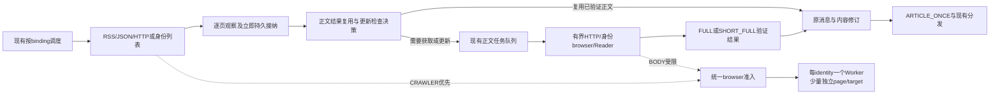

# 消息源轮询与正文补全整体优化方案

日期：2026-10-23。状态：开发方案，尚未实施。优先级：**P0降低新消息发现与接纳时延，P1使真实新文章完整正文取得率稳定超过80%**。P1不得通过挤占列表资源实现。

依据：[两轮排查报告](body-completion-and-poll-latency-diagnosis-20261023.md)，尤其第10—15节；本轮另复核当前代码、生产接线和容器配置。用户已明确选择：**保留 ARTICLE_ONCE；重要更新重新获取、更新原消息及修订记录，界面明确显示更新状态，不重复触发下游。**

## 1. 方案结论与边界

实施主线是：**先减少无效BODY占用并使列表优先准入，再打通同身份少量多页并发，随后缩短各源真实获取路径、逐页接纳并修复BODY质量和身份能力。** 不把所有站点切成浏览器，不给九ticker复制九套身份，不通过延长超时或减少查询词换低延迟。

继续使用现有Bus调度、durable enrichment jobs、Site Access、每identity一个控制Worker、Chrome Supervisor及Read投影。主要新增一个Bus内的正文结果复用表；任务终态、执行审计和统计复用现有存储/投影链路。不开第二套任务服务、Redis、额外Chrome集群或通用工作流平台。

必须正视三点：

- **默认4个browser操作槽不是所有目标都能成立的数学保证。** 历史成功列表runtime均值下，九ticker的Yahoo、InvestorsHub、Investing、Barron's各轮成本约138、105、79、61秒；四项相加已超过每分钟4槽的240秒，还未计BODY和Globe多query。因此必须降低实际浏览器调用量/耗时，并解除无必要串行；若改完后仍明确缺容量，可将全局槽4→6，不能坚持4槽后靠漏抓达标。
- **没有更新信号又完全不再检查页面，无法保证捕捉正文更新。** 本方案保留有界、低成本更新检查；对没有可靠更新信号的页面，不以无限TTL替代原有覆盖责任。
- **80%以上是生产验收目标，不能由修复数量直接推导。** 认证、订阅权益和真实页面可用性必须恢复；届时仍失败的文章留在分母，不能通过隐藏来源、只统计已入流文章或把PARTIAL改名来达标。

上述runtime量级含内部等待，仅用于容量预警；实施后按新增分段中的实际持槽执行时间计算需求，不能将runtime总和直接视为CPU消耗或证明必须配置多少并发。

## 2. 已核实基线及本轮进一步发现

本轮本地HEAD为`86d1a8cb`；相对上轮`2414d3ef`新增提交在模型/运行时运输相关模块。本轮未修改业务代码、配置、身份或部署。

生产只读复核：Bus和正文服务仍运行`92bbeece85b4`镜像；Site Access为其他维护发布的`challenge-repair-937d7159`。相关有效接线：`ticker_initialization_control_path`已配置，生产走`BusOrchestration`；scheduler tick为1秒；正文Hub为8个处理任务；浏览器business slots为4，browser进程配置为8。

|事实|对方案的约束|
|---|---|
|生产`BusOrchestration._inflight`已经按binding独立运行|不把standalone路径中的`gather`误判为生产全局屏障；保留现有调度骨架|
|源permit跨整次列表RPC持有，主要慢源配置单槽|必须同时调整源准入及下游容量，不能只抬Hub并发|
|Site/Identity单槽，Worker父锁和子进程`_active`再次串行|同Chrome多页需要协议、取消与页面生命周期一起改|
|JointBudget与HTTP SiteBudget初始均偏向BODY；全局browser slots不分purpose|只改某一层优先级仍会在下一层被BODY挡住|
|Site取得scope/identity permit后才等全局browser slot|可能拿着身份额度等待另一个资源；应合并browser准入|
|正文复用绑在发布收据和30分钟TTL上；终结后删除queue|已有正文仍重抓，同ID可重建，真实负载和审计同时失真|
|adapter通常完成全部query/page才返回PollResult|已经看到的新消息也要等本轮最慢的后续工作，需逐页持久接纳|
|Yahoo DOM日期获取会对缺缓存的文章逐一fetch；日期缓存只在Worker内|冷启动/Worker重建会重复支付详情获取成本；不能只优化列表导航|
|Globe实时checkpoint仅在gap recovery时读取；达到max_pages可done但coverage仍PARTIAL|分页限额不能变成默默跳过未完成覆盖；实时续跑要明确接线|
|SOURCE_SWEEP与实时使用同一个binding in-flight key；sweep还要等BODY收尾|需把“获取列表占用”和“等待正文结算”分开，保留冻结窗口及收据|

历史参考仍使用报告冻结窗，当前影子样本仅用于估算单次执行成本。不能把维护后的15秒shared capture命中耗时当成一次新导航耗时。

## 3. 验收口径与目标

### 3.1 P0：以发现和接纳为核心

采集时间统一使用真实阶段时间；`poll_attempted_at`不再冒充文章观察/入队时间。保留原发布时间、时间精度、语义交易日、美东02:00边界和admission规则。

|指标|定义|第一轮上线验收目标|
|---|---|---|
|调度迟到|实际开始该binding本轮工作 − target_due_at|正常运行p95≤5秒；慢ticker不使其他binding持续迟到|
|实际采集间隔|相邻两次新鲜列表capture的获取时间差|p95≤目标轮询周期T+15秒；不能用读取旧capture的次数替代|
|列表处理耗时|开始本轮获取至第一批有效列表观察持久接纳，含通过合同校验的真实空列表|五个重点源正常成功样本均值≤15秒、p95≤30秒；保留各源分项|
|发现后接纳耗时|列表实际取得该条目至durable intake提交|p95≤5秒；不等其他query、页面或BODY完成|
|发布至接纳|可信EXACT发布时间至intake，另标注源站发布延迟|在T≤60秒来源中，目标p50≤40秒、p95≤90秒；相同来源/时段对照基线至少改善50%；DATE/UNKNOWN单列|
|高尾与停滞|未取得新鲜列表的age、>60/120/300秒次数|正常可访问源不再周期性出现300秒级尾部；真实恢复/停服仍计入总可用性和停滞展示|
|覆盖|相同查询集合、时间窗内稳定文章ID/URL及续跑缺口|fixture/回放零漏项；线上对照出现差集必须逐条解释，不能以“耗时降低”接受不明缺口|

以上是验收目标，不是已经测得的收益。执行时先用上线前20—30分钟同一套计时建立可比基线，无需先等待三日才能发布。发布至接纳受源站自身发布时间语义影响，因此必须同时验收“实际capture间隔”和“发现后接纳”，不能只使用pubDate。

### 3.2 P1：按真实新文章计数，而非按重复任务计数

主指标：**首次发现后10分钟内，真实新文章取得经过身份/完整性验证的FULL或SHORT_FULL的比例**。cohort固定在首次发现所属语义日，重试完成日不能迁移分母。

- 分母为启用的正文采集源中已实际发现、符合当前admission的独立文章候选；无论后续是否匹配ticker、是否成功发布、是否因auth/预算失败，都保留。共享来源不能先丢掉正文失败项、再按成功分发项统计。
- 使用稳定provider article ID/已证实canonical别名合并同文；跨ticker只计一次全局文章，按ticker/source视图另算其候选集合。同标题不等于同文章；没有证据的跨站镜像不强并。
- 原生完整正文、或复用已验证同版本正文，可以满足该文章的完整正文结果；缓存命中不伪造一次新的网络成功尝试。
- 明确SKIP的短消息/非文章产品按原合同单列；错误解析成图片的新闻仍要修正回其真实文章身份。不能扩大排除规则或屏蔽困难站点来改善指标。
- 同时展示10分钟待成熟、终结未完成、超时后恢复、技术尝试成功率、缓存复用率及各来源失败构成。PARTIAL、摘要、付费墙和未验证命中都不算成功。

稳定验收：连续3个完整语义交易日，全局**每天及合计均>80%**，合计至少100篇新文章；不足样本只标记证据不足，不据10条canary宣称稳定。按来源/site同时展示，Reuters/DIGITIMES不能靠总量稀释宣布已恢复。这是后续自然验收，不阻塞已通过功能及P0验收的分批上线。

## 4. 目标链路与资源规则



### 4.1 先按4个browser槽实施，允许按证据扩到6

|层级|初始规则|实施说明|
|---|---|---|
|全局browser|总4；BODY常态最多2；没有CRAWLER等待时BODY可借第3槽|始终留一个可供新列表准入的槽；CRAWLER可使用全部4槽。不取消已运行BODY抢槽，只停止继续借位|
|同Identity|已验证的五个重点新闻身份最多2个读操作；其中BODY最多1个|允许CRAWLER+BODY或两ticker列表同身份并行；保留现有Chrome/登录Context。Reuters、DIGITIMES认证未恢复时先单槽|
|scope/site|与有效identity容量一致；同一站点按现有min_interval启动节奏|不让Site=1隐藏地把identity=2重新压成1；共享身份按真实identity汇总，而非按显示组合名各算一份|
|源列表请求|Yahoo、InvestorsHub、Investing、Barron's设2；Globe HTTP设2，browser兜底受全局限额|同binding仅一个实时head owner，多个ticker公平轮转；不把9个ticker一起排成长RPC队列|
|正文Hub|保留8个任务，不因P1加到几十个|其中实际browser受上表限制；重复下载跟随者和长期延期不占处理槽睡眠|
|公共HTTP|复用现有连接池，每host上限2—4，按源已验证节奏|与browser容量分开；不使公开HTTP进入identity单任务队列|
|恢复/人工维护|沿用独立recovery容量和profile独占|单identity维护只阻塞该身份。保留人机验证原target、会话证明、Cookie和egress绑定|

CRAWLER在可执行工作中优先于BODY，旧文复查优先级最低；新正文不能无限饥饿。正常容量满足后，BODY已等待30秒可提升到普通列表同级按入队顺序竞争，但仍遵守BODY最多2/借3和每身份BODY最多1。旧文复查不使用该提升。

如果消除重复、改轻路径及2页并发后，全局4槽仍持续满且CRAWLER等待p95>5秒，而主机CPU平均<70%、可用内存≥3GiB、Site容器内存有≥25%余量，则**全局一次调整到6槽，BODY常态上限仍2**。同时观察实际页面内存和身份错误；不是先扩Chrome进程或追加profile。若CPU/内存已紧张，继续降低列表导航与广告脚本成本，不能把下游排队重新移到更大的进程池。

### 4.2 browser容量只排一次

扩展现有`JointBudget`，在同一个准入判断中同时检查全局browser、site和identity额度、启动间隔及purpose优先级；等待者不预占任何一层额度。将`WorkerSiteAccessRuntime._business_slots`的独立二次排队并入此处。

`AccessRequest`只增一个有默认值的`work_class=foreground/backfill/recheck`，保持CRAWLER/BODY purpose及认证合同不变；由冻结的poll模式或正文job的work_kind经任务局部上下文传递，managed transport和browser reader都带上。旧客户端默认foreground。这样Site能真实区分实时列表、sweep补齐及旧文复查，而不是仅在Hub里排过一次序、到Site后又全部变成同优先级BODY。

Service准入后通过**内部调用上下文**标识已有容量，runtime不再重复acquire；不接受客户端传入“已获得容量”的字段。LOGIN/recovery等非普通业务入口继续走现有专用容量和profile写锁。底层page分配锁仅保护创建/登记，不覆盖整个抓取。

HTTP用现有SiteBudget，优先级与browser侧一致。由Site返回有界延期及`retry_not_before`；调用者释放源permit和任务槽后再调度，禁止在持有源/identity槽时sleep。原浏览器8个进程配置不是8个实际操作槽，指标必须分开。

### 4.3 影响、价值与依赖排序

|优化项|P0价值|P1价值|资源/依赖判断|
|---|---|---|---|
|CRAWLER优先、统一准入、源级公平|直接消除列表被BODY长等待挤压|避免新文章预算在排队中耗尽|优先实施；不增加Chrome进程。必须覆盖HTTP与browser两侧，不能只改优先级枚举|
|同身份2页及精准取消|直接打破九ticker在多层串行|利用原已验证身份，提高有效获取能力|依赖Worker协议、任务局部状态与目标所有权；先解除软件限制，再调配置|
|Yahoo快路径、Globe HTTP与按页接纳|缩短真实获取/新消息等尾部页面的时间|新鲜文章更早获得BODY机会|收益潜力高，但轻路径覆盖必须验证；不能把未验证的HTTP可用性算进容量预算|
|下载复用、去重终态、旧文复查分级|减少不必要BODY占槽，是P0直接减负|保留成功正文、减少反复失败分母|排在并发放量前；必要更新检查仍会消耗资源，不虚报全部浏览器调用可消除|
|预算、原因码、顺序、Apple/ETNews|减少过期任务和多阶段无效工作|直接修复可重复失败机制|多数可独立窄修；不等待认证源全部恢复|
|Reuters/DIGITIMES及国家域能力|恢复列表可用性、消除恢复空转|是困难站点真实成功率恢复的必要条件|必须有当前身份/权益/文章证明；手工恢复阻塞只影响对应站点|
|执行ID、cohort、UI|能看到真正尾延迟及覆盖缺口|消除指标失真，验证80%是否真实|不直接制造成功率收益；只读历史重建不是P0前置|

同一个修复可能同时提升P0/P1；不按旧报告的P0/P1标签机械分批。尤其不能先把更多BODY fallback打开，最后才处理其对列表容量的冲击。

## 5. P0工作包：调度、并发与浏览器执行

### P0-A：最小计时、立即接纳与慢工作隔离

修改：`message_bus_v2/{schema,scheduler,service,storage_lane}.py`、`persistent_runtime_v2/bus_orchestration.py`，以及逐页返回的adapter。

1. 在现有PollContext增加可选的异步`on_page`/观察批次回调，传入本页观察时间、query/page及覆盖证据。抽取`accept_observations`小函数，仅做该批admission、观察/去重、durable enqueue和返回job IDs，**不提前覆盖整个poll状态**。
2. Yahoo分阶段结果、Globe/Reuters多query分页等取得一批有效条目后立即调用；最终PollResult只汇总已接纳收据和未接纳部分，避免尾部再次重复入队/重复计数。老adapter继续可一次性返回。
3. 每页checkpoint只在该页观察及任务提交成功后前移。取消遇到已准入StorageLane事务，仍等待其原子提交；失败不前移游标。开启新一轮不能吞掉旧一轮未持久化的页。
   实时尚有可执行continuation时，`next_dispatch_at`设为不晚于当前时间+1秒，受真实`retry_not_before`约束；`target_due_at`仍表示新head的目标周期。修改当前只接受“更晚optional_next_poll_hint”的接线，避免时间片拆小后每页反而等待下一次60秒周期。
4. 轮询任务按最迟新鲜capture/target_due排序，维持每binding一个实时in-flight；源满时保留due状态、下一tick继续，避免九ticker各占一个排队协程等待分钟级permit。
5. SOURCE_SWEEP拆开列表获取占用和等待BODY结算：网络获取使用共享源/身份限额；poll_done后在`sweep:<task_id>`下结算，不持续占用实时binding key。CLOSED_SWEEP仍使用冻结query plan、cutoff、独立checkpoint和claim fence；它不能覆写实时next_due/cursor。
6. 生产保留现有非阻塞`BusOrchestration`。standalone长跑路径补同等in-flight隔离，单次CLI run-once可保留等待本次工作的语义；不另写一套调度算法。

完成条件：一个ticker卡45秒时，其他ticker到期仍启动；本轮前页的新文章先接纳；旧文sweep等待正文时不挡实时列表；崩溃重启后页游标与接纳收据一致。

### P0-B：正文减负前移——先上复用及重复任务修复

先实现第7节的基础部分：同文下载只进行一次、FULL复用不依赖是否发布、同ID终结不再重建、已排队任务在首次实际fetch前二次查询结果。修Apple主link、防止确定性图片进入BODY，并把旧文复查降到低优先级。

这些是P0前置减负，不必等P1全部站点修完。保持原完整性标准及admission，暂不改变站点访问方式即可减少无效Chrome占用。

### P0-C：Worker支持同一身份有界多页

修改：`site_strategy/{worker_manager,identity_worker,worker_runtime,browser_operations,browser_runtime,external_runtime,managed_runtime}.py`。

1. 复用父进程现有`pending[id]`和帧写锁，将`operation_lock`拆为短控制锁及读操作容量；不在整个roundtrip上持有身份独占锁。
2. 子进程`_active`改为`active: dict[command_id, Task]`；`execute`允许至identity配置容量；原ownership ack/result仍按ID、epoch收发。`allocate/login/verify/recover/detach/配置或session切换`等控制写操作先阻止新读，再等已有读退出，沿用profile独占。
3. 每请求使用独立lease、page、target/allocation ID、超时和阶段状态。继续每identity一个Worker及一个控制Node，登录profile仍只有一个Chrome writer；不同网页不是不同Chrome进程。
4. `SnapshotRepository.update()`不能在A执行中被B覆盖。将命令的identity/profile/egress/strategy快照做成任务局部只读视图；共享driver/连接池保留。instance/session revision改变时走已有drain，不在业务读任务中热换Cookie或egress。provenance来自各自lease。
5. 取消协议改为`cancel(command_id)`，返回取消/页面释放结果。等待准入超时不发取消；已运行任务超时只取消自身并清理仍归自己所有的BUSINESS target，不退役整个身份。已handoff为CHALLENGE/LOGIN的target不再由普通取消关闭。设置3秒有界清理，成功后兄弟任务继续。
6. 若CDP/Node确实断连或控制进程无法响应，才标记该identity不可用、统一drain其活动任务并保留明确失败；不得把失控取消伪装为成功，也不得kill整个进程组/重启Supervisor。
7. `status`、空闲回收、driver RSS/年龄轮换和`retire()`须读取活动任务集合；有业务或人工维护target时不按旧单任务IDLE判断退役。每次close释放自己的计数，旧lease不能减少新generation额度。

多页启用顺序：InvestorsHub → Yahoo → Globe → Investing → Barron's，每站通过一次“2 ticker + 1 BODY竞争、单任务取消、另一个完成”的真实验证后启用2页；这只是短机制验证，不要求每站先长时间观察。认证/挑战未恢复的身份不借另一身份证明抬并发。

保持页面/Context生命周期参数各自语义：`max_context_pages`是轮换相关阈值，不是该identity的任务并发数；不靠把它或RSS轮换阈值统一调大来启用多页。

### P0-D：CRAWLER/BODY优先级与准入统一

修改：`site_strategy/{budget,service,worker_runtime,schema}.py`、`settings.py`及精确来源配置。

- 落实第4节规则，HTTP与browser两类budget都改为列表优先；维护独占继续有效。优先选择有空闲真实identity且有可消费能力的请求，某个繁忙身份不能阻塞别的身份。
- 列表快路径的Site准入等待目标≤1秒；没有替代覆盖路径的authoritative browser请求可等最多3秒，之后持久延期、短续跑。不能将原10/25秒的队列等待直接加到每ticker的快路径。
- BODY最多等3秒准入，未获额度则返回可重调度的DEFERRED。它不算一次真实网络尝试、不增加站点风险惩罚，但文章仍在P1待完成分母中。禁止8个Hub任务一直睡在身份队列里。
- Site-managed BODY的browser阶段不再先进入legacy `DomainFetchController`的长等待，再去Site排一次；实际站点/身份并发由Site统一执行。旧V2.1/PublicTransport保留原域名节奏，Reader等公共HTTP也仍受自己的有界限额，不能因此变成无界抓取。
- min_interval和恢复probation照常执行，延后请求释放槽。更改并发与启动间隔是两件事；先保持现有每identity间隔，避免一次改变所有风控变量。
- 开启多页后同步更新源、Site和Identity的有效容量。检查`_group_constraints`对同scheduler_group取最严格值的实际结果，不能只改某个SourceDefinition却仍被同组配置压成1。源级permit只覆盖一个实际远端请求，不覆盖解析/入库、跨页续跑及重试sleep。

### P0-E：有界浏览器工作，不做全站激进拦截

修改：`site_strategy/runtime.py`及`message_bus_v2/{yahoo_sources,barrons_sources,market_sources}.py`的站点recipe。

- 保留已有`wait_until=commit`优化，等待实际需要的列表卡片/正文节点；不重新等待全站networkidle、广告或不相关DOMContentLoaded。已有内容合同通过后立即capture并关闭该BUSINESS页。
- 将导航、内容等待、recipe、质量校验分别计时。15秒节点等待不能在每个替代selector上重新完整计时；同一请求共享一个deadline。
- 对已确认为图片、视频、字体、第三方广告且不影响页面合同的资源，沿用现有站点规则；新拦截只对实测站点增加。保留身份验证、支付墙识别、核心JS、列表XHR和真实正文资源。
- 尽量从已取得HTML/JSON提取多个已需字段，不为日期、标题、正文各做一次导航；有完整正文候选就复用，不再抓详情一次。任何附带正文获取不能延迟本页列表持久接纳。

## 6. 五个重点来源的具体方案

### 6.1 Yahoo Finance：RSS先接纳，browser负责补齐覆盖

修改：`message_bus_v2/{news_adapters,yahoo_sources,yahoo_transport}.py`、Yahoo Site recipe，必要时正文结果表中的公开文章元数据。

1. 每轮先获取现有官方ticker RSS，快速解析并立即接纳；NCP若仍处于已知404/405/410或429端点退避，不在每ticker上重试。保留当前固定HTTP路由，不轮换新代理身份。
2. RSS成功不等于与ticker DOM等价。保留browser latest-news捕获作为补充，按binding的最后新鲜browser capture公平轮转，仍须覆盖九ticker；browser可用时同身份2页，源2请求。没有立即准入额度就记待补齐，不让RSS先等10秒。
3. 同一轮browser只作一次有界获取；列表runtime上限初设20秒，取得部分有证据条目即逐批接纳，其余待补齐。补齐任务沿用该binding后续调度/续跑记录，不能将“RSS已成功”写成全部覆盖完成。快路径目标可调30秒，browser补齐周期目标60秒、p95≤75秒。
4. 将DOM缺日期的链接与RSS/已有公开元数据按已证实文章ID/URL合并，只对未知/版本提示变化条目获取精确时间；共享并持久化已验证时间及候选正文，Worker重建后不对20篇旧文全量重抓。
5. 区分`datePublished`、`dateModified`和provider pubDate变化。不能将相对时间或本次抓取时间伪造成EXACT；没有时间证明的条目先持久保存为待时间核验，不静默丢掉，也不标成新鲜成功覆盖。核验与后续admission照现有合同执行。
6. browser列表metadata阶段已拿到文章HTML时，若通过同一套标题/完整性检查，写入正文复用结果供BODY使用。不要在列表关键路径继续额外获取尚不需要的正文。
7. endpoint不可用/站点恢复的退避状态按scope+endpoint共享；半开时同端点只放一个真实探测，其余ticker继续RSS及补齐责任。过期探测恢复后自动回到browser覆盖，不永久切RSS。
8. 同时处理`YahooTransport._lock`跨整个HTTP请求的隐含串行：保留NCP的原cookie jar、固定路由及单探测；RSS使用独立的公共session/端点容量，不等待一个慢NCP。锁只保护会话建立、节奏/退避状态更新；RSS/NCP共享所需的主机启动节奏，但不持锁等完整响应。所有curl session仍留在其专用event loop，不跨loop复用，不复制Chrome登录Cookie。

验收重点：RSS先接纳时延、DOM独有文章是否仍发现、冷启动详情请求次数、九ticker最长browser capture age，以及滚动新闻pubDate变化是否制造重复下载。

### 6.2 InvestorsHub：列表2页并发，独立验证HTTP轻路径

修改：`market_sources.py`的MarketTickerAdapter/解析器、Site recipe与对应scope配置。

- 在原登录Context上允许两ticker列表或列表+一篇正文并行，源/Site/Identity均为2；每identity BODY最多1。保留ticker路径、交易所及页面身份检查。
- 对现有ticker URL做有界HTTP/结构化列表验证：比较浏览器实得ID、时间、分页/置顶项；只有覆盖等价才把HTTP设为列表首选。当前约10秒的browser成本不能在方案中假定已经被HTTP解决。
- HTTP若是挑战/空壳/丢卡片，使用原身份browser；同一轮只回退一次。连续明确无效时按端点退避，不让每ticker都付一次完整失败HTTP超时。
- BODY静态文章已有FULL后直接复用；稳定provider article ID仍是身份主键。表单类SHORT_FULL沿用质量验证，不因去重证据kind=BODY就重抓。

### 6.3 Investing：列表能力与正文能力分别恢复、分别计时

修改：`market_sources.py`、`site_strategy/{investing_document,runtime,seeds,scope}.py`及实际策略revision。

- 保留现有原生redirect/完整response证据处理，不能用初始bootstrap 403覆盖已见证的同frame成功文档，也不能用看似正常DOM伪造200。
- 实测当前主/备CRAWLER合同和普通/Pro BODY合同。某个列表endpoint恢复中不等于所有BODY失败；按purpose复用已验证能力，不开启认证状态写假值的捷径。
- 健康identity允许2页、BODY最多1，源2。公共HTTP或原身份browser fetch只在真实列表卡片与时间等价后提升，不因BODY能读就假设列表JSON端点可用。
- 列表selector/响应解析共用请求deadline，内容证据足够后返回；恢复/挑战门禁立即延期，不在同一轮反复换组合导航。
- 地区域名处理见第8节，保留不同语言/文章身份，不先做无条件`in/uk/...→www` URL改写。

### 6.4 Barron's：复用已有短时capture，缩短真正的新捕获

修改：`barrons_sources.py`、`industry_sources.py`、Site capture计时/recipe与scope配置。

- 当前已有15秒shared CRAWLER capture，保留同请求合并；返回本次消费耗时、capture真实获取时间和age，不能重复使用原network_ms作为本次耗时。
- 对九ticker保留逐ticker获取；不同ticker不是同capture key，不合并成一个ticker。源/Site/Dow Jones身份有界2页，付费BODY最多1，继续使用原认证Context。
- 原生News卡片已有精确时间则立即返回，不等待无关推荐、完整hydration或正文。只在卡片确实尚未就绪时使用当前client-data捕获逻辑。
- 单独验证新导航的时间与覆盖，不拿15秒cache hit代替；付费BODY禁止走第三方Reader。

### 6.5 GlobeNewswire：HTTP优先候选，多query按页接纳与续跑

修改：`market_sources.py`的GlobeNewswireSearchAdapter、`schema.py`的continuation及现有query checkpoint。

- 对当前`/en/search/keyword/.../load/more`执行HTTP验证，使用现有query、pageSize和parser；若结果ID/时间/分页与browser等价，采用HTTP首选，browser仅用于合同不满足时兜底。目标是减少该站大量browser操作，不以删除长尾查询换速度。
- 实时轮次先取所有query的head页，分批接纳；续页用已保存query/page轮转执行，不让一个query的三页挡住其他query/ticker。保留原query plan、terms revision和每query覆盖。
- 按已配置源并发2运行；每次调度时间片最多2个页面请求或15秒，超出生成可恢复continuation，释放permit。下一次先完成尚未扫描的head，再推进旧页；新周期的head刷新与旧页补齐分别保存进度。
- continuation下一tick即可续跑，不等待一个完整60秒周期；新周期不能重置未扫head/query的位置。存在续页债务时，每4个成功页面请求至少一个用于续页，避免不断到来的head刷新使旧页永久饥饿；若债务仍增长，按真实请求成本解决容量，覆盖项不能验收通过。
- 只有到达时间窗边界/可靠锚点或结果真实穷尽才为该query写COMPLETE；达max_pages或时间片上限只写PARTIAL+next_cursor。实时continuation也读取checkpoint，不依赖`is_gap_recovery`才生效。
- 如果某query不能完成，其他query已见文章仍立即接纳，来源显示PARTIAL及最老未覆盖窗口。重试不从page1无限重扫，不静默放弃失败页。

## 7. 正文复用、更新检查与任务生命周期

### 7.1 一个持久结果表，解耦下载与发布

新增`message_bus_v2/body_results.py`及一个`article_body_results`表，使用现有Bus SQLite事务、NativeContent正文引用和StorageLane。现有distribution路径同样调用它，不把所有来源强迁到distribution模型。

最小字段组：

|字段组|内容|
|---|---|
|下载身份|`fetch_key`、canonical article key、publisher/access scope、language；记录验证过的URL别名|
|内容结果|FULL/SHORT_FULL、正文引用及hash、标题/文章身份与质量证据、首次取得时间、最后确认未变时间|
|更新线索|已确认内容版本、最新provider版本/modified/title/summary提示、ETag/Last-Modified、待核查提示及next_check_at|
|有限工作所有权|当前fetch owner execution ID、lease到期时间、失败类别及retry_not_before、由到期更新检查递增的check_seq|

下载身份不含ticker、binding、半小时桶和未证实的每次pubDate。付费/需认证结果必须带获准access scope和内容类型隔离，不能跨scope借用另一账户证明；公开同文可跨ticker复用。只有硬ID/可信canonical/已验证跳转才能建立别名，不全站模糊URL去重。

首次发现即为文章建立PENDING结果及`first_observed_at`，并在现有`message_observations`追加canonical article key/结果引用；失败、尚未发布、直接命中缓存而没有新网络job的输入均有发现证据。Read的新文章cohort由这些观察/结果及已验证别名投影，不只扫描成功raw或终态job。provider复用ID、不同语言/独立报道等沿用现有identity/context冲突检查，不能仅凭相同external_id复用旧正文。

复用结果不等于发布完成：每个原job继续执行自己的admission、相关性判断、ARTICLE_ONCE及发布收据；未发布FULL也可复用其下载结果。对复用附`reused_from_execution_id`和取得时间，不生成虚假的网络attempt或Site新能力证明。

### 7.2 入队前及首次fetch前都查一次

修改`service.enqueue_enrichment`、`repository.observe_input/claim_enrichment_jobs`及Hub `_process`：

1. 记录此次输入观察。先做轻量admission；查同文已验证正文及更新线索。
2. 无需要重新获取的实质变化：附加结果引用并继续原消息处理，不发网络请求。不再要求stream记录才能下载复用，也不因30分钟到期直接重开高优BODY。
3. 同文获取正在进行：关联/短延期当前job，释放Hub槽；不让多个binding各占一个任务await同一网络操作。lease超时只由新的owner接管。
4. 真需重新获取：现有job获得fetch lease后执行；完成前校验claim/lease owner，防止超时旧任务覆盖较新正文。
5. 已经排队的任务在首次fetch前再次查表，利用其他ticker/source刚完成的同文。好正文优先，后续失败或摘要不能覆盖已有FULL。

在现有job增加一个小的`work_kind`：新文章、已知文章内容更新、无提示定期核对；不新增Worker服务。已知文章更新必须引用原来已经合法接纳的文章/消息，仍检查当前source/binding启用和暂停状态；抽取现有正文合并/修订逻辑为`apply_known_article_revision`，不再经过新文章发布入口。它更新原消息时不重新按“新文章须在30分钟内”拒绝，也不把旧发布时间改成现在，更不能伪造CLOSED_SWEEP绕过准入。新文章admission保持原样；没有既有合法文章引用的输入不能使用此路径。

### 7.3 更新判断不依赖“每30分钟重新完整下载”

|观察/内容变化|处理|
|---|---|
|相同文章、相同有效输入，只是缩略图/跟踪参数/传输结构变化|复用BODY；更新观察时间，不新增正文工作|
|仅provider pubDate变化|保留原发布时间证据；标记待版本检查，合并重复提示，不能直接制造新文章或新高优完整下载|
|明确provider_version/dateModified或title/summary有内容变化|同文章合并一次更新检查；不能简单全部当噪声。优先HTTP conditional/已验证结构化端点；变化确认后取新正文|
|结果304且validator已针对该正文版本验证|更新最后确认未变时间；不产生新内容修订|
|200但规范化正文hash相同|记录检查，不改content_revision；页面广告/排版变化不视为新闻更新|
|规范化正文新增/删除事实、数字、段落或标题实质变化|保存新完整正文及旧版本，增加content_revision，更新原消息和UI；不再次入Stream/Runtime|
|当前页面退化为墙页/摘要/错误页|保留旧FULL，标记最新检查失败/待恢复；不能将旧结果宣称刚刚重新验证成功|

不引入LLM“实质更新分类器”。使用已有结构化正文清理、规范化hash和文本diff；只忽略明确排版、署名、广告等噪声，正文句段变化默认保留为修订，避免把重要事实过滤掉。下载调度和内容修订分类分别处理。

更新时间规则：

- 已明确版本提示的来源，提示变化即触发一次检查；相同提示合并，分钟内不反复重试。滚动文章保留其正常列表更新频率，不按静态稿长缓存。
- 无可靠提示但文章仍在监测列表中：保留最多30分钟一次的更新核对责任，先尝试可信conditional HTTP/低成本结构化响应；验证未变不进入browser BODY。
- 若此类页面只有真实Chrome才能核对，优先验证原身份的轻量browser-fetch/完整response捕获；未证实等价前保留原30分钟检查上限，放入独立低优复查类别，并按第4节受限运行。不能直接延长至数小时、永久停止检查或假报已确认未变。
- 更新提示到达时复查提升为普通内容更新任务；无变化的旧文复查始终最低优先级。P0拥塞时允许短延期，但待核对age和逾期数必须显示；持续逾期是容量/覆盖未达标，不能拿缓存当完成证明。

### 7.4 修复预算、终态和实际执行身份

修改`content_enrichment/{schema,service}.py`、Bus repository及distribution接线：

- `observed_at`为实际列表观察，`enqueued_at`为真实提交，`poll_attempted_at`独立保留。首次claim完成admission/缓存检查后、首次调用获取执行器前，创建一次180秒有界执行预算，不能从poll开头计；请求内部最多3秒的准入等待也计入该次预算。另记录Site返回的首次实际attempt时间，明确区分执行预算起点和真正网络起点，不声称二者完全相同。
- 未获得网络/浏览器准入的延期不记一次fetch attempt；首次fetch前的admission仍按真实时间重验，保留30分钟/语义窗，不为旧消息变造时间。已建立的执行deadline在重试/延期时不重置；执行预算先用尽则明确失败，尚未进入执行的持久排队任务受10分钟入队终限约束，不能靠重复首次claim续180秒。
- Hub真实获取最多2次整流程；各阶段共享总budget及退避。queue/恢复延期仍有独立的等待终限：超过首次入队10分钟形成明确未完成结果，后续恢复另记，不让任务无限挂起。CLOSED_SWEEP原冻结窗口和结算合同仍有效，不能因P0策略把合法sweep数据丢掉。
- 逻辑job ID按消费责任+文章/待核对版本生成，去掉“半小时必生新job”。定期核对仅在`next_check_at`到期时原子增加`check_seq`并生成一个检查job；不因每次列表观察创建，不因同版本终态而永远停止后续核对。真实执行使用`execution_id = job_id + execution_seq`，重试、重入、恢复不能复用同一个实际执行ID。
- queue增加COMPLETED/FAILED终态及结果引用，不在终结时删除其唯一去重凭据。`pending_enrichment_ids`、claim、list pending、sweep等待只选择活跃状态；同时更新索引及所有依赖“row不存在=完成”的查询。终态正文通过NativeContent引用，避免重复存正文。
- 普通缓存复用、发布重试、网络重试分别留痕。终态不会因为下一轮相同输入被重新入队；新版本检查有明确新责任。旧半小时ID保留，不重算历史记录。

### 7.5 两账、trace和恢复提示一致

- 将每次真实执行审计和Site outbox构造移到统一终结路径，早期duplicate返回也必须经过；同一Bus事务内提交执行结果、原消息更新/修订、job终态及outbox。distribution正文终结也遵循同一身份。
- `BodyOutcome`增加execution_id/logical_job_id兼容字段；Site按新execution_id幂等，旧客户端仍按旧job ID识别。旧132个冲突保留并标记legacy歧义，不回写成假成功。
- `SiteAccessTransport.access_trace`改为任务局部，取消/异常不残留。为每阶段记录原始异常、稳定原因、是否实际尝试、是否恢复/延期；首个有意义的完整性失败不被最后一次empty覆盖。
- 旧FULL可继续用于原消息展示，但最新检查失败、缓存取得时间、最近内容修订时间各自明确。缓存命中不刷新站点登录/订阅验证时间。

## 8. P1抓取机制及来源修复

### 8.1 有序、短路且不抢列表资源的fallback

修改`content_enrichment/{pipeline,managed,transport}.py`、`site_strategy/service.py`和每站策略revision。

1. 将`access_order`真正执行成按序阶段机，支持现有`http_public/browser/browser_fetch/reader`；每阶段立即做同一套身份和完整性检查，得到FULL/SHORT_FULL就停止。
2. 错误类别采用稳定码，例如`transport_timeout`、`http_403`、`challenge_required`、`subscription_required`、`content_incomplete`、`queue_deferred`。原异常类名单独保留，修正`Timeout/timeout`分歧。有限重试依类别判断，不复制字符串白名单到多层。
3. 公开低风险内容初值：HTTP单阶段8秒、browser最多25秒、Reader最多12秒，共用180秒；站点可在策略中覆盖。一次HTTP超时后的下一阶段有明确budget，不让每层都重开45/180秒。
4. 高风控站点使用已有已验证身份：InvestorsHub、Investing、Barron's默认browser或经验证browser-fetch优先；Yahoo公开BODY当前HTTP成功成本低，明确配置HTTP优先而非保留失效的browser-first声明。Reuters恢复后按其可消费能力选择browser；DIGITIMES required-auth只使用当前有订阅BODY资格的身份。
5. Reader只处理允许的公开文章；auth required、已识别付费墙、会话验证材料不送第三方。非文章、身份不匹配、明确无权益不做无意义阶段重试。
6. 同一站HTTP/Reader端点已知不可用时共享有界退避与单探测；不是为每ticker重复支付失败全链。站点恢复由现有Site owner处理，正文请求不自行切换Cookie/profile。
7. 不新增“HTTP失败立即并行启动browser+Reader”这种全量竞速；它增加请求和Chrome负载。改善fallback的重点是短路、复用、正确原因及阶段预算，BODY仍服从CRAWLER资源优先。

### 8.2 来源级修复清单

|问题|直接修改及验证|完成证据|
|---|---|---|
|Apple Atom|修`adapters._rss_rows`：RSS文本link、Atom rel=alternate/html主链接；enclosure独立字段，不覆盖文章URL；非文章准入按已证实媒体类型处理，不能只靠URL包含image粗过滤|真实五entry选文章URL；原5个图片不入BODY；文章详情经原质量校验；不关闭图片资源拦截|
|ETNews照片短稿|修`strategies/adapters.py`的正文容器/署名清理，适配记者名、기자及邮箱同段/同行尾巴；从真实文章段落获取完整短稿|报告201字符照片稿清理后SHORT_FULL；普通长稿FULL；摘要/read-more/无主体反例仍拒绝；无全局质量降级|
|Investing国家域|在策略增加已验证exact domains及地区recipe，ScopeResolver映射到明确publisher owner；普通/Pro模板分别处理；只有已证实canonical/redirect才跨域别名复用|in/uk/ca/ng各至少一个真实文章验证路由、语言、标题及FULL；地区挑战/Pro墙反例保留；不无条件复制Cookie或改写www|
|Reuters|以维护后的当前状态重新验证主备CRAWLER和BODY；保留已上线的legacy兼容、验证码恢复、空搜索结果合同。需要人工验证码时沿用原会话/target；备用只有能力证据成立才激活|真实搜索、真实文章FULL、当前session/capability一致；恢复期间清晰延期，正常source不受阻。旧VALID不作为新证明|
|DIGITIMES EN|核对主身份登录、订阅权益和两篇真实BODY；主备分别验证，CRAWLER READY不能提升BODY。沿用现有认证/权益激活流程|当前身份/session/instance有有效BODY证明并取FULL；账号缺权益则明确阻塞且保留P1失败分母，不写假VALID|
|Fool/Stocktwits/MarketScreener等Google外跳|按最终publisher分组，先修稳定错误码和回退，再对高失败域做当前策略样本；只为证实的DOM/JSON缺陷增加recipe|最终域名及失败phase有可复算改善；不把外跳正文失败归因成Google RSS不可用|
|企业IR BE 404等|复核feed详情URL/跳转与canonical映射，沿用公共HTTP/JSON独立端点；不引入九套Chrome|BE坏链单独修复，9ticker/12endpoint继续约30秒目标，正常IR不因新闻池调整回退|

## 9. 计时、UI及审计投影

### 9.1 最小阶段字段

沿现有poll state、acquisition metadata、AccessResult/AccessEvent、job/execution审计追加字段，避免另建全链路追踪服务。

- Poll：due、dispatch、各request的source permit等待、Site等待、runtime、parse/accept、首批/末批intake时间、capture_id/acquired_at/age、coverage及未完成query/page。
- BODY：首次观察、入队、首次claim、首次实际fetch、各阶段开始/结束、Site等待、runtime、完整性结果、真实execution ID、cache/reuse来源及质量证据。
- `StorageLane.call`增加锁等待和事务执行两个时间，现有慢日志保留；不再把锁前等待遗漏后归为网络。只对超过阈值的批次拆分事务，不拆出多个SQLite writer服务。
- `network_ms`保留兼容，但在新展示中明确为runtime；新增browser内部global/worker等待与导航/recipe/validation时间。失败准入也写等待；shared capture的本次消费与原始获取时间分别返回。

技术阶段明细按小时聚合，失败/慢例按现有retention保留；业务正文、内容修订、执行终态和对账收据遵守现有业务证据保留规则。不要把每个成功DOM快照永久写进SQLite或为每个毫秒阶段发一次CDC。

### 9.2 UI合同

修改`api_v2/{bus,bus_metrics}.py`、`v2_read/{outbox,projectors,bus_aggregates,repository,serving_fields}.py`及`frontend/v2/src/pages/{message-bus,source-settings}.tsx`，同步`dev_plan/workflow_v2/api_contract/doxagent-v2-api.types.ts`、`frontend/v2/src/core/schema-source.ts`及生成schema。

- 原`average_poll_latency_seconds`暂保留数值兼容，名称/提示明确“各启用源最近一次耗时均值”；新增明确时间窗的成功采集均值/p95、capture age、发现后接纳、延期/失败次数，不能把旧字段悄悄改成新语义。
- 正文区主展示真实新文章FULL/SHORT_FULL比例；并列技术尝试比例、待成熟/失败、缓存复用。现有筛选可以过滤已发布消息，但采集cohort中未入流失败项必须可见，避免幸存者偏差。
- 原消息显示最近内容修订、待更新检查/检查失败、BODY取得时间；保留原首次发现和发布时间。ARTICLE_ONCE不增加stream offset、不重新触发Runtime。
- 新结果及job终态投影注册到Bus outbox/Read重建、增量两条路径；新增cohort不得只从`standard_messages`反推。观察投影只因首次发现、文章引用/结果等业务变化发CDC，不为每次`last_seen/seen_count`刷新生成Read历史，避免新增计时/复用表放大SQLite写入。延迟聚合及正文统计均可回到原始receipt复算。
- 切换日期以后使用新执行ID；旧指标标legacy口径，历史失败审计不重写。额外历史回填不是上线前置，仅按必要索引、分批读取，不再次全扫百万CDC阻塞服务。

## 10. 可执行开发顺序与交付物

每个工作包完成重要代码修改后追加`changelog`。保留当前脏工作区及并行维护变更；实施时基于最新main形成窄提交，禁止混入模型/交易等无关改动。

|顺序/批次|具体交付|依赖与完成条件|
|---|---|---|
|01 / A|固化报告badcase fixtures；阶段计时与baseline脚本|输出九ticker有效配置/identity路由/覆盖基线；不先做长历史回填|
|02 / A|Apple主link、任务局部trace、稳定错误码；基础正文结果表和复用|确定性错误输入不再进browser；同文多binding只下载一次；FULL未发布仍能复用|
|03 / A|终态与execution ID、统一outbox/audit、首次fetch预算|duplicate路径不漏账；不重建已终结同版本job；pending查询不被新终态卡住|
|04 / B|Worker多任务、task-local快照、精准取消、维护独占|真实2页并发且取消互不影响；旧Cookie/profile/人工作业保持|
|05 / B|统一browser准入、CRAWLER优先、源/Site/Identity容量配置工具|四层不再互相压成1；压力下列表优先、BODY仍能有界推进|
|06 / C|逐页接纳、sweep结算隔离、实时continuation|已见消息先提交；慢query和sweep BODY不挡其他实时ticker|
|07 / C|Yahoo RSS先接纳+DOM补齐、Globe HTTP/分页、其余三站recipe优化|各来源对照无不明漏项；capture freshness和平均/尾部时效达标|
|08 / D|有序fallback、阶段budget及更新检查/内容修订|稳定旧文不重复高优下载；实质更新不漏获取；原消息更新但不重投|
|09 / D|ETNews、地区Investing、Reuters/DIGITIMES当前能力恢复|分别有真实FULL与反例；外部账户未恢复项单列，不阻塞健康源的P0发布|
|10 / E|UI/Read投影及自然验收|新文章cohort、真实attempt、cache、coverage和延迟指标可对账；3日稳定结果另行记录|

批次A先减负并建立可信数据；B上线后立即改善已在用browser路径；C覆盖来源特性及发现时效。D的不同站点可以独立交付，不要求困难站点全部恢复后才启用其他改进。各批次只合并必要schema/消费者，不等待大而全重构。

建议新增两个运维入口，均是本次实施的一部分：

- `scripts/ops/configure_news_latency.py`：默认dry-run，列出本次五个source、Site/Identity原/新revision、并发/间隔/purpose限额；apply调用Owner/CAS，保存旧配置回执。同步改seeds/默认及已有库的窄迁移，不让下一次bootstrap冲回旧值。
- `scripts/ops/audit_news_timeliness.py`：只读输出同一窗口的cohort、每binding新鲜capture间隔、接纳延迟、阶段占比、覆盖缺口、执行对账及进程资源；只读有界查询，不依赖全表CDC扫描。

## 11. 必须完成的测试与实测

### 11.1 机制回归

|测试组|必须证明的行为|
|---|---|
|并发/取消|同identity两execute重叠；一页超时另一页完成；等待准入超时不取消在途页；维护写操作等读任务退出；Worker断连仅影响该identity；不泄漏target/slot|
|预算/公平|BODY洪峰时CRAWLER能准入；旧文复查不抢新消息；无空闲资源不占着别的资源等；HTTP不占browser；probation启动间隔仍有效|
|调度/覆盖|慢ticker、慢query、sweep等待BODY均不阻塞其他实时binding；页入队提交前崩溃可重读，提交后崩溃幂等；PARTIAL续跑到边界；不丢head与续页|
|正文复用|9binding同文只取一次；FULL未发布可重走发布；缓存/网络失败不降级旧FULL；claim后另一任务完成时能复用；session/scope/语言不兼容不混用|
|更新与ARTICLE_ONCE|pubDate/缩略图噪声不重下载；真实title/summary/正文变化会核对并保存修订；无提示页面30分钟更新检查责任不丢；已合法接纳的旧文章可更新而新文章admission不放宽；原消息更新而Stream不重复|
|时间/结果身份|慢poll后首次执行重新获得180秒预算；执行开始后重试不续命；queue延期不算网络尝试；同job重试不同execution；duplicate及distribution两账一致|
|质量/策略|Timeout可走允许回退；按access_order短路；付费不进Reader；Apple主链接；ETNews短稿与摘要反例；国家域归属；Reuters/DIGITIMES能力门禁保持|
|Read/UI|新文章失败未入流仍在分母；cache成功不增加网络attempt；cohort跨日成熟不换分母；shared capture不产生负耗时；增量/重建一致；旧字段语义兼容|

新增行为测试建议：`test_news_timeliness.py`、`test_browser_priority_budget.py`、`test_identity_worker_multiplex.py`、`test_article_body_results.py`、`test_body_completion_receipts.py`。结合现有测试，不写只断言私有字段值的镜像测试。

可直接执行的现有窄回归命令（PowerShell，仓库根目录）：

```powershell
.venv/Scripts/python.exe -m pytest tests/test_identity_control_workers.py tests/test_site_strategy_dual_runtime.py tests/test_site_strategy_lifecycle.py tests/test_site_strategy_client.py tests/test_site_strategy.py -q
.venv/Scripts/python.exe -m pytest tests/test_content_enrichment_hub.py tests/test_content_enrichment_pipeline.py tests/test_content_enrichment_browser.py tests/test_message_bus_v2_deduplication.py tests/test_message_admission.py tests/test_message_bus_storage_lane.py -q
.venv/Scripts/python.exe -m pytest tests/test_yahoo_page_rss.py tests/test_yahoo_dom_recovery.py tests/test_yahoo_browser_transport.py tests/test_message_bus_market_sources.py tests/test_message_bus_rss_routes.py tests/test_barrons_native_news_capture.py -q
pnpm --dir frontend/v2 schema
pnpm --dir frontend/v2 typecheck
pnpm --dir frontend/v2 test
```

开发新增测试后纳入相应组；实际改动涉及Orchestration、Read、IR接线时，补跑对应既有测试。没有相关改动时不扩展到模型付费Pilot或无关交易回测。

### 11.2 少量真实验证，随后正常流量验收

1. 五个重点源各测真实列表、一个普通正文及一个必要反例；记录新导航与cache hit两种耗时。Reuters/DIGITIMES独立记录认证/权益和BODY证明。
2. 在一组现有身份上验证同identity两页及单页取消，复用现有登录，不为验证另建九套profile。验证完成关闭自己创建的BUSINESS target，保留LOGIN/CHALLENGE页。
3. 对同一批query/ticker做一次受控覆盖对照，公共HTTP与原browser ID/时间/分页有差异就保留browser及缺口；不把采样不足当等价。
4. 用正式正常流量观察首个20—30分钟、随后开盘/突发窗口的P0指标；不持续双倍抓取作长期对照。真实新文章走完整intake→BODY→ARTICLE_ONCE→Read链，缺新样本则明确待证实。
5. P1连续3日自然cohort验证由现有统计产出，不人为插入生产假新闻。任一日未过80%或P0恶化，按最终publisher/阶段处理，不宣称整体完成。

## 12. 迁移、发布与回滚

### 12.1 上线前处理

- 保存当前代码SHA、实际镜像、source/binding/Site/Identity revision、scope主备及各组件运行状态。其他会话已发布的挑战恢复、legacy协议兼容和模型变更不得被旧镜像覆盖。
- 先增加可兼容字段/表/终态读取，再启用新写入与并发。Read投影注册和新schema重建要一起覆盖，不能只让API返回零值。
- 只回填当前仍有用的FULL/SHORT_FULL引用及必要canonical别名，验证正文质量证据；失败/冲突历史原样保留。缺历史缓存允许正常获取，不要求全量回填成功才启动。
- 先发布“能读取新字段/终态、暂不启用新写入”的兼容镜像，作为后续批次的最低回滚底线，再开始写COMPLETED/FAILED。回滚到此兼容镜像会保留终态/执行收据且继续过滤pending；不能直接退回会把任意queue行当pending的`3d0ae94c`程序。业务证据不为回滚而删除。

### 12.2 分批窄发布

沿用`scripts/ops/storage_release.py`，不再以临时容器内文件覆盖代替正式镜像。实施获授权后按实际受影响组件执行，例如：

```bash
python scripts/ops/storage_release.py release --repo /home/ubuntu/doxagent --commit <本批已提交SHA> --component v2-site-access --component v2-message-bus --component v2-content-enrichment
```

Read/API/UI字段上线的批次另选实际API、projector、web消费者组件；先用`storage-status`确认登记名及current/previous，不照抄不相关全栈组件。Site父子Worker同镜像更新；drain控制Worker时保留Supervisor的Chrome和profile，不重启Chrome Supervisor，不升级Playwright/Chrome版本作为本轮优化的附带动作。

### 12.3 具体回退条件

|触发|处理|
|---|---|
|两页后身份挑战/控制断连明显增加，或单页取消影响兄弟页|该identity先退到1页，保留其他正常站点；修复精准取消/生命周期后再开，不全局回滚健康源|
|正文负载使CRAWLER等待或发现p95相对基线恶化>10%，持续两个5分钟窗|先禁止BODY借第3槽、暂停低优无更新提示复查的新增browser准入，保留pending/age；检查容量和轻路径，不能丢任务|
|新HTTP/JSON路径缺文章、时间或页覆盖|该endpoint回到原browser路径，保留其余已验证快路径及新观察记录|
|新计数/迁移出现不可解释丢项|停止对应新写入功能，保留原始收据并回退消费者；不通过删除审计恢复表面一致|
|资源不足|先停无效重试/重复fetch/旧文复查借位，修页面释放；确需降低并发时只作用于相关身份。不得任意关闭监测源、删profile或登录状态|

每次回退记录源/identity、配置revision、触发指标及未完成覆盖责任。健康来源和独立IR继续运行。旧文更新检查临时降速必须计为覆盖债务，不能长期暂停后声称“覆盖未变”。

## 13. 最终交付与完成判定

交付应包括：窄范围代码提交及changelog、可重复的配置dry-run/apply回执、schema/Read迁移证据、机制回归结果、五个重点源真实访问样本、P0前后同口径对照、P1三日cohort及全部未解决来源。

先验收P0：正常可访问源的新鲜列表周期、发现后接纳和尾部延迟实质改善，慢任务不持续拖住其他ticker，query/page/正文更新责任可追踪，服务器及身份稳定性未回退。再验收P1：真实新文章FULL/SHORT_FULL稳定>80%，原消息重要修订正常更新，两套结果及UI可解释。

若P0达标而某个付费源仍待账户权益恢复，应明确“P0完成、P1仍有外部阻塞”，继续保留其失败计数和恢复责任；不能把整体优化提前标为完成，也不应阻塞已验证健康来源的时效收益上线。
