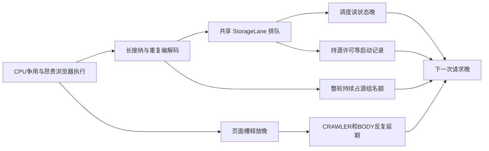

# 消息源实际采集周期与端到端时延优化方案

日期：2026-10-24，北京时间。状态：**排查、评估与待执行方案，未实施本方案、未修改生产配置或发布代码。**

适用范围：Message Bus 轮询、Site Access、Identity Worker、正文补全、接纳与 Read 投影。以升级后的 **8 核服务器、最多 20 个监测 ticker** 为设计基线；用户只确认了 CPU 升级，内存暂按现有约 16GiB 估算，不假定同时扩容内存。并发计算使用实际启用的 binding、查询及请求成本，不出现 `ticker_count == 9` 一类分支。

参考：[两轮排查记录](message-source-polling-constraints-and-stage-latency-findings-20261024.md)、[上一轮发布回执](message-source-polling-and-body-completion-optimization-release-20261024.md)。本文另外读取了当前代码与生产状态，原始结果见末尾证据索引。

## 1. 决策与目标

本次应实施一次**采集与接纳解耦、以到期时点调度请求、按实际工作量分配容量**的改造。继续使用现有 Bus SQLite、NativeContent、Site Access、身份与 Worker；不引入 Redis、Kafka、新下载平台或每 ticker 一个 Chrome。

核心改动按依赖关系排列：

1. 补齐真实请求和周期覆盖账，保留逾期、延期、失败及未派发轮次。
2. 缩短存储工作单元，把启动记录、调度读取与长接纳拆开；消除重复解析、重复入队及不必要的 CDC。
3. 取消整轮占源组名额；采集完成并持久保存后释放采集责任，接纳不再挡下一轮。实时首屏、补充路径与历史续页各自推进。
4. 优先减少浏览器的实际工作：使用已验证轻路径、先检查原生响应/目标列表是否完整、复用少量有所有权的同源 fetch 页面，减少反复导航和大 DOM 解析。
5. 在 8 核上以硬件总预算和已验证身份能力为边界，按启用工作量自动计算局部容量。CRAWLER 保持时效优先，BODY 有可兑现的容量，避免两者反复互相延期。

“配置多久就多久取得新列表”需要一个技术边界：不能对任意短周期、网站明确限流、站点不可用或远端响应本身超过周期作绝对保证。**不能通过静默拉长周期、返回旧缓存或忽略失败让指标合格。** 在可用网站、已配置的 30/60 秒等业务周期和通过容量验证的范围内，程序应兑现周期；外部故障及容量不满足都必须留在主验收分母，并明确显示原因、缺口和恢复情况。

### 1.1 验收目标

下列为开发/生产验收目标，不是已取得的性能结果。以每个启用且处于有效采集时段的 ticker/source 为基本单位，同时检查所有必需首屏查询/频道。

|维度|目标与判定|
|---|---|
|计划时点|使用固定相位的 `due(k)=epoch+phase+k*T`，T 为 binding 的有效周期；不以任务完成时间再加 T|
|实际启动|轻 HTTP/RSS 的 due→实际发送 p95 ≤2s，浏览器 p95 ≤5s；p99 ≤max(5s,0.2T)。不是创建 asyncio task 或取得源 permit 的时刻|
|实际刷新|新鲜列表间隔 p95：轻路径 ≤T+3s，浏览器 ≤T+5s；p99 ≤1.25T。重复消费旧 capture 不计一次新刷新|
|周期兑现|每个 binding、每个必需 head 采集单元，≥99% 的应执行周期在相应时效界限内取得有效列表；失败、延期、未知及未派发均不算兑现，不从分母删除|
|接纳|有效列表取得→该批可处理消息持久接纳 p95 ≤1s、p99 ≤3s；无变更列表不做全批重接纳|
|发布|已验证完整正文/缓存命中的消息，capture→Stream p95 ≤3s；需要实际下载的公开 HTTP 正文争取 p95 ≤20s，浏览器正文争取 ≤45s。分别报告请求成本和质量失败，不为达到时限提前标 FULL 或绕过现有发布合同|
|尾部与停滞|不能存在无解释的持续 >2T 无新鲜列表；展示最大 gap、最长逾期、未执行周期与恢复后的补覆盖；外部故障也作为业务未达标报告|
|正文|真实首次发现文章的成熟 cohort，FULL/SHORT_FULL ≥80%；与对照相比不得因 CRAWLER 优化显著降低。待处理、超时、无完整正文与未入流失败均保留，复用不伪装成新下载成功|
|扩展|9、12、20 ticker 使用同一代码；增减 ticker、修改周期、增减查询和暂停/恢复后自动重算需求与容量，保留明确的配置生效时点|

采集正常但网站没有新新闻仍可满足刷新；HTTP 304 只有在已经保存同一请求有效基线、实际进行了条件请求且校验器匹配时才算有效检查。站点返回空列表必须满足该来源的真实空列表合同，HTTP 200/页面壳/挑战页不算成功。

不能只使用窗口内存在两个成功 capture 的 binding 算间隔：窗口前最后一次新鲜 capture、窗口末尾仍未刷新的年龄都纳入统计，缺失者不能因为无法计算相邻间隔而消失。来源总体均值用于辅助诊断，验收仍按 binding/采集单元，避免高频健康源稀释坏源。

## 2. 当前证据与问题排序

### 2.1 本轮生产快照

本轮取证时本地及远端仓库 HEAD 为 `0731297c89de89d2795b7ebf8ccfbfdda3e9e1d1`。Bus/BODY 镜像为 `100affb6a6d8…`，Site 仍为 `4f5ed0970a03…`；仓库 HEAD 不等同于所有运行镜像提交。只读配置清点为 **9 ticker、172 个启用 binding、47 个有启用 binding 的来源**，未据此假定它们全天均通过交易日历/暂停等准入。撰写期间其他会话继续提交，最终核对 HEAD 已推进至文档提交 `1d3746d3`；本文数据仍对应明确标注的取证窗口，不将后续 HEAD 倒填为采样版本。

03:52:47 主机仍为 **4 核**：CPU PSI some avg60 80.65%、avg300 84.15%；前一个短采样运行队列 27–42、即时 CPU idle 为 0。主机物理内存约 15.24GiB，MemAvailable 约 2.67GiB，2GiB swap 已使用完；这不等于当时持续发生大量换页，但不能按“升级 CPU 后内存无限”规划。

03:40:00–03:52:59 的现有审计口径：

|来源|轮询样本|单次轮询均值|可观察新 capture 间隔均值|延期次数|失败次数|
|---|---:|---:|---:|---:|---:|
|Yahoo|28|35.2s|228.0s|0|0|
|Barron's|16|37.5s|290.3s|19|0|
|Investing|6|28.1s|145.4s|31|12|
|InvestorsHub|15|45.3s|281.8s|18|1|
|Globe search|35|28.5s|183.0s|0|0|
|企业 IR|277|0.675s|当前通用 capture 字段未给出完整端点间隔|0|0|

这仍是旧指标的有界快照，不是新的逐请求账。Yahoo 表中 0 次延期不代表 browser 补齐没有延期：另一 15 分钟 Site 窗口中 Yahoo CRAWLER 的 34 次结果全部延期，RSS 成功掩盖了补充路径失败。Globe 的轮询状态与 Site 也不是一一对应，不将两个表的次数相减归因。

慢日志只记录执行或等待 ≥1s 的样本，不能当全部调用的无偏平均：

|Bus 工作|慢样本|执行均值|应用锁等待均值|等待最大值|
|---|---:|---:|---:|---:|
|get_poll_state|716|18ms|4.39s|25.60s|
|请求开始 persist|714|26ms|4.10s|39.48s|
|save_poll_state|330|27ms|4.88s|35.02s|
|_prepare_poll_cycle|46|137ms|5.74s|21.20s|
|_accept_poll_result|269|1.48s|4.74s|34.77s|
|distribution ingest|223|0.91s|7.08s|23.41s|

Site 的执行子样本：Barron's browser runtime 均值 14.77s（19），Investing 17.50s（12），InvestorsHub 19.80s（19）；同窗纯准入延期另计。三站导航均值仅约 1.22/1.46/3.95s，说明不能把总耗时等同于下载慢。其余部分仍需新增子阶段计时，不把差额擅自全部归给 DOM 等待。

Site 进程清点含 19 个 Python、18 个 MainThread/driver、67 个 Chrome 进程；Supervisor 另有 116 个 Chrome 进程。进程数不是页面数，RSS 相加会重复计算共享页，`ps %CPU` 是运行以来的比例，不能据此认定泄漏或算出瞬时成本。它提示控制器/驱动也有资源成本，后续应量取存活页、PSS、CPU 秒和每条命令的成本。

### 2.2 确认的因果链



8 核能缓解 G，但不会移除 B/D/E，也不会使多个串行 HTTP 请求自动并行。优先处理这些确定的程序阻塞，收益不依赖某个网站是否配合。

### 2.3 容量计算必须包含 20 ticker

对于物理采集单元 i，令 `λi=每秒应发请求数`、`Si=实际占用该资源的服务秒数`；平均资源需求为 `Σλi*Si`。同时检查启动节奏需求 `λ*gap≤1`。N 必须按**不同 URL/查询/频道/访问 scope**计数：同一响应可合法共用时只计一次，不同 query 不能假装合并。

仅以三站各 ticker 每 60 秒一次、上述执行均值估算：

|假设|9 ticker|20 ticker|意义|
|---|---:|---:|---|
|保持当前 Barron's/Investing/InvestorsHub 执行成本|约 7.81 个持续槽|约 17.36 个持续槽|未计其他站和 BODY；当前 4 槽、甚至简单调到 8 槽都不够|
|将三站均值分别降至 3/4/8 秒的待验证情景|2.25 槽|5.00 槽|只是优化情景，不是承诺；20 ticker 下仍须为 Yahoo、其他站和 BODY 留量|

因此不能用“8 核开 20 页”解决，也不能把 3/4/8 秒目标当已验证事实。20 ticker 场景需要浏览器轻路径和重复采集共用真正生效；若某站仍必须长期 20 秒 DOM 导航，应明确算出所需容量，在有限身份及 8 核上验证，无法满足时报告瓶颈，不能静默缩小覆盖或改慢周期。

## 3. 调度与占槽改造

### 3.1 定时器与采集任务分离

修改 `persistent_runtime_v2/bus_orchestration.py` 和 `message_bus_v2/scheduler.py`：

- 保留交易语义日、ticker pause、绑定启停和配置版本；将有效采集名单、最小状态投影保存在调度内存快照。按配置修订刷新，暂停/启停最长 1s 可见，不能每个 tick 展开全部大对象并排队做几十次 DB 访问。
- 使用到期堆或排序后的定时任务，按最早应开始时点派发；网络任务完成用事件唤醒调度，不额外等一个被阻塞的全量 run_once。定时等待不持 DB 连接、源 permit 或浏览器槽。
- **删除以整轮任务数实施的 `_inflight_groups` / standalone `group_active` 上限。** 用独立的采集任务上限保护内存，实际网络并发由请求层和 Site 联合预算控制；接纳、统计及 BODY 不属于采集占槽。
- 同一 `binding+采集单元+配置代际` 仍只有一个 head 获取在途，避免同页重复导航。它在响应校验并持久保存后释放；后台接纳未结束不阻止下一轮 head。不能直接删除所有 `_inflight` 而造成无限重入。
- 错过多个周期时记录遗漏数量和原到期时点，只安排一次最新 head，不补发一串过期请求；原漏轮不会从验收账消失。若一次网络获取本身超过 T，仍记录未兑现，不以修改相位掩盖。
- 新 binding 按可用物理请求单元分配相位，增减 ticker 时保留未变 binding 的相位，避免一次配置变动把全站重新错峰或形成请求风暴。
- 实时 head 先于 sweep/尾页；后者只占允许的背景余量，每片完成释放请求资源并持久保存进度。实时反复有流量时也保留尾页的可观测进度和最大积压告警，不删除覆盖责任。

### 3.2 一个业务源可以有多个内部采集单元

不增加用户侧消息源数量；内部区分 `HEAD`、`SUPPLEMENT_HEAD`、`CONTINUATION`、`SWEEP`。至少以 endpoint/query/channel 区分进度、到期时间、失败及新鲜度。

Yahoo RSS 与 browser head 分开运行，browser 失败不延迟 RSS 下一次启动。Globe 每个 query 的首屏到期由 binding 的 T 决定，取消硬编码 60s；旧页只推进自己的 tail cursor，不把下一轮 head 改成“继续上一轮全部工作”。Reuters 多 query 同样逐个安排，慢 query 不挡其他 query 首屏。

**全部必需 head 的刷新周期都要兑现**：不能将 Yahoo RSS 30s 成功视为 browser 仍每几分钟刷新也合格，也不能一个 query 新鲜就把整个源标 COMPLETE。默认让补充 head 继承 T；只有证明该轻路径覆盖原列表、时间字段和相关分页后，才可将它提升为完整列表权威。20 ticker 的容量计算也必须包含尚未被替代的补充请求。

### 3.3 请求许可只覆盖真正需要限制的部分

`SchedulerGroupLimiter.permit` 不再持 semaphore/spacing lock 等 `record_scheduler_request_start` 经过长接纳队列。

具体实施：

1. 单个 Bus owner 内维护单调时钟的启动节奏，在最接近 `client.send` / browser 命令实际开始的位置更新；sleep/pacing 等待不占网络槽，取得槽后重新检查时钟，避免预留时间与实际启动错位。
2. 开始记录作为轻量观测异步批量刷入短写通道，目标 ≤500ms；不作为每次发送的同步前置事务。每组只合并可合并的 last_start 指针，逐请求时点仍写入有界 run 账。崩溃前未刷出的启动记为 UNKNOWN，不能补造成功证据。
3. 重启依据已保存节奏恢复，并至少等待一个相应 gap 后首次发送，避免丢失少量观测记录造成突发。运行 owner 排他沿用现有服务/任务所有权，不为了性能允许双 owner 同时发相同工作。
4. 网络 permit 在响应读取结束即释放；HTML 解析、正文质量判断、NativeContent、接纳都在其外面。Site 管理的 browser 不再先占一层源 semaphore 等另一层浏览器队列；源启动节奏与 Site 节奏以相同有效 rate key 协调，避免重复 sleep。
5. 将 `newswire_rss` 等按适配器名称混合的组改为真实 host/凭据/出口范围的限制；不同发布商不能因共用 RSS adapter 而串行。组配置仍有显式覆盖，组内取 min/max 的旧逻辑必须同步迁移，不能只改一条 SourceDefinition。

DB 中用于发布、claim、租约、去重、身份维护的强一致校验不移成异步观测。请求时点台账与业务接纳事务的保证要明确区分。

## 4. 接纳与存储：先缩小工作单元，再分流

### 4.1 最小持久采集收据

新增一张 Bus 本库的 `poll_captures` 表，作为轻量的持久采集收据/待接纳队列，**不另建消息系统**。至少包含：capture ID、物理 request key、source/binding 或 roster、采集单元/配置代际、实际请求与响应时点、有效列表载荷引用、页面 cursor、状态、接纳位置和 owner token。

流程：

`网络结束 → 校验并准备一次 NativeContent 引用 → 短事务保存 capture 与采集进度 → 释放采集责任 → 分片接纳 → 任务/正文复用 → 原有发布`

- capture 不是 FULL 正文或 Stream 消息。只有本次请求的完整列表/明确空列表合同通过后，才可记成功；部分频道/页保存为部分收据。
- 首先持久保存载荷，再推进获取 cursor；接纳 cursor 单独推进。崩溃后重放待接纳收据，不能因获取进度已前进而丢掉待处理文章。
- source/binding/roster 版本和 admission context 在 capture 保存时固定。恢复时沿用原始观察时点、bootstrap/sweep 合同；区分“采集时已过期”与“内部排队导致现在过期”，不能把排队造成的新闻遗漏当正常过滤。仍保留删除/撤销订阅和修订权限检查，不能用旧 snapshot 绕过当前权限。
- 按 capture+输入稳定键幂等接纳；最后一片成功与接纳 cursor/收据完成同事务。旧 head 与新 head 的 checkpoint 用代际/序号合并，禁止后结束的旧响应回滚较新进度。
- 不因队列压力删除 capture、截掉列表或提前标 coverage COMPLETE。出现积压时停旧文复查/历史追赶并报警，优先排新文章接纳；持续积压本身判定未达标。

采集收据取代逐页直接 await 整页 `_accept_poll_result`；非分页适配器也走同一持久化入口。IR 原有端点隔离保留，必要时接入同一短提交接口；不能为了统一而引入全局串行队列。

### 4.2 StorageLane 的具体处理

修改 `storage_lane.py`、`service.py`、`repository.py`、`distribution_repository.py`：

1. **读写分开**：配置/日历快照、短状态 SELECT 使用至多两个只读线程和独立短连接，`mode=ro/query_only`，不等待应用 writer 锁。按列读取，避免 SELECT 大 `data_json` 被 row_factory 自动解压。不能跨线程复用 SQLite connection，也不能将带隐式初始化/写入的 getter 误分到只读通道。
2. **写通道仍为单 owner、短事务**：捕获收据、调度控制、正文结果发布等短写可以先行；大接纳每片最多 16 篇，目标占用 ≤50ms，处理完让出写通道。50ms 是软工作预算，不能中断一条事务；单篇超过预算单列证据，继续拆其内部计算。每连续 8 个高优工作至少服务一次已等待的普通片，避免 BODY 最终发布饿死。
3. **事务外准备大载荷**：JSON/model 校验、hash、解压和新 NativeContent 文件准备在有界准备池中完成，初始两项并行；事务内仅做权威重查、关联和 SQL。文件仍先 fsync 再提交引用，不能用关闭耐久性换速度。内部 prepared 对象必须由可信编码器生成，不能允许来源传入任意 native marker 逃过校验。
4. **每次输入只做一次必要解析与定位**：合并 first-seen 的外层批量解析及 enqueue 内重复解析；在同一事务内传递已解析 first-seen、known article、body result 等上下文。提交前仍校验实际权威版本，不把过期读缓存当最终去重结果。
5. **快路径处理未变输入**：同一 URL/文章标识、列表实质字段、更新提示、正文检查代际和质量策略都未变时，仅汇总 last_seen/count，不重复 model dump、编解码、known 查找、旧正文展开和创建 BODY job。pubDate 真正修正、摘要/更新标记变化与 recheck 到期仍进入核查，不能用 URL 存在就永远跳过。
6. **减少无效写放大**：观察计数/last_seen 允许 5–10 秒合并落盘，保存真实最大观察时点；新发现、正文结果键首次出现、实质修订、终态和 Stream 必须立即持久化并投影。观测合并丢失边界只影响技术计数，不得丢业务文章。新增请求账每次请求只保存一条紧凑记录，阶段为列/小 JSON，不每阶段产生一轮 CDC。
7. **分发不等整批最慢任务**：共享响应只保存一次正文/载荷引用；ticker 局部收据分片登记。`DistributionWorker.run_once` 改为有空槽即 claim 的持续处理，不因一组 JEV/正文慢而等待整批 16 条全部完成才领取下一批。先准备共同文章，再各自执行 ticker admission，保持独立幂等和权限。

不直接把 StorageLane 的锁删掉后开十几个 SQLite writer，也不把事务拆到 cursor 提前成功。关键约束是**短事务、独立只读、准备在外、业务关联原子提交**。

## 5. 来源与浏览器执行改造

### 5.1 Yahoo

- RSS、browser head、时间补查各自有到期时间和进度；browser/补查不占 RSS 整轮责任，取消与 T 冲突的内部固定 60 秒。
- RSS 使用独立公共 session；其锁只保护 session 建立/更新和 pacing，不跨整个网络请求。连接数和请求并发按活动采集需求计算，保持与含认证状态的 NCP jar 分离。NCP cookie/crumb 更新需要互斥，普通只读请求不因另一个 ticker 下载而串行。
- 不同 ticker 的 RSS endpoint 可并行；host/出口级统一节奏保留，取消无依据的多层全局 gap/jitter 叠加。无真实 429 的公共 RSS 初始 host gap 250ms、并发上限 4，之后按实测需求计算，不按 ticker 固定 9。
- 429 按 Retry-After 和实际 host/出口/endpoint-family 作用域暂停；单 URL 404/410 不扩大成全站冷却。无 Retry-After 的风险退避保留但与纯容量延期分开，用少量半开请求恢复，不能用“失败就休眠十分钟”掩盖健康端点。
- browser 返回结构化 rows 和精确时间证据；大 HTML 只存一次引用，不能复制到每条消息并反复编码。原文 HTML 的正文复用仍通过质量核查。

### 5.2 GlobeNewswire

- 使用已验证的固定出口 HTTP 列表优先；HTTP 和 browser 的容量分开核算，不让轻 HTTP 等待全局 browser 槽。
- 每个 query head 按 T 刷新，取消硬编码 60s；首屏独立于 tail，每个 tail 小片完成即归还资源。先保证全部 query head，再公平推进尾页，保留未完成页责任。
- `_http_retry_at` 从 adapter 全实例字段改为与失败证据一致的 endpoint/query/route 状态；一个 ticker 的解析/连接失败不能让其他 ticker 五分钟全部降级到浏览器。站点确有共同 429 时才扩大到 host/出口级。
- 每请求即保存列表并尽快释放；取消以“2 请求或 15s 完整 adapter 任务”作为全 ticker 的 head 占槽周期。尾页时间片仍可有界，但不能推迟新的 head。

### 5.3 Barron's

现有两个同源 feed 已有真实合同与时间证据，优先优化这条已知路径，不重新回到等待新闻卡片渲染。

- 在当前已验证 Chrome 身份中，试行每个热身份一个受 TargetOwner 管理的同源 fetch anchor；两个频道按各自 request ID 发请求，复用 Cookie/TLS 和已经建立的控制连接，减少每轮 goto/target/gate 生命周期。anchor 总量按物理身份限制，绝不按 ticker 常驻页面。
- 只有 anchor 已是有效同源、没有挑战/维护占用时才复用；没有可复用页时走现有临时页建立路径。不可使用人工或待恢复挑战原页作为公共 anchor。
- 两个频道各自返回、校验并落捕获收据，一个慢频道不能挡另一个频道已发现文章；源的完整刷新仍必须等两个频道均满足各自周期，不能把 Promise.all 改成只取最快一个就报完整。
- 分别记录 feed header/body/解析耗时；AbortController 只取消自己请求。对真正的 8 秒网络慢不通过简单缩短 timeout 丢覆盖，后续同频道重试与下一轮 head 协调去重。
- 直接 HTTP 仅作为有界比对候选，未验证前保持 Chrome 原路径；付费 BODY 不走 Reader 绕过权益。

### 5.4 Investing

- 将 exact main-frame native response 的完整列表检查提前，与轻量目标节点就绪观察并行；先得到 ticker、URL、时间、列表/明确空列表合同充分证明的一方立即返回，不能先跑完通用 12 秒正文观察才检查已经完整的响应。
- CRAWLER 使用列表完整性规则，BODY 使用正文规则；避免在列表上反复调用全文候选选择器等待 FULL。保持 country host、原生 redirect、身份和访问 scope 合同，不统一改写到 www。
- native DOM 观察优先检查小范围目标结构，DOM 变化后才展开所需列表；成功抓取只解析一次。失败/挑战保留完整原始证据，不循环下载和解析整页广告 HTML。
- 对两个后台页并发做实际对照；修正历史 single-concurrency 假设。常规 CRAWLER 不无条件抢激活 target，优先原生响应/后台可用内容；真实验证需前台时使用短的身份内 focus 操作，不跨整次下载锁住其他页，不触碰人工维护原页。
- 同源 BROWSER_FETCH 作为待验证候选，若响应合同不完整或挑战必须回到原 DOM，不因为更快就提升为默认。

### 5.5 InvestorsHub

- 将 `.quote-news-item` 的 visible 等待改成基于原生响应/DOM attached 内容的业务就绪，核对精确 ticker、日期/URL 和列表完整/明确空列表状态。后台列表不应依赖当前 viewport 是否可见；仅第一个节点出现也不能宣称全页完成。
- 比对原生主响应 HTML 与实际列表；若可直接解析则不执行后续广告/UI 等待。HTTP 403 的历史证据仍有效，不把普通 HTTP 直接当默认轻路径；同身份 fetch 要实测。
- 浏览器 CDP attach/控制器重建失败单独计时；正常请求不重复冷启动/连接。现有代码已缓存 identity entry，优化应针对实际重建原因，不能把“复用 CDP”当一个尚未实现的新功能重复开发。

### 5.6 其他路径与共用

- Reuters 多 query、CTEE/TrendForce 等浏览器来源也进入 head/continuation 拆分与成本台账。真实风险/权益问题继续原恢复流程，不为它们长时间占用已准备好的采集槽。
- IBKR/Finnhub/Benzinga/API 路径取消无依据的整轮串行，保留供应商真实配额。相同 URL、参数、语言、凭据 scope、出口和解析合同的 RSS/列表可共用一次**本周期实际响应**，再按原 binding 独立过滤；不必改变外部 by_ticker 身份。
- 公共 RSS 不与无关发布商共用单槽；企业 IR、国防源既有端点隔离、已验证出口和公开完整正文策略保留。当前已修复的订阅预览拒绝及 unverified cache 隔离不得回退。
- Shared capture 的 freshness 使用底层实际请求时点；消费旧 capture、重新计算 JSON、改 `updated_at` 都不算新鲜获取。
- 不新增按 ticker 的常驻页；不统一屏蔽图片/JS/资源来换速度，不改浏览器指纹、代理或新建 profile。仅对已经验证的业务获取路径减少不必要执行。

## 6. 8 核、1–20 ticker 的容量配置

### 6.1 全局预算与局部需求分开

硬件预算决定总量，ticker/query 数和服务成本决定局部所需容量；不能为每个源都静态预留最高 20 ticker 的页面。

|资源|8 核初始方案|随 ticker 增减的行为|
|---|---|---|
|全局 browser|最终目标上限 8；灰度从 6 验证到 8，非按 ticker 设置|总上限按硬件/实测稳定容量；增加 ticker 不无限增加页|
|CRAWLER/BODY|BODY 常规上限 2、有待处理新文时至少获得 1 个可调度机会；CRAWLER 可使用其余，BODY 空闲时可借用|初期关闭 BODY 第三槽无条件借用；避免只有当前 waiter 而看不到即将到期 head 的错误空闲判断|
|Site/Identity|按需求计算，且不超过该身份已通过实际测试的并发能力和模型上限 8|首次上线做 2→3→4 的有界验证；需要更高时继续同样测试，不靠固定 2 或固定 9 个 ticker|
|轻列表 HTTP|Bus 进程总在途上限 16；host 默认上限 4，已验证成本低且有需求者最高 8|按有效请求单元和成本计算，实际连接与 pending 均有界；IR/国防独立池计入总资源成本|
|采集任务|内存中只保留每单元一个在途/一个合并待执行标记|上限随有效单元数派生；不为每个错过周期创建新任务|
|准备池/只读池|各至多 2 项并行，writer 仍单 owner|不随 ticker 开线程；通过批量索引、少写、共享内容承载增长|
|BODY Hub|先保留总并发 8，HTTP/缓存结果不占 browser|按实测新文章率和服务时间再调整，不按 ticker 数直接倍增|

全局 8 页是运行目标而非绕过内存/身份可用性的授权；若仅 16GiB 内存无法承载，先减少重复页面、控制器和载荷，而不是通过 swap 强开 8 页。若仍不足，明确记录所需内存，不能声称只升级 CPU 必然支持全部 20 ticker。

### 6.2 局部容量计算与更新

在 scheduler/预算配置中使用一套小的计算函数，不引入独立自动伸缩服务：

```text
units = 当前启用、处于有效采集时段、不能共用同一响应的 head/请求单元
demand = Σ(该单元每周期实际请求数 / 该单元有效T)
needed_concurrency = ceil(demand * service_cost / 0.75)
effective_limit = clamp(needed_concurrency + 必要的同身份BODY余量,
                        1, min(该身份已验证上限, 硬件总上限))
```

- `service_cost` 为当前传输路径实际占槽时间的 EWMA，辅以 p95 检查；不含 admission 延期或后续接纳，不将它们错误反馈成需要无限更多网络并发。
- 每次名单、周期或查询变动立即重算；平时每 60 秒更新一次成本，连续两个窗口越界再调整，单次一步，避免摇摆。这只是少量状态，不做预测模型或复杂调参平台。
- 计算的局部上限不是预留槽；实际借用由全局队列按 head 截止时点与公平性安排。相同身份/host 的多个 source 共同计算，不能每个 source 都独享一份容量。
- 所需启动速率若高于有证据的站点配额，或总 offered load 高于预算，记录 `capacity_shortfall`，展示需要/可用容量和受影响 binding。不得自动关闭 ticker、静默加长 T 或将未采集轮次算成功。
- 未测过的路径使用当前实测稳定能力并触发自动化容量验证任务；验证通过后写入 Owner 配置与有效能力，不要求用户因每次增加 ticker 再手工改代码。验证失败保留原身份，不通过新建 profile 绕过。
- 原 manifests、Site seeds、迁移脚本和 Worker `OperationGate` 必须读取同一有效上限。修正会把 `2/500ms` 特定旧配置降回 `1/3000ms` 的迁移逻辑，不能让重启覆盖新策略；显式人工上限仍被尊重并显示其容量影响。

网站实际 Retry-After、认证/维护 writer 排他、同 profile writer、发布事务 fencing 继续生效。默认 1/2 并发、适配器名称组锁、无证据固定 3/5 秒导航节奏与整轮锁属于可修改的程序策略，不混同为网站硬约束。

### 6.3 CPU 和内存控制

- 8 核升配后先采样同等负载，再验证 6→8 个活动页面；不能把升配前后差异全部归为代码收益。记录整机 CPU 秒、PSI、run queue、每来源完成单位成本和实际间隔。
- 减少反复 HTML 解析、每篇嵌入同一大载荷、观察重写、投影技术版本和无效 BODY 重试；这些优化优先于给解析再开十几个线程。
- 对 Bus/Site/Supervisor 的时效路径使用相对 CPU weight，BODY 保留合理权重，投影/技术维护使用余量；不硬绑核，不给消息服务设置导致空闲核不能用的低 CPU quota，不改变无关交易服务的优先级。配置在 release compose 中明确保存，不能只改一次运行容器。
- 目标是消息相关栈在常态负载下保留约 25% CPU 余量、CPU PSI some avg60 尽量低于 10%；超过时优先停止旧文 recheck/历史追赶，**不悄悄降低实时 head 频率**。若实时本身仍超载，记录容量缺口并继续优化最大成本来源。
- Chrome/driver 按物理身份复用；常规页面按任务关闭、fetch anchor 数量有界。审计实际 TargetOwner 存活与关闭成本，仅处理已确认由本任务持有的无用业务 target，不扫描清空人工/恢复页。活跃身份不进行周期性重启或清 Cookie。

## 7. CRAWLER/BODY：减少竞争而非牺牲正文

1. 浏览器请求携带原 due、采集单元、截止时点、work class。联合准入按可用身份中的最早 head 截止时间调度，不让某个忙身份挡其他站。纯容量不足仍异步等待/延期，不先拿另一层槽再排队。
2. 不再把“3 秒排队超时→上层几秒后重复 resolve/提交/写审计”当正常流控。保留一次排队责任到本次启动时限，超时返回容量原因和最近可重试时点；head 的 due 不重置。Body 同文等待合并，并在资源释放/较短有界时点后继续，避免每个 ticker 每秒重打 Site API。
3. `scope_activation_in_progress`/fallback warming 按恢复任务实际状态和完成事件推进，短探测 1–5s 级，不固定额外等 60/120s；同时限制重复启动控制器。网站 429、挑战未恢复和登录/权益失败仍有各自退避，不能因为追求快而不停撞站。
4. 新文章 BODY 有正常容量，旧文 recheck 不提升到 CRAWLER 同级。新 BODY 不再仅因等待 30 秒就全面追平紧急 head 优先级；通过上面的最少服务机会和 BODY 两槽上限避免饿死，而不是让它与所有 head 抢同一等级。
5. 入口和实际获取前分别复用正文结果；`fetch_key+scope+language+质量策略/修订代际` 一致时只下载一次。已完整且未有实质更新的旧文章不创建/认领新的网络工作；独立 ticker 发布收据仍要完整。
6. 首次下载、真实更新核查、周期旧文复查、缓存复用分别计量。被网站拒绝且没有新身份能力的付费 BODY 不每个 ticker 重试一遍；能力恢复后可有界重试，不伪造权益成功。
7. 列表已取得的真实文章 HTML 先做质量判断；确已 FULL/SHORT_FULL 时直接复用，HTTP→browser→Reader 每阶段有明确跳过/回退原因，只在上一阶段确实不足且下一路径适用时执行。保持已确认完整正文，不能让后续失败将其降级。
8. 缓存命中/已下载结果的最终接纳不再等待一个都在跑网络的 Hub 批次。通过短写公平队列立即推进原有 Stream/更新事务；依旧保留 ARTICLE_ONCE 和实质修订记录。

BODY 首次实际抓取预算与队列生命周期的上一轮修正继续保留；不通过延长 180 秒总预算或 pending 上限使低成功率看起来更高，也不提前关闭质量门禁换发布速度。

## 8. 台账、指标与 UI

新增紧凑 `poll_runs` 账，关联捕获收据、Site operation、BODY result/job、Raw/Stream。每次实际执行/延期记录一行，合并阶段更新；应执行但没派发的周期通过持久 schedule epoch/相位和 run 槽位范围补算，不为每个等待毫秒写一行。

至少持久保存：`due_at`、`dispatch_at`、`permit_ready_at`、`request_started_at`、`response_received_at`、`list_validated_at`、`capture_committed_at`、`first_intake_at`、`last_intake_at`、`body_started/ready_at`、`stream_published_at`、`read_visible_at`；未发生保持 null，不用末尾时间替代。

- 一个 run 可有多条 request/capture；同时展示每个子单元覆盖，禁止只保留最后 capture 抹掉 RSS/频道中间时点。
- `request_started_at` 是真正交给 HTTP transport 的发送/浏览器导航或 fetch 命令时点；能取得原生 network header 时增加远端响应证据。不要把 permit grant 当网站已经收到请求。
- 耗时使用 monotonic，跨进程时点统一 UTC 并记录时钟异常。主要阶段互斥拆分：到期等待、准入/节奏、发送至响应、列表准备、capture 提交、接纳排队/执行、正文等待/获取、最终发布/投影；内部嵌套 CDP/parse 作为子阶段，不能重复相加。
- 浏览器增加 page acquire、navigation、response/DOM wait、feed fetch 各频道、列表校验、gate/target close、Worker IPC 的计时；存储增加 queue、BEGIN writer wait、SQL、codec/hash、文件准备和 commit。低成本汇总直方图，必要 badcase 保存具体关联，不全量记录页面内容。
- UI 默认展示实际请求/新鲜列表间隔、周期间隔兑现率、最大未刷新年龄、逾期/延期/失败分布、capture→接纳→正文→发布；旧 last_latency 保留但明确“单次已派发轮询”范围。
- 前台回显配置有效值、完整源/子单元周期和程序计算出的容量；有缺口显示原因。暂停/非采集时段按真实状态单列，不能误当容量不足，也不能事后将失败段改为暂停排除。

新 run/capture 的业务索引、CDC 与 Read backfill 一起实现；技术阶段不产生完整业务历史版本风暴。既有正文结果与审计口径继续可解释，旧指标与新指标分开，不拼接为一个“优化后成功率”。

## 9. 执行拆分与依赖顺序

以下按可独立评审、测试、发布的改动包执行；每包追加 changelog。先完成最小关键计时，不等建完全部 UI 才开始优化。

|包|主要文件/落点|必须交付|直接验证|
|---|---|---|---|
|A 周期与请求账|schema/repository、scheduler、Site request/result、Read projector；扩展 audit 工具|run/采集单元/真实时点、失败分母、窗口两端 gap|新旧指标同窗对账，缺轮可见，阶段不重复相加|
|B 短存储与无变更快路径|storage_lane、service、repository、body_results、distribution_repository、NativeContent|只读旁路、16 篇片段、准备在外、复用已解析上下文、计数合并|人为 2s 接纳时短状态读不等它；长事务/CDC/codec 成本下降；取消时事务仍完整|
|C 捕获与接纳拆分|新增 poll_captures、scheduler on_page、service、distribution、IR 提交边界|持久收据、独立获取/接纳 cursor、崩溃重放、版本 fencing|capture 持久后杀进程不漏文；旧响应不能回滚 cursor；未持久不推进|
|D 调度及请求节奏|bus_orchestration、scheduler limiter、manifests、配置工具|固定周期、取消整轮组上限、head/尾页分离、启动记录异步、小快照|同组慢 ticker 不挡健康 ticker；9/12/20 动态增减；无 catch-up 风暴|
|E 轻量路径和浏览器成本|news_adapters/yahoo_transport、market_sources、barrons_sources、runtime/investing_document/external_runtime|Yahoo 独立路径、Globe head、Barron's 双 feed anchor、原生响应先用/列表就绪|每来源 ID/时间/频道/分页覆盖对照；真实页面与取消回归；无挑战/权益误判|
|F 容量与 BODY 公平性|budget、service、worker_manager/identity_worker/OperationGate、settings、seeds、release 配置|8 核全局预算、基于需求的局部容量、正确延期、正文不饿死|槽/锁不泄漏、单请求取消不杀兄弟、维护 writer 排他不破坏、并发能力实测|
|G 发布与投影时延|distribution Worker、ContentEnrichmentHub、Read 与前端轮询面板|有空槽即继续、缓存最终提交快路径、端到端 UI|完整正文队列和 Stream 时点对账，ARTICLE_ONCE，无重复下游|

B/C/D 是首批 P0 主链路，E 的轻路径可并行准备但依赖 A 的证据，F 需要 B/D/E 后的真实成本计算。不要先全量扩容到高并发，等遇到更多等待后再补机制。

## 10. 测试、上线验证及继续调试

### 10.1 离线与真实浏览器回归

扩展现有 `test_message_bus_storage_lane.py`、`test_news_timeliness.py`、`test_news_browser_capacity.py`、`test_browser_priority_budget.py`、runtime bus orchestration、Yahoo transport、来源 parser、正文 scope/质量、CDC/Read 测试；新增少量直接覆盖新机制的测试。

必测场景：

1. 用可控时钟执行 1/9/12/20 ticker，混合 30/60/120s、不同 query 数、慢响应/延期/失败/暂停。按所有 due 槽验收，不仅统计成功任务；增减 binding 无需改常数，不重置健康相位。
2. 一个来源网络慢、一个来源大批接纳慢、一个 BODY 25 秒，其余轻 head 仍按周期启动；HTTP 请求许可不被长接纳持有。
3. 两个独立只读连接、单 writer 取消/回滚、批次中断、SQLite contention、准备文件后 crash、capture 提交后 crash、最后接纳片提交后 crash；不得丢消息、前移错误 cursor、重复 Stream 或失去 fencing。
4. 20 ticker 同篇文章：网络下载一次，最多一次必要解析/文件准备，多份独立 ticker 发布收据；真实修订、pubDate 修正、来源不同 hint、策略改变、付费 scope 不同仍正确核查。
5. 同身份 2/3/4 页面或 fetch 并发，慢/取消一条不关闭其他条；维护 writer、challenge 原页、Cookie、出口与 controller epoch 保持。已有定向取消测试继续运行。
6. 各轻路径与原路径对照具体 URL/文章 ID、精确时间、两个频道/多 query、分页边界、真空列表、挑战/403/订阅预览。失败轻路径立即恢复原路径责任，不把空返回作为成功。
7. BODY 与高频 head 同时持续入队，检验 P0 截止时点和 BODY 最低服务机会；重新排队不重新发相同网络请求，旧文不会借 age 抢头部。
8. run/capture/观察/正文/Stream/Read 对账与 UI 指标；未知/null 时间不变成零耗时，窗口开头/结尾无 capture 的坏 binding 仍出现。

20 ticker 使用离线调度/CPU负载回放和本地真实浏览器 fixture 验证，**不在生产伪造 ticker 或业务新闻**。来源端点扩展只对真实授权订阅执行。

### 10.2 生产顺序

1. 升级至 8 核，确认实际 CPU、内存、磁盘与有效 cgroup 设置。升配需要的主机维护和本方案应用发布分别记录，保留原身份数据；不为测试清空 profile。
2. 取得 8 核同负载基线，再发布 A+B；观察存储等待是否从数秒降到目标范围。若仍慢，依子阶段定位 SQL writer、codec 或外部 CPU，不能继续笼统归为“SQLite 慢”。
3. 发布 C+D，启用 head/continuation 与新请求账；先验证轻源实际周期与故障隔离，再扩到全部现有 binding。
4. 逐来源启用 E；每个候选用小批真实对照确认合同后替换，双 feed/多 query 逐个核对。维持现有覆盖，避免同时长期双跑新旧全流量制造 CPU 争用。
5. 应用 F 的 8 核预算和动态局部容量，先 6 后 8 页；能力验证结果写入有效身份配置，配置工具重复 dry-run 应零差异，seeds 重启不还原旧限制。
6. 上线 G/UI，连续调试最差 binding：先查 due→send，再查发送→列表、capture→接纳、BODY→Stream，避免只让后台耗时变小。

所有发布使用标准构建/Owner/CAS；只重建相关组件，Supervisor 不因应用改版自动重启。新增表为加法迁移；回滚保留未消费捕获收据，先 drain 或由兼容 consumer 接管再退回旧调度，不能回滚后让队列永久失去消费者。

### 10.3 采样与退出条件

- 每个实现包可用 10–15 分钟窗口排查坏机制，不要求每次改动都等待三天；一次至少覆盖 10 个最慢配置周期，先前刚重启/冷启动段单独显示。
- P0 初验覆盖 60 分钟自然业务、全部启用 binding，含失败与延期及窗口两端 gap；至少再覆盖一段开盘/新闻高峰。对照使用相同来源、ticker、时段、周期和质量策略，区分升配收益与代码收益。
- P1 长期验收沿用成熟新文章 cohort，跨多个交易时段并报告样本量；样本不足不能用“3 篇全成功”下稳定结论。持续观察可另行安排，本轮不创建自动任务。
- 20 ticker 在正式新增前完成相同代码的合成/回放容量验证，实际新增后按真实 binding 即时重算，继续确认物理请求负载。若轻路径未能把总需求降到硬件预算以内，**20 ticker 全覆盖兑现目标仍未验收**，不能用离线模拟替代真实能力。

继续调试优先级：先让无网站限制的轻请求准时，其次解除存储/整轮阻塞，再处理成本最高的浏览器来源与其覆盖，最后根据真实成本分配容量。未达标时回到具体账中的最大等待段，不以继续加并发、延长超时或缩小正文质量范围收尾。

## 11. 本轮产物与证据边界

本轮仅完成方案与只读取证，生产仍为原运行状态；容量情景没有冒充 benchmark，未在生产执行新的抓取压力测试。仓库既有其他 changelog 改动保持原样。

- `eval/news-polling-plan-20261024/production-snapshot.json`：03:52:47 主机/容器资源、15 分钟 Site 事件、慢日志聚合；慢日志有选择偏差，事件阶段包含成功及实际执行失败子样本。
- `eval/news-polling-plan-20261024/readonly_production_snapshot.py`：本次取证脚本，仅只读 SQL、进程/容器状态与日志；未输出环境密钥。
- `eval/news-polling-plan-20261024/poll-and-body-audit.json`、`audit-summary.json`：既有口径的有界轮询/正文审计及按来源加权汇总；新文章仅 3 篇、3 篇完整，不作成功率验收。
- `eval/news-polling-plan-20261024/production-configuration.json`：启用配置清点；不是运行日历准入证明。
- `eval/news-polling-plan-20261024/site-processes.txt`、`supervisor-processes.txt`：有限字段的进程清点，未读取命令行密钥。
- `eval/news-polling-plan-20261024/capacity_model.py`、`capacity-model.json`：可复算容量算术，输入/假设和非实测边界明确；需覆盖 9/12/20，不能将场景值当实际提速。

代码重点入口：`message_bus_v2/{scheduler,storage_lane,service,repository,distribution,distribution_repository,body_results,yahoo_transport,news_adapters,market_sources,barrons_sources}.py`、`persistent_runtime_v2/bus_orchestration.py`、`site_strategy/{budget,service,runtime,investing_document,external_runtime,worker_runtime,worker_manager,identity_worker,operation_gate,seeds}.py`、`v2_read/{native_content,content_files,outbox,projectors}.py`、`content_enrichment/service.py`、`settings.py`、`scripts/ops/{configure_news_latency,audit_news_timeliness,storage_release}.py`。
