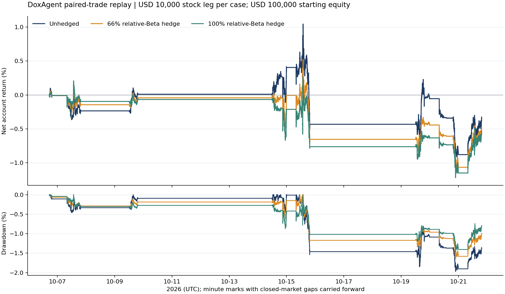

# DoxAgent 板块 Beta 对冲回测评估

报告日期：2026-10-23。固定样本来自 [先前交易意图审计](trade-intent-return-audit-20261022.md)，意图范围为北京时间 **2026-10-07 00:00 至 10-22 14:41:42**，对应实际模拟持仓覆盖美东 10-06 至 10-21。此次仅离线回测和只读获取远端 IBKR 行情；没有改变 W3、执行模块、账户配置或生产订单。

## 1. 结论与生产建议

**本样本不支持把 66% 或 100% 板块 Beta 对冲直接设为生产默认策略。** 在相同个股名义金额下，两种对冲均降低波动与最大回撤，但净亏损扩大、胜率下降，且需要更多总敞口与保证金。

- 每笔个股名义金额 USD 10,000、初始权益 USD 100,000：不对冲净损益 **USD -326.36**；66% 对冲 **-473.56**；100% 对冲 **-534.96**。
- 66% / 100% 对冲使单笔收益波动分别减少约 **28.6% / 29.9%**；但净损益分别比不对冲少 **USD 147.20 / 208.61**。
- **66% 与 100% 二选一**：66% 在本样本中损失较小、资金占用较少，日收益均值/波动比也较好；100% 的回撤和波动最低。二者都没有形成正的扣费风险调整收益，不能据此宣称 66% 已是可盈利的生产方案。
- **是否存在稳定可捕获的消息 Alpha**：有个别相对板块的正收益，例如 NBIS 空头及 INTC 的 Modal/Vera 两条 Case；但全样本 100% 对冲后只有 **5/14** 笔净盈利、合计仍亏损，且正收益集中、样本相关、估计区间很宽。现有证据不足以确认稳定 Alpha。
- **是否值得继续验证**：值得继续做影子账本或 PAPER 双腿验证，作为风险控制研究；当前不宜直接替换生产单腿策略。以下分 ticker 的最佳强度均为事后描述，不用本样本收益反向挑选生产参数。

## 2. 样本、共同时间与价格口径

原审计共 16 条意图。主回测使用 **14 条**：剔除 #3 RKLB 的 `DUPLICATE_POLICY`（本来就不应下单），#9 INTC 因美东凌晨约 03:38 没有同期股票/ETF 历史价格而不强行定价；二者都保留在覆盖记录和敏感性中。原 #1–#16 编号不变。没有 SNOW Case，所以本次不虚构 SNOW/IGV 的收益。

入场仍沿用 `min(意图释放时点, Case创建时点+5分钟)`，然后**统一上取整到下一整分钟**，股票腿和 ETF 腿同时使用该分钟 IBKR TRADES K 线开盘价；退出均在相同 15:30 美东分钟使用开盘价，15:30 后入场顺延下一交易日。两腿固定持有股数，到时同时退出，不在过程中再平衡。#14 在北京时间 10-07 产生，但使用美东 10-06 的行情和此前的 Beta。

这是一轮双腿同步分钟价模拟，**不是执行模块真实双腿成交回放**。此前执行故障，没有可供这 14 笔复原的同步成交；也没有将个股先买、ETF 延后几分钟。为保持共同估值时点，本轮未混用原审计个股逐笔价和 ETF 不同时刻的逐笔价；因此不对冲基线会与原审计略有差异，另用原逐笔价做了敏感性核对。#1 的 SOXX 入场分钟、#13 的 COHR 入场分钟无有效成交，采用 IBKR 携带的最近分钟价格，距最近有效成交分钟分别约 1 和 3 分钟；不模拟滑点或双腿成交约束。

**5 分钟提前入场仍是反事实假设**：使用历史最终 W3 方向，未验证其全部证据在提前后的时点已经到齐。本研究主要检验同一批既定方向加入对冲后的增量效果，不能等同于已证明生产能及时生成的收益。

## 3. ETF 选择与无未来数据的相对 Beta

用户指定 MU、INTC、BE → SOXX；RKLB → QQQ，按指定执行。BE 与半导体并非同一业务，SOXX 可能只代理 AI 基建共同因子，故其结果属于指定映射下的检验，未把它改成事后收益更好的 ETF。

其余两只先结合业务列候选，再只用**整个样本首次交易前**的数据选择联动最强者，映射一经选定不随回测结果改变：

| 标的 | 业务候选 | 样本前30交易日 R² | 固定选择 |
| --- | --- | --- | --- |
| COHR | 光学/光通信器件：SOXX、XLK、QQQ | SOXX 0.233；XLK 0.142；QQQ 0.114 | **SOXX** |
| NBIS | AI云基础设施：SKYY、IGV、QQQ | SKYY 0.064；IGV 0.035；QQQ 0.299 | **QQQ** |

选择窗口截至美东 2026-10-05，未用 10-06 及以后收益来挑 ETF。COHR 的产业关联加上较高历史联动支持 SOXX；NBIS 的云 ETF 相关性较弱，QQQ 对其历史共同风险代理更好，但 QQQ 仍是宽科技因子，无法涵盖所有 AI 基建风险。[SOXX 基金说明](https://www.ishares.com/us/products/239705/SOX)、[SKYY 基金说明](https://www.ftportfolios.com/Retail/etf/etfsummary.aspx?Ticker=SKYY)。

Beta 按每笔入场前 **30 个已完成交易日**的常规时段 **30 分钟简单收益**估计，OLS 含截距：`r_stock = a + beta × r_ETF + error`。只配对同日连续的30分钟收益，不把隔夜跳空混入；每笔使用 360 对观测。训练最晚 bar 的结束时间严格早于入场，入场当日所有行情均不参与估计；持仓期内 Beta 固定。另用 20/60 日重算，并按交易日分块 bootstrap 给 Beta 区间。

| 标的 → ETF | 主样本笔数 | 逐笔 Beta 范围 | 回归 R² 范围 | 解释 |
| --- | ---: | ---: | ---: | --- |
| INTC → SOXX | 5 | 1.169–1.316 | 0.553–0.577 | 联动较强，但事件收益可能已含板块方向 |
| MU → SOXX | 4 | 0.980–0.996 | 0.472–0.518 | 联动中等，部分绝对收益被行业腿解释 |
| BE → SOXX | 1 | 1.250–1.250 | 0.245–0.245 | 指定映射，解释力较弱、基差风险较大 |
| RKLB → QQQ | 2 | 2.024–2.081 | 0.223–0.236 | 高Beta且解释力偏低，不等于精准行业中性 |
| NBIS → QQQ | 1 | 2.851–2.851 | 0.351–0.351 | Beta较大；100%对冲ETF腿约为股票腿2.85倍 |
| COHR → SOXX | 1 | 1.236–1.236 | 0.337–0.337 | 部分联动，仍有较大个股残差 |

例如 BE 的30日 Beta 日分块95%区间约 0.81–1.62，NBIS 约 2.37–3.31。RTH Beta 比普通日线大盘 Beta 更接近日内风险，但本样本 4 笔跨夜持仓仍可能有不同隔夜暴露；不能把 100% Beta 对冲理解为未来波动完全消失。

## 4. 交易规模、成本与资金口径

令方向 `d=+1(LONG)/−1(SHORT)`，个股名义金额 `N=10,000`，强度 `h∈{0,0.66,1}`；ETF 名义金额为 **`N × beta × h`**，方向为 `−d`。毛收益：`N × d × r_stock − N × beta × h × d × r_ETF`。Beta 是相对所选 ETF 的 Beta，不是相对 SPY 的大盘 Beta；66% 也不是固定 ETF 名义金额为个股的66%。按精确名义金额模拟股数，忽略整数取整。

主表固定个股腿规模、初始权益 USD 100,000，不按赢亏复投，也不把重叠交易串行复利。个案独立记账，ETF 腿不在不同 Case 之间合并净额；同一时间的浮盈亏按组合汇总。

成本为**明确假设下的模拟净收益**，未声称还原历史账户账单：

- 使用 IBKR Pro Fixed 示例：每股 USD 0.005、每单最低 USD 1、最高交易金额1%，开/平两次分别计费；有对冲时两腿均计费。本样本每条腿每次都落在 USD 1 最低佣金。[IBKR 官方佣金表](https://www.interactivebrokers.com/en/pricing/commissions-stocks.php)。
- 跨夜空头按假设年化 **2%**、360日基数、跨越的日历夜数计借券费用；纯日内不加借券持有费。没有取得这些日期逐券历史借券费，因此该费率是研究假设。IBKR 官方说明借券成本随股票与市场变化，不能将2%当作实际报价。[IBKR 卖空成本说明](https://www.interactivebrokers.com/en/pricing/short-sale-cost.php)。
- 主账户资金足够：即使100%对冲，最大多头资金需求约 USD 49,027，小于 USD 100,000，未使用卖空所得资助多头，因此基础场景模拟融资利息为零。另做借券10%及所有跨夜多头按5%融资成本的偏保守压力情景。
- 按用户要求不计滑点；不模拟盘口/成交差、税费与历史逐单监管附加费，价格收益不单列现金分红。所有方案适用同一假设，报告中的“净”限于上述佣金、借券与压力融资成本。

资金占用用逐分钟两腿绝对市值之和作为毛敞口，**50%×毛敞口**作为统一初始保证金比较代理；不假设跨 Case 保证金优惠，不是券商实时 house margin 或 Portfolio Margin 重放。实际要求依账户与标的而变。[IBKR 保证金说明](https://www.interactivebrokers.com/en/trading/margin-stocks.php?ex=us&hm=us&pm=1&rgt=1&rsk=0&rst=101004100808)。

## 5. 三组主方案对比

下表 USD 为美元；账户收益率以初始 USD 100,000 为分母。“盈亏比”是平均盈利/平均亏损绝对值，“Profit Factor”是总盈利/总亏损绝对值。逐笔波动是每笔净损益除以该笔 USD 10,000 个股名义金额后的标准差。

| 指标 | 不对冲 | 66% Beta 对冲 | 100% Beta 对冲 |
| --- | ---: | ---: | ---: |
| 毛损益 USD | -297.24 | -415.71 | -476.74 |
| 佣金 USD | 28.00 | 56.00 | 56.00 |
| 借券费 USD（假设2%） | 1.11 | 1.84 | 2.22 |
| 融资利息 USD | 0.00 | 0.00 | 0.00 |
| 模拟净损益 USD | -326.36 | -473.56 | -534.96 |
| 账户毛收益率 | -0.297% | -0.416% | -0.477% |
| 账户净收益率 | -0.326% | -0.474% | -0.535% |
| 净盈利笔数 / 14 | 7 | 6 | 5 |
| 净胜率 | 50.00% | 42.86% | 35.71% |
| 平均盈利 USD | 135.92 | 85.03 | 98.29 |
| 平均亏损绝对值 USD | 182.54 | 122.97 | 114.05 |
| 盈亏比 | 0.745 | 0.691 | 0.862 |
| Profit Factor | 0.745 | 0.519 | 0.479 |
| 逐笔净收益标准差 | 2.114 个百分点 | 1.509 个百分点 | 1.481 个百分点 |
| 最大回撤 USD | 1,991.86 | 1,657.94 | 1,478.20 |
| 最大回撤 / 当时权益峰值 | 1.971% | 1.649% | 1.474% |
| 每日账户收益标准差 | 0.436 个百分点 | 0.334 个百分点 | 0.299 个百分点 |
| 日收益均值 / 标准差（未年化） | -0.061 | -0.117 | -0.148 |
| 峰值总毛敞口 USD | 30,725.00 | 64,439.40 | 81,826.81 |
| 峰值保证金代理 USD | 15,362.50 | 32,219.70 | 40,913.41 |
| 净损益 / 峰值保证金代理 | -2.124% | -1.470% | -1.308% |
| 每 USD 10,000 总双边成交额的净损益 | -11.66 | -8.83 | -8.00 |

组合净值按共同一分钟价格路径计算，包含持仓重叠、入场/退出佣金及借券费摊计；闭市期间使用最后已知价，不用下一交易日价格倒填。最大回撤来自完整样本期间的逐分钟权益峰谷，非仅按逐笔已实现收益排列。日指标包含 12 个交易日的日末净值（含无新交易日）；不把如此短窗口的 Sharpe 年化来暗示长期稳定性。



**损失扩大不只是佣金造成的。**66% / 100% 的 ETF 腿毛贡献分别为 USD -118.47 / -179.50，本身已为负；对冲另增加约 USD 28 佣金。100% 较66%再多占约 USD 8,693.71 峰值保证金代理，净损益又少 USD 61.41，换来更低波动和回撤。负的“净损益/保证金”数值因扩大分母而接近零，不应解释为创造了资本收益。

### 同等总毛敞口的公平比较

另令每笔总名义金额固定 USD 10,000：个股腿缩为 `10,000/(1+h×beta)`，其余用于 ETF 腿；佣金仍按每单最低收费重新计算。这是不同风险预算下的补充，不是主表个股腿规模不变的同一策略。

| 指标 | 不对冲 | 66% Beta 对冲 | 100% Beta 对冲 |
| --- | ---: | ---: | ---: |
| 净损益 USD | -326.36 | -241.45 | -257.69 |
| 账户净收益率 | -0.326% | -0.241% | -0.258% |
| 最大回撤 | 1.971% | 0.680% | 0.511% |
| 每日收益标准差 | 0.436 个百分点 | 0.139 个百分点 | 0.093 个百分点 |
| 峰值保证金代理 USD | 15,362.50 | 15,203.34 | 15,180.47 |

同等毛敞口下对冲亏损较少，但也降低了股票腿大小，不能把全部改善归于可捕获 Alpha；两组仍为负收益。66% 的净损益好于100%，100%的波动/回撤更低，收益与风险目标存在取舍。

## 6. 逐笔变化与 Alpha 解释

时间为北京时间、两腿共同入场→共同退出。净收益均除以每笔原始 USD 10,000 个股腿名义金额，已含上述成本；括号ETF为所选对冲工具，ETF涨跌为同一持仓区间的原始涨跌，不带头寸方向。

| 原编号 / 标的方向 | 共同入场→退出 | ETF / Beta | ETF区间涨跌 | 不对冲净收益 | 66%净收益 | 100%净收益 | 变化判断 |
| --- | --- | --- | ---: | ---: | ---: | ---: | --- |
| #14 INTC LONG | 10-07 01:14 → 10-07 03:30 | SOXX / 1.316 | -0.041% | -0.099% | -0.084% | -0.065% | 略减亏，仍无正Alpha |
| #15 BE LONG | 10-07 16:02 → 10-08 03:30 | SOXX / 1.250 | -1.102% | -2.254% | -1.365% | -0.897% | 明显减亏，仍亏损 |
| #16 MU SHORT | 10-09 20:12 → 10-10 03:30 | SOXX / 0.980 | -2.186% | +2.449% | +1.015% | +0.287% | 原盈利大部分来自行业下跌 |
| #1 INTC SHORT | 10-14 19:52 → 10-15 03:30 | SOXX / 1.198 | -3.231% | +2.550% | -0.025% | -1.341% | 原盈利转亏；跑输行业空头基准 |
| #2 RKLB SHORT | 10-15 04:49 → 10-16 03:30 | QQQ / 2.024 | +0.041% | -2.005% | -1.970% | -1.941% | 行业帮助很少，仍亏损 |
| #4 RKLB SHORT | 10-16 00:40 → 10-16 03:30 | QQQ / 2.081 | +0.636% | -4.970% | -4.116% | -3.666% | 减亏但没有转正 |
| #5 INTC SHORT | 10-19 20:10 → 10-20 03:30 | SOXX / 1.169 | -1.148% | +1.014% | +0.108% | -0.349% | 全对冲由盈转亏 |
| #6 INTC SHORT | 10-19 22:28 → 10-20 03:30 | SOXX / 1.169 | -0.483% | +1.570% | +1.178% | +0.986% | 保留正Alpha，盈利减少 |
| #7 INTC SHORT | 10-19 22:31 → 10-20 03:30 | SOXX / 1.169 | -0.298% | +1.256% | +1.006% | +0.888% | 保留正Alpha；与#6同催化 |
| #8 MU LONG | 10-20 04:06 → 10-21 03:30 | SOXX / 0.996 | +0.084% | -0.311% | -0.389% | -0.420% | 行业未拖累，反而跑输 |
| #10 MU SHORT | 10-20 19:31 → 10-21 03:30 | SOXX / 0.993 | +1.800% | -2.612% | -1.452% | -0.845% | 板块上涨解释部分亏损，仍未转正 |
| #11 NBIS SHORT | 10-21 03:35 → 10-22 03:30 | QQQ / 2.851 | +1.142% | -0.528% | +1.602% | +2.709% | 由亏转盈；有相对收益线索 |
| #12 MU LONG | 10-21 05:27 → 10-22 03:30 | SOXX / 0.993 | +0.434% | +0.502% | +0.194% | +0.045% | 仅剩很薄正Alpha |
| #13 COHR LONG | 10-21 18:41 → 10-22 03:30 | SOXX / 1.236 | +0.721% | +0.173% | -0.436% | -0.739% | 由盈转亏；落后行业上涨 |

主要转换可直接解释为：

- **因行业/市场上涨拖累的空头被救回：#11 NBIS。**QQQ 在该笔持仓期间上涨约1.14%；NBIS自身下跌约0.50%，已经相对其2.85倍QQQ暴露偏弱。ETF多头对冲后，净损益由约 **-$53** 变为 **+$160 / +$271**。这是本样本最清楚的一笔亏转盈，但只有一例，不能据此为NBIS直接设置100%生产对冲。
- **原盈利被剥离：#1 INTC爆炸事件。**个股下跌约2.57%，但SOXX跌约3.23%，乘以1.20的Beta后行业空头基准盈利更大。买入SOXX对冲把净盈利约 **+$255** 变为 **-$3 / -$134**。此前相对SPY的粗略Alpha不等于相对SOXX的Alpha；模型下这笔收益主要与板块下跌重合，而非被证实有独立负面消息收益。
- **#5 INTC NF3泄漏、#13 COHR CPO消息：全对冲后由盈转亏。**前者股票下跌弱于Beta对应的SOXX下跌，后者个股上涨弱于Beta对应的SOXX上涨。两者在持有区间内都没有体现正的全Beta净残差。
- **#15 BE、#4 RKLB、#10 MU罢工：对冲减亏，但未创造正Alpha。**BE下跌部分来自SOXX同步下跌；RKLB和MU空头亏损部分来自对应ETF上涨。然而剥离后仍亏，说明不能只把失败归因于行业方向。#2 RKLB的ETF几乎平盘，主要还是个股交易本身失败。
- **#16 MU Apple订单下修空头：绝对盈利不等于独立Alpha。**原净赚约$245，但同期SOXX下跌约2.19%，全对冲后仅净赚约$29。#12 MU LONG全对冲后仅剩约$5，成本变化即可影响其净正负。
- **较有保留价值的残差：#6/#7 INTC Modal/Vera。**全对冲后分别仍赚约$99/$89，但两者是同一催化的不同Case，应合并看待，不能算作两次独立验证。

覆盖保留：#3重复策略记录若也作假设成交，单列于敏感性；#9缺价若强行等到两腿首次共同有成交的04:00附近入场，属于改变入场策略，单列情景，不冒充原始结果。

## 7. 按标的、方向和事件类型归因

以下均为固定个股腿 USD 10,000 的模拟净损益，单位 USD；分组总和与主表一致。

| 标的 | 笔数 | 不对冲 | 66% | 100% | 本样本启示 |
| --- | ---: | ---: | ---: | ---: | --- |
| INTC | 5 | +629.13 | +218.27 | +11.76 | 对冲损失了主要盈利来源；不宜默认全对冲 |
| MU | 4 | +2.88 | -63.27 | -93.23 | 行业腿剥离后更弱，不能靠对冲补救选股 |
| BE | 1 | -225.39 | -136.52 | -89.71 | 减亏但仍负；指定SOXX的解释力有限 |
| RKLB | 2 | -697.44 | -608.61 | -560.79 | 风险有所缓释，但仍为最主要亏损源 |
| NBIS | 1 | -52.83 | +160.15 | +270.90 | 单例支持对冲，证据不足以定生产强度 |
| COHR | 1 | +17.29 | -43.57 | -73.89 | 单例中行业比个股更强，全对冲不利 |

| 方向 | 笔数 | 不对冲 | 66% | 100% |
| --- | ---: | ---: | ---: | ---: |
| LONG | 5 | -198.86 | -208.03 | -207.60 |
| SHORT | 9 | -127.49 | -265.53 | -327.36 |

| 事件类型 | 笔数 | 不对冲 | 66% | 100% |
| --- | ---: | ---: | ---: | ---: |
| AI/供电扩产需求 | 4 | -188.97 | -199.66 | -201.05 |
| 下游需求下修 | 1 | +244.91 | +101.52 | +28.69 |
| 业绩预期下修 | 1 | -496.96 | -411.63 | -366.65 |
| 事故/生产风险 | 3 | +95.26 | -136.96 | -253.50 |
| 竞争/性能/生态 | 4 | +219.88 | +370.16 | +451.69 |
| 项目进度 | 1 | -200.48 | -196.98 | -194.14 |

竞争/性能/生态类的对冲结果较好，但受到NBIS一笔和Modal同催化两笔显著影响。事故/生产风险类反而由合计盈利转为亏损，说明其中部分绝对收益来自板块方向。每个ticker/事件子组仅1–5笔，不能据此拟合“各ticker最优对冲比例”；更不能按已知盈利结果移除RKLB或只留下NBIS来证明策略有效。

## 8. 稳健性与小样本约束

| 敏感性场景（净损益 USD） | 不对冲 | 66% | 100% |
| --- | ---: | ---: | ---: |
| Beta用20个交易日 | -326.36 | -433.68 | -474.55 |
| Beta用60个交易日 | -326.36 | -460.95 | -515.86 |
| 原审计个股逐笔价作价格敏感性 | -281.69 | -428.89 | -490.30 |
| 把被拦截#3也视为假设成交 | -224.80 | -370.70 | -430.40 |
| 移除同催化的第二条Modal Case #7 | -451.96 | -574.17 | -623.73 |
| 移除全部INTC（仅检验集中度） | -955.49 | -691.82 | -546.72 |
| 借券10% + 跨夜多头资金成本5% | -333.58 | -488.16 | -553.37 |
| 缺价#9顺延到共同有价时点 | -454.80 | -544.78 | -575.68 |
| 只保留当日入场当日退出 | -92.16 | -417.16 | -574.28 |

20/60日Beta和原审计逐笔价格敏感性均未改变“固定股票腿时，对冲净损益更差”的主结论；因共同分钟入场而产生的基线价格差异不是该结论的唯一原因。移除INTC后，对冲改善其他标的的合计亏损，但仍未转正，表明结果有明显标的异质性。只看日内子样本也不支持总体增收；不能把本结论单纯归于隔夜Beta不匹配。

对同一天入场的交易按日成组重采样，保留同日相关性，共 **8 个入场日簇**，10,000次 bootstrap：

| 相对不对冲的增量净损益 | 样本增量 USD | 日簇 bootstrap 95%区间 USD |
| --- | ---: | --- |
| 66% | -147.20 | [-1,020.34, +801.42] |
| 100% | -208.61 | [-1,538.44, +1,226.64] |

区间均跨零，且全对冲净损益区间同样跨零。这里的 bootstrap 只展示小样本不确定性，不是通过显著性检验，更不是未来盈利概率。历史Case只覆盖较短时间、多个AI相关标的和相关事件，没有真正的独立样本外验证；ETF选择虽然冻结在样本前，最终66/100优劣比较仍属于这批固定样本的事后评估。

## 9. 对生产策略的回答

**目前更能确认的是“风险暴露可以减少”，而不是“净Alpha已经改善”。**若目标是控制账户波动，100%提供更强对冲；若必须在66%与100%中选择继续试验，66%在本样本中更节省资本、损失更少，但它仍未战胜不对冲的净收益。相同总敞口下的损失改善也包含缩小股票仓位的作用。

不建议立即把所有W3方向改为双腿实盘。合理的下一阶段是固定ETF映射、只使用历史可得Beta和固定成本假设，在后续新Case上并行记录0/66/100三份影子组合；把同催化重复合并评估，同时分别观察单腿和双腿的净残差、回撤与资金占用。是否采用分ticker强度，应由后续独立Case支持，不由本次1–5笔子组的最佳结果决定。本轮没有执行任何生产改造或部署。

## 10. 数据与复算

行情来自远端 IBKR TWS 官方API，server version 225：11只股票/ETF的4个月RTH 30分钟历史用于Beta，25组股票/ETF日内1分钟序列用于同步价格与组合路径，其中12组复用前轮原始缓存、13组新取。股票与ETF合约ID、查询参数和取得时间均保存在原始回包中。

- [冻结的16条原审计Case及时间/价格](../eval/sector_beta_backtest_20261023/audit_combined.json)
- [交易前30分钟行情](../eval/sector_beta_backtest_20261023/history.jsonl)、[复用分钟缓存](../eval/sector_beta_backtest_20261023/cached_minutes.jsonl)、[新增分钟行情](../eval/sector_beta_backtest_20261023/minutes.jsonl)
- [ETF筛选、逐笔Beta、20/60日估计及区间](../eval/sector_beta_backtest_20261023/beta.json)
- [全部主表/敏感性/归因/重采样结果](../eval/sector_beta_backtest_20261023/results.json)、[逐笔三方案CSV](../eval/sector_beta_backtest_20261023/trades.csv)
- [不对冲净值](../eval/sector_beta_backtest_20261023/equity_0.csv)、[66%净值](../eval/sector_beta_backtest_20261023/equity_0.66.csv)、[100%净值](../eval/sector_beta_backtest_20261023/equity_1.0.csv)
- [计算脚本](../eval/sector_beta_backtest_20261023/backtest.py)、[Beta脚本](../eval/sector_beta_backtest_20261023/estimate_beta.py)、[SHA-256清单](../eval/sector_beta_backtest_20261023/sha256.json)

从仓库根目录可离线执行：

```powershell
python eval/sector_beta_backtest_20261023/estimate_beta.py
python eval/sector_beta_backtest_20261023/backtest.py
python -m unittest discover -s eval/sector_beta_backtest_20261023 -p test_backtest.py -v
```

6项检查通过：对冲方向与相对Beta名义金额、同等毛敞口预算、跨夜借券计费、完整持仓路径回撤、训练数据严格早于入场及ETF选择冻结、逐笔独立公式/成本/共同时间及组合净值对账。
